# 注文管理のシーケンス

> 状態: 現行ソース確認（発送の節はグループ E-1 の変更を 2026-10-10 に、返金・支払い済みのキャンセル・取り込みと見回り・自動の返金の節はグループ E-2 の変更を 2026-10-11 に、返品を作る・受け取る・額を決めて返金する節はグループ E-3 の変更を 2026-10-13 に反映） | 確認日: 2026-10-04 | 対象: 未入金取消、発送（一部の発送・仕上がり・取消を含む）、管理返金と支払い済みのキャンセル、Stripe の返金の取り込みと見回り、自動の返金、返品（作る・受け取る・額を決めて返金する）、要対応の解決

## 概要

管理操作がAPIの認可、Stripeの確認、条件付きRPC、通知へ進む順序を示す。未入金注文の取消、返金（支払い済みのキャンセルを含む）による取消、要対応記録の解決は別の操作であり、保存結果も異なる。通常取消と取消付き解決ではStripeを確認するガードが異なるため、別シナリオとして記す。返品（グループ E-3）は、作る・受け取る（今返金なら Stripe に頼む）・額を決めて返金するの3つを SQ-ADMIN-09〜11 に分けて記す。受け取りと返金は、E-2 の「記録を先に作り、Stripe に頼み、結果を書く」に乗る。

図の粒度は[記載方針](README.md)、注文状態と独立属性は[注文・決済](../states/order-payment.md)、例外の状態は[決済の要対応](../states/payment-exception.md)を参照する。

## 範囲と根拠

対応領域は[ADMINの注文管理・要対応・要確認](../pages/16_admin.md)。管理者という参加者名は操作を行う利用者を示す。実際の許可条件は各APIの認可による。

| 境界・操作 | 実装根拠 |
| --- | --- |
| `POST /api/admin/orders/[id]/status`、未入金の取消と支払い済みのキャンセル | [status API](../../../src/app/api/admin/orders/%5Bid%5D/status/route.ts) |
| `GET`・`POST /api/admin/orders/[id]/fulfillments`、発送の取消 `…/fulfillments/[fulfillmentId]/cancel` | [発送API](../../../src/app/api/admin/orders/%5Bid%5D/fulfillments/route.ts)、[発送の取消API](../../../src/app/api/admin/orders/%5Bid%5D/fulfillments/%5BfulfillmentId%5D/cancel/route.ts) |
| `POST /api/admin/orders/[id]/completions`、仕上がりの取消 `…/completions/[completionId]/cancel` | [仕上がりAPI](../../../src/app/api/admin/orders/%5Bid%5D/completions/route.ts)、[仕上がりの取消API](../../../src/app/api/admin/orders/%5Bid%5D/completions/%5BcompletionId%5D/cancel/route.ts) |
| `GET`・`POST /api/admin/orders/[id]/refund`、返事待ちの確かめ直し `…/refund/confirm`、`refunds.create` | [refund API](../../../src/app/api/admin/orders/%5Bid%5D/refund/route.ts)、[確かめ直しAPI](../../../src/app/api/admin/orders/%5Bid%5D/refund/confirm/route.ts)、[返金の流れ](../../../src/lib/orders/refund/refund-service.ts)、[Stripe への頼み方](../../../src/lib/orders/refund/refund-stripe.ts) |
| `GET`・`POST /api/admin/orders/[id]/returns`、`GET …/returns/materials`、`POST /api/admin/returns/[returnId]/{receive,refund,cancel,reopen,close-missing,inspect,fee-payment,release-exchange}` | [返品の一覧と作る API](../../../src/app/api/admin/orders/%5Bid%5D/returns/route.ts)、[作る画面の材料 API](../../../src/app/api/admin/orders/%5Bid%5D/returns/materials/route.ts)、[受け取り API](../../../src/app/api/admin/returns/%5BreturnId%5D/receive/route.ts)、[額を決めて返金する API](../../../src/app/api/admin/returns/%5BreturnId%5D/refund/route.ts)、[返品の流れ](../../../src/lib/orders/returns/return-service.ts)、[返品の DB の呼び出し](../../../src/lib/orders/returns/return-store.ts) |
| `POST /api/admin/payment-exceptions/[id]/resolve` | [resolve API](../../../src/app/api/admin/payment-exceptions/%5Bid%5D/resolve/route.ts) |
| 管理認可 | [admin.orders.manage・admin.orders.refund・admin.orders.return・admin.settings.manage・セッション・AAL2確認](../../../src/lib/auth/admin-rbac.ts)。返金と確かめ直しは `admin.orders.refund`、支払い済みのキャンセルは `admin.orders.manage` と `admin.orders.refund` の両方（店長だけ）。返品の窓口は `admin.orders.return`（店長とサポート）で、返金に関わる操作（受け取りの今返金・額の指定・送料・交換の選び直し、額を決めて返金する、手数料の受け取りの記録、支払いを待たずに送る）は `admin.orders.return` と `admin.orders.refund` の両方（店長だけ。グループ E-3）。status/resolve/refund/refund confirm APIは認可後に明示的なCSRF helperを呼ぶ |
| `checkout.sessions.retrieve/expire`と失効競合 | [Session失効](../../../src/lib/stripe/checkout-session-expiry.ts) |
| `checkout.sessions.retrieve/list`、`paymentIntents.retrieve`、照合判定・条件付き更新 | [Stripe読取り](../../../src/lib/stripe/checkout-payment-reader.ts)、[照合器](../../../src/lib/stripe/checkout-payment-reconciler.ts)、[判定表](../../../src/lib/stripe/checkout-payment-decision.ts)、[RPC接続](../../../src/lib/stripe/checkout-payment-reconciler-deps.ts) |
| 在庫解放と取消記録 | [注文IDによる在庫解放RPC](../../../supabase/migrations/20260927100200_release_stock_by_order.sql)、[台帳反映トリガー](../../../supabase/migrations/20260919065355_add_stock_movements.sql) |
| 発送・仕上がり | [E-1 移行 A: 商品ごとの数と仕上がりの関数](../../../supabase/migrations/20261010120303_order_fulfillments.sql)、[E-1 移行 B: 発送・発送の取消の関数](../../../supabase/migrations/20261010122320_fulfillment_order_emails.sql)、[必須配送先判定](../../../supabase/migrations/20260925000218_add_order_state_transition_rpcs.sql) |
| 失敗注文の取消・例外解決 | [管理RPC](../../../supabase/migrations/20260927100500_payment_exceptions.sql)。取消メールの行を書く在庫解放関数は [移行 B](../../../supabase/migrations/20261009095736_order_email_enqueue.sql) |
| `refunds.list`（その支払いの返金を全ページ）、1件ずつの取り込みと読み直し、毎時の見回り、毎晩の照合 | [返金の取り込み](../../../src/lib/stripe/order-refund-sync.ts)、[毎時の見回り](../../../src/lib/orders/refund/refund-sweep.ts)、[毎晩の照合](../../../src/lib/stripe/reconcile-orders.ts) |
| 返金の記録・返金を始める関数・結果を書く関数・外からの返金の記録 | [E-2 移行 A: 表と数え方](../../../supabase/migrations/20261011222930_order_refund_records.sql)、[E-2 移行 B: 始める・材料](../../../supabase/migrations/20261011223147_order_refund_requests.sql)、[E-2 移行 C: 結果を書く・外からの返金・メールの行](../../../supabase/migrations/20261011223453_order_refund_results.sql) |
| 返品の記録・返品を作る関数・受け取り・額を決めて返金する関数 | [E-3 移行 A: 表と数え方](../../../supabase/migrations/20261012100000_order_return_records.sql)、[E-3 移行 B: 作る・取り消す・開き直す・届かないで終える・検品・手数料・読み出し](../../../supabase/migrations/20261012100100_order_return_actions.sql)、[E-3 移行 C: 受け取り・額を決めて返金・返金を始める本体の切り出し・メールの予定](../../../supabase/migrations/20261012100200_order_return_receipts.sql) |
| 自動の返金①②とショップの設定 | [決済照合器](../../../src/lib/stripe/checkout-payment-reconciler.ts)、[設定API](../../../src/app/api/admin/settings/shop/route.ts) |
| 取消・発送・返金のメール（発送は発送ごとに、返金は返金ごとに1通） | [送る予定の表](../../../supabase/migrations/20261009095633_order_email_outbox.sql)、[状態を変える関数](../../../supabase/migrations/20261009095736_order_email_enqueue.sql)、[発送ごとのメールの行](../../../supabase/migrations/20261010122320_fulfillment_order_emails.sql)、[返金ごとのメールの行](../../../supabase/migrations/20261011223453_order_refund_results.sql)、[worker](../../../src/lib/orders/email/order-email-worker.ts)、[中身](../../../src/lib/orders/email/order-email-compose.ts) |

status/resolve APIは管理認可の後、ID・本文の検証より先に`requireCsrfOrDeny`を呼び、戻り値がResponseならそのまま返して後続へ進まない。helperはrefresh Cookieがなければ検査不要として通し、Cookieがある場合のCSRFヘッダー欠落・hash不一致は403、例外は500。[CSRF helper](../../../src/lib/csrfMiddleware.ts)を参照。これはAPI独自のチェックであり、共通proxyのOrigin検査と別に行われる。発送・仕上がりのAPI（`fulfillments`・`completions`）は、管理認可（`admin.orders.manage`）→ CSRF helper → 回数の制限（送信元ごと・管理者ごと）→ 注文の番号の検証 → 本文の検証の順で、先に断った段階で後ろへ進まない（[メールの再送API](../../../src/app/api/admin/orders/%5Bid%5D/emails/resend/route.ts)と同じ形）。ただし発送の材料を読む `GET …/fulfillments` は、管理認可（`admin.orders.manage`）の後に注文の番号を検証するだけで、CSRF と回数の制限は通さない（読むだけで、状態を変えないため）。

review APIも同じCSRF helperを呼ぶ。refund API（返金と確かめ直し）とショップの設定のPUTも、E-2から同じCSRF helperを呼び、管理認可（`admin.orders.refund`・`admin.settings.manage`）→ CSRF helper → 回数の制限（送信元ごと・管理者ごと）→（注文の窓口だけ）注文の番号の検証 → 本文の検証の順で、先に断った段階で後ろへ進まない。支払い済みのキャンセルは、status APIの中で注文が`paid`と分かってから`admin.orders.refund`を確かめる（未入金の取消はサポートの人もできるまま）。管理認可は検証済みJWT、セッションの有効性、DB ACLの対象権限、JWTの`aal2`を確認する。トークン不正・セッション失効は401、権限またはAAL2不足は403、セッション有効性を確認できない場合は503。返金の権限は、検証済みJWTの`app_metadata.role`ではなく、DBの権限`admin.orders.refund`（店長の役割だけに付ける）で確かめる（グループE-2。以前の追加admin判定はやめた）。

返品の窓口（グループE-3）も同じ順に断る。管理認可（`admin.orders.return`。返金に関わる操作は`admin.orders.refund`も）→ CSRF helper → 回数の制限（送信元ごと・管理者ごと。作る・受け取る・額を決めて返金するは10分に30回、取消・開き直し・届かないで終える・検品・手数料の受け取りの記録・支払いを待たずに送るは10分に60回）→ 注文または返品の番号の検証 → 本文の検証。読む`GET …/returns`・`GET …/returns/materials`は、管理認可の後に注文の番号を検証するだけで、CSRFと回数の制限は通さない（読むだけで、状態を変えないため）。受け取りでは、`admin.orders.refund`を持たない人（サポート）の呼び出しを窓口が`_actor_can_refund = false`としてDBの関数へ渡し、今返金・額の指定は`RETURN_FORBIDDEN`で断る。DBの関数は権限そのものを確かめない（E-1・E-2と同じ）。

### 関連する照会入口

| 入口 | 図・操作との対応と結果 | 根拠 |
| --- | --- | --- |
| `GET /api/admin/orders` | `admin.orders.read`とAAL2で注文一覧を読む。返金のボタンの判定は、Stripeではなく受け取った額と返金の記録（`list_order_refund_summaries`）で決める。未入金の注文の取消の判定は、StripeのPIと未解決の金額不一致も参照する。canShip/canRecordCompletion/canCancel/canRefund等の表示用属性と、商品ごとの数から出した注文の言葉（status）・一部発送済みか、支払いの言葉と返金の印（paymentStatusKey・refundPending・refundFailed）と、返品の要約（returnSummary。`list_order_return_summaries`）、一覧の上の一行の件数（returnAttention。`count_order_return_attention`）を返し、問い `return=` で返品の状態に絞り込む（グループE-3。絞り込みは新しい注文から500件まで）。状態変更はしない。操作時は各POSTが再検証する | [注文一覧](../../../src/app/api/admin/orders/route.ts) |
| `GET /api/admin/order-attention` | 同じread認可で未解決例外・未確認注文を各最大100件返し、件数も返す。canCancelOrderは注文状態に基づく表示用属性で、Stripeの取消ガード成功を示さない。「返金の失敗」の行には、「もう一度返金する」を出せるか（canRetryRefund。注文の返せる額が0より多い）と、細目（refundFailure: 返金の額・失敗の理由の言葉・確保し直せなかった商品と数。要対応の支払いの印で返金の記録を service_role で引く）を付ける | [要対応・要確認一覧](../../../src/app/api/admin/order-attention/route.ts) |
| `GET /api/admin/orders/[id]/status` | 同じread認可でPOSTの説明とrequiredBodyを返す。対象注文の現在状態を取得・変更するAPIではない | [status API](../../../src/app/api/admin/orders/%5Bid%5D/status/route.ts) |
| `GET /api/admin/orders/[id]/fulfillments` | `admin.orders.manage` で、発送と仕上がりの画面の材料（商品ごとの数・発送の一覧・発送できない理由）を service_role で読む。状態変更はしない。操作時は各POSTが再検証する | [発送API](../../../src/app/api/admin/orders/%5Bid%5D/fulfillments/route.ts) |
| `GET /api/admin/orders/[id]/refund` | `admin.orders.refund`で、返金の画面の材料（注文の金額・返せる額・商品ごとの数と割り振った割引・返事待ちの返金）をservice_roleで読む。状態変更はしない。操作時はPOSTが再検証する | [refund API](../../../src/app/api/admin/orders/%5Bid%5D/refund/route.ts) |
| `GET /api/admin/orders/[id]/returns` | `admin.orders.return` で、返品の画面の材料（返品の一覧と行ごとの進み具合・返金待ちの額の見込み・手数料・返せる額と送料・返品できる数の合計・要検品の設定）を service_role で読む。取消・お断りの返品も返すが、画面は出さない。返金の権限の有無（canRefund）も返す。状態変更はしない。操作時は各POSTが再検証する | [返品の一覧と作る API](../../../src/app/api/admin/orders/%5Bid%5D/returns/route.ts) |
| `GET /api/admin/orders/[id]/returns/materials` | `admin.orders.return` で、返品を作る画面の材料（発送ごとの品・返品できる数と期限・交換の色とサイズと在庫・理由ごとの設定・返送先の有無・使う手数料の設定）を service_role で読む。状態変更はしない。操作時はPOSTが再検証する | [作る画面の材料 API](../../../src/app/api/admin/orders/%5Bid%5D/returns/materials/route.ts) |
| `POST /api/cron/expire-pending-orders` | `CRON_SECRET`のBearer認証で未入金の注文を見回り、最後に、時間の予算が残っている時だけ、15分より前から返事待ちの返金を探して合わせる（SQ-ADMIN-07）。管理認可とは別の入口 | [見回りAPI](../../../src/app/api/cron/expire-pending-orders/route.ts)、[Cron認証](../../../src/lib/cron/auth.ts) |
| `POST /api/cron/stripe-reconcile` | `CRON_SECRET`のBearer認証でPI・会計・Payoutを照合し、返金は前の48時間に作られた返金の支払いと保留の返金の支払いを、知らせの取り込みと同じ手順で返金の記録に合わせる（SQ-ADMIN-07）。管理認可とは別の入口 | [照合API](../../../src/app/api/cron/stripe-reconcile/route.ts)、[Cron認証](../../../src/lib/cron/auth.ts)、[Webhook関連見回り](stripe-webhooks.md#関連する見回りとschedule) |

## SQ-ADMIN-01: 未入金注文の通常取消

目的は、未入金注文をStripeの現在値と突き合わせて取り消すこと。事前条件は管理認可・CSRF helper・入力検証を通り、対象がpayment_in_progressまたはpendingであること。終了結果は取消成功の200、取り消せない状態の409、一時的な確認失敗の503等。

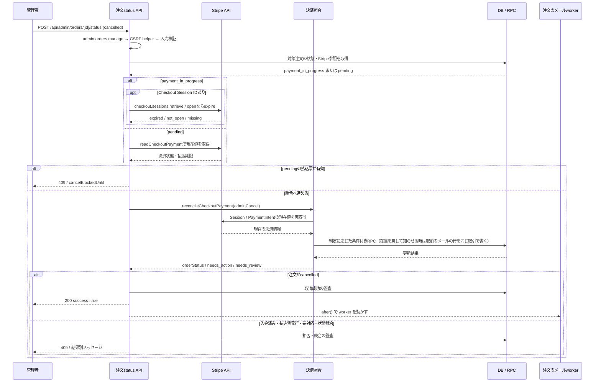

### 例外と永続化

| 条件 | 結果・保存内容 |
| --- | --- |
| cancelled / paid / shipped / abandonedを先に取得 | cancelledは再度200。shipped・abandonedは409で拒否し、通常取消のStripe確認へ進まない。paidは支払い済みのキャンセル（SQ-ADMIN-06。グループ E-2）へ回す |
| failedを取得 | `admin_cancel_failed_order`へ分岐。actor・理由・必要なメモを保存してfailed→cancelled。追加在庫解放と取消メールなし。更新0件は409 |
| 有効な払込票 | pendingの事前読取りがawaiting_paymentなら409。時計が払込期限を過ぎたことだけで取り消さず、最後はStripeの状態を使う |
| Stripe確認中に入金・払込票発行 | 照合器がpaid/pendingへ合わせる場合がある。取消要求でも入金を優先し、APIは409を返す |
| 期限切れ・放棄とadminCancel | payment_in_progress/pendingを期待状態に、解放RPCがcancelledへ更新。purchase/cancel台帳の差から予約済み数量だけcancel台帳に戻す |
| 取消情報 | actor、reason、note、notifyCustomerを保存。otherなら空でないメモ、メモ500字以下。状態変更の履歴はorder_revisions |
| Stripe/DBの一時エラー / その他の例外 | 通常取消APIは503 / 500。成立済みのRPC更新まで一括で巻き戻す保証ではない |

照合器の条件付き更新0件は、Stripe・DBを読み直す契機であり取消成功ではない。最大3回で収束しない場合は一時エラー。根拠はstatus API、照合器、在庫解放RPC。

## SQ-ADMIN-02: 入金済み注文の出荷記録（仕上がり・発送ごと・取消）

目的は、入金済みの注文の発送を商品と数ごとに1回ずつ記録し、受注生産の品の仕上がりを記録し、どちらも取り消せるようにすること。事前条件は管理認可（`admin.orders.manage`）・CSRF helper・回数の制限・入力の検証。終了結果は、記録が成立した200、条件不成立の404・409・400、RPC失敗の500。

### 発送を記録する

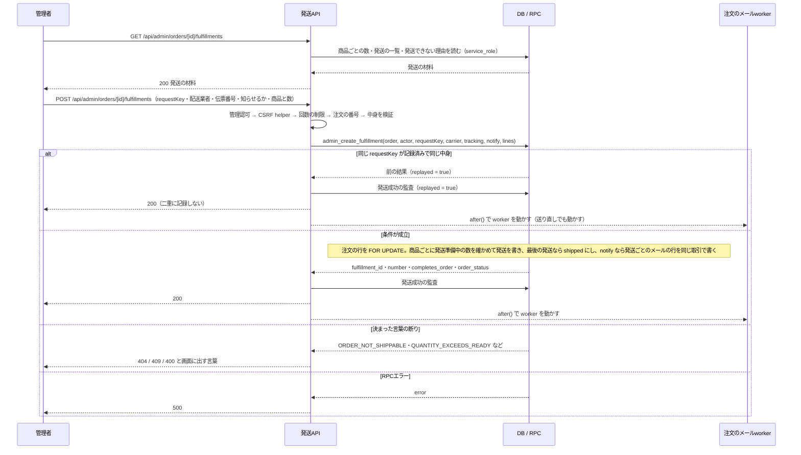

### 仕上がりと取消

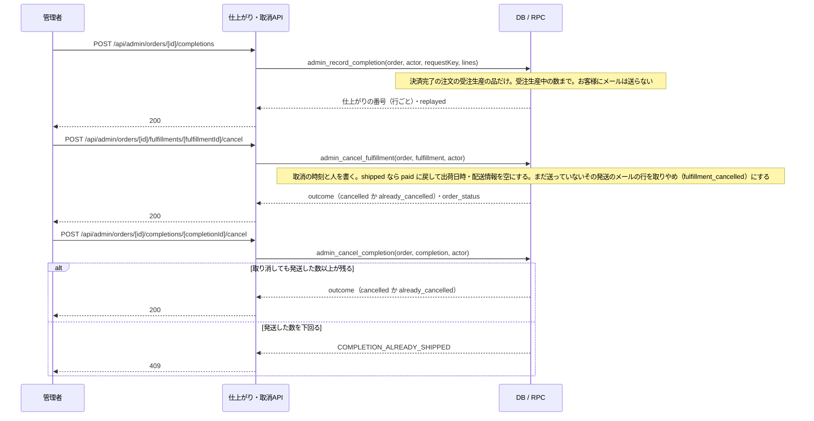

### 発送の条件と永続化

| 条件 | 結果・保存内容 |
| --- | --- |
| 発送できない状態 | 決済完了でない・未発送が無い: `ORDER_NOT_SHIPPABLE`（409）。配送先の必須項目が足りない: `SHIPPING_ADDRESS_INCOMPLETE`（409）。未解決の paid_amount_mismatch: `PAYMENT_REVIEW_REQUIRED`（409）。review_reason の未確認自体は拒否条件に含まれない |
| 数の超過 | 注文に無い商品: `LINE_NOT_IN_ORDER`、発送準備中の数を超える数: `QUANTITY_EXCEEDS_READY`（どちらも窓口は 409 で、画面の言葉は同じ）。受注生産中の品は、仕上がりを記録するまで送れない。関数の確かめに重ねて、`shipped ≤ completed ≤ quantity` を破る書き込みはトリガーが `FULFILLMENT_BOUNDS_VIOLATED`（23514）で止める（この言葉は窓口の言葉の表に無いので、窓口は 500） |
| 同時の操作 | 注文の行の鍵で1つずつ進む。後の方は前の発送の後の数で確かめ、超える分は上の断りになる（同じ品を同時に送ると2回目は記録されない） |
| 重複防止キー | 同じキーで同じ中身は前の結果（`replayed`）、違う中身は `FULFILLMENT_REQUEST_MISMATCH`（409）。答えが分からない時、画面は同じキーで確かめ直す |
| 保存 | 発送（番号は注文ごとの最大＋1。取り消した番号は使い回さない）・発送の商品。全部を送った時だけ、注文の shipped・出荷日時・配送業者・追跡番号。注文の改訂の理由は `admin_create_fulfillment`・`admin_cancel_fulfillment` |
| メール | `notifyCustomer` が真の時だけ、その発送の発送メールの行を同じ取引で書く。返事の後に worker が送る。失敗はやり直し、送れなければ店へ知らせる |

仕上がりの記録は決済完了の注文だけ（`ORDER_NOT_IN_PRODUCTION`）、受注生産の品だけ（`LINE_NOT_IN_PRODUCTION`）、受注生産中の数まで（`QUANTITY_EXCEEDS_IN_PRODUCTION`）。根拠は [移行 A](../../../supabase/migrations/20261010120303_order_fulfillments.sql)、[移行 B](../../../supabase/migrations/20261010122320_fulfillment_order_emails.sql)、[発送API](../../../src/app/api/admin/orders/%5Bid%5D/fulfillments/route.ts)、[worker](../../../src/lib/orders/email/order-email-worker.ts)。

## SQ-ADMIN-03: 管理画面の返金（記録を先に作り、Stripe に頼み、結果を書く）

目的は、商品と数・送料を選んだ返金を1件の記録にして Stripe に頼み、Stripe が受け付けた結果で、在庫・メールの予定・要対応・注文の返金済みの額と状態を1回の取引で書くこと。事前条件は管理認可（`admin.orders.refund`）→ CSRF helper → 回数の制限（送信元ごと・管理者ごと、10分に30回）→ 注文の番号の検証 → 本文の検証を通ること。終了結果は、受け付けた200、DB の断りの400・404・409、Stripe の断りの422、答えが分からない502、DB の失敗の500。考え方は [グループ E-2 設計書](../../superpowers/specs/2026-10-11-refund-and-cancel-design.md) の 3 章。

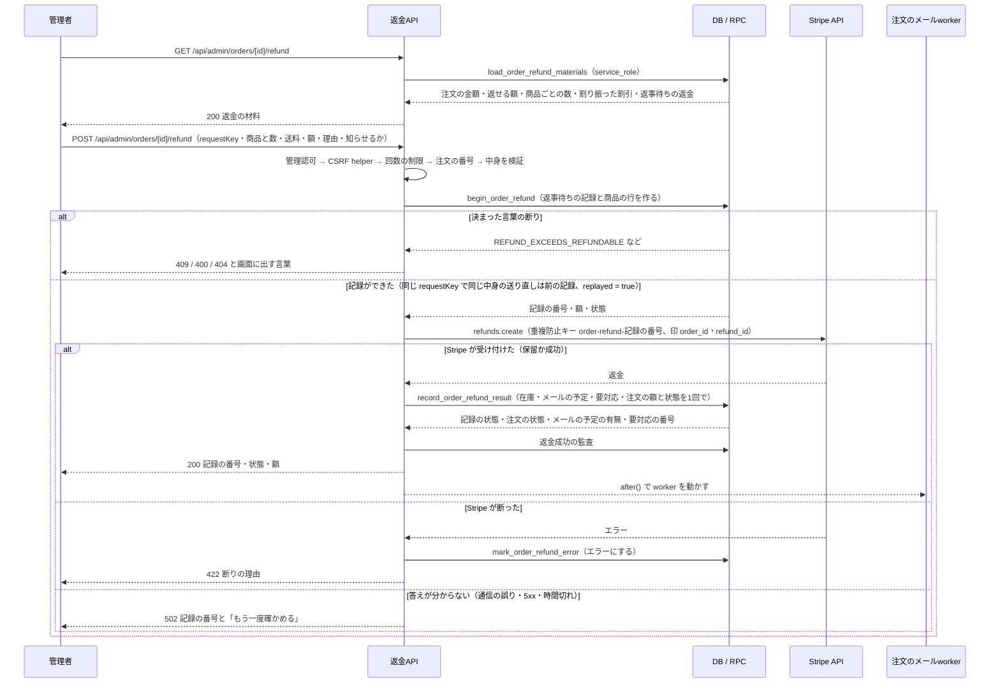

### 例外と永続化

| 条件 | 結果・保存内容 |
| --- | --- |
| 数と額の確かめ | 受け取った額（`orders.paid_amount`）から返事待ち・保留・成功の返金の合計を引いた額を超えると `REFUND_EXCEEDS_REFUNDABLE`（409）。送料は返せる送料まで（`REFUND_SHIPPING_EXCEEDS`）。発送前の返金は未発送の数まで（`REFUND_QUANTITY_EXCEEDS_UNSHIPPED`）、発送後の返金は発送後に返せる数まで（`REFUND_QUANTITY_EXCEEDS_SHIPPED`）。注文に無い商品は `REFUND_LINE_NOT_IN_ORDER` |
| 全額の決まり | 全額になるのに未発送の商品が全部入っていないと `REFUND_MUST_INCLUDE_UNSHIPPED`。1つも発送していない注文で残りの商品を全部返すのに、送料か返金額が全部でないと `REFUND_MUST_BE_FULL` |
| 同時の操作 | 注文の行の鍵で1つずつ進む。返金と発送を同時に押すと、後の方は前の結果の数で確かめられ、超える分は断られる（返金は `REFUND_QUANTITY_EXCEEDS_UNSHIPPED`、発送は `QUANTITY_EXCEEDS_READY`）。返事待ちの返金がある注文には別の返金を作れない（`AWAITING_REFUND_EXISTS`） |
| 二重防止 | 画面を開いた時に作る二重防止の番号。同じ番号で同じ中身は前の記録（`replayed`）、違う中身は `REFUND_REQUEST_MISMATCH`（409）。Stripe への重複防止キーは記録の番号から作る（`order-refund-{記録の番号}`）ので、同じ額の別の返金は別のキーになる（R-03）。送り直しで記録がもう保留・成功なら、Stripe を呼ばずに前の答え（`replayed: true`）を返し、エラー・失敗なら、Stripe を呼ばずに422を返す。返事待ちなら、下の「答えが分からない」の確かめ直しになる |
| Stripe が断った | 422。記録は「エラー」にする（返せる額に数えない）。同じ番号では二度目の頼みを受けないので、画面は直して新しい番号で送り直す |
| 答えが分からない | 502（記録は返事待ちのまま、記録の番号を返す）。画面は入力を止め、同じ番号で「もう一度確かめる」。作ってから23時間以内なら最初と同じ中身・同じ重複防止キーで頼み直し（支払いの種類が読めない時は Stripe を呼ばず、答えが分からない扱いにする）、超えていたら頼み直さず（Stripe は重複防止キーを24時間以上で消してよいため、時計のずれの余裕を置く）、Stripe の返金に付けた印（記録の番号）で探す。見つからなければ毎時の見回りがエラーにする。Stripe が重複防止キーの誤りと答えた時も、答えが分からない扱いにする（エラーにして返せる額を戻すと、二重の返金を許すため） |
| 保存（Stripe が受け付けた時） | 記録の状態（保留か成功）と Stripe の細目（口座の入力の期限・照会番号）。初めて保留か成功になった時の1回だけ、発送前・在庫の品の確保を外して台帳 `refund` で戻し（戻さない時は `refund` +n と `adjustment` −n の2行）、メールの予定を書く（残高不足の保留は成功した時）。注文の返金済みの額・返金日時・状態（[注文・決済の状態](../states/order-payment.md) の ST-ORDER-09・10・13・14） |
| 失敗した時 | 受け付けた返金が失敗になった時の1回だけ、確保を外した数を確保し直し、要対応「返金の失敗」を作って店へ知らせる。足りない数は返金の商品の行に残し、注文の要確認の理由が空か確認済みなら「在庫を確保できなかった注文」にして確認済みの印を外す（ほかの理由が開いている時は上書きしない）。お客様へは自動のメールを送らない |
| 権限 | 店長の役割（`admin.orders.refund`）だけ。サポートの人は断られる |
| 監査 | 返金の記録の番号・額・数・道・状態・実行した人だけ。お客様の名前・住所・メールとメモの本文は入れない。コンビニ払いの返金だけ、注文の連絡先のメールを Stripe の `instructions_email` に渡す（監査とログには入れない） |

根拠は [refund API](../../../src/app/api/admin/orders/%5Bid%5D/refund/route.ts)、[返金の流れ](../../../src/lib/orders/refund/refund-service.ts)、[Stripe への頼み方](../../../src/lib/orders/refund/refund-stripe.ts)、[E-2 移行 B](../../../supabase/migrations/20261011223147_order_refund_requests.sql)、[E-2 移行 C](../../../supabase/migrations/20261011223453_order_refund_results.sql)。同じ結果を書く関数は、支払い済みのキャンセル（SQ-ADMIN-06）、Stripe の返金の知らせの取り込み（SQ-ADMIN-07）、自動の返金（SQ-ADMIN-08）からも呼ばれる。

## SQ-ADMIN-04: 要対応記録を解決済みにする

目的は人による対応完了の記録。事前条件は管理認可、CSRF検証、UUID・本文検証を通り、cancelOrder=falseであること。終了結果は解決済みの200、不存在・既解決等の409、RPC失敗の500。Stripe操作、返金、注文取消は実行しない。

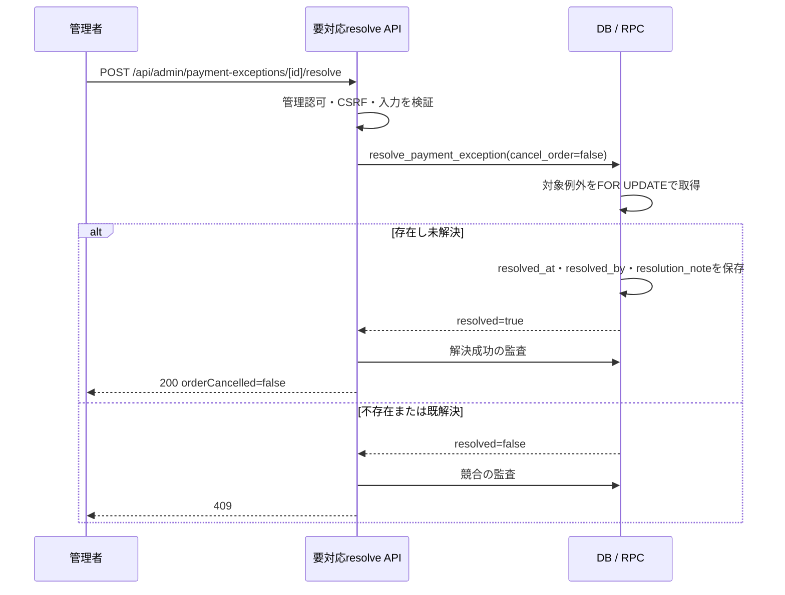

解決済みの再検出は検出回数・最終時刻を更新するが未解決には戻さない。メモは任意で最大500字。未解決paid_amount_mismatchを解決すると発送の関数（`admin_create_fulfillment`）のその拒否条件（`PAYMENT_REVIEW_REQUIRED`）がなくなるが、解決記録自体はStripeの金額訂正をしない。根拠は[resolve API](../../../src/app/api/admin/payment-exceptions/%5Bid%5D/resolve/route.ts)と[例外RPC](../../../supabase/migrations/20260927100500_payment_exceptions.sql)。

## SQ-ADMIN-05: 未入金注文を取り消して要対応を解決する

目的は、関連する未入金注文の取消と要対応の解決を同一DB処理で記録すること。事前条件は管理認可・CSRF検証・入力検証、cancelOrder=true、取消理由と空でないメモ。終了結果は取消と解決の200、Stripeが入金可能・状態競合等なら409、一時的な外部確認失敗は503。

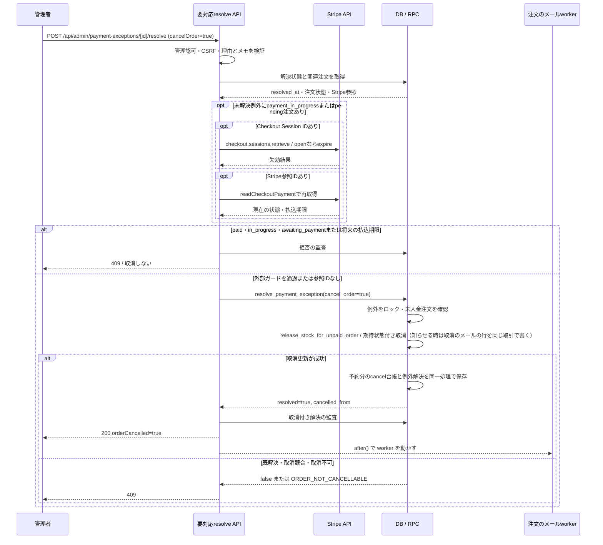

### 通常取消とのガード差と永続化

| 条件 | SQ-ADMIN-01 通常取消 | SQ-ADMIN-05 取消付き解決 |
| --- | --- | --- |
| 外部確認の対象 | payment_in_progressはSession失効後に照合。pendingは事前Stripe読取り後に照合 | 未解決例外の関連注文がpayment_in_progress/pendingなら、状態を問わずSession失効を先に試みて再読取り |
| 外部参照なし | 照合器の必須参照に達しなければ例外応答 | Stripe確認を省略し、DB RPCへ進める |
| 想定外・missing・0円完了等 | 注文ありなら照合器が要対応を記録し、取消APIは409となる場合がある | paid/in_progress/awaiting_paymentや将来の払込期限でなければ、DBの未入金条件に従い取消を試みる |
| 判断と更新主体 | Stripe現在値を照合器で分類して、必要な注文RPCを呼ぶ | APIの外部ガード後、resolve RPCがrelease RPCを呼び、取消成功時だけ例外を解決 |
| メモ | otherの場合に必須 | 取消理由にかかわらず必須 |
| 不存在・既解決・未入金以外 | 注文status APIの分岐と照合による | RPCが拒否。解決済み等の事前読取りではStripe操作を省略する |

APIが外部確認に失敗すればRPCへ進まない。DB側では例外行をロックし、関連注文がpayment_in_progress/pendingであることを確認する。在庫解放の条件付き更新0件なら例外を解決せずfalse。外部Stripe確認とDB更新は同一トランザクションには含まれない。根拠はresolve APIのcheckStripeBeforeCancel・refuseIfStripeMayTakeMoneyと、[resolve RPC](../../../supabase/migrations/20260927100500_payment_exceptions.sql)。

## SQ-ADMIN-06: 支払い済みの注文のキャンセル

目的は、支払い済みで1つも発送していない注文を、残りの商品全部と、送料（返せる送料と返せる額の小さい方）を返金してキャンセルすること。事前条件は管理認可（`admin.orders.manage`）→ CSRF helper → 注文を読んで `paid` と分かってから `admin.orders.refund` → 回数の制限（10分に30回）→ 本文の検証。未入金・失敗の注文の取消は SQ-ADMIN-01 のまま（サポートの人もできる）。終了結果は返金と同じ（200・400・404・409・422・502・500）。

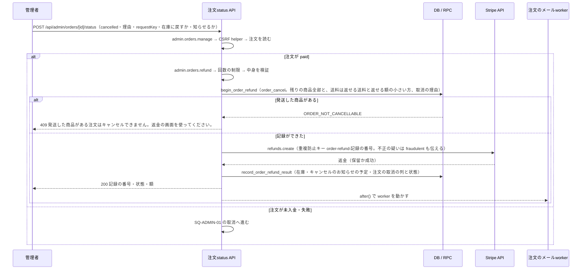

| 条件 | 結果・保存内容 |
| --- | --- |
| 中でやること | 残りの商品全部と、送料（返せる送料と返せる額の小さい方）を、`order_cancel` の返金1件で返す（前に一部を返金していれば、その残り。額は返せる額の全部）。商品の行は全部「発送前」で、在庫の品は「在庫に戻す」の選択で `cancel`（戻す）か `no_restock`（戻さない）、受注生産の品は `no_restock` |
| 注文の状態 | 返金が成功した時に `cancelled` にする（ST-ORDER-09。取消の理由・メモ・知らせるかを注文の取消の列に写す）。コンビニ払いで口座の入力を待つ間（保留）は `paid` のまま、進み具合を「キャンセルの手続き中」と出す |
| メール | 「お客様にキャンセルのお知らせを送る」が入っている時だけ、キャンセルのお知らせ（種類 `canceled`・書き分け `paid`）を返金ごとに1通。返金のお知らせは別に送らない。残高不足の保留は成功するまで待つ |
| 取消し直し | 取り消した後に返金が失敗して支払い済みに戻り、もう一度取り消すと2通目も届く（メールの行が返金ごとのため） |
| 理由「不正の疑い」 | Stripe にも不正の疑い（`fraudulent`）と伝える。お客様への文には理由を書かない（在庫切れとお客様の依頼の時だけ書く） |
| 権限 | 店長だけ（`admin.orders.manage` と `admin.orders.refund` の両方）。サポートの人は材料の読み込みで断られる |
| 同時の操作・答えが分からない時 | 注文の行の鍵で、返金・発送と1つずつ進む。二重防止の番号は画面を開いた時に作り、答えが分からない時は502（記録は返事待ちのまま）を返して、画面が同じ番号で「もう一度確かめる」（SQ-ADMIN-03 の表の「二重防止」「答えが分からない」） |
| 取消になった後の送り直し | カード・PayPay の返金は Stripe がその場で成功を返し、1回目の中で注文が `cancelled` になる。通信が切れて同じ二重防止の番号で送り直された時は、注文がもう `cancelled` でも、本文に null でない `requestKey` があれば支払い済みのキャンセルとして確かめ（返金の権限を確かめ、回数を数える）、DB が前の記録を返して `replayed: true` の答え（200）になる。この時、本文が不正なら（`requestKey` が UUID でない・`restock` が真偽値でない）、取消済みの200では返さず 400 `invalid_request` で断る。開いたままの別の画面から新しい番号で送った時は、DB が `ORDER_NOT_CANCELLABLE` で断る（409）。`requestKey` の無い（または null の）送り直し（未入金の取消）は今のまま |

根拠は [status API](../../../src/app/api/admin/orders/%5Bid%5D/status/route.ts)、[返金の流れ](../../../src/lib/orders/refund/refund-service.ts)、[E-2 移行 B](../../../supabase/migrations/20261011223147_order_refund_requests.sql)、[E-2 移行 C](../../../supabase/migrations/20261011223453_order_refund_results.sql)。

## SQ-ADMIN-07: Stripe の返金の取り込みと見回り

目的は、Stripe の画面で直接返した返金や、こちらの記録に結果を書く前に落ちた返金を、Stripe の今の返金の一覧から返金の記録に合わせること。知らせは合図にだけ使う（R-06）。事前条件は Stripe の署名（W）か、Cron の合言葉（J）。終了結果は、取り込みの完了、またはそろわずに失敗にして待ち行列のやり直しに任せること。

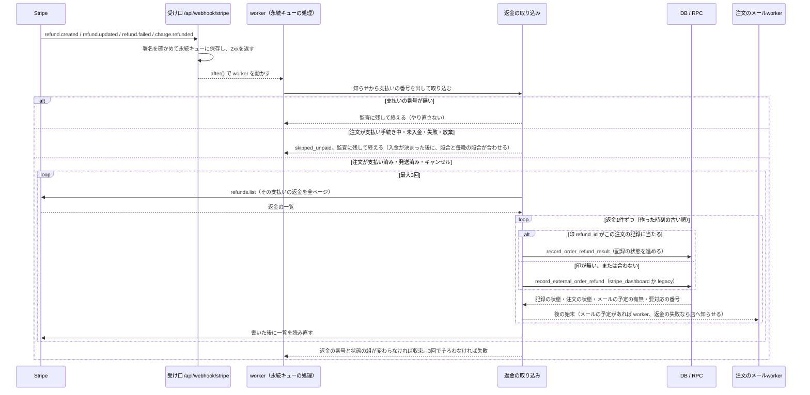

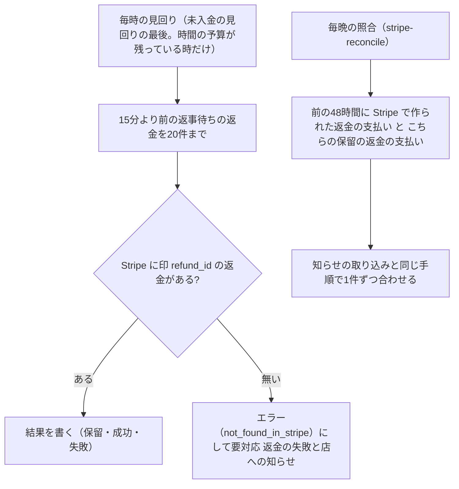

| 条件 | 結果・保存内容 |
| --- | --- |
| 支払いの番号が無い返金 | 取り込まない。監査 `checkout.webhook.refund_without_payment_intent` に残して終える（やり直さない。R-06）。会計の同期も飛ばす |
| 注文が無い | 今のとおり、監査に残し、失敗・取消の返金なら要対応にして店へ知らせる（注文が後から作られた時は、照合と毎晩の照合が合わせる） |
| 注文が支払い手続き中・未入金・失敗・放棄 | `skipped_unpaid`。監査 `checkout.webhook.refund_on_unpaid_order` に残して終える（やり直さない。R-06）。入金が決まった後に、照合と毎晩の照合が合わせる |
| 印 `refund_id` がこの注文の記録に当たる | その記録に Stripe の返金の番号と状態を書く（`record_order_refund_result`）。許さない移り方の知らせ（成功の後の保留など）は何もせず、今の値を返す。エラーにした記録に当たって、Stripe の返金が保留・成功になった時は、エラーの時の要対応「返金の失敗」（支払いの印は返金の記録の番号）が開いていればシステムが閉じる（ただし、その返金の発送前の行の商品が全部 s + rb ≤ q を保っている時だけ。エラーの間にその品を発送して崩れていれば、お客様に品と返金の両方が届くので、要対応を開いたまま残す）。受け付けずに失敗になった時は、同じ印（返金の記録の番号）で失敗の後始末の要対応を記録するので、エラーの時の要対応と同じ1行になり、店への知らせも1通になる。保留・成功を通った後に失敗になった時は、Stripe の返金の番号の印で新しい要対応を作り、店へ知らせる |
| 印が無い、または当たらない | 外からの返金として記録する（`record_external_order_refund`）。Stripe が返金を作った時刻が切り替えの時刻より前なら「前からの写し」（在庫もメールも動かさない）、後なら「Stripe の画面からの返金」。この返金で受け取った額に届く時は、未発送の商品を全部その返金の発送前の行に入れて在庫に戻し（送料は、行の有無に依らず返せる送料の全部。ただしその返金の額を超えない）、お客様に返金のお知らせを送る。印 `refund_id` があるのにこの注文の記録に当たらない時（uuid の形でない・別の注文の記録を指す・記録が無い）は、記録を作った時の1回だけ、監査 `stripe.refund.marker_unmatched` を残す（Stripe の返金の番号と印だけ。個人情報は入れない） |
| 書いた後の確かめ | Stripe の一覧を読み直し、返金の番号と状態の組が変わっていれば最大3回まで繰り返す。そろわなければ失敗にして、永続キューのやり直し（最大9回。その後は退避と店への知らせ。グループ B）に任せる |
| 後の始末 | メールの予定があれば worker を動かし、返金の失敗の要対応があれば店へ知らせる。始末が失敗しても取り込みは失敗にしない（記録はもう書けている。メールは worker が、店への知らせは毎時の見回りが送り直す） |
| 毎時の見回り | 未入金の見回り（`POST /api/cron/expire-pending-orders`）の最後に、時間の予算が残っている時だけ、15分より前から返事待ちの返金を20件まで、Stripe の印で探す。見つかれば結果を書き、無ければ「エラー」（`not_found_in_stripe`）にして要対応「返金の失敗」を作り、店へ知らせる（返金の結果の行が無いので、エラーにする関数が返した要対応の番号で直に送る）。支払いの番号が無い注文の記録も、同じ理由でエラーにする。エラーにした時は、その返金が数えていた発送前の行を数えなくなるので、未発送が戻る注文は発送済みから支払い済みに戻る（在庫・メール・失敗の後始末は動かさない） |
| 毎晩の照合 | `POST /api/cron/stripe-reconcile` で、前の48時間に Stripe で作られた返金の支払いと、こちらの保留の返金の支払いを集め、知らせの取り込みと同じ手順で1件ずつ合わせる。時間の予算に届いたら残りを次の夜に回す。作られてから48時間より後に成功から失敗に変わり、知らせも届かない返金は拾えない（Stripe は知らせを3日間送り直す）。成功した返金の合計を全部の支払いで比べる同期はやめた。会計の `stripe_refunds` への写しは今のまま続ける |
| 定期処理の登録 | 毎分・毎時・毎晩の3本は本番に未登録の間は動かない（開店前の設定。[全体の決定](../../superpowers/specs/2026-10-10-group-e-overview-design.md) の 8章）。登録するまで、見回りと照合は取りこぼしを拾わない |

根拠は [返金の取り込み](../../../src/lib/stripe/order-refund-sync.ts)、[Webhook の処理](../../../src/lib/stripe/webhook-processor.ts)、[毎時の見回り](../../../src/lib/orders/refund/refund-sweep.ts)、[毎晩の照合](../../../src/lib/stripe/reconcile-orders.ts)、[E-2 移行 C](../../../supabase/migrations/20261011223453_order_refund_results.sql)。キューと worker の仕組みは [Webhook のシーケンス](stripe-webhooks.md) を参照する。

## SQ-ADMIN-08: 自動の返金（取り消した注文への入金・支払額の違い）

目的は、決済の照合が見つけた2つの要対応のうち、取り消した注文への入金（①）と支払額の違い（②）を、ショップの設定がオンの時に自動で全額返金すること。事前条件は、照合がその要対応を初めて記録したこと（`is_new`。切り替えの前から記録のある要対応は初めてではないので効かない）。終了結果は、返金を受け付け、店への知らせを送れた後に要対応を自動で閉じる、または返金できない・知らせを送れない時に要対応を開いたまま残す。

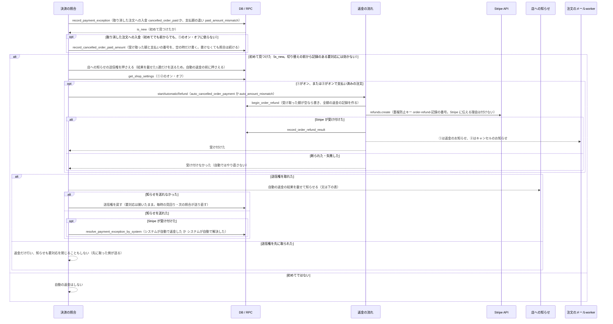

| 自動の返金 | 動き |
| --- | --- |
| ① 取り消した注文への入金（既定オン） | 照合が要対応を記録するたびに（初めてでも前からでも、設定のオン・オフに依らず、自動の返金より先に）、受け取った額と支払いの番号を注文に書く（`record_cancelled_order_paid_amount`。取り消した注文で受け取った額が空の時だけ。書けなくても照合は続ける）。初めて記録した時で設定がオンなら、全額の返金を `auto_cancelled_order_payment` で作る（商品の行は無い。Stripe に伝える理由は付けない）。Stripe が受け付けたら、お客様に返金のお知らせ（このご注文はお支払いの前に取り消し済みである旨の文を入れる）を送り、店へ「自動で全額を返金しました。対応は要りません。」と知らせ、知らせを送れた後に要対応を「システムが自動で返金した」と記録して閉じる。断られた・失敗した時は、自動ではやり直さず、要対応を開いたまま店へ「自動の返金ができませんでした。管理画面の注文から返金してください。」と知らせる。設定がオフの時は「管理画面の注文から返金してください。」 |
| ② 支払額の違い（既定オフ） | 設定がオンで、注文が支払い済みで1つも発送していなければ、支払い済みの注文のキャンセルを `auto_amount_mismatch` で行う（残りの商品全部と、送料は返せる送料と返せる額の小さい方を返す。理由は「その他」、メモ「支払額の違いの自動の取消」、在庫に戻す、お客様に知らせる。Stripe に伝える理由は付けない）。Stripe が受け付けたら、店へ「自動で全額を返金し、注文を取り消しました。」と知らせ、知らせを送れた後に要対応を「システムが自動で解決した」と記録して閉じる。オフか取り消せなかった時は、店へ「管理画面で差額を返金するか、注文をキャンセルしてください。解決済みにするまで発送できません。」と知らせる |

自動の返金の共通の決まり（①②とも）:

- どちらも、照合が要対応を初めて記録した時だけ動き、失敗しても次の照合では動かし直さない（①の受け取った額の書き込みだけは、記録のたびに行う）
- 店への知らせの送信権は自動の返金の前に押さえ、同じ支払いの照合が同時に走っても、結果を載せた1通だけを送る
- 要対応を閉じるのは照合で、`resolve_payment_exception_by_system`（解決した人は空）を使い、店への知らせを送れた後に閉じる。閉じた要対応は、毎時の見回りの送り直しにも次の照合にも拾われないので、先に閉じて知らせを送れないと、店は返金（②は注文の取消）を知る手段を失う
- 知らせを送れなければ、送信権を戻して要対応を開いたまま残し、毎時の見回り・次の照合が送り直す。その時の文は自動の返金が無い時の文になるが、返金は済んでいて返せる額が0なので、管理画面に「返金」は出ず、二重の返金にはならない
- 送信権を先に取られた照合は、返金だけ行い、知らせも要対応を閉じることもしない（先に取った側の送信が失敗した時に送り直せるよう、開いたままにする）
- 自動の返金の部品が誤りを投げた時は、送信権を戻してから投げ直す（再試行の照合は、結果の無い知らせを送る）
- 自動の返金の記録と要対応は、注文と支払いで結び付く。設定は店長だけが変える（`admin.settings.manage`）

根拠は [決済照合器](../../../src/lib/stripe/checkout-payment-reconciler.ts)、[返金の流れ](../../../src/lib/orders/refund/refund-service.ts)、[店への知らせの文](../../../src/lib/orders/order-lifecycle-emails.ts)、[設定API](../../../src/app/api/admin/settings/shop/route.ts)、[E-2 移行 C](../../../supabase/migrations/20261011223453_order_refund_results.sql)。

## SQ-ADMIN-09: 返品を作る（お店が作る返品）

目的は、発送済みの品の返品（返す品・数・理由・解決（返金か、同じ商品の色・サイズの交換）・返送のしかた・手数料）をお店が記録すること。お客様の申し込みは段2で、段1の返品はお店が作り、作った時から受付中になる。事前条件は管理認可（`admin.orders.return`）→ CSRF helper → 回数の制限（送信元ごと・管理者ごと、10分に30回）→ 注文の番号の検証 → 本文の検証を通ること。終了結果は、作れた200、DB の断りの400・404・409、思いがけない失敗の500。考え方は [グループ E-3 設計書](../../superpowers/specs/2026-10-12-returns-design.md) の 5 章（お店が作る返品）。

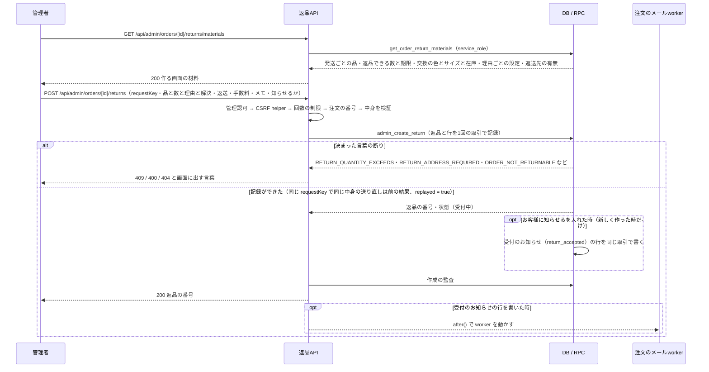

### 例外と永続化

| 条件 | 結果・保存内容 |
| --- | --- |
| 数の確かめ | 返す数は、発送の行ごとの返品できる数まで（`RETURN_QUANTITY_EXCEEDS`）。注文の商品ごとの返品できる数（[注文・決済の状態](../states/order-payment.md) の「返品の記録と状態」）も同時に確かめる。取消・お断りの返品の数は数えない |
| 注文の状態 | 支払い済み・発送済み以外（取り消した注文を含む）は `ORDER_NOT_RETURNABLE` |
| 返送先 | ショップの設定の返送先（名前・郵便番号・住所・電話番号）が空だと `RETURN_ADDRESS_REQUIRED`。返送不要の返品も止める |
| 受付の期限 | 期限を過ぎた発送の品も作れる。画面に警告を出すだけ（段1はお店が作るため） |
| 交換と理由 | 交換の色・サイズは同じ商品の物だけ（`RETURN_EXCHANGE_VARIANT_INVALID`）。理由が「その他」の時は理由のメモが要る（`RETURN_REASON_NOTE_REQUIRED`）。手数料の入力は0以上の整数で、円の欄は1,000,000円まで、返品の手数料の割合は0〜100まで（`RETURN_FEE_INVALID`） |
| 二重防止 | 画面を開いた時に作る番号と、入力の指紋。違う中身は `RETURN_REQUEST_MISMATCH`（409） |
| 番号 | 返品の番号は、注文の行の鍵の中で「その注文の返品の数 + 1」にする（取消の返品も数える。表示は `{注文番号}-R{n}`） |
| 権限 | `admin.orders.return`（店長とサポート） |
| 保存 | 返品の記録（`order_returns`）と行（`order_return_lines`）。「お客様に知らせる」を入れた時だけ、受付のお知らせ（種類 `return_accepted`）の行を同じ取引で書く。在庫・注文の状態・返金は動かさない |
| 監査 | 返品の番号・数・状態・実行した人だけ（`admin.orders.return.create`）。宛先・氏名・住所・メッセージとメモの本文は入れない |

受け取りの前後の小さな操作は、どれも CSRF helper と回数の制限（10分に60回）を通り、お客様にメールを送らない。

| 操作 | 窓口 | 権限 | 起きること |
| --- | --- | --- | --- |
| 取消 | `POST …/returns/[returnId]/cancel` | `admin.orders.return` | 何も受け取る前の受付中だけ。取消にし、品はまた返品できる。処理した数が1点でもある返品は `RETURN_STATE_CONFLICT`（「届かない」で終えて開き直し、まだ何も受け取っていない返品は取り消せる） |
| 届かないで終える | `…/close-missing` | `admin.orders.return` | 残りを `missing` の受け取りの行にして返品を終える（届かない品は返金も交換もしない）。二重防止の番号つき |
| 開き直し | `…/reopen` | `admin.orders.return` | 完了した返品の「届かない」の品を、また受け取れるようにする（`missing_reopened`）。受け取り済みの品は変わらない。開き直しの後は、同じ注文のほかの受付中の返品を番号の順に `private.refresh_order_return_status` で確かめ直す（未処理の数が戻って上限が下がり、返金待ちが覆われた返品を受付中のまま残さないため。注文の鍵の下で行い、完了の返品は受付中に戻さない）。閉じた後にその品をふつうの返金で返していた時は、受け取っても返金待ちにならない（開き直して受け取った返金の品は、ふつうの返金の当て先として先に数えるため）。二重防止の番号つき |
| 検品を終える | `…/inspect` | `admin.orders.return` | 検品待ちの品を、戻す・戻さないに決める（一部でもよい）。戻す分だけ台帳 `return` の +n。二重防止の番号つき |
| 手数料の受け取りの記録 | `…/fee-payment` | `admin.orders.return` と `admin.orders.refund` | 手数料の受け取りを記録するか、`waive: true` で「いただかないで終える」。どちらも、その時の手数料の額を決着した額（`fee_settled_amount`）に移して `fee_due_amount` を0に戻し、お支払い待ちを終え、ほかに待ち物が無ければ返品が完了する |
| 支払いを待たずに送る | `…/release-exchange` | `admin.orders.return` と `admin.orders.refund` | 手数料をお支払い待ちのまま、交換の品を送れるようにする。返品は完了しない |

根拠は [返品の一覧と作る API](../../../src/app/api/admin/orders/%5Bid%5D/returns/route.ts)、[返品の流れ](../../../src/lib/orders/returns/return-service.ts)、[E-3 移行 A](../../../supabase/migrations/20261012100000_order_return_records.sql)、[E-3 移行 B](../../../supabase/migrations/20261012100100_order_return_actions.sql)。

## SQ-ADMIN-10: 返品の受け取り（品ごとの扱い・今返金・相談・交換・お返し）

目的は、届いた品を1点ずつ「在庫に戻す・戻さない・検品待ち・お返し」に決めて記録し、返金（今・額を相談してから）・交換の品の追加・お客様へのお知らせを、1回の取引で書くこと。返金は E-2 と同じ「記録を先に作り、Stripe に頼み、結果を書く」に乗る。事前条件は管理認可（`admin.orders.return`。今返金・額の指定・送料・交換の選び直しは `admin.orders.refund` も）→ CSRF helper → 回数の制限（送信元ごと・管理者ごと、10分に30回）→ 返品の番号の検証 → 本文の検証を通ること。終了結果は、受け取れた200、DB の断りの400・403・404・409、Stripe の断りの422、答えが分からない502、思いがけない失敗の500。考え方は [グループ E-3 設計書](../../superpowers/specs/2026-10-12-returns-design.md) の 6 章。

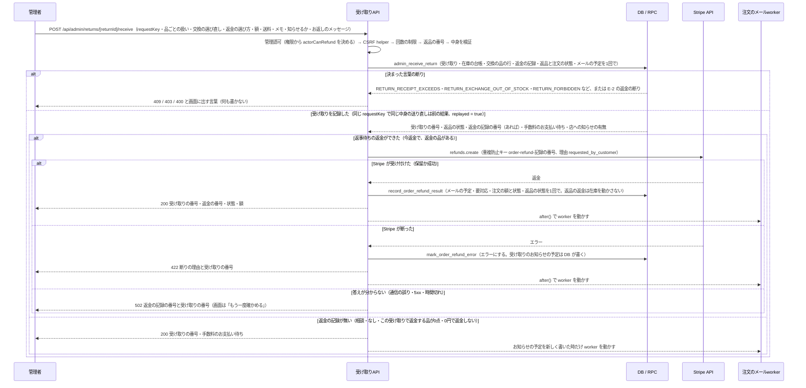

### 例外と永続化

| 条件 | 結果・保存内容 |
| --- | --- |
| 品ごとの扱い | 返品の行ごとに、届いた数を「在庫に戻す（`restocked`）・戻さない（`not_restocked`）・検品待ち（`pending_inspection`。設定で要検品を使う時だけ）・お返し（`sent_back`）」に分ける。残りの数を超えると `RETURN_RECEIPT_EXCEEDS`。一部だけ届いた時は受付中のまま残り、次は残りだけ受け取る。受け取りは取り消せない |
| 在庫 | 在庫に戻した分は台帳 `return` の +n（`stock_movements.return_id` に返品を残す）。受注生産で売った品も、戻すを選べばその色・サイズの在庫に足す。戻さない・お返し・届かないは動かさない。在庫から送る交換は台帳 `exchange` の −n で確保する |
| 返金の選び方 | `now`（今返金。店長だけで、サポートは `RETURN_FORBIDDEN`）・`consult`（額を相談してから。返金待ちに残す）・`none`（返金の品が無い受け取り。返金の品を含むと `RETURN_ARGUMENT_INVALID`）。サポートの受け取りは相談かなしだけで、返金待ちが残る返品は「返金待ち」になる。この受け取りで返金する品が0点（覆われた品だけ・交換だけ・お返しだけ）なら、選び方が今返金・相談でも、受け取りの記録の `refund_choice` は `none` で残す（入力の指紋は入力のまま作るので、同じ入力の送り直しは前の結果を返す。監査の記録は入力の値を書く） |
| 返金額 | 商品の額（E-2 の割り振り）− 手数料（最低0円）+ 送料の返金。店長は返せる額まで直せ、計算との差を `adjustment_amount` に残す（`RETURN_REFUND_AMOUNT_INVALID`）。0円になる時は返金の記録を作らず Stripe にも頼まず、`refund_waived` の受け取りの行で残す（答えは返金の番号なし・状態 `waived`）。お客様に返金のお知らせは出さず、受け取りのお知らせにその旨の一文を入れる。返金する数は数え方の本体で「この受け取りで返金待ちが増える数」として出し、0点の受け取りは、今返金でも返金の記録を作らず（返金の番号・額・状態は空。`waived` ではない）、受け取りだけを記録する。相談でも0点なら手数料の差し引き待ちを足さず、サポートでも店への知らせは予定しない。画面の見込みは覆いを見ないので、この場面では返金ありの見込みが出るが、記録は DB が正（受け入れた食い違い） |
| 交換の品 | 受け取った交換の数だけ、値段0の交換の品の行を足す。在庫が足りない時は、理由の設定「在庫の無い交換」で、作って送る（自動）、店長の選択（`exchangeOverrides`。作って送る・返金に変える）、または `RETURN_EXCHANGE_OUT_OF_STOCK`。同時に別のお客様が最後の1点を買っても、鍵の順番（注文 → 返品 → 返金 → 在庫）で在庫は0より小さくならない。注文が `shipped` なら `paid` に戻る（[注文・決済の状態](../states/order-payment.md) の ST-ORDER-15） |
| お返し | お客様へのメッセージ（必須。`RETURN_SENT_BACK_MESSAGE_REQUIRED`）・配送業者・伝票番号を受け取りの記録に残し、お知らせに必ず入れる。返金も交換もしない |
| メール | 返金のお知らせが出る受け取り（今返金を Stripe が受け付けた）は、返金のお知らせ（返品の書き分け。受け取りとお返しの文もここに入る）が1通。出ない受け取り（相談・なし・交換・返金が0円）は、受け取りの記録と同じ取引で「返品をお受け取りしました」（`return_received`）を予定し、全部をお返しする時は「品物をお返しします」（`return_sent_back`）を予定する。今返金が Stripe に受け付けられずエラーか失敗になった受け取りも返金のお知らせが出ないので、その結果を書く取引（`mark_order_refund_error`・`record_order_refund_result`）で、DB が「返品をお受け取りしました」を予定する（相談の時の一文つき）。サポートの受け取りで返金待ちが残る時は、店への知らせ（`return_refund_pending_shop`）も1通予定する。どれも受け取りごとに1行（一意の索引）で、送り直しても2通にならない。「お客様に知らせる」を外すとお客様向けのメールは書かない（お返しを含む時は、メッセージを伝えるために外せない）。相談の一文は、受け取りの記録の選び方が相談の時と、今返金が Stripe に受け付けられずエラーか失敗になった時に入り、返金する品が0点の受け取り（記録が `none`）には入らない |
| 二重防止 | 同じ番号・同じ指紋は前の受け取りと返金の記録を返す（`replayed`）。違う中身は `RETURN_REQUEST_MISMATCH`。Stripe への重複防止キーは返金の記録の番号から作るので、通信が切れて押し直しても Stripe の返金は1件 |
| Stripe が断った・答えが分からない | E-2 の返金と同じ（SQ-ADMIN-03）。422 は返金の記録を「エラー」にし、502 は返事待ちのまま画面が「もう一度確かめる」。受け取りは記録済みなので、本文に受け取りの番号も付く。エラーになった返金で引いた手数料は、返品に戻す。受け取りは取り消さない |
| 保存（Stripe が受け付けた時） | SQ-ADMIN-03 と同じ。返品の返金は、結果を書く関数が返品の状態も確かめ直す。ふつうの返金（道が `return` 以外）の始め・結果・エラーの後も、その注文の受付中の返品の状態を確かめ直す（鍵の順は注文 → 返品 → 返金） |
| 権限 | `admin.orders.return`（店長とサポート）。今返金・額の指定・送料・交換の選び直しは `admin.orders.refund` も（店長だけ） |
| 監査 | 返品・受け取り・返金の番号・数・額・状態・実行した人だけ（`admin.orders.return.receive`）。宛先・氏名・住所・メッセージとメモの本文は入れない |

根拠は [受け取り API](../../../src/app/api/admin/returns/%5BreturnId%5D/receive/route.ts)、[返品の流れ](../../../src/lib/orders/returns/return-service.ts)、[Stripe への頼み方](../../../src/lib/orders/refund/refund-stripe.ts)、[E-3 移行 C](../../../supabase/migrations/20261012100200_order_return_receipts.sql)。

## SQ-ADMIN-11: 額を決めて返金する（相談の後・サポートの受け取りの後・返金が失敗した後）

目的は、返金待ちの品（相談で受け取った品、サポートが受け取った品、返金が失敗した品）を、店長が額を決めて返すこと。事前条件は管理認可（`admin.orders.return` と `admin.orders.refund`）→ CSRF helper → 回数の制限（送信元ごと・管理者ごと、10分に30回）→ 返品の番号の検証 → 本文の検証を通ること。終了結果は、受け付けた200、返金しないで終えた200（`waived`）、DB の断りの400・404・409、Stripe の断りの422、答えが分からない502、思いがけない失敗の500。考え方は [グループ E-3 設計書](../../superpowers/specs/2026-10-12-returns-design.md) の 6-3。

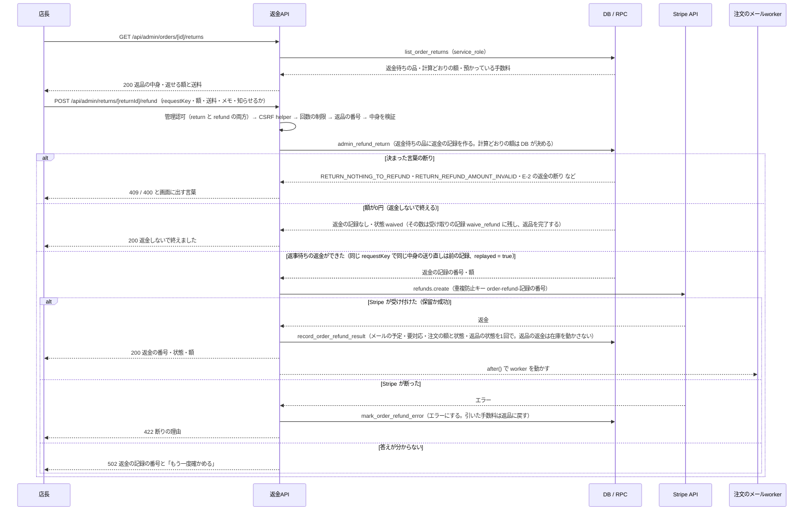

### 例外と永続化

| 条件 | 結果・保存内容 |
| --- | --- |
| 額 | 「計算どおり」（額を送らない）は、返金待ちの品の商品の額（E-2 の割り振り）から、相談で預かっていた手数料（`fee_pending_deduction`）を引いた額（最低0円）+ 送料。店長は返せる額（受け取った額 − 返事待ち・保留・成功の返金の合計）まで直せる（`RETURN_REFUND_AMOUNT_INVALID`）。額0は返金しないで終える |
| 返金待ちの品が無い | `RETURN_NOTHING_TO_REFUND`（画面を開き直す） |
| 返金しないで終える | 返金の記録を作らず、Stripe にも頼まない。その数を受け取りの記録（`kind = 'waive_refund'`、行は `refund_waived`）に残し、返品を確かめ直して完了する。お客様にメールは送らない（額を相談した中でお店が伝える）。権限は今返金と同じ（店長） |
| 失敗した後の返し直し | 新しい二重防止の番号で、新しい返金の記録を作り、新しい記録の番号の重複防止キーで頼む（断られた記録のキーは使い回さない）。道は `return` のまま。要対応の「返金の失敗」の「もう一度返金する」は、返品の返金の時は注文の返品の画面を開く（ふつうの返金の画面では返金待ちの品を選べないため） |
| メール | Stripe が受け付けた時の1回だけ、返金のお知らせ（返品の書き分け。「ご返品いただいた商品のご返金です」の一文つき）を1通予定する。返金しないで終える時は出さない |
| 返品の状態 | 返金の記録を作った時点で返金待ちが無くなれば、返品は完了する。返金が失敗しても完了は戻らず、覆いが外れて「返金待ち」に戻る |
| 二重防止・Stripe が断った・答えが分からない | SQ-ADMIN-03・SQ-ADMIN-10 と同じ |
| 権限・監査 | `admin.orders.return` と `admin.orders.refund`（店長だけ）。監査は `admin.orders.return.refund`（返金・返品の番号・額・数・状態・実行した人だけ） |

根拠は [額を決めて返金する API](../../../src/app/api/admin/returns/%5BreturnId%5D/refund/route.ts)、[返品の流れ](../../../src/lib/orders/returns/return-service.ts)、[E-3 移行 C](../../../supabase/migrations/20261012100200_order_return_receipts.sql)。

## 通知・履歴・要確認の別軸

| 項目 | 現行処理 |
| --- | --- |
| 取消・発送のメール | 取消・発送のメールは、状態を変える関数が同じ取引で送る予定の行を書き、worker が行の番号から作った重複防止キーで送る。失敗はやり直し、送れなければ店へ知らせる（FREQ-434・435）。発送のメールは発送ごとに1行で、取り消した発送のまだ送っていない行は取りやめになる（FREQ-442・443）。返金のお知らせは返金ごとに1行、支払い済みのキャンセルのお知らせ（種類 `canceled`・書き分け `paid`）も返金ごとに1行で、結果を書く関数が Stripe の受け付けた時（残高不足の保留は成功した時）に1回だけ書く（FREQ-455・456） |
| 返品のメール | 返品のメールの予定の種類は4つ。受付のお知らせ（`return_accepted`。返品ごとに1行）、返品をお受け取りしました（`return_received`）・品物をお返しします（`return_sent_back`）・店への知らせ（`return_refund_pending_shop`。送り先は環境変数 `SHOP_ALERT_EMAIL`）は、受け取りごとに1行。ほかに、返金のお知らせの書き分け `return`（受け取りと一緒の返金・額を決めて返した返金）と、発送のお知らせの交換の一文がある。どれも状態を書く関数が同じ取引で行を書き、worker が送る。返品の4種類は履歴からの再送の対象にならない（`RESEND_NOT_ALLOWED`）（グループ E-3。FREQ-469） |
| 発送の選択 | `notifyCustomer`（真偽、既定 true）が false なら、その発送のメールの行を書かない（FREQ-438。グループ E-1 から発送ごとに選ぶ） |
| 履歴 | RPCがactor・理由を設定し、order_revisionsに変更前後・変更列等を記録する。返金ではrefund_update、状態変更ではstatus_update等として記録。状態が変わらない一部の発送・仕上がりとそれらの取消は、発送の表・仕上がりの表から読んで同じ履歴に並べる（グループ E-1）。返金は返金の記録（`order_refunds`）から読んで同じ履歴に並べ、失敗の確保し直しも1行にする（グループ E-2。FREQ-459）。返品は返品の記録・受け取りの記録・手数料の記録から読んで同じ履歴に並べる（返品を作った・返品の受け取り（細目つき）・「届かない」として終えた・検品を終えた・取り消した・開き直した・交換の品を足した・手数料の受け取りを記録した・いただかないことにした・支払いを待たずに送れるようにした・返金しないで終えた。返金の行の「どこから」は「返品（番号）」。グループ E-3。FREQ-474） |
| 要確認 | [review API](../../../src/app/api/admin/orders/%5Bid%5D/review/route.ts)は管理認可・CSRF後にmark_order_reviewed。review_reasonあり・reviewed_atなしを条件にreviewed_at/byを保存し、reasonを消さない。要対応resolveとは別操作 |
| 返金の失敗 | 返金が失敗になった時、結果を書く関数が要対応（理由 `refund_failed`）を作り、アプリが店へ1通メールする（今の要対応の知らせと同じ。送る前に送信権を押さえる）。キャンセルのお知らせを送っていた注文が支払い済みに戻った時は、その旨をメールに書く。お客様へは自動のメールを送らない。管理画面の要対応で「もう一度返金する」か、別の方法で返したら「解決済みにする」（FREQ-457）。失敗した返金が返品の返金の時は、「もう一度返金する」が注文の返品の画面を開き、そこの「額を決めて返金する」で返し直す（グループ E-3。SQ-ADMIN-11） |
| API応答と外部副作用 | 先行RPCやStripeの成功後に後続処理が失敗する場合がある。応答コードだけから取消・返金・メールの全結果を判断しない |

根拠: [worker](../../../src/lib/orders/email/order-email-worker.ts)、[中身](../../../src/lib/orders/email/order-email-compose.ts)、[履歴トリガー](../../../supabase/migrations/20260925000218_add_order_state_transition_rpcs.sql)、[状態の履歴](../../../supabase/migrations/20261009095633_order_email_outbox.sql#L606)、[要確認RPC](../../../supabase/migrations/20260927100500_payment_exceptions.sql)。

## 関連テスト

| 観点 | 参照 |
| --- | --- |
| 発送・仕上がり・取消・競合 | [発送・仕上がりのDB](../../../tests/integration/db/order_fulfillments.integration.test.ts)、[発送ごとのメールのDB](../../../tests/integration/db/fulfillment_order_emails.integration.test.ts)、[E2E 部分発送](../../../e2e/FR-ADMIN-068-partial-fulfillment.spec.ts)、[E2E 発送の取消](../../../e2e/FR-ADMIN-072-fulfillment-cancel.spec.ts) |
| 通常取消・競合 | [在庫解放RPC](../../../tests/integration/db/release_stock_by_order.integration.test.ts) |
| 管理返金・確かめ直し・支払い済みのキャンセル | [refund API](../../../tests/unit/api/admin/order-refund-route.test.ts)、[返金を始めるDB](../../../tests/integration/db/order_refund_requests.integration.test.ts)、[E2E 返金の画面](../../../e2e/FR-ADMIN-074-refund-dialog.spec.ts)、[E2E 支払い済みのキャンセル](../../../e2e/FR-ADMIN-075-paid-order-cancel.spec.ts) |
| 結果の書き方・外からの返金・取り込みと見回り・自動の返金 | [返金の結果のDB](../../../tests/integration/db/order_refund_results.integration.test.ts)、[返金の取り込み](../../../tests/unit/lib/stripe/order-refund-sync.test.ts)、[E2E Stripe の画面からの返金](../../../e2e/FR-ADMIN-080-stripe-dashboard-refund.spec.ts)、[E2E 自動の返金①](../../../e2e/FR-CHECKOUT-051-auto-refund-cancelled-order.spec.ts) |
| 返品を作る・受け取る・額を決めて返金する | [返品の記録のDB](../../../tests/integration/db/order_return_records.integration.test.ts)、[返品の操作のDB](../../../tests/integration/db/order_return_actions.integration.test.ts)、[返品の受け取りのDB](../../../tests/integration/db/order_return_receipts.integration.test.ts)、[返品の窓口を通したDB](../../../tests/integration/db/return_postgrest.integration.test.ts)、[返品の流れ](../../../tests/unit/lib/orders/returns/return-service.test.ts)、[E2E 作る](../../../e2e/FR-ADMIN-084-return-create.spec.ts)、[E2E 受け取りと返金](../../../e2e/FR-ADMIN-085-return-receive-refund.spec.ts)、[E2E 相談と額を決めて返金](../../../e2e/FR-ADMIN-087-return-consult-refund.spec.ts)、[E2E 交換](../../../e2e/FR-ADMIN-088-return-exchange.spec.ts) |
| 解決・取消前のStripe確認・要確認 | [要対応API](../../../tests/unit/api/admin/order-attention-route.test.ts)、[例外RPC](../../../tests/integration/db/payment_exceptions.integration.test.ts) |
| 注文のメール | [中身](../../../tests/unit/lib/orders/email/order-email-compose.test.ts)、[worker](../../../tests/unit/lib/orders/email/order-email-worker.test.ts)、[送る予定の表](../../../tests/integration/db/order_email_outbox.integration.test.ts)、[行を書く関数](../../../tests/integration/db/order_email_enqueue.integration.test.ts)、[発送ごとのメール](../../../e2e/FR-ADMIN-071-fulfillment-shipping-email.spec.ts) |

関連テストは今回実行していない。DBや外部決済を操作した成功証跡ではない。

## 未確認事項

本番のRPC・トリガー・権限適用、実際の管理者ACL、Stripeの入金・返金結果、外部確認とDB更新の競合、メール到達は未確認。[pendingの状態強制](../../../supabase/pending/harden_order_state_transitions.sql)は実適用を確認せずに有効と断定しない。SQLコメントの計画と現行APIの呼出し経路を区別する。グループ E-2 の毎時の見回り・毎晩の照合は、定期処理が本番に登録されるまで動かず、Stripe の本番の受け口に返金の4つの知らせを入れたかも未確認（どちらも開店前の設定）。グループ E-3 の返品の移行 A〜C（`20261012100000`〜`20261012100200`）の名前は手元の版で、本番の適用状況は未確認（本番へは push の後に当てる）。受け取りで今返金する道の Stripe のテストの場での実際の返金は、管理者の権限の行が手元の DB に無いため、窓口を差し替える E2E では行わず、Stripe を差し替えた単体の試験と DB 結合の試験で確かめている。

最終照合のコード基準はmasterの`bbb18761`と、2026-10-04の作業ツリーにある決済・返金ライブラリの未コミット変更。取消・出荷のCSRF前段ガードと、返金同期の呼出し元・全額返金の扱いを静的に確認した。今回、コードの実行テストと本番反映は確認していない。
