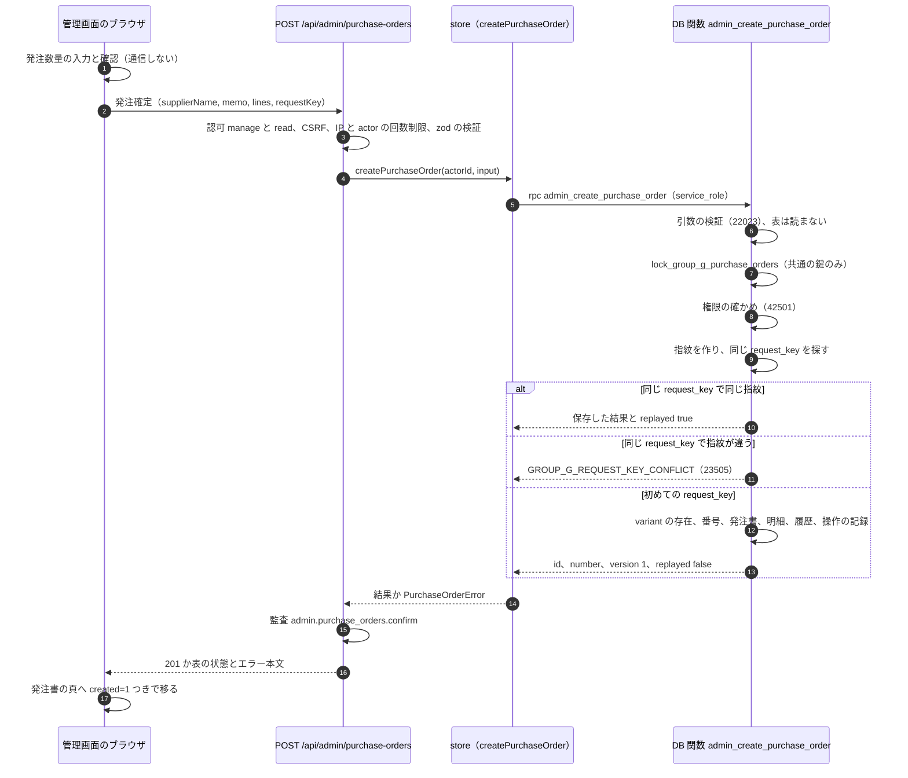
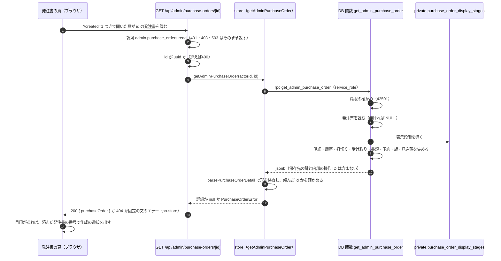
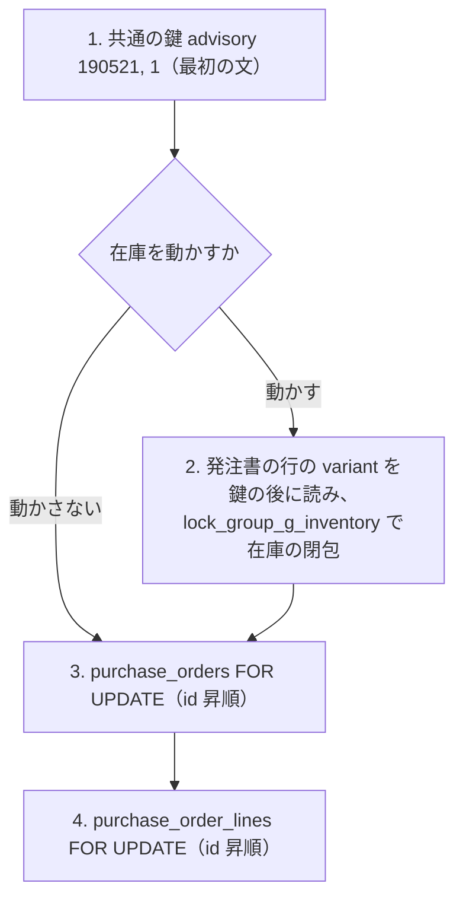

# 発注書の作成と読取の流れ（G-2）

> 状態: 現行のソース（グループ G-2 Task 4・5。発注の作成と、発注一覧表・発注書の詳細の読取。数量確定・受け取り・原本の添付は後続 Task が足す。本番へは未適用） | 確認日: 2026-10-25 | 対象: 在庫一覧表の「発注」から発注書を1件保存するまでの順序と、全ての発注書の書込みに共通のロックの順、発注一覧表と発注書の頁の読取の順序

## 概要

発注は 入力 → 確認 → 確定 の3段で行い、**通信するのは確定の1回だけ**。入力と確認は画面の中の段で、サーバーも DB も呼ばない。確定で `POST /api/admin/purchase-orders` が DB の関数 `admin_create_purchase_order` を1回呼び、発注書1件・明細N件・履歴・操作の記録を**同じ取引**で保存する。この Task は在庫・割当・台帳・注文を動かさない（数量が「仮」の発注書を作るだけで、在庫一覧表の「発注済み」にも数えない）。

| 項目 | 内容 |
| --- | --- |
| 入口 | `POST /api/admin/purchase-orders`（認可 `admin.purchase_orders.manage` ＋ `admin.purchase_orders.read` → CSRF → 回数制限 → 検証 → store → 監査 `admin.purchase_orders.confirm`） |
| 権限の確かめ | 窓口と DB の関数の両方（DB は実行者の有効な全役割の権限の和集合で、毎回確かめる） |
| 冪等 | 画面は同じ確認の再押下・通信の再送に同じ `requestKey` と本文を使う。DB は `(purchase_order_create, request_key)` と入力の指紋で、同じなら前の結果を `replayed: true` で返し、違えば断る |
| 番号 | `PO-` ＋ 日本時間の `YYYYMMDD` ＋ `-` ＋ 4桁の連番（その日の最大＋1）。別の日の番号は数えない |
| 共通のロック | 全ての発注書の書込みは `private.lock_group_g_purchase_orders` を引数の検証の直後に呼ぶ。最初の文が共通の鍵 `(190521, 1)` |

## 範囲と根拠

| 項目 | 内容 |
| --- | --- |
| 対応要件 | FREQ-526（発注の作成）、FREQ-540-AC-07（権限の組を窓口と DB の両方で確かめる）。[要件](../../02_Requirements/requirements.md) |
| 設計 | [グループ G 設計書](../../superpowers/specs/2026-10-23-group-g-design.md)、[G-2 実装計画](../../superpowers/plans/2026-10-24-group-g2-purchasing.md)の Task 4 と全体のロック順 |
| 実装 | 移行 `supabase/migrations/20261024180500_group_g2_purchasing_writers.sql`、[store](../../../src/lib/purchase-orders/purchase-order-store.ts)、[窓口](../../../src/app/api/admin/purchase-orders/route.ts)、[画面](../../../src/components/AdminInventorySection.tsx) |
| 関連 | 鍵の順の元は[在庫の割当と共通の鍵の流れ（G-1）](inventory-allocation.md)、保存する段階は[発注書の状態](../states/purchasing.md)、データは[ER 図](../../03_BasicDesign/data/er.md)の「発注書・受け取り・原本の添付」、API は[API 設計](../../03_BasicDesign/api/api-spec.md) |
| 調査時点 | 2026-10-25 のソース。本番の適用状況と実データでの競合は未確認（末尾） |

## 発注確定の順序

事前条件: 在庫一覧表を開いていて、「発注」で発注モードに入り、1行以上に 1〜99999 の整数の発注数量を入れ、「発注書確認」で確認の段に進み、発注先（必須・100字）とメモ（任意・500字）を入れている。納期の欄は無い。

| 順 | 内容 |
| --- | --- |
| 1 | 画面だけの段。入力は他の列の操作で消えない。確認は正の整数を入れた行だけを一覧する |
| 2〜3 | 窓口の順は変えない（認可 → CSRF → IP の回数制限 → actor の回数制限 → 検証）。回数制限は `admin.purchase_orders.create` の 30 回／600 秒。実行者は認可結果の `userId` だけから DB へ渡す |
| 4〜5 | store は引数名どおりに RPC を1回呼ぶ。DB の誤りは `message` と SQLSTATE が表と完全に一致した時だけ分類し、他は生の文を出さない500にする |
| 6〜8 | 引数の誤りは権限より先に断る。ロック helper は表の行を読む前に共通の鍵だけを取る（`_with_inventory` は偽。この Task は在庫を動かさない）。権限の確かめは再送の判定より先で、権限の無い人には再送の結果も見せない |
| 9〜13 | 初めての要求だけが、variant の存在、番号の採番、保存へ進む。再送と衝突は何も書かない |
| 14〜16 | 成功も失敗も監査に残す。metadata は件数・再送かどうか・結果コードだけで、発注先・メモ・要求番号は残さない |
| 17 | 入力を片付け、`/admin/purchase-orders/<id>?created=1` へ移る。通知「発注書 ○○ を作成しました。数量が確定するまで受け取りはできません。」は、移動で消えるこの画面ではなく、移動先の発注書の頁が `created=1` を見て出す（Task 5 で実装。下の「発注一覧表と発注書の頁の読取」、[16_admin](../pages/16_admin.md)） |

## DB の取引の中身

`admin_create_purchase_order` は1回の呼び出しが1つの取引で、次を全部書くか何も書かない。

| 書くもの | 内容 |
| --- | --- |
| `purchase_orders` 1件 | 番号・発注先・メモ（前後の空白を落とす。空白だけは NULL）・段階 `ordered`・版 1・作成者 |
| `purchase_order_lines` N件 | `line_no` は入力の並びの順（1から）。`provisional_quantity` は仮数量。商品名・色・サイズは作成時の写し。確定数量・単価は未設定 |
| `purchase_order_revisions` 1＋N件 | 種類 `order`・`revision_no` 1。発注書全体の1行（発注先とメモ）と、明細ごとの1行（仮数量） |
| `private.group_g_operations` 1件 | 操作 `purchase_order_create`・原因 `purchase_order`＝新しい id・指紋・結果。最後に書く（履歴の外部キーは遅延） |

書かないもの: 在庫（`stock_quantity`）・台帳・割当・状態の履歴・注文。明示して取るロックは共通の鍵と発注書の行（作成では空）だけで、variant や注文の行の鍵は明示して取らない（明細の外部キーの挿入が variant の行に暗黙の `FOR KEY SHARE` を取るが、共通の鍵を持つ書込みの間で待ち合いの輪にはならない）。

## 発注一覧表と発注書の頁の読取（Task 5）

読取は書込みと違い、**共通の鍵も行の鍵も取らない**。DB の読取の関数は STABLE で、呼び出しごとに1つの snapshot から読み、何も書かない。権限は窓口と DB の関数の両方が `admin.purchase_orders.read`（`manage` は要らない）で確かめ、DB は実行者（`_actor_id`）の有効な全役割の権限の和集合を毎回確かめる。表示段階は内部の helper 1か所が導く（[発注書の状態](../states/purchasing.md#表示段階の導き方実装)）。

| 順 | 内容 |
| --- | --- |
| 1〜3 | 認可が先で、id の検証はその後（権限の無い人に id の良し悪しを教えない）。一覧（`GET /api/admin/purchase-orders`）も同じで、`limit`（1〜100）・`page`（1〜100000）の範囲外は認可の後で400 |
| 4〜5 | store は引数名どおりに RPC を1回呼ぶ。権限の拒否（`GROUP_G_FORBIDDEN`／42501 の組が完全に一致した時だけ）は403、他の失敗（形の崩れ・通信の失敗・別の誤り）は生の文を持たない内部の失敗で、窓口は固定の500にする |
| 6〜9 | DB は権限の確かめを最初に行い、次に発注書を読む（無い発注書は NULL。窓口は404）。表示段階の helper を呼び、残りを同じ snapshot から集める |
| 10 | 戻りは決まった項目だけ。`storage_path` と操作の ID は含まず、`sha256` は含む |
| 11〜14 | 検査に通らない応答は成功にしない。画面は作成の通知を、読み込めた時だけ出す |

一覧は `list_admin_purchase_order_lines(limit, offset, actor)` が明細ごとの行を発注書番号の降順（バイト順）・明細番号順で返し、各行に全明細の数 `total` を持たせる（1回の読取で頁と合計を同じ snapshot から得る）。数量確定前の行の確定数量と未納は NULL。

## 共通のロックの順

発注書の書込みは全て `lock_group_g_purchase_orders(発注書の id の配列, 在庫を動かすか)` で鍵を取る。順は G-1 の末尾に足す。

| 規則 | 内容 |
| --- | --- |
| 鍵が先 | 対象の発見は鍵の後の読み取りだけ。呼び手は対象を後から足して前の段へ戻らない |
| 在庫を動かす書込み | 受け取りとその取消（Task 7）だけが `_with_inventory = true`。在庫の閉包を先に取り、発注書の行は最後 |
| 在庫を動かさない書込み | 作成・数量確定・打切り・添付は、鍵の直後に発注書の行を取る |
| 順番待ち | `SKIP LOCKED` は使わない。外部の I/O（Storage・メール）は取引の外 |

## 例外と永続化

| 結果 | 契機 | 保存 |
| --- | --- | --- |
| 400 | 入力の誤り（行0件・101行・variant 重複・数量の範囲外・発注先やメモの長さ・存在しない variant）。DB は `GROUP_G_ARGUMENT_INVALID`（22023） | 何も残さない |
| 403 | 権限の組が足りない（`items.*` だけ、manage だけ、read だけ、無効・期限切れの役割）。DB は `GROUP_G_FORBIDDEN`（42501） | 何も残さない |
| 409 | 同じ要求番号で内容が違う。DB は `GROUP_G_REQUEST_KEY_CONFLICT`（23505） | 何も残さない |
| 500 | 表に無い DB の誤り、戻り値の型の崩れ、通信の失敗、その日の番号が 9999 を超えた（`GROUP_G_PO_NUMBER_EXHAUSTED`） | 取引ごと戻る |
| 201 | 作成、または同じ要求の再送（`replayed` で区別） | 初回だけ書く |

通信が途中で切れた時は、画面が同じ `requestKey` と本文で送り直す。DB は届いていれば前の結果を返し、届いていなければ初めて作る。確定した応答（4xx）を受けた後は新しい要求として扱う。

## 関連テスト

| 層 | テスト |
| --- | --- |
| DB 結合 | [発注の作成](../../../tests/integration/db/group_g2_purchase_create.integration.test.ts)（保存の内容、番号、再送と衝突、引数、権限、在庫の不変、途中失敗で何も残らない、関数の ACL、ロック helper）、[書き手の閉じた一覧](../../../tests/integration/db/group_g1_writer_inventory.integration.test.ts)（57本） |
| DB 結合（読取。Task 5） | [発注の読取](../../../tests/integration/db/group_g2_purchase_reads.integration.test.ts)（一覧の並び・頁・total・数量未確定、詳細の形、表示段階の導出、予約・旗・見込額、権限、関数の ACL、最後の確かめ） |
| 単体 | [store](../../../tests/unit/lib/purchase-orders/purchase-order-store.test.ts)、[共通の定義](../../../tests/unit/lib/purchase-orders/purchase-order-types.test.ts)、[窓口](../../../tests/unit/api/admin/purchase-orders-route.test.ts)、[詳細の窓口](../../../tests/unit/api/admin/purchase-order-detail-route.test.ts)、[画面](../../../tests/unit/components/AdminInventorySection.test.tsx)、[一覧の画面](../../../tests/unit/components/PurchaseOrderListSection.test.tsx)、[発注書の画面](../../../tests/unit/components/PurchaseOrderDetailSection.test.tsx)、[発注書の頁](../../../tests/unit/components/PurchaseOrderDetailPage.test.tsx) |

テストへのリンクは検証観点の参照であり、実行成功の証跡ではない。

## 未確認事項

- 移行 `20261024180500_group_g2_purchasing_writers.sql` は本番へ未適用。ローカルの DB での実行結果は controller が `db reset` の後に確かめる。
- 発注の確定の後に移る先 `/admin/purchase-orders/[id]` と、`created=1` を見て通知を出す処理は Task 5 で作った（単体で確かめた。実ブラウザでの 390/768/1280px の確認は Task 10 の E2E）。
- 読取の関数（節15）は本番へ未適用で、ローカルの DB での実行結果は controller が `db reset` の後に確かめる。
- 同時の2つの発注確定の競合（共通の鍵での直列化）と、鍵を持つ他の書込みとの順番待ちは、Task 9 の並行試験で確かめる。
