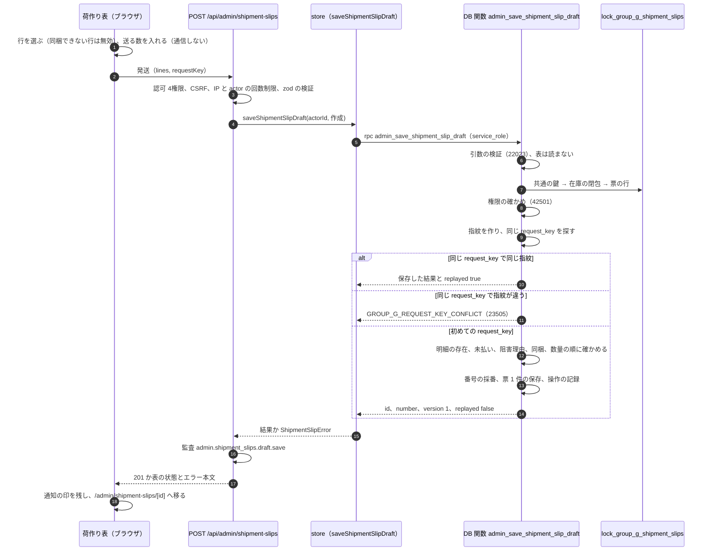
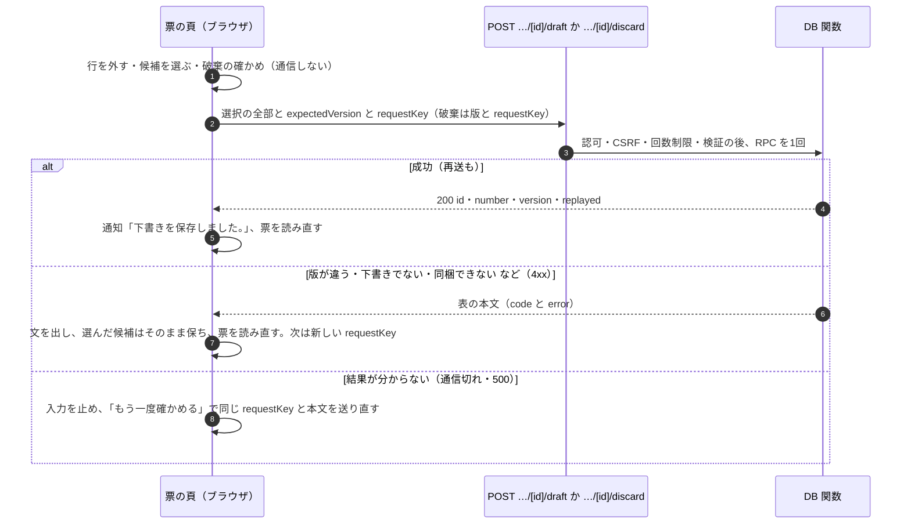
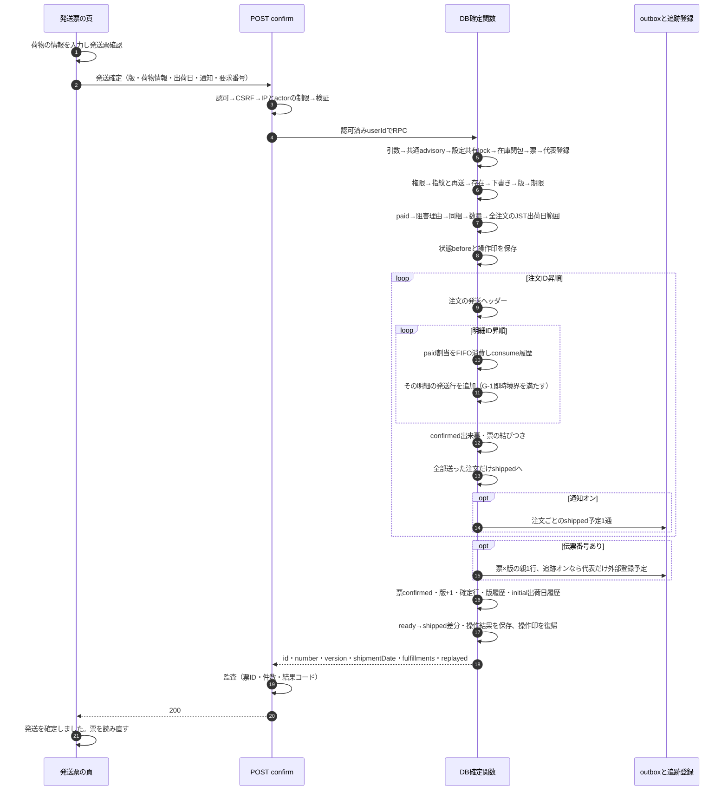
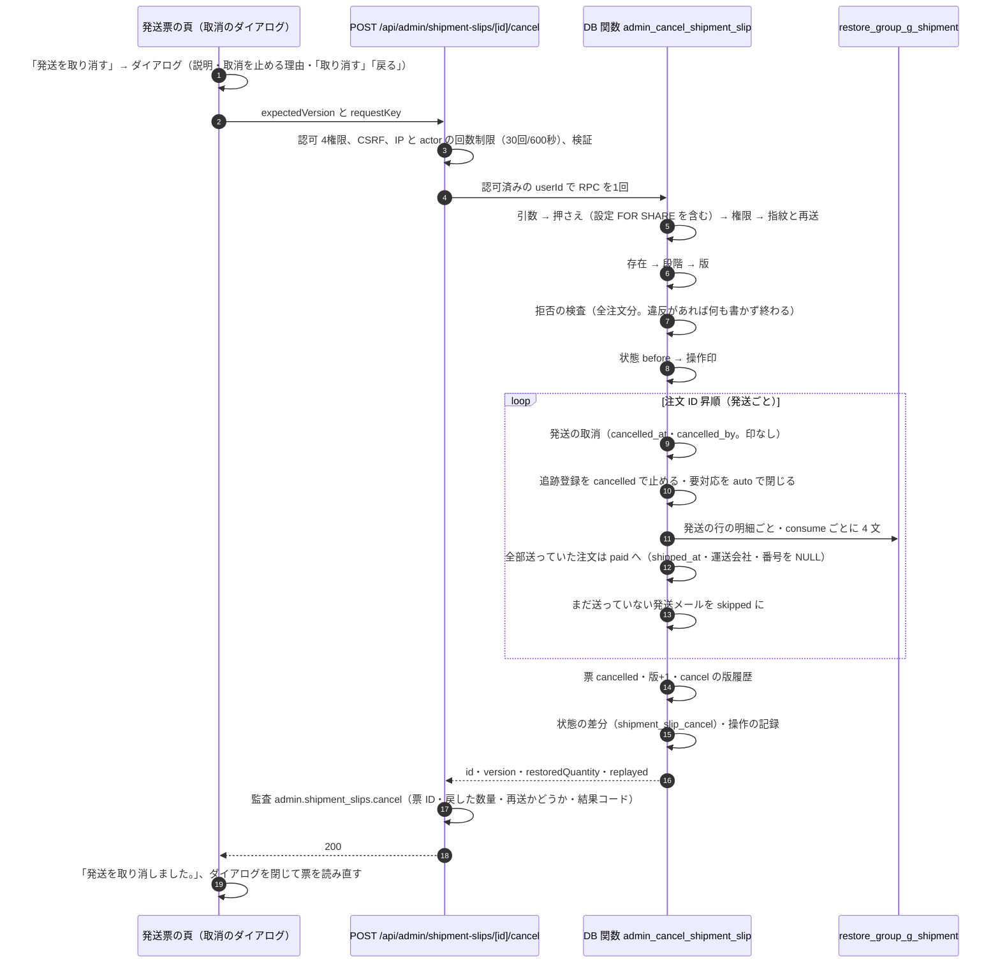

# 荷作り表から発送票の下書きまでの流れ（G-3）

> 状態: 現行のソース（グループ G-3 Task 4・5・6。荷作り表で下書きを作り、票の頁で編集・破棄・確認・確定・取消する。本番へは未適用） | 確認日: 2026-10-25 | 対象: 下書きの作成・入れ替え・破棄と発送確定と発送の取消の順序、発送票の書込みに共通のロックの順

## 概要

発送は 荷作り表で品物を選ぶ → 「発送」で下書きを作る → 発送票の確認 → 発送確定 の順に進む。この文書は**下書きを作る・入れ替える・破棄する操作と、発送確定**を扱う。下書きは「どの品物を何点まとめて送るか」を覚えておくだけの記録で、**在庫・割当・台帳・注文・発送は一切変えない**。2つの下書きが同じ明細を選べる（取り置かない）。先に確定した分を超える発送は、確定が数量を確かめて断る。

| 項目 | 内容 |
| --- | --- |
| 入口 | 作成 `POST /api/admin/shipment-slips`（201）、入れ替え `POST /api/admin/shipment-slips/[id]/draft`（200）、破棄 `POST /api/admin/shipment-slips/[id]/discard`（200）。認可（`admin.shipping.manage` ＋ `admin.shipping.read` ＋ `admin.orders.manage` ＋ `admin.orders.read` の4つすべて）→ CSRF → IP の回数制限 → actor の回数制限 → 検証 → store → 監査 |
| 権限の確かめ | 窓口と DB の関数の両方（DB は実行者の有効な全役割の権限の和集合で、毎回確かめる） |
| 冪等 | 画面は同じ内容の再押下・通信の再送に同じ `requestKey` と本文を使い、内容を変えたら新しい `requestKey`。DB は `(shipment_slip_save, request_key)` と入力の指紋（操作・票・行・実行者。版は含めない）で、同じなら前の結果を `replayed: true` で返し、違えば断る |
| 番号 | `SL-` ＋ 日本時間の `YYYYMMDD` ＋ `-` ＋ 4桁の連番（その日の最大＋1。9999 を超えると失敗）。下書きを作った時に採る。別の日の番号は数えない |
| 共通のロック | 全ての票の書込みは `private.lock_group_g_shipment_slips` を引数の検証の直後に呼ぶ。最初の文が共通の鍵 `(190521, 1)` |
| 有効期限 | 保存のたびに `now() + 7 日`。期限切れの下書きも保存し直せて、破棄もできる（確定は期限切れを断る） |

## 範囲と根拠

| 項目 | 内容 |
| --- | --- |
| 対応要件 | FREQ-531（荷作り表と下書きの選択）、FREQ-532（同梱の判定をサーバーでも）、FREQ-533（発送票の流れ。下書きの部分）、FREQ-540（権限の組・書き手の閉じた一覧）。[要件](../../02_Requirements/requirements.md) |
| 設計 | [G-3 実装計画](../../superpowers/plans/2026-10-25-group-g3-shipping.md)の Task 4・5 と全体のロック順、[グループ G 設計書](../../superpowers/specs/2026-10-23-group-g-design.md) |
| 実装 | 移行 `supabase/migrations/20261025100130_group_g3_shipping_slips.sql`、[store](../../../src/lib/orders/shipment-slips/shipment-slip-store.ts)、[書込みの窓口の共通の流れ](../../../src/lib/orders/shipment-slips/shipment-slip-route.ts)、窓口（[作成](../../../src/app/api/admin/shipment-slips/route.ts)・[入れ替え](../../../src/app/api/admin/shipment-slips/%5Bid%5D/draft/route.ts)・[破棄](../../../src/app/api/admin/shipment-slips/%5Bid%5D/discard/route.ts)）、[ブラウザの道具](../../../src/lib/orders/shipment-slips/shipment-slip-client.ts)、[送る流れの hook](../../../src/hooks/useShipmentSlipWrite.ts)、画面（[荷作り表](../../../src/components/PackingSection.tsx)・[票の頁](../../../src/components/ShipmentSlipSection.tsx)） |
| 関連 | 保存する段階は[発送票の状態](../states/shipping.md)、鍵の順の元は[在庫の割当と共通の鍵の流れ（G-1）](inventory-allocation.md)と[発注書の流れ（G-2）](purchasing.md)、API は[API 設計](../../03_BasicDesign/api/api-spec.md)の「管理:荷作り表・発送票」 |
| 調査時点 | 2026-10-25 のソース。本番の適用状況と実データでの競合は未確認（末尾） |

## 荷作り表から下書きを作る順序

事前条件: 荷作り表（`/admin/packing`）を開いていて、発送準備中の品物の行から 1 行以上を選んでいる。1行目を選ぶと、`bundleKey` が違う行・`bundleKey` が無い行は選べなくなる（「同じお客様・同じ配送先の注文だけ同梱できます」）。選んだ行ごとに「今回送る数」（1〜準備中の数。初期値は準備中の数）を入れている。

| 順 | 内容 |
| --- | --- |
| 1 | 画面だけの段。選択は頁をまたいで残り、同梱の基準は選んだ最初の行の `bundleKey`。「発送」は選択が1行以上で、全部の送る数が有効な時だけ押せる。送っている間は選択欄も入力も止める |
| 2〜3 | 窓口の順は変えない。回数制限は `admin.shipment_slips.draft` の 120 回／600 秒。実行者は認可結果の `userId` だけから DB へ渡す |
| 4〜5 | store は引数名どおりに RPC を1回呼ぶ。DB の誤りは `message` と SQLSTATE が表と完全に一致した時だけ分類し、他は生の文を出さない500にする |
| 6〜8 | 引数の誤りは権限より先に断る。ロック helper は票・注文・variant の行を読む前に共通の鍵だけを取る。権限の確かめは再送の判定より先で、権限の無い人には再送の結果も見せない |
| 9〜13 | 初めての要求だけが、明細の存在・同梱・数量の確かめと保存へ進む。再送と衝突は何も書かない |
| 14〜16 | 成功も失敗も監査に残す。metadata は件数・再送かどうか・結果コードだけで、品物・数量・要求番号は残さない |
| 17 | 移動で消える画面の代わりに、移動先の票の頁が一度だけ「下書きを保存しました。」を出す（`sessionStorage` に票の id だけを置く。URL は `/admin/shipment-slips/[id]` のまま） |

## DB の関数の中の確かめの順

`admin_save_shipment_slip_draft` は 1 回の呼び出しが 1 つの取引で、次の順に確かめて、最初の違反だけを返す。

| 順 | 確かめること | 違反の時 |
| --- | --- | --- |
| 1 | 引数の形: 実行者・要求番号あり、作成なら版なし・更新なら版あり（1以上）、`lines` は配列で1〜100件、各要素は `orderItemId`（uuid）と `quantity`（1〜99999 の整数）の2項目だけ、明細の重複なし | 空は `GROUP_G_SLIP_EMPTY`、他は `GROUP_G_ARGUMENT_INVALID`（22023） |
| 2 | 押さえ: `lock_group_g_shipment_slips(票, 明細, false)`（下の「ロックの順」） | |
| 3 | 権限: 4権限すべて（実行者の有効な全役割の和集合） | `GROUP_G_FORBIDDEN`（42501） |
| 4 | 指紋と再送 | 異なる内容は `GROUP_G_REQUEST_KEY_CONFLICT`（23505）。同じ内容は保存した結果を返して終わり |
| 5 | 更新なら: 票の存在 → 段階が下書き → 版が一致 | `GROUP_G_SLIP_NOT_FOUND`（P0002）→ `GROUP_G_SLIP_NOT_DRAFT` → `GROUP_G_SLIP_VERSION_CONFLICT`（55000） |
| 6 | 明細が全部ある | `GROUP_G_ARGUMENT_INVALID` |
| 7 | 注文が全部 `paid` | `GROUP_G_SLIP_ORDER_NOT_SHIPPABLE` |
| 8 | 阻害理由（`group_g_shipment_ready` を1回だけ評価）。支払額要確認 → 交換手数料待ち → 配送先不足 → 色サイズ未確定・入金日時なし の順 | `…_PAYMENT_REVIEW_REQUIRED`・`…_EXCHANGE_ON_HOLD`・`…_ADDRESS_INCOMPLETE`・`…_ORDER_NOT_SHIPPABLE` |
| 9 | 同梱の判定（`group_g_bundle_verdict`） | `…_CUSTOMER_MISMATCH`・`…_ADDRESS_MISMATCH`・`…_ADDRESS_INCOMPLETE` |
| 10 | 数量が各行の発送できる数（`shippable`）以下 | `GROUP_G_SLIP_QUANTITY_EXCEEDS_READY` |
| 11 | 書込み: 作成は採番（9999 超は失敗）と票の挿入、更新は印 `draft` の UPDATE（選択・顧客と送り先の写し・有効期限・版+1） | |
| 12 | 操作の記録（最後。操作 `shipment_slip_save`・原因 `shipment_slip`＝票の id） | |

顧客と送り先の写しは、選んだ明細を `orderItemId` の昇順に並べた先頭の明細の注文から取る（会員は `member` ＋会員 ID、ゲストは `guest` ＋ `lower(btrim(メール))`。7項目は前後の空白を落とし、建物は空なら NULL）。同梱の判定が通っているので、どの注文から取っても同じ値になる。

## 下書きの入れ替えと破棄

外す・追加は、どちらも**選択の全部**を `POST …/draft` で送って丸ごと入れ替える（`expectedVersion` は票の頁が読んだ版）。破棄は `POST …/discard`（`expectedVersion` と `requestKey`）。破棄は 1〜5 の確かめ（引数・押さえ・権限・再送・存在・下書き・版）だけを行い、印 `discard` で `stage = discarded`・`discarded_at`・`discarded_by`・`expires_at = NULL`・版+1 にして、操作 `shipment_slip_discard` を記録する。

| 失敗の種類 | 画面の扱い |
| --- | --- |
| 処理の前の断り（401・403・429） | 文を出す。同じ内容の再押下は同じ `requestKey`（記録していないので安全） |
| 処理の中の断り（400・404・409・422） | 表の文を出し、新しい `requestKey` で送れるようにする。票を読み直す |
| 結果が分からない（通信切れ・500番台・読めない成功） | 「結果を確かめられませんでした。「もう一度確かめる」を押すと、二重にならずに確かめ直します。」を出す。同じ `requestKey` と本文だけを送り直す。「戻る」は取ってある送信を捨て、票を読み直す |
| 荷作り表の答えの `canManage` が false | 最初の描画から選択欄と「発送」を出さず、「発送票を作る権限がありません。」を1回出す（窓口 `GET /api/admin/packing` が操作の4権限の組を調べて返す） |
| 荷作り表の「発送」の返事が権限の不足の 403（`permission`・`GROUP_G_FORBIDDEN`） | 選択欄と「発送」を片付け、「発送票を作る権限がありません。」を1回出す |
| 「発送」の返事が CSRF の失敗・MFA の 403 | 権限が無いことにしない。CSRF は「セキュリティ確認に失敗しました。ページを再読み込みして、もう一度送ってください。」、MFA は「2要素認証が必要です」を出し、操作は残す |
| 最後の1行を外そうとした時（票の頁） | 窓口へ送らず「品物を選んでください。」を出す |

## ロックの順（`lock_group_g_shipment_slips`）

票の書込みは、G-1 の全体順（共通の鍵 → 設定 → 注文 → … → 割当）の末尾に票を足す。helper の中の順は固定で、呼び手が対象を後から足して前に戻ることを禁じる。

| 順 | 取るもの | 補足 |
| --- | --- | --- |
| 1 | 共通の鍵 `pg_advisory_xact_lock(190521, 1)` | helper の**最初の文**。他の行を読む前 |
| 2 | `shop_settings`（id=1）を `FOR SHARE` | 追跡に触れる書込み（`_with_settings` が真）だけ。下書きの保存・破棄では取らない |
| 3 | 対象の読取だけ（行は取らない） | 渡された明細の注文・variant、票の下書きの選択・確定行・発送が指す注文を合わせて集める |
| 4 | `lock_group_g_inventory(variant 配列, 注文 配列, NULL)` | 共通の鍵は再入可能。戻りのロックした注文 ID（昇順）を保持して返す |
| 5 | `shipment_slips`（id 昇順）`FOR UPDATE` | 在庫の行を全部取った後 |
| 6 | 代表の `fulfillment_tracking_registrations`（`(fulfillment_id, tracking_version)` 昇順）`FOR UPDATE` | 追跡に触れる書込みだけ |

誰も EXECUTE できない内部の道具で、public の入口はない。書込みの本体（保存・破棄）は、票・注文・操作の記録の表を読む前にこれを呼ぶ（構造は pg_proc の本文で試験し、移行の末尾の確かめも見る）。書き手の閉じた一覧は G-2 の65本に保存・破棄・消費・追跡登録・確定の5本と戻し・取消の2本を足した72本。

## 関連テスト

| 観点 | 試験 |
| --- | --- |
| DB の関数（作成・入れ替え・再送・同梱・優先順・数量・権限・原子性・破棄・期限切れ） | [group_g3_draft](../../../tests/integration/db/group_g3_draft.integration.test.ts) |
| 書き手の閉じた一覧・関数の構造 | [group_g1_writer_inventory](../../../tests/integration/db/group_g1_writer_inventory.integration.test.ts)、G-2 の末尾の確かめを流し直す [group_g2_migration_asserts](../../../tests/integration/db/group_g2_migration_asserts.integration.test.ts)・[group_g2_purchase_documents](../../../tests/integration/db/group_g2_purchase_documents.integration.test.ts)、共有の道具 [書き手の一覧の入れ替え](../../../tests/integration/db/helpers/group-g-allowlist.ts) |
| 実 PostgREST | [group_g3_postgrest_paths](../../../tests/integration/db/group_g3_postgrest_paths.integration.test.ts) |
| 窓口 | [作成](../../../tests/unit/api/admin/shipment-slips-route.test.ts)、[入れ替えと破棄](../../../tests/unit/api/admin/shipment-slip-draft-route.test.ts) |
| store・ブラウザの道具 | [store](../../../tests/unit/lib/orders/shipment-slips/shipment-slip-store.test.ts)、[client](../../../tests/unit/lib/orders/shipment-slips/shipment-slip-client.test.ts) |
| 画面 | [荷作り表](../../../tests/unit/components/PackingSection.test.tsx)、[票の頁](../../../tests/unit/components/ShipmentSlipSection.test.tsx)、[取消のダイアログ](../../../tests/unit/components/ShipmentSlipCancelDialog.test.tsx) |
| 発送の取消 | DB [group_g3_cancel](../../../tests/integration/db/group_g3_cancel.integration.test.ts)、窓口 [cancel](../../../tests/unit/api/admin/shipment-slip-cancel-route.test.ts) |

## 未確認事項

- Task 5までの移行はローカルへ適用済み。controllerが実鍵PostgRESTを含む12 suiteで665/665成功を確認した（2026-10-25）。レビュー後の数量変数名の整理はcontrollerが再適用する。本番へは未適用。
- 390/768/1280px の実測と、本番ビルドでの画面の動きは E2E の担当（Task 13）。この Task は単体で表の構造とクラスだけを確かめた。
- 「発送票確認」「発送確定」「発送を取り消す」は実装済み（取消は Task 6）。確定後の伝票番号・配達済み・出荷日の訂正は後続Task。

## 発送確定（G-3 Task 5）

再送は保存結果を返し、発送・消費・予定・履歴を増やさない。失敗は取引全体を巻き戻す。Fは動かさずpaid割当Aだけ減らすため、手元（F+A+H）は発送数だけ減る。台帳のINSERTはない。DB内で外部送信は行わない。

割当消費は各発送行INSERTの前に行う。逆順ではG-1の即時境界が同じ数量を発送済みと残るpaid割当の両方に数え、FULFILLMENT_BOUNDS_VIOLATEDとなる。途中のconsumeと行の一時的な不一致は同一取引内だけで、G-3の遅延group_g_shipment_consumptionが最終的な一致を検査する。before取得・操作印・注文順・注文status・outbox・追跡登録・票更新・履歴・操作結果の順は維持する。

[確定DB試験](../../../tests/integration/db/group_g3_confirm.integration.test.ts)・[窓口単体](../../../tests/unit/api/admin/shipment-slip-confirm-route.test.ts)・[メール完全一致](../../../tests/unit/lib/orders/email/order-email-compose-shipped.test.ts)。controllerが実鍵PostgRESTを含む12 suiteで665/665成功を確認した（2026-10-25）。

## 発送の取消（G-3 Task 6）

確定済みの票を**全体で**取り消す（FREQ-533-AC-04・FREQ-534-AC-03）。票に含まれるすべての注文の発送を取り消し、割当の消費を**1回だけ**戻す。空き在庫Fは動かさず、手元の在庫（F+A+H）は消費した数だけ戻る。DB の関数 `admin_cancel_shipment_slip`（`private` の DEFINER 本体と、同名・同引数の `public` の SQL INVOKER 入口。service_role だけが EXECUTE）と、内部の道具 `restore_group_g_shipment`（誰も EXECUTE できない）が、1取引で行う。

### 順序

| 順 | 内容 |
| --- | --- |
| 引数 | 版・実行者・要求番号の欠け（版は1以上）は `GROUP_G_ARGUMENT_INVALID`（22023）。表は読まない |
| 押さえ〜再送 | `lock_group_g_shipment_slips(票, 空, true)`（追跡に触れるので設定を `FOR SHARE`）→ 4権限（42501）→ 指紋 `{operation, slip_id, actor_id}`（版は含めない）。同じ `request_key` で同じ指紋は保存した結果を `replayed: true` で返し、違えば `GROUP_G_REQUEST_KEY_CONFLICT`（23505） |
| 票 | 無ければ `GROUP_G_SLIP_NOT_FOUND`（P0002）→ 段階が `cancelled` なら `GROUP_G_SLIP_CANCELLED`、`confirmed` でなければ `GROUP_G_SLIP_NOT_CONFIRMED` → 版が違えば `GROUP_G_SLIP_VERSION_CONFLICT`（55000） |
| 拒否の検査 | 書込みの前に**全注文分**。1つでも違反があれば何も書かない（他の注文の発送・割当・台帳・メールを含む）。優先は ① 注文が `paid`・`shipped` でない発送 → `GROUP_G_SLIP_CANCEL_NOT_ALLOWED` ② その発送を指す返品行が `requested`・`open`・`closed` の返品に 1 つでもある → `GROUP_G_SLIP_HAS_RETURN` ③ 発送後の返金（返事待ちを含む）が取消で割れる（`shipped − この発送の数量 < 発送後に返金した数`）→ `GROUP_G_SLIP_REFUNDED`（いずれも 22023）。取消・お断りの返品と、失敗・エラーの返金は数えない |
| 書込み | 発送ごと（`order_id` 昇順）に、後述の順 |

### 書込みの順と、G-1 の即時の確かめ

G-1 の割当の数（`group_g_allocation_bounds`）・台帳の対応（`group_g_stock_movement_consistency`）と、G-3 の消費の裏付け（`group_g_shipment_consumption`）は**遅延**の確かめで、commit の時に最終の状態を見る。割当の変更の守り（`GROUP_G_HISTORY_IMMUTABLE`）・外部キー・一意制約・在庫 F の下限（`stock_quantity >= 0`）は**即時**で、文ごとに働く。次の順にして、**各文の時点で即時の確かめが通り**、遅延の確かめが commit の時に取消と戻しが揃って通るようにした。割当の上限（`残りの合計 <= 明細の数量 − 取り消していない発送の数量`）も遅延の確かめなので、文の途中の状態は見られず、commit の時の最終の状態だけが検査される（順を変えても最終の状態は同じで通る）。そのうえで、途中の状態も意味が通るように、発送の取消を先にして、新しい割当を足す時点でも上限を超えない並びにした（旧の取消と同じ並びで、読取の関数が途中で呼ばれても矛盾しない）。試験は取引の最後に `SET CONSTRAINTS ALL IMMEDIATE` で最終の状態を確かめる。

| 順 | 文 | この順にする理由 |
| --- | --- | --- |
| 1 | 発送の `cancelled_at`・`cancelled_by`（既存の取消の分岐。印なし） | 先に取り消すと、取り消していない発送の数量が減り、続く途中の状態でも新しい割当が明細の上限を超えない（上限そのものの検査は commit の時） |
| 2 | 追跡登録を `cancelled` で止める・要対応を `auto` で閉じる（代表以外は何も変わらない） | 既存の道具 `stop_fulfillment_registrations`・`close_delivery_attention`。（配送業者, 番号）の組の鍵は行の鍵の後に取る |
| 3 | `restore_group_g_shipment`（下の 4 文を consume ごとに） | 1 で途中の状態も上限に収まっている。割当の数・台帳の対応・消費の裏付けは commit の時に最終の状態で検査される |
| 4 | 注文が `shipped` で取消後の未発送が 1 以上なら `paid`（`shipped_at`・運送会社・番号を NULL） | 既存の取消と同じ理由コード `admin_cancel_fulfillment` |
| 5 | まだ送っていない発送メール（`pending`・`retry_wait`）を `skipped`（`last_error_code` は `fulfillment_cancelled`、本文を消す） | 既存の取消と同じ |

`restore_group_g_shipment` は、その発送の行を明細順に、確定の操作の `consume` 出来事を `id` 昇順に取り、出来事ごとに次の 4 文を**この順に**書く（外部キーが先の行を要る）。

| 順 | 文 | 内容 |
| --- | --- | --- |
| ① | 台帳 `restock` | `delta = +n`、`allocation_operation_id` を**付けない**、`order_id`・`order_item_id` つき、備考「発送票 ○○ の発送取消（戻し）」。台帳の対応の確かめは印の付いた行だけを見る |
| ② | 新しい割当 | 同じ明細・variant、数量 = 残り = `n`、`kind = 'paid'`、`operation_id` = 取消の操作。元の割当は一切更新しない |
| ③ | 台帳 `purchase`（交換の品は `exchange`） | `delta = −n`、取消の操作の印つき、備考「発送票 ○○ の発送取消（再確保）」 |
| ④ | 出来事 `restore` | 新しい割当・数量 `n`・連番 1・`reverses_event_id` = その `consume` の id・台帳は ③・理由 `shipment_cancel` |

F は ① で `+n`、③ で `−n` なので下限を割らず、最後は元のまま。戻しは 1 回で、同じ `consume` を 2 度戻そうとすると `order_item_allocation_events` の `reverses_event_id` の一意で止まる。

### お客様向けのメールと追跡

お客様向けの取消のメールは作らない。まだ送っていない発送メールだけを取りやめる（送信済みは変えない）。追跡は代表の登録だけが cancelled で止まり、一度でも外へ登録できた登録は外への停止の印（`provider_stop_pending`）が付く。参加の注文の発送に登録は無い。票×版の親の行は追記専用で変えない。取消後に同じ明細を新しい票へ選んで再発送でき、票番号は次の連番、発送の番号は取消済みも数えた次の番号になる。

### 画面

確定済みの票に「発送を取り消す」を出す（下書き・取消済みには出さない）。ダイアログは見出し「発送を取り消す」・説明「票に含まれるすべての注文の発送を取り消し、品物を発送準備中に戻します。」・「取り消す」「戻る」。`cancelBlockers` を持つ票は、ボタンの上に「注文 ○○ は返品の対象です／発送後に返金済みです／取り消せない状態です」を先に出す（それでもボタンは押せ、DB が最終の判断をする）。送信中は閉じず、二重に押しても通信は1回。DB が断った時（返品・返金・取り消せない状態・版の競合）は表の本文をダイアログの中に出して開いたまま票を読み直す。結果が分からない時は「もう一度確かめる」で同じ本文・同じ `requestKey` を送り直す。成功は「発送を取り消しました。」を出してダイアログを閉じ、票を読み直す。

### 未確認事項

- DB は controller が reset して実測した（別接続の試験と実鍵 PostgREST を含む21 suiteで1,287/1,287成功、全件の単体と DB で18,318件成功。2026-10-25）。実メール送信・実際の外への停止・本番の実データは未確認。
- 390/768/1280px の実測は E2E の担当。
