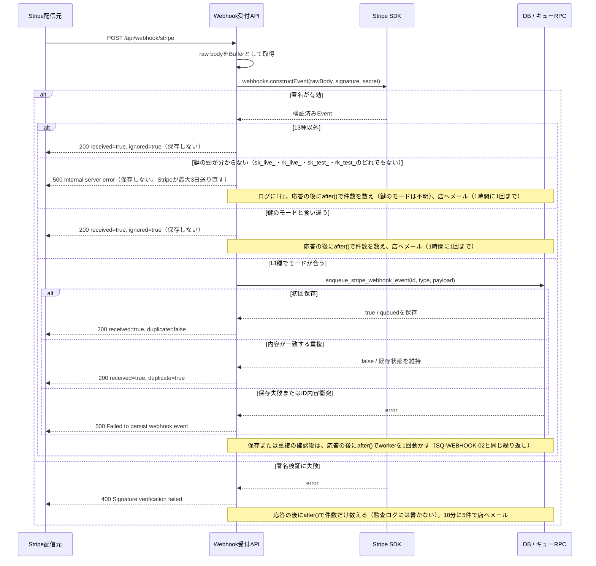
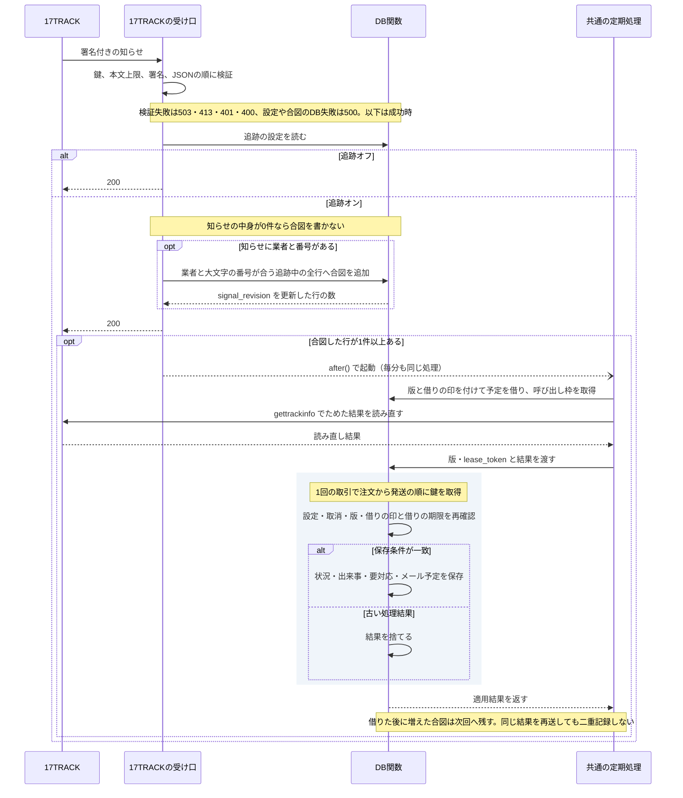

# Stripe Webhookの受付と非同期処理

> 状態: 現行ソース確認（返金の取り込み・見回り・照合はグループ E-2 の変更を 2026-10-11 に反映） | 確認日: 2026-10-07 | 対象: Webhook受付、イベントworker、決済見回り

## 概要

Stripe Webhookの受付は、署名を検証した13種のイベントのうち鍵と同じモードのものをDBへ保存して200を返し、その後に`after()`でworkerを1回動かす。注文・返金・会計の処理はworkerが行い、workerは毎分のCron APIからも起動する。受付応答、キューの処理完了、注文の入金済みはそれぞれ別の結果である。

図の分割・線種・根拠の扱いは[記載方針](README.md)に従う。状態値と再試行条件は[Webhookキュー](../states/stripe-webhook-queue.md)、注文照合は[購入・決済](checkout-payment.md)、返金の取り込みは[注文管理](order-administration.md)の SQ-ADMIN-07 を参照する。

## 範囲と根拠

対応領域は[CHECKOUTのWebhook](../pages/13_checkout.md)と[ADMINの決済管理](../pages/16_admin.md)。外部サービス内部の配信順序・処理と、本番のCron起動を実行済みとして描かない。

| 境界・操作 | 根拠 |
| --- | --- |
| `POST /api/webhook/stripe`、raw body、`webhooks.constructEvent`、13種とモードの判定、署名不正・モード違いの件数 | [Webhook受付](../../../src/app/api/webhook/stripe/route.ts)、[13種とモード](../../../src/lib/stripe/handled-webhook-events.ts)、[件数と知らせ](../../../src/lib/ops/webhook-receiver-signals.ts) |
| enqueue・claim・complete・fail RPC | [イベントサービス](../../../src/lib/stripe/webhook-events.ts)、[キュー定義](../../../supabase/migrations/20260925000303_add_stripe_webhook_queue.sql)、[再試行・退避の定義](../../../supabase/migrations/20261007030242_webhook_queue_dead_letter.sql) |
| `POST /api/cron/process-stripe-webhooks`、Bearer認証、payload検査、繰り返し | [worker](../../../src/app/api/cron/process-stripe-webhooks/route.ts)、[workerの起動](../../../src/lib/stripe/webhook-worker.ts)、[繰り返し](../../../src/lib/stripe/webhook-drain.ts)、[Cron認証](../../../src/lib/cron/auth.ts) |
| 決済・返金イベントの振り分け、会計同期、処理監査 | [イベント処理](../../../src/lib/stripe/webhook-processor.ts) |
| `checkout.sessions.retrieve/list`、`paymentIntents.retrieve`、注文RPC | [Stripe読取り](../../../src/lib/stripe/checkout-payment-reader.ts)、[照合器](../../../src/lib/stripe/checkout-payment-reconciler.ts)、[RPC接続](../../../src/lib/stripe/checkout-payment-reconciler-deps.ts) |
| `refunds.list`と返金の結果を書く関数（`record_order_refund_result`・`record_external_order_refund`。グループ E-2 で `apply_order_refund_projection` を消して置き換えた） | [返金の取り込み](../../../src/lib/stripe/order-refund-sync.ts)、[E-2 移行 C](../../../supabase/migrations/20261011223453_order_refund_results.sql) |
| 会計原始記録のSDK読取りと保存 | [会計同期](../../../src/lib/stripe/accounting-sync.ts)、[DB接続](../../../src/lib/stripe/supabase-accounting-database.ts)、[保存処理](../../../src/lib/stripe/accounting-store.ts) |

## SQ-WEBHOOK-01: 署名検証済みイベントの受付

目的は、Stripeから受け取ったイベントを処理前に永続化すること。事前条件はWebhook secretとStripe秘密鍵が設定され、`stripe-signature`ヘッダーがあること。終了結果は保存または一致する重複の確認後の200、保存しない200（13種以外・鍵と食い違うモード）、または400・500（鍵の頭が分からないときの、保存しない500を含む）であり、注文処理の完了ではない。

### 例外と永続化

| 条件 | 応答・保存結果 |
| --- | --- |
| Webhook secretまたはStripe秘密鍵が未設定 | 500。enqueueへ進まない（Stripeが後で送り直す） |
| signature欠落 / 署名不一致 | 400。enqueueへ進まない。監査ログに1件ずつ書かず、`ops_alert_state`の件数だけを進める（10分に5件で店へメール。1時間に1回まで） |
| 13種以外 | 200 `ignored=true`。保存しない（ログに1行） |
| 鍵のモードと食い違う（`sk_live_`・`rk_live_`は本番、`sk_test_`・`rk_test_`はテスト） | 200 `ignored=true`。保存しない。件数を進めて店へメール（1時間に1回まで）。メールを送れなかったときも、次の要求では送り直さない |
| 鍵は設定されているが、頭が`sk_live_`・`rk_live_`・`sk_test_`・`rk_test_`のどれでもない（引用符つきで貼った・`pk_`の鍵など） | 500 `Internal server error`。保存しない（Stripeが最大3日送り直す。200だと知らせが失われる）。ログに`[webhook] STRIPE_SECRET_KEY has an unknown prefix`を1行出し、件数を進めて店へメール（鍵のモードは「不明」。1時間に1回まで。送れなかったときも、次の要求では送り直さない） |
| 初回enqueue | event ID・type・payload、`queued`、attempt_count=0、次の試行時刻を保存 |
| 同じevent IDの再送 | event type、data、account、livemodeを照合する。一致すれば既存キュー状態を変更せずfalse。配信メタデータ全体の完全一致は要求しない |
| 同じIDで内容が矛盾 | RPCがID衝突を拒否し、受付APIは500。既存行を上書きしない |
| 保存または重複確認の200の後 | `after()`で`runWebhookWorker`を1回動かす（Stripe の知らせに35秒、注文のメールに10秒。合わせて45秒の処理予算、点検と配達の見回りはその後。SQ-WEBHOOK-02）。失敗してもログに残すだけで、毎分のCronが拾う |

根拠は上記のWebhook受付とキューRPC。署名失敗は監査ログに書かず件数だけを数える。処理成功の監査はworker側で行う。

## SQ-WEBHOOK-02: workerによる処理

目的は、DBに保存されたイベントを順に取得し、対応する業務処理と完了記録を行うこと。開始契機は毎分の`POST /api/cron/process-stripe-webhooks`と、受付APIが保存の後に`after()`で動かす1回で、Cron APIの事前条件は`CRON_SECRET`（32文字以上）と一致するBearer認証。1回の起動は、取り出せるイベントが無くなるかStripe の知らせの35秒の予算に達するまで続ける。1件の失敗は原因の記号を記録して次へ進む。終了結果は200 `{processed,failed,stoppedBy}`で、502はclaimのDB障害（`stoppedBy=claim_error`）だけである。

```mermaid
sequenceDiagram
    participant Cron as Cron呼出し元
    participant Worker as イベントworker API
    participant DB as DB / RPC
    participant Processor as イベント処理
    participant Stripe as Stripe API
    Cron->>Worker: POST /api/cron/process-stripe-webhooks
    Worker->>Worker: Bearer認証（CRON_SECRETは32文字以上）
    loop 取り出せる間（Stripe の知らせの35秒の予算まで。時間切れはstoppedBy=budget）
        Worker->>DB: claim_stripe_webhook_event()
        DB-->>Worker: 対象なし / payloadとclaim token / error
        alt claim RPCが失敗
            Note over Worker,DB: ループを止める（stoppedBy=claim_error）
        else 対象なし
            Note over Worker,DB: ループを止める（stoppedBy=empty）
        else 1件を取得
            Worker->>Worker: id・type・data.objectを検査
            alt 検査・業務処理・完了記録が成功
                Worker->>Processor: processStripeWebhookEvent(payload)
                alt CheckoutまたはPaymentIntent決済イベント
                    Processor->>Stripe: Session / PaymentIntentの現在値を取得
                    Stripe-->>Processor: 現在の決済情報
                    opt 注文作成・状態更新または要対応記録の判定
                        Processor->>DB: 照合判定に応じた条件付き注文RPC または 要対応記録
                        DB-->>Processor: 更新結果 または 要対応記録
                    end
                    opt none判定・paid/shipped注文・Stripe paid・返金額が正・PIあり
                        Processor->>Stripe: refunds.list / その支払いの返金を全ページ読む
                        Stripe-->>Processor: 返金の一覧
                        Processor->>DB: 返金1件ずつ record_order_refund_result か record_external_order_refund（書いた後に読み直し、最大3回）
                        DB-->>Processor: 同期後の注文状態
                    end
                else Refundまたはcharge.refunded
                    Processor->>DB: 支払いの番号があればPaymentIntentの注文を検索
                    DB-->>Processor: 注文あり / 注文なし / DB error
                    alt 知らせに支払いの番号が無い
                        Processor->>DB: refund_without_payment_intentを監査（やり直さない。会計同期も省略）
                    else 注文が支払い済み・発送済み・キャンセル
                        Processor->>Stripe: refunds.list(payment_intent) / 全ページ
                        Stripe-->>Processor: 返金の一覧
                        Processor->>DB: 返金1件ずつ record_order_refund_result か record_external_order_refund
                        DB-->>Processor: 記録・在庫・メールの予定・要対応・注文の額と状態
                        Processor->>Stripe: refunds.list / 書込み後の再確認（変わっていれば最大3回）
                        Stripe-->>Processor: 返金の一覧
                    else 注文が支払い手続き中・未入金・失敗・放棄
                        Processor->>DB: refund_on_unpaid_orderを監査（やり直さない）
                    else 注文なし
                        alt failed / canceled の返金、またはrefund.failed
                            Processor->>DB: Refund IDを参照にunexpected_stateを記録
                            Processor->>DB: 未解決なら店通知をclaimし送信を試みる
                            Processor->>DB: refund_without_orderをerror監査
                        else その他の返金 / charge.refunded
                            Processor->>DB: refund_without_orderをsuccess監査
                        end
                        Note over Processor,Stripe: 返金一覧・返金の取り込みを省略し後段へ進む<br/>記録例外はworkerのfailへ
                    else DB照会エラー
                        Note over Worker,Processor: 例外で中断、workerのfail分岐へ
                    end
                else その他のイベント
                    Note over Processor: このswitchでは注文・返金を変更しない
                end
                opt 会計対象イベント
                    alt payment_intent.succeeded
                        Processor->>DB: PIに対応する注文を検索
                        alt 注文あり
                            Processor->>Stripe: PaymentIntent / Charge / BalanceTransactionをretrieve
                            Stripe-->>Processor: 会計原始記録
                            Processor->>DB: BalanceTransactionを保存
                        else 注文なし
                            Note over Processor,DB: unmatchedで正常終了、Stripe会計読取り・保存を省略
                        end
                    else refund.created / updated / failed
                        Processor->>Stripe: refunds.retrieve(refundId)
                        Stripe-->>Processor: Refund現在値
                        Processor->>DB: RefundのPIに対応する注文を検索
                        alt 注文あり
                            Processor->>Stripe: 存在する返金・失敗のBalanceTransactionをretrieve
                            Stripe-->>Processor: 会計原始記録
                            Processor->>DB: BalanceTransaction / Refundを保存
                        else 注文なし
                            Note over Processor,DB: unmatchedで正常終了、会計DB保存を省略
                        end
                    else Payout対象イベント
                        Processor->>Stripe: Payout / BalanceTransactionを取得
                        Stripe-->>Processor: 会計原始記録
                        Processor->>DB: 会計原始記録とPayoutを保存
                    end
                end
                Processor->>DB: logAudit(event_processing, success)
                DB-->>Processor: 監査呼出し完了
                Processor-->>Worker: 正常終了
                Worker->>DB: complete_stripe_webhook_event(id, token)
                DB-->>Worker: true / completed
                Note over Worker: processedを加算
            else 検査・業務処理・completeで例外
                Worker->>DB: fail_stripe_webhook_event(id, token, 原因の記号)
                DB-->>Worker: failedまたはdeadを保存 / 記録失敗（ログに残す）
                Note over Worker: failedを加算して次の1件へ
            end
        end
    end
    Worker->>DB: record_ops_heartbeat(webhook_worker)
    Worker->>Worker: 注文のメールworker（10秒の処理予算）
    Note over Worker: Stripe の知らせ35秒＋注文のメール10秒＝45秒の処理予算
    Worker->>DB: 店への知らせの点検（注文のメールの点検も行う）
    Worker->>Worker: 配達の見回り（1時間に1回、最後。時間枠8秒）
    alt stoppedByがclaim_error
        Worker-->>Cron: 502
    else stoppedByがemptyまたはbudget
        Worker-->>Cron: 200 processed・failed・stoppedBy
    end
```

図の業務処理はイベント種別で選ぶ部分シナリオである。照合器が呼ぶ状態変更 RPC は同じ取引で注文のメールの行を書く。Stripe の知らせに35秒、注文のメールに10秒（合わせて45秒の処理予算）を使い、点検の後に配達の見回りを行う。個々のRPCと最大3回の読み直しは[注文状態](../states/order-payment.md)と[返金の取り込み](order-administration.md#sq-admin-07-stripe-の返金の取り込みと見回り)に記す。workerは、取り出せるイベントが無くなるかStripe の知らせの35秒の予算に達するまで、同じ要求の中で続けて取得する。1件の失敗は記録して次へ進み、`claim_error`だけが繰り返しを止めて502になる。

### イベントと実行処理

| イベント | 注文・返金処理 | 会計処理 |
| --- | --- | --- |
| checkout.session.completed / async_payment_succeeded / async_payment_failed / expired | Session IDとevent IDを照合器へ。イベントの中の状態・金額から注文を直接更新しない。照合器のnone判定が条件を満たせば返金の取り込みも実行 | この種類による会計同期なし |
| payment_intent.succeeded / payment_failed | PI IDとevent IDを照合器へ。payment_failedだけで在庫を解放しない。照合器のnone判定が条件を満たせば返金の取り込みも実行 | succeededだけPaymentIntent会計同期。注文なしならunmatchedで保存を省略 |
| refund.created / updated / failed | 支払いの番号が無ければ監査して終える（やり直さない。R-06）。PI IDで注文を検索し、支払い済み・発送済み・キャンセルの注文なら、その支払いの返金を全ページ読み直して1件ずつ返金の記録に合わせる（印 `refund_id` がこの注文の記録なら `record_order_refund_result`、無い・合わなければ `record_external_order_refund`。グループ E-2）。支払い手続き中・未入金・失敗・放棄の注文は監査して終える。注文なしならイベント種別・参照IDを監査して取り込みを省略 | Refund会計同期の呼出しは続ける（支払いの番号の無い返金は省略）。Refundの現在値を取得して注文を再検索し、不在ならunmatchedで会計DB保存を省略 |
| charge.refunded | refund.* と同じ取り込み（支払いの番号が無い・未入金の注文は監査して終える。グループ E-2）。注文なしならイベント種別・参照IDを監査して取り込みを省略 | この種類による会計同期なし |
| payout.paid / failed / reconciliation_completed | 注文・返金switchでは処理なし | Payout会計同期 |
| その他 | 注文・返金処理なし | 会計switchの対象でなければ処理なし。監査後にキュー完了 |

根拠: [イベント処理のswitch](../../../src/lib/stripe/webhook-processor.ts)。会計SDKは[会計同期](../../../src/lib/stripe/accounting-sync.ts)でPaymentIntent・Charge・BalanceTransaction・Refund・Payoutを読む。

### 例外と永続化

| 条件 | workerの扱い・永続化 |
| --- | --- |
| Bearer不一致、`CRON_SECRET`未設定または32文字未満 / claim RPC失敗 | 401 / 502（`stoppedBy=claim_error`）。業務処理へ進まない |
| payload不正、業務・会計例外 | 原因の記号つきでfailを試み、同じ要求の中で次のイベントへ進む（応答は200で、`failed`に数える）。fail記録そのものの失敗もログに残して次へ進む。先に成立した注文・会計更新を一括で巻き戻す処理ではない |
| 返金イベントにPIなし | 監査 `checkout.webhook.refund_without_payment_intent` に残して正常に終える（やり直さない。会計同期も省略。グループ E-2。R-06） |
| 返金イベントの注文が支払い手続き中・未入金・失敗・放棄 | 監査 `checkout.webhook.refund_on_unpaid_order` に残して正常に終える（入金が決まった後に、照合と毎晩の照合が合わせる。グループ E-2。R-06） |
| PIに対応する注文なし | syncPaymentIntentRefundsがOrderNotFoundForPaymentIntentErrorを投げ、返金イベント処理だけがその型を捕捉する。refund_without_orderをイベント種別・参照IDで成功監査し、会計処理・通常監査・completeへ進む。後段が成功すればキューcompletedとなる |
| 取り込みがそろわない | 書いた後に読み直した返金の番号と状態の組が、3回書いても変わり続けたら `RefundSyncNotConvergedError` で失敗にし、キューのやり直しに任せる（グループ E-2。前の「既存取消の維持」はやめ、未入金から取り消した注文への返金も記録して返金済みの額に入れる） |
| 注文の検索DBエラー | 注文なしとは区別して例外を再throwする。返金一覧・会計同期へ進まずworkerがfailを試みる |
| needs_action / needs_review | 照合器が記録と必要な通知の試行を行い正常に返れば処理成功としcompleted。入金成功やメール送信成功の意味ではない |
| complete/failのtokenが一致しない | RPCはfalse。イベントサービスがclaim喪失の例外を投げる。前workerは新tokenの行を完了・失敗にできない |
| 再試行 | queued/failedは試行時刻到来でclaimできる。失敗した試行の回数をnとして、待機は2^(n-1)分（1・2・4…128分）。9回目の試行も失敗したら`dead`にして取り出さず、店へまとめて知らせる。processingは5分lease切れになると、次のclaimで1回の失敗（`lease_expired`）として数える |
| 注文のメール | Stripe の知らせを35秒の予算で処理した後、続けて10秒の予算で注文のメールを送り、注文のメールの点検の後に1時間ごとの配達の状態を見回る（グループ D）。送信・点検・配達の見回りは環境の門に従う |
| 監査要求 | workerは空ヘッダーのNextRequestを作る。CronのIP・User-AgentをStripe配信元のものとして記録しない |

注文なし返金の捕捉はWebhook processorにある。共通の返金同期関数自身が正常終了へ変える処理ではない。また、成功監査はpayment_exceptionsのresolved_atを更新せず、既存の要対応を自動解決しない。根拠は[handleRefundChanged](../../../src/lib/stripe/webhook-processor.ts)と[返金同期の注文検索](../../../src/lib/stripe/order-refund-sync.ts)。

返金イベントが注文作成より先に届き、注文なしとして完了した場合も、後続の決済照合が部分返金済みの注文を作成・入金済みにした後の読み直しで返金同期を実行する。注文なし・snapshotに下書きIDありでStripeの受取額全額が返金済みなら、`record_only:refunded_before_order`として注文を作らない。既存注文の入金更新で金額・通貨が一致する場合も、全額返金済みなら注文確認メールを抑止し、その後の返金同期（返金の取り込み）で取消にする。根拠は[判定表](../../../src/lib/stripe/checkout-payment-decision.ts)、[照合器](../../../src/lib/stripe/checkout-payment-reconciler.ts)、[返金接続と一時エラー分類](../../../src/lib/stripe/checkout-payment-reconciler-deps.ts)。

## 関連する見回りとschedule

| 処理 | 現行の範囲・制限 | 根拠 |
| --- | --- | --- |
| `POST /api/cron/expire-pending-orders` | Bearer認証後、checkout_session_created_atが30分超前のpayment_in_progressとpending全件を候補に取得。1回最大50件、各注文の開始前に45秒の時間予算を確認する（実行時間の厳密な上限ではない）。時間ごとに取得offsetを巡回。payment_in_progressでSession IDがある場合だけopen Sessionの失効を先に試み、各候補で同じ照合器を呼ぶ。1件失敗でも他を続行 | [見回りAPI](../../../src/app/api/cron/expire-pending-orders/route.ts)、[Session失効](../../../src/lib/stripe/checkout-session-expiry.ts) |
| 店向け要対応メールの再送 | 注文処理の中断フラグtimeBudgetExhaustedがfalseなら、未解決・未通知を最大20件取得し、送信権をclaimして再送を試みる。最後の注文処理後に経過時間を再検査する条件ではない | [見回りAPI](../../../src/app/api/cron/expire-pending-orders/route.ts)、[未送信取得](../../../src/lib/stripe/checkout-payment-reconciler-deps.ts) |
| 注文の無い支払いの拾い上げ | 上の注文処理と店向け再送の後、`timeBudgetExhausted`がfalseのときだけ、同じ45秒の予算の残りで動く（新しい照合の開始前に締切を確認する）。直近24時間に作られた完了済みCheckout Sessionのうち注文の無いもの（50件ずつ注文の有無を確かめる）を照合器へ渡し、照合器がその呼出しで注文を作ったときだけ、要確認「支払いから作った注文」（`recovered_from_payment`。在庫の要確認が先に付いていればそれを残す）を付ける。印は3回まで試し、付けられない注文は印なしのまま店向けメールに載せる。拾った注文は、その回の1通にまとめて店へ知らせる。読む範囲が毎回24時間で重なるので、予算切れや注文を作る前の失敗は次の回で拾い直す。注文の行を作った後の失敗は、その Session に注文があるので次の回は拾い直さない。1件失敗でも他を続行し、`failed`に数える | [見回りAPI](../../../src/app/api/cron/expire-pending-orders/route.ts)、[拾い上げ](../../../src/lib/stripe/orphan-payment-recovery.ts)、[店向けメール](../../../src/lib/ops/ops-alert-mail.ts) |
| 返事待ちの返金の見回り（グループ E-2） | 注文の処理・店向け再送・拾い上げの後、時間の予算が残っている時だけ、15分より前から返事待ちの返金を20件まで、Stripeの返金に付けた印（`refund_id`）で探す。見つかれば結果を書き、無ければエラー（`not_found_in_stripe`）にして要対応「返金の失敗」を作り、店へ知らせる。応答に `checkedRefunds`・`syncedRefunds`・`erroredRefunds` を足す | [見回りAPI](../../../src/app/api/cron/expire-pending-orders/route.ts)、[見回り](../../../src/lib/orders/refund/refund-sweep.ts) |
| 最後の成功の記録と点検 | 注文の無い支払いの拾い上げの直後（拾った注文の要約の読み込み・店へのメール・監査の行より前）に`order_sweep`の最後の成功を`ops_job_heartbeats`へ記録し、最後（応答の直前）にworkerと同じ点検（溜まり・退避・遅れを店へ）と注文のメールの点検（`runOrderEmailOpsChecks`）を行う。後続が遅くなって実行の上限（60秒）に届いても、成功の記録は残る。注文候補を読めず500を返すときは、失敗と原因の記号`db_unavailable`を記録してから点検して返す。記録や点検の失敗は応答を変えない。応答には`checkedSessions`・`recoveredOrders`・`recoveredOrdersNotified`を含める | [見回りAPI](../../../src/app/api/cron/expire-pending-orders/route.ts)、[点検](../../../src/lib/ops/ops-checks.ts)、[記録](../../../src/lib/ops/ops-store.ts) |
| workerのschedule案 | pending SQLには毎分のPOST（受付APIもその場で1回動かすので、毎分の起動は取りこぼしを拾う役目）、Vaultのapp_base_url・cron_secret参照を定義。登録・到達性・実起動は未確認 | [worker schedule](../../../supabase/pending/schedule_stripe_webhook_worker.sql) |
| 見回りのschedule案 | pending SQLには毎時0分のPOSTとVault参照を定義。ソース中の最長90分というコメントは、件数・時間制限下の無条件保証として扱わない | [見回りschedule](../../../supabase/pending/schedule_expire_pending_orders.sql) |
| 照合のschedule案 | pending SQL（`supabase/pending/schedule_stripe_reconcile.sql`）には毎日18:00 UTC（日本時間3:00）のPOSTとVault参照を定義。登録・到達性・実起動は未確認 | [保留中のSQL](../../../supabase/pending/README.md) |
| `POST /api/cron/stripe-reconcile` | Bearer認証（`CRON_SECRET`・32文字以上）後、先に返金を照合する（前の48時間に作られたStripeの返金の支払いと、こちらの保留の返金の支払いを集め、知らせと同じ取り込みで1件ずつ返金の記録に合わせる。使う時間は120秒まで。読む範囲はこの2つだけで、作られてから48時間より後に成功から失敗に変わり、知らせも届かない返金は拾えない。Stripeは知らせを3日間送り直す。グループ E-2）。続いてsucceeded PIを走査し、注文の無い支払いを報告する（注文のある支払いの返金は読まない）。会計原始記録とPayoutも同期する。支払いごと・Payoutごとの失敗は原因の記号で受け止めて続行し、監査`stripe.reconcile`（注文の無い直近7日の支払いのIDを20件まで含む）と最後の成功を記録する。そのあと、直近7日の注文の無い成功の支払い（全額返金済みを除く）か支払い・Payoutごとの失敗があれば、1回の実行につき1通のメールで店へ知らせる（時間ごとの権利は取らない。送れなくても応答と記録は変えない）。実行の上限は300秒で、pg_netは60秒で待つのをやめる。Checkout決済状態を照合する上の見回りとは用途が異なる | [会計・返金照合API](../../../src/app/api/cron/stripe-reconcile/route.ts)、[照合処理](../../../src/lib/stripe/reconcile-orders.ts) |

見回りは個々の注文処理の例外を数えて続行し、部分失敗でも集計を200で返す。会計・返金照合は、注文なしのPIを未対応支払いとして集計する場合があるが、そのPIの会計同期は省略する。返金の照合・PaymentIntent会計同期・Payout同期の例外は、支払いごと・Payoutごとに原因の記号つきで`errors`へ収集して続行し、200の集計に含める。注文をDBから読めないとき、またはStripeの一覧そのものを読めないときは全体の502になり、その回の残りを中断する（最後の失敗を記録する）。先行保存を巻き戻す処理ではない。根拠は上表の各APIと照合処理。

## 関連テスト

| 観点 | 参照 |
| --- | --- |
| 受付の署名・永続化・重複 | [durable ingress](../../../tests/unit/api/webhook/stripe-ingest.test.ts) |
| イベント振り分け・業務処理 | [processor](../../../tests/unit/api/webhook/stripe-route.test.ts) |
| claim・complete・failと競合 | [イベントサービス](../../../tests/unit/lib/stripe/webhook-events.test.ts)、[worker API](../../../tests/unit/api/cron/process-stripe-webhooks-route.test.ts)、[キューRPC](../../../tests/integration/db/stripe_webhook_queue.integration.test.ts) |
| 見回り・返金と会計照合 | [見回りAPI](../../../tests/unit/api/cron/expire-pending-orders-route.test.ts)、[stripe-reconcile API](../../../tests/unit/api/cron/stripe-reconcile-route.test.ts) |

関連テストは検証観点の参照であり、今回は実行していない。

## 未確認事項

本番のmigration適用、Stripe配信設定・実配信、キューの実データ、Cron登録・Vault値・HTTP到達性、メール到達、競合時の実行結果は未確認。pending SQLの記載を、本番で稼働している証拠として扱わない。

最終照合のコード基準はmasterの`bbb18761`と、2026-10-04の作業ツリーにある決済・返金ライブラリの未コミット変更。注文なし返金イベントの型限定catch、会計のunmatched分岐、共通照合器による返金同期まで静的に確認した。今回、そのコードの実行テストと本番反映は確認していない。

2026-10-07 に、Webhook受付・worker・見回り・照合の記述（グループ B で変えた部分）を、masterの`b54976d2`のソースで確認し直した。processorの振り分けと会計同期の記述は、上の基準のまま。そのあと、最終のレビューの直し（鍵の頭が分からないときの500、見回りの成功の記録の位置、照合の実行の上限300秒と見つかったことのメール）を、同じ日の作業ツリーのソースで確認して反映した。

2026-10-11 に、返金の取り込み・毎時の見回り・毎晩の照合の記述（グループ E-2 で変えた部分）を、実装を読んで直した。本番への適用、Stripeの本番の受け口への返金の4つの知らせの購読、定期処理3本の登録は未確認。

## 配送の状態と処理（E-4 / FREQ-488〜497）

[配送の詳細設計](../../superpowers/specs/2026-10-21-delivery-status-design.md)・[実装計画](../../superpowers/plans/2026-10-21-delivery-status.md)を参照。以下は実装後の契約であり、既存の決定の本文は履歴として残す。

Stripeの受け口と独立した `POST /api/webhook/17track` を追加する。既存Stripeの13イベント・署名・キュー・再試行の契約は維持する。配送の知らせでは本文をキューに保存せず、合図から17TRACKのためた結果を読み直す。

| 順序 | 17TRACKの処理 |
| --- | --- |
| 1 | 鍵なし503 → 1MiB超413 → signのSHA-256を時間差なしで照合し不一致401 → JSON/形不正400 |
| 2 | 設定オフなら200で終わる。設定読取・合図のDB失敗は500。知らせの中身が0件なら合図を書かず200。それ以外は合図を記録し200、合図した行が1件以上ある時だけafter()で共通worker |
| 3 | （carrier・大文字の番号）が合うregistered全行へsignal_revisionを足す。共有番号でも全行が対象 |
| 4 | workerが版・lease_token付きでclaimし、providerの枠を取ってgettrackinfo。署名済み本文は状況の正として採用しない |
| 5 | 注文 → 発送をlockし、設定・取消・版・leaseを再確認。同一取引で状況・出来事・要対応・メール予定を書き、古い結果は捨てる |
| 6 | 処理中に増えた合図は次回へ残す。同じ結果の再送は冪等。毎分も同じ処理を使う |

毎分 `process-stripe-webhooks` の順はStripe（35秒）→注文メール（10秒）→配送追跡（min(8秒,残り)、3秒未満ならskip）→運用点検・メール配達確認。入口60秒内に後続用15秒を残す計算を保ち、配送を飛ばしても `delivery_tracking` の心拍を記録する。荷物の配達完了とメール配達のdeliveredは別物。

### 知らせから読み直しと記録まで

署名が正しい知らせでも状況の正には使わず、保存の根拠は読み直しの結果だけとする。
