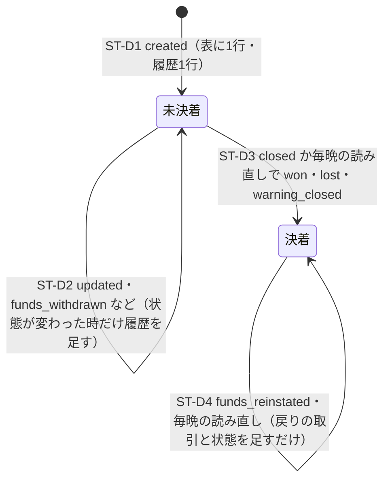
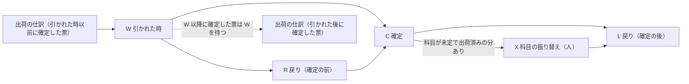

# カード会社からの支払いの取り消し（dispute）の状態と計上の段

> 状態: 現行のソース（会計の作り直し 計画2 Task 5・6・7。手元の Supabase で確かめた分。本番には未適用） | 確認日: 2026-11-09 | 対象: `stripe_disputes`（dispute の状態）、`stripe_dispute_events`（履歴）、dispute の仕訳の4つの段（W・C・R／L・X）とその待ち合い

## 概要

dispute は Stripe の側で状態が動き（`needs_response` → `under_review` → `won`／`lost` など）、お金は引かれた時（残高の取引 `adjustment`・`dispute`、額がマイナス）と戻った時（`dispute_reversal`、額がプラス）に動く。計上は、この動きを4つの段の仕訳に分ける。段は互いに待ち合うが、輪にはならない。

| 段 | 意味 | 仕訳 | 印 |
| --- | --- | --- | --- |
| W（引かれた時） | 残高から引かれた | 貸 `1160`（額 A）／借 `2150`（未出荷の分 U）・借 `1470` 補助 `dispute_pending`（出荷済みの分 S） | `dispute_event:<dp>:withdrawn:<取引>` |
| C（確定） | 負けて損失が確定した | 借 設定の科目（無ければ `1470` 補助 `dispute_confirmed_unassigned`）／貸 `1470` 補助 `dispute_pending`（仮払金の残り全部） | `dispute_event:<dp>:confirmed:lost` |
| R（確定の前の戻り） | 確定の前に戻った | 借 `1160`／貸 `2150`（未出荷の分）・貸 `1470` 補助 `dispute_pending`（出荷済みの分） | `dispute_event:<dp>:reversal:<戻りの取引>` |
| L（確定の後の戻り） | 確定の後に戻った | 借 `1160`／貸 `2150`（未出荷の分）・貸 C が使った科目（出荷済みの分） | 同上 |
| X（科目の振り替え） | 科目が未定だった損失を人が振り替えた | 借 設定の科目／貸 `1470` 補助 `dispute_confirmed_unassigned` | `dispute_event:<dp>:assigned:1` |

W の額の分け方は、引かれた時の番号 N の時点の着ごとの残りの価値で、出荷済みの分 S と未出荷の分 U に分ける（端数は小さい番号の着）。戻り R／L の分け方は、その dispute の戻りの累計で割る。R か L かは Stripe の時刻で決める（確定の時刻 = 確定した履歴行の Stripe の時刻の最も早い物、無ければ `occurred_at` の最も早い物。戻りの Stripe の時刻がそれより後なら L、同じか前なら R）。C が済んだ（仕訳が入った、または `no_revenue`）後に残る戻りは、時刻にかかわらず全部 L。

## 範囲と根拠

| 項目 | 内容 |
| --- | --- |
| 対応要件 | FREQ-567（受け取り）、FREQ-568（仕訳）、FREQ-569（計上待ち） |
| 実装 | 移行 `supabase/migrations/20261108190000_accounting_p2_dispute_intake.sql`（S10）、`20261108200000_accounting_p2_dispute_posting.sql`（S11）。アプリ: [dispute-sync.ts](../../../src/lib/stripe/dispute-sync.ts)、[reconcile-orders.ts](../../../src/lib/stripe/reconcile-orders.ts) |
| 関連 | 受け取りと係の流れは[計上係のシーケンス](../sequence/accounting-posting.md)、保留は[計上待ちの状態](accounting-pending.md) |
| 調査時点 | 2026-11-09 のソース |

## dispute の状態（`stripe_disputes.status`）

状態は Stripe の値をそのまま持つ（1〜64字）。計上が見る「決着」は `won`・`lost`・`warning_closed` と、`lost` の履歴行がある場合。

| ID | 契機 | 条件・副作用 | 実行する物 |
| --- | --- | --- | --- |
| ST-D1 | `charge.dispute.created` | `dp_…` の番号。額は正。表と履歴を書く。表の `id`・`amount`・`currency`・`reason`・`charge_id`・`payment_intent_id`・`stripe_created_at` は後から変えられない（`ACCOUNTING_HISTORY_IMMUTABLE`）。`order_id` は一度入れば NULL に戻らない | `syncDisputeAccounting` → `record_stripe_dispute` |
| ST-D2 | `updated`・`funds_withdrawn` | 取得時刻が新しい物だけが表を更新する（古い取得は上書きしない）。履歴行は `stripe_event_id` で一意 | 同上 |
| ST-D3 | `closed` と毎晩の読み直し（未解決の全件〔上限500〕と直近30日） | `lost` になる時は、確定の時刻を `events.list`（`charge.dispute.closed`）で探して履歴に残す（Stripe は30日しか持たない） | `reconcileStripeDisputes` |
| ST-D4 | `funds_reinstated` | 戻りの残高の取引を保存し、残高の取引の `payout_id` は元のまま | 同上 |

## 計上の段と待ち合い

| 段 | 待つもの（保留の理由） |
| --- | --- |
| W | 注文が結び付く（`no_order`）、切り替えの日（`before_cutover`）、期間（`period_missing`）、成功した返金が無い（`dispute_refund_overlap`）、返品の返金待ちが無い（`dispute_return_refund_pending`）、引かれた時以前に確定した発送票の仕訳（`dispute_shipment_pending`）、着ごとの価値（`order_not_postable`）、前受金の残り（`deferred_revenue_short`） |
| R／L | 注文、W（`dispute_withdrawal_missing`）、決着（`dispute_status` つき）、L は C の済みと、出荷済みの分があれば科目（`waiting_on = dispute_account_unassigned`）、切り替えの日、期間 |
| C | W、確定の時刻以前の R、仮払金が0なら仕訳なし（`no_revenue`）、切り替えの日、期間。W の取引が全部計上済みであること |
| X | 人の操作だけ（`admin.accounting.entries.correct`）。再送は要求の鍵で同じ答え。1つの dispute に1回 |

- 出荷の係は、引かれた時の番号より後に確定した票を、W が入るまで待たせる（循環しない）。画面と route は、引かれた取引のある判断待ちの dispute を含む票の確定を止める（`DISPUTE_HOLD`）。
- W の `before_cutover` の行は、出荷の側が待つ相手に数えない（待ち続けないため）。

## 独立属性・冪等性

- 印は dispute の番号・段・取引の番号で一意。同じ出来事は1本。
- 読み（`list_accounting_disputes`・`get_order_dispute_holds`・`get_slip_dispute_holds`）は `raw_payload`・`evidence_details`・名前を返さない。
- 設定（原因ごとの科目）は、費用か収益の科目だけ。16の原因のどれか以外は `other`。

## 関連テスト

- DB: `accounting_p2_dispute_intake`（受け取り）、`accounting_p2_dispute_posting`（段・待ち合い・届く順の組み合わせ12行）、`accounting_p2_dispute_concurrency`（並行）、`accounting_p2_run_posting_postgrest`（権限）。
- アプリ: `tests/unit/lib/stripe/dispute-sync.test.ts`、`tests/unit/api/admin/accounting-disputes-route.test.ts`、`tests/unit/components/cost-profit/dispute-settings-panel.test.tsx`。E2E: `FR-ADMIN-133`（FREQ-568-AC-02・06）。

## 未確認事項

- 引かれた後に確定した発送票と W の止まりかたと回復、切り替えの日をまたぐ dispute、確定の前の戻りが確定の後に保存された時の日付（[運用](../../06_Operations/accounting-p2-posting-stripe.md)の未確認事項 10〜12）。
- dispute の取引で想定外の種類・符号の組は、キーが付かず保留に残る（未確認事項 9）。
- 出荷済みの品の取り消しの消費税の区分と、原因ごとの科目は、課税事業者になる前に税理士と決める。
