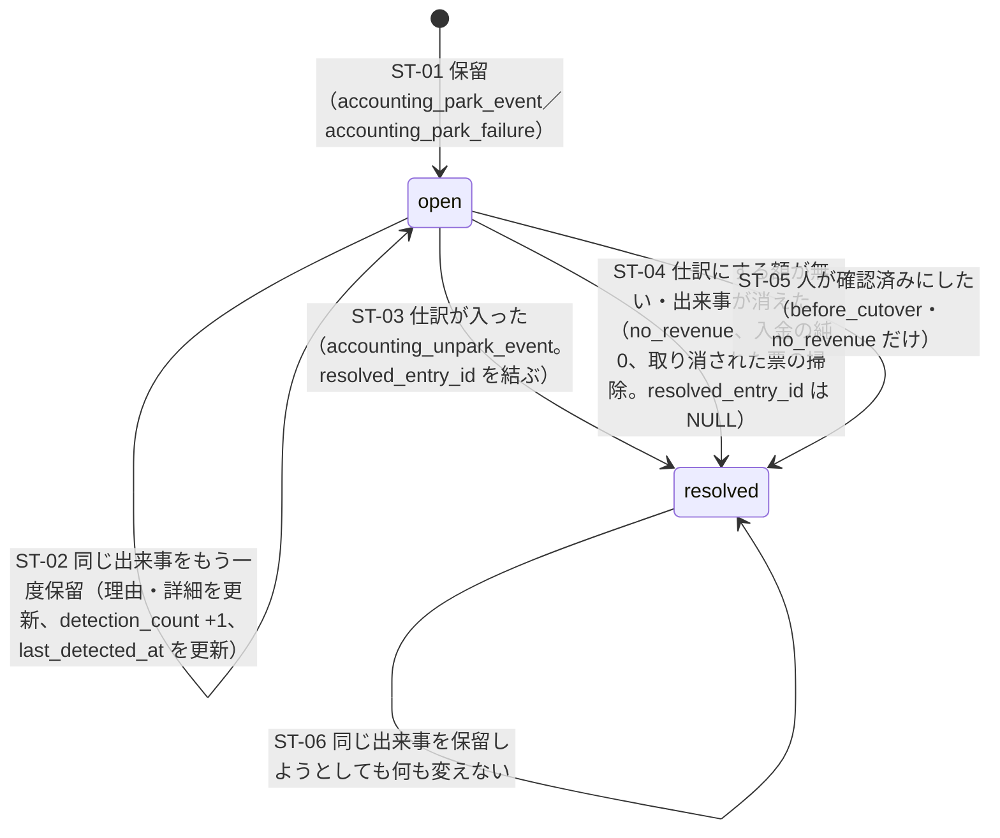

# 会計の計上待ち（仕訳にできていない出来事）の状態

> 状態: 現行のソース（会計の作り直し 計画2 Task 1・2・3・4・6・10・11。手元の Supabase で確かめた分。本番には未適用） | 確認日: 2026-11-09 | 対象: `accounting_pending_events`（計上待ちの行）の「開いている」「解決済み」と、その間の遷移

## 概要

仕訳にできない出来事（支払い、発送票、Stripe の取引、dispute）は、捨てずに `accounting_pending_events` へ理由つきで置く。1つの出来事（種類・出どころの表・出どころの番号）に1行。状態は2つだけで、`resolved_at` が NULL なら「開いている」、入っていれば「解決済み」。解決済みは終わりで、同じ出来事の保留は二度と書き換えられない。

| 状態 | 見分け方 | 意味 |
| --- | --- | --- |
| 開いている（open） | `resolved_at IS NULL` | 理由つきで待っている。次の計上の呼び出しで見直す（最大10件ずつ） |
| 解決済み（resolved） | `resolved_at` あり | 仕訳が入った（`resolved_entry_id`）、仕訳にする額が無い（`resolved_entry_id` が NULL）、出来事が無くなった（取り消された票など）、人が確認済みにした（`resolved_by`・`resolution_note`） |

## 範囲と根拠

| 項目 | 内容 |
| --- | --- |
| 対応要件 | FREQ-569（計上待ちと前受金の確認）、FREQ-562〜568（理由の出どころ） |
| 実装 | 移行 `supabase/migrations/20261108150000_accounting_p2_posting_tables.sql`（S6。表と `accounting_park_event`・`accounting_unpark_event`・`admin_resolve_accounting_pending_event`・`list_accounting_pending_events`）、`…160000`（S7。`accounting_park_failure`）。アプリ: [posting-route.ts](../../../src/lib/accounting/posting-route.ts)、[pending-view.tsx](../../../src/components/cost-profit/pending-view.tsx) |
| 関連 | 係の流れは[計上係のシーケンス](../sequence/accounting-posting.md)、読み方は[会計の運用](../../06_Operations/accounting-p2-posting-stripe.md)の 2 |
| 調査時点 | 2026-11-09 のソース |

## 状態の遷移

| ID | 契機 | 条件 | 副作用 | 実行する物 |
| --- | --- | --- | --- | --- |
| ST-01 | 計上係が仕訳にできない出来事を見つけた | `event_kind` が仕訳の種類の目録の中。`reason` が18種の中。`detail` が理由ごとの鍵を満たす（`period_missing` は `entry_date` が要る。`error_code` は `unexpected_error` か `^(ACCOUNTING|GROUP_G|GROUP_H)_[A-Z0-9_]{1,80}$`） | 行を新しく書く。違うと `ACCOUNTING_ARGUMENT_INVALID`（22023）。例外の文は保存しない | `private.accounting_park_event`（直接の呼び出し元は各係。失敗の保留は `accounting_park_failure` がこれを呼ぶ） |
| ST-02 | 次の呼び出しでも、まだ仕訳にできない | 行が開いている | 理由と詳細を最新にし、`order_id` は NULL で消さない。数が増える | 同上（`ON CONFLICT … DO UPDATE … WHERE resolved_at IS NULL`） |
| ST-03 | 仕訳が入った | 同じ出来事の開いている行がある | `resolved_at`・`resolved_entry_id` | `private.accounting_unpark_event` |
| ST-04 | 額が0（`no_revenue`）、純0の入金（`payout_net_zero`）、取り消された票の掃除、後の直しに追い越された日の直し | 係の判断 | 同上（`resolved_entry_id` は NULL）。`no_revenue` は保留と同時に閉じる | 各係 |
| ST-05 | 画面の「確認済みにする」 | 理由が `before_cutover` か `no_revenue`。権限 `admin.accounting.entries.correct`。メモは1〜500字。要求の鍵（再送は同じ内容なら同じ答え） | `resolved_by`・`resolution_note`・`resolution_request_key`・`resolution_request_hash`。ほかの理由は `ACCOUNTING_EVENT_NOT_POSTABLE`（409）、解決済みは `ACCOUNTING_PENDING_RESOLVED`（409） | `public.admin_resolve_accounting_pending_event` ← `POST /api/admin/accounting/pending-events/[id]/resolve` |
| ST-06 | 解決済みの出来事を保留し直そうとした | 行が解決済み | 何もしない | `accounting_park_event` の `WHERE resolved_at IS NULL` |

## 理由ごとの待ちの先

| 理由 | 待つもの | 解消 |
| --- | --- | --- |
| `payment_journal_missing`・`amount_mismatch`・`no_order`（支払いの側） | 注文と結び付く支払いの仕訳、総額の一致 | 支払いが入る・取引が同期し直される。`no_order`（payment intent の無い売上）は手では閉じられず残る |
| `order_not_postable`・`units_insufficient`・`shipment_lines_mismatch`・`shipment_date_mismatch`・`deferred_revenue_short` | 注文の形、着の数、明細、日、前受金の残り | 直る・支払いや戻しが入る。`units_insufficient` はその発送票を取り消した時だけ |
| `before_cutover`・`period_missing`・`no_revenue` | 切り替えの日、期間、額 | `before_cutover`・`no_revenue` は人が確認済みにする。`period_missing` は期間を作る |
| `unknown_category`・`payout_mismatch` | 取引の種類の対応、入金の中身の一致 | 対応が足される・照合が済む |
| `dispute_*`（4種） | dispute の前の段の仕訳、科目の設定、返金・返品の仕訳（計画3）、出荷の仕訳 | [dispute の状態](accounting-dispute.md) |
| `posting_error` | 人が原因を直す | 直して「もう一度計上する」。確認済みにはできない |

## 独立属性・冪等性

- 印: `(event_kind, source_table, source_id)` が一意。同じ出来事は1行だけ。
- 数の意味: `detection_count`（見つけた回数）は、開いている間だけ増える。
- 掃除: 係は毎回、取り消された票の保留の行と、後の直しに追い越された日の直しの行を、仕訳なしで閉じる。
- 一覧: 新しい順（`first_detected_at`、`id`）の続きの目印で読む。目印が古いと `ACCOUNTING_LIST_RESTART`（409）で最初から読み直す。画面の既定は開いている行だけ。

## 関連テスト

- DB: `tests/integration/db/accounting_p2_posting_tables.integration.test.ts`（保留の書き手と読み、詳細の検査、解決）、`accounting_p2_run_posting.integration.test.ts`、各係の試験。
- アプリ: `tests/unit/api/admin/accounting-pending-events-route.test.ts`、`tests/unit/components/cost-profit/pending-view.test.tsx`。E2E: `FR-ADMIN-132`（FREQ-569-AC-01・06）。

## 未確認事項

- `payment intent` の無い売上の行（`no_order`）を閉じる道は、計画6の訂正の入口ができるまで無い。
- 保留の行の増え方（長く解決しない行が溜まる）の掃除は決めていない。
