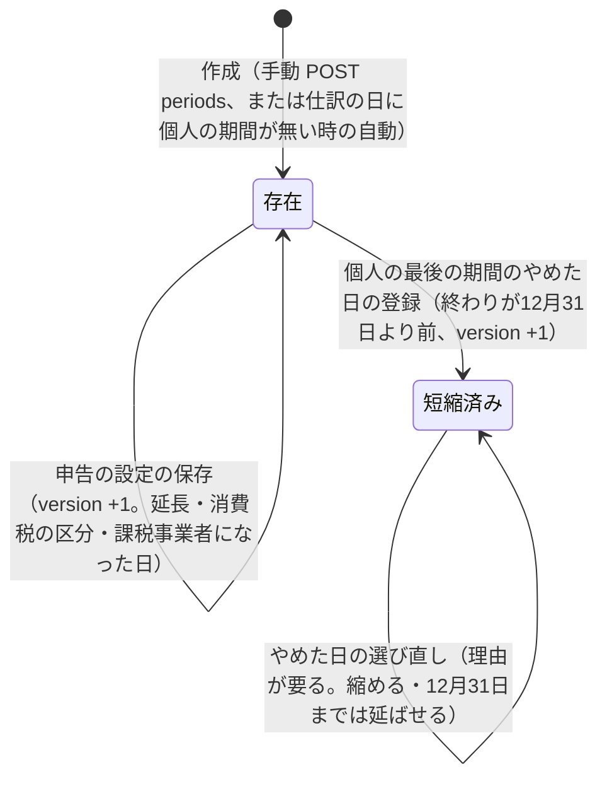
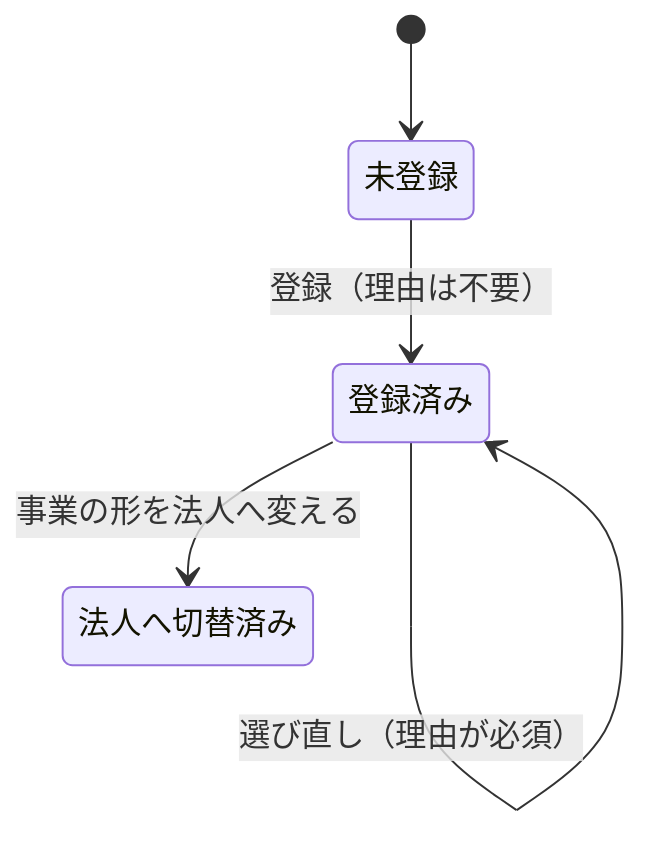

# 会計の期間と個人事業の最後の日の状態

> 状態: 現行のソース（会計の作り直し 計画1 Task 7・8・11。手元の Supabase と使い捨てのコンテナで確かめた分。本番には未適用） | 確認日: 2026-11-08 | 対象: `accounting_periods`（期間）、`accounting_settings`（開業日・事業の形・個人事業を終えた日）

## 概要

計画1の期間は「開いている」ままで、締める・締めを解くの状態は持たない（`accounting_periods` に状態の列が無い。締めは後の計画）。変わるのは次の3つだけで、どれも追記と版番号（`version`）で管理し、削除しない。

| 対象 | 状態の持ち方 | 変わる契機 |
| --- | --- | --- |
| 期間 | 作られて存在する。申告の設定と、個人の最後の期間の終わりの日だけが変わる | 作成（手動・仕訳の日による自動）、申告の設定の保存、やめた日の登録・選び直し |
| 開業日 | `business_start_date` が NULL → 入力済み。一度入れたら変えられない | 設定の保存 |
| 個人事業を終えた日 | `sole_business_ended_on` が NULL → 登録済み → 選び直し（何度でも、理由が要る） | 最後の個人の期間のやめた日の登録・選び直し |

## 範囲と根拠

| 項目 | 内容 |
| --- | --- |
| 対応要件 | FREQ-555（期間・やめた日）、FREQ-561（開業日・申告の期限） |
| 実装 | 移行 `20261107130200_accounting_p1_journal_foundation.sql`（S2。期間の表と長さの検査）、`20261107130300_accounting_p1_period_reads.sql`（S3。設定・期間の書き手とトリガー）、[period.ts](../../../src/lib/accounting/period.ts)、[settings-view.tsx](../../../src/components/cost-profit/settings-view.tsx) |
| 関連 | 仕訳の流れは[会計の仕訳のシーケンス](../sequence/accounting-journal.md)、窓口は[API 仕様](../../03_BasicDesign/api/api-spec.md)の `/api/admin/accounting/*` |
| 調査時点 | 2026-11-08 のソース |

## 期間の存在と変更

| 規則 | 内容 |
| --- | --- |
| 長さ | 1期間は1年を超えない（`accounting_period_length_ok`。起算は翌日、応当日の前日に満了）。個人の期間は暦年（1月1日始まり、同じ年の中で終わる） |
| 重なり・すき間 | 同じ事業の形の期間は重ならず、すき間も作らない。作成と COMMIT の時（遅延トリガー）に検査する |
| 自動で作る期間 | 個人の事業の形で、仕訳の日を含む期間が無い時だけ暦年の個人の期間を作る（開業日の年（未入力は2025年）から今年の翌年まで。間の年も作る）。やめた日より後の年は作らない |
| 名前 | 個人は `YYYY年（個人）`、法人は始まりの順の `第N期` |
| 法人の期間 | 手動でだけ作る。第1期の始まりは自由（成立の日）。2期目からは前の期間の翌日から始まる |
| 変えられない列 | 番号・事業の形・始まりの日・作成の記録・要求の印。直接変えると `ACCOUNTING_HISTORY_IMMUTABLE`（500）。DELETE・TRUNCATE も拒む |

## やめた日の規則（最後の個人の期間）

| 規則 | 内容 |
| --- | --- |
| 対象 | 最後の（始まりが一番新しい）個人の期間だけ。日はその期間の始まりから12月31日の間 |
| 縮める時の拒否 | その日より後の日付の仕訳（元の仕訳も取り消しも）があると 409 `ACCOUNTING_PERIOD_SHORTEN_BLOCKED`。課税事業者になった日より前にも縮められない（400） |
| 後の期間があると登録できない | 翌年以降の個人の期間が既にあると 409 `ACCOUNTING_PERIOD_SHORTEN_BLOCKED`。翌年の個人の期間は、その年の日付の取引が書かれた時などに自動で作られるため、事業をやめたら、年が変わる前、かつ事業の形を法人へ変える前に登録する |
| 登録後の仕訳の日 | やめた日より後の日付は、事業の形が個人のままなら 409 `ACCOUNTING_PERIOD_MISSING`（本文「やめた日が正しいか確かめ、正しければ事業の形を法人へ切り替えてください」）。法人へ切り替えると法人の期間に入る。個人の期間は黙って作られない |
| 画面 | 個人から法人へ変える時は、やめた日の登録済みと確かめの印が要る（DB は事業の形の更新だけでは確かめない）。登録後は個人の期間の追加を案内しない |
| 記録 | 登録・選び直しごとに `sole_end_changes` へ（前の日・新しい日・理由・時刻）を追記する。変更者は応答に出さない。同じ日の再送は何も変えない（版も上げない） |
| 競合 | 期間と設定の版を渡し、違えば 409 `ACCOUNTING_VERSION_CONFLICT`。同じ要求の印で内容が違えば 409 `ACCOUNTING_REQUEST_KEY_CONFLICT` |

## 関連テスト

- DB: `tests/integration/db/accounting_p1_periods.integration.test.ts`（期間・やめた日）、`accounting_p1_opening.integration.test.ts`（期首）、`accounting_p1_reads.integration.test.ts`（読み）、`accounting_p1_migration_asserts.integration.test.ts`（末尾の検査）。
- 単体: `tests/unit/lib/accounting/period.test.ts`、`accounting-store.test.ts`。画面: `tests/unit/components/cost-profit/settings-view.test.tsx`。E2E: `FR-ADMIN-128`。

## 未確認事項

- 期間を締める・締めを解く状態は計画6で追加する。計画1には無い。
- 個人から法人への切り替えを画面の確かめなしで DB だけに送った時の挙動（法人へ戻す更新を含む）は、画面の経路としては確かめていない。
- 本番の設定の表は未適用。適用後の最初の読み取りは運用の文書の手順に従う。
