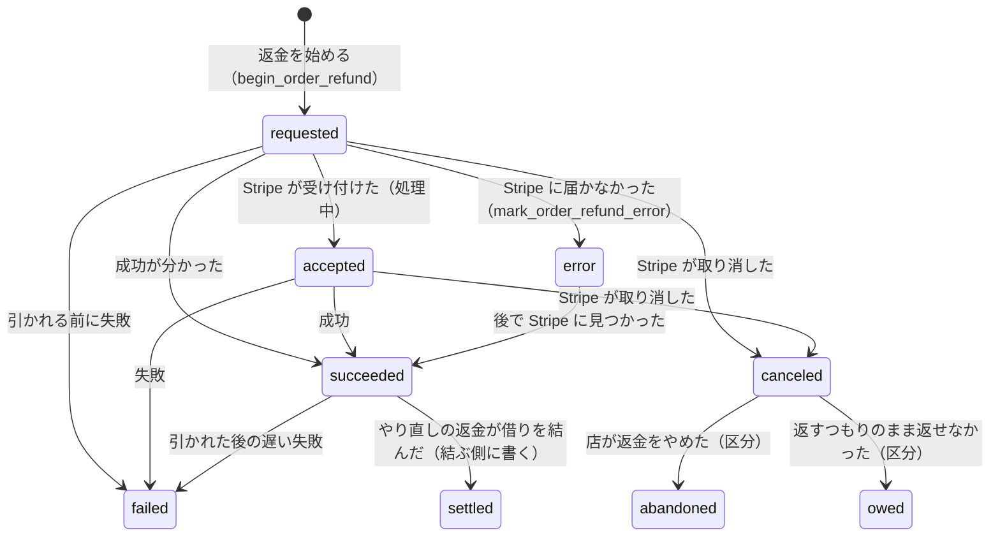

# 会計の返金の状態の履歴と取り消しの区分の状態

> 状態: 現行のソース（会計の作り直し 計画3 Task 1・3・6。手元の Supabase で確かめた分。**本番には未適用**） | 確認日: 2026-11-15 | 対象: `accounting_refund_events`（返金の状態の履歴）と、取り消された返金の区分（`abandoned`・`owed`）

## 概要

注文の返金（`order_refunds`）の状態は、お金の側の状態（`order_refunds.status`）とは別に、会計のために状態の履歴を1状態1行で追記する（`accounting_refund_events`）。同じ返金に同じ状態を2行入れることはできず（`(refund_id, state)` が一意）、同じ状態の再処理で行は増えない。履歴は追記専用で、更新・削除・TRUNCATE は断られる。計上係（返金の係）は、返金ごとに最後の状態と事実だけから仕訳を作る。時刻（`occurred_at`）は知った時刻で、2つの事実の前後を比べるのには使わない。順番は番号 `seq` と G の鍵の中の番号 `fact_seq` で決める。

この文書は[注文・決済の状態](order-payment.md)と別の対象を扱う。注文の状態は `orders.status`、ここは会計が見る返金の履歴。

## 範囲と根拠

| 項目 | 内容 |
| --- | --- |
| 対応要件 | FREQ-576-AC-01（履歴）、FREQ-579-AC-02・03・07・08（失敗・取り消し・やめた・返す）、FREQ-577-AC-09（届く順） |
| 実装 | 移行 S15（表）・S17（書き手）・S20（計上と結び）。書き手は `private.accounting_record_refund_event`（返金を始める関数・結果を書く関数・error を書く関数・取り消しの区分の関数・結びが呼ぶ）。[ER 図](../../03_BasicDesign/data/er.md)の「会計の返金・返品の表」 |
| 調査時点 | 2026-11-15 のソース。本番には S15〜S25 とも未適用 |

## 状態の遷移

状態は9つ（`requested`・`accepted`・`succeeded`・`failed`・`canceled`・`abandoned`・`owed`・`error`・`settled`）。実装が許すのは、同じ状態を1回だけ書くことで、状態の順序そのものを表では強制していない。次の図は、書き手が書きうる順番を示す（試験が通す形）。

| 状態 | 意味 | 書く人・関数 | 仕訳への効き |
| --- | --- | --- | --- |
| `requested` | 返金を始めた | 返金を始める関数（管理者・支払い済みのキャンセル・返品の返金）、外の返金の記録 | 事実（額・出来事・割り当て）が同じ取引で残る。仕訳はまだ無い |
| `accepted` | Stripe が処理中 | 結果を書く関数 | 残高の取引が無い間は仕訳を作らない |
| `succeeded` | 成功 | 結果を書く関数 | 残高の取引の日に返金の仕訳（出荷前: 2150／1160、返品: 2130／1160、出荷後: 4020／1160） |
| `failed` | 失敗 | 結果を書く関数 | 引かれた後なら戻りの取引の日に「Stripe 未収金／返金の未払い」。引かれる前の出荷前は決まった日に「前受金／返金の未払い」。引かれる前の返品は仕訳を作らない |
| `canceled` | Stripe が取り消した | 結果を書く関数 | 区分を選ぶまで計上待ち（`refund_cancel_undecided`） |
| `abandoned` | 店が返金をやめた（区分） | `admin_decide_refund_cancellation`（理由・人・要求番号が必須） | 引かれた後なら元の仕訳の取り消しだけ。発送前の取り消しならその着を送れるように戻し、割り当てを返す |
| `owed` | 返すつもりのまま返せなかった（区分） | 同上 | 失敗と同じ借り。振込かやり直しの結びで消す |
| `error` | Stripe に届かず記録だけ | `mark_order_refund_error` | 仕訳を作らない。やり直しは返金を新しく始める |
| `settled` | やり直しの返金が借りを結んだ | `admin_settle_owed_by_refund`（結ぶ側の返金に書く） | 結んだ額だけ借りを戻す |

## 取り消しの区分

- 区分は取り消された（`canceled`）返金にだけ選べる。選ぶまで計上待ちに残る。2回目は前の結果、違う内容は `ACCOUNTING_REFUND_CANCEL_DECIDED`、同じ要求番号で違う内容は `ACCOUNTING_REQUEST_KEY_CONFLICT`。
- 区分の行は理由・人・要求番号が必須（`state IN ('abandoned','owed')` と同時に3つがそろう。それ以外の状態は3つを持たない）。
- `abandoned` の行だけが、戻せなかった額 s（`release_shortfall`）と持ち越す直し d（`carried_adjust`）を1回だけ持つ。ほかの状態は持たない。
- Stripe に届いていない `error` の返金は、発送前の取り消しの戻しを断る（`UNIT_CANCEL_REVERT_REFUSED`）。この返金の道は、返金を Stripe へやり直すことだけ。
- 引かれて戻された（`succeeded` の行が無いまま Stripe が取り消した）返金の区分は、戻りの取引が無い間 `failure_txn_missing` で待つ。

## 独立属性・冪等性

- 同じ状態の再処理は行を増やさない（`(refund_id, state)` が一意）。順番 `seq` は返金ごとに1から。
- 届く順が入れ替わっても、各仕訳の額と最後の残高は同じ（FREQ-579-AC-06、FREQ-581-AC-08。16の例の順をすべて試す）。
- 同時に同じ返金を流しても1本（G の鍵の中で番号を取る）。

## 関連テスト

- DB: `tests/integration/db/accounting_p3_return_refund_tables`（制約・追記専用）・`accounting_p3_refund_writers`（書き手が残す履歴）・`accounting_p3_refund_failures`（失敗・取り消し・振込・結び）・`accounting_p3_refund_order_independence`（届く順）・`accounting_p3_refund_writers_concurrency`・`accounting_p3_refund_rule5`（`.integration.test.ts`）。
- アプリ: `tests/unit/lib/accounting/return-refund-types.test.ts`（状態は9つ・TS の `REFUND_EVENT_STATES` と同じ順）。

## 未確認事項

- 状態の順序（例: `succeeded` の後に `requested` を書かない）は、書き手の呼び方が守るもので、表の制約では強制していない。
- 結びの関数（S20）の穴: 成功したのちに失敗した返金が支払いの返金として受け付けられうる。普通の返品の借りの結びが受け付けられうる（P3-T11j。最終レビューで扱いを決める）。
