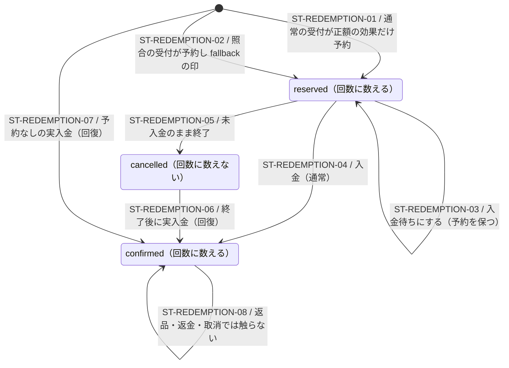

# 割引の使用（redemption）の状態

> 状態: 実装済み（グループ H Task 7、DB 試験は controller 実行待ち） | 確認日: 2026-10-29 | 対象: `discount_redemptions.state` と要対応の印（`attention_kind`・`reconciliation_fallback`）

## 概要

割引の使用は注文ごと・割引ごとに 1 行（`UNIQUE (order_id, discount_id)`）。`state` は `reserved`（予約）・`confirmed`（確定）・`cancelled`（取消）の 3 値で、使用回数は `reserved + confirmed` を数え、`cancelled` は数えない。書くのは注文の受付と入金の関数だけで、表への直接の書込みは認めない。返品・返金・注文の取消で `confirmed` を戻さない（D14）。

要対応の印は状態とは別の属性で、`confirmed` の行にだけ付く。付いた印は金額・使用履歴・出荷を変えず、「確認済みにする」で表示だけ閉じる（C20 案）。

## 範囲と根拠

対応領域: [注文の状態](order-payment.md)、[注文管理シーケンス](../sequence/order-administration.md)、仕様書 [グループ H 割引](../../superpowers/specs/2026-10-28-group-h-promotions-design.md) の 6.2・11.2・16 章。実装は [H4 移行](../../../supabase/migrations/20261029130300_group_h_discounts_acceptance.sql) の `private.group_h_reserve_redemptions`・`private.group_h_settle_redemptions` と、これを呼ぶ `place_order_from_checkout_draft`・`place_reconciled_order_from_checkout_draft`・`mark_order_paid`・`release_stock_for_unpaid_order`・`record_cancelled_order_paid_amount`。支払いの例外の解決による未入金の取消は [H7 移行](../../../supabase/migrations/20261029130600_group_h_payment_exception_cancel.sql) の `private.resolve_payment_exception` から同じH4 helperを呼ぶ（2026-11-01追加。同日、手元のDBで取消と取消なしの両方を確認済み）。

## 状態定義と図

## 遷移条件

| ID | 契機・ガード | 更新と結果 |
| --- | --- | --- |
| ST-REDEMPTION-01 | 通常の `place_order_from_checkout_draft`。固定 draft の本人・割引 id の鍵を取り、`group_h_recheck_discount_facts` が `valid`。額が正の効果だけ | `reserved` を作る。同じ Session の再送は既存の注文を返すだけで増やさない。再確認が `codes_invalid` / `automatic_changed` なら注文・在庫・予約を作らず `rejection` を返す |
| ST-REDEMPTION-02 | `place_reconciled_order_from_checkout_draft`（`paid` / `awaiting_payment`）。金額・通貨・所有者・固定 snapshot の確認は保つが、現在の回数・1 人 1 回・期間・停止・割当・初回・着数では拒否しない | `reserved` を作り `reconciliation_fallback=true`。通常の受付では立てない |
| ST-REDEMPTION-03 | `mark_order_awaiting_payment`（`payment_in_progress` → `pending`） | 予約を保つ。要対応は付けない |
| ST-REDEMPTION-04 | `mark_order_paid` と同じ取引で `group_h_settle_redemptions(order, true)` | `reserved` → `confirmed`、`confirmed_at` を書く。上限・1 人 1 回・単発 code を超えていれば `discount_limit_exceeded`、fallback の行なら `discount_reconciliation_recovered`、どちらでもなければ印なし |
| ST-REDEMPTION-05 | `release_stock_for_unpaid_order` が `failed` / `abandoned` / 未入金の `cancelled` へ進めた取引、または `resolve_payment_exception(_cancel_order=true)` が `payment_in_progress` / `pending` の注文を取り消した取引。注文が入金済み（`paid`・`shipped` または `paid_amount > 0`）でない | 取消UPDATEの直後に `group_h_settle_redemptions(order, false)` を呼び、`reserved` → `cancelled`、`cancelled_at` を書く。全体・本人・コードの使用回数と初回の予約を戻し、管理の割り当て表も「使用済み（入金待ち）」ではなく未使用になる。新しい要対応は出さない。`_cancel_order=false` は予約を保つ。入金済みの注文では何も変えない（paid と expire の順違いでも `confirmed` を戻さない） |
| ST-REDEMPTION-06 | `mark_order_paid`（失敗・取消後の入金）または `record_cancelled_order_paid_amount`（取消済み注文への実入金）。実入金は `paid` / `shipped` または `paid_amount > 0` | `cancelled` → `confirmed`。同じ確定処理で `discount_reconciliation_recovered`（超過なら `discount_limit_exceeded`）の印 |
| ST-REDEMPTION-07 | 予約が無い注文への実入金で、固定 draft が使える | `group_h_reserve_redemptions` で作ってから確定し、fallback の印と回復の要対応を 1 件出す |
| ST-REDEMPTION-08 | 返品・返金・取消・出荷 | `confirmed` の行は変えない。返金で割引を戻さず、初回の資格も戻さない |

## 独立属性・冪等性

- `attention_kind` は `confirmed` の行にだけ付き、再送で重複させない（`COALESCE(attention_kind, 新しい kind)`）。注文ごとの表示は 1 欄にまとめ、`discount_limit_exceeded` を優先する。
- `attention_resolved_at` / `attention_resolved_by` は「確認済みにする」（`admin_resolve_discount_attention`、`admin.orders.manage`）だけが書く。金額・状態・出荷は変えない。
- 本人鍵の結付け（`link_guest_orders`）は `user_id` と `identity_key` を会員へ付け替えるだけで、回数も状態も変えない。すでに 2 回確定していても消さず、unique 違反にしない（D16）。
- 確定時の超過の数え方は、他の注文の `reserved` + `confirmed`（fallback の予約を含む）を使う。照合の予約が先に上限を押し上げた場合、正規に予約していた注文が確定時に `discount_limit_exceeded` になることがある（D16 の範囲で、割引は認めて確定する）。
- 照合の受付は `orders.user_id` を空にする（グループ C の注文の持ち主の決まり）。redemption の本人は固定 draft の会員から取り、`auth.users` に行が無い（退会済み）時は `user_id` を NULL、`identity_key` は `member:<id>` のまま保つ。
- 割引 0 円の H 注文は redemption と配分を持たないが、全通常行の数量ぶんの `order_line_unit_amounts` を持つ。

## ロック順

G 共通鍵 `pg_advisory_xact_lock(190521,1)` → H 目録 `(190522,0)` → 本人キー `(190523, hashtext(identity))`（辞書順）→ 割引 id `(190524, hashtext(id))`（昇順）と行ロック → G 既存の在庫・注文・明細の鍵。helper は `GROUP_H_LOCK_REQUIRED / 55000` で鍵の不足を断る。

## 関連テスト

[受付](../../../tests/integration/db/group_h_acceptance.integration.test.ts)・[予約の遷移](../../../tests/integration/db/group_h_redemptions.integration.test.ts)・[並行](../../../tests/integration/db/group_h_acceptance_concurrency.integration.test.ts)・[末尾 assert](../../../tests/integration/db/group_h_migration_asserts.integration.test.ts)。DB 試験は controller が実行する。

## 未確認事項

本番の実データでの件数、Stripe の実決済での fallback の経路、3 連続の並行試験は controller の実測待ち。
