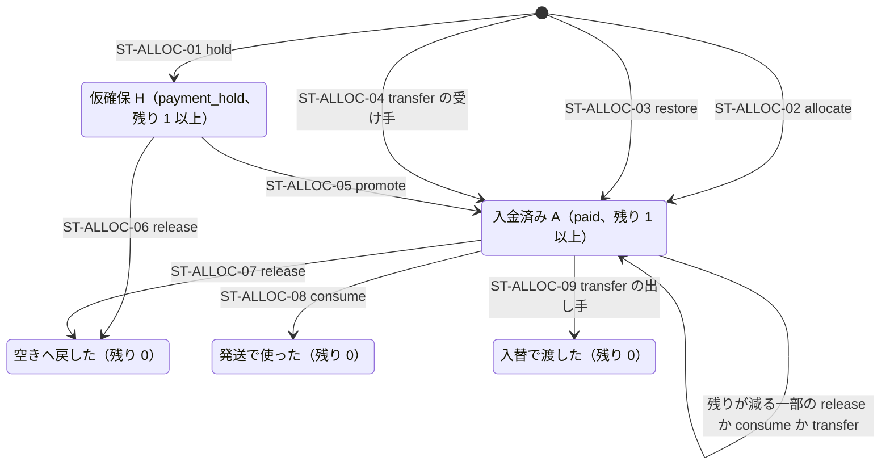
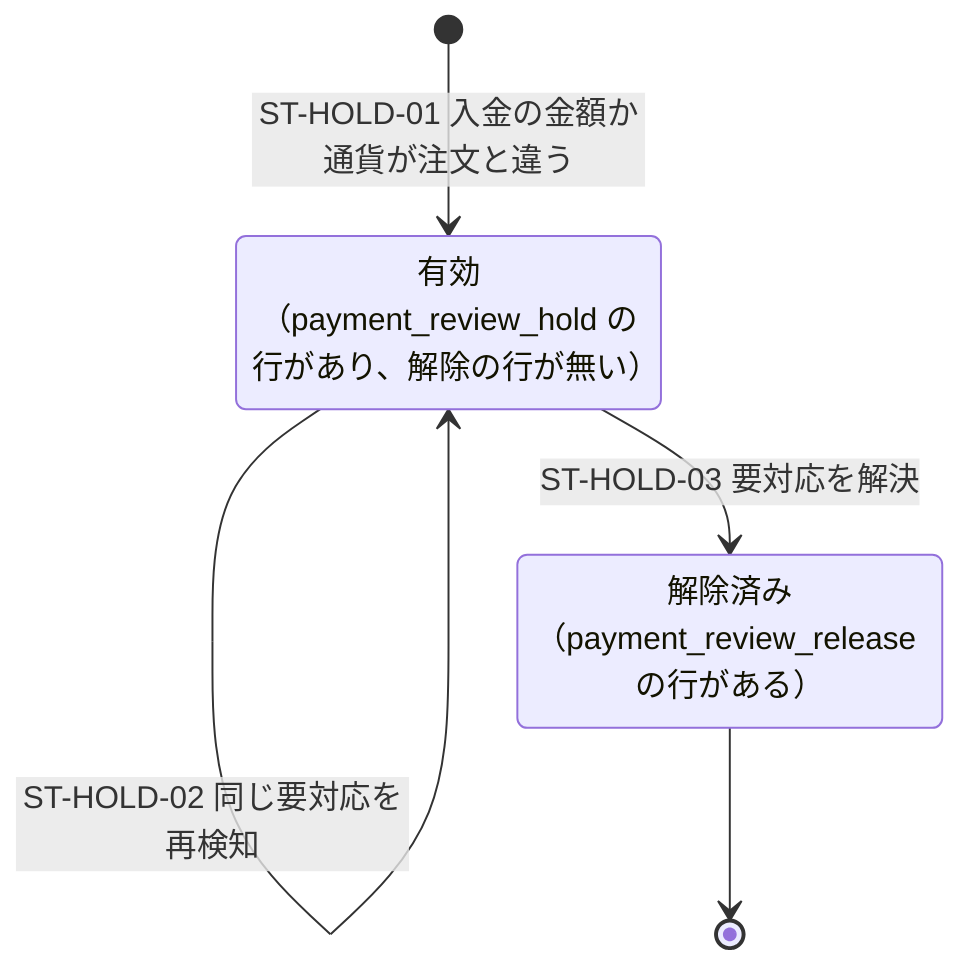

# 在庫の割当の状態（G-1）

> 状態: 現行のソース（グループ G-1。2026-10-24 に本番へ適用済み） | 確認日: 2026-10-24 | 対象: `order_item_allocations` の種類と残数量、割当の履歴の型、支払額の違いの保留、`orders.paid_at`

## 概要

割当の1本は、種類 `kind`（`payment_hold` が仮確保 H、`paid` が入金済みの割当 A）と残数量 `remaining_quantity` だけで状態が決まる。状態の列は持たない。変えられるのは「H から A への種類の変更」と「残数量が減ること」だけで、変わるたびに `version` を 1 進め、同じ取引で履歴 `order_item_allocation_events` を足す。数量・作った操作・明細・variant は作った後に変えない。

品物ごとの12状態（未払い・受注生産中・発送準備中など）は保存せず、原本と割当から投影する。ここでは割当そのものの状態と、投影との関係を書く。流れは [在庫の割当の流れ](../sequence/inventory-allocation.md)、列と制約は [ER 図](../../03_BasicDesign/data/er.md)の「在庫の割当と品物の状態の履歴」。

## 範囲と根拠

| 項目 | 内容 |
| --- | --- |
| 対応要件 | FREQ-520（12状態）・521（F/A/H の保存則と割当台帳）・522（FIFO）・523（入替の基盤）・535（初回入金日時）。[要件](../../02_Requirements/requirements.md) |
| 設計 | [グループ G 設計書](../../superpowers/specs/2026-10-23-group-g-design.md)の6-2・6-3（品物の状態）と7-1〜7-3（数の保存とFIFO） |
| 実装 | 移行 `supabase/migrations/20261023211425_group_g1_allocation.sql`。守りは `private.guard_group_g_allocation_change`（行の変更）と `private.check_group_g_allocation_bounds`（commit の時の数の確かめ） |
| 調査時点 | 2026-10-24 のソース。本番の実データは未確認 |

## 状態定義

| 状態 | 判定 | 数え方 |
| --- | --- | --- |
| 仮確保 H | `kind = 'payment_hold'` かつ `remaining_quantity > 0` | H。手元の在庫 `F + A + H` の一部で、空き F には含めない |
| 入金済み A | `kind = 'paid'` かつ `remaining_quantity > 0` | A。取消申請などの審査中で保留している割当も含む |
| 外れた行 | `remaining_quantity = 0` | どれにも数えない。行と履歴は残る（種類は外れた時のまま） |

H と A は排他的で、同じ明細が両方の残りを同時に持たない。一部だけ外れた行は、残りがある間は H か A のままになる。

## 図

G-1 の関数が実際に書くのは、`hold`・`allocate`・`promote`・`release`（ST-ALLOC-01・02・05・06・07）だけ。`restore`・`consume`・`transfer`（ST-ALLOC-03・04・08・09）は、制約と履歴の型を用意しただけで、書く関数は G-3（発送）と G-4（入替）で作る。

## 遷移条件

| ID | 契機とガード | 台帳（`stock_movements`） | 割当と履歴 | 書く関数 |
| --- | --- | --- | --- | --- |
| ST-ALLOC-01 | 注文の受付。在庫が足りる明細（`stock`）で variant が空でない行 | `purchase`、−数量 | H を作る（残り = 数量）。履歴 `hold`（reason `checkout`） | `place_order_from_checkout_draft` |
| ST-ALLOC-02 | FIFO。入金済み・未発送・止める理由が在庫不足だけの未割当の数量。H を持つ行は除く | `purchase`（交換の品は `exchange`）、−割り当てた数 | A を作る。履歴 `allocate`（reason `fifo`）。数量は `min(未割当, 空き)` | `allocate_group_g_fifo` |
| ST-ALLOC-03 | 発送の消費を戻す（別の割当の同じ明細・同じ variant・同じ数量の `consume` を1回だけ） | `purchase`／`exchange`、−数量 | 新しい A。履歴 `restore`（`reverses_event_id`） | 書く関数なし（G-3） |
| ST-ALLOC-04 | 同じ variant の入替で受け取る側 | なし | 新しい A。履歴 `transfer`（`counterpart_allocation_id`） | 書く関数なし（G-4） |
| ST-ALLOC-05 | 入金。買い手本人の同じ注文の H で残りがある | なし（F も手元の在庫も変えない） | 種類を A に。`version` +1。履歴 `promote`（reason `stripe_payment_paid`） | `mark_order_paid` |
| ST-ALLOC-06 | 未入金の期限切れ・取消・失敗した注文の取消・要対応の取消 | `cancel`、+残り | 残りを 0 に。`version` +1。履歴 `release`（reason は固定の値） | `release_group_g_payment_holds`（`release_stock_for_unpaid_order` などから） |
| ST-ALLOC-07 | 発送前の返金で外す／在庫を減らす操作で足りない分を外す | `refund`／`allocation_release`、+外した数 | 残りが減る（返金は同じ明細の新しい割当から、在庫を減らす操作は新しい注文から外す）。`version` +1。履歴 `release` | `begin_order_refund_core`、`admin_record_stock_movement` |
| ST-ALLOC-08 | 発送で使う（A だけ。H の `consume` は不可） | なし | 残りが減る。履歴 `consume` | 書く関数なし（G-3） |
| ST-ALLOC-09 | 入替で渡す側（受け手と両側が対） | なし | 残りが減る。履歴 `transfer` | 書く関数なし（G-4） |

## 不変条件

| 条件 | 内容 | 守るもの |
| --- | --- | --- |
| 一方向の変更 | 種類は H から A だけ。残数量は増やせない（戻す時は `restore` で新しい行を作る）。行は削除できない | `order_item_allocations_change_guard`（`GROUP_G_HISTORY_IMMUTABLE`、55000） |
| 履歴と行の一致 | 作る履歴はちょうど1つで、数量と操作が行と同じ。残数量 = 数量 − （`release`・`consume`・入替の出し手の合計）。`consume` は A だけ。H で作った行だけが `promote` を1回持てる | `group_g_allocation_bounds`（commit の時） |
| 台帳との一致 | 台帳を動かす履歴は同じ variant・同じ操作の台帳の行を1つ指す（作る履歴は負数、`release` は正数）。操作の番号を持つ台帳の行は履歴がちょうど1つ対応する | `group_g_allocation_bounds`、`group_g_stock_movement_consistency` |
| 明細ごとの上限 | A と H の残数量の和は、明細の数量から取り消していない発送の数量を引いた値以下。購入時の区分（`stock`／`backorder`）では分けない | `group_g_allocation_bounds`（`item_bounds`、`hold_paid_overlap`） |
| 操作の受付 | 割当・履歴・台帳が指す操作の行は、取引の終わりまでに1度だけ書く（遅延の外部キー）。受付の行は更新・削除できない | 遅延の FK と `group_g_operations_no_update` ほか |
| 鍵 | 台帳へ書く前に共通の鍵を持っていること | `stock_movements_apply`（`GROUP_G_INVENTORY_LOCK_REQUIRED`） |

違反は取引ごと戻る。例えば履歴を足さずに残数量だけを減らす更新や、台帳だけを足す INSERT は、commit の時に `GROUP_G_ALLOCATION_BOUNDS`（23514）で全部戻る。

## 品物の12状態との関係

12状態は `private.group_g_item_state_ranges(uuid[])` が、注文・入金・割当・発送・配送・取消申請・返品・返金から数量の区間として投影する。割当は次の判定にだけ効く。

| 投影の状態 | 割当との関係 |
| --- | --- |
| 未払い・支払い期限切れ | 未入金の注文。H を持っていてもここに数え、発送準備中には数えない |
| 発送準備中 | 入金済み・未発送で、取消申請・返品・返金などの他の状態に覆われない数量のうち、A の残りで覆える数 |
| 受注生産中 | 同じ条件で A に覆われない数。止める理由が在庫不足だけの時だけ FIFO の候補になる。金額の確認・交換手数料待ち・variant が空の行は、止める理由が他にもあるため FIFO の候補にならない |
| 発送済み以降・キャンセル・返品 | 発送・申請・返品・返金の記録が数量を覆う。割当の残りで数えない |

状態の履歴 `order_item_state_events` は、原因の処理が呼ぶ `record_group_g_item_state_changes` が、処理の前後の投影の差（変化した数量の区間だけ）を同じ取引で足す。1つの処理で複数回足すときは `sequence` で順を分ける（例: 解放が 1、FIFO が 2）。

## 支払額の違いの保留

要対応（理由 `paid_amount_mismatch`）に結ぶ保留は、割当ではなく操作の受付の行 `private.group_g_operations` で表す。保留が有効な間、その注文の行は FIFO の対象外になる。割当の H・A は動かさない。

| ID | 契機とガード | 結果 |
| --- | --- | --- |
| ST-HOLD-01 | `mark_order_paid` か `record_payment_exception` が、注文のある `paid_amount_mismatch` を検知。要対応が未解決 | 要対応の行（1つの支払い・理由につき1行）と保留の行を同じ取引で作る。保留は要対応ごとに1つ（番号は要対応から決まる） |
| ST-HOLD-02 | 同じ要対応を再検知 | 要対応の最後の検知時刻と回数、空の列だけを進める。保留は増やさない。解決済みの要対応は開き直さず、保留も作らない |
| ST-HOLD-03 | `resolve_payment_exception`（人）か `resolve_payment_exception_by_system`（システム）で要対応を解決 | 保留ごとに `payment_review_release` の行を1つ足す。注文の他の止める理由が無ければ、元の注文日で FIFO に再参加する |

別の注文の要対応に保留を付けようとする呼び出しは `GROUP_G_PAYMENT_REVIEW_CONFLICT`（55000）で断る。

## 初回入金日時 `orders.paid_at`

| 状態 | 内容 |
| --- | --- |
| 空 | 未入金。または G-1 の前に入金済みだった注文（清掃で全て消すため、G-1 の適用後は残らない） |
| 設定済み | `mark_order_paid` か `record_cancelled_order_paid_amount` が、実入金を DB に初めて記録した時刻（`clock_timestamp()`）を書いた。金額が違う入金・期限後の入金・0円の正常決済も含む。取消済みの注文への入金の記録も対象 |

遷移は空から設定済みへの1回だけ。設定済みの値は、再送・CAS 不一致・返金・交換手数料の入金や免除・発送保留の解除では変わらず、空へ戻すこともできない（`orders_paid_at_once`、`GROUP_G_PAID_AT_IMMUTABLE`、55000）。

## 関連テスト

[group_g1_model](../../../tests/integration/db/group_g1_model.integration.test.ts)（表・権限・追記だけ・割当の現在値の守り・数の確かめ・操作の受付・状態の履歴）、[group_g1_item_states](../../../tests/integration/db/group_g1_item_states.integration.test.ts)（12状態の投影と区間の履歴）、[group_g1_fifo](../../../tests/integration/db/group_g1_fifo.integration.test.ts)、[group_g1_payment](../../../tests/integration/db/group_g1_payment.integration.test.ts)、[group_g1_payment_review](../../../tests/integration/db/group_g1_payment_review.integration.test.ts)。一覧と要件の対応は[テスト仕様](../../05_Quality/tests/test-spec.md)。今回の実行成功の証跡ではない。

## 未確認事項

- 2026-10-24 に本番へ適用した（[DB マイグレーション運用](../../06_Operations/db-migrations.md) の G-1 の記録）。清掃で注文は0件になったので、実データでの割当の保存則は開店後の注文で確かめる。
- 取消済みの注文は、発送しておらず割当も残っていない品物を、後から入金や明細の無い返金が記録されても「取消」として投影する（`private.group_g_item_state_ranges`。最終レビューの指摘 I1 を G-1 の移行の中で直した）。FIFO（待ち注文は `paid`・`shipped` だけ）は影響を受けない。
- `consume`・`restore`・`transfer` を書く関数が無い間は、これらの遷移は試験の材料（reason が `fixture_*`）でしか起きない。
