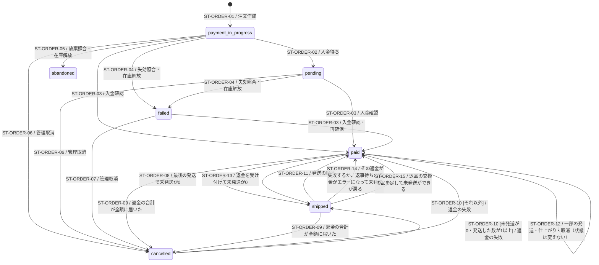
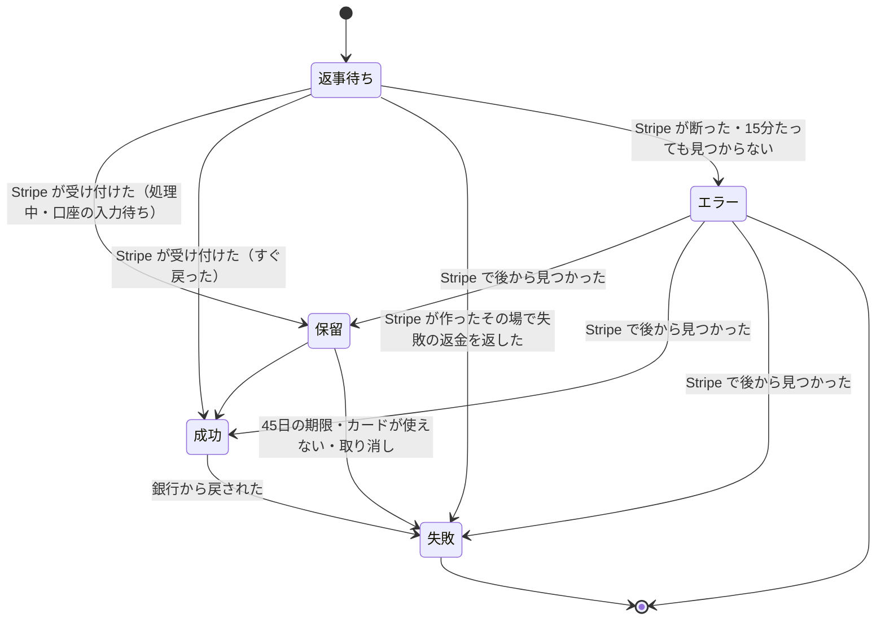
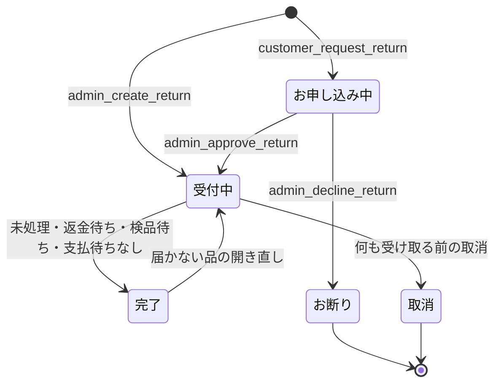
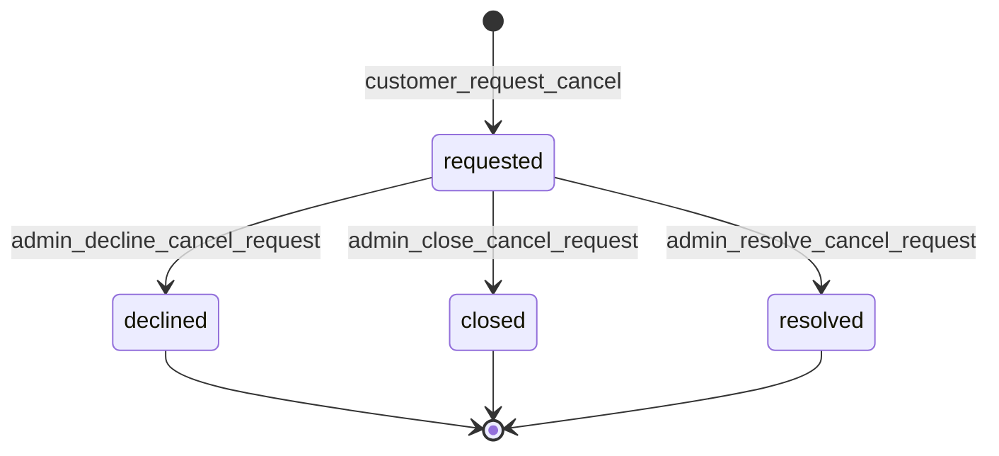
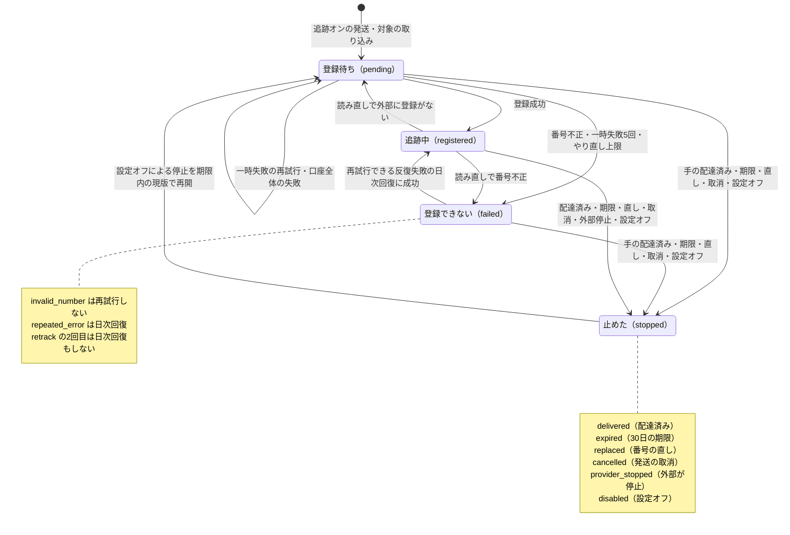

# 注文・決済の状態

> 状態: 現行ソース確認（返金の記録と状態・支払いの言葉・返金の取り込みと自動の返金の節は、グループ E-2 の変更を 2026-10-11 に、返品の記録と状態の節・交換の品を足した時の遷移 ST-ORDER-15 は、グループ E-3 の変更を 2026-10-13 に反映） | 確認日: 2026-10-04 | 対象: `orders.status`と決済・在庫の独立属性、返品の記録と状態

## 概要

注文の状態値と、それを更新する照合・管理RPCを示す。Stripeの現在値、下書き、Webhookキュー、返金額、在庫確保、通知は別の対象・属性として扱う。現行アプリはStripeを入金済み・入金待ちと確認した照合処理から注文を作る。決済前に注文受付APIを呼ぶ経路は現在の `src` にはない。返金は、注文の返金済みの額だけでなく1件ずつの記録（`public.order_refunds`）で持つ。記録の状態・全額の数え方・注文の状態への書き方は「返金の記録と状態（グループ E-2）」の節にまとめる。返品は、返品の記録（`public.order_returns`）と受け取りの記録で持ち、交換の品は注文の商品の行（`line_kind = 'exchange'`）として足す。返品の状態・数え方・返金との関わりは「返品の記録と状態（グループ E-3）」の節にまとめる。注文の状態の値は増やさない。E-3 段2の requested・declined とお客様用の8状態、キャンセルの申し込みの独立した4状態を以下に加える。

## 範囲と根拠

対応領域は [CHECKOUT](../pages/13_checkout.md)と[ADMINの注文管理](../pages/16_admin.md)。[購入シーケンス](../sequence/checkout-payment.md)、[管理シーケンス](../sequence/order-administration.md)、[下書き](checkout-draft.md)、[キュー](stripe-webhook-queue.md)、[要対応記録](payment-exception.md)を関連モデルとする。

| 略号 | 実装根拠 |
| --- | --- |
| P | [注文受付RPC](../../../supabase/migrations/20260927100300_place_order_from_checkout_draft.sql) |
| M | [基の入金済み・入金待ちRPC](../../../supabase/migrations/20260927100400_mark_order_payment_rpcs.sql)。現行定義は D |
| L | [基の未入金の在庫解放RPC](../../../supabase/migrations/20260927100200_release_stock_by_order.sql)。現行定義は D |
| E | [要対応・管理取消RPC](../../../supabase/migrations/20260927100500_payment_exceptions.sql)。出荷とメールの行を書く処理は D（発送は E-1 から FB） |
| D | [グループ D の移行 B: 入金済み・入金待ち・在庫解放・発送と、同じ取引でのメールの行の作成](../../../supabase/migrations/20261009095736_order_email_enqueue.sql) |
| FA | [グループ E-1 の移行 A: 発送・仕上がりの記録と商品ごとの数](../../../supabase/migrations/20261010120303_order_fulfillments.sql) |
| FB | [グループ E-1 の移行 B: 発送・発送の取消と、発送ごとのメールの行](../../../supabase/migrations/20261010122320_fulfillment_order_emails.sql) |
| RA | [グループ E-2 の移行 A: 返金の記録・受け取った額・商品ごとの数への返金の組み込み](../../../supabase/migrations/20261011222930_order_refund_records.sql) |
| RB | [グループ E-2 の移行 B: 返金を始める・材料を読む関数](../../../supabase/migrations/20261011223147_order_refund_requests.sql) |
| RC | [グループ E-2 の移行 C: 返金の結果を書く関数・外からの返金の記録・返金のメールの行](../../../supabase/migrations/20261011223453_order_refund_results.sql) |
| RTA | [グループ E-3 の移行 A: 返品の4つの表・返品の設定の2つの表・交換の品の列・返品できる数と期限の関数](../../../supabase/migrations/20261012235910_order_return_records.sql) |
| RTB | [グループ E-3 の移行 B: 返品を作る・取り消す・開き直す・届かないで終える・検品する・手数料を記録する関数と読み出し](../../../supabase/migrations/20261013000456_order_return_actions.sql) |
| RTC | [グループ E-3 の移行 C: 受け取り・額を決めて返金する関数、返金を始める本体の切り出し、交換の品の行、返品のメールの予定、発送の手数料待ちの守り](../../../supabase/migrations/20261013001143_order_return_receipts.sql) |
| R | [返金投影RPC](../../../supabase/migrations/20260925000218_add_order_state_transition_rpcs.sql)。`apply_order_refund_projection` は E-2 の移行 C で消し、結果を書く関数（RC）に置き換えた。古い定義の記録 |
| C | [照合器](../../../src/lib/stripe/checkout-payment-reconciler.ts)、[判定関数](../../../src/lib/stripe/checkout-payment-decision.ts)、[Stripe現在値の読取り](../../../src/lib/stripe/checkout-payment-reader.ts) |

## 状態定義

| DB値 | 意味・表示上の扱い |
| --- | --- |
| `payment_in_progress` | 注文を受付RPCで作成した初期状態。顧客の注文履歴・KPI対象から除外する値 |
| `pending` | Stripe現在値を入金待ちと照合した状態 |
| `paid` | Stripe現在値を入金済みと照合した状態。金額不一致や未確保在庫が残る場合もあり得る。一部の商品だけ発送した間、受注生産の品を作っている間、返品の交換の品がまだ送り終わっていない間も `paid` のまま（グループ E-1・E-3） |
| `failed` | 未入金注文で払込票の失効等を照合し、確保在庫を解放した状態。遅れて入金した場合の回復経路がある |
| `abandoned` | 手続き未完了のCheckout期限切れを照合した状態。顧客履歴・KPI対象から除外する値 |
| `cancelled` | 人が未入金注文を取り消した場合、または成功した返金の合計が全額（受け取った額 `orders.paid_amount`。受け取った額が0か空の注文は注文の合計 `total_amount`。注文額と同じことが多い）に到達した場合。支払い済みの注文のキャンセルも、返金が成功した時にここへ入る（グループ E-2） |
| `shipped` | 全部の商品を発送した状態。最後の発送の関数が `paid` から変え、出荷日時・配送業者・追跡番号をその発送の値で保存する。発送の取消で未発送が出たら `paid` に戻して空にする（グループ E-1）。残りの商品を発送前に返金して未発送が0になった時も、その返金を Stripe が受け付けた時点で `paid` から変える（グループ E-2。ST-ORDER-13）。返品の交換の品を足して未発送ができた時は `paid` に戻し、送り終えるとまた `shipped` にする（グループ E-3。ST-ORDER-15） |

値の正本は[ORDER_STATUSES](../../../src/lib/orders/order-payment-types.ts)と[enum追加migration](../../../supabase/migrations/20260927100000_add_order_payment_statuses.sql)。管理画面の注文の履歴の状態の表示名は [order-history.ts](../../../src/lib/orders/email/order-history.ts) の `ORDER_STATUS_LABELS` に揃える（注文の一覧の言葉は下の「画面の言葉と DB の状態」）。表示ユーティリティの別名を新しいDB状態として追加しない。

## 状態遷移図

初期ノードは新規作成の条件付き経路。図は現在のアプリから呼ぶRPCによる遷移を示し、すべての直接SQL更新を強制するDBトリガーが適用済みとは宣言しない。状態の名前だけで終端を判断しない。

## 遷移条件と副作用

| ID | イベント・ガード | 更新・副作用 | 根拠 |
| --- | --- | --- | --- |
| ST-ORDER-01 | 注文なし、Stripe `paid/awaiting_payment`。paidは全額返金済みでないこと。draftがcreated、所有sessionと添付Sessionが一致、正の額、通貨と割引前合計が一致、商品が存在しpublished | payment_in_progressの注文と明細を作成。賄えるvariantのみstockとしpurchase台帳で確保、他はbackorder。draftをcompletedにする。ここではカートを消さない | P、C |
| ST-ORDER-02 | Stripe `awaiting_payment`、現在payment_in_progress、既存PIがあれば一致 | pending、PI補完、snapshotに含む所有sessionのカート行を削除、入金待ち注文メールの行を同じ取引で書く | D、C |
| ST-ORDER-03 | Stripe `paid`、期待状態がpayment_in_progress/pending/failedかつDB現在値一致、PI一致 | paid、PI補完、受け取った額（`orders.paid_amount`。金額が注文と違っても、実際に受け取った額）の書き込み、カート削除。stock明細で確保ゼロの分を再確保し、不足が残ればreview_reason。金額・通貨不一致でもpaidに更新後、要対応を記録して注文確定メールを抑止する。全額返金済みもpaidメールを抑止し、通知あり・金額一致なら注文確認メールの行を同じ取引で書く。金額一致なら後続のnone判定で返金同期を呼び、Stripe の返金を返金の記録に取り込む | D、C |
| ST-ORDER-04 | Stripe `voucher_expired`、payment_in_progress/pending、通常照合 | failed、予約台帳の差から残る確保数量だけcancel台帳を追記、期限切れメールの行を同じ取引で書く | D、C |
| ST-ORDER-05 | Stripe `checkout_abandoned`、payment_in_progress、通常照合 | abandoned、同じ在庫解放。pendingからのabandonedはRPCでも拒否。放棄メールは送らない | D、C |
| ST-ORDER-06 | 管理取消: Session失効・再読取り後の期限切れ/放棄判定。要対応の取消付き解決: 外部支払可否確認後、関連注文がpayment_in_progress/pending | actor・理由必須、otherはメモ必須。期待状態付き更新、残る予約分だけ解放、取消情報を保存、指定時に取消メールの行を同じ取引で書く | D、E、[管理status API](../../../src/app/api/admin/orders/%5Bid%5D/status/route.ts)、[例外resolve API](../../../src/app/api/admin/payment-exceptions/%5Bid%5D/resolve/route.ts) |
| ST-ORDER-07 | actor・理由、otherならメモ。現在failed、メモ500字以下 | cancelled。追加の在庫解放と取消メールは行わない | E、管理status API |
| ST-ORDER-08 | admin.orders.manage、actor・重複防止キー・配送業者・追跡番号・商品と数、paid、必須配送先が揃い、未解決paid_amount_mismatchがなく、各商品の数が発送準備中の数以内。この発送で未発送の数が全部0になる（`completes_order`） | shipped、出荷日時・配送情報（その発送の値）。発送ごとに発送の記録を1つ書く（全部を送らない発送は ST-ORDER-12）。`notifyCustomer` が true の時だけ、その発送の発送メールの行を同じ取引で書く。review_reason未確認自体はこのRPCの拒否条件に含まれていない。手数料のお支払いを待っている返品の交換の品の行（その返品の `fee_due_amount` が0より多く、`fee_received_at` も `exchange_released_at` も空）を含む発送は、`FULFILLMENT_EXCHANGE_ON_HOLD` で断る（グループ E-3） | FB、RTC、管理発送API |
| ST-ORDER-09 | 返金の結果を書く関数（`record_order_refund_result`・`record_external_order_refund`）で、成功した返金の合計が全額（`COALESCE(NULLIF(paid_amount, 0), total_amount)`。受け取った額が0か空の注文は注文の合計）に届き、注文が `paid` か `shipped`。注文の行を `FOR UPDATE` で押さえた中で判定する | cancelled（改訂の理由 `refund_projection`）、返金済みの額・返金日時・支払状態更新時刻を書く。支払い済みのキャンセル（`order_cancel`）と自動の取消（`auto_amount_mismatch`）の返金なら、その返金の取消の理由・メモ・知らせるかを注文の取消の列に写す。全額の返金では未発送の商品を全部その返金の発送前の行に入れてあるので、在庫は返金が動かしている（台帳 `refund`）。 | RA・RC、[返金の流れ](../../../src/lib/orders/refund/refund-service.ts)、[返金の取り込み](../../../src/lib/stripe/order-refund-sync.ts) |
| ST-ORDER-10 | 最後に `cancelled` になった時の注文の改訂の理由が `refund_projection`（前からの `stripe_refund_projection` を含む）で、返金が失敗して成功した返金の合計が全額（受け取った額。0か空なら注文の合計）を下回った | 未発送が0で発送した数が1以上なら `shipped`、ほかは `paid` に戻す（改訂の理由 `refund_projection`。発送していない注文は発送済みにしない）。未入金から取り消した注文（改訂の理由が返金でない。自動の返金①の注文を含む）は戻さない | RC |
| ST-ORDER-11 | 発送の取消: admin.orders.manage、注文がpaidかshipped、発送がその注文の物で未取消 | 発送に取消の時刻と人を書く。注文がshippedならpaidに戻し、出荷日時・配送業者・追跡番号を空にする。その発送のまだ送っていない発送メールの行を取りやめ（`fulfillment_cancelled`）にする。お客様には知らせない。取消済みなら `already_cancelled`（変更なし） | FB、管理発送の取消API |
| ST-ORDER-12 | 一部の発送、仕上がりの記録、仕上がりの取消。paid（発送の取消はpaidかshipped） | 状態は変えない。発送・仕上がりは別の表に1回ごとに記録する。発送した数は発送準備中の数まで、仕上がりは受注生産中の数まで。画面の言葉（受注生産中・発送準備中・配送中）は記録から出す | FA、FB |
| ST-ORDER-13 | 返金を Stripe が受け付け（保留か成功に初めてなる）、未発送の数が0になり、発送した数が1以上で、注文が `paid`（全額ではない） | shipped（改訂の理由 `refund_completed_order`）。発送日・配送業者・追跡番号は、取り消していない最後の発送の値を写す | RC |
| ST-ORDER-14 | 次のどちらかで未発送が戻って、注文が `shipped`。(a) ST-ORDER-13 の返金が失敗し、確保し直しなどで戻った。(b) 返事待ちの返金が `mark_order_refund_error` でエラーになり、その返金の発送前の行を数えなくなって戻った | paid（改訂の理由 `refund_failed_reopened`）。発送日・配送業者・追跡番号を空にする。(b) は在庫・メール・失敗の後始末を動かさない | RC |
| ST-ORDER-15 | 受け取りの関数（`admin_receive_return`）が、返品の交換の品の行を足し（受け取った交換の数だけ。在庫から送る交換も作って送る交換も）、注文が `shipped` で、足したことで未発送が1以上になる | paid（改訂の理由 `return_exchange_added`）。発送日・配送業者・追跡番号を空にする（ST-ORDER-14 と同じ。発送ごとの記録は残るので、前の発送の伝票番号は消えない）。注文が `paid` の間は状態を変えない。足した交換の品を送り終えると、ST-ORDER-08 が `paid` から `shipped` に進める。交換の品の行は値段0（`item_price = 0`・`line_total = 0`）で、注文の金額（`total_amount`・`paid_amount`・`refunded_amount`）は動かさない。在庫から送る交換は台帳 `exchange` の −n で確保し、作って送る交換は台帳を動かさず `backorder` の行にする | RTC、[返品の流れ](../../../src/lib/orders/returns/return-service.ts) |

更新0件は成功した遷移ではない。照合器はStripeと注文を最大3回読み直す。state_conflictが最終回まで続けば要対応を記録してneeds_actionを返す。最大3回の試行内でdoneに達せず、最終回がapplied/lost_raceで追加読取りを要する場合はReconcileTransientError(not_converged)。管理APIの0件は409等の競合結果になる。

## 返金の記録と状態（グループ E-2）

2026-10-11 から、返金は注文の返金済みの額だけで持たず、1件ずつの記録（`public.order_refunds`。Stripe の返金1件が1行）で持つ（[グループ E-2 設計書](../../superpowers/specs/2026-10-11-refund-and-cancel-design.md) の 4 章）。注文の状態の値（上の7つ）は変えない。返金の記録は消さず、中身を直さない。進むのは状態と、その細目・時刻・印だけで、トリガー `order_refunds_guard` が止める（RA）。

返金の記録の状態は、Stripe の返金の状態から次のとおりに決める。

| Stripe の返金の状態 | 記録の状態 |
| --- | --- |
| `pending`・`requires_action` | 保留 |
| `succeeded` | 成功 |
| `failed`・`canceled` | 失敗 |

許さない移り方の知らせ（成功の後の保留など。Stripe の知らせは順番どおりに届かない）は、結果を書く関数が何もせずに今の値を返す。誤りにはしない。返金の道（`source`）は次の6つ。

| 道 | 中身 |
| --- | --- |
| `admin` | 管理画面の返金。商品と数・送料を選ぶ |
| `order_cancel` | 支払い済みの注文のキャンセル。残りの商品全部と、送料（返せる送料と返せる額の小さい方） |
| `stripe_dashboard` | Stripe の画面からの返金。知らせから取り込む。商品の行は無く、全額になる時だけ未発送の商品を全部その返金の発送前の行に入れる（送料は、行の有無に依らず返せる送料の全部。ただしその返金の額を超えない） |
| `auto_cancelled_order_payment` | 自動の返金①。取り消した注文への入金を全額返す |
| `auto_amount_mismatch` | 自動の返金②。支払額の違う注文を全額返して取り消す（残りの商品全部と、送料は返せる送料と返せる額の小さい方） |
| `legacy` | 前からの写し。切り替えの時刻より前に Stripe で作られた返金で、在庫もメールも動かさない |

- 全額 = 受け取った額（`orders.paid_amount`。店内だけの列。書くのは、入金を記録する時（`mark_order_paid`）と、照合が取り消した注文への入金を見つけた時（`record_cancelled_order_paid_amount`。記録のたびに、自動の返金①のオン・オフに依らず、空の時だけ））。返せる額 = 受け取った額 − 返事待ち・保留・成功の返金の合計。返せる送料 = 注文の送料 − 同じ返金の送料の合計。`orders.refunded_amount` = 成功した返金の合計（意味は変えない）。エラーと失敗の返金は、どの合計にも数えない
- 商品ごとの数: q = 注文の数、s = 発送した数、c = 仕上がった数（在庫の品は q）、rb = 発送前に返金した数、ra = 発送後に返金した数（rb・ra は返事待ち・保留・成功の返金の行）。未発送 q − s − rb、まだ作っていない max(q − rb − c, 0)、発送準備中 max(min(c, q − rb) − s, 0)、発送後に返せる数 s − ra。守る関係 s + rb ≤ q・ra ≤ s・s ≤ c を、トリガー `private.check_order_line_fulfillment_bounds` が守る
- 返金を始める関数（`begin_order_refund`。RB）は、返事待ちの記録と商品の行を作り、返せる額・送料・数の上限と、二重防止の番号を確かめる
- 結果を書く関数（`record_order_refund_result`・`record_external_order_refund`。RC）は、1回の取引で、記録の状態・在庫（Stripe が受け付けた時の1回だけ）・メールの予定・要対応（失敗の1回だけ）・注文の返金済みの額と状態を書く（注文の状態の移り方は上の ST-ORDER-09・10・13・14）。詳しい流れは [注文管理のシーケンス](../sequence/order-administration.md) の SQ-ADMIN-03・06・07・08
- エラーにした返金が Stripe で後から見つかった時は、エラーから保留・成功・失敗に進める（エラーにした時刻は残す）。保留・成功に進めた時は、エラーの時に作った要対応「返金の失敗」（支払いの印は返金の記録の番号）が開いていれば、システムが閉じる（`resolved_by` は空。メモは「Stripe で返金が見つかったため自動で解決」。[要対応の状態](payment-exception.md) の ST-EXCEPTION-04）。ただし閉じるのは、その返金の発送前の行の商品が全部 `s + rb ≤ q` を保っている時だけ。エラーの間にその品を発送して崩れていれば（お客様に品と返金の両方が届く）、要対応を開いたまま残し、店が確かめる。受け付けずに（保留・成功を通らずに）失敗に進めた時は、失敗の後始末の要対応を同じ印（返金の記録の番号）で記録するので、エラーの時の要対応と同じ1行になり、2件目は作らず、店への知らせも1通になる。保留・成功を通った後に失敗した時（エラー → 成功でエラーの時の要対応を閉じた後に、コンビニ払いの期限で失敗した時など）は、Stripe の返金の番号の印で新しい要対応を作り、店へ知らせる（閉じた行に重ねて、本当の失敗を誰にも知らせないことを避けるため）
- 返事待ちの返金をエラーにした時（`mark_order_refund_error`）は、その返金が数えていた発送前の行を数えなくなるので、未発送が戻る注文は発送済みから支払い済みに戻る（ST-ORDER-14。在庫・メール・失敗の後始末は動かさない）

## 返品の記録と状態（グループ E-3）

2026-10-13 から、返品は注文の状態の値（上の7つ）を増やさず、1件ずつの記録（`public.order_returns`）で持つ（[グループ E-3 設計書](../../superpowers/specs/2026-10-12-returns-design.md) の 3・4・6・7 章）。返す品は `order_return_lines`（数・理由・詳しい内容・ご希望は変えない。親が requested の間だけ resolution・exchange_variant_id・exchange_method を承認で更新できる）、受け取りは `order_return_receipts` と `order_return_receipt_lines`（追記だけ。更新と削除はトリガーが断る）に残す（RTA）。返品の記録も消さず、直せるのは状態・時刻・する人・手数料の列と、requested から open への承認の1回の返送・手数料・知らせ・店のメモだけで、書くのは SECURITY DEFINER の DB の関数だけ。段1の source = 'shop' に加え、段2は source = 'customer_request'・requested で作り、承認で open、お断りで declined に進む。

| 返品の記録の状態 | 入る時 | 出る時 |
| --- | --- | --- |
| `open`（受付中） | 作った時。開き直した時（`admin_reopen_return`。完了の時刻は消さず、閉じ直す時に書き直す）。開き直しの後は、同じ注文のほかの受付中の返品をid の順（ふつうの返金と同じ）に `private.refresh_order_return_status` で確かめ直す（未処理の数が戻って上限が下がり、ほかの返品の返金待ちが覆われるため。注文の鍵の下で行い、完了の返品は受付中に戻さない） | 取消か完了 |
| `closed`（完了） | 完了の条件を満たした時に、`private.refresh_order_return_status` が閉じる。受け取り・検品・「届かない」で終える・手数料の受け取りの記録（いただかないで終えるを含む）・額を決めて返金（返金しないで終えるを含む）・返金の結果を書く関数（Stripe が受け付けた時と失敗した時）が、この関数を呼ぶ。ふつうの返金（道が `return` 以外）も、始めた後（`private.begin_order_refund_core`）・結果を書いた後（`record_order_refund_result`）・エラーにした後（`mark_order_refund_error`）に、その注文の受付中の返品を確かめ直す（返金の行が品を覆うと、返品が「返品中」のまま操作できなくなるのを防ぐ。確かめるのは受付中だけで、完了の返品は戻さない。鍵の順は注文 → 返品 → 返金） | 開き直しだけ（確かめ直しの関数は、完了を受付中に戻さない） |
| `cancelled`（取消） | `admin_cancel_return`。受付中で、処理した数（受け取り・お返し・検品待ち・届かない − 開き直し）が0の返品だけ。取り消した品はまた返品できる。お客様にメールは送らない。まだ送っていない（送信待ち・やり直し待ちの）返品の受付のお知らせは取りやめる（`return_cancelled`）が、取消と同時に送っている途中のお知らせは取りやめない（まれな重なり。worker は返品の状態を見ない） | — |
| `requested`・`declined` | 段2 | 段1は作らない |

完了の条件は、全部の品が処理され（`restocked`・`not_restocked`・`sent_back`・`missing` と、検品で決めた数の合計が返品の数に達し）、検品待ちが無く、返金待ち（下の rw）が0で、お支払い待ち（`fee_due_amount > 0` で `fee_received_at` が空）が無いこと。返金の記録を作った時に、返金の品が全部その返金で覆われて rw が0になれば、Stripe の結果を待たずに返品は完了する。その後に返金が失敗しても、完了は戻さない（覆いが外れて rw が戻り、画面の返品の状態が「返金待ち」に戻るだけ）。同じ注文の別の返品を開き直して受け取った時に、ふつうの返金の当て先が開き直した品へ移って、完了した返品の rw が戻ることもある（同じく完了のまま「返金待ち」になり、「額を決めて返金する」で返す）。

商品ごとの数は、E-2 の q・s・c・rb・ra に次の6つを足す（数えるのは取消・お断りでない返品。数え方の本体は `private.order_line_return_counts` の1か所で、窓口・画面・E-2 の返金の数は全部これを使う。RTA）。

| 記号 | 数えるもの |
| --- | --- |
| rq | 申し込み中の返品の行の数（段2） |
| op | 受付中の返品の行の、まだ処理していない数（返品の行の数 − 処理した数。処理した数は、受け取り（`restocked`・`not_restocked`・`pending_inspection`・`sent_back`）と、`missing` − `missing_reopened`） |
| rw | 返金待ち。受け取った返金の品のうち、返事待ち・保留・成功の返品の返金で覆われていない数。ふつうの返金で先に返した品は、覆われたものとして数える。「届かない」として終えた後に開き直して受け取った返金の品は、その品が「届かない」だった間（届かないの記録から次の開き直しまで、両端を含む）に作ったふつうの返金（道が `return` 以外の発送後の返金）だけの当て先として先に数える（二重の返金を避ける側。返し足りない時は、ふつうの返金の画面で選べる発送済みの数が、減った返金待ちと同じだけ増えるので、そこで返せる） |
| ex | 受け取った交換の品の数 |
| sb | お返しした数 |
| rf | 返金しないことにした数（`refund_waived`。0円で終えた品を、返品できる数に戻さないため） |

- 返品できる数（注文の商品ごと）= `s − ra − rq − op − rw − ex − sb − rf`。発送の行ごとの返品できる数（`private.fulfillment_line_returnable`）= その発送の行の数 − その行を指す申し込み・受付中・完了の返品の行の数の合計 + その行を指す `missing − missing_reopened` の合計。ふつうの返金の画面で選べる発送済みの数 = `s − ra − rq − op − rw − ex`（E-2 の `s − ra` に替える）。どれも0より小さくしない
- 受付の期限は、発送の行ごとに「日本時間の発送日 + 目安の日数（既定3）」を届いた日とし（配達の記録ができる E-4 まで）、数え始めが「最後の品」の時は取り消していない発送のうち最も遅い届いた日を使い、「届いた日 + 日数（既定7）」の日の終わり（日本時間の23:59:59）まで。日数が「無制限」なら期限は無い。段1はお店が作るので、期限を過ぎても止めず、作る画面に警告を出すだけ
- 返金待ち（rw）と、返金で覆われた数は、`private.order_return_line_states_core` の1か所で数える（保存済みの記録だけを数える `private.order_return_line_states` は、これを空の明細で呼ぶ）。未保存の受け取りの明細も足して数えられるので、受け取りの関数は、受け取りの前後の返金待ちの差を「この受け取りで返金待ちが増える数」として出し、返金する数に使う（下の「返品の返金と手数料」）

受け取りの商品の扱い（`order_return_receipt_lines.disposition`）と、在庫の台帳:

| 値 | 意味 | 台帳 |
| --- | --- | --- |
| `restocked` | 在庫に戻す | 理由 `return` の +n（`stock_movements.return_id` に返品を残す） |
| `not_restocked` | 戻さない | 動かさない |
| `pending_inspection` | 検品待ち。返品の画面の「検品を終える」で、次の2つに決める（設定で要検品を使う時だけ選べる） | 動かさない |
| `inspected_restocked`・`inspected_not_restocked` | 検品で決めた、戻す・戻さない | 戻す分だけ `return` の +n |
| `sent_back` | お返し（条件に合わない品。返金も交換もしない。お客様へのメッセージが要る。`RETURN_SENT_BACK_MESSAGE_REQUIRED`） | 動かさない |
| `missing`・`missing_reopened` | 「届かない」として終えた数と、その開き直し | 動かさない |
| `refund_waived` | 返金しないことにした数 | 動かさない |

画面の返品の状態は、一覧の「返品」の列と返品の画面に出す。進み具合の言葉（下の「画面の言葉と DB の状態」）とも、支払いの言葉とも別の列で出す。

| 画面の言葉 | `display_status` | 決まり |
| --- | --- | --- |
| 返品の申し込み | `requested` | 段2 |
| 返品中 | `in_progress` | 受付中で、下の返金待ちでない物。小さな印: 受け取り待ち（`awaiting_items`。何も届いていない）・一部受け取り（`partially_received`）・検品待ち（`pending_inspection`）・お支払い待ち（`awaiting_fee`） |
| 返金待ち | `refund_waiting` | 受付中で、全部の品が処理され、検品待ちが無く、rw が1以上。または、完了した返品で rw が1以上（返品の返金が失敗した後） |
| 返品済み | `returned` | 完了で、rw が0 |

注文に返品が2つ以上ある時は、いちばん手前（返品の申し込み → 返品中 → 返金待ち → 返品済み）を出す。取消・お断りの返品しかない注文には出さない。次にすること（`next_action`）は、`refund`（rw が1以上の返品がある。店長だけに出す）・`receive`（受付中で未処理がある）・`review_request`（段2）・`none`。

返品の返金と手数料:

- 返品の返金は、返金の道（`order_refunds.source`）が `return`。返金の商品の行は発送後の行だけで、在庫の戻し方は `return`（在庫は受け取りの時に動かし済みなので、返金の結果は在庫を動かさない）。受け取りで「今返金」を選ぶと、同じ取引で E-2 の返金を始める本体（`private.begin_order_refund_core`。`public.begin_order_refund` は返品なしでこの本体を呼ぶだけ）を返品つきで呼んで返事待ちの返金を作り、アプリが E-2 と同じ頼み方（重複防止キー `order-refund-{記録の番号}`）で Stripe に頼み、結果を `record_order_refund_result` が書く。「額を相談してから返金」は返金を作らず、返金待ち（rw）に残して、後で店長が `admin_refund_return`（返品の画面の「額を決めて返金する」）で返す
- 返金額 = 商品の額（E-2 の割り振り）− 手数料の合計（最低0円）+ 送料の返金。店長は返せる額まで直せ、計算との差を `adjustment_amount` に残す。0円になる時は、返金の記録を作らず Stripe にも頼まず、その数を `refund_waived` の受け取りの行（受け取りの中なら同じ受け取りの記録、額を決めて返金なら `kind = 'waive_refund'` の受け取りの記録）で残す（答えは返金の番号なし・状態 `waived`）。お客様への返金のお知らせは出さない
- 受け取りで返金する数は、数え方の本体（`private.order_return_line_states_core`）で「この受け取りで返金待ちが増える数」として出す（ふつうの返金で先に返した品・返金しないことにした品は増えない）。0点になるのは、覆われた品だけ・交換だけ・お返しだけを受け取る時で、その受け取りは、選び方が今返金・相談でも、返金の記録を作らず（返金の番号・額・状態は空で、`waived` ではない）、受け取りの記録の `refund_choice` を `none` で残し、受け取りだけを記録して返品の状態を確かめ直す。相談でも0点なら手数料の差し引き待ち（`fee_pending_deduction`）を足さず（付く手数料があれば、返金の品が無い受け取りと同じく `fee_due_amount` に足す）、サポートの受け取りでも店への知らせは予定しない。入力の指紋は入力のまま作るので、同じ入力の送り直しは前の結果を返し、監査の記録には入力の値を書く。画面の見込み（`refund_amounts_by_count`）は覆いを見ないので、この場面では返金ありの見込みが出るが、記録は DB が正（受け入れた食い違い。受け取りの後の知らせは、DB の答えの返金の番号が空かどうかで選ぶ）
- 返金が失敗した後の返品は、完了のままでも rw が戻るので「返金待ち」になり、店長が返品の画面の「額を決めて返金する」で返し直す（道は `return` のまま。新しい返金の記録と、新しい記録の番号の重複防止キーで頼む）。受け取りと一緒の返品の返金が、返金のお知らせを予定しないままエラーか失敗になった時（その場で断られた・見回りがエラーにした・作ったその場で失敗）は、DB がその受け取りの「返品をお受け取りしました」を予定する（「お客様に知らせる」を入れた受け取りだけ。E-2 の節の `mark_order_refund_error` にある「在庫・メール・失敗の後始末は動かさない」の、返品の返金での例外）。エラーか失敗になった返品の返金で引いた手数料は、返品の `fee_pending_deduction` に戻し、返し直しの「計算どおり」でもう一度引く（引いた額は返金ごとに `order_refunds.return_fee_deduction` に持つので、続けて2回失敗してもそれぞれ戻る。エラーの後に Stripe で見つかって保留か成功に移った時は、引き直す）
- 手数料は設定で使う時だけ付く（このブランドは今は使わない）。返品の手数料 = `floor(この受け取りで返金する品の商品の額の合計 × 手数料の % / 100)`。返送料の定額（送り方が `shop_label` の時）は、返金の品か交換の品がある最初の受け取りだけ。交換の手数料と交換の送料は、交換の品がある最初の受け取りだけ。今返金はその返金から引き、引けない分を `fee_due_amount`（お支払い待ち）に足す。相談の受け取りは `fee_pending_deduction` に足しておき、額を決めて返金する時に引いて0に戻す。返金の品が無い受け取り（交換だけなど）の手数料は `fee_due_amount` に足す
- お支払い待ち（`fee_due_amount > 0` で `fee_received_at` が空）の間、返品は完了せず、交換の品は `FULFILLMENT_EXCHANGE_ON_HOLD` で送れない。店長が「手数料の受け取りを記録する」（`admin_record_return_fee_payment`）か、そこにある「いただかないで終える」（`_waive = true`。`fee_waived` を立てる）を押すと、その時の `fee_due_amount` を決着した額の合計 `fee_settled_amount` に足して `fee_due_amount` を0に戻し、お支払い待ちが終わって交換の品は送れるようになり、ほかに待ち物が無ければ返品も完了する。`fee_due_amount` は「まだ決着していない手数料」で、新しい手数料は0から足すので、お支払い待ちは新しく付いた分だけになる（決着した手数料をもう一度お客様に求めない）。受け取り・額を決めて返金で新しい手数料が付いて、手数料の受け取りの記録（`fee_received_at`・`fee_received_by`・`fee_received_note`）を空に戻す時は、同じ更新で `fee_waived` も false に戻す。履歴の手数料の行の額は `fee_settled_amount` で、決着の記録は最後の1回分だけ（限界は [管理画面の詳細設計](../pages/16_admin.md) の「限界」）。「支払いを待たずに送る」（`admin_release_return_exchange`。`exchange_released_at`）は交換の品を送れるようにするだけで、手数料は残り、返品は完了しない。手で受け取った手数料は、帳簿に自動では入らない
- 成功した返金の合計が受け取った額に届くと、E-2 の決まりのまま注文は `cancelled` になる（ST-ORDER-09。返品の返金も同じ結果を書く関数を通る）

交換の品の行と、返品の守り:

- 交換の品の行は、受け取った時に、受け取った交換の数だけ1行を足す。品・色・サイズは交換の色・サイズから写し、`item_price = 0`・`line_total = 0`・`line_kind = 'exchange'`、元の品のその数の分の支払額を `exchange_paid_amount` に持つ。在庫から送る交換は台帳 `exchange` の −n で確保する。足りない時は、理由ごとの設定「在庫の無い交換」が `make` なら自動で作って送る（`backorder`。台帳は動かさない）に変え、`decline` なら、店長が「作って送る」か「返金に変える」を選ばない限り `RETURN_EXCHANGE_OUT_OF_STOCK` で断る。同時に別のお客様が最後の1点を買っても、鍵の順番で在庫は0より小さくならない
- 交換の品の行は、発送・仕上がり・受注生産の数・確保の数え方には入れ、割引の割り振り・人気の商品・KPI の品の数・一覧と CSV の商品数・法定の写しの明細には入れない。発送前の交換の品をふつうの返金の画面で返す時の額は、`exchange_paid_amount` を数で累積に割り振った額（E-2 の割引の割り振りと同じ丸め方）
- 申し込み・受付中・完了の返品が指す発送は、取り消せない（`FULFILLMENT_HAS_RETURN`。取消の返品しか指さない発送は取り消せる）。ふつうの返金の画面と DB は、返品中・返金待ち・交換にした品を、発送済みの数に数えない（`REFUND_QUANTITY_EXCEEDS_SHIPPED`）
- 鍵の順番は、注文 → 返品 → 返金 → 色・サイズの在庫（番号の昇順）。作る・受け取り（受け取り・検品・届かないで終える・開き直し）・額を決めて返金は、画面を開いた時に作る番号（uuid）と、入力を決まった順に並べた JSON の md5 の指紋を持ち、同じ番号で同じ指紋なら前の結果（`replayed`）、違う中身なら `RETURN_REQUEST_MISMATCH` で断る

根拠は RTA〜RTC、[返品の流れ](../../../src/lib/orders/returns/return-service.ts)、[返品の DB の呼び出し](../../../src/lib/orders/returns/return-store.ts)、[返品の計算](../../../src/lib/orders/returns/return-calc.ts)。流れは [注文管理のシーケンス](../sequence/order-administration.md) の SQ-ADMIN-09〜11。

## 画面の言葉と DB の状態（グループ E-1）

DB の状態の値（上の7つ）は変えない。管理画面とお客様の画面の言葉は、商品ごとの数（`private.order_line_fulfillment`）から [order-progress.ts](../../../src/lib/orders/order-progress.ts) が出す。管理画面・窓口・お客様の画面が同じ言葉を使う。

| DB の状態 | 商品ごとの数 | 出す言葉 |
| --- | --- | --- |
| `payment_in_progress` | — | 支払い手続き中（管理画面だけ。お客様には出さない） |
| `pending` | — | 未決済 |
| `paid`・`shipped` | 受注生産中の数が1以上の商品がある | 受注生産中 |
| `paid`・`shipped` | 上が無く、発送準備中の数が1以上の商品がある | 発送準備中 |
| `paid`・`shipped` | 上が無く、発送した数が1以上 | 配送中（配達済みは E-4。E-1 では発送した品は全部「配送中」） |
| `paid` | 未発送の数の合計が0・発送した数の合計が0で、手続き中の返金（返事待ち・保留）がある | キャンセルの手続き中（グループ E-2。コンビニ払いの口座の入力待ちなど。段は出さない） |
| `failed` | — | 決済失敗 |
| `abandoned` | — | 放棄（管理画面だけ） |
| `cancelled` | — | キャンセル |

- 「一部発送済み」の印は、`paid`・`shipped` の注文で、発送した数が1以上かつ未発送の数も1以上の時に付ける（管理画面の注文の一覧と、お客様の注文の詳しい画面。お客様の購入履歴の一覧には出さない）。
- 商品ごとの数: 発送した数（取り消していない発送の合計）、仕上がった数（在庫の品は注文の数、受注生産の品は取り消していない仕上がりの合計）、発送前・発送後に返金した数（返事待ち・保留・成功の返金の行。グループ E-2）、受注生産中の数（max(注文の数 − 発送前に返金した数 − 仕上がった数, 0)）、発送準備中の数（max(min(仕上がった数, 注文の数 − 発送前に返金した数) − 発送した数, 0)）、未発送の数（注文の数 − 発送した数 − 発送前に返金した数）。`shipped + refunded_before_shipment ≤ quantity`・`refunded_after_shipment ≤ shipped`・`shipped ≤ completed`（受注生産）・`completed ≤ quantity` を DB の関数とトリガーで守る（考え方は「返金の記録と状態（グループ E-2）」の節）。
- お客様の進み具合の段は、在庫の品だけの注文が「お支払い・発送準備中・配送中・配達済み」、受注生産の品を含む注文が「お支払い・受注生産中・発送準備中・配送中・配達済み」。今の段は、注文のいちばん手前の段階で決める。キャンセル・決済失敗の注文と、キャンセルの手続き中の注文には段を出さない。
- 管理画面の注文の履歴は、見出しも状態の変化の行も DB の状態の言葉（決済完了・発送済みなど。`ORDER_STATUS_LABELS`）のまま出す。上の進み具合の言葉には替えない。
- 返品の交換の品の行（グループ E-3）も、商品ごとの数に注文の商品と同じに入る。交換の品を足すと未発送ができるので、在庫から送る交換は「発送準備中」（一部を発送済みなら「一部発送済み」の印も付く）、作って送る交換は仕上がりを記録するまで「受注生産中」、送ると「配送中」の言葉が出る。返品の状態の言葉（返品中・返金待ち・返品済みなど）は、この進み具合の言葉とも支払いの言葉とも別の列で出す（「返品の記録と状態（グループ E-3）」の節）。

### 支払いの言葉（グループ E-2）

管理画面の注文の一覧は、進み具合とは別に「支払い」の列を持つ（Shopify の Payment status と同じく、支払いと発送を分ける）。DB の状態の値と、受け取った額・成功した返金の合計から、[payment-status.ts](../../../src/lib/orders/payment-status.ts) の `derivePaymentStatus` が上から順に当てはめ、最初に当たった1つを出す。

| 順 | 条件 | 支払いの言葉 |
| --- | --- | --- |
| 1 | DB の状態が `payment_in_progress`・`pending` | 未入金 |
| 2 | `failed` | 支払いの失敗 |
| 3 | `abandoned` | 支払いなし |
| 4 | 受け取った額が空か0（未入金のまま取り消した注文を含む） | 支払いなし |
| 5 | 成功した返金が0 | 支払い済み |
| 6 | 成功した返金が0より多く、受け取った額より少ない | 一部返金 |
| 7 | 成功した返金が受け取った額に届いた | 返金済み |

小さな印として、返事待ち・保留の返金がある注文に「返金の手続き中」、開いている「返金の失敗」の要対応がある注文に「返金の失敗」を、支払いの言葉の横に足す。

## Stripe現在値の分類

次はローカルの観測分類であり、Stripe自身の状態機械やDBのenumではない。イベントの種類と到着順だけで注文状態を更新しない。

| 観測分類 | 読取り条件 | 注文への判断 |
| --- | --- | --- |
| `in_progress` | Sessionがopen | 通常は変更なし。pending/paid/shippedとの組合せは矛盾記録 |
| `checkout_abandoned` | Sessionがexpired | payment_in_progressだけ放棄へ。注文なしなら新規注文を作らない |
| `zero_amount_complete` | Session complete、no_payment_required | 注文なしなら監査記録のみ、注文ありは金額の要対応 |
| `paid` | Session complete、PIあり、payment_status paidまたはPI succeeded。返金額は展開したlatest_charge.amount_refunded、受取額はPI.amount_received | 注文なしは全額返金済みなら記録のみ、一部返金なら新規作成。paid/shippedのnone判定でも返金額>0なら返金を同期し、同期後statusを返す。cancelledへの入金はStripe返金額が受取額未満なら要対応 |
| `awaiting_payment` | Session complete/unpaid、PI requires_action/processing | 新規作成またはpendingへ。既にpendingなら変更なし |
| `voucher_expired` | Session complete/unpaid、PI requires_payment_method/canceled | 未入金注文の在庫解放。注文なしなら何もしない |
| `missing` | Stripe resource_missing | 注文なしなら監査記録のみ、注文ありは要対応 |
| `not_applicable` | 対象外・分類不能 | 注文なしは記録のみ、注文ありは想定外状態の要対応 |

通常の `readCheckoutPayment` の分岐と、PIからSessionを逆引きする互換経路はCの読取り実装を根拠とする。外部サービス内部の自動遷移はこの図の対象外。

### 行動決定表と先行ガード

照合器は次の順で判定する。先行ガードに該当した場合、下の表より優先する。

1. 注文とsnapshotの両方にPI IDがあり不一致なら`state_conflict(payment_intent_mismatch)`。
2. 注文paid/shippedかつsnapshot paidで注文額/通貨と受取額/通貨が違えば`paid_amount_mismatch`。以前の要対応記録が失敗していても再検出する。
3. 注文なし・draft IDなしではmissing以外を`not_applicable(no_draft)`に置き換える。既存注文はdraft IDなしでも通常判定する。

| Stripe観測 | 注文なし | payment_in_progress | pending | paid / shipped | failed | abandoned | cancelled |
| --- | --- | --- | --- | --- | --- | --- | --- |
| paid | 全額返金済みなら記録のみ、それ以外は作成・paid | paidへ | paidへ | 変更なし・必要な返金同期 | paidへ再確保 | 状態矛盾 | 返金額>=受取額なら変更なし、それ以外は取消後入金の要対応 |
| awaiting_payment | 作成・pending | pendingへ | 変更なし | 状態矛盾 | 状態矛盾 | 状態矛盾 | 状態矛盾 |
| voucher_expired | 変更なし | failedへ | failedへ | 状態矛盾 | 変更なし | 変更なし | 変更なし |
| checkout_abandoned | 変更なし | abandonedへ | 状態矛盾 | 状態矛盾 | 変更なし | 変更なし | 変更なし |
| in_progress | 変更なし | 変更なし | 状態矛盾 | 状態矛盾 | 変更なし | 変更なし | 変更なし |
| zero_amount_complete | 記録のみ | 金額不一致 | 金額不一致 | 金額不一致 | 金額不一致 | 金額不一致 | 金額不一致 |
| missing | 記録のみ | Stripe対象なし | Stripe対象なし | Stripe対象なし | Stripe対象なし | Stripe対象なし | Stripe対象なし |
| not_applicable | 記録のみ | 想定外状態 | 想定外状態 | 想定外状態 | 想定外状態 | 想定外状態 | 想定外状態 |

「全額返金済み」は注文なしの作成判定とメール抑止では`amountRefunded > 0 && amountRefunded >= amountReceived`。既存cancelledの判定は実コード通り`amountRefunded >= amountReceived`で、返金>0を追加しない。作成なしの返金は監査note `refunded_before_order`だけで、新しい要対応理由や注文状態を追加しない。

通常のfailed/abandonedへの解放は`adminCancel`付きならcancelledへ置き換える。状態矛盾は最終回前なら再読取り、最終回なら`state_conflict`を記録。金額不一致、Stripe対象なし、想定外状態、取消後入金は、それぞれ`paid_amount_mismatch`、`stripe_object_missing`、`unexpected_state`、`cancelled_order_paid`の要対応となる。

返金同期は、none判定かつpaid/shipped注文・paid snapshot・返金額>0・PIありの場合に[返金同期](../../../src/lib/stripe/order-refund-sync.ts)を呼ぶ。その支払いの返金を全ページ読み、1件ずつ返金の記録（`order_refunds`）に合わせる（印 `refund_id` がこの注文の記録に当たる返金は、その記録に結果を書く。印の無い返金は「Stripe の画面からの返金」か「前からの写し」として記録する）。書いた後に一覧を読み直し、返金の番号と状態の組が変わっていれば最大3回まで繰り返す（グループ E-2。CAS での上書きはやめた）。全額ならST-ORDER-09、一部なら状態を維持して返金済みの額だけ更新する。返金0や既にcancelledの注文にはこの照合器から呼ばない。WebhookのRefund分岐、管理返金、会計照合からの直接呼出しは[注文管理](../sequence/order-administration.md)を参照する。

同期後のcancelledを古いpaid/shippedとして返さず、completeはorderIdなし・cancelledとも409。返金同期のStripe/DB一時障害や未収束は照合器の一時エラーとなり、成立済み入金更新を巻き戻さない。

取り消した注文への入金（`cancelled_order_paid`）と支払額の違い（`paid_amount_mismatch`）は、要対応を初めて記録した時（切り替えの前から記録のある要対応には効かない）だけ、ショップの設定に応じて自動の返金を動かす（グループ E-2）。①は取り消した注文への入金を全額返金し、②は支払額の違う注文を全額返金して取り消す。どちらも失敗しても、次の照合ではやり直さない。流れは [注文管理のシーケンス](../sequence/order-administration.md) の SQ-ADMIN-08。

## 独立属性と不変条件

- `refunded_amount`は成功した返金の合計（意味はE-2でも変えない）。返金の記録（`order_refunds`）の成功の合計と等しく、返事待ち・保留・エラー・失敗は合計へ加えない。部分返金はpaid/shippedを維持する。全額の判定は、受け取った額`paid_amount`（入金を記録する時に書く、店内だけの列）で行い、受け取った額が0か空の注文は注文の合計`total_amount`で行う（`COALESCE(NULLIF(paid_amount, 0), total_amount)`。返金が0円のままキャンセルにならないため）。
- 在庫確保はstock_movementsのpurchase/cancel/refund/exchangeで判断する（exchangeは返品の交換の品を在庫から確保した−n。返品の受け取りで在庫へ戻す+nのreturnは、注文の確保ではないので数えない。グループE-3）。`stock_released`という列を仮定しない。未入金取消は解放する。返金は、Stripeが受け付けた時（保留か成功に初めてなった時）の1回だけ、発送前の在庫の品の確保を外して台帳に`refund`で戻し（戻さない時は`refund`+nと`adjustment`−nの2行）、失敗した時は外した数を`purchase`で確保し直す（グループE-2。R-16）。
- 発送した数・仕上がった数は、変えられない注文の明細ではなく、`order_fulfillments`・`order_fulfillment_lines`・`order_item_completions` に1回ごとに記録する。発送は在庫の台帳を動かさない（在庫は注文の時に確保済み）。
- `shipped_at`・`shipping_carrier`・`tracking_number` は「全部の商品を発送した時」の値で、一部だけ送った間は空。返金の取り消しの戻し先（ST-ORDER-10）はこの値の有無で決める。発送の取消で未発送が出たら空に戻す（ST-ORDER-11）。
- `review_reason/review_marked_at`は在庫確保不足等、`reviewed_at/reviewed_by`は手動確認。確認済みにしても理由は消さない。
- 金額不一致のpaid注文は[要対応](payment-exception.md)を解決するまで発送の関数（`admin_create_fulfillment`）が拒否する。paidであることだけから発送可能とは判断しない。
- 注文のメールは、状態を変える関数が同じ取引で `private.order_email_outbox` に行を書き、worker が送る（[グループ D 設計書](../../superpowers/specs/2026-10-09-order-email-outbox-design.md)）。
- 返品の返金も、`refunded_amount`（成功した返金の合計）と返金の記録の数え方は E-2 のまま。返品の完了は返金の成功を待たず、返金が失敗しても戻さない。返品の受け取りの記録は追記だけで、返品の行は作った後に変えない（グループ E-3）。
- 旧finalize RPC、PI IDで呼ぶ旧release RPCは[廃止migration](../../../supabase/migrations/20260927100800_retire_legacy_order_rpcs.sql)に含まれ、現行の正規経路として図示しない。

## 関連テスト

[状態値](../../../tests/unit/lib/orders/order-payment-types.test.ts)、[判定表](../../../tests/unit/lib/stripe/checkout-payment-decision.test.ts)、[照合器](../../../tests/unit/lib/stripe/checkout-payment-reconciler.test.ts)、[入金RPC](../../../tests/integration/db/mark_order_payment.integration.test.ts)、[在庫解放](../../../tests/integration/db/release_stock_by_order.integration.test.ts)、[返金同期](../../../tests/unit/lib/stripe/order-refund-sync.test.ts)、[発送・仕上がりのDB](../../../tests/integration/db/order_fulfillments.integration.test.ts)、[発送ごとのメールのDB](../../../tests/integration/db/fulfillment_order_emails.integration.test.ts)、[発送・仕上がりのE2E](../../../e2e/FR-ADMIN-068-partial-fulfillment.spec.ts)、[返金の記録のDB](../../../tests/integration/db/order_refund_records.integration.test.ts)、[返金を始めるDB](../../../tests/integration/db/order_refund_requests.integration.test.ts)、[返金の結果のDB](../../../tests/integration/db/order_refund_results.integration.test.ts)、[Stripeの画面からの返金のE2E](../../../e2e/FR-ADMIN-080-stripe-dashboard-refund.spec.ts)、[返品の記録のDB](../../../tests/integration/db/order_return_records.integration.test.ts)、[返品の操作のDB](../../../tests/integration/db/order_return_actions.integration.test.ts)、[返品の受け取りのDB](../../../tests/integration/db/order_return_receipts.integration.test.ts)、[返品の窓口を通したDB](../../../tests/integration/db/return_postgrest.integration.test.ts)、[返品の受け取りと返金のE2E](../../../e2e/FR-ADMIN-085-return-receive-refund.spec.ts)、[交換のE2E](../../../e2e/FR-ADMIN-088-return-exchange.spec.ts)。今回のDB・外部サービス実行成功証跡ではない。

## 未確認事項

本番migration適用、実際のStripe現在値、Cronの登録、実データによる全競合・遅延入金は未確認。グループ E-3 の移行 A〜C（`20261012235910`〜`20261013001143`）は、2026-10-13 に本番へ適用済み（20261012235910・20261013000456・20261013001143）。本番のデータでの返品の動きも未確認。`supabase/pending/`の状態遷移強制・schedule案を適用済みの事実として扱わない。保留の状態遷移強制（`harden_order_state_transitions.sql`）の表には、E-2 で`paid`→`shipped`（`refund_completed_order`）と`shipped`→`paid`（`refund_failed_reopened`）を足し、全額の判定を受け取った額に直したが、当てていない（開店前に当てるかを決める。当てる前に、全額返金で取り消した注文を戻す決まりに `private.order_cancelled_by_refund(OLD.id)` の確かめを足す。足さないと、未入金で取り消した注文に届いた入金の全額の返金（自動の返金①、管理画面の返金の画面の「すべて選ぶ」で返した全額の返金、Stripe の画面からの全額の返金）が成功の後に失敗した時、失敗を記録できず止まる。[開店のときの順番](../../06_Operations/webhook-queue-operations.md)の 5f）。E-3 で`shipped`→`paid`の許す理由に `return_exchange_added`（交換の品を足した時）も足したが、同じく当てていない（当てるなら、この理由が入っていることを先に確かめる。入っていないと、交換の品を足す受け取りが断られる）。ソース中の最大所要時間のコメントも、件数・時間制限がある見回りの無条件保証として記載しない。

## お客様の申し込みと表示する状態（E-3 段2）

お客様は paid・shipped の注文の取り消していない発送だけを申し込む。deadline_date >= (pg_catalog.now() AT TIME ZONE 'Asia/Tokyo')::date の間を期限内とし、null は無制限。選べる数は発送の行と注文の商品ごとの returnable の小さい方。requested の行は rq に入り、申し込んだ時から数を消費する。承認で数は変わらない。ご希望と仮の解決の3列を分けて持つ。

顧客用の状態は次の表で上から最初に当たった物。注文の order_status の値は増やさない。

| 条件 | customer_status | 言葉 |
| --- | --- | --- |
| 記録が requested | requested | お申し込み中 |
| 記録が declined | declined | お受けできませんでした |
| 管理用の表示が refund_waiting | refund_preparing | ご返金の準備中 |
| 記録が closed | returned | 返品済み |
| open でお支払い待ち | awaiting_fee | お支払いをお待ちしています |
| open で受け取った品があり未処理が残る | partially_received | 一部をお受け取りしました |
| open で未処理なし・検品待ちあり | inspecting | お受け取りしました（確かめています） |
| ほかの open | accepted | 返品の受付済み |

取消の返品は顧客へ返さない。返送先は open だけ。availability は、受付オフ・キャンセルだけなら closed、paid・shipped 以外は none、選べる品ありは available、期限切れの品ありは ended（endedOn はその最大の日付）、残りは none。商品の行は、数あり・期限内→selectable、数あり・期限切れ→past_deadline、申し込み中か受付中の未処理あり→requested、お返しあり→sent_back、残り→unavailable。

### キャンセルの申し込みの独立した状態

注文に開いている申し込みは1つ。pending・paid の未発送の数までで、設定の受付オン・返品とキャンセルかキャンセルだけの時に申し込める。resolved は返金なら同じ注文で申し込み後の awaiting_response・pending・succeeded を確認し、取消なら注文が cancelled であることを確認し、返金の細目が申し込みの品を全部覆うかは確認しない。declined はメッセージをメールで伝え、closed は注文を変えずメールも送らない。終わった状態からは戻さず、同じ状態への更新も拒む。

### サポートの今返金の例外

_actor_can_refund = false でも、source = 'customer_request' AND return_method <> 'not_required' の時だけ今返金を許す。額・送料・交換の上書きは許さない。DB の計算額を E-2 の返金の記録として作り、Stripe の重複防止キーは order-refund-{記録の番号} のまま。確かめ中の返金があれば受け取りごと取り消す。相談なら受け取りを残し、記録の選択が consult の時だけ店への返金待ちを予定する。今返金・0円・返金の品0点では予定しない。

E-3 段2の移行 D・E・F は、2026-10-21 に本番へ適用済み（20261020144439・20261020144842・20261020150415）。Stripe の実際の返金、本番の Storage・配達は開店前に別途確認する。

## 配送の状態と処理（E-4 / FREQ-488〜497）

[配送の詳細設計](../../superpowers/specs/2026-10-21-delivery-status-design.md)・[実装計画](../../superpowers/plans/2026-10-21-delivery-status.md)を参照。以下は実装後の契約であり、既存の決定の本文は履歴として残す。

配送は発送ごとの独立属性であり、注文の `orders.status` / `order_status` の列挙は増やさない。Stripeの入金、Webhookキューの処理、メールの配達は荷物の配達と別の状態。

| 対象 | 状態・遷移 |
| --- | --- |
| 配送の8状態 | `confirmed`（受付済み）・`in_transit`（輸送中）・`out_for_delivery`（配達中）・`attempted_delivery`（不在で持ち帰り）・`ready_for_pickup`（受け取り待ち）・`delivered`（配達済み）・`delayed`（遅れ）・`failure`（問題あり） |
| 出どころ | `shipment`・`tracking`・`manual`・`tracking_edit`。状況と時刻だけを追記、場所・配送会社の文は保存しない |
| 番号の直し | 版+1、confirmed、届いた時刻NULL、旧版の未停止登録だけ停止。新版の期限は直した時刻から30日。同値は拒否、再送は元の結果 |
| 手の配達済み | manualを追記してdelivered、登録停止と要対応の自動閉鎖。選べる日は発送の日〜今日、JST正午を発送時刻と今で挟む |
| 読み直し | 同版のtrackingの出来事だけで時刻比較。未知は現状を保持。未来は読取時刻で頭打ちし、届いた時刻は発送時刻を下限にする。delivered後は同版を動かさず停止 |
| 登録 | pending → registered／failed／stopped。失敗はinvalid_number・repeated_error、停止理由はdelivered・expired・replaced・cancelled・provider_stopped・disabled |
| 設定 | 初期オフ。オンの対象は現版・期限内・取消なし・未配達。オフはdisabledにして要対応をautoで閉じ記録を保持、外へstopしない。再オンは期限内disabledを同じ行で再開 |

### 追跡登録の状態

移行Bの登録・停止・再開と、移行Cの登録結果・読み直し・期限の処理を示す。配送の8状況とは別に管理する。

設定による停止からの再開は、期限内・現在の版・取消なし・未配達の同じ行だけ。外部停止の合図は、古くない読み直しに成功し、処理中に新しい合図がなく、未配達なら停止へ進める。番号の直し・取消で外部へ停止を送るのは、一度でも登録でき、同じ業者・番号の未停止の行がほかに無い時だけ。配達済み・期限・設定オフでは外部へ停止を送らない。

`deriveOrderProgress` は、生産中・準備中の品がなく発送数が1以上、取消でない `activeCount>0` で `deliveredCount===activeCount` の場合だけ注文の表示を「配達済み」にする。一部配達済みは「配送中」。DB状態のfilterは維持する。

返品は `delivered_at` があればそのJST日付を起点とし、NULLなら発送のJST日付＋目安の日数。品ごと／最後の品・日数・日の終わり・無制限・既存の返品と申し込みは変えない。番号の直しで届いた時刻を消すと、未作成分の期限判定は目安に戻る。

## 注文状況の閲覧状態（E-5 / FREQ-498〜502）

[詳細設計](../../superpowers/specs/2026-10-22-order-status-page-design.md)・[実装計画](../../superpowers/plans/2026-10-22-order-status-page.md)・[ページ仕様](../pages/20_order_status.md)を参照。注文のenumと決済・発送・返金・返品の状態遷移は変更しない。

| 閲覧の状態 | 表示 |
| --- | --- |
| `access:'none'` | 公開情報。期限内・電話あり・未ロックなら下4桁欄、それ以外はログイン・登録・問い合わせ |
| `access:'verified'` | 公開情報と個人情報。24時間とDBの確認期限の早い方で終了 |
| `access:'member'` | 持ち主に公開情報と個人情報。電話の確認期限に依存しない |
| 印の改変・別注文・期限切れ・ログアウト | 個人情報を捨てて公開を維持。再取得結果で案内する |
| 障害 | 公開を残し、500/503/通信失敗の固定文と再取得ボタン |
| `cancelled` | 取り消した注文として表示 |
| `payment_in_progress` / `abandoned` / 無い注文・形不正 | 同じ404 |

閲覧状態は注文状態と別に持つ。ロックは新しい下4桁の確認を止め、有効な既存印そのものは失効させない。期限後の公開部分も同じリンクで閲覧できる。
