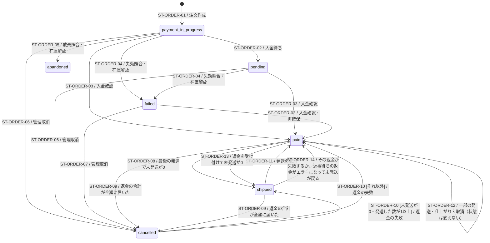
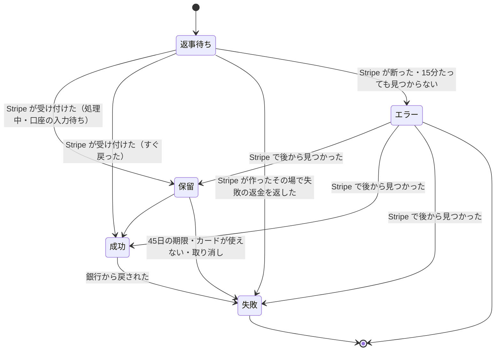

# 注文・決済の状態

> 状態: 現行ソース確認（返金の記録と状態・支払いの言葉・返金の取り込みと自動の返金の節は、グループ E-2 の変更を 2026-10-11 に反映） | 確認日: 2026-10-04 | 対象: `orders.status`と決済・在庫の独立属性

## 概要

注文の状態値と、それを更新する照合・管理RPCを示す。Stripeの現在値、下書き、Webhookキュー、返金額、在庫確保、通知は別の対象・属性として扱う。現行アプリはStripeを入金済み・入金待ちと確認した照合処理から注文を作る。決済前に注文受付APIを呼ぶ経路は現在の `src` にはない。返金は、注文の返金済みの額だけでなく1件ずつの記録（`public.order_refunds`）で持つ。記録の状態・全額の数え方・注文の状態への書き方は「返金の記録と状態（グループ E-2）」の節にまとめる。

## 範囲と根拠

対応領域は [CHECKOUT](../pages/13_checkout.md)と[ADMINの注文管理](../pages/16_admin.md)。[購入シーケンス](../sequence/checkout-payment.md)、[管理シーケンス](../sequence/order-administration.md)、[下書き](checkout-draft.md)、[キュー](stripe-webhook-queue.md)、[要対応記録](payment-exception.md)を関連モデルとする。

| 略号 | 実装根拠 |
| --- | --- |
| P | [注文受付RPC](../../../supabase/migrations/20260927100300_place_order_from_checkout_draft.sql) |
| M | [基の入金済み・入金待ちRPC](../../../supabase/migrations/20260927100400_mark_order_payment_rpcs.sql)。現行定義は D |
| L | [基の未入金の在庫解放RPC](../../../supabase/migrations/20260927100200_release_stock_by_order.sql)。現行定義は D |
| E | [要対応・管理取消RPC](../../../supabase/migrations/20260927100500_payment_exceptions.sql)。出荷とメールの行を書く処理は D（発送は E-1 から FB） |
| D | [グループ D の移行 B: 入金済み・入金待ち・在庫解放・発送と、同じ取引でのメールの行の作成](../../../supabase/migrations/20261009095736_order_email_enqueue.sql) |
| FA | [グループ E-1 の移行 A: 発送・仕上がりの記録と商品ごとの数](../../../supabase/migrations/20261010120303_order_fulfillments.sql) |
| FB | [グループ E-1 の移行 B: 発送・発送の取消と、発送ごとのメールの行](../../../supabase/migrations/20261010122320_fulfillment_order_emails.sql) |
| RA | [グループ E-2 の移行 A: 返金の記録・受け取った額・商品ごとの数への返金の組み込み](../../../supabase/migrations/20261011120000_order_refund_records.sql) |
| RB | [グループ E-2 の移行 B: 返金を始める・材料を読む関数](../../../supabase/migrations/20261011120100_order_refund_requests.sql) |
| RC | [グループ E-2 の移行 C: 返金の結果を書く関数・外からの返金の記録・返金のメールの行](../../../supabase/migrations/20261011120200_order_refund_results.sql) |
| R | [返金投影RPC](../../../supabase/migrations/20260925000218_add_order_state_transition_rpcs.sql)。`apply_order_refund_projection` は E-2 の移行 C で消し、結果を書く関数（RC）に置き換えた。古い定義の記録 |
| C | [照合器](../../../src/lib/stripe/checkout-payment-reconciler.ts)、[判定関数](../../../src/lib/stripe/checkout-payment-decision.ts)、[Stripe現在値の読取り](../../../src/lib/stripe/checkout-payment-reader.ts) |

## 状態定義

| DB値 | 意味・表示上の扱い |
| --- | --- |
| `payment_in_progress` | 注文を受付RPCで作成した初期状態。顧客の注文履歴・KPI対象から除外する値 |
| `pending` | Stripe現在値を入金待ちと照合した状態 |
| `paid` | Stripe現在値を入金済みと照合した状態。金額不一致や未確保在庫が残る場合もあり得る。一部の商品だけ発送した間、受注生産の品を作っている間も `paid` のまま（グループ E-1） |
| `failed` | 未入金注文で払込票の失効等を照合し、確保在庫を解放した状態。遅れて入金した場合の回復経路がある |
| `abandoned` | 手続き未完了のCheckout期限切れを照合した状態。顧客履歴・KPI対象から除外する値 |
| `cancelled` | 人が未入金注文を取り消した場合、または成功した返金の合計が全額（受け取った額 `orders.paid_amount`。受け取った額が0か空の注文は注文の合計 `total_amount`。注文額と同じことが多い）に到達した場合。支払い済みの注文のキャンセルも、返金が成功した時にここへ入る（グループ E-2） |
| `shipped` | 全部の商品を発送した状態。最後の発送の関数が `paid` から変え、出荷日時・配送業者・追跡番号をその発送の値で保存する。発送の取消で未発送が出たら `paid` に戻して空にする（グループ E-1）。残りの商品を発送前に返金して未発送が0になった時も、その返金を Stripe が受け付けた時点で `paid` から変える（グループ E-2。ST-ORDER-13） |

値の正本は[ORDER_STATUSES](../../../src/lib/orders/order-payment-types.ts)と[enum追加migration](../../../supabase/migrations/20260927100000_add_order_payment_statuses.sql)。管理画面の注文の履歴の状態の表示名は [order-history.ts](../../../src/lib/orders/email/order-history.ts) の `ORDER_STATUS_LABELS` に揃える（注文の一覧の言葉は下の「画面の言葉と DB の状態」）。表示ユーティリティの別名を新しいDB状態として追加しない。

## 状態遷移図

初期ノードは新規作成の条件付き経路。図は現在のアプリから呼ぶRPCによる遷移を示し、すべての直接SQL更新を強制するDBトリガーが適用済みとは宣言しない。状態の名前だけで終端を判断しない。

## 遷移条件と副作用

| ID | イベント・ガード | 更新・副作用 | 根拠 |
| --- | --- | --- | --- |
| ST-ORDER-01 | 注文なし、Stripe `paid/awaiting_payment`。paidは全額返金済みでないこと。draftがcreated、所有sessionと添付Sessionが一致、正の額、通貨と割引前合計が一致、商品が存在しpublished | payment_in_progressの注文と明細を作成。賄えるvariantのみstockとしpurchase台帳で確保、他はbackorder。draftをcompletedにする。ここではカートを消さない | P、C |
| ST-ORDER-02 | Stripe `awaiting_payment`、現在payment_in_progress、既存PIがあれば一致 | pending、PI補完、snapshotに含む所有sessionのカート行を削除、入金待ち注文メールの行を同じ取引で書く | D、C |
| ST-ORDER-03 | Stripe `paid`、期待状態がpayment_in_progress/pending/failedかつDB現在値一致、PI一致 | paid、PI補完、受け取った額（`orders.paid_amount`。金額が注文と違っても、実際に受け取った額）の書き込み、カート削除。stock明細で確保ゼロの分を再確保し、不足が残ればreview_reason。金額・通貨不一致でもpaidに更新後、要対応を記録して注文確定メールを抑止する。全額返金済みもpaidメールを抑止し、通知あり・金額一致なら注文確認メールの行を同じ取引で書く。金額一致なら後続のnone判定で返金同期を呼び、Stripe の返金を返金の記録に取り込む | D、C |
| ST-ORDER-04 | Stripe `voucher_expired`、payment_in_progress/pending、通常照合 | failed、予約台帳の差から残る確保数量だけcancel台帳を追記、期限切れメールの行を同じ取引で書く | D、C |
| ST-ORDER-05 | Stripe `checkout_abandoned`、payment_in_progress、通常照合 | abandoned、同じ在庫解放。pendingからのabandonedはRPCでも拒否。放棄メールは送らない | D、C |
| ST-ORDER-06 | 管理取消: Session失効・再読取り後の期限切れ/放棄判定。要対応の取消付き解決: 外部支払可否確認後、関連注文がpayment_in_progress/pending | actor・理由必須、otherはメモ必須。期待状態付き更新、残る予約分だけ解放、取消情報を保存、指定時に取消メールの行を同じ取引で書く | D、E、[管理status API](../../../src/app/api/admin/orders/%5Bid%5D/status/route.ts)、[例外resolve API](../../../src/app/api/admin/payment-exceptions/%5Bid%5D/resolve/route.ts) |
| ST-ORDER-07 | actor・理由、otherならメモ。現在failed、メモ500字以下 | cancelled。追加の在庫解放と取消メールは行わない | E、管理status API |
| ST-ORDER-08 | admin.orders.manage、actor・重複防止キー・配送業者・追跡番号・商品と数、paid、必須配送先が揃い、未解決paid_amount_mismatchがなく、各商品の数が発送準備中の数以内。この発送で未発送の数が全部0になる（`completes_order`） | shipped、出荷日時・配送情報（その発送の値）。発送ごとに発送の記録を1つ書く（全部を送らない発送は ST-ORDER-12）。`notifyCustomer` が true の時だけ、その発送の発送メールの行を同じ取引で書く。review_reason未確認自体はこのRPCの拒否条件に含まれていない | FB、管理発送API |
| ST-ORDER-09 | 返金の結果を書く関数（`record_order_refund_result`・`record_external_order_refund`）で、成功した返金の合計が全額（`COALESCE(NULLIF(paid_amount, 0), total_amount)`。受け取った額が0か空の注文は注文の合計）に届き、注文が `paid` か `shipped`。注文の行を `FOR UPDATE` で押さえた中で判定する | cancelled（改訂の理由 `refund_projection`）、返金済みの額・返金日時・支払状態更新時刻を書く。支払い済みのキャンセル（`order_cancel`）と自動の取消（`auto_amount_mismatch`）の返金なら、その返金の取消の理由・メモ・知らせるかを注文の取消の列に写す。全額の返金では未発送の商品を全部その返金の発送前の行に入れてあるので、在庫は返金が動かしている（台帳 `refund`）。 | RA・RC、[返金の流れ](../../../src/lib/orders/refund/refund-service.ts)、[返金の取り込み](../../../src/lib/stripe/order-refund-sync.ts) |
| ST-ORDER-10 | 最後に `cancelled` になった時の注文の改訂の理由が `refund_projection`（前からの `stripe_refund_projection` を含む）で、返金が失敗して成功した返金の合計が全額（受け取った額。0か空なら注文の合計）を下回った | 未発送が0で発送した数が1以上なら `shipped`、ほかは `paid` に戻す（改訂の理由 `refund_projection`。発送していない注文は発送済みにしない）。未入金から取り消した注文（改訂の理由が返金でない。自動の返金①の注文を含む）は戻さない | RC |
| ST-ORDER-11 | 発送の取消: admin.orders.manage、注文がpaidかshipped、発送がその注文の物で未取消 | 発送に取消の時刻と人を書く。注文がshippedならpaidに戻し、出荷日時・配送業者・追跡番号を空にする。その発送のまだ送っていない発送メールの行を取りやめ（`fulfillment_cancelled`）にする。お客様には知らせない。取消済みなら `already_cancelled`（変更なし） | FB、管理発送の取消API |
| ST-ORDER-12 | 一部の発送、仕上がりの記録、仕上がりの取消。paid（発送の取消はpaidかshipped） | 状態は変えない。発送・仕上がりは別の表に1回ごとに記録する。発送した数は発送準備中の数まで、仕上がりは受注生産中の数まで。画面の言葉（受注生産中・発送準備中・配送中）は記録から出す | FA、FB |
| ST-ORDER-13 | 返金を Stripe が受け付け（保留か成功に初めてなる）、未発送の数が0になり、発送した数が1以上で、注文が `paid`（全額ではない） | shipped（改訂の理由 `refund_completed_order`）。発送日・配送業者・追跡番号は、取り消していない最後の発送の値を写す | RC |
| ST-ORDER-14 | 次のどちらかで未発送が戻って、注文が `shipped`。(a) ST-ORDER-13 の返金が失敗し、確保し直しなどで戻った。(b) 返事待ちの返金が `mark_order_refund_error` でエラーになり、その返金の発送前の行を数えなくなって戻った | paid（改訂の理由 `refund_failed_reopened`）。発送日・配送業者・追跡番号を空にする。(b) は在庫・メール・失敗の後始末を動かさない | RC |

更新0件は成功した遷移ではない。照合器はStripeと注文を最大3回読み直す。state_conflictが最終回まで続けば要対応を記録してneeds_actionを返す。最大3回の試行内でdoneに達せず、最終回がapplied/lost_raceで追加読取りを要する場合はReconcileTransientError(not_converged)。管理APIの0件は409等の競合結果になる。

## 返金の記録と状態（グループ E-2）

2026-10-11 から、返金は注文の返金済みの額だけで持たず、1件ずつの記録（`public.order_refunds`。Stripe の返金1件が1行）で持つ（[グループ E-2 設計書](../../superpowers/specs/2026-10-11-refund-and-cancel-design.md) の 4 章）。注文の状態の値（上の7つ）は変えない。返金の記録は消さず、中身を直さない。進むのは状態と、その細目・時刻・印だけで、トリガー `order_refunds_guard` が止める（RA）。

返金の記録の状態は、Stripe の返金の状態から次のとおりに決める。

| Stripe の返金の状態 | 記録の状態 |
| --- | --- |
| `pending`・`requires_action` | 保留 |
| `succeeded` | 成功 |
| `failed`・`canceled` | 失敗 |

許さない移り方の知らせ（成功の後の保留など。Stripe の知らせは順番どおりに届かない）は、結果を書く関数が何もせずに今の値を返す。誤りにはしない。返金の道（`source`）は次の6つ。

| 道 | 中身 |
| --- | --- |
| `admin` | 管理画面の返金。商品と数・送料を選ぶ |
| `order_cancel` | 支払い済みの注文のキャンセル。残りの商品全部と、送料（返せる送料と返せる額の小さい方） |
| `stripe_dashboard` | Stripe の画面からの返金。知らせから取り込む。商品の行は無く、全額になる時だけ未発送の商品を全部その返金の発送前の行に入れる（送料は、行の有無に依らず返せる送料の全部。ただしその返金の額を超えない） |
| `auto_cancelled_order_payment` | 自動の返金①。取り消した注文への入金を全額返す |
| `auto_amount_mismatch` | 自動の返金②。支払額の違う注文を全額返して取り消す（残りの商品全部と、送料は返せる送料と返せる額の小さい方） |
| `legacy` | 前からの写し。切り替えの時刻より前に Stripe で作られた返金で、在庫もメールも動かさない |

- 全額 = 受け取った額（`orders.paid_amount`。店内だけの列。書くのは、入金を記録する時（`mark_order_paid`）と、照合が取り消した注文への入金を見つけた時（`record_cancelled_order_paid_amount`。記録のたびに、自動の返金①のオン・オフに依らず、空の時だけ））。返せる額 = 受け取った額 − 返事待ち・保留・成功の返金の合計。返せる送料 = 注文の送料 − 同じ返金の送料の合計。`orders.refunded_amount` = 成功した返金の合計（意味は変えない）。エラーと失敗の返金は、どの合計にも数えない
- 商品ごとの数: q = 注文の数、s = 発送した数、c = 仕上がった数（在庫の品は q）、rb = 発送前に返金した数、ra = 発送後に返金した数（rb・ra は返事待ち・保留・成功の返金の行）。未発送 q − s − rb、まだ作っていない max(q − rb − c, 0)、発送準備中 max(min(c, q − rb) − s, 0)、発送後に返せる数 s − ra。守る関係 s + rb ≤ q・ra ≤ s・s ≤ c を、トリガー `private.check_order_line_fulfillment_bounds` が守る
- 返金を始める関数（`begin_order_refund`。RB）は、返事待ちの記録と商品の行を作り、返せる額・送料・数の上限と、二重防止の番号を確かめる
- 結果を書く関数（`record_order_refund_result`・`record_external_order_refund`。RC）は、1回の取引で、記録の状態・在庫（Stripe が受け付けた時の1回だけ）・メールの予定・要対応（失敗の1回だけ）・注文の返金済みの額と状態を書く（注文の状態の移り方は上の ST-ORDER-09・10・13・14）。詳しい流れは [注文管理のシーケンス](../sequence/order-administration.md) の SQ-ADMIN-03・06・07・08
- エラーにした返金が Stripe で後から見つかった時は、エラーから保留・成功・失敗に進める（エラーにした時刻は残す）。保留・成功に進めた時は、エラーの時に作った要対応「返金の失敗」（支払いの印は返金の記録の番号）が開いていれば、システムが閉じる（`resolved_by` は空。メモは「Stripe で返金が見つかったため自動で解決」。[要対応の状態](payment-exception.md) の ST-EXCEPTION-04）。ただし閉じるのは、その返金の発送前の行の商品が全部 `s + rb ≤ q` を保っている時だけ。エラーの間にその品を発送して崩れていれば（お客様に品と返金の両方が届く）、要対応を開いたまま残し、店が確かめる。受け付けずに（保留・成功を通らずに）失敗に進めた時は、失敗の後始末の要対応を同じ印（返金の記録の番号）で記録するので、エラーの時の要対応と同じ1行になり、2件目は作らず、店への知らせも1通になる。保留・成功を通った後に失敗した時（エラー → 成功でエラーの時の要対応を閉じた後に、コンビニ払いの期限で失敗した時など）は、Stripe の返金の番号の印で新しい要対応を作り、店へ知らせる（閉じた行に重ねて、本当の失敗を誰にも知らせないことを避けるため）
- 返事待ちの返金をエラーにした時（`mark_order_refund_error`）は、その返金が数えていた発送前の行を数えなくなるので、未発送が戻る注文は発送済みから支払い済みに戻る（ST-ORDER-14。在庫・メール・失敗の後始末は動かさない）

## 画面の言葉と DB の状態（グループ E-1）

DB の状態の値（上の7つ）は変えない。管理画面とお客様の画面の言葉は、商品ごとの数（`private.order_line_fulfillment`）から [order-progress.ts](../../../src/lib/orders/order-progress.ts) が出す。管理画面・窓口・お客様の画面が同じ言葉を使う。

| DB の状態 | 商品ごとの数 | 出す言葉 |
| --- | --- | --- |
| `payment_in_progress` | — | 支払い手続き中（管理画面だけ。お客様には出さない） |
| `pending` | — | 未決済 |
| `paid`・`shipped` | 受注生産中の数が1以上の商品がある | 受注生産中 |
| `paid`・`shipped` | 上が無く、発送準備中の数が1以上の商品がある | 発送準備中 |
| `paid`・`shipped` | 上が無く、発送した数が1以上 | 配送中（配達済みは E-4。E-1 では発送した品は全部「配送中」） |
| `paid` | 未発送の数の合計が0・発送した数の合計が0で、手続き中の返金（返事待ち・保留）がある | キャンセルの手続き中（グループ E-2。コンビニ払いの口座の入力待ちなど。段は出さない） |
| `failed` | — | 決済失敗 |
| `abandoned` | — | 放棄（管理画面だけ） |
| `cancelled` | — | キャンセル |

- 「一部発送済み」の印は、`paid`・`shipped` の注文で、発送した数が1以上かつ未発送の数も1以上の時に付ける（管理画面の注文の一覧と、お客様の注文の詳しい画面。お客様の購入履歴の一覧には出さない）。
- 商品ごとの数: 発送した数（取り消していない発送の合計）、仕上がった数（在庫の品は注文の数、受注生産の品は取り消していない仕上がりの合計）、発送前・発送後に返金した数（返事待ち・保留・成功の返金の行。グループ E-2）、受注生産中の数（max(注文の数 − 発送前に返金した数 − 仕上がった数, 0)）、発送準備中の数（max(min(仕上がった数, 注文の数 − 発送前に返金した数) − 発送した数, 0)）、未発送の数（注文の数 − 発送した数 − 発送前に返金した数）。`shipped + refunded_before_shipment ≤ quantity`・`refunded_after_shipment ≤ shipped`・`shipped ≤ completed`（受注生産）・`completed ≤ quantity` を DB の関数とトリガーで守る（考え方は「返金の記録と状態（グループ E-2）」の節）。
- お客様の進み具合の段は、在庫の品だけの注文が「お支払い・発送準備中・配送中・配達済み」、受注生産の品を含む注文が「お支払い・受注生産中・発送準備中・配送中・配達済み」。今の段は、注文のいちばん手前の段階で決める。キャンセル・決済失敗の注文と、キャンセルの手続き中の注文には段を出さない。
- 管理画面の注文の履歴は、見出しも状態の変化の行も DB の状態の言葉（決済完了・発送済みなど。`ORDER_STATUS_LABELS`）のまま出す。上の進み具合の言葉には替えない。

### 支払いの言葉（グループ E-2）

管理画面の注文の一覧は、進み具合とは別に「支払い」の列を持つ（Shopify の Payment status と同じく、支払いと発送を分ける）。DB の状態の値と、受け取った額・成功した返金の合計から、[payment-status.ts](../../../src/lib/orders/payment-status.ts) の `derivePaymentStatus` が上から順に当てはめ、最初に当たった1つを出す。

| 順 | 条件 | 支払いの言葉 |
| --- | --- | --- |
| 1 | DB の状態が `payment_in_progress`・`pending` | 未入金 |
| 2 | `failed` | 支払いの失敗 |
| 3 | `abandoned` | 支払いなし |
| 4 | 受け取った額が空か0（未入金のまま取り消した注文を含む） | 支払いなし |
| 5 | 成功した返金が0 | 支払い済み |
| 6 | 成功した返金が0より多く、受け取った額より少ない | 一部返金 |
| 7 | 成功した返金が受け取った額に届いた | 返金済み |

小さな印として、返事待ち・保留の返金がある注文に「返金の手続き中」、開いている「返金の失敗」の要対応がある注文に「返金の失敗」を、支払いの言葉の横に足す。

## Stripe現在値の分類

次はローカルの観測分類であり、Stripe自身の状態機械やDBのenumではない。イベントの種類と到着順だけで注文状態を更新しない。

| 観測分類 | 読取り条件 | 注文への判断 |
| --- | --- | --- |
| `in_progress` | Sessionがopen | 通常は変更なし。pending/paid/shippedとの組合せは矛盾記録 |
| `checkout_abandoned` | Sessionがexpired | payment_in_progressだけ放棄へ。注文なしなら新規注文を作らない |
| `zero_amount_complete` | Session complete、no_payment_required | 注文なしなら監査記録のみ、注文ありは金額の要対応 |
| `paid` | Session complete、PIあり、payment_status paidまたはPI succeeded。返金額は展開したlatest_charge.amount_refunded、受取額はPI.amount_received | 注文なしは全額返金済みなら記録のみ、一部返金なら新規作成。paid/shippedのnone判定でも返金額>0なら返金を同期し、同期後statusを返す。cancelledへの入金はStripe返金額が受取額未満なら要対応 |
| `awaiting_payment` | Session complete/unpaid、PI requires_action/processing | 新規作成またはpendingへ。既にpendingなら変更なし |
| `voucher_expired` | Session complete/unpaid、PI requires_payment_method/canceled | 未入金注文の在庫解放。注文なしなら何もしない |
| `missing` | Stripe resource_missing | 注文なしなら監査記録のみ、注文ありは要対応 |
| `not_applicable` | 対象外・分類不能 | 注文なしは記録のみ、注文ありは想定外状態の要対応 |

通常の `readCheckoutPayment` の分岐と、PIからSessionを逆引きする互換経路はCの読取り実装を根拠とする。外部サービス内部の自動遷移はこの図の対象外。

### 行動決定表と先行ガード

照合器は次の順で判定する。先行ガードに該当した場合、下の表より優先する。

1. 注文とsnapshotの両方にPI IDがあり不一致なら`state_conflict(payment_intent_mismatch)`。
2. 注文paid/shippedかつsnapshot paidで注文額/通貨と受取額/通貨が違えば`paid_amount_mismatch`。以前の要対応記録が失敗していても再検出する。
3. 注文なし・draft IDなしではmissing以外を`not_applicable(no_draft)`に置き換える。既存注文はdraft IDなしでも通常判定する。

| Stripe観測 | 注文なし | payment_in_progress | pending | paid / shipped | failed | abandoned | cancelled |
| --- | --- | --- | --- | --- | --- | --- | --- |
| paid | 全額返金済みなら記録のみ、それ以外は作成・paid | paidへ | paidへ | 変更なし・必要な返金同期 | paidへ再確保 | 状態矛盾 | 返金額>=受取額なら変更なし、それ以外は取消後入金の要対応 |
| awaiting_payment | 作成・pending | pendingへ | 変更なし | 状態矛盾 | 状態矛盾 | 状態矛盾 | 状態矛盾 |
| voucher_expired | 変更なし | failedへ | failedへ | 状態矛盾 | 変更なし | 変更なし | 変更なし |
| checkout_abandoned | 変更なし | abandonedへ | 状態矛盾 | 状態矛盾 | 変更なし | 変更なし | 変更なし |
| in_progress | 変更なし | 変更なし | 状態矛盾 | 状態矛盾 | 変更なし | 変更なし | 変更なし |
| zero_amount_complete | 記録のみ | 金額不一致 | 金額不一致 | 金額不一致 | 金額不一致 | 金額不一致 | 金額不一致 |
| missing | 記録のみ | Stripe対象なし | Stripe対象なし | Stripe対象なし | Stripe対象なし | Stripe対象なし | Stripe対象なし |
| not_applicable | 記録のみ | 想定外状態 | 想定外状態 | 想定外状態 | 想定外状態 | 想定外状態 | 想定外状態 |

「全額返金済み」は注文なしの作成判定とメール抑止では`amountRefunded > 0 && amountRefunded >= amountReceived`。既存cancelledの判定は実コード通り`amountRefunded >= amountReceived`で、返金>0を追加しない。作成なしの返金は監査note `refunded_before_order`だけで、新しい要対応理由や注文状態を追加しない。

通常のfailed/abandonedへの解放は`adminCancel`付きならcancelledへ置き換える。状態矛盾は最終回前なら再読取り、最終回なら`state_conflict`を記録。金額不一致、Stripe対象なし、想定外状態、取消後入金は、それぞれ`paid_amount_mismatch`、`stripe_object_missing`、`unexpected_state`、`cancelled_order_paid`の要対応となる。

返金同期は、none判定かつpaid/shipped注文・paid snapshot・返金額>0・PIありの場合に[返金同期](../../../src/lib/stripe/order-refund-sync.ts)を呼ぶ。その支払いの返金を全ページ読み、1件ずつ返金の記録（`order_refunds`）に合わせる（印 `refund_id` がこの注文の記録に当たる返金は、その記録に結果を書く。印の無い返金は「Stripe の画面からの返金」か「前からの写し」として記録する）。書いた後に一覧を読み直し、返金の番号と状態の組が変わっていれば最大3回まで繰り返す（グループ E-2。CAS での上書きはやめた）。全額ならST-ORDER-09、一部なら状態を維持して返金済みの額だけ更新する。返金0や既にcancelledの注文にはこの照合器から呼ばない。WebhookのRefund分岐、管理返金、会計照合からの直接呼出しは[注文管理](../sequence/order-administration.md)を参照する。

同期後のcancelledを古いpaid/shippedとして返さず、completeはorderIdなし・cancelledとも409。返金同期のStripe/DB一時障害や未収束は照合器の一時エラーとなり、成立済み入金更新を巻き戻さない。

取り消した注文への入金（`cancelled_order_paid`）と支払額の違い（`paid_amount_mismatch`）は、要対応を初めて記録した時（切り替えの前から記録のある要対応には効かない）だけ、ショップの設定に応じて自動の返金を動かす（グループ E-2）。①は取り消した注文への入金を全額返金し、②は支払額の違う注文を全額返金して取り消す。どちらも失敗しても、次の照合ではやり直さない。流れは [注文管理のシーケンス](../sequence/order-administration.md) の SQ-ADMIN-08。

## 独立属性と不変条件

- `refunded_amount`は成功した返金の合計（意味はE-2でも変えない）。返金の記録（`order_refunds`）の成功の合計と等しく、返事待ち・保留・エラー・失敗は合計へ加えない。部分返金はpaid/shippedを維持する。全額の判定は、受け取った額`paid_amount`（入金を記録する時に書く、店内だけの列）で行い、受け取った額が0か空の注文は注文の合計`total_amount`で行う（`COALESCE(NULLIF(paid_amount, 0), total_amount)`。返金が0円のままキャンセルにならないため）。
- 在庫確保はstock_movementsのpurchase/cancel/refundで判断する。`stock_released`という列を仮定しない。未入金取消は解放する。返金は、Stripeが受け付けた時（保留か成功に初めてなった時）の1回だけ、発送前の在庫の品の確保を外して台帳に`refund`で戻し（戻さない時は`refund`+nと`adjustment`−nの2行）、失敗した時は外した数を`purchase`で確保し直す（グループE-2。R-16）。
- 発送した数・仕上がった数は、変えられない注文の明細ではなく、`order_fulfillments`・`order_fulfillment_lines`・`order_item_completions` に1回ごとに記録する。発送は在庫の台帳を動かさない（在庫は注文の時に確保済み）。
- `shipped_at`・`shipping_carrier`・`tracking_number` は「全部の商品を発送した時」の値で、一部だけ送った間は空。返金の取り消しの戻し先（ST-ORDER-10）はこの値の有無で決める。発送の取消で未発送が出たら空に戻す（ST-ORDER-11）。
- `review_reason/review_marked_at`は在庫確保不足等、`reviewed_at/reviewed_by`は手動確認。確認済みにしても理由は消さない。
- 金額不一致のpaid注文は[要対応](payment-exception.md)を解決するまで発送の関数（`admin_create_fulfillment`）が拒否する。paidであることだけから発送可能とは判断しない。
- 注文のメールは、状態を変える関数が同じ取引で `private.order_email_outbox` に行を書き、worker が送る（[グループ D 設計書](../../superpowers/specs/2026-10-09-order-email-outbox-design.md)）。
- 旧finalize RPC、PI IDで呼ぶ旧release RPCは[廃止migration](../../../supabase/migrations/20260927100800_retire_legacy_order_rpcs.sql)に含まれ、現行の正規経路として図示しない。

## 関連テスト

[状態値](../../../tests/unit/lib/orders/order-payment-types.test.ts)、[判定表](../../../tests/unit/lib/stripe/checkout-payment-decision.test.ts)、[照合器](../../../tests/unit/lib/stripe/checkout-payment-reconciler.test.ts)、[入金RPC](../../../tests/integration/db/mark_order_payment.integration.test.ts)、[在庫解放](../../../tests/integration/db/release_stock_by_order.integration.test.ts)、[返金同期](../../../tests/unit/lib/stripe/order-refund-sync.test.ts)、[発送・仕上がりのDB](../../../tests/integration/db/order_fulfillments.integration.test.ts)、[発送ごとのメールのDB](../../../tests/integration/db/fulfillment_order_emails.integration.test.ts)、[発送・仕上がりのE2E](../../../e2e/FR-ADMIN-068-partial-fulfillment.spec.ts)、[返金の記録のDB](../../../tests/integration/db/order_refund_records.integration.test.ts)、[返金を始めるDB](../../../tests/integration/db/order_refund_requests.integration.test.ts)、[返金の結果のDB](../../../tests/integration/db/order_refund_results.integration.test.ts)、[Stripeの画面からの返金のE2E](../../../e2e/FR-ADMIN-080-stripe-dashboard-refund.spec.ts)。今回のDB・外部サービス実行成功証跡ではない。

## 未確認事項

本番migration適用、実際のStripe現在値、Cronの登録、実データによる全競合・遅延入金は未確認。`supabase/pending/`の状態遷移強制・schedule案を適用済みの事実として扱わない。保留の状態遷移強制（`harden_order_state_transitions.sql`）の表には、E-2 で`paid`→`shipped`（`refund_completed_order`）と`shipped`→`paid`（`refund_failed_reopened`）を足し、全額の判定を受け取った額に直したが、当てていない（開店前に当てるかを決める。当てる前に、全額返金で取り消した注文を戻す決まりに `private.order_cancelled_by_refund(OLD.id)` の確かめを足す。足さないと、未入金で取り消した注文に届いた入金の全額の返金（自動の返金①、管理画面の返金の画面の「すべて選ぶ」で返した全額の返金、Stripe の画面からの全額の返金）が成功の後に失敗した時、失敗を記録できず止まる。[開店のときの順番](../../06_Operations/webhook-queue-operations.md)の 5f）。ソース中の最大所要時間のコメントも、件数・時間制限がある見回りの無条件保証として記載しない。
