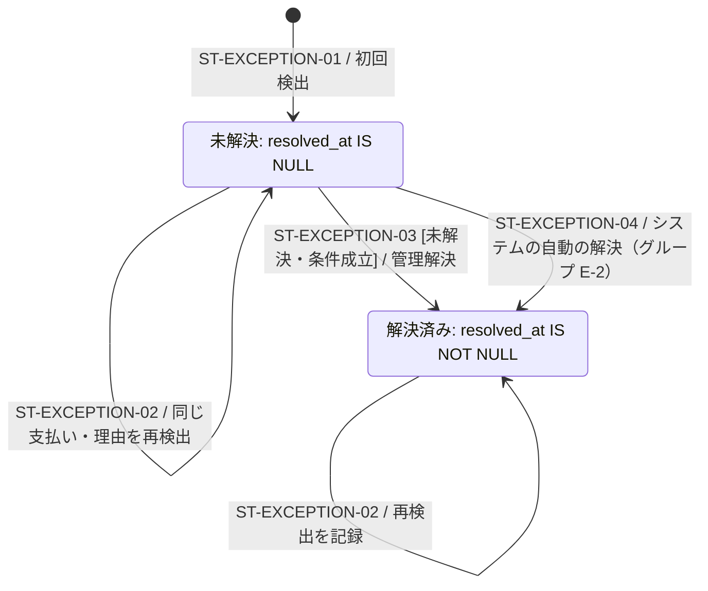

# 決済の要対応記録の状態

> 状態: 現行ソース確認（理由 `refund_failed`・受け取った額の書き込み・システムの自動の解決はグループ E-2 の変更を 2026-10-11 に反映） | 確認日: 2026-10-04 | 対象: `payment_exceptions`の解決状態

## 概要

要対応記録に `status` 列はない。`resolved_at IS NULL`を未解決、非NULLを解決済みとして扱う。同じ支払い・同じ理由は1行にまとめ、解決後の再検出でも未解決に戻さない。注文の要確認フラグと別の対象である。

## 範囲と根拠

対応領域: [ADMINの要対応・要確認](../pages/16_admin.md)、[注文管理シーケンス](../sequence/order-administration.md)。定義とRPCは[要対応migration](../../../supabase/migrations/20260927100500_payment_exceptions.sql)、検出は[照合器](../../../src/lib/stripe/checkout-payment-reconciler.ts)、解決は[resolve API](../../../src/app/api/admin/payment-exceptions/%5Bid%5D/resolve/route.ts)（人が押す解決）。システムの自動の解決（グループ E-2）は、[E-2 移行 C](../../../supabase/migrations/20261011120200_order_refund_results.sql)の `resolve_payment_exception_by_system`。

## 状態定義と図

## 遷移条件

| ID | 契機・ガード | 更新と結果 |
| --- | --- | --- |
| ST-EXCEPTION-01 | 照合器が要対応と判定、`(payment_ref, reason)`が未登録 | `record_payment_exception`がINSERT、最初と最後の検出時刻、検出回数1。`is_new=true` |
| ST-EXCEPTION-02 | 同じunique keyが存在 | 最後の検出時刻と回数を更新し、欠けていた参照IDを補う。`resolved_at`を消さず、解決済みかを返す |
| ST-EXCEPTION-03 | `admin.orders.manage`とAAL2を満たす利用者、actorあり、対象行が存在し未解決。resolve APIにadminロールだけの追加制限はない | RPCが対象をロックし `resolved_at/resolved_by/resolution_note`を更新。既に解決済みならfalse、APIは409 |
| ST-EXCEPTION-04 | 次のどちらか（グループ E-2）。(a) 照合が取り消した注文への入金（`cancelled_order_paid`）か支払額の違い（`paid_amount_mismatch`）を初めて記録し（切り替えの前から記録のある要対応は初めてではないので効かない）、ショップの設定に従った自動の返金①②をStripeが受け付け、店への知らせを送れた（閉じるのは知らせを送れた後。送れなければ送信権を戻して開いたまま残し、毎時の見回り・次の照合が送り直す。送信権を先に取られた照合は、返金だけ行い閉じない）。(b) エラーにした返金（`mark_order_refund_error`）の要対応「返金の失敗」が開いていて、その返金がStripeで後から見つかり、保留か成功になった。かつ、その返金の発送前の行の商品が全部 `s + rb ≤ q`（発送した数 + 発送前に返金した数 ≤ 注文の数）を保っている（エラーの間にその品を発送して崩れていれば、閉じずに開いたまま残す） | `resolve_payment_exception_by_system`が対象をロックし、`resolved_at`と`resolution_note`を書く。メモは (a) ①が「システムが自動で返金した」、②が「システムが自動で解決した」、(b) が「Stripe で返金が見つかったため自動で解決」。`resolved_by`は空（人が解決したST-EXCEPTION-03と見分ける印）。既に解決済みならfalse |

記録キーのpayment_refは、Stripe snapshotのSession ID、PI ID、入力のSession ID、PI IDの順で選ぶ。同じキー・理由の再検出は参照列をCOALESCEで補うが、既存detailと解決情報は上書きしない。

### 要対応を検出する条件

| reason | 現行の検出条件 |
| --- | --- |
| `order_not_creatable` | 注文受付RPCがdraft_not_found・item_unavailable・amount_mismatch・currency_mismatch・zero_amountの理由コードを返す。注文作成時の在庫不足はbackorderの扱いとなり、この理由だけで受付拒否しない |
| `paid_amount_mismatch` | 入金更新RPCの金額・通貨不一致、既にpaid/shippedの注文とStripe受取額・通貨の不一致、または既存注文に対する0円完了。金額不一致を再読取りでも導き直す |
| `cancelled_order_paid` | cancelled注文にStripe paidが対応し、Stripe返金額が受取額未満。受取額以上の返金ならこの理由を記録しない。この理由を記録するたびに（初めてでも前からでも、自動の返金①のオン・オフに依らず）、照合器が受取額と支払い（PI）の番号を注文に書く（`record_cancelled_order_paid_amount`。受取額が空の時だけ。書けなくても照合は続ける。グループ E-2） |
| `state_conflict` | 注文とsnapshotのPI不一致、または判定表の矛盾する状態の組合せ。最終回より前は記録・通知をせず両方を読み直し、最大3回目まで残った場合に記録 |
| `unexpected_state` | 注文作成に必要なsnapshot属性が不足、または既存注文にStripe not_applicableが対応する |
| `stripe_object_missing` | 既存注文にStripe missingが対応する。注文なしのmissingはrecord_onlyで要対応行を作らない |
| `refund_failed` | 照合器ではなく返金のDB関数が記録する（グループ E-2）。返金の結果を書く関数（`record_order_refund_result`・`record_external_order_refund`）が、保留・成功だった返金、または返事待ちの返金を初めて失敗にした時（`failure_applied_at`で1回だけ）。`payment_ref`はStripeの返金の番号（まだ無ければ返金の記録の番号）。ただし、エラーにした記録が受け付けられずに（保留・成功を通らずに）失敗になった時は返金の記録の番号で、エラーの時の要対応と同じ1行にまとまり、店への通知も1通。エラーの後に保留・成功になり（その時、発送前の行の商品の数の関係が保たれていれば、エラーの時の要対応はシステムが閉じる）、その後に失敗になった時（コンビニ払いの期限切れなど）は、Stripeの返金の番号の別の行として新しい要対応を作り、店へ知らせる（閉じた行に重ねて、本当の失敗を誰にも知らせないことを避けるため）。`detail`は失敗の理由。もう一つは、毎時の見回りがStripeに見つからない返事待ちの返金をエラーにした時（`mark_order_refund_error`。`payment_ref`は返金の記録の番号、`detail`は`not_found_in_stripe`）。店への通知はアプリが送る（送る前に送信権を押さえる） |

根拠は[照合器](../../../src/lib/stripe/checkout-payment-reconciler.ts)と[判定表](../../../src/lib/stripe/checkout-payment-decision.ts)（`refund_failed`は[E-2 移行 C](../../../supabase/migrations/20261011120200_order_refund_results.sql)、受取額の書き込みは[E-2 移行 B](../../../supabase/migrations/20261011120100_order_refund_requests.sql)）。注文なし・下書きIDなしの対象外支払い、注文なしの0円完了、注文なしの全額返金済みpaidもrecord_onlyであり、初回検出として描かない。

### 注文を取り消して解決する場合

`cancelOrder=true`では取消理由と空でないメモが必要。APIは必要な場合に既存Checkout Sessionの失効を試みてStripeを読み直す。`paid`・`in_progress`・`awaiting_payment`、または未来の払込期限がある場合は409で拒否する。Stripeの一時的な確認失敗時も取消へ進まない。関連注文にStripe参照IDがなければ、この外部確認は行わずRPCへ進む。

RPCは関連注文が `payment_in_progress/pending` であることを確認し、`release_stock_for_unpaid_order`の条件付き更新が成功した場合だけ、同じトランザクションで例外を解決する。取消成功後、notifyCustomer指定に応じて通知を試みる。単なる「解決済みにする」はStripe返金や注文取消を実行しない。

## 独立属性・不変条件

| 属性 | 状態との区別 |
| --- | --- |
| `reason` | `order_not_creatable`、`paid_amount_mismatch`、`cancelled_order_paid`、`state_conflict`、`unexpected_state`、`stripe_object_missing`、`refund_failed`（返金の失敗。グループ E-2）。解決状態ではない |
| 通知 | `shop_notified_at/customer_notified_at`で送信前にclaimし、送信がfalseならNULLへ戻す処理を試みる。release RPCのエラーはDB接続側でログだけに記録し、通知時刻が残る場合がある。通知claim RPC自体の条件は各通知時刻がNULLであること。解決済みかの判定は呼び出し側の責務 |
| 要確認 | 注文の `review_reason/review_marked_at/reviewed_at/reviewed_by`。在庫確保不足などを記録する別属性。手動確認はreviewed_at/byを設定し、reasonを消さない。要対応行の解決とは別操作 |
| 再検出 | 解決済みを再度開くRPCはこの実装にない。新たな別理由なら別unique keyの行として記録する |

根拠: [状態値と理由](../../../src/lib/orders/order-payment-types.ts)、[DBと通知RPC](../../../supabase/migrations/20260927100500_payment_exceptions.sql)、[照合器](../../../src/lib/stripe/checkout-payment-reconciler.ts)。

通知claimにtoken・lease・送信後の確定RPCはない。claim後の処理停止やrelease失敗では通知時刻が残り、実際の送信成功を示すとは限らない。店向けの再送は見回りが未解決かつ`shop_notified_at IS NULL`の行だけ取得するため、時刻が残った行は対象外。顧客向け通知には同じCron再送処理はなく、注文を作れなかった支払いを再検出し、未解決・宛先あり・customer claim取得の条件を満たす場合に再試行する。通常の送信失敗がfalseで返れば要対応記録とイベント処理を巻き戻さず、キューは完了できる。根拠は[通知接続と未送信取得](../../../src/lib/stripe/checkout-payment-reconciler-deps.ts)、[通知と見回り](../sequence/stripe-webhooks.md)。

## 関連テスト

[要対応API](../../../tests/unit/api/admin/order-attention-route.test.ts)、[照合器](../../../tests/unit/lib/stripe/checkout-payment-reconciler.test.ts)、[PostgREST照合](../../../tests/integration/db/reconciler_postgrest.integration.test.ts)、[照合と本物のDB](../../../tests/integration/db/reconciler_composed.integration.test.ts)（受取額の書き込み）、[返金の結果のDB](../../../tests/integration/db/order_refund_results.integration.test.ts)（返金の失敗の要対応・システムの自動の解決）。今回の実行成功証跡ではない。

## 未確認事項

本番の制約適用、実際の通知到達、管理者の対応履歴は未確認。「解決済み」は、人が解決した記録（`resolved_by`あり）と、システムが自動で閉じた記録（`resolved_by`が空。ST-EXCEPTION-04）のどちらかで、どちらもStripeの入金・返金結果の保証として扱わない。
