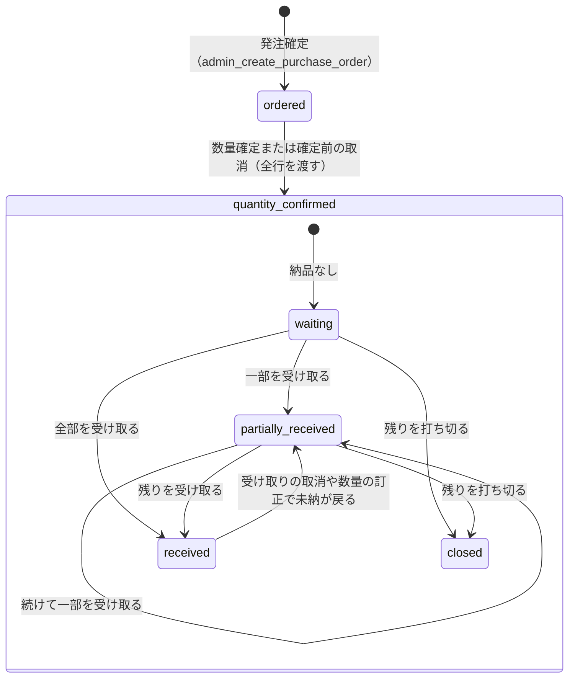

# 発注書の状態（G-2）

> 状態: 保存する2段階と、導出する3つの表示段階（導出する関数は Task 5）、数量の確定・訂正・打切り・取消の遷移（Task 6）は現行のソース（グループ G-2 Task 2・4・5・6。本番へは未適用） | 確認日: 2026-10-25 | 対象: `purchase_orders.stage` と、画面に出す5つの表示段階

## 概要

発注書の「段階」は、**DB に保存する2つ**と、**保存せず納品・未納・打切りから導く3つ**に分かれる。保存するのは `ordered`（発注確定の直後。数量は仮）と `quantity_confirmed`（数量が確定済み）だけで、受け取りの進み具合や打切りでは `stage` を変えない。画面には、この2つに導出の3つを足した5つの表示段階を出す。`draft`（入力途中）は画面の中の状態で、DB に保存しない。

| 層 | 値 | 保存 | 更新主体 |
| --- | --- | --- | --- |
| 保存する段階 | `ordered`、`quantity_confirmed` | `purchase_orders.stage`（CHECK 制約。既定 `ordered`） | 作成は `admin_create_purchase_order`（Task 4）、`quantity_confirmed` への進みは数量確定の関数 `admin_confirm_purchase_order_quantities` と、確定前の取消の打切り `admin_short_close_purchase_order`（Task 6） |
| 導出する表示段階 | `ordered`、`quantity_confirmed`、`partially_received`、`received`、`closed` | しない（読取の関数が毎回導く） | 内部の helper `private.purchase_order_display_stages`（Task 5。導くのはここ1か所） |
| 画面だけの状態 | `draft` | しない | 在庫一覧表の発注モード（入力と確認） |

## 範囲と根拠

| 項目 | 内容 |
| --- | --- |
| 対応要件 | FREQ-526（発注の作成）、FREQ-527・528（数量の確定・訂正と打切り・取消。Task 6）、FREQ-529（受け取り。後続 Task） |
| 設計 | [グループ G 設計書](../../superpowers/specs/2026-10-23-group-g-design.md)、[G-2 実装計画](../../superpowers/plans/2026-10-24-group-g2-purchasing.md)の「決めたこと」 |
| 実装 | 表と CHECK は移行 `20261024153505_group_g2_purchasing_foundation.sql`、作成・数量の確定と訂正・打切り・発注先の訂正は `20261024180500_group_g2_purchasing_writers.sql`、型は[共通の定義](../../../src/lib/purchase-orders/purchase-order-types.ts) |
| 関連 | 書込みの順序は[発注書の作成の流れ](../sequence/purchasing.md)、在庫の割当は[在庫の割当の状態](inventory-allocation.md) |
| 調査時点 | 2026-10-25。導出の式は Task 5 の移行（`20261024153505_group_g2_purchasing_foundation.sql` の節15）に実装した。DB での実行の検証は[発注の読取の試験](../../../tests/integration/db/group_g2_purchase_reads.integration.test.ts)（controller が使い捨て DB で流す） |

## 状態定義

| ID | 種類 | 値 | 意味 | 表示の文 |
| --- | --- | --- | --- | --- |
| ST-PO-01 | 保存 | `ordered` | 発注を確定した直後。明細の数量は仮（`provisional_quantity`）で、確定数量は未設定。受け取りはできない | 数量確定待ち |
| ST-PO-02 | 保存 | `quantity_confirmed` | 数量が全行そろって確定した。確定数量・納品済み・未納（確定数量 − 納品済み）を持つ。訂正してもこの段階のまま | 数量確定済み・受け取り待ち |
| ST-PO-03 | 導出 | `partially_received` | `quantity_confirmed` で、納品が1つ以上あり未納が残る | 一部受け取り済み |
| ST-PO-04 | 導出 | `received` | `quantity_confirmed` で、全行の未納が0で、打切りが無い | 受け取り完了 |
| ST-PO-05 | 導出 | `closed` | `quantity_confirmed` で、全行の未納が0で、打切りがある（確定前の発注の取消も、確定数量を全行0にした打切りとして、ここに入る） | 完了（残りを打ち切り） |

## 図

内側の状態 `waiting` の表示の文は「数量確定済み・受け取り待ち」。外側の遷移は保存する `stage` の変化、内側は保存せず導く表示段階の変化。訂正・単価・発注先の訂正・受け取り・打切りは `quantity_confirmed` のまま（`stage` は変えない）で、下の遷移条件表に書く。

## 表示段階の導き方（実装）

導くのは DB の内部の関数 `private.purchase_order_display_stages(uuid[])`（STABLE の SECURITY DEFINER。誰にも EXECUTE を付けず、発注一覧表の読取 `list_admin_purchase_order_lines` と発注書の詳細の読取 `get_admin_purchase_order` だけが呼ぶ）の**1か所だけ**。戻りは 発注書の id・表示段階・納品の合計・未納の合計・`has_active_short_close`。納品の合計・未納の合計は発注書の明細の `received_quantity`・`outstanding_quantity`（確定数量 − 納品済み。未確定の行は NULL で、合計では 0 として数える）の和。

| 順 | 条件 | 表示段階 |
| --- | --- | --- |
| 1 | 保存する段階が `ordered` | `ordered` |
| 2 | 未納の合計 > 0 かつ 納品の合計 = 0 | `quantity_confirmed` |
| 3 | 未納の合計 > 0 かつ 納品の合計 > 0 | `partially_received` |
| 4 | 未納の合計 = 0 かつ（`has_active_short_close`、または納品の合計 = 0） | `closed` |
| 5 | 未納の合計 = 0 かつ 納品の合計 > 0 かつ `has_active_short_close` でない | `received` |

`has_active_short_close` は「ある明細の、数量に関わる最新の版が打切りである」時に真。数量に関わる版は `purchase_order_revisions` の、種類 `short_close`（打切り）と、**数量が実際に変わる**種類 `quantity` の版（`before_quantity` と `after_quantity` が違う。NULL 同士は同じとみなす）で、明細ごとに `revision_no` が最大の1件を取り、それが `short_close` なら真（`order`・`header` の版は数えない）。単価だけを直す `quantity` の版（数量は変わらない。Task 6 の確定・訂正の関数は単価だけの変更も `before_quantity` ＝ `after_quantity`（どちらも現在の数量）の `quantity` の版で記録する）は打切りを戻さないので、打切りの後に単価を足しても `closed` のまま。数量が実際に変わる訂正（例: 打切りで下げた数量を戻す、納品済みまで減らす）は打切りを戻す。判定は明細ごとなので、別の明細の訂正は他の明細の打切りを戻さない。誤って打切った後に数量を戻す再確定（数量が変わる、より新しい `quantity` の版）をした明細は偽に戻るので、全部を受け取った後は `received` になる。全行を確定数量 0 で確定した（確定前の取消も含む）発注書は、納品の合計が 0 なので打切りの版が無くても `closed`。

## 遷移条件

| ID | 契機 | 条件 | 副作用 | 実行 |
| --- | --- | --- | --- | --- |
| ST-PO-T1 | 発注確定 | 権限の組があり、引数が範囲内で、variant が全て存在する | 発注書・明細・履歴・操作の記録を1取引で保存。版 1、段階 `ordered` | `admin_create_purchase_order`（Task 4） |
| ST-PO-T2 | 数量確定 | 段階が `ordered`。発注書の全行を一度に渡す（理由は任意） | 段階 `quantity_confirmed`、全行の確定数量と単価を決め（行の版 +1）、発注書の版 +1。**全行**を履歴（`quantity`。前＝仮数量、後＝確定数量。仮数量のまま・単価なしの行も、理由〔任意〕・実行者・時刻つき）へ書く（確定そのものが追記専用の履歴に残る）。前後が同じ数量の履歴は表示段階の導出で数えないので、段階は変わらない。戻りの `changedLines` は数量か単価が実際に変わった行だけを数える | `admin_confirm_purchase_order_quantities`（Task 6） |
| ST-PO-T3 | 確定前の発注の取消 | 段階が `ordered`。全行を渡した打切り（一部の行だけは 22023） | 確定数量を全行0にして段階 `quantity_confirmed`、打切りの履歴（前＝仮数量、後＝0）と打切り（`closed_quantity`＝仮数量）を残す。表示は `closed` | `admin_short_close_purchase_order`（Task 6） |
| ST-PO-T4 | 数量の訂正・単価の訂正 | 段階が `quantity_confirmed`。理由が必須。納品済み未満には訂正できない（`GROUP_G_PO_QUANTITY_BELOW_RECEIVED`）。何も変わらない訂正は 22023 | 版 +1、変わった行だけを履歴（`quantity`）へ。単価だけの変更は前後の数量を現在の数量にして書く。段階は変えない | `admin_confirm_purchase_order_quantities`（Task 6） |
| ST-PO-T4b | 発注先・メモの訂正 | どの段階でもよい。理由が必須。発注先もメモも変わらなければ 22023 | 版 +1、履歴（`header`）に前後の発注先とメモと理由。段階・明細は変えない | `admin_update_purchase_order_header`（Task 6） |
| ST-PO-T5 | 受け取り・その取消 | 段階が `quantity_confirmed`。未納以下の数 | 納品済みの合計が変わる（導出する表示段階が変わる）。段階は変えない | Task 7 |
| ST-PO-T6 | 残りを打ち切る | 段階が `quantity_confirmed`。選んだ行の未納が全て1以上（未納0の行を含むと `GROUP_G_PO_NOTHING_TO_CLOSE`）。理由が必須 | 確定数量を納品済みまで下げ、未納0にする（確定10・納品6 は発注数量6・未納0、`closed_quantity`＝4）。履歴（`short_close`）と打切りを残し、版 +1。段階は変えない。入庫・台帳・割当は動かさない。誤った打切りは理由付きの数量の訂正（ST-PO-T4）で戻せる | `admin_short_close_purchase_order`（Task 6） |

どの書込みも、引数の検証 → 共通のロック → 権限（`admin.purchase_orders.manage` ＋ `admin.purchase_orders.read`）→ 指紋と再送 → 存在（`GROUP_G_PO_NOT_FOUND`）→ 版（`GROUP_G_PO_VERSION_CONFLICT`）→ 業務規則 の順に確かめる。指紋に版は含めないので、版が進んだ後に古い版で再送しても保存した結果を返す。

逆向きの遷移（`quantity_confirmed` から `ordered` へ戻す）は無い。`UPDATE` は `purchase_orders` の `version` を1つずつ進め、共通の鍵を持つ接続だけが書ける（DB の守り）。

## 独立属性・冪等性

| 属性 | 内容 |
| --- | --- |
| 版 | `purchase_orders.version` と `purchase_order_lines.version`。作成は1。更新のたびに +1 し、利用者の画面が古い版で送ると `GROUP_G_PO_VERSION_CONFLICT`（後続 Task） |
| 履歴 | `purchase_order_revisions` は追記専用。`revision_no` は更新後の版。作成は種類 `order` の `revision_no` 1 |
| 冪等 | 作成は `(purchase_order_create, request_key)` と入力の指紋。同じ再送は同じ発注書を返し、状態を進めない |
| 納品の整合 | 納品済みは受取行の合計と一致する（commit の時に DB が確かめる）。未納は確定数量から導く生成列 |

## 関連テスト

| 層 | テスト |
| --- | --- |
| 単体 | [共通の定義（段階の文・エラー表・読取の検査）](../../../tests/unit/lib/purchase-orders/purchase-order-types.test.ts)、[画面の段階の文](../../../tests/unit/components/PurchaseOrderDetailSection.test.tsx) |
| DB 結合 | [発注の作成（版 1・段階 ordered）](../../../tests/integration/db/group_g2_purchase_create.integration.test.ts)、[発注書の9表と守り](../../../tests/integration/db/group_g2_purchase_model.integration.test.ts)、[発注の読取（表示段階の導出）](../../../tests/integration/db/group_g2_purchase_reads.integration.test.ts)、[数量の確定・訂正・打切り・発注先の訂正（関数を通した段階）](../../../tests/integration/db/group_g2_purchase_quantities.integration.test.ts) |

## 未確認事項

- 導出の式は Task 5 の試験が、直接 INSERT / UPDATE の材料で全分岐（`ordered`・`quantity_confirmed`・`partially_received`・`received`・`closed`、打切りを数量の変わる再確定で戻した場合、打切りの後に単価だけの `quantity` の版を足しても `closed` のままの場合）を確かめる。数量確定・打切り・受け取りの**関数を通した**段階の遷移は、数量の確定・訂正・打切り・取消・打切りを再確定で戻して全部を受け取った後の `received`・打切りの後の単価の追加が Task 6 の試験（受取の材料は試験内で作る）、受取の関数を通した部分受取・全受取は Task 7 の試験が確かめる。Task 6 の確定・訂正の関数は、単価だけが変わった明細にも `quantity` の版を書く（`before_quantity` = `after_quantity`）ことを、この規則が前提にしている（Task 6 の静的な試験がその書き方の文を固定し、DB の試験が打切りの後に単価を足しても `closed` のままであることを確かめる）。
- 数量の確定・訂正・打切り・取消・発注先の訂正の関数（Task 6）は実装済み（ローカルの使い捨て DB での実行は controller が行う）。受け取りの関数（Task 7）は未実装で、遷移表の「実行」が Task 7 になっている ST-PO-T5 はまだコードに無い。
