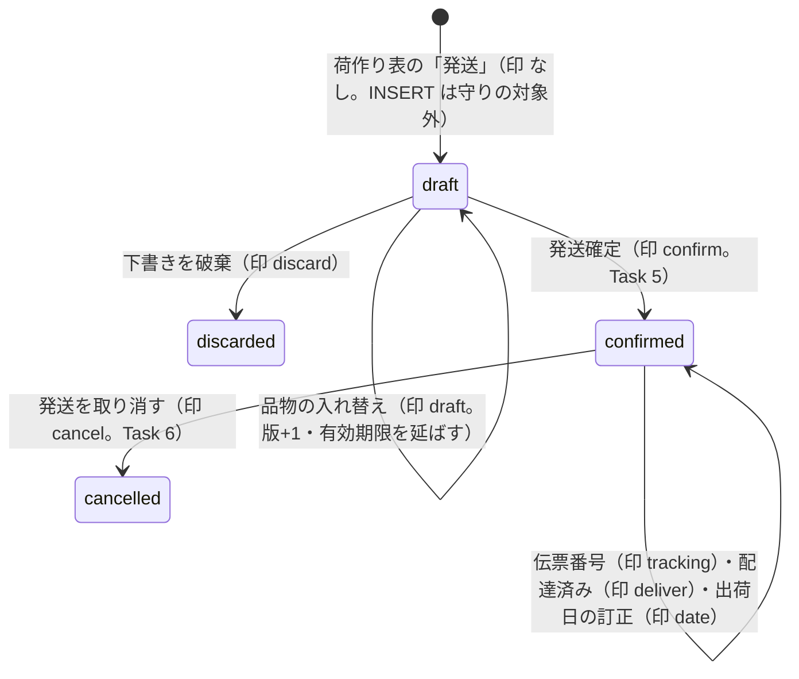

# 発送票の状態（G-3）

> 状態: 保存する4段階と、操作印ごとの遷移の定義は現行のソース（グループ G-3 Task 1・4・5・6・7・8・9）。下書きの保存・破棄（Task 4）と確定（Task 5）と取消（Task 6）の関数を実装。Task 5まで、controllerが実鍵PostgRESTを含む12 suiteで665/665成功を確認した（2026-10-25）。取消（Task 6）を含む21 suiteで1,287/1,287成功も確認した（2026-10-25）。伝票番号の入力・訂正と手動の配達済み（Task 7）の関数を実装（controller が fresh reset して19 suite・1,079/1,079成功を確認。2026-10-25）。出荷日の訂正（Task 9）の関数も実装済み（本番へは未適用） | 確認日: 2026-10-26 | 対象: `shipment_slips.stage` と、票の更新を通す操作印 `app.group_g_slip_change` | G-3 Task 9 確認: 2026-10-26（修正前はfresh reset・12 suite・639/639成功、Fix round 1は再検証対象）

## 概要

発送票は **DB に保存する 4 つの段階**だけを持つ。`draft`（下書き。どの品物を何点まとめて送るかを覚えるだけで、在庫も発送も動かさない）、`confirmed`（発送を確定した）、`cancelled`（確定した発送を取り消した）、`discarded`（下書きを破棄した）。配達済みかどうか・伝票番号・出荷日の訂正は**段階を変えない**（票の版が進み、履歴が追記される）。期限切れは段階ではなく、下書きの `expires_at` が過ぎたという属性で、画面は「期限切れ」の印を付ける。

| 値 | 意味 | 更新主体 |
| --- | --- | --- |
| `draft` | 下書き。選択（`draft_lines`）・顧客と送り先の写し・有効期限（保存から7日）を持つ。何度でも丸ごと入れ替えられる | 作成と入れ替えは `admin_save_shipment_slip_draft`（Task 4） |
| `confirmed` | 発送を確定した。出荷日・運送会社・伝票番号（任意）・メールの有無を持つ。票の行・発送の結び付きは追記専用 | 発送確定（Task 5） |
| `cancelled` | 確定した発送を、票の全注文まとめて取り消した | 発送の取消（Task 6） |
| `discarded` | 下書きを破棄した。選択は残るが、確定できない | `admin_discard_shipment_slip_draft`（Task 4） |

## 範囲と根拠

| 項目 | 内容 |
| --- | --- |
| 対応要件 | FREQ-531〜534（荷作り表・同梱・発送の流れ・票単位の操作）、FREQ-540（権限）。[要件](../../02_Requirements/requirements.md) |
| 設計 | [G-3 実装計画](../../superpowers/plans/2026-10-25-group-g3-shipping.md)の「共通の値」（操作印）と Task 1・4 |
| 実装 | 表と更新の守りは移行 `20261025053324_group_g3_shipping_foundation.sql`（`private.guard_group_g_shipment_slip_change`）、下書きの保存・破棄は `20261025100130_group_g3_shipping_slips.sql`。段階・文字は[共通の定義](../../../src/lib/orders/shipment-slips/shipment-slip-types.ts) |
| 関連 | 書込みの順序は[荷作り表から発送票の下書きまでの流れ](../sequence/shipping.md)、データは[ER 図](../../03_BasicDesign/data/er.md)の「発送票」 |
| 調査時点 | 2026-10-25 のソース。DB での実行の検証は[発送票モデル](../../../tests/integration/db/group_g3_model.integration.test.ts)と[下書き](../../../tests/integration/db/group_g3_draft.integration.test.ts)（controller が使い捨て DB で流す） |

## 状態定義

| ID | 値 | 期限・時刻の列 | 備考 |
| --- | --- | --- | --- |
| ST-SL-01 | `draft` | `expires_at` を持つ（下書きだけ） | 期限切れの下書きも保存し直せる。確定は期限切れを断る（Task 5） |
| ST-SL-02 | `confirmed` | `confirmed_at`・`shipment_date`・`notify_customer`・確定の操作と要求番号を持つ | 版は確定で 1 つ進む（作成で 1）。以後の伝票・配達済み・出荷日の訂正でも版が進む |
| ST-SL-03 | `cancelled` | `cancelled_at`・`cancelled_by` を持つ | 取消後に同じ品物を新しい票で再び発送できる。取消は票全体で、取消の版（種類 `cancel`）が残る。一度取り消した票は戻せない |
| ST-SL-04 | `discarded` | `discarded_at`・`discarded_by` を持ち、`expires_at` は NULL | 破棄した票は戻せない |

## 図

## 遷移条件表

票の UPDATE は `private.guard_group_g_shipment_slip_change`（BEFORE UPDATE OR DELETE）だけが通す。トランザクション内の操作印 `app.group_g_slip_change` が次のどれかで、**遷移元の段階・遷移先の段階・変わってよい列・版が 1 だけ増えること**がすべて合う時に限る。DELETE と TRUNCATE は常に拒否する（`GROUP_G_HISTORY_IMMUTABLE`）。

| ID | 印 | 遷移 | 変わってよい列（版・`updated_at` に加えて） | 書く関数 |
| --- | --- | --- | --- | --- |
| ST-SL-T1 | `draft` | `draft` → `draft` | `draft_lines`・顧客の写し（種類・会員 ID・メール）・送り先の写し7項目・`expires_at` | `admin_save_shipment_slip_draft`（Task 4） |
| ST-SL-T2 | `discard` | `draft` → `discarded` | `stage`・`discarded_at`・`discarded_by`・`expires_at` | `admin_discard_shipment_slip_draft`（Task 4） |
| ST-SL-T3 | `confirm` | `draft` → `confirmed` | `stage`・確定の時刻・実行者・確定の操作・要求番号・運送会社・伝票番号・メールの有無・出荷日・`expires_at` | 発送確定（Task 5） |
| ST-SL-T4 | `tracking` | `confirmed` → `confirmed` | 運送会社・伝票番号・追跡の版 | 伝票番号の後入力・訂正（Task 7） |
| ST-SL-T5 | `deliver` | `confirmed` → `confirmed` | なし（版だけ） | 手動の配達済み（Task 7） |
| ST-SL-T6 | `date` | `confirmed` → `confirmed` | 出荷日 | 出荷日の訂正（Task 9） |
| ST-SL-T7 | `cancel` | `confirmed` → `cancelled` | `stage`・取消の時刻・実行者 | `admin_cancel_shipment_slip`（Task 6） |

印が無い・知らない値の UPDATE は、段階も列も見ずに拒否する。印を設定したまま関数を抜けないよう、書く関数は UPDATE の直前に印を置き、直後に元の値へ戻す。下書きの作成（INSERT）は守りの対象外で、`stage = draft`・版 1・有効期限あり・確定の列は空で作る（表の CHECK が段階と列の組を守る）。

## 独立した属性・冪等性

| 属性 | 扱い |
| --- | --- |
| 期限切れ | `stage = draft AND expires_at <= now()`。段階を変えず、読取の関数が `expired` を返す。保存し直すと `expires_at` が延びて解ける |
| 版 | 作成で 1。上のどの遷移でも 1 つだけ増える。画面の書込みは読んだ版を `expectedVersion` で送り、違えば `GROUP_G_SLIP_VERSION_CONFLICT`。同じ要求番号の再送は版の確かめより先に保存した結果を返す |
| 二重選択 | 2つの下書きが同じ明細を選べる。取り置かないので、片方が確定した後のもう片方は数量が足りなければ確定時に断られる（Task 5） |
| 操作の記録 | 保存・破棄は `private.group_g_operations` に `(shipment_slip_save \| shipment_slip_discard, request_key)` で 1 件。最後に書く |

## 発送の取消（G-3 Task 6）

`confirmed` → `cancelled`（印 `cancel`。ST-SL-T7）は `admin_cancel_shipment_slip` が起こす。同じ取引で、票の全注文の発送が取り消され（発送の `cancelled_at`・`cancelled_by`）、品物の状態が `shipped`（配達済みなら `delivered`）から `ready` へ戻り、全部送っていた注文は `shipped` から `paid` へ戻る。取消の前に、返品・発送後の返金・`paid`・`shipped` でない注文が1つでもあれば全体を断り、何も変わらない（段階も版も変わらない）。順序の詳細は[発送の取消](../sequence/shipping.md)。

| 前の段階 | 取消の結果 |
| --- | --- |
| `confirmed` | `cancelled`（版+1。取消の版 `cancel` を残す）。一部の注文だけ・一部の明細だけの取消はない |
| `cancelled` | 別の要求番号の取消は `GROUP_G_SLIP_CANCELLED`。同じ要求番号の再送は保存した結果を返す |
| `draft`・`discarded` | `GROUP_G_SLIP_NOT_CONFIRMED` |

## 伝票番号の後入力・訂正と手動の配達済み（G-3 Task 7）

`confirmed` → `confirmed`（印 `tracking`）は伝票番号の入力・訂正、`confirmed` → `confirmed`（印 `deliver`）は手動の配達済み。段階は変わらず、版だけが1つ増える（`tracking` は運送会社・番号・`tracking_version` も変える。`deliver` は版と更新時刻だけ）。伝票番号の訂正では、発送が配達済みだった票も発送済みの状態（`delivery_status = confirmed`）へ戻る。順序の詳細は[伝票番号の後入力・訂正と手動の配達済み](../sequence/shipping.md)。

| 前の段階 | 伝票番号の入力・訂正（印 `tracking`） | 手動の配達済み（印 `deliver`） |
| --- | --- | --- |
| `confirmed` | `confirmed`（版+1。`tracking_version`+1。版履歴 `tracking_update`）。同じ値は `GROUP_G_SLIP_TRACKING_UNCHANGED`、空に戻す訂正は `GROUP_G_SLIP_TRACKING_INCOMPLETE` | `confirmed`（版+1。版履歴 `delivered`）。すでに配達済みなら `GROUP_G_SLIP_ALREADY_DELIVERED`、届いた日が範囲外なら `GROUP_G_SLIP_DELIVERY_DATE_INVALID` |
| `cancelled` | `GROUP_G_SLIP_CANCELLED` | `GROUP_G_SLIP_CANCELLED` |
| `draft`・`discarded` | `GROUP_G_SLIP_NOT_CONFIRMED` | `GROUP_G_SLIP_NOT_CONFIRMED` |

## 関連テスト

[伝票番号・配達済み](../../../tests/integration/db/group_g3_tracking.integration.test.ts)（番号の後入力・訂正・手動の配達済み・旧版の借りの印・権限・旧4RPCの停止）、[発送票モデル](../../../tests/integration/db/group_g3_model.integration.test.ts)（印ごとの列の許可表と、許さない遷移の拒否）、[下書き](../../../tests/integration/db/group_g3_draft.integration.test.ts)（作成・入れ替え・破棄・期限切れ・原子性）、[発送の取消](../../../tests/integration/db/group_g3_cancel.integration.test.ts)（戻しは1回・拒否の優先・再発送・原子性）、[発送票の頁](../../../tests/unit/components/ShipmentSlipSection.test.tsx)（段階ごとの画面）、[取消のダイアログ](../../../tests/unit/components/ShipmentSlipCancelDialog.test.tsx)。

## 未確認事項

確定の遷移はTask 5のadmin_confirm_shipment_slipが起こし、controllerが実鍵PostgRESTを含む12 suiteで665/665成功を確認した（2026-10-25）。取消の遷移はTask 6のadmin_cancel_shipment_slipが起こす（controllerのresetの後、21 suiteで1,287/1,287成功）。伝票・配達済みはTask 7、出荷日の訂正はTask 9の関数が起こす。ここに書いたのは、Task 1 の守りが許す遷移の定義と、Task 4・5・6 が動かす作成・保存・破棄・確定・取消の遷移。本番の実データでの状態は未確認。

## 出荷日の訂正（G-3 Task 9）

確認日: 2026-10-26。FREQ-535 AC-03・04・05、FREQ-540 AC-10。controllerが修正前のTask 9をfresh resetし、実鍵PostgRESTを含む12 suite・639/639成功（2026-10-26）。Fix round 1の後も、controllerがfresh resetし実鍵PostgRESTを含む12 suite・642/642成功（2026-10-26）。

| 前 | 条件 | 後と記録 |
| --- | --- | --- |
| confirmed | 訂正3権限、理由trim後1〜200字、版一致、異なる日付 | confirmedのまま版+1、全有効発送も同じ日付。correctionとdate_correctionを追記 |
| confirmed | 全注文の最遅JST入金日未満／今日超 | GROUP_G_SHIPMENT_DATE_INVALID / 22023、全て不変 |
| confirmed | 有効な発送の配達日JSTより後／同日訂正 | AFTER_DELIVERY／UNCHANGED / 22023、全て不変 |
| draft・discarded／cancelled | 訂正 | NOT_CONFIRMED／CANCELLED、全て不変 |
| 任意 | 同キー同指紋、現在も権限あり | 保存結果にreplayed:true、履歴・版は増やさない |

品物状態・割当・在庫・台帳、shipped_at・confirmed_at・delivered_at、返品期限、メール・追跡は不変。履歴は初回／訂正・前後日付・理由・日時。権限なしは「出荷日の訂正は店長だけができます。」を出して訂正ボタンを出さない。
