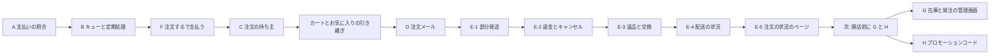

# 作業と指摘の台帳（決済・注文まわり）

> 始まり: 2026-09-25 の変更差分の決済・セキュリティレビュー。2026-10-22 に作業の状況表と1つにした
> 元の記録: 各グループの[設計書](../../../superpowers/specs/)と[実装計画](../../../superpowers/plans/)、[Webhook と定期処理の運用手順](../../../06_Operations/webhook-queue-operations.md)、[注文のメールの運用手順](../../../06_Operations/order-email-operations.md)
> 最後に調べた日: 2026-11-07（push の前の単体テストが揺れて止まったので、NEWS の試験の直しと、割引の速さの試験を全件の後に1本で流す形へ直した。ログインをパスキーに置き換える設計を書き、オーナーが順番を「会計 → パスキー → 開店の準備」と決めた）。その前は 2026-11-06（FREQ-641 の後回しの小さな直しを直した。実装・手元の検証と文書を確認。本番DBへ移行 `20261106005536` を当ててから push した）。その前は 2026-11-04（会計（S-2・K-2）の設計の1〜15番を全部決め、オーナーが設計全体を承認した（8d639725）。次は作る手順の計画）。その前は 2026-11-03（会計の設計の初版を書いた）。その前は 2026-11-01（開店前のセキュリティの穴 波 6 のコード・文書・試験と手元の Supabase の切り替えを作業ツリーに反映。本番の M3 は 2026-11-01 21:06 頃 JST に適用済み、本番の Supabase Auth の設定は MCP から変えられず未反映で、オーナーの選択待ち）。その前は 2026-11-01（グループ H の割引を本番の DB へ適用（H1〜H7）。手元の `db:reset` の後で DB 結合・単体・本番ビルドの E2E 全件まで確かめた）。その前は 2026-10-29（開店前のセキュリティの穴 波 5 のコード・文書・試験を作業ツリーに反映。M1・M2 とも本番適用済み（M2 は同日に単独で適用）。手元の `db:reset` の後で DB 結合と本番ビルドの E2E 全件まで確かめた）。その前は 2026-10-28（開店前のセキュリティの穴 波 4 のコードと文書を作業ツリーに反映し、本番ビルドの E2E 全件まで確かめた）。その前の同じ日の記録は、波 3 のコードと文書を作業ツリーに反映し、本番ビルドの E2E 全件まで確かめた。その前は 2026-10-27（G-4 の注文一覧表・詳細・入替を本番へ適用。波 2 の移行 6 本と 20261026010000 も同じ push で適用し、本番の DB は 20261026130600 まで）。同じ日の前の記録は、波 2 の権限・検索・制約・置き場の移行 6 本と窓口を作業ツリーに反映。その前は 2026-10-26（波 1-B・波 1-C のセキュリティの穴の修正を作業ツリーに反映。コードの基準は 5774fdca、本番の DB は 20261025134538 まで適用済み）。判断待ちの決定は 2026-10-23 に反映。開店前の直し 波1 と波2 は 2026-10-23、G-0（権限の設定の画面）は 2026-10-24 に実装・push・本番適用まで済んだ。G-1 は 2026-10-24、G-2 は 2026-10-25、G-3 は 2026-10-26 に本番適用まで済み、push は G-4 以降とまとめて行う

---
## 概要

2026-09-25 のレビューで見つかった指摘（R-01〜R-57）を、同じコードを何度も直さないようにグループ A〜H にまとめて直してきた。この台帳は、グループごとに「やらなければいけなかったこと」「決まったこと」「今の状態」を1か所で見るための管理表である。指摘ごとの元の記録（箇所・再現経路・直し方）は6章以降に残す。

| まとまり | 状態 |
| --- | --- |
| 返品の受け取りで品ごとに返金を選ぶ（FREQ-641） | 後回しの小さな直しのうち4つを 2026-11-07 にコミットした（`e42e1f71`、未 push。画面の上限の見込みの直しは取り下げ）。返品の E2E 13ファイルは 335/337 通過で、落ちた2件は環境由来で単独なら通過。DB の結合試験は今回流していない。 実装・手元の検証済み（2026-11-06）。master のコミット `d2fc614e..ac6b8c0a`。[実測](../../tests/test-spec.md)はDB・PostgREST・単体・画面結合・本番ビルドの3幅E2Eを含む。本番DBの移行 `20261106005536` は 2026-11-06 にオーナーの許可を得て当て、その後に master を push した（[移行運用](../../../06_Operations/db-migrations.md)の順番どおり、移行が先・コードが後） |
| グループ A・B・C・D・E（E-1〜E-5）・F、カートとお気に入りの引き継ぎ | 完了（実装・push・本番の DB への適用まで。アプリは未公開） |
| 開店前の直し 波1（J-03・J-04・J-06・J-10〜J-12・J-15〜J-17・K-3・R-22・X-1・X-2・S-4） | 完了（2026-10-23。実装・push・本番の DB への適用まで）。J-02 は G に回した |
| 開店前の直し 波2（K-1・K-4・K-5） | 完了（2026-10-23。実装・push・本番の DB への適用まで）。S-1・R-13・R-08・R-23 が直った。次は G → H（[判断表の4章](2026-10-22-decision-sheet.md#4-決めた後の作業の順番)） |
| グループ G（在庫・注文・発注の管理画面）・H（プロモーションコードの管理） | G は[設計](../../../superpowers/specs/2026-10-23-group-g-design.md)を承認済み（2026-10-23）。G-0（権限の設定の画面）は完了（2026-10-24。本番の版 20261023175712。役割の印は店長なのに権限の表に行が無い試し用の4人は直さずに適用し、オーナーの決定で残す（2026-10-24）。権限の表に行が無いので管理の操作はできない）。G-1（データモデル・品物ごとの状態・FIFO の割り当て）も完了（2026-10-24。本番の版 20261023211425、オーナーの指示で Supabase CLI の db push で適用。試しの注文16件・明細18・変更の記録13・下書き140・送る予定のメール8を、オーナーの確認の上で同じ取引で片付けた。在庫は元から全部0。旧の発送・発送取消・伝票の直し・手動の配達済み・手動の仕上がりは G-3 まで止めた。記録は [DB マイグレーション運用](../../../06_Operations/db-migrations.md) の G-1 の節）。G-2（在庫一覧表・発注書・受け取りとその取消・見積書と請求書の原本の添付）も完了（2026-10-25。本番の版 20261024153505・20261024180500、Supabase CLI の db push で適用。データを変える文は無く、新しい9表・置き場・関数だけ。サポーターは初期値では在庫・発注・受け取りを見られないが INVENTORY のメニューは出て権限の文が出る。受け取りの取消は空き在庫が足りない分だけ支払い済みの割当を新しい注文から外す〔確認つき、お客様には知らせない〕。商品の削除の確かめが発注書を見ない点〔押すと理由なしの 409〕は G-3 の最初の移行で直す。記録は同じ文書の G-2 の節）。G-3（荷作り表・発送票・出荷日）も完了（2026-10-26。本番の版 20261025053324・20261025070821・20261025100130・20261025134538、Supabase CLI の db push で適用。データを変える文は無く、新しい6表・出荷日の列・関数だけ。適用の時、別セッションの移行 20261026010000 はオーナーの決定で外して当てなかった。G-1 で止めた発送・発送取消・伝票番号の訂正・手動の配達済みは票単位で再開。サポーターは初期値で荷作り・発送・伝票の訂正・配達済み・取消ができ、出荷日の訂正は店長だけ。同梱は同じ会員かゲスト同士の同じメールで配送先が完全に同じ注文だけ。交換手数料待ちの交換品は入金まで荷作り表に出ない。商品の削除の確かめが発注書を見ない点は G-3 の基盤で直した。最終レビューの軽微4件〔索引・期限の境目・注記〕は G-4 の最初の移行へ持ち越し。記録は同じ文書の G-3 の節）。G-4（注文一覧表・注文の詳細・全件 CSV・割当の入替）も完了（2026-10-27。本番の版 20261026045859・20261026054705・20261026101624、Supabase CLI の db push で適用。オーナーの決定で、別セッションの 20261026010000 と波 2 の6本も同じ push で当てた。データを変える文は無く、索引1つ・割当の理由の CHECK・関数だけ。旧い注文の一覧・各 dialog・旧い11列の CSV・旧い 410 の窓口6本は撤去し、操作は注文の詳細頁へ移した。サポーターは初期値で一覧・詳細・CSV は可、入替は不可。一覧は最初から全期間で、条件に合う注文が5000件を超える間は新しい5000件だけを読んで注記を出し、CSV は2万行を超えると注文日で絞るよう案内して断る。金額の範囲の検索は引き継がない〔オーナーの決定〕。G-3 の持ち越しの軽微のうち索引・期限の境目は G-4 の最初の移行で直し、M4・M5 は未実施〔適用済みのファイルは編集しない〕。G-2 の N3・N4 は未実施〔範囲外〕。記録は同じ文書の G-4 の節）。G は G-0〜G-4 まで全部完了。master にあり push は開店の準備までまとめて。次は H。H は未着手で、Shopify と同じ機能を全部作る（1章） |
| 追跡の仕組み（NEWS・HOME・LOOK・ABOUT・STOCKIST・SEARCH・PRIVACY・AUTH・ADMIN の 9 領域） | 実装・最終レビュー・レビューの直しまで済み、master にある（push は G-3 以降とまとめて。DB の変更なし）。要求から受け入れ条件・設計・コード・テストまでの ID のつながり、検査（`validate-trace`）、一覧の生成、影響範囲の道具を作った。今のコードが満たさないセキュリティ要件が約 145 件見つかり、開店前の判断として5章 W-08 に載せた。後回しにした範囲は5章 W-09（[設計](../../../superpowers/specs/2026-10-24-traceability-design.md)・[計画](../../../superpowers/plans/2026-10-24-traceability-news-pilot.md)・[追跡の一覧](../../reports/trace-matrix.md)） |
| 開店前のセキュリティの穴 波 1-B（認証の窓口・登録と確認・管理の窓口・取扱店・お知らせ・ホーム。5章 W-08 の一部） | 実装・単体・結合・文書まで済み（2026-10-26。本番の DB の変更なし）。E2E・DB 結合は未実行で、controller の実測待ち。下の「波 1-B の注」に開店前の確認を並べた |
| 開店前のセキュリティの穴 波 1-C（検索・LOOK・お知らせ・取扱店・プライバシー・ホームの窓口と公開の取り出し・誤りの画面、`/api/auth/me`。5章 W-08 の一部） | 実装・単体・結合・文書・E2E まで済み（2026-10-26。本番の DB の変更なし）。E2E は範囲内の 1861 件を controller が本番ビルドで流し、期待どおりが 1834 件。新しい赤は `SEC-SEARCH-020-AC-02` の書き直しで解消（14/14 通過）。DB 結合だけ未実行。下の「波 1-C の注」に実測の結果と残る確認を並べた |
| 開店前のセキュリティの穴 波 2（権限・検索・制約・置き場。移行 6 本 `20261026130100`〜`130600` と取扱店・ニュース・LOOK の書き込み窓口。5章 W-08 の一部） | コードを直し、本番の DB へ適用済み（2026-10-27）。2026-10-27。手元の `db:reset` と DB 結合（4339 件通過・0 失敗）、DB なしの jest（19704 件通過・0 失敗）まで済み。E2E 全件は 414 failed（G-3 は 175）で、増えた赤は G-4 の注文・返品の E2E か再実行で通る揺れ、波 2 の対象ファイルは赤なし。2026-10-27 に本番へ G-4 と一緒に当て、事後の確かめ（当てた文とファイルの一致・権限・関数・置き場）も通った。**台帳系の 5 表の書き込み側の権限は本番では変化なし、連番 `order_revisions_id_seq` は本番の実変更**（5章 W-08、[移行運用](../../../06_Operations/db-migrations.md)） |
| 開店前のセキュリティの穴 波 3（画像の署名を自分の道筋だけにする・CSP・`session_id` の発行範囲・`/api/auth` の `no-store`・LOOK の og:image・ビルドの必須の環境変数。5章 W-08 の一部） | コードを直した。2026-10-28。本番の DB の変更なし。DB なしの jest 全体は落ち 0、`test:trace-coverage` は通過。本番ビルドの E2E 全件は 183 failed（G-4 は 181。増えたのは商品詳細の揺れ 2 件）で、外した `test.fail` 18 行と足した E2E は緑。1 回目に出た決済の E2E 17 件の赤（`no-store` の応答の本文を読まない refresh が開いたまま残る）は `client-fetch.ts` で直した。下の「波 3 の注」に配備の前の確認を並べた |
| 開店前のセキュリティの穴 波 4（送り元の IP は Vercel の見出しだけから取る・回数の鍵と管理の監査の IP を 1 つの関数に揃える・取扱店の認可の拒否の監査・管理画面の CONTACT タブと LOOK の「新規作成」の権限での出し分け。5章 W-08 の一部） | コードを直した。2026-10-28。本番の DB の変更なし。手元の `npm run db:reset` の後、DB なしの jest 全体は 803 suites・20226 件通過・0 失敗。`npm run test:trace-coverage` は届かない分岐の節に無い 0 件・ずれた 0 件。`npm run validate-trace` は基準より増えた 0 件。`tsc` 誤り 0、`validate-docs` の失敗は既知の 2 件（`2026-10-07-checkout-place-order-payment.md` の相対リンク）だけ、`tests/unit/docs` 56 件通過。本番ビルドの E2E 全件（1 回）は 185 failed・4832 passed・26 skipped。波 3 の 183 failed（`.superpowers/sdd/2026-10-25-security-gap-fixes/e2e-results-wave3-full.json`）と比べて新しく赤になった 10 ファイル（FR-ITEM-031・FR-PRIVACY-006・FR-ADMIN-057・FR-HOME-022・NFR-HOME-002・FR-CART-024・FR-CHECKOUT-039・FR-LOGIN-038・FR-NEWS-ALL-001・002）は、1 並列の再実行で 200 件とも通った（並列の揺れ）。外した `test.fail` 16 行と足した E2E は緑。全件の後に見つけて直した物: 取扱店の作成ページの結合試験 2 ファイル（SEC-STOCKIST-019 で頁が先に `GET /api/admin/stockists/access` を呼ぶ形に合わせた。40 件通過）、`test-gaps.md` の行のずれ 22 件、新しい単体 `tests/unit/api/admin/stockists/stockists-access-route.test.ts`（6 件）。LOOK の管理の一覧（`LookSection.tsx` の 3 か所）と G の画面 2 か所（`useOrderAttention.ts`・`customer-return-client.ts`）に、no-store の 429・503 の本文を読み切る 1 行を足した。DB 結合（`tests/integration/db`）は流していない。窓口は `GET /api/admin/stockists/access` が 1 本増えた（155 ファイル・197 メソッド）。下の「波 4 の注」に残り・引き渡し・本番の前の確認を並べた |
| 開店前のセキュリティの穴 波 5（アプリの session への結び付け・`has_permission` が aal2 と結び付いた生きた session を求める・会員の表 `profiles`・`orders`・`order_items` の方針。移行 M1・M2。5章 W-08 の一部） | コードを直した。M1・M2 とも本番適用済み（2026-10-29。M2 は単独で適用し、事後の確認も済み）。2026-10-29。`db:reset` の後、DB 結合は 146 suites・4377 件通過・0 失敗、DB なしの jest は 807 suites・20345 件通過・0 失敗。`test:trace-coverage` は 0 件・0 件（`verify/route.ts:143` に届く単体を 1 本足した）、`validate-trace` は基準より増えた 0 件。本番ビルドの E2E 全件は 203 failed・4821 passed・26 skipped（波 4 の 185 failed、`.superpowers/sdd/2026-10-25-security-gap-fixes/e2e-results-wave4-full.json` と比べる）。新しい赤を 1 並列で再実行すると 154 件通り、残った 4 件（`FR-PRIVACY-007:210`×3・`FR-SEARCH-020:246`）は波 5 に未対応の試験で、直して 51 件通過。ほかは並列の揺れ（ITEM-DETAIL-019〜021・NFR-HOME-002・HOME-006〜008・NEWS-ALL-003・004・LOGIN-038 のタイムアウト・ADMIN-112 の dialog 幅 1.6px）。外した `test.fail` 9 行と足した E2E は緑。下の「波 5 の注」に配備の順序・本番の前の確認・残る危険を並べた |
| 開店前のセキュリティの穴 波 6（Supabase Auth の captcha・パスワード変更の窓口と画面・手元の Supabase の設定を本番の前提にそろえる・`APP_ALLOWED_ORIGINS` を本番のビルドで必須にする。移行 M3。5章 W-08 の一部） | 実装して手元で確かめた（2026-11-01。Opus の最終レビューは Approved、最終レビューの直しの再レビューも Approved）。コード・文書・試験を作業ツリーに反映し、手元の Supabase を切り替えた。**本番の反映（Task 11。2026-11-01）**: M3 `20261101120000_sec_password_change_challenges` は本番に適用済み（21:06 頃 JST。G-1 に知らせ、dry-run が M3 の1本だけと確かめてから）。本番の Supabase Auth の設定の変更（段階 A・段階 B を Management API で。オーナーの個人アクセストークンが要る。段階 B の captcha には本番の Turnstile の秘密が要る）は **MCP からは変えられず未反映**（3 回試して不可。確認メール必須はすでに ON。残りはオーナーが選ぶ。記録は [supabase-auth-config.md](../../../06_Operations/supabase-auth-config.md) の「2026-11-01 の実施記録」）。段階 B は本番の URL と Turnstile のウィジェットができるまで見送り（オーナーの決定）。`db:reset` の後、DB 結合は 161 suites・4715 件通過・0 失敗（13 suites skipped）、本番ビルドの E2E 全件は 186 failed・4937 passed・26 skipped・5149 件（波 5 は 203 failed）。新しい窓口 `POST /api/auth/password/change/start`・`confirm` と画面 `/account/password`。下の「波 6 の注」に残りを並べた |
| 指摘 65件（R-01〜R-57・X-1〜X-4・S-1〜S-4） | 直った41件、一部2件、残る19件、保留2件、判断できない1件（2章） |
| 判断（J-01〜J-21） | 全件決定（2026-10-22〜23）。J-03・J-04・J-06・J-10〜J-12・J-15〜J-17 は波1で実装済み（2026-10-23）。J-02 は G に回した。ほかの実装はこれから。決めた内容は3章 |
| 開店前に直す物のやり方（K-1〜K-5） | 全件決定（2026-10-22〜23）。S-1・S-2・S-3・R-13・R-08・R-23 は決定を2章に書いた。K-3（S-3）は波1、K-1（S-1）・K-4（R-13・R-08）・K-5（R-23）は波2で実装済み。残る K-2（S-2）は G・H の後の会計で作る。売上の計上の方針は 2026-10-23 に承認済み（[方針](../../../01_Planning/revenue-recognition-policy.md)） |
| ログインをパスキーに置き換える（お客さん・サポーター・店長） | 設計を書いた（2026-11-07、ba9a7e93。[設計](../../../superpowers/specs/2026-11-07-passkey-auth-design.md)）。順番は 会計 → パスキー → 開店の準備（2026-11-07 オーナー決定）。計画と作る作業は会計の後。本番に当てるのは普段の開発を手元の Supabase に切り替えた後 |
| 開店の準備 | 4章（全部まだ） |

状態の言葉は次のとおり。

| 言葉 | 意味 |
| --- | --- |
| 完了 | 実装・push・本番の DB への適用まで済んだ。本番のアプリはまだ公開していない |
| 開店時 | 開店の手順の中で行う（定期処理の登録など） |
| 保留 | 直す SQL などを `supabase/pending/` に置き、当てる時期を待つ |
| 判断待ち | ユーザーの決定が要る |
| 決定 | ユーザーが決めた。実装はこれから |
| 未着手 | まだ設計も始めていない |
| 後回し | 後でやると決めた |



この台帳を直す時は、状態の欄と「最後に調べた日」を更新する。2026-09-25 に作った冒頭の指摘の表は、直した物も「未修正」のまま古くなっていたので、2026-10-22 に2章へ置き換えた。

| 章 | 中身 |
| --- | --- |
| [1](#1-グループの一覧) | グループごとのやらなければいけなかったこと・状態・本番の DB の版・決まったこと |
| [2](#2-指摘ごとの状態) | 指摘65件の今の状態（手を付ける物と直った物） |
| [3](#3-判断の記録) | 判断の記録（J-01〜J-21 は全件決定） |
| [4](#4-開店の準備) | 開店の準備 |
| [5](#5-まだ着手していない作業) | まだ着手していない作業 |
| [6](#6-指摘の詳細) | 指摘ごとの元の記録（箇所・再現経路・直し方・直した時の追記） |
| [7](#7-対処計画r-01-近傍のグループ) | グループ分けの承認（2026-09-25）と、その時に決まったこと |
| [8](#8-追加レビュー2回目claude-code) | 追加レビュー（2回目）の候補の全件と X-1〜X-4 |
| [9](#9-過去レビューとの照合と監査の範囲) | 過去のレビューとの照合と監査の範囲 |

---

## 1. グループの一覧

### 1-1 やらなければいけなかったことと状態

| グループ | やらなければいけなかったこと | 対象の指摘・要望 | 状態 | 本番の DB の版 | 設計書・計画 |
| --- | --- | --- | --- | --- | --- |
| A 支払いの照合 | 注文と在庫を Stripe の今の支払いの状態に合わせ、注文を支払いの前に受け付ける | R-01・R-02・R-04・R-18・R-25（Webhook 側）・R-41・R-42・R-43・R-44・R-57 | 完了。R-04 の第2段階（状態の守りの SQL）は保留、R-43 は一部（返金で変わった履歴の起因が空） | 20260927100000〜20260927100900（10本） | [設計書](../../../superpowers/specs/2026-09-26-order-payment-reconciliation-design.md)・[計画](../../../superpowers/plans/2026-09-27-order-payment-reconciliation.md) |
| F 「注文する」で支払う | 支払いを最終確認画面の「注文する」に移す。在庫は「注文する」で確保する | R-56・X-3・在庫の確保の要望・R-28（画面側） | 完了。R-28 は一部（前からある0円の完了の扱い）。X-3 は特定商取引法の専門家の確認が開店前に要る | 20261007133711 | [設計書](../../../superpowers/specs/2026-10-07-checkout-place-order-payment-design.md)・[計画](../../../superpowers/plans/2026-10-07-checkout-place-order-payment.md) |
| B キューと定期処理 | Stripe の知らせを取りこぼさず、止まったら店が気づける形で処理する。E2E を本番の DB から切り離す | R-05・R-07・R-32・R-33・R-35・R-55・X-4 | 完了。R-07 の定期処理の登録は開店時（保留） | 20261007030242・20261007030336 | [設計書](../../../superpowers/specs/2026-10-05-webhook-queue-operations-design.md)・[計画1](../../../superpowers/plans/2026-10-05-e2e-local-supabase.md)・[計画2](../../../superpowers/plans/2026-10-05-webhook-queue-operations.md) |
| C 注文の持ち主 | ログインして買った注文を本人の履歴に必ず出し、別の人の注文が出ないようにする | R-24（R-26 は A で解消） | 完了 | 20261008055720 | [設計書](../../../superpowers/specs/2026-10-08-order-owner-binding-design.md)・[計画](../../../superpowers/plans/2026-10-08-order-owner-binding.md) |
| カートとお気に入りの引き継ぎ | ゲストのカートとお気に入りをログインで失わない | C の途中で見つかった M9・R-15 | 完了 | 20261008220825・20261008220944・20261008220958 | [設計書](../../../superpowers/specs/2026-10-08-cart-wishlist-carryover-design.md)・[計画](../../../superpowers/plans/2026-10-08-cart-wishlist-carryover.md) |
| D 注文メール | お客様への注文のメールを0通にも2通にもならないように送る | R-34・R-14 | 完了 | 20261009095633・20261009095736 | [設計書](../../../superpowers/specs/2026-10-09-order-email-outbox-design.md)・[計画](../../../superpowers/plans/2026-10-09-order-email-outbox.md) |
| E-1 部分発送 | 在庫の品だけを先に送れるようにし、注文の進み具合を言葉で見せる | ユーザーの要望（2026-10-10） | 完了 | 20261010120303・20261010122320 | [全体の決定](../../../superpowers/specs/2026-10-10-group-e-overview-design.md)・[設計書](../../../superpowers/specs/2026-10-10-partial-fulfillment-design.md)・[計画](../../../superpowers/plans/2026-10-10-partial-fulfillment.md) |
| E-2 返金とキャンセル | 返金を1件ずつ記録し、Stripe の画面の返金も取り込み、支払い済みの注文をキャンセルできるようにする | R-03・R-06・R-16 | 完了 | 20261011222930・20261011223147・20261011223453 | [設計書](../../../superpowers/specs/2026-10-11-refund-and-cancel-design.md)・[計画](../../../superpowers/plans/2026-10-11-refund-and-cancel.md) |
| E-3 段1 返品と交換（お店が作る） | 返品の記録・受け取り・返金・同じ商品の交換 | ユーザーの要望（2026-10-11〜12） | 完了 | 20261012235910・20261013000456・20261013001143 | [設計書](../../../superpowers/specs/2026-10-12-returns-design.md)・[計画](../../../superpowers/plans/2026-10-12-returns-stage1.md) |
| E-3 段2 お客様の申し込み | お客様の返品・交換・キャンセルの申し込み、承認とお断り、写真 | 同上 | 完了 | 20261020144439・20261020144842・20261020150415 | [設計書](../../../superpowers/specs/2026-10-12-returns-design.md)・[計画](../../../superpowers/plans/2026-10-13-returns-stage2.md) |
| E-4 配送の状況 | 配達中・配達済みと発送の更新をお客様に見せる。追跡は設定で 17TRACK に切り替える | ユーザーの要望 | 完了（追跡はオフで開始） | 20261021220816・20261021221140・20261021221410 | [設計書](../../../superpowers/specs/2026-10-21-delivery-status-design.md)・[計画](../../../superpowers/plans/2026-10-21-delivery-status.md) |
| E-5 注文の状況のページ | ログインしないお客様がメールのリンクから注文の状況を見られる。個人情報は電話番号の下4桁で確かめた後だけ | ユーザーの要望 | 完了 | 20261022084844・20261022084944 | [設計書](../../../superpowers/specs/2026-10-22-order-status-page-design.md)・[計画](../../../superpowers/plans/2026-10-22-order-status-page.md) |
| 開店前の直し 波1 | 決めた小さな直しと、台帳に残る不具合のうち独立した物を開店前に片付ける | J-03・J-04・J-06・J-10〜J-12・J-15〜J-17・K-3（S-3）・R-22・X-1・X-2・お知らせの分類の選択欄・S-4（J-02 は G に回した） | 完了（2026-10-23。efa2d1d1〜a0a1a1c3 を push。改名 3334f026）。後回しにした細かい点は下の注 | 20261023061408（J-06 キャンセルの理由）・20261023061434（J-04 返金の失敗のメモ）・20261023061453（K-3 監査ログの権限）・20261023061456（J-17 メールの停止の理由） | [計画](../../../superpowers/plans/2026-10-23-launch-fixes-wave1.md) |
| 開店前の直し 波2 | 送料の残り物と文をそろえる。商品から外した色・サイズの組み合わせを止める。Stripe のエラーの後の下書きを片付ける | K-1（S-1）・K-4（R-13・R-08）・K-5（R-23） | 完了（2026-10-23。84f228a6〜a60aaaea を push。改名 627cf6ab）。後回しにした細かい点は下の注 | 20261023082632（K-1 送料の既定値）・20261023082740（K-4 外した組み合わせを止める）・20261023082752（K-5 下書きの片付け） | [計画](../../../superpowers/plans/2026-10-23-launch-fixes-wave2.md) |
| G 在庫・注文・発注の管理画面 | 色×サイズごとに販売できる在庫・注文数・受注生産の注文数を管理し、発注に使う | ユーザーの要望・R-09・R-10・R-15・R-39 | 完了（G-0〜G-4 は本番適用済み。G-4 は 2026-10-27。push は開店の準備までまとめて）。開店前に作る（決定 2026-10-22）。中身は [G の提案](../../../superpowers/specs/2026-10-23-group-g-proposal.md)の Q1〜Q8 で決定（2026-10-23）。R-09・R-10 は E-1、R-15 はカートとお気に入りで先に直った。R-39 は残る | — | [提案](../../../superpowers/specs/2026-10-23-group-g-proposal.md)（設計書・計画はこれから） |
| H プロモーションコードの管理 | 管理画面でコードを作る・止める。初回限定と1人あたりの回数の上限は自前で確かめる。0円になるコードは作らせない | ユーザーの要望（2026-09-27） | 完了（2026-11-01 に本番適用済み。`20261029130000`〜`130600` の7本。push は開店の準備までまとめて）。[設計](../../../superpowers/specs/2026-10-28-group-h-promotions-design.md)・[計画](../../../superpowers/plans/2026-10-29-group-h-promotions.md)・[運用の手順](../../../06_Operations/group-h-discounts.md)。開店前に作る（決定 2026-10-22）。Shopify と同じ割引の機能を全部作る。細部は H の設計で決める。送料は無料に固定なので、送料無料のコードは作らない | — | — |
| 追跡の仕組み（9 領域） | 要求・要件・受け入れ条件・設計・コード・テストを ID でつなぎ、変える前の影響範囲と、試験の足りない所・使われていないコードを機械で出せるようにする。文書とコードが食い違った所は決めずに載せる | ユーザーの要望（2026-10-24）。台帳の指摘は直さない | 作業は完了（9 領域の文書・コードの `@impl`・`@design`・テスト名の ID・検査・生成物。最終レビューの指摘は直し済み）。設計の11章の Claude の判断と、検査の基準（`scripts/trace/baseline.json`）で「通る」とみなすことは、ユーザーの確認待ち。セキュリティの判断待ちは5章 W-08（SEC-AUTH-026 は波 1-A で直した（画面を削除、確かめの部品に置換、戻り先の控えを追加。2026-10-25、本番の DB 適用は G-3 の後）） | なし（DB の変更なし） | [設計](../../../superpowers/specs/2026-10-24-traceability-design.md)・[計画](../../../superpowers/plans/2026-10-24-traceability-news-pilot.md) |

波1の注（2026-10-23）。

- push は e0c3f42d..a0a1a1c3（o_official の master）。改名 3334f026 はまだ push していない。
- 本番の DB に当てた4本は、当てた文の md5 がファイルと合った。
- 確かめ: 単体 9905 件通過、DB 結合 1537 件通過。E2E 全件 3641 件で 3414 件通過・199 件失敗（前回 E-5 は 3355 件通過・196 件失敗）。前回と比べて新しく落ちた10件は、全部ログインの確認コードの回数制限（429）。db reset の後に流し直すと通った。push の前の E2E は 3424 件通過。
- 後回しにした細かい点は SDD の記録 `.superpowers/sdd/2026-10-23-launch-fixes-wave1/progress.md` に並べた。最終レビューで「待てる」と分けた物で、開店を止めない。

波2の注（2026-10-23）。

- push は a027bf7b..a60aaaea（o_official の master）。改名 627cf6ab はまだ push していない。
- 本番の DB に当てた3本は、当てた文の md5 がファイルと合った。当てる前の本番は、商品9点に組み合わせ21本で、全部が今の色・サイズと合っていた。止まった組み合わせは0本。当てた後は21本とも有効で、`orders.shipping_amount` の既定は0。
- 確かめ: 単体 9921 件通過、DB 結合 1548 件通過。E2E 全件 3653 件で 3433 件通過・192 件失敗（前回 波1 は 3414 件通過・199 件失敗）。新しく落ちたのは FR-ACCOUNT-044 の 1280px の1件だけで、単体で流すと通った。push の前の E2E は 3433 件通過。
- K-1 で分かったこと: 決済はもう送料0円で計算していた。500円は使われない関数と DB の既定値にだけ残っていた。S-1・W-01 の「決済は一律500円を取る」は誤りだったので、2章と5章を直した。直したのは残り物と文だけで、お金の動きは変えていない。
- 後回しにした細かい点は SDD の記録 `.superpowers/sdd/2026-10-23-launch-fixes-wave2/progress.md` に並べた。最終レビューで「待てる」と分けた物で、開店を止めない。

波 1-B の注（2026-10-26）。直した SEC の一覧と残る SEC は5章 W-08。

- 外した `test.fail` は 38 行。単体・結合は通過（`--findRelatedTests` で 135 スイート 3121 件）。E2E・DB 結合は書いただけで流していない。
- **開店前の必須の確認**: 本番ダッシュボードの確認メールの雛形が `token_hash` と `type=signup` を `/api/auth/confirm` へ渡しているか。`type=email` のままだと、`signup` 以外は `verifyOtp` を呼ばず `/login` へ送られるため、会員登録の確認が全部止まる（Task 2・9）。
- **本番の DB の前提**: 確認リンクの結び付け（SEC-AUTH-007、Task 3）は波 1-A の移行 `20261026010000_auth_return_intents.sql`（本番に未適用）の後でなければ本番で動かない。
- **実測が要る物**: メール OTP ログイン後の通行証の `amr`（`otp` か `magiclink` か。管理者が最初の TOTP を登録できなければ `enroll-totp` の `hasSecondFactorAmr` の確かめだけを戻す）。本物の GoTrue で `confirm` の `signOut({ scope: 'local' })` が `verifyOtp` の session を失効させるか。`getUserById` の「見つからない」の返し（強制失効の 404）。`increment_rate_limit_counter` の本物との通し。
- **本番のデータの確認（読むだけの SQL）**: `stockists` の `name`・`address`・`time`・`holiday` に制御文字・書式文字・行区切りが、`phone` に数字・`+-()`・空白・全角の括弧以外が無いか。ある店は編集フォームで保存し直せなくなる（400）。
- **運用**: 本番の環境変数 `ADMIN_API_KEY` を削除する（もう読まない。[secrets.md](../../../06_Operations/secrets.md)）。
- **ユーザーに見せる**: `/login?registered=1` の案内の文「会員登録が完了しました。ログインしてください。」は案（[ADR-0413](../../../03_BasicDesign/decisions/ADR-0413-signup-binding-email-bound-return-intent.md)）。
- **後始末の候補**: `docs/04_DetailDesign/sequence/auth-login-mfa.md`（MFA の順番に利用者単位の枠・2 段目の確かめが入った）が未更新。監査・ログに残る誤りの文（`register` の `detail: error.message` ほか）は波 1-C の `safe-error.ts` で直す。返信の保存の後の 500 で送り直すと返信が 2 行になりうる（[ADR-0456](../../../03_BasicDesign/decisions/ADR-0456-contact-reply-save-before-mail.md)）。`admin-origin-guard.test.ts` の describe 名「窓口は CSRF の印と回数を見ない」は全 10 窓口が回数を数える今は不正確。`FREQ-147-REQ-02`・`FREQ-147-AC-02` の「xl 以上は 10 件」は FREQ-276 で置き換え済みの古い記述（食い違いとして残す）。
- 詳しくは SDD の記録 `.superpowers/sdd/2026-10-25-security-gap-fixes/wave1b-task-*-report.md`。

波 1-C の注（2026-10-26）。直した SEC の一覧と残る SEC は5章 W-08。

- 外した `test.fail` は 32 行、足した E2E は 4 本（`SEC-LOOK-009-AC-02`・`SEC-LOOK-019-AC-05`・`SEC-SEARCH-020-AC-02`・`SEC-SEARCH-021-AC-02`）。単体・結合は通過。`isolated-global` の `FR-SEARCH-022`・`FR-LOOK-SEC-005`・`FR-PRIVACY-009` は他と同時に流さない。
- **E2E の実測（2026-10-26、controller、本番ビルド、手元の Supabase）**: 範囲内の 1861 件を流し、期待どおりが 1834 件。新しい赤は `SEC-SEARCH-020-AC-02`（外のオリジンの頁を開く手順では要求の応答を捕まえられなかったため、request fixture で `Sec-Fetch-Site: cross-site` を付けて送る形に書き直し、`FR-SEARCH-022` が 14/14 通過）。`LOGIN-032` は一時的な 503 で、再実行で通過。プライバシーの基準日を 2026-10-26 に上げた後の `FR-PRIVACY-*` も通過。`FR-SEARCH-022` はコミット前にもう 1 回流す。DB 結合は未実行のまま。
- **実測が要る物（E2E で確かめきれていない分を含む）**: `/look`・`/news`・`/privacy` の誤りの画面の HTTP 状態（見込みは 500 のまま。`/privacy` が 200 になると `FR-PRIVACY-009` の 3 本が赤になる）、`Cache-Control: private, no-store` を `proxy.ts`・`next.config.ts` が上書きしないか、LOOK の詳細の前後（PostgREST の `.or()` の時刻の引用）、NEWS の詳細の `.single()` → `.maybeSingle()`、NEWS・LOOK の管理の置き場の削除（service role）、`SEC-PRIVACY-012-AC-01` の日本時間 0 時の境目。
- **ユーザーの確認の状況**: `SEC-SEARCH-021` の画面の写真 6 枚（`test-results/wave1c/search-021-*.png`）はユーザーに見せ済み。`ADR-0314` は確認待ちのため「推定」のまま。`SEC-PRIVACY-011` の問い（事業者名＝B、9 節の段落＝B、キャンペーンの文は残す＝A、国名は書かない＝A）はユーザーが答え済みで、9 節に反映した。残るのは法務の確認（法人名・Turnstile が取る閲覧者の情報の書き方・Google マップ・7 節の国名）だけ。
- **本番の前提**: 環境変数・移行は無し。画像の後始末は service role で行うので、置き場の方針（`storage.objects` の RLS）の移行は要らない見込み。本番に既にある孤児の画像の掃除は別の運用作業（ADR-0025）。
- **後始末の候補**: `FR-HOME-022` の冒頭コメント（「TM-HOME-37・43…は test.fail」）が古い。`docs/03_BasicDesign/areas/news.md` の ARC-NEWS-002 に 1-B 以前の古い一文（「0件でも成功と記録する」）が残る。`e2e/account-test-utils.ts` ほか 3 か所の `/api/auth/me` の模擬と `tests/unit/components/LoginContext.test.tsx` のモックに `email` が残る（読み手が使わないので壊れない）。
- 詳しくは SDD の記録 `.superpowers/sdd/2026-10-25-security-gap-fixes/wave1c-task-*-report.md`。

波 3 の注（2026-10-28）。直した SEC の一覧と残る SEC は5章 W-08。

- 決めたこと（ユーザー、2026-10-28）: Stripe の CSP の許可は全頁に残す（Stripe.js を読むのは決済の頁だけ。`SEC-PRIVACY-014` の要件と `FR-PRIVACY-006` を直した）。`session_id` の発行は `/cart`・`/checkout`・`/api/checkout` だけ。`/ui` の外部画像は `public/` の手元の画像に替えた。詳しくは `wave3-decisions.md`。
- 外した `test.fail` は 18 行、足した E2E は `SEC-HOME-009-AC-03`・`SEC-PRIVACY-014-AC-03`・`SEC-PRIVACY-015-AC-02`・`SEC-LOOK-006-AC-03`（`SEC-ABOUT-004` の AC-01・02 は書き換え）。単体・結合は各 Task の対象の範囲で通した。**E2E・DB 結合は未実行で、controller の本番ビルドの実測待ち**（3000 番に残ったアプリを止めてから）。確かめるまで「直した」は書いた状態。内訳は [test-spec](../../tests/test-spec.md) の波 3 の節。
- **配備の前の必須**: Vercel の Production に `NEXT_PUBLIC_SITE_URL`（https・末尾 `/` 無し）と `NEXT_PUBLIC_SUPABASE_URL` を**ビルドの前に**設定する。無いと初回の配備のビルドが落ちる（意図。`assertBuildEnv`、[ADR-0206](../../../03_BasicDesign/decisions/ADR-0206-about-site-url-required-at-production-build.md)、[secrets.md](../../../06_Operations/secrets.md)）。`SUPABASE_URL` と `NEXT_PUBLIC_SUPABASE_URL` が別の origin だとビルドが落ちる（署名つき URL の host と `remotePatterns` の host を揃えるため）。
- **本番の前の確認**: (1) 本番の Stripe アカウントで Link が有効だと、決済の部品が `link.com` の枠を開こうとして今の CSP で止まる可能性がある（テストモードの `FR-CHECKOUT-025` では出ていない。足していない）。(2) 本番のニュースの本文に `` で自分のでない host の画像があると、CSP の `img-src`（自分の Supabase と `'self'` だけ）で止まる。本番の `news` の本文の画像の host を読むだけで確かめる。(3) Google マップの鍵・`'strict-dynamic'` は足していない（[ADR-0108](../../../03_BasicDesign/decisions/ADR-0108-csp-own-project-stripe-turnstile-only.md)）。
- **実測が要る物**: `FR-HOME-023:225`（ホーム・LOOK の関連商品の署名が 1 時間以内。手元の Storage に見本の商品画像が要る）、`FR-NEWS-SEC-003` の `max-age <= 3600`（手元の置き場の `cache-control` が 3600 か）、`FR-LOGIN-030` の `no-store`（proxy の値が最終応答に載るか。429 の応答も）、`FR-HOME-022` の CSP の違反 0 件（`instrumentation-client` の zod の `jitless` が本番ビルドで効くか。赤なら残った違反の `blockedURI` を見る）、`/checkout` の最初の応答で `session_id` が付くか、`FR-CART-*` の画像が `/placeholder.png` になる変更、`FR-UI-*`・`slider-*` が `/ui` の画像の差し替えで壊れないこと。
- **観察（直していない）**: 商品詳細の `og:image`（`src/app/item/[id]/page.tsx`）が生の `image_url`（非公開バケットで 400 の壊れた URL）のまま。直すなら LOOK と同じ形の `/item/[id]/og`。`src/lib/news-data.ts` の `newsData`（`readdy.ai` の住所）はどこからも使われていないが、消さずに報告する。署名つき URL は残りが期限の半分以上ある間は使い回すので、最適化した画像は URL の期限より最大でおよそ 1800 秒長く残りうる（「期限を超えない」は言い過ぎ）。開いたまま 1 時間を超えた頁の遅延画像は切れる。`/look/<id>/og` には回数の制限が無い（`?x=…` で CDN を避けた量は波 4 で見直す）。ログインの回転（`register.ts`）で `session_id` は許可リストの外でも発行される。
- **後始末の候補**: `FR-WISHLIST-011` の `beforeEach` が取れない `session_id` を取ろうとする（使わないので動く）。`SEC-ABOUT-006-AC-01`・`SEC-ABOUT-007-AC-01`・`SEC-NEWS-008-AC-02` は AC に E2E が無く `baseline.json` の既知の `missing-child` のまま。Vercel 以外へ移す時は `assertBuildEnv` の判定（`VERCEL_ENV` だけ）を見直す。
- 詳しくは SDD の記録 `.superpowers/sdd/2026-10-25-security-gap-fixes/wave3-task-*-report.md`。

波 4 の注（2026-10-28）。直した SEC の一覧と残る SEC は5章 W-08。

- 決めたこと（ユーザー、2026-10-28。`wave4-decisions.md`）: 送り元の IP は Vercel の見出しだけから取る。`process.env.VERCEL === '1'` か `CLIENT_IP_HEADER` が設定されている時だけ `x-vercel-forwarded-for` → `x-real-ip` の順に読み、`x-forwarded-for` は読まない。`node:net` の `isIP` を通らない値と見出し無しは `null`（[ADR-0416](../../../03_BasicDesign/decisions/ADR-0416-auth-client-ip-vercel-headers-only.md)）。回数の鍵は `null` のとき 1 つの枠（`rate_limit_counters.ip` は `inet` なので `'unknown'` は入らない。controller の裁定で決定文の字面から変えた）、監査の IP は `null` のまま。管理の操作の監査に IP を残す（[ADR-0462](../../../03_BasicDesign/decisions/ADR-0462-admin-audit-keeps-client-ip.md)。ADR-0158・ADR-0010 の「残さない」は IP の部分だけ置き換え。保存期間は法令対応の後回しに従う）。
- **XFF の直読み 25 → 0**: Task 2 で `rateLimit.ts`・取扱店・強制失効・2 要素のリセット・Turnstile の `remoteip` 3 か所（`src` 9 ファイル）を `getClientIp` に替えた時点で、`x-forwarded-for` を直に読む `src` がまだ 25 ファイル残っていた。Task 2b で非 G の 13 ファイル（contact・wishlist・items・webhook-processor・role-permissions・settings/shop・会計・users など）を、Task 2c で G/H の 12 ファイル（注文の管理 4・返品 2・配送 1・checkout 3・cart 2。G-1 了承のうえ controller の裁定で、保存先・変数名は変えず読み方だけ）を寄せて 0 にした。各窓口が持っていた自前の `getClientIp`・`clientIpOf` の複製（contact・wishlist・webhook-processor・checkout・cart ほか約 10）は削除。`grep -rn "x-forwarded-for" src` の残りは `request-ip.ts` の説明と、`admin/news/route.ts`・`look/admin-audit.ts` のコメントだけで、読む所は 0。**挙動の変化**: Vercel の外で `CLIENT_IP_HEADER` が無いと、全窓口の回数の鍵は 1 つの枠、監査の `ip` は `null`（旧: XFF の左端。偽れた値）。contact の `submitted_ip`（DB に保存）も null になりうる（列は null 可。個人情報としての保存期間・開示は法令対応の後回し）。
- **Vercel 直の前提**: 本番は Vercel に直接置き、前段に Cloudflare などの中継を置かない。置く時は `TRUSTED_PROXY_HOPS` の設計を先に作る（今回は作らない。ADR-0416、[deployment-topology.md](../../../06_Operations/deployment-topology.md)）。`CLIENT_IP_HEADER` は旗で、値は見ない（[secrets.md](../../../06_Operations/secrets.md)。`TRUST_PROXY_HEADERS` とは別。`.env.example` はコメントアウト。有効にすると手元の開発で偽の `x-real-ip` を信じる）。E2E は `scripts/e2e/environment.ts` の `E2E_FIXED_ENV` が手元の Supabase のときだけ入れる。
- **配備の前の必須（preview の実測）**: Vercel の最初の preview で、偽の `x-real-ip` と偽の `x-forwarded-for`（と偽の `x-vercel-forwarded-for`）を付けた要求を送り、Vercel が上書きして `x-vercel-forwarded-for`・`x-real-ip` に本物の IP が入ることを実測する（公式は「`x-real-ip` は XFF と同一」とだけ書く）。入らなければ `getClientIp` は `x-vercel-forwarded-for` だけにする。手順は deployment-topology.md の「最初の preview での実測」。同時に、前段の中継が無いことを確かめる。実測するまで ADR-0416 は「推定」のまま。
- **G-1 への引き渡し（11 か所。波 4 では直していない）**: 回数の制限の 429・503 に `Cache-Control: private, no-store` が付くため、非 ok の応答の本文を読まずに戻る G/H の呼び手は E2E の `networkidle` を止めうる。波 4 は G-1 の了承を得て 2 か所（`src/hooks/useOrderAttention.ts` の 503・429、`src/features/account/returns/customer-return-client.ts` の `status >= 500`・429。`void response.arrayBuffer?.().catch(() => {});` の 1 行）だけ直した。残りは G-1 が窓口ごとに回数の制限の対象かを確かめて同じ 1 行を足す。一覧（`wave4-g-client-drain-report.md`）: (1) `src/components/AdminOrderDetailSection.tsx:164-166`（status 更新の 401/403/503）、(2) 同 `:188-189`（review の 403/503）、(3) `src/components/AdminOrderItemListSection.tsx:175-176`（一覧の 403）、(4) 同 `:276`（CSV の 429）、(5) `src/components/OrderHistoryPanel.tsx:164-167`（履歴の非 ok 全部）、(6) 同 `:225-227`（メール本文の非 ok 全部）、(7) `src/lib/orders/admin-orders/admin-order-client.ts:36`（注文詳細の非 ok 全部）、(8) `src/lib/orders/refund/refund-client.ts:61, 81`（`status >= 500`）、(9) `src/lib/orders/returns/return-photo-client.ts:79-80`（429、400/409 以外）、(10) `src/lib/inventory/allocation-swap-client.ts:25`（`status >= 500`）、(11) `src/app/account/orders/[id]/page.tsx:215-216`（非 ok 全部）。枝の中身を未確認の物: `AdminOrderDetailSection.tsx:106`・`OrderHistoryPanel.tsx:246`・`src/app/account/page.tsx:294`・`CostProfitSection.tsx`・`ProductCostSection.tsx:183`・`status-client.ts`。公開側（商品・検索・ニュース・お気に入り・お問い合わせ）と管理画面（お問い合わせ・商品フォーム・取扱店・LOOK・設定ほか）の呼び手は波 4 の Task 1b で直した（[test-spec](../../tests/test-spec.md) の波 4 の節）。
- 外した `test.fail` は 16 行（`FR-LOGIN-035`・`FR-SEARCH-022`×2・`FR-NEWS-SEC-003`・`FR-ADMIN-MISC-003`・`-005`・`-006`×2・`-007`・`FR-STOCKIST-013`×2・`-014`×2・`-015`・`FR-LOOK-SEC-003`・`-004`）。足した E2E は `SEC-STOCKIST-019-AC-03`・`SEC-STOCKIST-021-AC-02`・`-AC-03`・`SEC-ADMIN-022-AC-03`・`SEC-ADMIN-023-AC-02`・`SEC-NEWS-016-AC-03`。内訳は [test-spec](../../tests/test-spec.md) の波 4 の節。本番ビルドの E2E 全件で緑（実測は上の 1 章の表）。DB 結合は流していない。
- **本番の前の確認**: (1) 上の preview の実測。(2) Supabase Auth（GoTrue）の IP の枠: アプリのサーバーから呼ぶ時に利用者の IP を渡していないので、サインイン・OTP・更新の枠（公式の既定は 30 回／5 分／IP など）は店の全員で分け合う見込み。本番の枠の値・送り元を渡す方法・枠を上げる手順を確かめる（R17）。(3) `audit_logs.ip` に IP が入る（個人情報にあたりうる）。保存期間・開示は法令対応の後回しの決めに従う（ADR-0462 の未確認事項）。
- **観察・回す物（直していない）**: (a) 監査の `detail` の権限の符号（`admin.stockists.manage` など）が `maskAuditEvent` の JWT の伏せ字で `Forbidden: [REDACTED_JWT] (permission)` になる（`metadata.permission` は残る。直すなら `detail` を `.` を含まない形に）。(b) `rateLimit.ts` を通らず手で 429・503 を作る所（`auth/confirm`・`auth/otp/verify`・`checkout/create-session`・`checkout-route-guard`・`checkout-error.service`・`look/services/admin-rate-limit.ts`）は `no-store` の有無を別に確かめる。(c) 残りの動的 import の制限部品 12 ファイル（握りつぶさないので害は無い）。(d) 取扱店の編集の頁は入口の確かめを持たない（`admin.stockists.read` だけの人に編集のフォームが出る穴は残る。書き込みは窓口が 403）。(e) `revoke-user-sessions` の拒否の監査（actor 無し・全体で 20 行、ADR-0460）は `auditAuthzDenial` に寄せていない。(f) `password-reset/link` は制限の呼び出しが投げると外側の catch の 400 `link_expired` を返す（先へは進まない）。(g) `FR-LOOK-SEC-004:303`（SEC-LOOK-012-AC-03）・`FR-ADMIN-MISC-005:219`（SEC-ADMIN-002-AC-02、DB の aal2）は波 4 の範囲外で残る。(h) 取扱店の送り元の枠が認可の前になった副作用: 同じ送り元の店長が、別の人の未ログイン・権限無しの連打で 429 になりうる。(i) `/look/<id>/og` の回数の制限は未導入（波 3 から持ち越し）。
- **追跡の扱い**: `SEC-AUTH-013-AC-03`・`AC-04` は AC として起こさず、`SEC-AUTH-013` 本文と `DD-AUTH-038` に寄せた（`validate-trace` の規則で AC に e2e の子が要り、単体・結合の AC は `wrong-test-level`）。`DD-LOOK-072`・`DD-ADMIN-016` は欠番（コードの単位が無い DD は孤児になるため、`DD-LOOK-060`・`DD-LOOK-063` と `ARC-ADMIN-003`・ADR-0462 に統合）。`ADR-0166` は状態「推定」（ユーザーの明示の承認が無い）。`ADR-0158`・`ADR-0010` は状態の字を変えず、概要に「IP の部分は ADR-0462 が置き換え」を追記。`IMPL-AUTH-224`（`getClientIp`）・`225`（`getAuditRequestContext`）・`IMPL-STOCKIST-150`（`auditAuthzDenial`）・`151`（`access`）を新設。`scripts/trace/scope.json` に `request-ip.ts`・`audit-authz-denial.ts` と各単体試験を足した。
- **後始末の候補**: `docs/05_Quality/reports/trace-matrix.md` の `TM-ADMIN-01`・`TM-ADMIN-50`・`TM-ADMIN-63`・`TM-ADMIN-64` は満たしたので `npm run trace:report` で作り直す（自動生成。未実行）。
- 詳しくは SDD の記録 `.superpowers/sdd/2026-10-25-security-gap-fixes/wave4-task-*-report.md` と `wave4-g-client-drain-report.md`。

波 5 の注（2026-10-29）。直した SEC の一覧と残る SEC は5章 W-08。

- 決めたこと（`wave5-decisions.md`、計画 [2026-10-29-wave5-session-binding-aal2-db.md](../../../superpowers/plans/2026-10-29-wave5-session-binding-aal2-db.md)）: アプリのログイン（パスワード＋OTP）を通って作られた session だけを通す。GoTrue の `session_id`（refresh と、補助の totp の amr を足した refresh では変わらないことを Task 0 で実測。本物の `mfa.verify` は preview で確かめる）を `public.sessions.auth_session_id` に結び付け、読む側は `is_app_session_active` で結び付いた行の生存を確かめる（[ADR-0417](../../../03_BasicDesign/decisions/ADR-0417-auth-bind-app-session-to-gotrue-session-id.md)）。旗 `AUTH_REQUIRE_APP_SESSION` は既定で有効（`off`・`0`・`false` で無効。[ADR-0419](../../../03_BasicDesign/decisions/ADR-0419-auth-require-app-session-flag-default-on.md)）。DB は `has_permission` が aal2 と結び付いた生きた session を求め、会員の表 `profiles`・`orders`・`order_items` に RESTRICTIVE の方針 `require app bound live session` を足す（M2。[ADR-0418](../../../03_BasicDesign/decisions/ADR-0418-auth-has-permission-requires-aal2-and-bound-session.md)）。
- 移行: M1 `20261029120000_sec_app_session_binding`（列・索引・関数 3 本。追加だけで挙動は変わらない）は **本番適用済み（2026-10-29）**。M2 `20261029120100_sec_has_permission_aal2_member_rls`（`has_permission` の置き換えと方針 3 本。**こちらが効く**）も **本番適用済み（2026-10-29。オーナーの決定で G-1 の次の適用より前に単独で、`npx supabase db push --linked`）**。手順・事前の確認・事後の確認・ロールバックは [db-migrations.md](../../../06_Operations/db-migrations.md) の波 5 の節。
- **M2 の本番適用（2026-10-29 に済み）**: オーナーが M2 だけを単独で、G-1 の次の適用より前に当てると決め、controller が `npx supabase db push --linked` で当てた（直前の dry-run は M2 の 1 本だけ）。事後の確認（読むだけ・Supabase MCP）: 最新の版が `20261029120100`、`md5(statements[1])` がファイルと一致（`e99566627ad4f56a6cc6da961d2a687e`）、`has_permission` に `aal2` の検査と結び付いた生きた session の検査があり ACL は不変（postgres・authenticated・service_role。使う方針は 83 本。適用前の md5 は `418b949c1ec79dfa89ea6454bf81f66a` で `aal2` の検査なし）、RESTRICTIVE の方針 `require app bound live session`（ALL・authenticated・`(SELECT private.is_app_bound_live_session())`）が `profiles`・`orders`・`order_items` にある、`get_advisors`（security）に新しい項目なし。適用前の本番は結び付いた生きた session が 0 本。**効き方:** 結び付いた生きた session を持たない利用者の JWT は、`has_permission` が false になり、会員の表の読みも断られる。本番の利用者は 8 人（全員試し用。本番のアプリは未配備）で、アプリでログインし直す必要がある。手元の開発は本番の DB を使うので、手元でもログインし直す。旗は DB を戻せない（DB は環境変数を読まない）。戻すのは M2 のヘッダーの ROLLBACK（M2 → M1 の順）と、アプリは旗 `off`。
- **会員の 2 段はアプリ独自の方針で、NIST SP 800-63B の AAL2 ではない**（メールは out-of-band の認証器に使えない。3.1.3.1）。AAL2 にあたるのは管理者の TOTP。要件・ADR にそう書いた。
- 直した SEC（5章 W-08 に反映）: SEC-AUTH-005（AC-01〜05）・SEC-AUTH-010（AC-01・AC-03）・SEC-AUTH-030-AC-03・SEC-AUTH-031-AC-02（以上はアプリの窓口と E2E）、SEC-ADMIN-002-AC-02・SEC-HOME-003-AC-01・SEC-LOOK-003-AC-01・SEC-NEWS-002-AC-01/AC-03・SEC-STOCKIST-003-AC-01（以上は M2 を当てた DB で満たす。M2 は未適用）。外した `test.fail` は 9 行（`FR-LOGIN-031`×3・`FR-ADMIN-MISC-005`・`FR-HOME-024`・`FR-LOOK-SEC-002`・`FR-NEWS-SEC-002`×2・`FR-STOCKIST-016`）。内訳は [test-spec](../../tests/test-spec.md) の波 5 の節。
- **本番の前の確認（コードでは確かめられない）**: (1) 本物の TOTP の `mfa.verify` の前後で `session_id` が変わらないこと（Task 0 は補助の amr で代用した）。配備前の preview で管理者 1 人が TOTP を通して実測する（本物の TOTP の昇格は preview で 1 回）。(2) Google ログイン（`oauth/callback`）の session が結び付くこと。(3) 本番の GoTrue の `auth.sessions` の `not_after`（time-box）の設定（短いと再ログインが増える）。(4) `auth.sessions` の主キー引きの性能（`get_advisors`（performance）と管理画面の一覧の応答時間を適用の前後で比べる。重ければ Custom Access Token Hook を上乗せする）。(5) 適用前に本番の `pg_policies` を読み、`auth.uid()`・`auth.jwt()` を使う方針が `profiles`・`orders`・`order_items` だけであることを照合する。
- **残る危険・申し送り**: (a) パスワードとメールの受信箱の両方を盗まれた場合は、アプリを通らずに作った通行証でも会員の 2 段は破れない（メールの OTP が 2 段目のため。結び付けで断つのは「アプリのログインを通っていない通行証」）。(b) `orders` の RESTRICTIVE は authenticated 全体に効くので、ログイン済みの JWT がゲストの注文を `app.session_id` で読む道があれば止まる（anon の道は変わらない）。`FR-ACCOUNT-009`・`010` と注文確認まわりの E2E で確かめる。(c) G-4／H が会員の行を返す新しい表を足したら、同じ RESTRICTIVE の方針が要る。H の DB 試験の claims には `createLiveAppSession`（`tests/integration/db/helpers/app-session.ts`）が要る。(d) `docs/05_Quality/security/threats/privacy.md` の「`has_permission` は aal を見ない」は M2 を当てる時に直す。(e) 領域別の設計の SEC-ADMIN-002・NEWS-002・STOCKIST-003・LOOK-003・HOME-003 の状態の語は、M2 を当てたら「現行」に直す。(f) `/api/auth/login` が捨てた password の session が GoTrue に残る（結び付かないので無害）、`persistSessionAndCookies` の `expires_at` の意味、`public.sessions` の掃除は回す物。
- **実測（2026-10-29。手元の `db:reset`、M1・M2 を `supabase/migrations` に置いた状態）**: DB 結合は 146 suites・4377 件通過・0 失敗（13 suites・14 件 skipped、1 todo）。reset せずに流した 1 回目は G の g3／g4 が赤だったが、前の実行の残りのデータで、reset し直すと緑。`news_articles_rls` に「aal1・結び付いていない・失効した読み手は公開済みの行しか見えない」の否定を足した。DB なしの jest は 807 suites・20345 件通過・0 失敗。`test:trace-coverage` は 0 件・0 件、`validate-trace` は増えた 0 件。本番ビルドの E2E 全件は 203 failed・4821 passed・26 skipped（波 4 の 185 failed、`e2e-results-wave4-full.json` と比べる）。新しい赤の 1 並列の再実行は 154 件通過。残った 4 件は波 5 に未対応の試験で、直した（`FR-PRIVACY-007:210`×3 は aal1 の管理者が結び付くので窓口が 403 MFA required で断る、`FR-SEARCH-020:246` は対照を aal2・結び付いた管理者にして aal1 は非公開の行が見えない確かめを足した。2 ファイルで 51 件通過）。ほかは並列の揺れ（`FR-ITEM-DETAIL-019`・`020`・`021`、`NFR-HOME-002`、`FR-HOME-006`・`007`・`008`、`FR-NEWS-ALL-003`・`004`、`FR-LOGIN-038` のタイムアウト、`FR-ADMIN-112` の dialog 幅 1.6px）。内訳は [test-spec](../../tests/test-spec.md) の波 5 の節。
- 詳しくは SDD の記録 `.superpowers/sdd/2026-10-25-security-gap-fixes/wave5-task-*-report.md`・`wave5-docs-report.md`。

波 6 の注（2026-11-01）。直した SEC の一覧と残る SEC は5章 W-08。

- 決めたこと（`wave6-decisions.md`、計画 [2026-11-01-wave6-captcha-password-change-config.md](../../../superpowers/plans/2026-11-01-wave6-captcha-password-change-config.md)、ADR-0420・0421）: Supabase Auth の captcha（Turnstile）を有効にし、アプリのログイン 2 回・ログインの再送・会員登録・未確認の会員の確認メールの再送・パスワード変更の現行パスワードの確かめの 6 か所は、captcha を免除される auth だけの client（サービスの鍵）で呼ぶ（`createServiceRoleAuthClient`）。E2E・DB 結合の補助の GoTrue 直叩きにはダミーのトークンを付ける。ログイン中の会員が自分でパスワードを変える窓口（現行パスワード → メールの 8 桁のコード → 新パスワード）と画面を足し、変更後は全 session を失効して通知する。パスワードの規則に UTF-8 で 72 バイト以内を足した（手元の GoTrue の実測。73 バイトは 400）。`APP_ALLOWED_ORIGINS` を本番のビルドで必須にした（決定 2026-10-31）。
- 移行: M3 `20261101120000_sec_password_change_challenges`（表 `password_change_challenges` と関数 2 本。追加だけで挙動は変わらない）。**手元は 2026-11-01 に適用済み、本番も 2026-11-01 21:06 頃 JST に適用済み**（`db push --linked`。本番の `schema_migrations` は手元の db reset の物と同じ MD5）。当てる順序・戻し方は [移行運用](../../../06_Operations/db-migrations.md)の波 6 の節。
- **手元の Supabase を切り替えた（2026-11-01）**: `supabase/config.toml` を本番の前提（確認メール必須・captcha・最小長 16・`secure_password_change`・TOTP 有効・OTP の期限 300 秒・確認メールの雛形）にそろえ、`supabase/.env` に captcha のテスト用の秘密を置いた。`magic_link.html` の期限は「5分」。9 つの `test.fail`（ENV）のうち 8 つを外すか書き換え、`SEC-AUTH-015-AC-05`（現行パスワードの要求）の 1 つが残る。
- 直した SEC（5章 W-08 に反映）: SEC-AUTH-015（AC-01・02・04。AC-05 は ENV の印）、SEC-AUTH-016-AC-01・AC-04、SEC-AUTH-029、SEC-AUTH-030-AC-01、SEC-AUTH-034（パスワード変更。AC-01〜04）、SEC-AUTH-035（AC-01・02）、FREQ-316-REQ-02-AC-01、FREQ-320-AC-03、FR-LOGIN-004-AC-01、SEC-ABOUT-007-AC-02、FR-AUTH-006（AC-01〜07）。
- **本番の前の確認と残り（Task 11。オーナーの許可と G-1 への知らせの後）**: (1) M3 を本番に当てる（**済み。2026-11-01 21:06 頃 JST**）。(2) 本番の Supabase Auth の設定を [supabase-auth-config.md](../../../06_Operations/supabase-auth-config.md) の目標の値にする（段階 A: 確認メール必須・雛形・最小長 16・OTP 300 秒・TOTP ほか、段階 B: captcha。順序が命。雛形は `mailer_autoconfirm: false` と同じ PATCH か前）。(3) 本番の `sb_secret_` が captcha を免除されるか（ADR-0420 の未確認事項。段階 B の前に確かめる）。(4) Redirect URLs（`uri_allow_list`）に確認の戻り先 `/api/auth/confirm` が当たること。(5) Vercel の本番に `APP_ALLOWED_ORIGINS`（無いとビルドが落ちる）。
- **残る危険・申し送り**: (a) 5 回の誤りの上限と `confirm` の本人ごとの枠が同じ 5 回なので、利用者に「使えなくなった」が見えるのは枠の回復の後（コードは 401 のまま）。(b) Google だけで登録した会員（パスワード無し）は `start` が必ず 401。画面に再設定への案内を固定で出す。(c) 登録時のパスワードを忘れた未確認の会員は、確認の後にパスワードの再設定を使う（再送でパスワードは変わらない）。(d) `verifyCurrentPassword` の誤りの分類（`invalid_credentials` など）と `FR-AUTH-006-AC-05` の漏洩照合（本物の HaveIBeenPwned）は手元の実 GoTrue で確かめる物。(e) 72 バイトの AC に E2E を足していない（単体・結合・画面で確かめた。足すなら 3 幅の E2E）。
- **レビュー後の直し（2026-11-01）**: 未確認の会員の抜け道（確認のリンクが切れた会員が同じメールで登録し直すと確認メールを送り直す。SEC-AUTH-016-AC-04）、パスワード変更の画面の 401 `Unauthorized` で 1 回だけ更新して送り直す、監査の `code_locked` を分ける、ADR-0420 の「4 か所」を 6 か所に、は波 6 のうちに直した。
- **最終レビュー（Opus、2026-11-01）の指摘 1〜8 の状態**（直しの再レビューは Approved）:
  - 指摘 1: 対応済み（管理の会員作成を `email_confirm: true` に。単体 2 件・結合 1 件、`supabase-auth-config.md` の手順 1 の項目 8）。**段階 A の前に、本番の確認前の利用者の数をオーナーに報告する**（0 でなければ段階 A に進まない）。
  - 指摘 2: 対応済み（ログインの GoTrue 429 → 429＋`Retry-After`／5xx・通信の失敗 → 503、監査 `supabase_rate_limited`／`supabase_unavailable`。単体 6 件）。
  - 指摘 3: 開店の準備 1h に書いた（波 6 では直さない）。
  - 指摘 4: 対応済み（client を 4 関数に狭めた。ADR-0420）。
  - 指摘 5: 対応済み（ADR-0421 の「結果」を 2 つの危険に分けた）。
  - 指摘 6: 対応済み（`confirmation.html` と運用文書の雛形に 1 行）。
  - 指摘 7: 対応済み（本番ビルドで `APP_ALLOWED_ORIGINS` の書式を見る。単体 10 件）。
  - 指摘 8: 開店の準備の「他」の CI の行に書いた。
- **実測（2026-11-01）**: 手元の `db:reset` の後、DB 結合は 161 suites・4715 件通過・0 失敗（13 suites skipped）。非 DB の jest は全件通過（落ち 0）、`tsc` 誤り 0、`validate-trace` は基準より増えた 0、`test:trace-coverage` 通過。`validate-docs` は既知の 2 件（`2026-10-07-checkout-place-order-payment.md` のリンク切れ）のみ。本番ビルドの E2E 全件は 186 failed・4937 passed・26 skipped・5149 件（波 5 は 203 failed・4821 passed）。前に通って今落ちた 27 と新しい赤 2 は単独の再実行で通過（負荷の時間切れ・ログインのコードの回数の枠の 429・Kong の upstream の不正な応答）。認証の E2E の組は 636 通過・3 失敗（`FR-ABOUT-005-AC-01`・`FR-ABOUT-006-AC-01`・`FR-LOGIN-038` の `SEC-AUTH-032-AC-01`。どれも波 5 の全件でも赤だった既知の赤）。内訳は [test-spec](../../tests/test-spec.md) の波 6 の節。結果の元は `.superpowers/sdd/2026-10-25-security-gap-fixes/e2e-results-wave6-full.json`。
- 詳しくは SDD の記録 `.superpowers/sdd/2026-10-25-security-gap-fixes/wave6-task-*-report.md`・`wave6-fix-batch-report.md`・`wave6-72byte-report.md`・`wave6-docs-report.md`・`wave6-final-review.md`・`wave6-final-fix-report.md`。

### 1-2 決まったこと（主なもの）

細部は各グループの設計書。ここには後の作業や運用に効く決定だけを書く。

| グループ | 決まったこと |
| --- | --- |
| A | Stripe の今の値を正とし、照合の関数を1つだけ置く（Webhook・定期処理・完了・取消が同じ関数を呼ぶ）。注文は「注文する」で先に受け付けて在庫を確保する。決済の画面は30分で失効。コンビニ払いの期限は7日。人の作業は要対応（不具合・改ざん・矛盾）と要確認（在庫を確保できない）だけ。削除できない商品の削除ボタンは常に出し、押した時に理由と非公開への誘導を出す |
| F | 入力画面 →「確認へ進む」→ 最終確認画面（特定商取引法 12条の6 の項目とお支払い方法の入力）→「注文する」。割引コードはサーバーが確かめて付ける。支払い方法はカード・PayPay・コンビニ |
| B | 失敗した知らせは1分から倍々で8回までやり直し、9回目も失敗したら退避して店へメール（Shopify と同じ。管理画面の「やり直す」ボタンは作らない）。定期処理は worker 毎分・見回り毎時・照合毎晩。店への知らせは `SHOP_ALERT_EMAIL` へ、種類ごとに1時間に1回まで。E2E は手元の Supabase。普段の開発は開店まで本番の DB |
| C | 持ち主はサーバーがログインを確かめて決め、注文を作るのと同じ処理の中で書く。別の会員への付け替えは DB が断る。確かめられない経路の注文は、メール確認済みのログインの時にまとめる |
| カートとお気に入り | Shopify と同じ形。中身はサーバー、ゲストのブラウザには印だけ。ログインで合わせる（同じ品は大きい方の数）。1明細20個・1カート50種類。ゲストの分は30日で消す |
| D | transactional outbox（状態の変更と同じ取引で「送る予定」を書き、worker が送る）。9回まで倍々でやり直し、だめなら退避して店へ知らせ、管理画面から再送できる。設定の問題では全体を一時停止し15分ごとに試す |
| E 全体 | 作る順は E-1 → E-2 → E-3 → E-4 → E-5。作業ごとに仕様書 → 計画 → 実装 → push → 本番適用 |
| E-1 | 発送は1回ごとの記録（Shopify の Fulfillment）。受注生産の品は仕上がりを記録するまで送れない。注文の状態は記録から「未決済・受注生産中・発送準備中・配送中・配達済み」で見せ、DB の値は変えない。発送のメールは発送ごとに1通 |
| E-2 | 返金は記録 → Stripe の順。Stripe の画面の返金も取り込む。自動の返金①（取り消した注文への入金を全額返金）は既定オン、②（支払額の違う注文を全額返金して取消）は既定オフ。どちらも店長だけが変える。支払い済みのキャンセルは1つも発送していない注文だけ。Stripe の返金のメールは開店前に切る |
| E-3 | 同じ商品の交換だけ作る（色・サイズ違い。差額なし）。返金は品を受け取った時だけ（「返送不要」を設定で出せる。既定は出さない）。承認は毎回お店。状態は Shopify と同じ4つ。サポートの受け取りでは計算どおりの額を自動で返金する（お客様の申し込みで品が届いた返品だけ）。返品不可の印。写真は理由ごとに必須・任意・なし、5枚まで、終了から90日で消す。申し込みの種類はこのブランドでは「返品だけ」 |
| E-4 | 最初は追跡しない（案 B）。伝票番号の直し・発送の更新のメール・手で配達済み。ショップの設定でオンにすると 17TRACK で追う（店長だけ・鍵が無いとオンにできない）。伝票番号の大文字・小文字だけの直しは断る |
| E-5 | リンクだけで公開の状況（進み具合・品物・金額・運送会社・返金・申し込みの状況）。個人情報は電話番号の下4桁で確かめた後（20回で止まる・メールの送信から21日・確認印は24時間）。期限後は持ち主のログインだけ。ゲストの返品・キャンセルは会員登録かお問い合わせ（注文番号入り）の2つの道。お客様向けメールから電話番号を消した |
| 波1 | J-02（取り消せない仕上がりの行に理由を出す）は G に回した。G で仕上がりを手で付ける仕組みをやめるため。J-17 で止めた後に送り直すのは注文のメールだけ。パスワードの再設定・会員登録のメールは送らずにお店へ知らせる（お客様がもう一度頼めば送られる）。Supabase が自分で送るメールの住所は Supabase の管理画面の Site URL で決まり、Vercel の本番の `NEXT_PUBLIC_SITE_URL` が未設定だと住所が `*.vercel.app` に落ちる。どちらも開店前に本番の住所にする（4章）。移行は4本に分けた |
| 波2 | 送料（K-1）と商品と決済の守り（K-4・K-5）は、どれも小さいので1つの計画にまとめた。K-1: お金の動きは変えない（決済はもう0円）。送料0円の注文はどの画面でも「無料」、昔の送料つきの注文は今どおり額を出す。K-4: 止めるのは DB の同期1か所。色・サイズの行と組み合わせは消さず（在庫・番号・履歴を残す）、戻したら同じ組み合わせが有効に戻る。「注文する」の道だけ止めた組み合わせを `item_unavailable` で断り、お金が動いた後の照合の道は今どおり注文を作る。管理画面の在庫の欄では止めた行に「止めた」を出す（隠さない）。K-5: 片付けるのは Stripe の決済の画面を作る呼び出しが失敗した時だけ。同時に2回押した時（`idempotency_key_in_use`）は片付けない |
| 波2 の運用の注意（K-4） | 色の名前の大文字・小文字だけの直しも「名前を変えた」扱いになる。古い組み合わせは止まり、在庫は古い方に残ったまま引き継がれない（管理画面では「止めた」と出る） |
| G | 開店前に作る（G-1・J-21）。[提案](../../../superpowers/specs/2026-10-23-group-g-proposal.md)の Q1〜Q8 で決定（2026-10-23）。注文一覧表は品物ごとに1行（合計金額・返金額も品物ごと）。返金・キャンセル・返品・割り当ての入れ替えは注文の詳細に移す（Shopify と同じ）。品物ごとのステータスに一本化して J-09（言葉の重なり）を解く。在庫一覧表（色×サイズ）・発注書（発注先とメモを持つ。数量は空から入れる。数量確定の段で単価・見積もりと請求書の添付・残りの打ち切りを記録）・受け取りの画面・発注一覧表。受注生産の「仕上がり」の手記録をやめ、受け取った品を古い注文から自動で割り当てる。荷作り表（同じお客様かつ同じ送り先でまとめる）と発送票（運送会社と伝票番号を1回入れてまとめて発送。出荷日の欄が帳簿の売上の日） |
| H | 開店前に作る（H-1。2026-10-22）。Shopify と同じ機能を全部作り、細部は H の設計で決める。送料は無料に固定（K-1）なので、送料無料のコードは作らない |
| S-2 売上の計上 | [売上の計上の方針](../../../01_Planning/revenue-recognition-policy.md)を承認（K-2・J-08。2026-10-23）。帳簿の売上は実際に出荷した日、先に受け取った代金は前受金、現金主義の特例は使わない。管理画面は注文の日の「受注高」を別に出し、取消・返金はマイナスで出す。返品は品が店に届いた日に「売上値引・返品／未払金」、返金した日に「未払金／Stripe 残高」。締めた年は固定し、後で起きた出来事は起きた年、誤りはその年の申告を直す。AI の第三者レビューは5回通ったが、税理士の確認はまだ（4章） |

---

## 2. 指摘ごとの状態

6章の R-01〜R-57、8章の X-1〜X-4、2026-10-22 に新しく足した S-1〜S-4 を、2026-10-22 のコード（e0c3f42d）で1件ずつ読み直した結果。波1で直した5件（R-22・X-1・X-2・S-3・S-4）は 2026-10-23 のコード（a0a1a1c3）で、波2で直した4件（S-1・R-13・R-08・R-23）は 2026-10-23 のコード（a60aaaea）で更新した。「直った」はコードと移行を読んで、台帳の再現経路が今は無いという判定で、本番での動作を確かめた意味ではない。

| 今の状態 | 件数 |
| --- | ---: |
| 直った | 41 |
| 一部（一部は直り、残りがある） | 2 |
| 残る | 19 |
| 保留（直す SQL を `supabase/pending/` に置いている） | 2 |
| 判断できない（法務の判断が要る） | 1 |
| 合計 | 65 |

2026-10-22 までの冒頭の表と食い違っていたのは20件（R-01・R-02・R-05・R-09・R-10・R-13・R-18・R-19・R-21・R-23・R-29・R-32・R-35・R-36・R-41・R-42・R-43・R-44・R-55・R-57）。冒頭の表はこの2章に置き換えた。

### 2-1 手を付ける物（残る・一部・保留・判断できない）

優先度の高い順。担当の「なし」は、どのグループにも入っていない物。波1（2026-10-23）で直った5件と波2（2026-10-23）で直った4件は、どう直したかが分かるようにこの表に残した。

| ID | 優先度 | 指摘 | 担当 | 今の状態 | 残っていること | 根拠 |
| --- | --- | --- | --- | --- | --- | --- |
| R-04 | P1 | 注文と明細を Data API で直接書き換えられる権限が残る | A | 保留 | 権限を外し状態の移り変わりを守る SQL は保留中。J-19 決定（2026-10-23）: 未入金の取消 → 後の入金 → 自動の返金① → 返金の失敗の道だけを通す確かめと DB 結合の試験を足し、G の状態にも合わせてから、開店の準備で本番に当てる（当てる時は許可を得る。3章 J-19・4章） | `supabase/pending/harden_order_state_transitions.sql` |
| R-07 | P1 | worker の定期起動が未登録 | B | 保留 | 受け取った直後に1回動く道はある。毎分の定期処理は開店時に登録（4章の順3） | `supabase/pending/schedule_stripe_webhook_worker.sql` |
| R-13 | P1 | 販売していない色・サイズの組み合わせで注文が成立する | 波2 | 直った | 波2で直した（commit b836d427／本番 20261023082740）。K-4 決定（2026-10-23）案 A どおり、商品から外した色・サイズの組み合わせを DB の同期で止める（消さない。在庫と履歴は残し、戻したら同じ組み合わせが有効に戻る）。「注文する」の DB 関数も止めた組み合わせを `item_unavailable` で断る。任意の文字列を入れる道は前にカートの作り直しで消えていた | `src/features/cart/services/cart-stock.ts:6`・`supabase/migrations/20260921121038_retire_item_stock_quantity.sql:309` |
| R-08 | P2 | 商品から外した色・サイズが公開の在庫の判定に残る | 波2 | 直った | 波2で直した（commit b836d427／本番 20261023082740）。R-13 と同じ直し。止めた組み合わせは `is_active` が偽になり、それを見ている在庫の判定に入らない。管理画面の在庫の欄では止めた行に「止めた」を出す | `supabase/migrations/20261008220958_item_variant_sync.sql:22`・`src/lib/items/availability.ts:79` |
| R-22 | P2 | なりすましの送信を防ぐ CSRF の検査が、拒否の応答を見落として効いていない | 波1 | 直った | 波1で直した（commit 020948b7）。決済・プロフィール・住所・ログアウトの5つの窓口で拒否の応答を返す | `src/app/api/checkout/create-session/route.ts:62`・`src/app/api/profile/route.ts:67`・`src/app/api/profile/addresses/route.ts:55`・`src/app/api/auth/logout/route.ts:22` |
| R-23 | P2 | Stripe が一度エラーを返すと同じ重複防止キーで同じエラーが続く | 波2 | 直った | 波2で直した（commit 23187998／本番 20261023082752）。K-5 決定（2026-10-23）どおり、決済の画面を作る時に Stripe がエラーを返したら、画面の番号の無い下書きを片付ける。押し直しでは新しい下書きと新しい重複防止キーで作り直す。同時に2回押した時（`idempotency_key_in_use`）は片付けない | `src/app/api/checkout/create-session/route.ts:237` |
| R-47 | P2 | 並び替えなどの選択欄に、読み上げ用の名前が無い | なし | 残る | 呼び出し側に名前を付けていない | `src/features/items/components/PublicItemGrid.tsx:752` |
| R-48 | P2 | 誤りのある選択欄に移っても見た目が変わらない | なし | 残る | 誤りの色で枠の変化を上書きし、フォーカスの線が無い | `src/components/ui/SingleSelect/SingleSelect.css:176` |
| X-1 | — | 管理画面のユーザー一覧で役割を選んでも反応しない | 波1 | 直った | 波1で直した（commit bf728a3c）。部品と呼ぶ側の受け渡しをそろえた | `src/components/UserSection.tsx:191` |
| X-2 | — | ログインの確認の方法を選んでも切り替わらない | 波1 | 直った | 波1で直した（commit bf728a3c）。`native` の選択欄に `onValueChange` を渡していたのを `onChange` に直した（X-1 とは食い違いの向きが逆） | `src/app/auth/verified/page.tsx:359` |
| X-3 | — | 最終確認画面が特定商取引法 12条の6 の要件を満たすか | F | 判断できない | 画面と支払いの順はグループ F で直した。法務の最終判断は専門家に（4章） | `src/app/checkout/_components/FinalConfirmationStep.tsx:264` |
| S-1 | — | 送料が /legal（無料）と決済（一律500円）で違う | 波2 | 直った | 波2で直した（commit 66599ced／本番 20261023082632）。指摘の前提は誤りだった。決済はもう送料0円で計算していて、500円は使われない関数 `calculateCheckoutAmounts` と DB の `orders.shipping_amount` の既定値にだけ残っていた。K-1 決定（2026-10-22）どおり送料は無料に固定し、残り物を消して、会員の注文の詳細・注文の状況のページ・規約・/ui の見本の文をそろえた（送料0円は「無料」）。お金の動きは変えていない | `src/features/checkout/services/checkout-pricing.service.ts:23`・`src/app/legal/page.tsx:80` |
| S-2 | — | 発送済みの注文が売上と KPI から外れる | なし | 残る | 売上は支払い済みと返金のある取消だけ、KPI も支払い済み以外を除く。K-2 決定（2026-10-23）: [売上の計上の方針](../../../01_Planning/revenue-recognition-policy.md)を承認。帳簿の売上は出荷した日、管理画面は注文の日の「受注高」を別に出し、取消・返金はマイナスで出す（J-08 もこの形）。設計はオーナー承認済み（2026-11-04、8d639725。[会計の作り直しの設計](../../../superpowers/specs/2026-11-03-accounting-redesign-design.md)。1〜15番を全部決定、開業日は2025年・2026年分の在庫は最終仕入原価法）。次は作る手順の計画。方針の9章の一覧を開店前に税理士へ持っていく（4章） | `src/lib/sales/order-sales.ts:44`・`src/app/api/admin/kpi/route.ts:190` |
| S-3 | — | 監査ログを読む権限 `admin.audit.read` がどの役割にも付いていない | 波1 | 直った | 波1で直した（commit 8c65d137／本番 20261023061453）。K-3 決定（2026-10-23）どおり店長（admin）の役割にだけ付けた。当てる前の本番では、どの役割にも付いていなかった | `src/app/api/admin/audit-logs/route.ts:18` |
| R-39 | P3 | 在庫の行ごとの操作に、どの色・サイズかを示す名前が無い | G | 残る | 操作の名前が全部の行で同じ | `src/app/admin/item/ItemStockSection.tsx:297` |
| R-11 | P3 | 決済の画面を作る時にサーバー側の戻り先が無い | なし | 残る | 今は画面側の戻り先で動く。堅くするなら両方を同時に直す | `src/app/api/checkout/create-session/route.ts:1037` |
| R-17 | P3 | お気に入りのカードに「受注生産」が出ない | なし | 残る | お気に入りの窓口が受注生産かどうかを返さない | `src/app/api/wishlist/route.ts:125` |
| R-20 | P3 | 在庫の増減の入力の確かめが緩く、二重防止も無い | なし | 残る | 上限と重複防止キーが無い | `src/app/api/admin/items/[id]/variants/route.ts:23` |
| R-28 | P3 | 0円の決済を完了させた後に注文を断る | F | 一部 | 新しい0円の決済は前もって断る。前からある0円の完了の扱いは残る | `src/app/api/checkout/complete/route.ts:275` |
| R-30 | P3 | 消えた決済の画面を指したまま決済を始められない | なし | 残る | 「無い」と返された時の片付けが無い | `src/app/api/checkout/create-session/route.ts:905` |
| R-37 | P3 | 公開の在庫の集計が取得の上限で黙って切れうる | なし | 残る | まとめて1回だけ読む | `src/lib/items/availability.ts:62` |
| R-38 | P3 | 使われない「予約注文」の分岐が残る | なし | 残る | コードの片付けだけ | `src/features/account/components/OrderItemRow.tsx:22` |
| R-40 | P3 | お問い合わせと注文を結ぶ時のメールの照合があいまい | なし | 残る | `ilike` で `%`・`_` を逃がさない | `src/app/api/contact/route.ts:45` |
| R-43 | P3 | 注文の履歴の「起因の知らせ」が空 | A | 一部 | 決済の知らせは入る。返金で変わった履歴は空のまま | `supabase/migrations/20261013001143_order_return_receipts.sql:1213` |
| R-45 | P3 | 在庫の関数3本の search_path が弱い | なし | 残る | 多層防御の一段 | `supabase/migrations/20260921011535_harden_security_definer_search_path.sql:36` |
| R-46 | P3 | 移行の書き方が決まりとそろわない | なし | 残る | 適用済みの移行は直さない。今後の書き方の話 | `docs/06_Operations/db-migrations.md:190` |
| R-49 | P3 | 返金の後に管理画面の表が消えてフォーカスを失う | なし | 残る | 表が消える点は G-4 Task 7 で直した（新しい一覧は読み直しの間も前の頁の表・件数・注記・頁送りを出したままにし、押した「次の頁」のフォーカスが落ちない。単体で確認）。結果の案内を常に置いた入れ物へ出す点は残る。旧 `OrderSection.tsx:262` は削除した | `src/components/AdminOrderItemListSection.tsx`（読み直しの間の前の頁の表示） |
| R-50 | P3 | お問い合わせフォームの必須の示し方がそろわない | なし | 残る | 一部の欄に必須の印と属性が無い | `src/app/contact/page.tsx:323` |
| R-51 | P3 | 失敗の案内が割り込まない読み上げで出る | なし | 残る | お気に入り・問い合わせの返信・会計の入力 | `src/app/wishlist/page.tsx:359` |
| R-52 | P3 | カードの見出しの文字の大きさがカードに合わせて変わらない | なし | 残る | 見出しの大きさを定義し直していない | `src/components/ui/Card/Card.css:61` |
| R-53 | P3 | フッターの変更に要求と E2E が無い | なし | 残る | 要求表と試験を足す | `src/components/Footer.tsx:50` |
| R-54 | P3 | 固定の購入ボタンの案内の E2E が「見えている」ことを確かめない | なし | 残る | 試験に1行足す | `e2e/FR-ITEM-DETAIL-062-persistent-mobile-cta.spec.ts:95` |
| S-4 | — | E2E FR-ADMIN-018 が今日の日付で季節を選び、10月から落ちる | 波1 | 直った | 波1で直した（commit bf728a3c）。試験が日付に頼らないようにした | `src/lib/kpi/monthly-metrics.ts:218` |

### 2-2 直った物

| ID | 優先度 | 指摘 | 直したグループ | 主な根拠 |
| --- | --- | --- | --- | --- |
| R-01 | P1 | 決済の知らせの順番の乱れで注文の状態が残る | A | 照合の関数（`src/lib/stripe/checkout-payment-reconciler.ts`） |
| R-02 | P1 | 決済の1回の失敗で在庫を戻す | A | 同上 |
| R-03 | P1 | 同じ額の別の返金が同じ操作になる | E-2 | 返金の記録ごとの重複防止キー |
| R-05 | P2 | 署名の合わない知らせのたびに監査と外への知らせ | B | 数えるだけにした |
| R-06 | P2 | 注文の無い返金の知らせをやり直し続ける | E-2 | 区別して監査し、やり直さない |
| R-09 | P2 | 受注生産の数に発送済み・取消の注文が残る | E-1（G の項目） | 新しい集計 |
| R-10 | P2 | 集計と履歴の取得の失敗を空として返す | E-1（G の項目） | 誤りを500で返す |
| R-12 | P2 | 割引の削除の失敗を見落とす | F | 削除で Stripe を呼ばない |
| R-14 | P2 | 送信権の取得の失敗でもメールを送る | D | outbox |
| R-15 | P2 | 色・サイズの組み合わせが在庫の欄を開くまで作られない | カートとお気に入り（G の項目） | 保存と同じ取引で同期 |
| R-16 | P3 | 発送前の全額の返金で在庫が戻らない | E-2 | 受け付けた時に1回だけ戻す |
| R-18 | P3 | 未入金の取消の履歴に実行した人が残らない | A | 取消に実行した人と理由を渡す |
| R-19 | P3 | カートの1行の数に上限が無い | カートとお気に入り | 1明細20個 |
| R-21 | P3 | 重なった色・サイズの名前で在庫の欄が500 | カートとお気に入り | 保存の時に400で断る |
| R-24 | P2 | 会員の注文に持ち主が付かない | C | 受け付けの時に持ち主を書く |
| R-25 | P2 | 古い決済の画面で支払った後に注文を断る | A・F | 30分の失効と先の受け付け |
| R-26 | P3 | 値引きの書き戻しで下書きの照合が外れる | A | 値引きの額だけを書き戻す |
| R-27 | P2 | メールを固定した決済の画面で支払えない | F | メールの更新を呼ばない |
| R-29 | P3 | 再試行のボタンと誤りの消し方が食い違う | F（後の直しで残りも） | 表示の額を更新してから押し直す |
| R-31 | P3 | 別のタブから支払った後の配送先を書き換えられる | F | 配送先を下書きの指紋に入れた |
| R-32 | P2 | 定期処理の実行の記録が増え続ける | B | 7日を残して毎日消す |
| R-33 | P2 | 失敗する知らせを永久にやり直す | B | 9回目で退避して知らせる |
| R-34 | P2 | 注文確認のメールを送り直す道が無い | D | outbox と管理画面の再送 |
| R-35 | P3 | worker が1回の起動で1件だけ | B | 時間内は続けて処理 |
| R-36 | P3 | カートの単体の試験が500でも通る | カートとお気に入り | 試験を置き換えた |
| R-41 | P2 | 古い注文の取消で在庫が台帳に湧く | A | 確保した分だけ戻す |
| R-42 | P3 | 注文の確定とカートの数の変更でデッドロック | A | 商品の行の鍵の種類を変えた |
| R-44 | P3 | 在庫を動かした商品の削除が500 | A | 理由つきの409と非公開への誘導 |
| R-55 | P3 | E2E が本番の DB に注文を作りうる | B | E2E を手元の DB に、受け取り口でモードを確かめる |
| R-56 | P1 | 「確認へ進む」で支払いが確定し、戻ると先へ進めない | F | 支払いを「注文する」に移した |
| R-57 | P2 | コンビニの期限が /legal と Stripe で違う | A | 7日の定数を両方が読む |
| X-4 | — | 定期処理の合言葉を時間の一定でない比べ方で確かめる | B | 同じ長さで比べる関数に統一 |

---

## 3. 判断の記録

J-01〜J-21 は全件、2026-10-22〜23 にユーザーと1件ずつ話して決めた。決定の全文と理由は[判断表の5章](2026-10-22-decision-sheet.md#5-決定の記録)。おすすめと違う決定は判断表の5章が正。実装は、J-13 の1行の直しと、波1（2026-10-23）の J-03・J-04・J-06・J-10〜J-12・J-15〜J-17 が済んだ。J-02 は G に回した。ほかはこれから。

G と H の順番・範囲（G-1〜G-4・H-1）は1章、開店前に直す物のやり方（K-1〜K-5）は2章（S-1・S-2・S-3・R-13・R-08・R-23）に書いた。

| # | グループ | 決めること | 今の作り | 決定 | 状態 |
| --- | --- | --- | --- | --- | --- |
| J-01 | E-1 | CSV の「商品数」と「購入商品」の数え方 | — | 3つの表にする。「注文一覧表」は Shopify と同じ品物ごとに1行で、共通の欄（注文ID・注文日・顧客名など）は全部の行で埋める（今の注文の CSV を置き換える。品物ごとに発送済み・発送準備中・受注生産中・返金した数を出す）。「発注一覧表」と「荷作り表」は G で作る | 決定（2026-10-22） |
| J-02 | E-1 | 取り消せない仕上がりの行に理由を出すか（設計書 5-1 は出す） | ボタンを隠すだけ | 押せない形でボタンを出し、理由を添える（設計書どおり） | 決定（2026-10-22）。G に回した（波1の ruling。G で仕上がりを手で付ける仕組みをやめるため） |
| J-03 | E-1 | 古い E2E FR-ACCOUNT-005・014 の扱い | — | 今の画面（行全体がリンク、FREQ-88）を正とし、E2E FR-ACCOUNT-005・014 を直す。要求表の FREQ-79 は FREQ-88 で置き換えと書く | 実装済み（2026-10-23、波1） |
| J-04 | E-2 | 要対応「返金の失敗」を手で解決する時のメモを必須にするか（設計書 9-4 は必須） | 任意 | メモを必須にする（画面と窓口） | 実装済み（2026-10-23、波1） |
| J-05 | E-2 | 在庫の履歴に「どの返金で動いたか」を出すか（設計書 9-5 は出す） | 出さない | 今のまま（出さない） | 決定（2026-10-22） |
| J-06 | E-2 | 支払い済みのキャンセルで Stripe に伝える理由 | 不正の時だけ「不正」、ほかは「お客様の希望」 | キャンセルの理由を Shopify と同じ6つにする（お客様の都合・支払いの拒否・不正・在庫切れ・お店の誤り・その他。未入金の取消と支払い済みのキャンセルの両方。DB の移行1本）。Stripe へは「お客様の都合」→ requested_by_customer、「不正」→ fraudulent、ほかは理由を付けない。お知らせの冒頭の文を理由ごとに分ける（文面は判断表の5章）。未入金の取消のお知らせも、在庫切れ・お店の誤り・支払いの拒否の時は同じ理由の文にする | 実装済み（2026-10-23、波1） |
| J-07 | E-2 | お客様の画面で、Stripe の返事待ちの返金も「手続き中」と出すか | 出す | 今のまま（返事待ちも出す） | 決定（2026-10-23） |
| J-08 | E-2 | 自動の返金①で全額を返した取消の注文が、会計の売上に出る | 出る | K-2 と同じ形。管理画面は注文の日の「受注高」を別に出し、取消・返金はマイナスで出す。帳簿の売上は出荷した日（[売上の計上の方針](../../../01_Planning/revenue-recognition-policy.md)を承認） | 決定（2026-10-23） |
| J-09 | E-2 | 一覧の隣の列の意味の近い言葉（「未入金｜未決済」「支払いの失敗｜決済失敗」） | 並ぶ | G の品物ごとのステータスに一本化して解く（[G の提案](../../../superpowers/specs/2026-10-23-group-g-proposal.md)の2章） | 決定（2026-10-23） |
| J-10 | E-2 | 返金の画面の閉じるボタンの名前「キャンセル」 | 「キャンセル」 | 返金・キャンセルの確認の画面の閉じるボタンを「戻る」にそろえる | 実装済み（2026-10-23、波1） |
| J-11 | E-2 | 決済の入力欄でどの支払い方法を最初に開くか | Stripe 任せ（PayPay が先のことがある） | カード → PayPay の順に固定する（`paymentMethodOrder`） | 実装済み（2026-10-23、波1） |
| J-12 | E-2 | 返金・キャンセルの画面に注文番号とお客様の名前を出すか、390px で上に「×」を付けるか | 出ない・無い | 見出しに注文番号を入れる（「返金（注文 #1234）」「注文をキャンセルする（注文 #1234）」）。名前は出さない。スマホの全画面の時は共通の部品の右上に「×」を足す（ほかの全画面の画面も同じく直る） | 実装済み（2026-10-23、波1）。注文番号は今の画面と同じ `ORD-XXXXXXXX` の形 |
| J-13 | E-2 | `.claude/CLAUDE.md` の要求管理ルールが指す `docs\2_Specs\spec.md` は無い（実際は `docs/02_Requirements/requirements.md`） | — | 場所を `docs\02_Requirements\requirements.md` に直した（1行。ユーザーのまだ保存していない変更には触れない） | 決定（2026-10-23） |
| J-14 | E-4 | 配送の追跡（17TRACK）をオンにするか。オンにするならプライバシーポリシーの文（運営会社の名前と国） | オフ | オフのまま開店する。配達済みは管理の画面から手で付ける。発送の数が増えたら、E-4 の残り（直すコード6つ・本物の確かめ5点）を片付けてオンにする（4章） | 決定（2026-10-23） |
| J-15 | E-5 | 確かめる前の返品の欄に「品物のご返送は不要です。」を出すか | 確かめた後だけ | 確かめる前にも出す。返品の送り先の住所は今どおり確かめた後だけ | 実装済み（2026-10-23、波1） |
| J-16 | E-5 | 画面へ戻った時に個人情報と下4桁の欄が一度消える | 消えて出直す | 読み直しでは、同じ注文・同じログインの状態なら、答えが来るまで今の表示と入れかけの下4桁を残す。ログアウト・期限切れ・別の注文では今どおり消す | 実装済み（2026-10-23、波1） |
| J-17 | E-5 | 本番でサイトの住所が未設定（localhost）の時にメールの送信を止めるか | 止めない（開店前の確かめで防ぐ） | Vercel の本番でサイトの住所が localhost か https でない時は、メールを送らずに止めてお店に知らせる。設定を直したら送り直す。手元の E2E は止めない | 実装済み（2026-10-23、波1）。送り直すのは注文のメールだけ。パスワードの再設定・会員登録のメールは送らずにお店へ知らせる（波1の ruling）。Supabase の Site URL と Vercel の `NEXT_PUBLIC_SITE_URL` は4章 |
| J-18 | 開店 | 本番でコンビニ払いを使うか | 使う | 開店の時は使わない（カードと PayPay）。作った仕組みは残し、要る時に Stripe の設定でオンにする。/legal と最終確認の画面の文は使わない形に合わせる（4章） | 決定（2026-10-23） |
| J-19 | 開店 | 状態の移り変わりを守る SQL（`supabase/pending/harden_order_state_transitions.sql`。R-04 の第2段階）を当てるか | 未適用 | 未入金の取消 → 後の入金 → 自動の返金① → 返金の失敗の道だけを通す確かめと DB 結合の試験を足し、G の状態にも合わせてから、開店の準備で本番に当てる（当てる時は許可を得る。4章） | 決定（2026-10-23） |
| J-20 | 開店 | 返品不可の印をどの商品に付けるか | 付けていない | 開店の時はどの商品にも付けない。理由ごとの決まりで動かし、特注品・セールの品が出たらその商品にだけ付ける | 決定（2026-10-23） |
| J-21 | 全体 | G と H の順番、開店の前に入れるか | — | G も H も開店前に作る（一度「G 先・H は開店後」と決めた後、変更）。G の範囲は発注書と一覧の両方、H は Shopify と同じ機能を全部（1章） | 決定（2026-10-22） |

---

## 4. 開店の準備

順番は [Webhook と定期処理の運用手順](../../../06_Operations/webhook-queue-operations.md) の1節が正。下は各グループの「開店前の一覧」を1つにまとめた物。

| 順 | やること | 誰が | 由来 | 状態 |
| --- | --- | --- | --- | --- |
| 0 | 本番で試した送信待ちのメールを確かめて片付ける（取りやめはユーザーの承認の後） | ユーザーと Claude | D | まだ |
| 1 | Vercel に公開し、環境変数を入れる（`CRON_SECRET`・`SHOP_ALERT_EMAIL`・`MAIL_FROM_ADDRESS`・`MAIL_PROVIDER=resend`・`RESEND_API_KEY`（Full access）・`RESEND_DELIVERY_WEBHOOK_SECRET`・`STRIPE_SECRET_KEY`・`NEXT_PUBLIC_SITE_URL`（build の前）・`ORDER_STATUS_SESSION_SECRET`・`JWT_SECRET`・お問い合わせの `CONTACT_INBOUND_DOMAIN`・`CONTACT_REPLY_SECRET`）。System Environment Variables を公開する設定を有効にする | ユーザー | B・D・E-5・お問い合わせ | まだ |
| 1b | Vercel の本番の `NEXT_PUBLIC_SITE_URL` を本番の住所にする。未設定だと住所が `*.vercel.app` に落ち、J-17 の見張り（localhost か https でない時に止める）を通ってメールが送られる | ユーザー | J-17（波1） | まだ |
| 1c | Supabase の管理画面（Authentication の URL Configuration）の Site URL を本番の住所にする。Supabase が自分で送るメール（ログインの確認コードなど）の住所はこれで決まり、J-17 の見張りでは止まらない | ユーザー | J-17（波1） | まだ |
| 1d | Vercel の本番に `APP_ALLOWED_ORIGINS`（許可するオリジンの一覧。www と apex など）を入れる。無いと本番のビルドが落ちる（SEC-ABOUT-007-AC-02。`NEXT_PUBLIC_SITE_URL` と同じく build の前） | ユーザー | 波6 | まだ |
| 1e | 波 6 の本番反映（Task 11）。先に M3 `20261101120000` を本番に当て（G-1 に知らせてから。[移行運用](../../../06_Operations/db-migrations.md)）、次に本番の Supabase Auth の設定を [目標の値](../../../06_Operations/supabase-auth-config.md)にする（段階 A → 段階 B の captcha。本番の Turnstile のウィジェットの秘密を Vercel の `TURNSTILE_SECRET_KEY` と Supabase の両方に入れる。使い終えたら `SUPABASE_ACCESS_TOKEN` を消す） | Claude（許可を得て）とユーザー | 波6 | M3 は本番適用済み（2026-11-01 21:06 頃 JST）。本番の Auth の設定は MCP から変えられず未反映（3 回試して不可。確認メール必須はすでに ON）。オーナーが、Management API 用の個人アクセストークンを渡すか、ダッシュボードで [実施記録](../../../06_Operations/supabase-auth-config.md)の手順どおりに変えるかを選ぶ。段階 B（captcha）は本番の URL と Turnstile のウィジェットができるまで見送り（下の 1e-2）。手元は 2026-11-01 に切り替え済み |
| 1e-2 | 段階 B（本番の Supabase の captcha）の前提: 本番の URL（Vercel のデプロイ）と、そのドメインの Turnstile のウィジェットを作る。秘密を Vercel の `TURNSTILE_SECRET_KEY` と Supabase の両方に入れ、本番の `sb_secret_` が captcha を免除されるかを段階 B の前に確かめる（ADR-0420） | ユーザーと Claude | 波6（オーナーの決定 2026-11-01） | まだ（本番の URL ができるまで見送り） |
| 1f | 本番の Supabase の Redirect URLs（`uri_allow_list`）に確認の戻り先（`/api/auth/confirm`）が当たること、確認メールの雛形（`token_hash`・`type=signup` のリンク）、漏洩パスワードの確認（プランの対応）、IP ごとのサインインの枠（店の全員が Vercel の出口で分け合うので上げる）、自前 SMTP（Resend）と `smtp_host`、`max_rows` を確かめる | ユーザーと Claude | 波6 | まだ |
| 1g | 確認のリンクが切れた未確認の会員の再送（同じメールで登録し直すと確認メールを送り直す。SEC-AUTH-016-AC-04） | Claude | 波6（Task 8 指摘 1） | 済み（手元。2026-11-01）。本番は 1e の後 |
| 1h | GoTrue の `over_email_send_rate_limit`（`only request this after N seconds`）をログイン（`login/route.ts` の OTP 送信）と再送（`login/resend/route.ts`）が 500 にしている。`status 429` かつ本文が `/after (\d+) seconds?/` に当たる時だけ 429＋`Retry-After: <秒>`（取れなければ 60）・文「しばらくしてから再送してください」・監査 `outcome: 'failure'`／`detail: 'otp_send_throttled'` に分ける別の小さな変更。「email rate limit exceeded」（プロジェクト全体のメール枠の使い切り）は全員が止まる故障なので 5xx のまま残す（符号だけで分けない）。ログインで当たった時は保留の Cookie を発行して `step: 'otp'` に進める案もある。守りの穴ではなく、60 秒だけの締め出しと 5xx の監視の誤報。波 6 では直さない | Claude | 波6（最終レビュー指摘 3） | まだ |
| 2 | 本番の DB で pg_net を有効にし、Vault に `cron_secret` と `app_base_url` を入れる | ユーザーと Claude | B | まだ |
| 3 | 保留の定期処理4本（worker・見回り・照合・写真の片付け）を新しい移行にして当てる | Claude（許可を得て） | A・B・E-3 | まだ |
| 3b | 状態の守りの SQL（`supabase/pending/harden_order_state_transitions.sql`。R-04 の第2段階）を本番に当てる。先に、未入金の取消 → 後の入金 → 自動の返金① → 返金の失敗の道だけを通す確かめと DB 結合の試験を足し、G の状態にも合わせる（G を作った後） | Claude（許可を得て） | A（J-19） | まだ |
| 4 | 定期処理が成功しているのを確かめる | Claude | B | まだ |
| 5 | Stripe の知らせの宛先を作り13種を購読する。署名の合言葉を Vercel に入れる | ユーザー | B | まだ |
| 5b | Resend の配達の知らせの宛先、お問い合わせの受信の宛先（`/api/contact/inbound`）を登録する | ユーザー | D・お問い合わせ | まだ |
| 5c | Stripe の「顧客に返金のメールを送信する」を切る | ユーザー | E-2 | まだ |
| 5e | ショップの設定で自動の返金①オン・②オフを確かめる | ユーザー | E-2 | まだ |
| 5g | 返品の返送先と申し込みの注意書きを入れる（空の間は返品を作れない・承認できない） | ユーザー | E-3 | まだ |
| 5h | 権限 `admin.orders.return` が店長とサポートに付いているかを読む | Claude（許可を得て） | E-3 | まだ |
| 5i | 申し込みの設定と /legal・/terms の問い合わせの案内の文を合わせる | ユーザー | E-3 | まだ |
| 5j | 写真の置き場 `return-photos` と、本番の画面で写真を1枚送る確かめ | Claude とユーザー | E-3 | まだ |
| 6 | 少額の本番の決済と返金で、知らせ・返金の記録・在庫・メールの流れを通す | ユーザーと Claude | B・E-2 | まだ |
| 7 | 普段の開発を手元の DB に切り替える | Claude とユーザー | B | まだ |
| 他 | 特定商取引法の表示を専門家に確かめてもらう | ユーザー | F（X-3） | まだ |
| 他 | [売上の計上の方針](../../../01_Planning/revenue-recognition-policy.md)の9章の一覧を、資格を持つ税理士に持っていく。答えで変わった所だけ方針を直す（AI の第三者レビューは通ったが、税理士の確認は受けていない） | ユーザー | K-2（S-2） | まだ |
| 他 | コンビニ払いを使わない形で開店する（カードと PayPay）。/legal と最終確認の画面の文を合わせ、Stripe の設定でコンビニ払いがオフなのを確かめる。要る時に Stripe の設定でオンにできる | ユーザーと Claude | J-18 | まだ |
| 他 | 配送の追跡（17TRACK）はオフのまま開店する。配達済みは管理の画面から手で付ける。オンにする前に E-4 の残り（直すコード6つ・本物の確かめ5点）を片付ける | ユーザー | E-4（J-14） | まだ |
| 他 | Supabase のログインの確認コードが8桁で、ログインのメールの型に `{{ .Token }}` が入っているか | ユーザー | ログイン | まだ |
| 他 | 実機の確かめ（画面の読み上げ、PayPay からの戻る、Instagram のアプリ内ブラウザ、履歴のダイアログの読み上げ） | ユーザー | F・D | まだ |
| 他 | メールの送信を止めて戻す通しの確かめ（鍵を一時的に誤った値にする） | ユーザーと Claude | D | まだ |
| 他 | CI（`.github/workflows/db-migrations.yml`）は `supabase/config.toml` の変更でも起動する。波 6 を push すると本番への `db push` の作業が起動する。今は `supabase link` で落ちていて実害なし。CI を直す時に、`config.toml` を起動の条件から外すか、`env(SUPABASE_AUTH_CAPTCHA_SECRET)` 用に CI へ空でないダミーの値を渡すかを決める（CLI が未設定の `env()` をどう扱うかは未確認）。M3 は足すだけなので、計画の順の外で当たっても害は小さい | Claude | 波6（最終レビュー指摘 8） | まだ |
| 他 | 本番のアクセスログ・解析・エラーの監視で `/order-status/` の住所を記録しない設定。Resend のクリックの追跡を注文のメールで使わない | ユーザー | E-5 | まだ |
| 他 | 本物のゲストの注文で、メール → 注文の状況のページ → 下4桁の確かめを1回通す | ユーザー | E-5 | まだ |
| 他 | Stripe のテストモードで返品の受け取りから今返金を1回通す | Claude とユーザー | E-3 | まだ |
| 他 | 申し込みの窓口の実行時間の上限（足りなければ `maxDuration = 60`） | Claude | E-3 | まだ |
| 他 | 返品の一覧の速さを件数を増やして測る | Claude | E-3 | まだ |

---

## 5. まだ着手していない作業

| # | 作業 | 理由・中身 | 状態 |
| --- | --- | --- | --- |
| W-01 | 送料を無料に固定 | K-1 決定（2026-10-22）: 送料は無料に固定する。設定は作らない（E-2 の設計の時の「設定で選べる」は取りやめ）。波2で直した（commit 66599ced／本番 20261023082632）。「決済は一律500円を取る」という前提は誤りで、決済はもう0円だった。使われない関数と DB の既定値に残っていた500円を消し、文をそろえた（2章 S-1） | 完了（2026-10-23） |
| W-02 | G 在庫・注文・発注の管理画面 | 1-1 の表。開店前に作る（決定 2026-10-22・23） | 未着手 |
| W-03 | H プロモーションコードの管理 | 1-1 の表。開店前に作る（決定 2026-10-22） | 完了（2026-11-01 本番適用。push は未） |
| W-04 | 2-1 の表の「残る」「一部」の指摘 | 開店前に直したいのは S-2（R-22・X-1・X-2・S-3 は波1、R-13・R-08・R-23 は波2で直した）。a11y の R-47・R-48 も P2。ほかは P3 | 未着手 |
| W-05 | E-4 の追跡をオンにする前に直すコード6つ | 設定の読み取りが重い・定期処理の結果の記録・retrack の答え2つ・署名の合わない知らせ・発送の行の守り・配達済みのメールの住所の設定の誤り。[運用手順](../../../06_Operations/webhook-queue-operations.md)の8節 | 後回し（追跡をオンにする時） |
| W-06 | 法令対応 | 電子帳簿保存法のアーカイブ・監査ログの保持・パスワード再設定の印とセッションの掃除（GitHub Actions 6本を 2026-08-31 に削除） | 後回し（システム完成後と決定） |
| W-07 | 試験の直し | FR-ADMIN-018 の日付頼みは波1（S-4）で直した。残りは全件の時だけ落ちる揺れ（商品詳細の API・回数の制限） | 未着手 |
| W-08 | 今のコードが満たさないセキュリティ要件の扱い（開店前の判断） | 追跡の仕組みで、文書の要件にコードが届いていない物が `test.fail` の E2E として約 145 件見つかった（[追跡の一覧](../../reports/trace-matrix.md)の「食い違い」節。TM の番号で引ける）。とくに開店前に決めたい物: SEC-AUTH-026（`/auth/callback?next=//evil.example` で外へ出られる open redirect。画面ごと消すか `//` と `/\` を断るか。TM-AUTH-58。前からある本物の穴）、SEC-ADMIN-002（色見本の RLS が aal2 と有効な session を見ない。TM-ADMIN-43）、SEC-LOOK-002（公開の LOOK から非公開の商品の ID が読める。TM-LOOK-52・62）、SEC-STOCKIST-003（取扱店の RLS が aal2 と session の生存を見ない。TM-STOCKIST-36・39）。直すには製品のコードの変更が要り、追跡の作業では直していない | SEC-AUTH-026 は波 1-A で直した（画面を削除、確かめの部品に置換、戻り先の控えを追加。2026-10-25、本番の DB 適用は G-3 の後）。**波 1-B で次の SEC を直した（2026-10-26。窓口・公開の取り出し・文書。本番の DB の変更なし）**: SEC-AUTH-006・007・009・016-AC-03・017・022（応答の本文の分。`no-store` は波 3）・030（成功の監査の分）・031（局所版）、SEC-ADMIN-006・007・008・012・013・014・015・018・020・021・023（読んだ人の IP を除く）、SEC-STOCKIST-002・009・011・013・014・018（窓口と公開の取り出しの分）、SEC-NEWS-005・016・007/008（公開の道の分）、SEC-HOME-013（商品の件数の分）。`test.fail` は 38 行を外した。単体・結合は通過（135 スイート 3121 件）、**E2E・DB 結合は未実行**（controller の実測で外した 38 行が緑になることを確かめる。確かめるまで「直した」は書いた状態）。波 1-B の後に残る物: SEC-ADMIN-002・SEC-STOCKIST-003（RLS。判断待ち・波 2 / 5）、SEC-LOOK-002（判断待ち）、SEC-ADMIN-022（行為者のメール・IP）・SEC-ADMIN-009・SEC-STOCKIST-012・SEC-ADMIN-023 の IP（波 4）、SEC-AUTH-022-AC-02 の `no-store`（`proxy.ts`、波 3）、SEC-AUTH-005・031 の共有版と本人への通知（波 5）、SEC-AUTH-013（波 4）、SEC-AUTH-010・011（DB）、環境の設定が要る SEC-AUTH-029・016-AC-01・015・030-AC-01・FREQ-316-REQ-02（波 6）、SEC-NEWS-007/008 の検索と管理の署名、SEC-HOME-006・007 と署名の表の件数の上限（SEC-HOME-013 の残り）、SEC-STOCKIST-018 の `max_rows` の本番設定、SEC-STOCKIST-013 の token の期限の落ち込み（DB の client が anon に落ちる件。未確認のまま残る）。波 1-B の開店前の確認は 1 章 1-1 の「波 1-B の注」。**波 1-C で次の SEC を直した（2026-10-26。窓口・公開の取り出し・画面・文書。本番の DB の変更なし）**: SEC-SEARCH-004・005・010・017・018（記録）・019・020（外のサイトからの読み込みの側。偽の送り元の側は波 4）・021（文言と枠は案。写真待ち）、SEC-LOOK-009（公開側）・013・014・016（公開と管理の id・JSON）・019（局所版。窓口とカードの 3 ボタン）・021・022（公開と管理）、SEC-NEWS-006・012・017・018・020（公開と管理）、SEC-STOCKIST-010・014（外側の catch と公開の取り出しの記録）、SEC-PRIVACY-009・012・016、SEC-PRIVACY-011（9 節に事業者名・2 節からメールマガジンを外した。法人名などは法務の確認待ち、キャンペーンの文はオーナーの決定で残す）、SEC-HOME-015（ブラウザ側）・016（メールを外した。`id` は残す）。`test.fail` は 32 行を外した。単体・結合は通過（91 スイート 2181 件、`tests/unit/docs` 56 件、`tsc` 誤り 0）、**E2E は controller が本番ビルドで実測した**（2026-10-26。範囲内の 1861 件、期待どおり 1834 件。外した 32 行と足した 4 本は緑。新しい赤だった `SEC-SEARCH-020-AC-02` は request fixture に書き直して 14/14 通過、`LOGIN-032` は一時的な 503 で再実行が通過、プライバシーの基準日を上げた後も通過。`FR-SEARCH-022` はコミット前にもう 1 回流す）。**DB 結合は未実行**。波 1-C の後に残る物: SEC-LOOK-019-AC-04（新規作成ボタン）・SEC-LOOK-020・SEC-SEARCH-006 と 020 の偽の送り元の側・SEC-STOCKIST-012・019・020・021（波 4）、SEC-LOOK-007・008・SEC-NEWS-007/008・SEC-SEARCH-014〜016・SEC-HOME-006・007 の署名の共有ライブラリ、SEC-PRIVACY-014・015、`/api/auth` の `no-store`（波 3）、SEC-LOOK-002・003・004・005・010・015・023、SEC-NEWS-002・010・022・025、SEC-SEARCH-003・007・008（DB の移行。波 2 / 5）、SEC-LOOK-012（判断待ち）、SEC-LOOK-016 の商品 ID の重なり、SEC-HOME-015 のサーバー側の記録（`src/lib/items/public.ts`・`availability.ts` ほか）、SEC-HOME-014 の NEWS 以外の 6 取得、SEC-PRIVACY-002（設定の関数が 4 欄を返すので「満たさない」が残る。本文を 2 欄に直したのでオーナーの確認が要る）、SEC-SEARCH-018-AC-01（E2E の手立てなし）、本番の孤児の画像の掃除、PUT の同時実行で画像が残りうる点（波 2）。波 1-C の記録は「波 1-C の注」（1 章 1-1）。決まったら、直すものを G 以降の作業として起こし、直した SEC の `test.fail` を外す。**波 2 で次の SEC を「コードを直し、本番の DB へ適用済み（2026-10-27）」にした（2026-10-27。移行 6 本 `20261026130100`〜`130600` と窓口の変更。作業ツリーのみで、本番の DB には未適用。本番は G-4 と一緒に当てる・オーナーの確認の後）**: SEC-HOME-004・005・020、SEC-AUTH-011、SEC-LOOK-002・004・005・010・015・023、SEC-NEWS-010・022・025、SEC-SEARCH-003・007・008、SEC-STOCKIST の `type` の列（`stockists.type` を NULL 可に）、書き込みの穴の部分（SEC-HOME-003-AC-02、SEC-LOOK-003-AC-02、SEC-NEWS-002-AC-02、SEC-STOCKIST-003-AC-02・AC-03・008、SEC-ADMIN-002-AC-01）。SEC-AUTH-033（権限の一覧の歯止め）は試験を書き、手元の DB で通した（本番の DB へ適用済み 2026-10-27）。AC-01 の読み（`has_permission` の aal2・session の生存。SEC-HOME-003-AC-01、SEC-LOOK-003-AC-01、SEC-NEWS-002-AC-01・AC-03、SEC-STOCKIST-003-AC-01、SEC-ADMIN-002-AC-02、SEC-AUTH-010）は波 5 のまま。`test.fail` は 27 行を外した（本番ビルドの E2E 全件で、該当ファイルは赤なし）。実測は手元だけ: `db:reset` で 6 本の自己検査が通り、DB 結合は 4339 件通過・0 失敗、DB なしの jest は 19704 件通過・0 失敗。E2E 全件は 414 failed（G-3 は 175）で、増えた赤は G-4 の注文・返品の E2E か再実行で通る揺れ。**本番で変わる物**: 台帳系の 5 表（`legal_archive_runs`・`order_revisions`・`stripe_balance_transactions`・`stripe_payouts`・`stripe_refunds`）の anon・authenticated の書き込み側の権限は、本番にはもともと無いので変化なし。**連番 `order_revisions_id_seq` だけは本番で anon = authenticated = SELECT・UPDATE・USAGE のままなので、移行 130200 の 5 の節で外す実変更**。`stockists_id_seq` は service_role を USAGE・SELECT だけに、`looks_id_seq`・`news_articles_id_seq`・`item_color_presets_id_seq` は PUBLIC・anon・authenticated から外す（130300）。適用後に「適用済み」へ書き換える。当てる順序・事前の確認・ロールバックは [移行運用](../../../06_Operations/db-migrations.md) の「波 2 権限・検索・制約・置き場の移行 6 本」。波 2 の後に残る物: 上の読み（波 5）、CHECK の `VALIDATE`（本番の行の点検の後）、`ALTER DEFAULT PRIVILEGES`（別の判断。Q9）、`search_public_*` の DROP、`item_cost_history` を読む画面、`item-images` の置き場の設定、台帳系 5 表の余分な SELECT を外すかの判断。**波 3 で次の SEC を「コードを直した。E2E の実測待ち。2026-10-28」にした（作業ツリーのみ。本番の DB の変更なし）**: SEC-SEARCH-014・015・016（署名の共有ライブラリ `parseOwnObjectPath`。ITEM・LOOK・NEWS の 3 つの署名が自分の道筋だけを通し、道筋にできない値と署名の失敗は `null`。期限は 3600 秒。ADR-0316）、SEC-HOME-006・007、SEC-LOOK-007・008、SEC-NEWS-007・008（署名の側。上の「検索と管理の署名」の残り）、SEC-HOME-009（AC-01 の CSP から jsDelivr・`placehold.co`・`readdy.ai`・`*.supabase.co` を外した、AC-02 のブラウザ側の zod の `jitless`、AC-03 の Stripe を全頁に残す。ADR-0108）、SEC-HOME-017（CSP と `remotePatterns`・`minimumCacheTTL` 3600。`/ui` の外部画像は `public/` の画像に替えた）、SEC-ABOUT-003（AC-01・AC-02）、SEC-NEWS-004-AC-02・SEC-NEWS-023、SEC-PRIVACY-014（Q29 で要件を直した。AC-02 を書き換え、AC-03 を足した）、SEC-PRIVACY-015・SEC-ABOUT-004（`session_id` の発行を `/cart`・`/checkout`・`/api/checkout` だけにした。ADR-0355）、SEC-AUTH-022-AC-02（`/api/auth` 配下の全応答に proxy が `no-store`。ADR-0415。波 1-B の「`no-store` は波 3」の分）、SEC-LOOK-006（`og:image` を同一オリジンの `/look/[id]/og` に。ADR-0165）、SEC-ABOUT-007（本番ビルドで必須の環境変数が無ければ落とす。ADR-0206。`getSiteUrl` は変更なし）。`test.fail` は 18 行を外し、足した E2E は 4 本。単体・結合は各 Task の対象の範囲で通った。**E2E・DB 結合は未実行**（controller の本番ビルドの実測で、外した 18 行が緑になること、足した E2E が通ることを確かめる。確かめるまで「直した」は書いた状態）。波 3 の後に残る物: 商品詳細の `og:image`（壊れた URL。`/item/[id]/og` の案）、`/look/[id]/og` の回数の制限（波 4）、`newsData` の削除、`SEC-ABOUT-006-AC-01`・`SEC-ABOUT-007-AC-01`・`SEC-NEWS-008-AC-02` の E2E（AC の置き方の判断）、本番の前の確認（Link・本番のニュース本文の画像の host・配備の前の 2 つの環境変数）。波 3 の記録は「波 3 の注」（1 章 1-1）。**波 4 で次の SEC を「コードを直した。2026-10-28」にした（本番ビルドの E2E 全件は 185 failed・4832 passed・26 skipped。新しく赤になった 10 ファイルは 1 並列の再実行で全部通った。外した `test.fail` 16 行と足した E2E は緑）（作業ツリーのみ。本番の DB の変更なし）**: SEC-AUTH-013（送り元の取り出し `getClientIp`＝Vercel の見出しだけ・`x-forwarded-for` を読まない・回数の鍵は取れなければ `null` の 1 つの枠・429／503 に `no-store`、AC-02 は制限部品の `try/catch` を静的 import にして外し「呼び出しが投げたら先へ進まない」、AC-01 の E2E は固定の `x-real-ip`。ADR-0416。Supabase Auth 側の IP の枠は店の全員で分け合う見込みのまま残る＝R17・本番の前の確認）、SEC-SEARCH-006・020（偽の送り元の側。波 1-C の「波 4」の分）、SEC-NEWS-011、SEC-STOCKIST-012（監査の IP）・019（作成の頁の入口の確かめ `GET /api/admin/stockists/access`。編集の頁は残る）・020（送り元の枠を認可の前に）・021（actor が分かる拒否だけ監査に残し、操作者ごとに 10 分 20 行。ADR-0268・0269）、SEC-ADMIN-009（強制失効・2 要素のリセットの監査の IP）・022（監査の行為者のメール・IP・ブラウザの名乗り、色見本の作成と削除の監査）・023（読んだ人の IP。波 1-B の「IP を除く」の分。ADR-0462）、SEC-LOOK-020（LOOK の監査の IP）・SEC-LOOK-011（回数の鍵の側）・SEC-NEWS-016-AC-03（NEWS の監査に IP。ADR-0010 の「残さない」を改めた）、SEC-LOOK-019-AC-04（「新規作成」を `canManage` で出す。波 1-C の局所版の残り。ADR-0166）・FR-ADMIN-009（CONTACT タブ。TM-ADMIN-01 解消）。XFF の直読み 25 ファイルは全部 `getClientIp` に寄せた（残り 0。1 章の「波 4 の注」）。`test.fail` は 16 行を外し、足した E2E は 6 本。単体・結合は各 Task の対象の範囲で通った。**E2E・DB 結合は未実行**（controller の本番ビルドの実測で、外した 16 行が緑になること、足した E2E が通ることを確かめる。確かめるまで「直した」は書いた状態）。波 4 の後に残る物: SEC-ADMIN-002-AC-02（DB の aal2）・SEC-LOOK-012-AC-03、取扱店の編集の頁の入口の確かめ、G/H のクライアント 11 か所の `!ok` の本文の読み切り（G-1 への引き渡し）、`/look/<id>/og` の回数の制限、`rateLimit.ts` を通らず手で 429／503 を作る 6 か所の `no-store`、Vercel の preview での見出しの上書きの実測、前段の中継を置く時の `TRUSTED_PROXY_HOPS` の設計。波 4 の記録は「波 4 の注」（1 章 1-1）。**波 5 で次の SEC を「コードを直した。M1・M2 とも本番適用済み（2026-10-29）。手元で実測済み。2026-10-29」にした（作業ツリー。M1・M2 は本番の DB に適用済み）**: SEC-AUTH-005（アプリを通らず Supabase Auth を直接呼んで取った通行証を受けない。AC-01 は窓口、AC-02 の PostgREST の側は M2、AC-03 は OTP だけの通行証、AC-04 は本物のログインの通行証の継続、AC-05 は password grant の refresh token で洗えない。ADR-0417・0419）、SEC-AUTH-010（AC-01・AC-03。`has_permission` が aal2 と結び付いた生きた session を求める。M2、ADR-0418）、SEC-AUTH-030-AC-03（結び付けの拒否の監査。計画の AC-02 は既存と衝突したので AC-03）、SEC-AUTH-031-AC-02（`enroll-totp` の 401 と `app_session_required` の監査）、SEC-ADMIN-002-AC-02・SEC-HOME-003-AC-01・SEC-LOOK-003-AC-01・SEC-NEWS-002-AC-01/AC-03・SEC-STOCKIST-003-AC-01（読みの側。M2 を当てた DB で満たす。M2 は 2026-10-29 に本番適用済み）。`test.fail` は 9 行を外した（`FR-LOGIN-031`×3・`FR-ADMIN-MISC-005`・`FR-HOME-024`・`FR-LOOK-SEC-002`・`FR-NEWS-SEC-002`×2・`FR-STOCKIST-016`。`grep -rnE "test\.fail" e2e` で SEC-AUTH-005・010、ADMIN-002、LOOK-003、NEWS-002、STOCKIST-003、HOME-003 は 0 件。ENV の印 `FR-LOGIN-032:402,488` は残る）。足した E2E は `SEC-AUTH-005-AC-03`（2 本）・`-AC-04`・`-AC-05`、`SEC-AUTH-030-AC-03`、`SEC-AUTH-031-AC-02`、`SEC-AUTH-010-AC-03`。単体・結合は各 Task の対象の範囲で通った（Task 3 時点の `tests/unit` と `tests/integration/api` と `tests/integration/ui` は失敗 0。`tsc` 誤り 0、`validate-trace` は基準より増えた 0 件）。**実測は手元だけ（2026-10-29）**: `db:reset`（M1・M2 を `supabase/migrations` に置いた状態）の後、DB 結合は 146 suites・4377 件通過・0 失敗（書き換えた 18 ファイルと新しい 2 本を含む。reset せずに流した 1 回目に赤だった G の g3／g4 は前の実行の残りのデータで、reset し直すと緑）、DB なしの jest は 807 suites・20345 件通過・0 失敗、`test:trace-coverage` は 0 件・0 件、`validate-trace` は増えた 0 件。本番ビルドの E2E 全件は 203 failed・4821 passed・26 skipped（波 4 の 185 failed との差の新しい赤は 1 並列の再実行で 154 件通り、残り 4 件は波 5 に未対応の試験 `FR-PRIVACY-007:210`×3・`FR-SEARCH-020:246` で直して 51 件通過。ほかは並列の揺れ）。外した 9 行は緑。M2 は 2026-10-29 に本番へ適用済み（本番での効きは、適用の事後の確認とログインし直しの後のアプリの動きで確かめる）。波 5 の後に残る物: 本番の前の確認（本物の `mfa.verify`・Google ログイン・`not_after`・`auth.sessions` の性能・`pg_policies` の照合）、パスワードとメールの両方を盗まれた場合の 2 段目（会員の 2 段は NIST の AAL2 ではなくアプリ独自の方針）、SEC-AUTH-029・016-AC-01・015・030-AC-01・FREQ-316-REQ-02（波 6）、`FR-LOOK-SEC-004:303`（SEC-LOOK-012-AC-03）。波 5 の記録は「波 5 の注」（1 章 1-1）。**波 6（2026-11-01）で、環境の設定が要った SEC-AUTH-029・016-AC-01・015・030-AC-01・FREQ-316-REQ-02-AC-01 を、手元の Supabase を本番の前提に切り替えて直した**（確認メール必須・captcha・最小長 16・`secure_password_change`・TOTP 有効・OTP 300 秒。`test.fail`（ENV）は 9 つのうち 8 つを外すか書き換えた）。**W-08 の ENV の印は 1 つだけ残る**: `FR-LOGIN-031` の `SEC-AUTH-015-AC-02`(i)（試験名の先頭は `SEC-AUTH-015-AC-05`。「現行パスワード無しのパスワード変更は 400」。手元の `config.toml` に鍵が無いので設定できず、本番は Management API の GET で確かめる）。あわせて SEC-AUTH-034（パスワード変更の窓口。全 session の失効・通知・回数・監査）と SEC-AUTH-035（captcha を免除される client）を足して満たした。移行 M3 は 2026-11-01 に本番適用済み。本番の Supabase Auth の設定は未反映（MCP からは変えられない。Task 11。開店の準備の 1e）。波 6 の記録は「波 6 の注」（1 章 1-1）。 |
| W-09 | 追跡の仕組みの後回しの範囲 | 共有部品（`src/features/auth/**`・`src/lib/auth/*`・`src/lib/csrf*`・`src/lib/audit.ts`・`src/lib/supabase/*`・`src/components/ui/*`・`src/app/admin/look/LookForm.tsx` など）には `@impl`・`@design` を入れていない。設計の文書の上位に `（範囲外）` 付きで書いてある（[設計](../../../superpowers/specs/2026-10-24-traceability-design.md)の11章）。ほかの領域（ITEM・CART・CHECKOUT・ACCOUNT・WISHLIST・CONTACT・ADMIN の在庫・注文・発注など）も範囲に入れていない。持ち主はオーナーと Claude、時期は G・H の後（会計の前後）に決める | 未着手。時期は未決定 |

---

## 6. 指摘の詳細

2026-09-25 の記録。作業ツリーの変更差分と注文・Stripe・Supabaseの周辺経路を対象にした指摘台帳。指摘は実コードと一次資料で確認してから追加し、修正後も検証結果を追記する。以下は2026-09-25時点で未修正。レビューのみを行い、決済や本番DBの状態変更はしていない。R-01〜R-14 は1回目（Codex）、R-15 以降は2回目（Claude Code、[追加レビュー](#8-追加レビュー2回目claude-code)）の指摘。2回目では R-11 の重大度を訂正した。

各指摘の「修正」「解消」「対応」の追記は、直した時に書いた物。今の状態は2章を正とする。

### R-01 非同期決済イベントの順不同で注文状態が取り残される

- **箇所**: [webhook-processor.ts](../../../../src/lib/stripe/webhook-processor.ts) 425〜525行、551〜574行、636〜650行、[worker route](../../../../src/app/api/cron/process-stripe-webhooks/route.ts) 48〜49行。
- **再現経路**: checkout.session.async_payment_succeeded が注文作成前に処理されると条件付きUPDATEは0件だが成功扱い。続く checkout.session.completed はイベント内の payment_status=unpaid から pending 注文を作る。その後の payment_intent.succeeded は既存注文としてスキップされ、入金済みでも pending が残り得る。失敗イベントも対象注文0件で完了扱いになり、その後の completed が pending 注文と予約在庫を作り得る。checkout.session.expired も同じ0件完了経路を持つ。
- **根拠**: [Stripe Webhook event ordering](https://docs.stripe.com/webhooks#event-ordering) は配信順を保証しない。[OWASP Business Logic Security](https://cheatsheetseries.owasp.org/cheatsheets/Business_Logic_Security_Cheat_Sheet.html) は状態遷移の順番を変えたテストを求める。
- **修正方針**: イベントのスナップショットとDB更新0件だけで完了判定せず、Stripeの現在のSession/PaymentIntent状態を注文作成・更新の直前に照合する。注文未作成なら依存イベントを再試行可能に保つか、現在値から注文を確定する。成功・失敗・期限切れの両順序をworker完了状態までテストする。
- **2回目の追記**: worker は10秒間隔・最長60秒なので最大約6本が並行し、claim の `FOR UPDATE SKIP LOCKED` は別イベントを並行に取らせる。同じ PaymentIntent のイベントでも受信順に処理される保証はなく、修正には payment_intent 単位の直列化（advisory lock 等）も要る。

### R-02 payment_intent.payment_failed は決済全体の最終失敗ではない

- **箇所**: [webhook-processor.ts](../../../../src/lib/stripe/webhook-processor.ts) 695〜720行、621〜650行、482〜525行。
- **再現経路**: payment_intent.payment_failed を受けると、現行コードはStripeの現在値を確認せず release_stock_for_unpaid_order を呼び、pending注文を failed にして在庫を解放する。同じPaymentIntentで後から成功した場合、payment_intent.succeeded は注文が存在するだけでスキップし、async_payment_succeeded は pending 以外を更新しないため、入金済み注文が failed のまま残り得る。
- **根拠**: [Stripe Event types](https://docs.stripe.com/api/events/types) は同イベントを支払方法または支払いを作る「試行」の失敗と定義する。
- **修正方針**: 試行失敗だけでは在庫を解放しない。Checkout Sessionの最終失敗・失効とStripeの現在値を照合してから状態遷移させ、後続成功があれば既存注文も安全に paid へ収束させる。試行失敗後に成功するケースを追加する。

### R-03 返金の冪等キーが操作を識別しない

- **箇所**: [refund route](../../../../src/app/api/admin/orders/[id]/refund/route.ts) 168〜180行。現行HEADにも存在するが、今回変更した返金導線の周辺リスク。
- **再現経路**: 同じ注文へ同額の部分返金を2回行うと、2回目も同じ admin-refund:orderId:amount を送る。Stripeは最初の返金応答を再利用し、新しい返金を作らない。理由や操作主体が異なるとパラメータ不一致になる。24時間以降に同じキーが削除されると、逆に同一操作の再送で新規返金が生じ得る。
- **根拠**: [Stripe Idempotent requests](https://docs.stripe.com/api/idempotent_requests) は同じキーの結果再利用、パラメータ照合、24時間以降の削除を規定する。OWASPも外部の非冪等操作には操作単位のキーを求める。
- **修正方針**: 返金操作ごとに一意な要求IDを永続化し、その要求の再試行だけで同じStripe冪等キーを使う。新規の同額部分返金には新しいIDを割り当て、Stripe返金ID・結果と対応づける。並行返金と日をまたぐ再送をテストする。
- **修正（2026-10-11）**: グループ E-2（[設計書](../../../superpowers/specs/2026-10-11-refund-and-cancel-design.md)・[実装計画](../../../superpowers/plans/2026-10-11-refund-and-cancel.md)）。返金を1件ずつの記録（`order_refunds`）にし、画面を開いた時に作る二重防止の番号で送り直しを前の記録に結び付け、Stripe への重複防止キーを記録の番号から作る（`order-refund-{記録の番号}`）ので、同じ額の別の返金は別の記録・別のキーになる。直したコミット: `4a6798cb`・`b77b54c2`（返金の記録と二重防止の番号）、`05fd0e97`（Stripe への重複防止キー）、`136db61e`（管理画面の窓口）。E2E は `7c20c469`（FR-ADMIN-074）。

### R-04 本番の注文直接更新経路は第2段階マイグレーション待ち

- **箇所**: [harden_order_state_transitions.sql](../../../../supabase/pending/harden_order_state_transitions.sql)。
- **事実**: 2026-09-25のSupabase MCP読取では、authenticated の public.orders UPDATE権限は true、admin orders manage by permission update policy が有効で、不変条件トリガーはまだ未適用。管理APIが入金済み注文の通常キャンセルを409にしても、当該権限のある利用者はData APIを直接呼んで迂回できる。これは承認済みの段階的適用計画の未完了部分で、新しいコード由来の発見ではない。
- **根拠**: [Supabase Securing your API](https://supabase.com/docs/guides/api/securing-your-api) はData APIのGrantとRLSの両方で公開範囲を制限する実装を案内する。
- **対応条件**: 対応アプリを公開・検証した後に保留中のハードニングを適用し、Grant、policy、トリガーをMCPで読み戻す。この段階を終えるまでAPIだけで入金済みの不正キャンセルを防げるとは判定しない。
- **2回目の追記**: 本番では anon・authenticated の両方が orders・order_items に INSERT・UPDATE・DELETE・TRUNCATE の表権限を持ち、authenticated 向けに orders の insert/update/delete、order_items の insert/update/delete の permissive policy がある（2026-09-25 MCP読取）。保留中の [harden_order_state_transitions.sql](../../../../supabase/pending/harden_order_state_transitions.sql) は orders の UPDATE とその policy しか外さず、不変条件トリガーも BEFORE UPDATE だけ。適用後も admin.orders.manage を持つ利用者は Data API で入金済みの注文を INSERT でき、order_items の INSERT は既定値 'stock' の明細を作って R-41 の在庫水増しにつながる。アプリは orders・order_items を直接 INSERT していない（grep）ので、INSERT・DELETE・TRUNCATE の REVOKE と該当 policy の削除を同じ第2段階に含める。TRUNCATE は PostgREST から届かないため多層防御の位置付け。

### R-05 署名不正Webhookで監査・外部通知を増幅できる

- **箇所**: [webhook route](../../../../src/app/api/webhook/stripe/route.ts) 34〜47行、[audit.ts](../../../../src/lib/audit.ts) 45〜81行。旧実装でも署名不正時に同様の監査を行っていた。
- **再現経路**: 公開エンドポイントに不正署名付きPOSTを大量送信すると、署名失敗のたびに audit_logs INSERT と ALERT_AUDIT_URL へのPOSTが起きる。署名は防御されているが、DB・通知先を未認証リクエストで消費できる。
- **修正方針**: 不正署名は機密情報を含めずサーバーログに記録し、DB監査・外部通知は集約またはレート制限して異常頻度を通知する。署名検証の失敗自体は引き続き400とする。

### R-06 注文に紐づかない返金イベントが永続的な再試行になる

- **箇所**: [webhook-processor.ts](../../../../src/lib/stripe/webhook-processor.ts) 730〜743行と815〜822行、[order-refund-sync.ts](../../../../src/lib/stripe/order-refund-sync.ts) 154〜155行、[worker route](../../../../src/app/api/cron/process-stripe-webhooks/route.ts) 48〜58行。既存の返金イベント処理にも同じ根本問題があり、今回 refund.failed が対象に増えた。
- **再現経路**: Stripeアカウントでこのアプリの注文に紐づかないRefundまたはcharge.refundedが発生した場合、またはRefund/Chargeにpayment_intentが無い場合、注文投影が例外を投げる。workerはイベントをfailedへ戻して再試行し続け、後続の会計同期にも到達しない。Stripe-only支払いは注文を自動作成しない設計のため、注文不在は恒久的な入力になり得る。
- **根拠**: [Stripe Refund object](https://docs.stripe.com/api/refunds/object) のpayment_intentはnullable。イベントの重複・順不同に備え、注文投影と会計同期を独立に扱う必要がある。
- **修正方針**: 注文不在とpayment_intent無しを一過性DB障害から区別する。注文投影を安全にスキップして未対応の紐付けとして監査し、Refund自身の会計同期を実行する。注文が後から作られる可能性には、現在値からの照合・再同期経路を設ける。
- **2回目の追記**: 注文が存在しても status が pending・failed なら、[apply_order_refund_projection](../../../../supabase/migrations/20260925000218_add_order_state_transition_rpcs.sql) の `status IN ('paid','shipped','cancelled')` 条件で0行になり同じく永久再試行になる。R-02 で入金済みなのに failed になった注文を管理者がStripeダッシュボードから返金すると到達する。上限と通知がない点は R-33。
- **修正（2026-10-11）**: グループ E-2。Stripe の返金の知らせは合図にだけ使い、その支払いの返金を全部読み直して1件ずつ返金の記録に合わせる。支払いの番号の無い返金と、支払い手続き中・未入金・失敗・放棄の注文の返金は、監査に残して終える（やり直さない）。入金が決まった後は、照合と毎晩の照合が合わせる。直したコミット: `b78bc093`（Stripe の画面の返金を記録する関数）、`5e2d29f0`（返金の知らせの取り込みと、毎時・毎晩の見回り）。E2E は `7c20c469`・`80891a1d`（FR-ADMIN-080）。
### R-07 workerの起動経路を受信ルートより先に確保する必要がある

- **箇所**: [webhook route](../../../../src/app/api/webhook/stripe/route.ts) 51〜63行、[worker route](../../../../src/app/api/cron/process-stripe-webhooks/route.ts) 15〜58行、[schedule_stripe_webhook_worker.sql](../../../../supabase/pending/schedule_stripe_webhook_worker.sql)。
- **事実**: 署名済みイベントはキュー保存後に2xxを返し、注文更新はworkerに移された。2026-09-25のSupabase MCP読取では対象Cronジョブ0件で、worker起動用マイグレーションは保留中。受信ルートだけを公開するとStripeは再送せず、イベントはキューに残って注文と会計が更新されない。CronマイグレーションもVaultの app_base_url / cron_secret が無い場合は警告だけで作成を続行するため、適用成功だけでは稼働確認にならない。
- **対応条件**: 対象Vault secretと到達先を確認し、workerを先にデプロイしてCronを登録する。Cronの実行履歴・HTTP応答・キューの処理完了を実イベントまたは安全なテストイベントで確認してから受信ルートを公開する。公開後は滞留件数と最古イベントの経過時間を監視する。
### R-08 商品から外した色・サイズの旧バリアントが公開在庫判定に残る

- **箇所**: [商品更新API](../../../../src/app/api/admin/items/[id]/route.ts) 139〜145行・183〜193行、[バリアント取得API](../../../../src/app/api/admin/items/[id]/variants/route.ts) 56〜70行、[backfill関数](../../../../supabase/migrations/20260921121038_retire_item_stock_quantity.sql) 286〜317行、[公開在庫集計](../../../../src/lib/items/availability.ts) 74〜87行。
- **再現経路**: 在庫のある色またはサイズを商品編集で削除・改名すると、items.colors/sizes は変わるが item_colors/item_sizes/item_variants は残る。GET時の backfill_item_variants は新しい組合せを追加するだけで旧組合せを無効化しない。公開在庫集計は旧バリアントも数えるため、現在選択できる組合せがすべて在庫0でも商品一覧は「在庫あり」になり、詳細APIに選択不能な組合せが混ざる。
- **修正方針**: 商品の選択肢変更とバリアントの有効状態・公開対象を原子的に同期する。過去の注文明細と在庫台帳は消さず、旧組合せを販売画面の集計から除く。色・サイズ削除、改名、在庫ありの旧組合せを含むケースを検証する。

### R-09 受注生産の受注数が製造待ち数量として過大になる

- **箇所**: [variant_backorder_summary](../../../../supabase/migrations/20260919065518_add_variant_backorder_summary.sql) 5〜12行、[管理画面の取得API](../../../../src/app/api/admin/items/[id]/variants/route.ts) 80〜114行、[出荷RPC](../../../../supabase/migrations/20260925000218_add_order_state_transition_rpcs.sql) 203〜213行。
- **再現経路**: 集計ビューは order_items.fulfillment_type='backorder' の数量を親注文の状態と無関係に合算する。受注生産の注文を発送、取消、失敗にしても明細はそのままなので、管理画面の「受注生産」数量は減らない。詳細設計は製造判断に使う数としているため、未履行数として読むと過大発注につながる。
- **修正方針**: 表示を累計受注数とするか製造待ち数量とするか確定する。製造待ちを示すなら、親注文と出荷・取消の状態でビューを絞り、各遷移後の数量をDBテストで確認する。累計なら画面にその意味を明示する。

### R-10 集計・履歴の取得失敗を空データとして返す

- **箇所**: [バリアント取得API](../../../../src/app/api/admin/items/[id]/variants/route.ts) 80〜101行・103〜115行。
- **再現経路**: variant_backorder_summary または stock_movements のSELECTが権限・接続・スキーマ不整合などで失敗しても、APIは error を見ずに null を空配列へ変換して200を返す。管理画面は受注生産数0件、履歴なしと表示するため、実データ欠落と正常なゼロを区別できない。
- **修正方針**: 両SELECTの error を判定し、失敗を監査したうえで適切なエラー応答または明示的な部分取得状態を返す。管理画面には再取得を促し、取得失敗時にゼロと表示しないテストを追加する。
### R-11 Custom Checkoutでリダイレクト型決済に必要なreturn_urlがない

- **箇所**: [Checkout Session作成API](../../../../src/app/api/checkout/create-session/route.ts) 987〜1025行。
- **再現経路**: 新実装は payment_method_types を省略してStripeダッシュボードの動的決済手段を使う。PayPayなどリダイレクト型の手段が有効な場合でも custom ui_mode の SessionCreateParams に return_url を指定せず、hosted 側だけ success_url/cancel_url を設定している。StripeのSession作成条件に合わず、決済開始自体が失敗する。単体テストはStripe作成APIをモックしているためこの条件を検出しない。
- **根拠**: [Stripe Checkout Session作成API](https://docs.stripe.com/api/checkout/sessions/create) は、custom/embeddedでリダイレクト型の決済手段を有効にすると return_url が必須と規定する。リポジトリの[動的決済手段の設計書](../../../superpowers/specs/2026-09-12-checkout-dynamic-payment-methods-design.md)もPayPayへの切替と復帰を対象にしている。
- **修正方針**: custom 側にも許可済み checkout_origin から組み立てた return_url を設定する。復帰時の session_id 検証・注文確定経路とつなぎ、PayPayを有効にしたStripeテスト環境で作成と復帰を検証する。
- **2回目の訂正（P1→P3）**: 「決済開始自体が失敗する」は成り立たない。[動的決済手段の設計書](../../../superpowers/specs/2026-09-12-checkout-dynamic-payment-methods-design.md) 21行目で、return_url なし・PayPay有効の状態でSession作成が成功した実測がある。画面は [page.tsx](../../../../src/app/checkout/page.tsx) 1443〜1446行で `confirm({ returnUrl })` を渡しており、[Stripe.js confirm](https://docs.stripe.com/js/custom_checkout/confirm) は returnUrl を「Session作成時に return_url を指定しなかった場合のみ必須」とする。APIリファレンス上は条件付き必須なので、堅牢化としてサーバー側設定は残す。ただし [Basil の変更](https://docs.stripe.com/checkout/custom-checkout/changelog) により、Sessionに return_url がある状態で confirm に returnUrl を渡すとエラーになる。サーバー側に移すときは画面側の returnUrl を同時に外し、R-23 のとおり冪等キーの版も上げる。
### R-12 プロモーションコード削除の失敗を案内しない

> 解消（グループ F）。[入力画面](../../../../src/app/checkout/page.tsx)の割引削除はローカルの適用済み値だけを消し、removePromotionCodeを呼ばない。[create-session](../../../../src/app/api/checkout/create-session/route.ts)が確認時にサーバー検証済みコードだけをdiscountsで付け、配送先・コードを指紋へ含めて新しい決済の画面を作る。旧再現経路は無い。以下は変更前の指摘。

- **箇所**: [Checkout画面](../../../../src/app/checkout/page.tsx) 307〜315行、[Stripe.jsの戻り値型](../../../../node_modules/@stripe/stripe-js/dist/stripe-js/checkout.d.ts) 552〜554行。
- **再現経路**: removePromotionCode() は例外だけでなく type='error' の結果を返すが、削除処理は結果を確認せず入力待ち状態に戻る。通信障害やStripe側の拒否で割引が残っても、客には理由が示されず、そのまま購入を進め得る。applyPromotionCode側は同じ型の error を表示している。
- **修正方針**: 削除結果の type を判定し、error.message を promoError に表示する。成功時だけ削除済みとして扱い、失敗結果を返すテストを追加する。

### R-13 任意の色・サイズで支払済み注文が成立する

- **箇所**: [カート入力検証](../../../../src/features/cart/services/cart-stock.ts) 4〜21行、[カート追加API](../../../../src/app/api/cart/route.ts) 195〜205行・243〜269行、[Session作成API](../../../../src/app/api/checkout/create-session/route.ts) 541〜604行、[variant解決関数](../../../../supabase/migrations/20260921035818_wire_variant_stock_on_order.sql) 63〜74行、[注文確定関数](../../../../supabase/migrations/20260921121038_retire_item_stock_quantity.sql) 505〜535行。
- **再現経路**: 公開POST /api/cart は color/size の文字種だけを検証し、対象商品の現在の選択肢と照合しない。任意文字列を入れたカートも Session 作成では商品の公開状態しか確認せず、決済へ進める。DBは一致する variant がないと variant_id=NULL とし、backorder で支払済み注文を作る。販売していない色・サイズの注文を運用へ流すことになる。
- **修正方針**: カート追加と決済開始前に、公開商品が提供する色・サイズの組合せを検証する。Session作成時に認めた組合せをdraftへ固定し、商品編集が並行しても支払済み注文を失わないよう注文確定側は既存のフォールバックを維持する。改ざんした入力と編集競合をテストする。
- **2回目の追記**: 改ざんがなくても、再購入（useReorder）は過去の注文の色・サイズをそのまま送るため、販売をやめた組合せが同じ NULL バリアントの経路に入る。数量の上限は R-19。
### R-14 メール送信権のDB取得失敗時に重複送信を許す

- **箇所**: [注文確認メール](../../../../src/lib/orders/order-confirmation-email.ts) 177〜205行、[対応テスト](../../../../tests/unit/lib/orders/order-confirmation-email.test.ts) 190行付近。
- **再現経路**: claim_order_email RPC が失敗すると claimOrderEmail は監査後に true を返す。complete、Webhook、再試行が同じ注文を並行処理し、DBの一時障害で各呼び出しのclaimが失敗すれば、いずれも送信へ進んで同じ確認メールを複数通送る。これは「未達より重複を優先」という意図的な実装だが、FREQ-386の二重送信防止契約はこの障害時には満たさない。
- **修正方針**: 送信権が不明な状態では無条件送信せず、永続的なoutboxと再試行で到達性と一度だけの送信を両立する。claim失敗・並行complete/Webhookの試験を追加し、障害時のメール運用方針を仕様に明記する。
- **修正（2026-10-09）**: グループ D（[設計書](../../../superpowers/specs/2026-10-09-order-email-outbox-design.md)・[実装計画](../../../superpowers/plans/2026-10-09-order-email-outbox.md)）で、送信権の仕組みを送る予定の表（transactional outbox）に置き換えた。注文の状態を変える DB の関数が同じ取引で1行書き（自動の行は1注文1種類1行）、worker が行の番号から作った重複防止キーで Resend に送る。一時的な失敗は約4時間で9回までやり直し、設定の問題は送信全体を止め、送れなければ店へ知らせて管理画面から再送できる。移行は `20261009095633_order_email_outbox.sql`・`20261009095736_order_email_enqueue.sql`（2026-10-09 に push し、本番へ適用済み。当てる前の古い送信権の8行・注文2件が、同じ数の取りやめの行になったことを確かめた）。

### R-15 色・サイズとバリアントの同期が管理画面の在庫欄を開いたときだけ走る

- **箇所**: [variants route](../../../../src/app/api/admin/items/[id]/variants/route.ts) 56〜64行（`backfill_item_variants` の唯一の呼び出し元）、[resolve_checkout_item_variants](../../../../supabase/migrations/20260921035818_wire_variant_stock_on_order.sql) 36〜74行、[variant_backorder_summary](../../../../supabase/migrations/20260919065518_add_variant_backorder_summary.sql) 10〜11行、[ItemForm](../../../../src/app/admin/item/ItemForm.tsx) 364行。
- **再現経路**: 商品を新規作成すると一覧（`/admin?tab=ITEM`）へ戻り、編集画面の在庫欄は開かれない。本番の items のトリガーは `trg_items_updated_at` だけ（MCPで確認）なので item_variants は作られない。この間に購入されると variant_id=NULL・backorder の明細になり、集計ビューは `variant_id IS NOT NULL` だけを数えるため受注生産数から永続的に漏れる。商品詳細も組合せが空なので納期表示が出ない（FREQ-400-REQ-02）。
- **修正方針**: 商品の作成・更新と同じトランザクションでバリアントを同期する（RPC化、または colors/sizes 変更のトリガー）。R-08 と同じ根本原因なので1か所で直す。バリアント生成時に NULL の明細を再照合するかも決める。GET に書き込みの副作用がある点もここで解消する。
- **修正（2026-10-09）**: カートとお気に入りの引き継ぎ（[設計書](../../../superpowers/specs/2026-10-08-cart-wishlist-carryover-design.md)）の全体レビューで同じ問題が見つかり、[移行 20261008220958_item_variant_sync.sql](../../../../supabase/migrations/20261008220958_item_variant_sync.sql) で `items` に `AFTER INSERT OR UPDATE OF colors, sizes` のトリガーを足し、商品の作成・色やサイズの変更と同じ取引で `backfill_item_variants` を呼ぶ形にした（本番に適用済み。適用時に全商品を一度そろえ、組み合わせの欠けた公開中の商品が0件なことを確かめた）。管理画面の保存は色の名前・サイズの重なりを 400 で断る。外した色・サイズのバリアントを止める R-08 は未修正のまま。

### R-16 未発送の全額返金で取消になっても引当在庫を台帳へ戻さない

- **箇所**: [apply_order_refund_projection](../../../../supabase/migrations/20260925000218_add_order_state_transition_rpcs.sql) 261〜292行、[stock_movements](../../../../supabase/migrations/20260919065355_add_stock_movements.sql) 10〜11行、[管理設計書](../../../04_DetailDesign/pages/16_admin.md) 151行。
- **事実**: 全額返金で status を cancelled にするが、`reason='refund'` の台帳行を書く処理はリポジトリのどこにもない（grep）。設計書は refund を「注文の処理が書く理由」と定義している。refund.failed で cancelled から paid へ戻す分岐もあるため、戻すなら再引当も対になる。
- **修正方針**: 未発送の全額返金で明細単位に冪等な refund 行を追記するか、手動調整（adjustment）で運用すると仕様に明記するかを決める。
- **修正（2026-10-11）**: グループ E-2。発送前の在庫の品の返金は、Stripe が受け付けた時に1回だけ確保を外して台帳に `reason = 'refund'` で戻し（「戻さない」は `refund` +n と `adjustment` −n の2行）、全額の返金でキャンセルになる時は、前からの写し（`legacy`）を除くどの道でも未発送の商品を全部その返金に入れるので、確保が「引き当て済み」に残らない。返金が失敗した時は確保し直す（`purchase`）。直したコミット: `4a6798cb`・`b77b54c2`・`b78bc093`（移行 A〜C の返金と在庫の関数）、`5e2d29f0`（Stripe の画面の全額の返金）。E2E は `7c20c469`・`80891a1d`（FR-ADMIN-080。081・082 は `7c20c469`）。

### R-17 ウィッシュリストのカードに「受注生産」が出ない

- **箇所**: [wishlist API](../../../../src/app/api/wishlist/route.ts) 110〜141行（未変更）、[wishlist page](../../../../src/app/wishlist/page.tsx) 360行。
- **事実**: 画面は `product?.madeToOrder ?? false` を読むが、APIは madeToOrder を返さない。FREQ-400-REQ-01 は「一覧・ウィッシュリストのカード」に表示すると定めている。既定値も一覧（[public.ts](../../../../src/lib/items/public.ts) 21行の `?? true`）と逆。
- **修正方針**: API で `getItemsAvailability` を使って付与し、既定値を一覧とそろえる。E2E に在庫0の組合せだけの商品ケースを加える。

### R-18 管理者の未入金注文キャンセルで注文履歴に実行者が残らない

- **箇所**: [release_stock_for_unpaid_order](../../../../supabase/migrations/20260921121038_retire_item_stock_quantity.sql) 567〜627行、[status route](../../../../src/app/api/admin/orders/[id]/status/route.ts) 396〜400行。
- **事実**: 他の管理RPCは `app.order_actor_id` を設定するが、この関数は設定しない。service role からの呼び出しでは `auth.uid()` も NULL なので、order_revisions.changed_by と変更理由が NULL になる。設計書 16_admin.md 144行「人間の操作は changed_by へ記録する」に反する。監査ログ側には actor_id が残る。
- **修正方針**: `_actor_id` を受け取る管理者用の未入金キャンセルRPCを追加し、Webhook経路と分ける。

### R-19 カート加算後の1行数量に上限がない

- **箇所**: [cart route](../../../../src/app/api/cart/route.ts) 246〜255行、[cart-stock.ts](../../../../src/features/cart/services/cart-stock.ts) 3・17行。
- **事実**: 入力は1回あたり20以下に制限するが、既存行への加算結果は検査しない。`quantity:20` を2回送ると40になる。決済開始側にも行単位の上限がない。移行SQL（20260921121038 22行）は「上限は MAX_CART_ITEM_QUANTITY で担保」と書いており、前提が成り立たない。今回の差分で唯一の在庫ガード（実運用では NULL で無効だった）も消えた。
- **修正方針**: 加算後の値を検査して409か上限丸めを返す。carts に `CHECK (quantity BETWEEN 1 AND 20)` を付け、create-session でも再検証する。

### R-20 在庫増減APIの入力検証が緩く冪等キーもない

- **箇所**: [variants route](../../../../src/app/api/admin/items/[id]/variants/route.ts) 19〜25行。
- **事実**: `z.coerce.number()` は `true`→1、`"1e3"`→1000、`[7]`→7 を通す（実測）。上限がなく、`3e9` は integer 列の範囲外で500になる。理由「入荷」でも負の値が通る。タイムアウト後の再送で同じ増減が二重に記録される。
- **修正方針**: coerce をやめ `z.number().int().min().max()` で範囲を決め、入荷は正の値に限る。要求IDを冪等キーとして台帳に一意制約で持つ。

### R-21 重複した色・サイズ名を保存でき、その商品の在庫欄が500になる

- **箇所**: [admin item route](../../../../src/app/api/admin/items/[id]/route.ts) 9〜25行、[ItemForm](../../../../src/app/admin/item/ItemForm.tsx) 256〜260行、[backfill_item_variants](../../../../supabase/migrations/20260921121038_retire_item_stock_quantity.sql) 258〜287行。
- **事実**: 更新スキーマに名前の一意性検査がなく、保存済みカラーの適用も重複を確認しない。重複があると backfill が data_exception を投げ、在庫欄は「Failed to sync item variants」の500を返し続ける。
- **修正方針**: zod とフォームの両方で色名・サイズ名の一意性を検査し、data_exception は理由の分かる4xxへ変換する。

### R-22 CSRFトークン検査の拒否応答を見落とし、検査が効いていない

- **箇所**: [create-session](../../../../src/app/api/checkout/create-session/route.ts) 40〜48行・500〜519行、`src/app/api/checkout/update-shipping/route.ts`（グループ F で削除済み）21〜23行、同形の判定が profile・profile/addresses・auth/logout にもある。正しい判定は [admin-security.ts](../../../../src/features/stockist/services/admin-security.ts) の `value instanceof Response`。
- **再現経路**: ログイン客（`sb-refresh-token` あり）が X-CSRF-Token なし・不正値でPOSTすると、[requireCsrfOrDeny](../../../../src/lib/csrfMiddleware.ts) は403の NextResponse を返す。呼び出し側は `'status' in value && '_body' in value` で拒否を判定するが、`'_body' in NextResponse.json({}, {status: 403})` は false（node で実測）。拒否が無視され処理が続く。DB障害時の500応答も同様に無視される。
- **影響**: proxy の Origin 検査と SameSite=Lax があるため直接の悪用は難しいが、設計が前提とする多層防御の1層が欠けている（OWASP CSRF Prevention Cheat Sheet）。単体テストはモックが `_body` 付きの素のオブジェクトを返すため検出できない。HEADから存在し、今回の差分は update-shipping を含む同じ経路を変更している。
- **修正方針**: `if (csrfResult instanceof Response) return csrfResult;` に統一し、実際の NextResponse を返すモックで拒否ケースを試験する。画面は clientFetch が X-CSRF-Token を付けるので、修正で正規の利用は壊れない。

### R-23 Stripeの500系応答が同じ冪等キーで再生され、そのカートで決済を始められない

- **箇所**: [create-session](../../../../src/app/api/checkout/create-session/route.ts) 169〜171行（キーは draft ID から決まる）・1024〜1026行、[claim_checkout_draft](../../../../supabase/migrations/20260925000132_add_checkout_session_claim_rpcs.sql) 125〜185行、[checkout-error.service.ts](../../../../src/features/checkout/services/checkout-error.service.ts) 66〜98行。
- **再現経路**: `sessions.create` がStripe側で実行開始後に500を返すと、draft は Session ID なしの created のまま残る。同じカートの再試行は同じ fingerprint で同じ draft を取り、同じキーを送る。Stripeは保存済みの500を返し続け、画面は「再試行する」を出し続ける。Session ID がないので `retire_expired_checkout_draft` も使えない。draft の保持期間は30日、Stripeのキーは24時間以降に削除される。
- **根拠**: [Stripe Idempotent requests](https://docs.stripe.com/api/idempotent_requests) は「成否にかかわらず最初の結果を保存し、500を含めて同じ結果を返す」と規定する。
- **修正方針**: StripeAPIError（実行開始後の5xx）と StripeIdempotencyError を受けたら、その draft を条件付き更新で failed にして次回は新しい draft とキーを使う。StripeIdempotencyError は再試行不可として扱い警報を出す。

### R-24 ログイン客の注文が user_id に紐付かず注文履歴に出ない

> 解消（グループ C）。「確認へ進む」と「注文する」の両方でサーバーがログインを確かめ、同じ会員の時だけ、注文を作るのと同じ処理の中で持ち主（`orders.user_id`）を書く。完了（complete）での紐付けはやめた。[設計書](../../../superpowers/specs/2026-10-08-order-owner-binding-design.md)、[実装計画](../../../superpowers/plans/2026-10-08-order-owner-binding.md)。「箇所」から「グループ C の前の状態」までは変更前の指摘。

- **箇所**: [complete route](../../../../src/app/api/checkout/complete/route.ts) の `linkOrderToUserIfUnowned`（グループ C で削除）、[webhook-processor](../../../../src/lib/stripe/webhook-processor.ts)、[place_order_from_checkout_draft](../../../../supabase/migrations/20260927100300_place_order_from_checkout_draft.sql)、[orders API](../../../../src/app/api/orders/route.ts)。
- **修正前の再現経路**: ログイン状態で購入すると注文は RPC で作られるが、INSERT に user_id がなく、通常経路でも `linkOrderToUser` が呼ばれなかった。購入履歴は `eq('user_id', userId)` なので、次回ログイン時の `linkGuestOrdersByEmail` まで表示されなかった。
- **グループ C の前の状態**: complete API は照合後、ログイン中なら未所有注文を `user_id` に紐付けた。完了の処理がログインなしで行われる場合（ブラウザを閉じた・通信が切れた・PayPay から別のブラウザに戻った）と、ユーザー情報を持たない Webhook 単独経路では、持ち主が空のまま残った。また、注文した人と、完了の時にログインしている人が同じかは確かめていなかった。
- **修正内容（グループ C）**:
  - 買い手の確かめ: create-session・place-order・resume の3つの入口が、各入口の守りの直後、DB と Stripe に触れる前に `resolveCheckoutBuyer` を呼ぶ。会員の ID は検証済みの `claims.sub` だけから取り、画面から送られた値は使わない。印が古い時は 401 `auth_expired`（画面が印を新しくして1回だけ送り直す）、確かめられない時は 503（ゲスト扱いにしない）。
  - 「確認へ進む」で、下書きの `buyer_user_id` に買い手（会員の ID、ゲストは空）を記録する。後から変えられない（`CHECKOUT_DRAFT_BUYER_IMMUTABLE`）。
  - 「注文する」でもう一度確かめ、下書きの買い手と違えば 409 `login_changed` で断る（決済の画面を閉じる。お金は動かない）。同じなら、受付 RPC `place_order_from_checkout_draft` に買い手を渡す。RPC は下書きをロックして買い手を比べ直し、注文を作るのと同じ処理の中で `user_id` を書く。
  - 「注文する」を通らない支払い（Stripe の知らせ・見回り・完了の照合）は持ち主を付けない。その注文は、メール確認済みのログインの時に `linkGuestOrdersByEmail` が同じメールの注文としてまとめる（今までの仕組み）。
  - 注文の持ち主は DB が守る。空から値へだけ書け、別の会員への付け替えは `ORDER_OWNER_IMMUTABLE` で断る。空に戻るのは会員を消した時だけ。
- **確認**: DB 結合 [checkout_order_owner_binding](../../../../tests/integration/db/checkout_order_owner_binding.integration.test.ts)、E2E [FR-CHECKOUT-046](../../../../e2e/FR-CHECKOUT-046-order-owner-binding.spec.ts)（FREQ-426・427）。FREQ-427 の2つは断られる経路が違い、別々に確かめる: AC-01 はログインでカートの印が新しくなり、買い手の比べより前に 403 `forbidden` で断られる経路（画面は `login_changed` と同じ扱い）、AC-02 はカートの印が残ったままログインの Cookie が無くなり、買い手の比べで 409 `login_changed` で断られる経路。移行 `20261008055720_checkout_order_owner_binding.sql` は本番へ未適用で、push の後にユーザーの許可を得て当てる。

### R-25 Checkout Sessionの有効期限が既定24時間のまま、支払後に注文確定を断る経路がある

> 解消（グループ F）。Sessionはページを開いた時でなく「確認へ進む」で作る。[期限予約RPC](../../../../supabase/migrations/20260927100600_checkout_session_expiry.sql)が30分の期限（Stripeの下限を割らないため30秒の余裕）を決め、[create-session](../../../../src/app/api/checkout/create-session/route.ts)がexpires_atに渡す。[後始末](../../../../src/features/checkout/services/checkout-session-lifecycle.service.ts)は同じCookieの別のopen Sessionを閉じ、受付済みなら照合して在庫を戻す。[place-order](../../../../src/app/api/checkout/place-order/route.ts)が商品・カート・価格・在庫を受付RPCで支払い前に検証するため、旧来の24時間放置・古い画面から支払い後に初めて商品を拒否する再現経路は無い。別の完了済み画面はpayment_doneでその注文の確定へ進める。閉鎖失敗は監査し、Stripe・DBの実環境検証は別途必要。以下は変更前の指摘。

- **箇所**: [create-session](../../../../src/app/api/checkout/create-session/route.ts) 987〜1022行（expires_at なし）、finalize の `ITEM_NOT_PUBLISHED`（[retire_item_stock_quantity](../../../../supabase/migrations/20260921121038_retire_item_stock_quantity.sql) 414行）、[webhook-processor](../../../../src/lib/stripe/webhook-processor.ts) 167〜191行。
- **再現経路**: 1画面化でSessionはページを開いた時点で作られ、既定で24時間有効。その間に商品を非公開にすると、開いたままのタブで支払いは完了するが、注文確定は ITEM_NOT_PUBLISHED で失敗する。画面は409、Webhookは例外で永久再試行（R-33）となり、入金済み・注文なしが残る。カート変更で新しい draft を作っても古いSessionは失効させていない。
- **修正方針**: expires_at を短く（30〜60分）設定し、新しい draft を作るとき同じ session_id の古い open Session を失効させる。支払後に確定できない場合の補償（自動返金、または要確認フラグ付きの注文作成）を決める。

### R-26 値引き額の書き戻しでdraftの照合が外れ、再表示が500になる

- **箇所**: [place_order_from_checkout_draft](../../../../supabase/migrations/20260927100300_place_order_from_checkout_draft.sql) と [complete route](../../../../src/app/api/checkout/complete/route.ts)。
- **修正前の再現経路**: 値引きありの支払い後、complete が draft の `total_amount` を値引き後の額へ書き換えると、同じカートの `create-session` が既存 draft と照合できず `CHECKOUT_FINGERPRINT_MISMATCH` になった。
- **修正内容（グループ A）**: `place_order_from_checkout_draft` は注文作成と同じトランザクションで、`discount_amount` だけを Stripe の値へ更新し、`total_amount` は割引前の額のまま残す。照合は `total_amount + discount_amount` と Stripe の割引前合計を比べる。現行の確認は [place_order_from_checkout_draft.integration.test.ts](../../../../tests/integration/db/place_order_from_checkout_draft.integration.test.ts)。

### R-27 customer_email付きで作ったSessionでは updateEmail が例外になり支払えない

> 解消（グループ F）。[入力画面](../../../../src/app/checkout/page.tsx)と[最終確認部品](../../../../src/app/checkout/_components/FinalConfirmationStep.tsx)はupdateEmailを呼ばない。メールは「確認へ進む」で下書きと指紋に固定し、create-sessionがcustomer_emailとして渡す。入力を変えれば別の決済の画面になり、confirm前のupdateEmail例外の経路は無い。以下は変更前の指摘。

- **箇所**: [create-session](../../../../src/app/api/checkout/create-session/route.ts) 1004行、[page.tsx](../../../../src/app/checkout/page.tsx) 1133〜1143行（カート読込後にSession作成）・1433〜1440行（確定直前の updateEmail）・1818行（再試行）。
- **再現経路**: Session作成時の shipping.email が空でないと `customer_email` を送る。ログイン客のプロフィール取得がカート取得より先に終わった場合、「再試行する」を押した場合、失効した draft を作り直した場合に起こる。このSessionで確定すると `updateEmail` が例外になり「メールアドレスの反映に失敗しました」等で支払えない。shipping は fingerprint に含まれないため、同じカートでは同じSessionが再利用され続ける。
- **根拠**: [Stripe Elements with Checkout Sessions 変更ログ](https://docs.stripe.com/checkout/custom-checkout/changelog)（custom_checkout_beta_6）は「updateEmail は、Checkout Session の作成時に customer_email が指定されるとエラーをスローする」「更新できるメールを事前入力するなら customer_email を渡さず updateEmail を呼ぶ」と明記する。
- **確度**: 仕組みは文書で確定。本アカウントの実APIでの再現は未実施（Stripe MCP未認証のため）。
- **修正方針**: custom モードでは customer_email を送らない。事前入力は updateEmail、または confirm の `email` オプションで行う。ログイン客でのE2E（プロフィール先着・再試行）を加える。

### R-28 100%割引で0円Sessionを完了させた後に注文確定を断る

> FREQ-420 により一部修正。以下は変更前の指摘であり、現在の画面では「適用」と「確認へ進む」でサーバーがコードを検証し、合計0円になる割引を拒否する。

- **箇所**: [page.tsx](../../../../src/app/checkout/page.tsx) 1442〜1446行、[complete route](../../../../src/app/api/checkout/complete/route.ts) 299〜319行。
- **事実**: 0円のSessionは注文にしない方針（FREQ-389）だが、画面は確定前に合計0円を止めない。Session は Stripe 上で完了し、プロモーションコードの利用回数も消費されたうえで、客には「注文確定に失敗」と出る。
- **修正方針**: 確定前に `total.minorUnitsAmount === 0` を止めて案内する。プロモーションコード側に最低金額を設定する運用も併記する。
- **対応（グループ F）**: [割引コードの検証](../../../../src/features/checkout/services/promotion-code.service.ts)が`zero_total`を拒否し、[promotion-code](../../../../src/app/api/checkout/promotion-code/route.ts)・[create-session](../../../../src/app/api/checkout/create-session/route.ts)がこの検証を呼ぶ。custom / hosted とも検証済みコードだけを`discounts`で付け、最終確認画面からはコードを変更できない。[place-order](../../../../src/app/api/checkout/place-order/route.ts)も支払い前に受付RPCの`zero_amount`を拒否する。既存の0円Sessionに対する[complete](../../../../src/app/api/checkout/complete/route.ts)の完了後拒否は残るため、台帳は一部修正とする。

### R-29 画面の再試行ボタンとエラー消去の不整合

> 一部修正（グループ F）。決済の準備は「確認へ進む」に統合し、[checkout-api](../../../../src/app/checkout/_lib/checkout-api.ts)が通信の失敗を再試行可能として返し、[入力画面](../../../../src/app/checkout/page.tsx)はretryable:falseのエラー時に「確認へ進む」を無効にする。残りは2点: [create-session](../../../../src/app/api/checkout/create-session/route.ts)のcheckout_amount_mismatchにretryable:falseが無いため、古い表示額で繰り返せること。handleSelectSavedAddressで「新規」を選ぶとsetCheckoutError(null)が在庫切れ等の再試行不可の案内まで消すこと。この波では台帳に残し、修正はしない。

- **箇所**: [create-session](../../../../src/app/api/checkout/create-session/route.ts) 643〜650行、[page.tsx](../../../../src/app/checkout/page.tsx) 945行・793行。
- **事実**: 409 `checkout_amount_mismatch` は retryable を返さず、画面は `retryable ?? true` で「再試行する」を出す。再試行は古い表示金額を送るので同じ409が続く（文言は「再読み込み」を案内）。また保存済み住所で「新規」を選ぶと `setCheckoutError(null)` で在庫切れ等の再試行不可エラーまで消える。
- **修正方針**: 金額不一致に `retryable: false` を付ける。住所選択では配送先由来のエラーだけを消す。PayPay等から戻ったときの create-session 並行実行は未追跡のため本指摘に含めない。

### R-30 resource_missing でそのカートの決済開始が恒久的に500になる

- **箇所**: [create-session](../../../../src/app/api/checkout/create-session/route.ts) 830〜845行、[create-session テスト](../../../../tests/unit/api/checkout/create-session-route.test.ts) 551行・1146行。
- **事実**: draft に保存したSessionを `retrieve` できない（テストキーから本番キーへの切替など）と、例外は再試行可能な500になる。draft は作り直されないので、同じCookieとカートでは抜けられない。本番DBにE2Eの draft が残っているため、公開時の鍵切替で起こり得る。
- **修正方針**: resource_missing では draft を failed にして作り直す。

### R-31 支払後・注文確定前のdraftの配送先を別タブから上書きできる

> グループ F により解消。配送先の後からの同期の入口を廃止したため、以下の変更前の経路は現在は存在しない。

- **箇所**: `src/app/api/checkout/update-shipping/route.ts`（グループ F で削除済み）150〜161行。
- **事実**: 条件は版番号と `status <> 'completed'` だけ。同じCookieの別タブは同じ draft とSessionを使うので、タブAで支払った後、注文確定までの間にタブBの入力で配送先を上書きできる。確定前の書き込みを必須にした FREQ-365 の意図（使う直前の値で確定する）を支払後の区間で崩す。failed の draft も更新できる。
- **修正方針**: 更新を `status = 'created'` かつ Stripe Session が open の場合に限る。支払済みなら409で再読み込みを案内する。
- **対応（グループ F）**: 配送先は[create-session](../../../../src/app/api/checkout/create-session/route.ts)の下書き作成時に保存し、要求の指紋に含める。別タブで配送先を変えると別の下書きになり、古い下書きの配送先は書き換えない。[CHECKOUT詳細設計のFREQ-365](../../../04_DetailDesign/pages/13_checkout.md#配送先の書き込み順freq-365)と同じ扱い。

### R-32 10秒間隔のworker Cronで実行履歴が肥大し、Freeプランの容量上限に達する

- **箇所**: [schedule_stripe_webhook_worker.sql](../../../../supabase/pending/schedule_stripe_webhook_worker.sql) 14〜45行。
- **事実**: 本番は組織プラン free、`cron.log_run=on`、登録済みジョブは retention の2本だけで `cron.job_run_details` の削除ジョブはない（2026-09-25 MCP読取）。既存行は平均194 byte、本ジョブのcommandは約850文字なので1行約1KB、1日8,640行で約8〜9MB増える。現在のDBは59MBで、約50日で500MBを超える。
- **根拠**: Supabase文書 [Upgrading: pg_cron records](https://supabase.com/docs/guides/platform/upgrading) は「pg_cron は履歴を自動では消さない」と明記する。Freeプランは容量超過で read-only になり、注文確定・キュー保存・監査ログが書けなくなる。
- **修正方針**: 同じマイグレーションで job_run_details の定期削除ジョブを登録する。command を private 関数呼び出し1行に縮め、R-35 と合わせて間隔を見直す。

### R-33 Webhookの恒久失敗が上限・退避・通知なしで永久に再試行される

- **箇所**: [add_stripe_webhook_queue.sql](../../../../supabase/migrations/20260925000303_add_stripe_webhook_queue.sql) claim・fail（最大30分間隔で無期限）、[webhook-events.ts](../../../../src/lib/stripe/webhook-events.ts) 100〜131行、[worker route](../../../../src/app/api/cron/process-stripe-webhooks/route.ts) 51〜58行。
- **事実**: 試行回数の上限・dead状態・通知がない。last_error はエラー名だけ（アプリの throw は素の Error なので実質 'Error'）。HEADの受信ルートは処理失敗を監査ログ（`checkout.webhook.event_processing`）に書いていたが、workerは書かない。受信ルートは常に2xxなのでStripe側の配信失敗通知も出ない。HEADの設計書（13_checkout.md「上限超過で DLQ へ退避しアラート通知」）の要件を今回削っている。R-02・R-06・R-25 の経路から到達する。
- **修正方針**: コード付きの例外型で原因を分類して記録し（PIIは入れない）、上限超過で dead へ移して監査ログと警報を出す。処理失敗の監査ログを復活させ、lease 切れも記録する。
- **修正（グループ B。2026-10-07）**: グループ B（[設計書](../../../superpowers/specs/2026-10-05-webhook-queue-operations-design.md)）で直った。失敗した試行を数えて、倍々の間隔でやり直し、9回目の失敗で退避（`dead`）にして店へ知らせる。移行は `20261007030242_webhook_queue_dead_letter.sql`（2026-10-07 に本番へ適用済み）。

### R-34 注文確認メールの送信失敗後に再送する経路がない

- **箇所**: [order-confirmation-email.ts](../../../../src/lib/orders/order-confirmation-email.ts) 155〜174行、[webhook-processor](../../../../src/lib/stripe/webhook-processor.ts) 425〜441行・280〜300行、[complete route](../../../../src/app/api/checkout/complete/route.ts) 430〜457行。
- **事実**: 送信失敗時は送信権を戻して false を返すが、呼び出し側は戻り値を見ない。以後、Stripeの再送はキューで重複扱い、Webhookと complete は注文が既にあれば早期に戻り、掃除ジョブは pending→paid の昇格時しか送らない。Resend の一時失敗だけで確認メールが0通で確定する。FREQ-386「0通や2通にならない」「あとの経路が送れるようにする」を満たさない。R-14 と逆方向の同じ問題。
- **修正方針**: R-14 と共通の永続 outbox を作り、workerが送信・再試行する。
- **修正（2026-10-09）**: グループ D（[設計書](../../../superpowers/specs/2026-10-09-order-email-outbox-design.md)・[実装計画](../../../superpowers/plans/2026-10-09-order-email-outbox.md)）で、送信権の仕組みを送る予定の表（transactional outbox）に置き換えた。注文の状態を変える DB の関数が同じ取引で1行書き（自動の行は1注文1種類1行）、worker が行の番号から作った重複防止キーで Resend に送る。一時的な失敗は約4時間で9回までやり直し、設定の問題は送信全体を止め、送れなければ店へ知らせて管理画面から再送できる。移行は `20261009095633_order_email_outbox.sql`・`20261009095736_order_email_enqueue.sql`（2026-10-09 に push し、本番へ適用済み。当てる前の古い送信権の8行・注文2件が、同じ数の取りやめの行になったことを確かめた）。

### R-35 workerが1起動1件しか処理せず、集中時に反映が数十分遅れる

- **箇所**: [worker route](../../../../src/app/api/cron/process-stripe-webhooks/route.ts) 22〜50行、[webhook route](../../../../src/app/api/webhook/stripe/route.ts) 52〜61行。
- **事実**: 1回の起動で claim は1回だけ。10秒間隔なので上限は毎分6件。受信ルートは種別を絞らず全イベントを保存する。カード注文1件で最低2イベント、返金は3イベントなので、販売開始直後に数百件が溜まると数十分遅れる。コンビニ・銀行振込の注文作成とメール、返金反映、会計同期が遅れる。
- **修正方針**: 時間予算内で繰り返し claim する。受信ルートから `after()` で即時処理を起動し、Cronは取りこぼし用にする。Stripe側の購読イベントを処理対象に絞る。

### R-36 FREQ-401のカート単体テストが500応答でも成功する

- **箇所**: 当時の `tests/unit/api/cart/route.test.ts` 55〜95行。2026-10-08追記（FREQ-430）: このファイルはカート API の移行で削除済み。以下は移行前の試験についてのレビュー記録として残す。
- **事実**: モックに `insert` がなく、実行ログに `TypeError: cartSupabase.from(...).insert is not a function` が出たうえで3件成功する（2026-09-25 実行）。アサーションが `not.toBe(409)` だけなので500でも通る。
- **修正方針**: insert をモックし、201と投入内容（色・サイズ・数量）を検証する。

### R-37 公開在庫の集計が取得上限で黙って切れ得る

- **箇所**: [availability.ts](../../../../src/lib/items/availability.ts) 58〜63行、[public.ts](../../../../src/lib/items/public.ts) 96〜99行、[config.toml](../../../../supabase/config.toml) 18行（`max_rows = 1000`）。
- **事実**: 件数上限も並び順もない。1ページ最大60商品で1商品あたり17組合せを超えると上限に達し、後ろの商品は誤って「受注生産」になる。本番は現在1商品最大12バリアントなので未発生。
- **修正方針**: 商品単位で集計するRPCかビューに置き換える。

### R-38 注文APIから在庫状態を外したが「予約注文」分岐と仕様が残る

- **箇所**: [OrderItemRow](../../../../src/features/account/components/OrderItemRow.tsx) 18・35〜46行、[account page](../../../../src/app/account/page.tsx) 57行、[types/item.ts](../../../../src/types/item.ts) 28行、FREQ-78。
- **事実**: orders API は stockStatus を返さなくなったので「予約注文」リンクは表示されない死んだ分岐になった。FREQ-78 は在庫状況を返すと書いたまま。
- **修正方針**: 分岐と型を削除して仕様を更新するか、バリアント在庫から返し直すかを決める。

### R-39 在庫欄の行ごとの操作にどの組合せかを示す名前がない

- **箇所**: [ItemStockSection](../../../../src/app/admin/item/ItemStockSection.tsx) 243〜293行。
- **事実**: 各行の「理由・増減・備考・記録する」は同じラベルで、`aria-describedby` も見出し「在庫」を指すだけ。支援技術で操作一覧をたどると、どの色・サイズの操作か分からない（WCAG 2.4.6 / 1.3.1）。動的に挿入する role=alert は主要な支援技術で読み上げられるため指摘に含めない。
- **修正方針**: 行ごとに fieldset/legend を置くか、組合せ名を含む aria-label を付ける。

### R-40 お問い合わせの注文紐付けで ilike のワイルドカードを未エスケープ

- **箇所**: [contact route](../../../../src/app/api/contact/route.ts) 44〜49行。エスケープ済みの実装は [link-guest-orders.ts](../../../../src/lib/orders/link-guest-orders.ts) 113〜125行。
- **再現経路**: zod の email は `______@gmail.com` を通す。`.ilike('shipping_email', email)` で `_` が任意1文字になり、他人の注文番号を知る攻撃者がその注文を「本人の注文」として問い合わせに紐付けられる。管理画面は紐付けを本人確認済みとして表示するため、担当者が注文情報を開示する誘因になる。HEADから存在し、今回の差分は同ファイルのレート制限だけを変更している。
- **修正方針**: link-guest-orders と同じエスケープを行うか、正規化したメールで完全一致させる。

### R-41 バリアント導入前の未入金注文を取り消すと、引当のない在庫が台帳に湧く

- **箇所**: [add_order_items_variant_columns](../../../../supabase/migrations/20260919065442_add_order_items_variant_columns.sql) 11〜34行（`fulfillment_type NOT NULL DEFAULT 'stock'` と既存明細への variant_id 後埋め）、[release_stock_for_unpaid_order](../../../../supabase/migrations/20260921121038_retire_item_stock_quantity.sql) 601〜623行。
- **再現経路**: バリアント導入前の明細は既定値 'stock' と後埋めの variant_id を持つが、引当（purchase）の台帳行は一度も書かれていない。取消時の関数は purchase の有無を確かめずに `variant_id IS NOT NULL AND fulfillment_type='stock'` の明細を 'cancel'（+数量）で追記する。その注文が期限切れ・payment_failed・管理画面キャンセル・未入金掃除ジョブで取り消されると、在庫0のバリアントが「在庫あり」になり、以後の注文が3〜7日発送の約束で受け付けられる。台帳とキャッシュが同時に増えるため `verify_stock_integrity()` でも検知できない。
- **本番の対象**: purchase 行のない 'stock' 明細は pending 2注文・2明細、paid 13注文・16明細（2026-09-25 MCP読取、件数のみ）。pending の2件は取消の経路に乗る。paid の16件は R-16 を「refund 行を書く」方向で直すと同じ問題になる。
- **修正方針**: 取消はその注文の purchase 行を order_item_id 単位で反転して戻す（`-m.delta`）。既存明細の fulfillment_type は、purchase 行がなければ 'backorder' 相当として扱うかを移行で確定し、列の既定値を外す。

### R-42 注文確定とカート数量変更のロック順が逆でデッドロックし得る

- **箇所**: [retire_item_stock_quantity](../../../../supabase/migrations/20260921121038_retire_item_stock_quantity.sql) 402〜416行（finalize: items を FOR UPDATE）→ 545〜549行（carts を DELETE）、同 175〜191行（update_cart_item_quantity_secure: carts を FOR UPDATE → items を FOR SHARE）。
- **事実**: 同じセッションのカート行を注文確定と数量変更が同時に扱うと items→carts と carts→items で待ち合い、Postgres が片方を打ち切る。打ち切られたのが注文確定なら支払済みの客に失敗が返る。在庫判定を廃止したので items の行ロックはどちらも公開状態の確認にしか使っておらず、[lock_items_in_id_order](../../../../supabase/migrations/20260916034433_lock_items_in_id_order.sql) が目指したロック順の統一を満たしていない。
- **修正方針**: 数量変更側の items ロックをやめる（公開状態はロックなしで読む）か、finalize 側を FOR SHARE にする。並行実行のDBテストを加える。

### R-43 注文履歴の起因イベントIDが常に空

- **箇所**: [record_order_revision](../../../../supabase/migrations/20260925000218_add_order_state_transition_rpcs.sql) 44〜61行、[apply_order_refund_projection](../../../../supabase/migrations/20260925000218_add_order_state_transition_rpcs.sql) 221行以降。
- **事実**: トリガーは `app.order_source_event_id` を読むが、設定する処理が src・migrations のどこにもない（grep 0件）。Stripe起因の状態・返金の更新がどのイベントで起きたかを order_revisions からたどれない。列はHEADからあるが、今回Webhook処理をworkerへ移した際も設定していない。
- **修正方針**: 状態遷移RPCに `_source_event_id` を追加し、workerがイベントIDを渡す。

### R-44 在庫を一度でも動かした商品は削除できず汎用500になる

- **箇所**: [add_stock_movements](../../../../supabase/migrations/20260919065355_add_stock_movements.sql) 8行（`variant_id ... ON DELETE RESTRICT`）、[admin item route](../../../../src/app/api/admin/items/[id]/route.ts) 250〜268行。
- **事実**: items→item_variants は CASCADE だが、台帳が1行でもあるバリアントは RESTRICT で消せず、DELETE は 23503 になる。APIは「Failed to delete item」の500を返す。台帳は追記専用なので管理者に回避手段がない。
- **修正方針**: 23503 を理由付きの409に変換し、非公開化を案内する。削除ボタンの表示条件も合わせる。
- **2026-09-27 追記（見せ方の決定）**: 「表示条件を合わせる」はボタンを隠す意味にしない。管理画面の商品一覧（`/admin` の ITEM タブ）の削除ボタンは削除できない商品にも常に出し、押した時点で一覧 API の判定の理由と非公開への誘導を出す。無効化・非表示にはしない（ユーザー決定。グループ A の実装計画 Task 21）。

### R-45 SECURITY DEFINER 3本の search_path が public を pg_catalog より前に置く

- **箇所**: [harden_security_definer_search_path](../../../../supabase/migrations/20260921011535_harden_security_definer_search_path.sql) 36〜43行、[retire_item_stock_quantity](../../../../supabase/migrations/20260921121038_retire_item_stock_quantity.sql) 221行。本番の apply_stock_movement・backfill_item_variants・verify_stock_integrity は `search_path=public, pg_catalog, pg_temp`。
- **事実**: pg_catalog を明示して後ろに置くと、public に作られた同名の関数・演算子が組み込みより優先される。apply_stock_movement は `now()` や `+` を未修飾で使う。public に CREATE できるのは postgres 等だけなので現時点で攻撃経路はない。
- **根拠**: [Supabase Database Functions](https://supabase.com/docs/guides/database/functions#security-definer-vs-invoker) は SECURITY DEFINER に `search_path = ''` と完全修飾を推奨する。注文更新RPCについては FREQ-404-REQ-05 が同じ方針を定めており、在庫系だけ外れている。
- **修正方針**: 3本を `search_path = ''` と完全修飾に書き換える。

### R-46 マイグレーションが冪等性の規約に反する

- **箇所**: [fix_guest_rpc_item_id_type](../../../../supabase/migrations/20260921133624_fix_guest_rpc_item_id_type.sql) 31・100・158・188・204行（`CREATE FUNCTION`）、[add_stripe_webhook_queue](../../../../supabase/migrations/20260925000303_add_stripe_webhook_queue.sql) 6〜8・22行（`IF NOT EXISTS`）、[db-migrations.md](../../../06_Operations/db-migrations.md) 168〜190行。
- **事実**: 規約は「関数は冪等にする」「テーブル・列は冪等にしない（想定外なら落ちる）」だが、関数を OR REPLACE なしで作り、列と索引を IF NOT EXISTS で黙って飛ばしている。本番は適用済みで実害はないが、全ファイルを頭から流す環境（同文書16行）で再実行に失敗する、または想定外の既存列を見逃す。
- **修正方針**: 以後のマイグレーションで規約に合わせる。適用済みファイルは書き換えず、規約違反を運用文書に既知事項として残す。

### R-47 見出しのないドロップダウン（/item の並び替え等）が名前を失った

- **箇所**: [SingleSelect.tsx](../../../../src/components/ui/SingleSelect/SingleSelect.tsx) 353〜388行、[PublicItemGrid.tsx](../../../../src/features/items/components/PublicItemGrid.tsx) 750〜767行。管理画面の UserSection（権限）、LookForm（SS/AW）も同じ。
- **事実**: 引き金の `<button>` に `role="combobox"` を付けた。ARIA 1.2 の combobox は名前を作者指定（label・aria-label）からしか取らず、内容（選択中の値）からは取らない。HEADは role なしの button で「新着順」が名前になっていた。label も aria-label もない呼び出しでは名前が空になる（WCAG 4.1.2）。FR-ITEM-ALL-007 は CSS セレクタで要素を探すため検出できない。
- **修正方針**: 呼び出し側に aria-label（「並び替え」等）を付け、dropdown では label か aria-label を型で必須にする。E2E は `getByRole('combobox', { name })` で探す。

### R-48 誤りのあるドロップダウンにフォーカスしても見た目が変わらない

- **箇所**: [SingleSelect.css](../../../../src/components/ui/SingleSelect/SingleSelect.css) 176〜180行（`outline: none` と枠色の変更だけ）、346〜351行（今回追加）。
- **事実**: 誤りの状態ではフォーカス中も枠をエラー色に固定したため、フォーカスの有無で見た目が変わらない。globals.css に共通の focus-visible 指定はない。/checkout で都道府県だけ未入力のまま確定すると、`focusFirstError` がこの引き金にフォーカスを移すが見た目は変わらない（WCAG 2.4.7）。TextField の誤り状態にも同じ作りがある。
- **修正方針**: `:focus-visible` に outline か box-shadow のリングを足し、誤りの枠色と両立させる。

### R-49 管理画面で返金後に表が消えてフォーカスを失い、結果の案内も不安定

- **箇所**: `OrderSection.tsx`（G-4 Task 7 で削除） 62〜80行・154行、[admin page](../../../../src/app/admin/page.tsx) 190〜192行・511〜526行。
- **事実**: 返金後の `fetchOrders()` が読み込み中の状態を立て、OrderSection は読み込み中に早期 return するので、表と押した「返金」ボタンが一度消えてフォーカスが body に落ちる。結果の案内は条件付きで差し込む `role=status`・`role=alert` のままで、同じ差分で導入した LiveMessage の方針（入れ物を常に置く）と食い違う。行ごとの「配送先要確認」に付けた `role="status"` はライブリージョンの誤用。単体テストは OrderSection をモックに差し替えているため検出できない。
- **修正方針**: 再取得中も表を残し、案内は常に置いた LiveMessage に出す。静的なラベルから role を外す。

### R-50 お問い合わせフォームの必須の示し方がそろっていない

- **箇所**: [contact page](../../../../src/app/contact/page.tsx) 297〜300行・357行、[TextAreaField.tsx](../../../../src/components/ui/TextAreaField/TextAreaField.tsx) 41〜46行。
- **事実**: TextAreaField に必須マーカーの仕組みがなく、メッセージ欄は見出し文字列に「*」を含めるため名前が「MESSAGE / メッセージ *」と読まれる。お問い合わせ内容の SingleSelect は検証上必須だが `required` を渡しておらず、マーカーも aria-required もない。他の欄は aria-hidden の「*」と required で示している（WCAG 3.3.2）。
- **修正方針**: TextAreaField に TextField と同じマーカーを付けて見出しの「*」を消し、SingleSelect に required を渡す。

### R-51 失敗の案内が割り込まない polite で出る箇所がある

- **箇所**: [wishlist page](../../../../src/app/wishlist/page.tsx) 328〜335行、[AccountInquiries](../../../../src/components/AccountInquiries.tsx) 222〜225行、CostProfitSection の各案内。
- **事実**: [設計書](../../../04_DetailDesign/shared/21_design_system.md) 71行は「送信・保存の失敗、カートの操作失敗の Toast」を `role="alert"` と定めるが、これらは成功も失敗も `politeness="status"` の1つの入れ物に出す。wishlist・account・cart のトーストは閉じるボタンも入れ物の中にあり、「閉じる」まで案内として読まれる。
- **修正方針**: 成功と失敗で入れ物を分け、失敗は alert にする。閉じるボタンは入れ物の外に置く。

### R-52 Card の見出しがカードのサイズに追従しなくなった

- **箇所**: [Card.css](../../../../src/components/ui/Card/Card.css) 101〜108行、[Card.tsx](../../../../src/components/ui/Card/Card.tsx) 25〜28行、[globals.css](../../../../src/styles/globals.css) 775〜780行。
- **事実**: `.card__label` を共通トークン `--lk-label-size` に変えたが、トークンを再宣言する `[data-ui-size]` が Card のルートにない（Card は `data-ui-card-size` を使う）。見出しは祖先か :root の値（md 基準で約11.4px）になり、xs のカードでも縮まない。FR-UI-005 の確認対象に `.card__label` がないため検出できない。
- **修正方針**: Card のルートに `data-ui-size` を付けるか、`[data-ui-card]` で `--lk-label-size` を再宣言する。FR-UI-005 に Card を加える。

### R-53 Footer のレイアウト変更に要求と E2E がない

- **箇所**: [Footer.tsx](../../../../src/components/Footer.tsx) 50〜64行。
- **事実**: 左右余白の `px-[10%]` 化、FOLLOW US の `col-span-2`、md の間隔変更に対応する FREQ 行が spec.md の差分になく、E2E も追加されていない。プロジェクトの要求管理ルール（.claude/CLAUDE.md）に反する。
- **修正方針**: FREQ 行と3ビューポートの E2E を追加する。

### R-54 固定CTAの案内のE2Eが「見えている」ことを確かめなくなった

- **箇所**: [FR-ITEM-DETAIL-062](../../../../e2e/FR-ITEM-DETAIL-062-persistent-mobile-cta.spec.ts)。
- **事実**: 案内の入れ物を常に置く方式に合わせ、`toBeVisible()` を `toHaveText(/\S/)` に置き換えた。文言が入っても見た目が隠れたまま（sr-only のまま）という不具合を検出できない。
- **修正方針**: `toHaveText` と `toBeVisible` の両方を確かめる。

### R-55 E2E が実際に決済を確定し、テストWebhookを登録すると本番DBに注文を作る

- **箇所**: FR-CHECKOUT-029（グループ F で削除。当時の 10〜11行・73〜114行）、[webhook-processor](../../../../src/lib/stripe/webhook-processor.ts)（livemode の照合なし）。
- **事実**: テストカードで `checkout.confirm()` まで実行し、Stripe のテスト決済を完了させる。スペックは「注文する」を押さないので注文と在庫は変えないとするが、それは Stripe テストモードの Webhook が0件（2026-09-17 時点）だから成り立つだけ。テスト用 Webhook を登録するか `stripe listen` を動かすと、E2E が本番 Supabase を使う現状では、実行のたびに本番DBへ注文・在庫の出庫・example.com 宛のメールが作られる。
- **修正方針**: Webhook 処理で `event.livemode` と実行環境を照合する。E2E の前提（テスト用 Webhook を登録しない）をスペックと README に明記し、長期的には E2E 用のDBを分ける。
- **2026-09-27 追記（pre-push の E2E）**: [scripts/hooks/pre-push](../../../../scripts/hooks/pre-push) は `npx supabase db reset` でローカル DB を作り直してから E2E 全件を流すが、アプリは `.env.local` の本番 Supabase（pjidrgofvaglnuuznnyj）を使う。ローカル Supabase が動いていると db reset が成功し、push のたびに E2E が本番へ書き込む。ローカルが止まっていれば db reset が失敗し、警告だけで E2E を飛ばす（2026-09-27 時点はこちら）。E2E 用の接続先をローカルに切り替えるまで、フックの E2E は本番に向かう前提で扱う（B で直す）。
- **2026-10-05 追記（グループ B 計画1）**: E2E と pre-push を手元の Supabase に切り替え、見張りが本番の住所・本番の鍵・外へのメール・確かめられない3000番のアプリを拒むようにした（[計画1](../../../superpowers/plans/2026-10-05-e2e-local-supabase.md)）。アプリのメールは手元の Mailpit に届く。受け取り口で `livemode` を確かめるのは計画2。

### R-56 「確認へ進む」で支払いが確定し、戻る・再読込の後は決済フォームが出ず先へ進めない

- **出所**: 2026-09-25 ユーザー報告。「確認へ進む」の後に確定せず戻ると、支払方法の欄に「決済フォームを準備しています...」「この決済セッションは既に確定処理へ進んでいます。」が出て、「確認へ進む」が押せなくなる。
- **箇所**: [page.tsx](../../../../src/app/checkout/page.tsx) 1390〜1463行（「確認へ進む」の処理が `checkout.confirm()` で支払いを実行してから step 2 へ進む）、579行（段階は画面の状態だけで持つ）、2041行（決済フォームは step 1 だけ描画）、2120行（支払後の確認画面には「戻る」がない）、[create-session](../../../../src/app/api/checkout/create-session/route.ts) 903〜915行（完了済み Session には `retryable: false` の409）、[1画面化の設計書](../../../superpowers/specs/2026-09-11-checkout-single-step-design.md) 75行（`checkout.confirm()` → 成功で step 2 へ、を設計として決めている）。
- **再現経路**: 「確認へ進む」でカードは引き落とされ、コンビニは払込票が出る。確認画面でブラウザの戻る・再読込・カートからの入り直しをすると、段階は step 1 に戻る。カートは注文確定まで消えないので同じ下書きを取り、Stripe 上は完了済みの Session を掴んで409になる。再試行ボタンも出ず、決済フォームは描画されない。
- **影響**: 支払った客が注文を確定できない。画面からは注文が作られず、Webhook の稼働後は Webhook が注文とメールを作るので、客の認識（戻った＝注文していない）と食い違う。カートを変えると新しい Session で再び支払える（二重払い）。X-3（特定商取引法12条の6の最終確認画面）と同じ根本原因で、最終確認の前に支払いが確定している。
- **修正方針**: 支払いの実行を「注文する」へ移す。確認画面は決済フォーム（Payment Element）をマウントしたまま確認内容を示し、「注文する」で `confirm()` → 注文作成 → 在庫確保 → メール送信を一度に行う（[Stripe.js confirm](https://docs.stripe.com/js/custom_checkout/confirm) は既定でマウント中の Payment Element から支払い方法を読む）。入り直しで完了済みの Session を見つけたときは、409 で止めずに注文の状態を示す画面へ案内する。在庫を「注文の確定時（メール送信と同時）」に確保するというユーザー要望は、この変更で成り立つ。
- **対応（グループ F）**: 支払いを最終確認画面の「注文する」に移した。「確認へ進む」では決済の画面を作るだけで、お金は動かない。支払いの後に入り直すと、入り直しの入口が注文の確定を仕上げて「ご注文は確定しています」を出す（[設計書](../../../superpowers/specs/2026-10-07-checkout-place-order-payment-design.md)、[実装計画](../../../superpowers/plans/2026-10-07-checkout-place-order-payment.md)）。

### R-57 コンビニの支払期限が /legal と Stripe の設定で食い違う

- **出所**: 2026-09-27、グループ A の計画づくりの中で確認。
- **箇所**: [legal/page.tsx](../../../../src/app/legal/page.tsx) 95行（「ご注文から7日以内」）、[create-session](../../../../src/app/api/checkout/create-session/route.ts) 1006行（`expires_after_days: 3`。コミット済みのコードは未指定で、Stripe の既定値の3日）、[決済手段の動的化の設計書](../../../superpowers/specs/2026-09-12-checkout-dynamic-payment-methods-design.md) A-3（3日と決定）、[spec.md](../../../02_Requirements/requirements.md) の FREQ-106（7日。定数で一元管理し /legal と同期）。
- **影響**: 特定商取引法で表示が必要な支払時期（/legal）より、実際の期限が短い。7日と読んだお客様が注文日の4日後以降に払おうとすると、払込票が切れている。本番は未公開のため実害なし。
- **根拠**: [Stripe コンビニ決済](https://docs.stripe.com/payments/konbini/accept-a-payment?payment-ui=checkout)（既定3日・1〜60日、期限日の 23:59:59 まで）、[消費者庁 通信販売の広告表示](https://www.no-trouble.caa.go.jp/what/mailorder/advertising.html)。
- **修正方針**: 期限は7日（2026-09-27 ユーザー決定。根拠は[グループ A 設計書](../../../superpowers/specs/2026-09-26-order-payment-reconciliation-design.md)の 5-7）。日数を定数1つに置き、create-session と /legal の両方が読む（FREQ-106-REQ-01）。グループ A の実装計画 Task 7 で直す。

## 7. 対処計画（R-01 近傍のグループ）

下の表の「状態」は 2026-10-22 に今の状態へ直した。グループごとの詳しい状態と本番の DB の版は1章。

2026-09-25 にユーザー承認。R-01 と同じコード（Webhook の処理本体・worker・注文の状態を変えるRPC）に関わる指摘を、同じ関数を何度も直さないようにまとめた。各グループは brainstorming（設計）→ 仕様書 → writing-plans → テスト先行の実装の順に進める。

| 順 | グループ | 指摘ID | 状態 |
| --- | --- | --- | --- |
| 1 | A 支払状態を Stripe の現在値に合わせる | R-01, R-02, R-04, R-18, R-25（Webhook 側）, R-41, R-42, R-43, R-44（①の削除の案内と同じ箇所のため 2026-09-25 に移した）, R-57（create-session の同じ箇所を直すため 2026-09-27 に加えた） | 完了。本番の DB に 20260927100000〜20260927100900 の10本を適用済み（[設計書](../../../superpowers/specs/2026-09-26-order-payment-reconciliation-design.md)、[実装計画](../../../superpowers/plans/2026-09-27-order-payment-reconciliation.md)。当てる前の確認は下の「グループ A を本番へ当てる前の確認」）。R-04 の第2段階は保留、R-43 は一部（2章） |
| 2 | F 支払いを「注文する」で実行する | R-56, X-3, 在庫を注文確定時に確保する要望 | 実装済み・push 済み（[設計書](../../../superpowers/specs/2026-10-07-checkout-place-order-payment-design.md)、[実装計画](../../../superpowers/plans/2026-10-07-checkout-place-order-payment.md)）。DB の変更は 2026-10-07 に本番へ適用済み（20261007133711）。開店の前に、特定商取引法の表示を専門家に確かめてもらう（X-3） |
| 3 | B キューと worker の運用基盤 | R-07, R-33, R-32, R-05, R-35, R-55, X-4 | 実装済み・push 済み（[設計書](../../../superpowers/specs/2026-10-05-webhook-queue-operations-design.md)、[実装計画1（E2E）](../../../superpowers/plans/2026-10-05-e2e-local-supabase.md)、[実装計画2](../../../superpowers/plans/2026-10-05-webhook-queue-operations.md)。DB の変更は 2026-10-07 に本番へ適用済み（20261007030242・20261007030336）。定期処理の登録は開店のとき（[手順書](../../../06_Operations/webhook-queue-operations.md)）） |
| 4 | C 注文確定RPC（finalize）の整合 | R-24, R-26（R-42 は同じ箇所を直す A へ移した） | 実装済み（[設計書](../../../superpowers/specs/2026-10-08-order-owner-binding-design.md)、[実装計画](../../../superpowers/plans/2026-10-08-order-owner-binding.md)）：R-26 はグループ A で修正。R-24 は「注文する」で確かめた会員を持ち主として書く形で解消（完了での紐付けは廃止）。DB の変更（20261008055720）は 2026-10-08 に本番へ当てた |
| 5 | D 注文メールを確実に送る | R-34, R-14 | 実装済み・push 済み（[設計書](../../../superpowers/specs/2026-10-09-order-email-outbox-design.md)、[実装計画](../../../superpowers/plans/2026-10-09-order-email-outbox.md)）。DB の変更は 2026-10-09 に本番へ適用済み（20261009095633・20261009095736）。開店の前の残りは[手順書](../../../06_Operations/order-email-operations.md)の 1 |
| 6 | E 返金イベントの反映 | R-06, R-16, R-03 | E-1 部分発送は実装済み・push 済み・本番適用済み（2026-10-10。[設計書](../../../superpowers/specs/2026-10-10-partial-fulfillment-design.md)）。E-2 返金とキャンセルは実装済み（2026-10-11。[設計書](../../../superpowers/specs/2026-10-11-refund-and-cancel-design.md)、[実装計画](../../../superpowers/plans/2026-10-11-refund-and-cancel.md)）。push 済み・本番適用済み（2026-10-12。20261011222930・20261011223147・20261011223453）。E-3 返品と交換の段1（お店が作る返品）は実装済み（2026-10-13。[設計書](../../../superpowers/specs/2026-10-12-returns-design.md)、[実装計画](../../../superpowers/plans/2026-10-12-returns-stage1.md)）。2026-10-13 に本番へ適用済み（20261012235910・20261013000456・20261013001143）。E-3 段2（お客様の申し込み）は FREQ-475〜486 の要求・設計・個別の試験を対象とする（[実装計画](../../../superpowers/plans/2026-10-13-returns-stage2.md)）。2026-10-21 に本番へ適用済み（20261020144439・20261020144842・20261020150415）。全件の単体・型・lint・DB 結合・E2E の結果と適用の証拠は、実行した結果だけをこの行に追記する。管理画面の E2E は窓口を差し替え、Stripe のテスト環境での実際の返金・本番の写真の送信・本番の配達は確認済みにしない。写真のジョブ登録と最初の成功、法的な案内と注意書きは開店前の確認。E-4 配送の状況は 2026-10-22 に本番へ適用済み（20261021220816・20261021221140・20261021221410）。E-5 注文の状況のページは 2026-10-22 に本番へ適用済み（20261022084844・20261022084944）。E は全部完了（1章） |
| 未定 | H プロモーションコードの管理（ユーザー要望。2026-09-27） | 管理画面でコードを作成・停止する。期限・全体の回数上限・最低購入額は Stripe の制限で効く。初回限定は、Customer を作らない今の決済では Stripe が誰でも初回とみなすため効かない。1人あたりの回数上限は Stripe に無い。この2つは自前で確かめる。0円になるコード（100%割引、割引額以下の最低購入額）は作らせない | 未着手。開店前に作る（3章 J-21。決定 2026-10-22） |
| 未定 | G 在庫・注文・発注の管理画面（ユーザー要望） | 色×サイズごとに「販売できる在庫」「在庫に対しての注文数」「受注生産の注文数」を管理し、発注に使う。関連: R-09, R-10, R-15, R-39 | 未着手。開店前に作る（3章 J-21。決定 2026-10-22）。R-09・R-10 は E-1、R-15 はカートとお気に入りの引き継ぎで先に直った。R-39 は残る |

決定事項（A の設計中に確定）:

- 支払後に注文を確定できないとき（R-25）: 注文を作らずに「要対応」として記録・通知し、返金は店が決める。非公開・削除の商品も注文を作らない（2026-09-25 に変更。①で決済を自動で失効させるので、非公開・削除と支払いが数秒で重なった場合だけ起きる）。金額・通貨の食い違い、下書きが無い場合も同じ。
- 在庫の確保: カートでは確保しない。注文を作った時点で確保する。コンビニ払いの期限は7日（2026-09-27 に3日から変更。R-57）。在庫を戻すのは、当店の時計ではなく Stripe が失敗を確定したとき。銀行振込は Session に Customer を指定していないため使えず、期限は定めない。
- 在庫の確保を「注文の確定（メール送信）」の時点に合わせるため、支払いの実行を「注文する」へ移す（F）。
- 方式: Stripe の現在値に合わせる照合関数を1つ作る（方式1。Stripe の注文フルフィルメント手順に一致）。
- お客様へのメール（2026-09-25 決定。Shopify・ZOZOTOWN との比較から）: 払込期限が切れたら期限切れのお知らせを送る（コンビニ払い。銀行振込は今の決済画面では使えないため、使えるようにする時に同じ仕組みに載せる）。店が注文を取り消したら取消のお知らせを送る。返金したら返金のお知らせを送る。
- 支払い後に注文を作れない状態: Shopify と同じく、支払いと注文作成を一体にして起きないようにする（2026-09-25 決定）。仕組みは「注文を先に受け付けてから支払う」（2026-09-25 承認）。「注文する」でサーバーが商品・金額・下書きを確かめ、「支払い手続き中」の注文を作って在庫を確保してから支払う。決済画面の放棄は30分で自動的に「放棄」にして在庫を戻す（メールなし・一覧に出さない）。Stripe の手動キャプチャーはコンビニ払い・PayPay・銀行振込で使えないため採らない。
- 人の作業を減らす自動化（A に含める）: ① 決済中の商品を非公開・削除したら、その商品を含む開いている決済を自動で失効させ、決済中・注文済みの商品は削除させず非公開へ誘導する。⑤ 失敗にした注文に後から入金があれば自動で入金済みにし、在庫があれば確保し直し、足りないときだけ要確認にする。人の作業が残るのは、不具合による金額の食い違いと、非公開・削除と支払いが数秒で重なった場合（どちらも要対応）、失敗後の入金で在庫が足りない場合（要確認）だけ。注文と支払いの矛盾は RPC 限定で起きなくし、起きたら警報を出す。
- 設計の第2〜4節（受付を先にする方式に合わせた改訂版。2026-09-25 承認）: 注文の状態に「支払い手続き中（payment_in_progress）」「放棄（abandoned）」を加える。PaymentIntent は Session の支払い確定時にできる（Stripe API 2022-08-01 以降）ため、`orders.payment_intent_id` は空から値へ1回だけ書けるようにし、`checkout_session_id` は空を除いて一意にして照合はこの列で注文を引く（本番16件に重複なし）。受付後に商品が非公開・削除されても注文は残し、①の自動失効は受付前の決済だけに行う。受付を通らずに支払われた場合だけ、照合が同じ受付 RPC で注文を作り、作れなければ要対応にしてお客様へ案内を1回送る。
- 設計の第5節（テストと公開の手順。2026-09-25 承認）: テストを先に書く。DB 結合はローカル Supabase で、E2E は API をモックして本番 DB に書かない。メールは単体テストで確かめる。マイグレーションは enum 値の追加だけの1本と、それ以外の1本に分ける（enum 値は消せないので名前はこの設計で確定）。本番に当てる直前に Session ID の重複0件を読み直す。R-04 の不足分は保留中の第2段階に足す。未入金の掃除は照合の見回り（毎時）に変え、Cron の本番登録は B で行う。本番の未入金2件（2026-03-20）は移行時にメールを「送信済み」として登録し、メールを送らない。R-44 は①と同じ API・同じ案内なので A に移す。
- 設計書を書いた後の論点1〜8（2026-09-27 確認。詳細は[設計書](../../../superpowers/specs/2026-09-26-order-payment-reconciliation-design.md)）:
  1. 完了 API も照合関数を呼ぶ。
  2. 0円の注文は FREQ-389 どおり断る。
  3. 注文があるのに Stripe の状態が想定外なら要対応にし、解決の操作で未入金の注文を取り消せる。
  4. 支払額の食い違いは F で起きなくする（割引コードはサーバーが付ける）。起きたら入金済みと要対応にし、解決まで発送不可。自動で返金する設定は E（既定オフ）。
  5. 取消の注文への入金は要対応。自動で返金する設定は E（既定オン）。
  6. 取消の画面は Shopify に合わせる（理由の選択は必須、お知らせは既定で送り外せる）。
  7. 決済画面は開いてから30分を超えたら失効（Stripe には30分30秒を渡す）。見回りは毎時で、受付 API（グループ F）が支払いの前に注文を作るようになった後は、Webhook が届かなくても最長90分で在庫が戻る（今は注文を支払いの後に作るので、放棄された決済は在庫を押さえない）。
  8. 在庫を戻す関数は注文 ID で引く形にし、古い定義は同じ変更で消す。
- 実装計画の後の決定（2026-09-27）:
  - コンビニ払いの期限は7日。Stripe・KOMOJU の既定値と ZOZOTOWN・Amazon は3日、BASE は5日、楽天市場は7日。OWASP OAT-021 にも特定商取引法にも日数の基準は無い。受注生産が中心で在庫を押さえる害が小さいため、よく使われる範囲の上限にする（R-57）。
  - 削除できない商品の削除ボタンは常に出し、押した時点で理由と非公開への誘導を出す（無効化・非表示にしない。R-44）。

### グループ A を本番へ当てる前の確認

マイグレーション10本（`20260927100000`〜`20260927100900`）は、master へ push すると CI（`.github/workflows/db-migrations.yml`）が本番へ当てる。本番へは Supabase MCP で読むだけにする（`list_migrations`、`execute_sql` は SELECT のみ、`get_advisors`）。

| 時点 | 読むもの | 期待 |
| --- | --- | --- |
| push の直前 | `list_migrations` | 最新が `20260925000303` のまま（違えば、台帳にあってファイルに無い version で `db push` が止まる。押し通さず、ユーザーに知らせる） |
| push の直前 | `select checkout_session_id, count(*) from public.orders where checkout_session_id is not null group by 1 having count(*) > 1;` | 0行（`orders_checkout_session_id_key` を作れる） |
| push の直前 | `select relacl from pg_class where oid = 'public.orders'::regclass;` と `select attname, attacl from pg_attribute where attrelid = 'public.orders'::regclass and attnum > 0 and not attisdropped and attacl is not null;` | `20260901102912_remote_schema.sql` の事前 GRANT からの期待値は、relacl が postgres grantor による postgres・anon・authenticated・service_role の付与だけ（PUBLIC なし）、列 ACL は0行。適用前のローカル値は現時点で確認できない。PUBLIC または別の grantor による付与は、この移行の REVOKE 後も残る |
| push の直前 | 下の `public.orders` のトリガーの SELECT | 5行（`protect_legal_order_delete`・`protect_legal_order_immutable_fields`・`record_order_revision`・`reject_shipping_without_address`・`trigger_orders_updated_at`）。`enforce_order_payment_invariants` は無い（保留中の第2段階 `supabase/pending/harden_order_state_transitions.sql` が作る）。`information_schema.triggers` で数えると、`reject_shipping_without_address` が INSERT と UPDATE の2行になるので6行 |
| push の直前 | `select count(*) from public.orders where status = 'pending' and checkout_session_id is null;` | 2（2026-03-20 の移行前の未入金。2でなければ push せず、件数と作成日時をユーザーに知らせる） |
| push の直前 | `select count(*), min(created_at), max(created_at) from public.orders where status = 'pending';` | 2件まで（上の移行前の2件だけ。`checkout_session_id` の有無を問わず数える）。E2E が本番に書いた入金待ちの注文が残っていれば、最初の見回りで `payment_expired` のメールや `stripe_object_missing` の要対応になる。2件より多ければ push せず、件数と作成日時をユーザーに知らせる |
| 当てた後（照合・見回りを流す前） | `select count(*) from private.order_emails as e join public.orders as o on o.id = e.order_id where o.status = 'pending' and o.checkout_session_id is null;`<br>注: グループ D の移行 B の後は、この表は無い（`private.order_email_outbox` を見る） | 8（移行前の2件 × お客様向けメール4種。`20260927100500_payment_exceptions.sql` の `private.suppress_legacy_unpaid_order_emails()` が送信済みとして登録する。照合を流すと2件は入金待ちでなくなりうるので、その前に読む） |
| 当てた後 | `select enumlabel from pg_enum where enumtypid = 'public.order_status'::regtype order by enumsortorder;` | 7行（`payment_in_progress`・`pending`・`paid`・`failed`・`abandoned`・`cancelled`・`shipped`） |
| 当てた後 | `select conname from pg_constraint where conrelid = 'public.orders'::regclass and conname = 'orders_checkout_session_id_key';` | 1行 |
| 当てた後 | 下の関数の権限の SELECT | 14行。どれも `anon`・`authenticated` が false、`service_role` が true（古い定義が残っていれば行が増える） |
| 当てた後 | `select c.relrowsecurity, p.policyname, p.permissive, p.roles from pg_class as c left join pg_policies as p on p.schemaname = 'public' and p.tablename = c.relname where c.oid = 'public.payment_exceptions'::regclass;` | 1行（true・`deny direct client access`・`RESTRICTIVE`・`{anon,authenticated}`） |
| 当てた後 | 下の `payment_exceptions` の表の権限の SELECT | 3行。`anon`・`authenticated` は `can_select`・`can_do_more` とも false（何も無い）、`service_role` は `can_select` が true・`can_do_more` が false（SELECT だけ） |
| 当てた後 | 下の `public.orders` の店内の列の SELECT | 2行（`anon`・`authenticated`）。どちらも `unreadable_columns` が `cancel_note, cancel_notify_customer, cancel_reason, reviewed_by` の4列だけ（ほかの列は読める。`20260927100900_hide_internal_order_columns.sql` が隠す。取消のメモ・理由を、注文の持ち主やゲストに読ませないため） |
| 当てた後 | `get_advisors`（security） | 新しい警告が0件 |

```sql
select p.proname,
       has_function_privilege('anon', p.oid, 'EXECUTE') as anon,
       has_function_privilege('authenticated', p.oid, 'EXECUTE') as authenticated,
       has_function_privilege('service_role', p.oid, 'EXECUTE') as service_role
from pg_proc as p
join pg_namespace as n on n.oid = p.pronamespace
where n.nspname = 'public'
  and p.proname in (
    'place_order_from_checkout_draft', 'mark_order_paid', 'mark_order_awaiting_payment',
    'release_stock_for_unpaid_order', 'record_payment_exception', 'claim_payment_exception_notification',
    'release_payment_exception_notification', 'resolve_payment_exception', 'mark_order_reviewed',
    'admin_cancel_failed_order', 'admin_ship_paid_order', 'reserve_checkout_session_expiry',
    'find_open_checkout_sessions_for_item', 'item_delete_blockers'
  )
order by p.proname;
```

上の表の「`public.orders` のトリガーの SELECT」:

```sql
select t.tgname
from pg_trigger as t
where t.tgrelid = 'public.orders'::regclass
  and not t.tgisinternal
order by t.tgname;
```

上の表の「`payment_exceptions` の表の権限の SELECT」:

```sql
select r.rolname,
       has_table_privilege(r.rolname, 'public.payment_exceptions', 'SELECT') as can_select,
       has_table_privilege(r.rolname, 'public.payment_exceptions',
                           'INSERT, UPDATE, DELETE, TRUNCATE, REFERENCES, TRIGGER') as can_do_more
from pg_roles as r
where r.rolname in ('anon', 'authenticated', 'service_role')
order by r.rolname;
```

上の表の「`public.orders` の店内の列の SELECT」（読めない列だけを並べる。店内の4列以外が出たら、新しい列に `GRANT SELECT` を足し忘れている）:

```sql
select r.rolname,
       string_agg(a.attname, ', ' order by a.attname collate "C") as unreadable_columns
from pg_roles as r
cross join pg_attribute as a
where r.rolname in ('anon', 'authenticated')
  and a.attrelid = 'public.orders'::regclass
  and a.attnum > 0
  and not a.attisdropped
  and not has_column_privilege(r.rolname, 'public.orders', a.attnum, 'SELECT')
group by r.rolname
order by r.rolname;
```

- 本番の環境変数に `SHOP_ALERT_EMAIL` を足す（未設定なら店への要対応メールを送らず、毎時の見回りが送り直す）
- 保留中の SQL（見回りの毎時の登録 `supabase/pending/schedule_expire_pending_orders.sql`・R-04 の第2段階 `supabase/pending/harden_order_state_transitions.sql`）は、今までどおり明示の承認を得てから当てる
- 公開前に照合を1回流し、移行前の未入金2件の結果を確かめる（設計書 7-1）
- 公開前の最初の見回りは、移行前の2件を作った Stripe のモード（テストか本番か）のキーで流す（違うと2件とも `stripe_object_missing` になる）

## 8. 追加レビュー（2回目・Claude Code）

R-01〜R-14 記録後にコード変更なし（src/supabase/tests/e2e/scripts の更新時刻が本台帳 11:04 より新しいファイル 0件）を確認してから開始。5領域（Checkout / Webhook・決済 / DBマイグレーション / 注文・在庫・カートAPI / UI・ツール）を並列レビューし、出た候補はすべて下表に記録、周辺コード・一次資料で検証して「妥当 / 却下 / 要確認」を付ける。妥当なものだけ R-15 以降の本指摘へ昇格する。

### 候補メモ（検証前を含む全件）

| 候補 | 出所 | 概要 | 検証結果 |
| --- | --- | --- | --- |
| O-1 | 注文・在庫 | 色・サイズとバリアントの同期が管理画面の在庫欄GET時だけ。新商品は購入でNULL variant・受注生産集計から漏れる | 妥当 → R-15 |
| O-2 | 注文・在庫 | 未発送の全額返金で cancelled になっても引当在庫を台帳へ戻さない | 妥当 → R-16 |
| O-3 | 注文・在庫 | ウィッシュリストAPIが madeToOrder を返さず「受注生産」が出ない | 妥当 → R-17 |
| O-4 | 注文・在庫 | 管理者の pending キャンセルで order_revisions に実行者が残らない | 妥当 → R-18 |
| O-5 | 注文・在庫 | カート加算後の1行数量に上限検査がない | 妥当 → R-19 |
| O-6 | 注文・在庫 | 在庫増減APIの z.coerce・上限なし・理由と符号の不整合・冪等キーなし | 妥当 → R-20 |
| O-7 | 注文・在庫 | 重複した色・サイズ名を保存でき、在庫欄が500で使えなくなる | 妥当 → R-21 |
| O-8 | 注文・在庫 | FREQ-401 カート単体テストが500でも成功する | 妥当 → R-36（実行ログに `insert is not a function`、3件成功） |
| O-9 | 注文・在庫 | 公開在庫集計が PostgREST max_rows で黙って切れ得る | 妥当（潜在） → R-37（config.toml の max_rows=1000、1ページ最大60商品） |
| O-10 | 注文・在庫 | 注文APIから stockStatus を外したが「予約注文」分岐と仕様が残る | 妥当 → R-38 |
| O-11 | 注文・在庫 | 在庫欄のエラー通知方式と行ごとの操作名がない（a11y） | 一部妥当 → R-39（行ごとの操作名のみ。動的挿入の role=alert は主要ATで読み上げられるため除外） |
| O-12 | 注文・在庫 | お問い合わせの注文紐付けで ilike の `_` がワイルドカード（HEADから存在） | 妥当・既存 → R-40 |
| W-1 | Webhook・決済 | 10秒間隔のworker Cronが cron.job_run_details を肥大させ、Freeプランで約7週間後に read-only | 妥当 → R-32（本番: plan=free、cron.log_run=on、履歴削除ジョブなし。Supabase文書: pg_cron は履歴を自動削除しない） |
| W-2 | Webhook・決済 | 恒久失敗が上限・dead状態・通知なしで永久再試行。last_error は 'Error' だけで監査も消えた | 妥当 → R-33（HEADの設計書にあったDLQ・アラート要件を削除） |
| W-3 | Webhook・決済 | メール送信失敗で送信権を戻しても再送経路がなく、確認メール0通で確定 | 妥当 → R-34（FREQ-386「0通や2通にならない」を満たさない） |
| W-4 | Webhook・決済 | workerは1起動1件。最大毎分6件で、販売開始時に数十分遅延 | 妥当 → R-35 |
| C-1 | Checkout | `requireCsrfOrDeny` の拒否判定が `'_body' in value` で、403応答を見落としCSRF検査が無効 | 妥当 → R-22（`'_body' in NextResponse.json(...)` は false を実測。HEADから存在） |
| C-2 | Checkout | Stripe 500系が同じ冪等キーで24時間再生され、そのカートで決済を始められない | 妥当 → R-23 |
| C-3 | Checkout | ログイン客の注文が通常経路で user_id に紐付かず注文履歴に出ない | 妥当 → R-24（通常経路はHEADから。差分でフォールバック経路を削除） |
| C-4 | Checkout | expires_at 未設定。放置タブから非公開化後の商品を支払うと入金済み・注文なし | 妥当 → R-25 |
| C-5 | Checkout | 値引き額の total_amount 書き戻しで claim の照合が外れ、再表示が恒久500 | 妥当 → R-26 |
| C-6 | Checkout | customer_email を取得順しだいで送り、Stripe側でメール変更不可に固定 | 妥当・重大度引上げ → R-27（Stripe変更ログ: customer_email 指定Sessionでは updateEmail が例外。確定不能になる） |
| C-7 | Checkout | 100%割引で0円のSession完了後に注文確定を断る | 妥当 → R-28 |
| C-8 | Checkout | 画面の再試行・エラー表示の不整合（金額不一致に retryable:false なし等） | 一部妥当 → R-29（PayPay復帰時の並行作成は未追跡のため除外） |
| C-9 | Checkout | resource_missing でそのカートが恒久500 | 妥当 → R-30 |
| C-10 | Checkout | 注文確定前の draft の配送先を別タブから上書きできる | 妥当 → R-31 |
| R-11 異論 | Checkout | 画面は confirm({returnUrl}) を渡すので Session 作成は失敗しない | 異論妥当 → R-11 を P3 に訂正（設計書の実測と Stripe.js confirm 仕様） |
| D-1 | DB | variant導入前の pending 明細（既定 'stock'＋後埋め variant_id）を取り消すと purchase なしで cancel が書かれ在庫が湧く | 妥当 → R-41（本番に該当 pending 2注文・2明細、paid 13注文・16明細を読取で確認） |
| D-2 | DB | 注文確定（items→carts）とカート数量変更（carts→items）のロック順が逆でデッドロック | 妥当 → R-42 |
| D-3 | DB | order_revisions.source_event_id を設定する処理がなく常に NULL | 妥当・既存 → R-43 |
| D-4 | DB | 在庫台帳のある商品は ON DELETE RESTRICT で削除できず汎用500 | 妥当 → R-44 |
| D-5 | DB | キュー導入前の failed/processing 行が worker 起動時に再生される | 却下（本番のキューは completed 1件のみ。旧同期ハンドラは本番未デプロイで対象行が生じない） |
| D-6 | DB | SECURITY DEFINER 3本の search_path が public, pg_catalog の順 | 妥当（多層防御） → R-45（本番 proconfig で3本を確認。public への CREATE は postgres 等に限られ現時点で経路なし） |
| D-7 | DB | マイグレーション規約違反（CREATE FUNCTION の非冪等、IF NOT EXISTS）とローカル台帳のずれ | 一部妥当 → R-46（ローカル台帳のずれは本番に影響しないため除外） |
| D-8 | DB | 一意索引と先頭列が重複する冗長索引3本 | 妥当（Nit・記録のみ。performance advisor も item_variants_item_id_idx を未使用と報告） |
| R-04 追加 | DB | authenticated が orders/order_items に INSERT・TRUNCATE も持ち、保留中の harden は UPDATE しか剥がさない | 妥当 → R-04 に追記（本番の権限・policy を読取で確認） |
| U-1 | UI | SingleSelect を role=combobox にしたため、見出しなしの並び替え等が名前を失う | 妥当 → R-47（ARIA 1.2 の combobox は名前を内容から取らない） |
| U-2 | UI | エラー中の combobox にフォーカスしても見た目が変わらない | 妥当 → R-48（globals.css に focus-visible の共通指定なし） |
| U-3 | UI | 管理画面の返金後に表が消えフォーカス喪失、結果が読み上げられない | 妥当 → R-49 |
| U-4 | UI | お問い合わせの必須表示が TextAreaField・SingleSelect で不統一 | 妥当 → R-50 |
| U-5 | UI | SingleSelect を開いてすぐ Tab で先頭項目が黙って選ばれる | 却下（WAI-ARIA APG の select-only combobox の既定動作どおり。空の選択肢を先頭に置くかは画面ごとの設計判断） |
| U-6 | UI | 商品詳細の納期表示の切替が読み上げられない | 却下（選択に伴う内容の変化で、WCAG 4.1.3 の status message に当たるとは言い切れない。改善提案として記録のみ） |
| U-7 | UI | 失敗案内が polite のまま、閉じるボタンが読み上げ枠の中 | 妥当 → R-51（設計書 21_design_system.md 71行「失敗は role=alert」に反する） |
| U-8 | UI | Card の見出しがカードのサイズに追従しなくなった | 妥当 → R-52 |
| U-9 | UI | Footer のレイアウト変更に FREQ 行と e2e がない | 妥当 → R-53（spec.md の差分に該当行なし） |
| U-10 | UI | e2e の検証が弱くなった箇所（FR-ITEM-DETAIL-062、FR-UI-008 AC-04） | 一部妥当 → R-54（FR-ITEM-DETAIL-062 のみ。AC-04 は否定の確認として成立） |
| U-11 | UI | FR-CHECKOUT-029 が confirm まで実行し、webhook 登録時に本番へ注文を作る | 妥当（条件付き） → R-55（webhook-processor に livemode の照合なし） |
| X-1 | UI（差分外） | UserSection の権限ドロップダウンは onChange を渡すが、dropdown は onValueChange しか呼ばず権限を変更できない | 妥当・差分外（HEADの SingleSelect も同じ。別タスクへ） |
| X-2 | UI（差分外） | /auth/verified の認証要素選択は native の SingleSelect に onValueChange を渡すが、native 分岐は呼ばず既定の要素から切り替えられない | 妥当・差分外（HEADから同じ。複数要素の管理者が別要素で検証できない。別タスクへ） |
| X-3 | Checkout（差分外） | 「確認へ進む」で課金が確定し「注文する」は後に来るため、特定商取引法12条の6の最終確認画面の要件を満たすか | 要確認（法務判断。HEADと同じ2段構成。表示項目の確認は未実施）。画面は対応（最終確認画面「注文内容の最終確認」に第12条の6 の項目を出し、申し込みと同時に支払う。グループ F）。要件を満たすかの最終判断は開店の前に専門家へ |
| Y-1 | ユーザー報告 | 「確認へ進む」の後に確定せず戻ると「決済フォームを準備しています...」「この決済セッションは既に確定処理へ進んでいます。」で先へ進めない | 妥当 → R-56（再現経路をコードで確認。X-3 と同じ根本原因）。グループ F で解消（確認へ進むでは支払わず、支払いの後の入り直しは注文の状態を出す） |
| X-4 | Cron（差分外） | stripe-reconcile の CRON_SECRET 照合が `!==` で定数時間比較でない（他の Cron は timingSafeEqual） | 妥当・差分外（[stripe-reconcile/route.ts](../../../../src/app/api/cron/stripe-reconcile/route.ts) 30行。グループA設計中に発見。グループBで Cron 認証をそろえる） |
| 追加証拠 | Webhook・注文 | R-01: worker が最大約6本並行し SKIP LOCKED で同じ PaymentIntent のイベントも並行処理される。R-06: 注文が pending/failed でも返金反映は0行で永久再試行。R-13: 再購入（useReorder）も過去の色・サイズをそのまま送る | 妥当 → 各指摘に追記 |

## 9. 過去レビューとの照合と監査の範囲

- このCodexセッションで既に扱ったCheckout Session失効、入金済み注文キャンセル、resource_missing、Checkout Session再利用、Webhookの早期2xx、配送先欠落の方針を参照した。R-01〜R-03はそれらの修正後にも残る別の経路として確認した。
- ローカルClaude Codeの「変更差分のセキュリティレビュー」セッション（ID 88be9aa9-57db-47cd-b265-7dc75d12c971）の9月20〜21日の記録を参照した。割引額列、注文メール重複、欠落商品、フリガナ等の既往指摘は履歴として扱い、現在の差分で独立に確認していないものを新規指摘として数えていない。
- プロジェクトの security-check スクリプトを変更されたTypeScript/TSX/JavaScript 69ファイルへ実行した。生の検出はHigh 9件、Medium 2件。target=_blank の2件には既に rel=noopener noreferrer があり、動的fetch 5件はブラウザからの相対 /api URL、認証なしとされた4ルートは公開またはゲスト利用の設計で、該当するOrigin/CSRF・Cookie・レート制限のコードを確認した。これら11件は確定指摘に数えていない。静的監査だけでは決済の状態遷移問題は検出できない。
- Supabase MCPの文書検索で [Securing your API](https://supabase.com/docs/guides/api/securing-your-api)、[Database Functions](https://supabase.com/docs/guides/database/functions)、[Scheduling Edge Functions](https://supabase.com/docs/guides/functions/schedule-functions) の実装例を確認した。本番Security Advisorは今回追加したRPCについて新規警告を出していない。既存の has_permission 公開、漏えいパスワード保護無効、会計3表のpolicyなしの警告は別件として残る。

- 型検査は成功。Webhook・worker・返金の対象Jest 4スイート49件は成功したが、R-01〜R-03とR-06の入力順序・二度目の同額返金・注文不在の分岐を検証していない。本番依存の npm audit はmoderate以上0件。
- 変更された69ファイルの対象ESLintは成功。本番MCP読取では今回のWebhook worker対象Cron登録は0件で、[schedule_stripe_webhook_worker.sql](../../../../supabase/pending/schedule_stripe_webhook_worker.sql) は保留中。受信ルート公開前にworkerの運用経路を確保する必要がある。

### 2回目（Claude Code）の範囲と検証方法

| 項目 | 内容 |
| --- | --- |
| 対象 | 作業ツリーとHEADの差分（190ファイル変更・未追跡のsrc 12件・マイグレーション30本・pending 4本）。graphify-out と package-lock の機械生成分は除外 |
| 分担 | Checkout / Webhook・決済 / DBマイグレーション / 注文・在庫・カートAPI / UI・ツール・E2E基盤 の5領域を並列にレビューし、出た候補51件（C・W・D・O・U・X・既存指摘への異論と追加証拠）を上の候補メモに全件記録した |
| 検証 | 候補ごとに周辺コード（呼び出し元・最新のDB関数定義・テスト）を読み、本番（pjidrgofvaglnuuznnyj）はカタログと件数だけを SELECT で読んだ。書き込み・決済・マイグレーション適用はしていない |
| 一次資料 | Stripe: [Idempotent requests](https://docs.stripe.com/api/idempotent_requests)、[Checkout Session作成](https://docs.stripe.com/api/checkout/sessions/create)、[Stripe.js confirm](https://docs.stripe.com/js/custom_checkout/confirm)、[Elements with Checkout Sessions 変更ログ](https://docs.stripe.com/checkout/custom-checkout/changelog)。Supabase（MCP文書検索）: [Database Functions](https://supabase.com/docs/guides/database/functions)、lint 0028/0029、[Upgrading: pg_cron records](https://supabase.com/docs/guides/platform/upgrading) |
| 機械検証 | `tsc --noEmit` 成功。単体テスト `jest tests/unit tests/items` は192スイート・1,319件成功（3スイート・8件skip）。E2E は本番Supabaseに書き込むため実行していない。DB結合テスト（ローカルDB専用で、localhost 以外の接続先では実行を拒否する）も今回は実行していない（2026-09-25 訂正: 以前は「本番に書き込むため」と誤記） |
| 結果 | 妥当 R-15〜R-55（41件）、R-01・R-04・R-06・R-13 への追記、R-11 の P1→P3 訂正。却下は D-5・U-5・U-6 の3件、記録のみは D-8（Nit）、差分外は X-1〜X-3 |
| 未使用の手段 | Stripe・Resend のプラグインMCPは未認証、GitHub MCPは接続失敗のため使っていない。R-27 の updateEmail の例外は文書で確定させたが、本アカウントの実APIでの再現は未実施 |

### 公開前に片付ける順序（2026-09-25 時点）

R-07・R-32・R-33 は worker Cron と受信ルートの公開条件、R-01・R-02・R-25・R-34 は支払済みなのに注文・メールが欠ける経路、R-27・R-23 は客が支払えなくなる経路、R-41 は本番の未入金注文2件で在庫を水増しし得る経路。これらを先に直し、残りの P3 は次の修正にまとめる。
