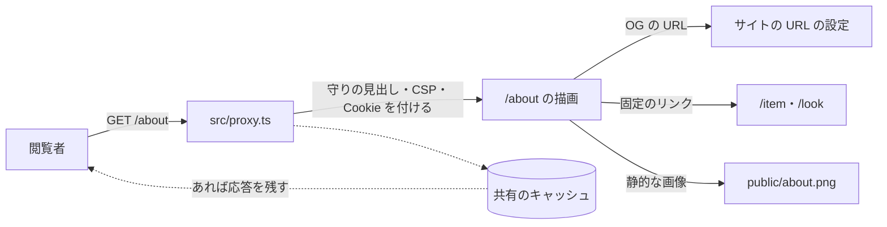

# ABOUT の脅威

> 状態: 推定（コードを読んで起こした。ユーザーの確認は未） | 確認日: 2026-11-01 | 対象: ABOUT の頁（`/about`、`src/app/about/page.tsx`）と、その応答に効く共有の守り | 基準コミット: `a03beaff`（本文の `ファイル:行` は、この脅威の文書が日付つきの証拠として残す行番号で、このコミットの内容を指す。コードを読み直す時は関数・部品の名前でたどる）

---

## 概要

ABOUT（ブランドの紹介の頁）で考える脅威を、1つずつ `THR-ABOUT-NNN` の項目で書く。ABOUT の頁は入力・DB・API・置き場を持たず、決まった文と2つのリンク（`/item`・`/look`）を出すだけなので、脅威は応答の見出し・画像の出どころ・キャッシュ・OG の URL・負荷に限られる。

| 項目 | 内容 |
| --- | --- |
| 項目の数 | 6（THR-ABOUT-001〜006） |
| 守りがある物 | 画像を外から読まない（001）、守りの見出し（002）、OG の URL を要求の見出しから作らない（005 の一部）、描画が DB を読まない（006 の一部） |
| 守りが欠ける・弱い物 | CSP が ABOUT に要らない外部まで許す（003）、Cookie を付けた応答のキャッシュの指定を明示しない（004）、サイトの URL の設定が無い時に OG が手元の URL を指す（005。対策は SEC-ABOUT-007）、頁の要求に回数の制限が無い（006） |
| 当てはまらない物 | PostgREST・RPC の直接の呼び出し、`has_permission` と aal2、表の権限、署名つき URL、入力の確かめ、CSRF。理由は「範囲と根拠」の表 |
| 対策の書き先 | 対策のセキュリティ要件 `SEC-ABOUT-NNN` は要件の文書（`docs/02_Requirements/areas/about.md`）に書く。下の「対策」の欄は読み手のための写し |
| 状態の付け方 | どの項目もコードとレビューから起こし、ユーザーの確認を受けていないので「推定」（SKILL の 7）。ユーザーが確かめたら「現行」にする。どれも実行しての確かめはしていない |

---

## 範囲と根拠

- 範囲: `scripts/trace/scope.json` の ABOUT の src（`src/app/about/**/*.{ts,tsx}`。今は `src/app/about/page.tsx` の1ファイルだけ）
- 範囲の外だが `/about` の応答に効くので見た物: `src/proxy.ts`（守りの見出し・CSP・セッションの Cookie）、`src/app/layout.tsx`（毎回サーバーで描く指定、OG の URL の基点）、`src/lib/redirect.ts`（サイトの URL の取り方）、`src/contexts/Providers.tsx`（頁を包むカート・ログインの部品）、`src/components/Header.tsx`（入口のリンク）、`src/components/ui/Button/Button.tsx`（CTA のリンク）、`src/styles/globals.css`（アイコンの字形の読み込み）、`next.config.ts`
- 出どころのレビュー: `docs/05_Quality/reviews/security/security_review_about.md`、`docs/05_Quality/reviews/code/2026-04-18-about-page-security-review.md`、`docs/05_Quality/reviews/security/security_review_overview.md`。どれも「当時の記録で、今の状態は確かめていない」ので、今の状態は 2026-10-24 にコードを読み直して決めた
- 全体のセキュリティ要件は `docs/02_Requirements/requirements.md` の 5.4 節（NFR-SEC-001〜012・AC-SEC-001）。ABOUT に当てはまる物は、各項目の根拠に書いた
- ASVS は OWASP ASVS 4.0.3 の項目番号。当てはめに自信の無い物は「（当てはめは推定）」、番号を決められない物は「ASVS 未対応付け」と書いた

### 当てはまらない脅威

NEWS などで考えた脅威のうち、ABOUT に入口が無い物。ABOUT に DB の読み書き・入力・置き場が加わったら見直す。

| 脅威の型 | ABOUT に当てはまらない理由 |
| --- | --- |
| PostgREST・RPC を直接叩いてアプリの絞りを迂回する | ABOUT の page.tsx は表も関数も読まない（`src/app/about/page.tsx:1-183` に Supabase の client・取得の呼び出しが無い）。迂回する絞りが無い |
| `has_permission` が aal2 を見ず、2要素認証を飛ばして DB を触る | ABOUT は認可を持たず、誰にでも同じ頁を返す。守る非公開の行が無い |
| anon・authenticated の表の権限が広すぎる | ABOUT の表が無い |
| 署名つき URL の期限・道筋の書き換え | ABOUT は置き場の画像を使わない。OG の画像は `public/about.png` の静的な物（`src/app/about/page.tsx:13`） |
| 入力の確かめ漏れ・本文の XSS | 入力（検索の値・フォーム）を受けず、文はコードに直に書いてある。HTML をそのまま差し込む書き方も無い（`src/app/about/page.tsx` を読んだ結果） |
| CSRF・状態を変える操作 | GET で頁を返すだけで、状態を変える送信が無い |
| リンクの差し替え・開いたリダイレクト | CTA の行き先は `/item`・`/look` の固定の値（`src/app/about/page.tsx:164,172`）。要求の値から行き先を作らない |
| API の回数の制限の迂回 | ABOUT の page.tsx は API を持たない。`/about` を開くと共有の部品が呼ぶ API は「範囲外の指摘」に書いた。頁の要求そのものの回数は THR-ABOUT-006 で扱う |

外した物: 頁の文の正しさ（metadata の「天然繊維100%」と本文の「天然繊維を中心に」の違い、`src/app/about/page.tsx:8,47`）は要件の食い違いで、脅威ではない。要件の文書で扱う。

### 入口と守りの位置

- 実線の矢印は今のコードの道。点線は本番で前に置くかもしれない共有のキャッシュ（THR-ABOUT-004）
- `/about` の描画は DB も外部のサービスも読まない。守りは全部 `src/proxy.ts` と `src/app/layout.tsx` にある（どちらも範囲外の共有部品）
- 頁の要求は回数の制限を通らない（THR-ABOUT-006）

---

## 脅威の一覧

### THR-ABOUT-001 外の配信元から読む画像で、頁の表示が壊れる・別の画像に差し替わる

| 属性 | 値 |
| --- | --- |
| 守るもの | ABOUT の頁の見た目と、共有された時の OG の画像（ブランドの印象） |
| 脅威 | 外の配信元が止まる・中身を差し替える・乗っ取られることで、ABOUT に壊れた画像や別の画像が出る |
| 起こり方 | 頁か OG の画像を第三者の URL（過去は readdy.ai）から読む時に起こる。今は本文に画像が無く、OG の画像は同じオリジンの `/about.png`（`src/app/about/page.tsx:13`）。過去は CSP の `img-src` が `https://readdy.ai`・`https://*.readdy.ai`・`https://placehold.co` を許し、next/image の外の画像の許可（`next.config.ts` の `remotePatterns`）も placehold.co・readdy.ai・public.readdy.ai を許していたので、コードに外の URL が戻っても CSP では止まらず、next/image で出すと `src` は頁と同じオリジンの `/_next/image?url=…` になって CSP を絞っても止まらなかった。2026-10-28 に `img-src`（`src/proxy.ts` の `buildCsp`。`ADR-0108`）と `remotePatterns`（本番は自分の Supabase の host 1 つの署名つきの道だけ。`DD-HOME-004`）の両方から外した |
| 影響 | ブランドの紹介の頁が崩れる、意図しない画像が出る。外の配信元に閲覧の記録が渡る |
| 対策 | SEC-ABOUT-001 |
| ASVS | ASVS 未対応付け（V14.2.3 の SRI が近いが、外に置かない対策とは同じでない） |
| 根拠 | 過去の要件 FR-ABOUT-008 が readdy.ai からの移しを求め、過去のレビューが「第三者の資産は自前か SRI 付きに」と勧めた。今のコードは外から読まないが、それを試す E2E（`e2e/FR-ABOUT-008-static-image-source.spec.ts:9`）は画像が1枚以上ある前提で落ち、性質を試せていない |
| 状態 | 推定 |
| 出どころ | `docs/02_Requirements/requirements.md:300-301`（FR-ABOUT-008）、`docs/05_Quality/reviews/code/2026-04-18-about-page-security-review.md:56-57` |

### THR-ABOUT-002 守りの見出しが無く、枠への埋め込み・種類の取り違え・平文の通信を許す

| 属性 | 値 |
| --- | --- |
| 守るもの | 閲覧者の端末と通信 |
| 脅威 | 攻撃者のサイトが ABOUT を枠に埋めて操作を誘う、応答の種類をブラウザに取り違えさせる、平文の通信に落として中身を差し替える |
| 起こり方 | 守りの見出しが無い応答を返す時に起こる。今は `src/proxy.ts` が全部の要求（対象の型は `/:path*`、`src/proxy.ts:246`）の応答に、nonce 付きの CSP（`default-src 'none'`・`frame-ancestors 'none'`）・`Referrer-Policy: no-referrer`・`Permissions-Policy`・`X-Content-Type-Options: nosniff`・`X-Frame-Options: DENY`・`Strict-Transport-Security` を付ける（`src/proxy.ts:234-239`）。`X-Powered-By` は出さない（`next.config.ts:22`） |
| 影響 | クリックジャッキング、スクリプトの差し込み、通信の盗み見と改ざん |
| 対策 | SEC-ABOUT-002 |
| ASVS | V14.4.3、V14.4.4、V14.4.5、V14.4.6、V14.4.7 |
| 根拠 | 守りがある。ただし同じ見出しを試す E2E は `/terms` だけを開き（`e2e/FR-TERMS-003-security-headers.spec.ts:5`）、`/about` では試していない。`src/proxy.ts` は範囲外の共有部品なので、ABOUT の文書から守りの在りかとして指す。全体の NFR-SEC-001（TLS・HSTS）・NFR-SEC-003（CSP）に当てはめた |
| 状態 | 推定 |
| 出どころ | `docs/05_Quality/reviews/security/security_review_about.md:43`（about 本体は静的表示中心）、実装から推定（2026-10-24 の突き合わせ） |

### THR-ABOUT-003 CSP の許可が ABOUT に要らない外部まで広く、差し込まれた時の被害を広げる

| 属性 | 値 |
| --- | --- |
| 守るもの | 閲覧者の端末と、閲覧の記録 |
| 脅威 | 将来どこかに差し込みの穴ができた時に、攻撃者が許可された外のオリジンを使ってスクリプト・画像・スタイルを読み込み、情報を持ち出す |
| 起こり方 | CSP は全部の頁に同じ1つの方針を付ける（`src/proxy.ts` の `buildCsp`）。ABOUT が使わない `https://cdn.jsdelivr.net`・readdy.ai・placehold.co・`*.supabase.co` は 2026-10-28 に外した（`ADR-0108`）。Stripe・Turnstile・地図の枠は全頁で許す（Q29。`next/link` の遷移で CSP が変わらないため）ので ABOUT の応答でも許す。以前の jsdelivr は src の `.ts`・`.tsx`・`.css` のどこからも読まず、アイコンの字形は自前で読み込む（`src/styles/globals.css:3`）。style は要素の style 属性のために `'unsafe-inline'` を常に許し（`src/proxy.ts:91-96`）、ABOUT も文字の大きさを全部 style 属性で付ける（`src/app/about/page.tsx:19-35`） |
| 影響 | 差し込みの穴が別にできた時の持ち出しの道が増える。ABOUT 自体は入力を持たないので、今の影響は小さい |
| 対策 | SEC-ABOUT-003 |
| ASVS | V14.4.3 |
| 根拠 | 過去のレビューが「about に不要な外部依存が CSP に含まれる」を Low・Open とし、今も同じ。CSP を頁ごとに分けるか全体を絞るかは決まっていない。全体の NFR-SEC-003（CSP 導入）に当てはめた |
| 状態 | 推定 |
| 出どころ | `docs/05_Quality/reviews/security/security_review_about.md:37`、`docs/05_Quality/reviews/code/2026-04-18-about-page-security-review.md:56-57` |

### THR-ABOUT-004 応答が共有のキャッシュに残り、別の閲覧者に同じセッションの id や CSP の nonce が配られる

| 属性 | 値 |
| --- | --- |
| 守るもの | 閲覧者ごとのセッションの id（カート・閲覧の紐づけ）と、要求ごとに変わる CSP の nonce |
| 脅威 | 本番の前に置く共有のキャッシュ（CDN など）が、初めての閲覧者への `/about` の応答を `Set-Cookie` ごと残し、後の閲覧者に同じセッションの id を配る（2026-10-28 以降、`/about` に `Set-Cookie` は付かないので、この組み合わせは起きない）。Cookie を持って戻った閲覧者への応答は `Set-Cookie` を持たないので残しやすく、残ると HTML と CSP の nonce が焼き付き、誰にでも同じ nonce が配られる |
| 起こり方 | 過去は `src/proxy.ts` が Cookie を持たない要求に、どの頁でもセッションの Cookie を発行していた。2026-10-28 に、発行を `/cart`・`/checkout`・`/api/checkout` だけにしたので、`/about` の応答に `Set-Cookie` は付かない（`DD-PRIVACY-004`、`ADR-0355`）。要求ごとに変わる nonce が載る点は変わらない。ABOUT は中身が誰にでも同じなので、キャッシュに残しやすい頁に見える。`src/app/layout.tsx:22` が毎回サーバーで描く指定をしており、Next はその頁に共有のキャッシュに残させない `Cache-Control` を付ける（推定。実測していない）。`src/proxy.ts`・`next.config.ts` は `Cache-Control` を明示しない（`src/proxy.ts:234-240`、`next.config.ts` に見出しの設定が無い）。nonce は要求ごとに作り、CSP と、要求と応答の `x-nonce` の見出しに載せる（`src/proxy.ts:215-216,224,234,240`） |
| 影響 | 複数の閲覧者が同じセッションの id を共有し、カートや閲覧の紐づけが混ざる。セッションの固定の足がかりになる。nonce が固定されると、差し込みの穴が別にできた時に nonce の守りが効かなくなる |
| 対策 | SEC-ABOUT-004 |
| ASVS | V8.1.1（当てはめは推定） |
| 根拠 | どのレビューにも無く、2026-10-24 の突き合わせで気づいた。過去のレビューは ABOUT を「入力/API を持たない静的ページ」として対象外にしたが、実際は毎回描かれ Cookie を発行する。守りは Next の既定の動きに頼り、明示も試験も無いので「推定」にした |
| 状態 | 推定 |
| 出どころ | `docs/05_Quality/reviews/security/security_review_overview.md:12`、実装から推定（2026-10-24 の突き合わせ） |

### THR-ABOUT-005 OG の URL が別のサイトや手元の URL を指し、共有のカードが壊れる・差し替わる

| 属性 | 値 |
| --- | --- |
| 守るもの | 共有された時の OG の画像と、ブランドの印象 |
| 脅威 | 攻撃者が要求の `Host`・`X-Forwarded-Host` を偽って OG の画像の URL を自分のサイトに向けさせる。または本番でサイトの URL の設定が漏れ、OG の画像が手元の URL やデプロイごとの URL を指す |
| 起こり方 | OG の画像 `/about.png`（`src/app/about/page.tsx:13`）は、layout の基点の URL（`src/app/layout.tsx:28`）で絶対の URL になる。基点は環境変数だけから作り、要求の見出しを読まない（`src/lib/redirect.ts:64-72`）ので、見出しの偽りは効かない。環境変数が1つも無い時は `http://localhost:3000` に落ちる（`src/lib/redirect.ts:1,71`）。`NEXT_PUBLIC_SITE_URL`・`NEXT_PUBLIC_BASE_URL`・`BASE_URL` が無く `NEXT_PUBLIC_VERCEL_URL` だけがある時は、その値（Vercel が自動で入れる場合はデプロイごとの `*.vercel.app`）に落ちる（同 `:65`）。Vercel では後者の方が起こりやすい。2026-10-28 に、本番のビルド（`VERCEL_ENV=production`）は `NEXT_PUBLIC_SITE_URL` と `NEXT_PUBLIC_SUPABASE_URL` が無ければ落とすようにした（`next.config.ts` の `assertBuildEnv`、`src/lib/build-env-guard.ts`、`ADR-0206`）。2026-11-01 に許可オリジン `APP_ALLOWED_ORIGINS` も必須に足した（Origin の確かめの許可の一覧を本番で明示させるユーザーの決定による。`NEXT_PUBLIC_SITE_URL` が必須なので proxy の退避は本番では起きない。SEC-ABOUT-007-AC-02）。本番の公開の応答は `NEXT_PUBLIC_SITE_URL` を基点にし、手元の URL にもデプロイごとの URL にも落ちない。手元・preview・E2E の本番ビルドは従来どおり |
| 影響 | SNS で共有された ABOUT のカードの画像が出ない。見出しの偽りと共有のキャッシュが重なれば別の画像が配られる（今は見出しから作らないので起きない） |
| 対策 | SEC-ABOUT-005、SEC-ABOUT-007 |
| ASVS | ASVS 未対応付け |
| 根拠 | 見出しから作らない守りはある。設定の漏れは、本番のアプリがまだ無く本番の環境変数を見ていないので「推定」にした。どのレビューにも無く、2026-10-24 の突き合わせで気づいた |
| 状態 | 推定 |
| 出どころ | 実装から推定（2026-10-24 の突き合わせ） |

### THR-ABOUT-006 毎回サーバーで描く頁を大量に要求され、サーバーに負荷をかける

| 属性 | 値 |
| --- | --- |
| 守るもの | サイトの応答の速さと、サーバーの費用 |
| 脅威 | 攻撃者が `/about` を大量に要求し、毎回の描画でサーバーを詰まらせる |
| 起こり方 | `src/app/layout.tsx:22` の指定で、`/about` も要求のたびにサーバーで描かれる（CSP の nonce のため）。頁の要求は回数の制限を通らない（回数の制限は API の窓口だけが呼び、`src/proxy.ts`・`src/app/layout.tsx` は呼ばない）。今の ABOUT の描画は DB も外のサービスも読まない（`src/app/about/page.tsx:1-183`）ので、1回の重さは描画だけ |
| 影響 | 応答が遅れる・止まる。ホスティングの費用が増える |
| 対策 | SEC-ABOUT-006 |
| ASVS | V11.1.4（自動化への守り。当てはめは推定） |
| 根拠 | 頁の要求の回数の制限はアプリに無く、本番のホスティングの守りに頼る。本番のアプリがまだ無いので守りを確かめていない。ABOUT の描画が DB を読まないことが、1回の重さを抑える今の守り |
| 状態 | 推定 |
| 出どころ | 実装から推定（2026-10-24 の突き合わせ） |

---

## 範囲外の指摘

ABOUT のレビューに載ったが、守る物も直す所も ABOUT の範囲の外にある指摘。ABOUT の脅威の項目にはせず、持ち主の領域を書く。

| 指摘 | 今の状態 | 持ち主 | 出どころ |
| --- | --- | --- | --- |
| サーバーの記録に Cookie・token の断片を出す（`src/lib/supabase/server.ts`） | Closed（当時） | 共有部品 | `security_review_about.md:15` |
| 未認証で確認済みの利用者を作る（`src/app/api/auth/identify/route.ts`） | Closed（当時） | AUTH | `security_review_about.md:16` |
| 回数の制限の DB の失敗で素通しにする・数え方が原子的でない | Closed（当時） | 共有部品（`src/features/auth/`） | `security_review_about.md:17-18` |
| identify の回数の制限の呼び出しの例外で素通しになる余地 | Open（当時）。今は確かめていない | AUTH | `security_review_about.md:36` |
| `/about` を開くと、包みの `CartProvider`・`LoginProvider` が `/api/cart`・`/api/wishlist`・`/api/auth/me` を自動で呼ぶ（カートは `/privacy` でだけ止める） | 今も呼ぶ（`src/contexts/Providers.tsx:29-30`、`src/contexts/CartContext.tsx:157-164`、`src/features/cart/client/cart-api.ts:64`、`src/contexts/LoginContext.tsx:72,249`）。ABOUT の page.tsx は使わない | CART・AUTH・共有部品 | 実装から推定 |
| 部品の見本の頁 `/ui` が readdy.ai の画像 7 か所を外から読む（`src/app/ui/page.tsx`） | Closed（2026-10-28）。`public/` の手元の画像（`/news1.png`〜`/news3.png`・`/placeholder.png`）に替えた。CSP の `img-src` と `remotePatterns` から readdy.ai を外す作業の前提 | HOME（`DD-HOME-004`） | `docs/superpowers/plans/2026-10-28-wave3-csp-images-session.md`（Task 6） |
| 部品の見本の頁 `/ui` への導線がヘッダーに残る | Open のまま。今も `src/components/Header.tsx:24` に `/ui` があり、大きい画面のナビ（`Header.tsx:187`）とドロワー（`Header.tsx:132`）に出る。ABOUT を含む全部の頁に出る | AUTH（`Header.tsx`） | `security_review_about.md:38` |
| turnstile の失敗の詳細が記録に残る | Open（当時）。今は確かめていない | AUTH | `security_review_about.md:39` |
| どの頁を開いてもセッションの Cookie を発行する | Closed（2026-10-28）。発行を `/cart`・`/checkout`・`/api/checkout` だけにした（`src/proxy.ts` の `shouldIssueSessionCookie`、`ADR-0355`）。`/about` には付かない。キャッシュとの組み合わせは THR-ABOUT-004 | PRIVACY・共有部品 | 実装から推定 |

---

## 未確認事項

- `/about` の応答の `Cache-Control` の実際の値（THR-ABOUT-004）。Next の既定の動きとして読んだだけで、本番のビルドの応答を見ていない
- 本番の前に共有のキャッシュ（CDN など）を置くか、置く時に `Set-Cookie` 付きの応答をどう扱うか（THR-ABOUT-004）。本番のアプリはまだデプロイしていない
- 本番でサイトの URL と許可オリジンの環境変数が設定されるか（THR-ABOUT-005）。設定が漏れればビルドが落ちる（2026-10-28。許可オリジンは 2026-11-01。`ADR-0206`）が、Vercel の Production に実際に入れたかは本番が未デプロイなので未確認。`NEXT_PUBLIC_VERCEL_URL` の読み方を直すかは別の判断
- 本番のホスティングが頁の要求の回数を絞るか（THR-ABOUT-006）
- CSP を頁ごとに分けるか、全体の許可を絞るか（THR-ABOUT-003）。ユーザーに決めてもらう
