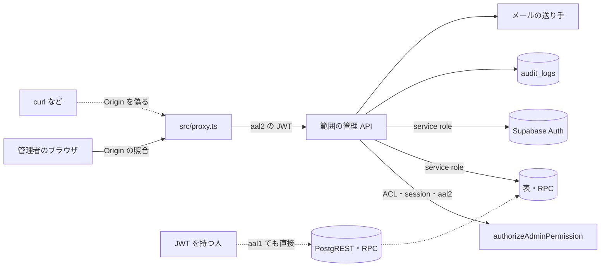

# ADMIN の脅威

> 状態: 推定（コードを読んで起こした。ユーザーの確認は未） | 確認日: 2026-10-24 | 対象: 管理のそのほか（ユーザー作成・強制失効・監査ログ・MFA のリセット・問い合わせの管理・返信の宛先・色見本・監査ログの削除）の API・画面・DB | 基準コミット: `4facf63b`（本文の `ファイル:行` は、この脅威の文書が日付つきの証拠として残す行番号で、このコミットの内容を指す。コードを読み直す時は関数・部品の名前でたどる）

---

## 概要

ADMIN（管理のそのほか）の領域で考える脅威を、1つずつ `THR-ADMIN-NNN` の項目で書く。過去のセキュリティレビューの指摘と、2026-10-24 にコードと DB の移行を読んで気づいた点の両方を拾った。

| 項目 | 内容 |
| --- | --- |
| 項目の数 | 25（THR-ADMIN-001〜025） |
| 守りがある物 | 管理 API の認可（ACL・有効な session・aal2、001）、問い合わせ・監査・session の表の直接の読み書きの拒否（003）、特権の RPC の実行の権限（004）、Origin の照合（005）、監査ログの読み出しの列（011）、返信の宛先の印（017）、管理の画面の中身（023） |
| 守りが欠ける・弱い物 | DB が aal2 と session の生存を見ない（002）、回数の制限が無い（006）、監査ログの水増し・平文の個人情報・偽れる IP・消去と改ざん（007〜010）、作るユーザーの弱いパスワード（012）、MFA のリセットと強制失効の悪用（014・015）、失効の取りこぼし（016）、成功の取り違え（021）、記録の無い変更（022）、記録の無い読み出し（025） |
| 当てはまらない物 | 署名つき URL（ADMIN の範囲は置き場を使わない）など。理由は「当てはまらない脅威」の表 |
| 対策の書き先 | 対策のセキュリティ要件 `SEC-ADMIN-NNN` は要件の文書（`docs/02_Requirements/areas/admin.md`）に書く。下の「対策」の欄は読み手のための写し |
| 状態の付け方 | どの項目もコード・移行・レビューから起こし、ユーザーの確認を受けていないので「推定」（`.claude/skills/documentation-guide/SKILL.md` の 7）。どれも実行しての確かめはしていない |

---

## 範囲と根拠

- 範囲: `scripts/trace/scope.json` の ADMIN の src（`src/app/api/admin/create-user/**`・`revoke-user-sessions/**`・`audit-logs/**`・`users/mfa/**`・`contact/**`・`item-color-presets/**`、`src/app/admin/create-user/**`、`src/lib/contact/**`、`src/lib/auditCleanup.ts`）
- 範囲の外だが脅威の入口になるので見た物: `src/lib/auth/admin-rbac.ts`（管理の認可）、`src/lib/audit.ts`（監査の記録と伏せ字）、`src/proxy.ts`（Origin の照合）、`src/features/auth/middleware/rateLimit.ts`（回数の制限）、`src/lib/mail/adapters/*`（メールの送り方）、`supabase/migrations/20260901102912_remote_schema.sql`（表・RLS・表の権限・RPC）、`supabase/migrations/20261023175712_group_g0_permissions.sql`（`has_permission`）
- 出どころのレビュー: `docs/05_Quality/reviews/security/security_review_admin.md`・`security_review_contact.md`、`docs/05_Quality/reviews/code/2026-04-18-admin-security-review.md`・`2026-04-18-auth-security-review.md`・`2026-04-18-contact-review.md`。どのレビューも当時の記録なので、今の状態は 2026-10-24 にコードを読み直して決めた
- 全体のセキュリティ要件は `docs/02_Requirements/requirements.md` の 5.4 節（NFR-SEC-001〜012・AC-SEC-001）。ADMIN に当てはまる物は、各項目の根拠に書いた
- ASVS は OWASP ASVS 4.0.3 の項目番号。当てはめに自信の無い物は「（当てはめは推定）」、番号を決められない物は「ASVS 未対応付け」と書いた
- 認可の部品（`authorizeAdminPermission`）と `has_permission` は権限と割当の作業が持つ共有の物。ここでは守りの在りかとして指すだけにした

### 当てはまらない脅威

NEWS などで考えた脅威のうち、ADMIN の範囲に入口が無い物。範囲に置き場・画面が加わったら見直す。

| 脅威の型 | ADMIN に当てはまらない理由 |
| --- | --- |
| 署名つき URL の期限・道筋の書き換え | 範囲の API・画面は置き場（Storage）を使わない。色見本は名前と色の値だけで画像を持たない（`supabase/migrations/20260901102912_remote_schema.sql:544-552`） |
| 本文の XSS（管理の画面） | 問い合わせを出す管理の画面の部品 `src/components/ContactSection.tsx` はどこからも読み込まれず、範囲にも無い。返信のメールは文の形で送る（`src/app/api/admin/contact/[id]/reply/route.ts:64-69`）。会員の頁で管理者の返信を出す所（FR-ACCOUNT-008）は ACCOUNT の範囲 |
| 開いたリダイレクト | 範囲の API と画面は要求の値から行き先を作らない |

### 入口と守りの位置

- 実線の矢印はアプリが用意した道、点線はアプリを通らない道か、ブラウザ以外からの道
- PostgREST からは、色見本の表だけが権限で読み書きを許す（THR-ADMIN-002）。問い合わせ・監査・session の表は全部断る（THR-ADMIN-003）。特権の RPC は service role だけ（THR-ADMIN-004）
- 範囲の API は回数の制限を通らない（THR-ADMIN-006）

---

## 脅威の一覧

### THR-ADMIN-001 権限の無い人が管理 API を直接呼ぶ

| 属性 | 値 |
| --- | --- |
| 守るもの | 利用者のアカウント（作成・失効・MFA）、問い合わせの個人情報、監査ログ、色見本 |
| 脅威 | 未ログインの人・一般会員・権限の足りない管理者が、範囲の管理 API を直接呼ぶ |
| 起こり方 | `/api/admin/create-user`・`revoke-user-sessions`・`audit-logs`・`users/mfa/reset`・`contact/**`・`item-color-presets/**` を JWT 無し・一般会員の JWT・別の権限の JWT で呼ぶ。過去は `x-admin-token` の共有の秘密1本で通った |
| 影響 | アカウントの乗っ取りや締め出し、問い合わせの個人情報の漏れ、監査ログの漏れ |
| 対策 | SEC-ADMIN-001 |
| ASVS | V4.1.1、V4.3.1 |
| 根拠 | 全部のルートが最初に `authorizeAdminPermission` を通る（例 `src/app/api/admin/create-user/route.ts:18`、`revoke-user-sessions/route.ts:14`、`audit-logs/route.ts:18`、`users/mfa/reset/route.ts:41`、`contact/route.ts:16`、`item-color-presets/route.ts:13`）。認可は JWT の検証・session の生存・DB の ACL・`aal2` を全部見る（`src/lib/auth/admin-rbac.ts:184-250`）。`admin.users.manage` は店長に固定した権限（`src/lib/auth/role-permission-catalog.ts:4`、`docs/superpowers/specs/2026-10-23-group-g-design.md:560`）、`admin.audit.read` は店長だけに付ける（`supabase/migrations/20261023061453_audit_read_permission.sql:6-12`）。全体の NFR-SEC-005（権限管理）・NFR-SEC-008（RBAC）に当てはめた |
| 状態 | 推定 |
| 出どころ | `docs/05_Quality/reviews/code/2026-04-18-admin-security-review.md:29-34,43-48`、`docs/05_Quality/reviews/security/security_review_admin.md:12-17` |

### THR-ADMIN-002 2要素認証を済ませていない、または失効した session の JWT で色見本を DB に直接書く

| 属性 | 値 |
| --- | --- |
| 守るもの | 色見本（`item_color_presets`）の正しさ |
| 脅威 | `admin.items.read`・`admin.items.manage` を持つ人の、パスワードだけで得た `aal1` の JWT、または強制失効の後も期限の残る JWT を手に入れた者が、色見本を読み・足し・書き換え・消す |
| 起こり方 | アプリの窓口を通らず PostgREST の `item_color_presets` を直接叩く。RLS の方針は `has_permission` だけを見る（`supabase/migrations/20260901102912_remote_schema.sql:3435-3454`）。`has_permission` は ACL だけを見て、`aal` も session の生存も見ない（`supabase/migrations/20261023175712_group_g0_permissions.sql:186-216`。移行のどこにも `aal` の記述が無い）。表の `name` には長さの上限が無い（`remote_schema.sql:544-552`）ので、API の 40 字の上限（`item-color-presets/route.ts:7`）も迂回できる |
| 影響 | 2要素認証と強制失効の守りがアプリの窓口だけになる。商品の編集の画面に偽の色見本や長い名前が出る。直接の書き換えは監査の記録にも残らない（THR-ADMIN-022） |
| 対策 | SEC-ADMIN-002 |
| ASVS | V4.3.1 |
| 根拠 | 管理の窓口は `aal2` と session の生存を求める（`src/lib/auth/admin-rbac.ts:197-250`）が、同じ守りが DB に無い。PostgREST が `aal1` の JWT と、Auth の session を消した後の期限内の JWT を受けるのは Supabase の標準の動き（推定）。NEWS の THR-NEWS-002 と同じ形。実際に叩いての確かめはしていない。全体の NFR-SEC-008（RBAC）に当てはめた |
| 状態 | 推定 |
| 出どころ | 実装から推定（2026-10-24 の DB の移行の読み直し） |

### THR-ADMIN-003 表の権限が anon・authenticated に全部付き、RLS だけが守りになる

| 属性 | 値 |
| --- | --- |
| 守るもの | 問い合わせ（`contact_inquiries`・`contact_messages`・`contact_reply_templates`）、監査ログ（`audit_logs`）、自前の session（`sessions`）、色見本 |
| 脅威 | anon の鍵や一般会員の JWT を持つ人が、PostgREST で管理の表を直接読み書きする |
| 起こり方 | 表の権限は anon・authenticated に select・insert・update・delete・truncate・references・trigger・maintain の8種類とも付いている（`remote_schema.sql:4142,4150,4152,4154,4156,4200`）。RLS は有効で、問い合わせの3表は直接の select・insert・update・delete を全部断り（`remote_schema.sql:3366-3427`）、監査ログと session は anon・authenticated の全部の操作を断る（`remote_schema.sql:3313-3330,3747-3763`）。どれかの移行で RLS か方針を外すと、権限がそのまま効く。TRUNCATE・MAINTAIN は RLS の方針を受けない権限なので、方針が正しくても守りにならない（PostgREST からは届かない形だが、推定） |
| 影響 | 守りが1段だけなので、移行の誤り1つで問い合わせの個人情報・監査ログ・session の印の漏れや書き換えに届く |
| 対策 | SEC-ADMIN-003（問い合わせの3表と色見本の anon の権限）、SEC-AUTH-011（範囲外。`sessions`・`audit_logs` の表の権限） |
| ASVS | V4.1.3（当てはめは推定） |
| 根拠 | 今は RLS が断るので select・insert・update・delete は直接は届かない（守りがある）。ただし表の権限で絞っていないので、多層の守りになっていない。RLS を受けない TRUNCATE・MAINTAIN の権限も付いている。全体の NFR-SEC-005（権限管理）・NFR-SEC-010（個人情報のマスキング）に当てはめた |
| 状態 | 推定 |
| 出どころ | 実装から推定（2026-10-24 の移行の読み直し） |

### THR-ADMIN-004 特権の RPC を利用者の JWT で直接呼び、他人の session を消す

| 属性 | 値 |
| --- | --- |
| 守るもの | 利用者の Supabase Auth の session |
| 脅威 | anon・一般会員・管理者が、強制失効に使う RPC `revoke_auth_sessions_for_user` を PostgREST から直接呼び、任意の利用者を締め出す |
| 起こり方 | `/rest/v1/rpc/revoke_auth_sessions_for_user` を `p_user_id` 付きで呼ぶ。関数は SECURITY DEFINER で `auth.sessions` を消す（`remote_schema.sql:2122-2136`） |
| 影響 | 店長を含む誰でも締め出せる。アプリの認可と監査を通らない |
| 対策 | SEC-ADMIN-004 |
| ASVS | V4.1.1 |
| 根拠 | 実行の権限は PUBLIC から外し、postgres と service_role だけに付けている（`remote_schema.sql:4004-4006`）。search_path も空にしてある（`supabase/migrations/20260921011535_harden_security_definer_search_path.sql:16`）。守りがある。全体の NFR-SEC-005（権限管理）に当てはめた |
| 状態 | 推定 |
| 出どころ | 実装から推定（2026-10-24 の移行の読み直し） |

### THR-ADMIN-005 別のサイトが管理者のブラウザに書き込みの要求を送らせる

| 属性 | 値 |
| --- | --- |
| 守るもの | ユーザー作成・強制失効・MFA のリセット・問い合わせの状態と返信・返信のテンプレート・色見本 |
| 脅威 | 攻撃者のサイトが、ログイン中の管理者のブラウザから範囲の書き込み API を呼ばせる |
| 起こり方 | 管理者が攻撃者の頁を開き、その頁がフォームや fetch で POST・PUT・PATCH・DELETE を送る。範囲の書き込み API は CSRF の印（`requireCsrfOrDeny`）を見ない。守りは `src/proxy.ts` の Origin・Referer の照合だけ（`src/proxy.ts:166-200,206`）。照合は Origin も Referer も無い要求を断る（`src/proxy.ts:180-183`）が、許可の一覧が未設定の時は要求の Host から作った値と比べる（`src/proxy.ts:189-199`） |
| 影響 | 管理者の名で、ユーザーの作成・締め出し・MFA の削除・客へのメールの送信が起きる |
| 対策 | SEC-ADMIN-005 |
| ASVS | V4.2.2 |
| 根拠 | ブラウザは Origin を偽れないので、今の照合で多くは断れる（推定）。過去のレビューは「変更系の管理 API の CSRF の適用が不統一」を Open のまま残している。範囲外の users の PATCH だけ `requireCsrfOrDeny` を使う（`src/app/api/admin/users/route.ts:182`）。全体の NFR-SEC-003（XSS・CSRF 対策）に当てはめた |
| 状態 | 推定 |
| 出どころ | `docs/05_Quality/reviews/security/security_review_admin.md:40`、`docs/05_Quality/reviews/code/2026-04-18-auth-security-review.md:47-58` |

### THR-ADMIN-006 管理の書き込み API を回数の制限なしに繰り返す

| 属性 | 値 |
| --- | --- |
| 守るもの | 利用者のアカウント、客のメールの受け取り、送り手のメールの評判、DB の容量 |
| 脅威 | 管理者の JWT を手に入れた者、または誤って作った自動の処理が、範囲の書き込み API を大量に呼ぶ |
| 起こり方 | ユーザー作成・強制失効・MFA のリセット・問い合わせの返信（客へメールを送る）・テンプレート・色見本の API は、どれも回数の制限を呼ばない（範囲の route.ts に `enforceRateLimit` などの呼び出しが無い）。範囲外の管理 API（LOOK・取扱店・注文・返品など）は持つ（例 `src/app/api/admin/looks/route.ts:7,67`）。共有の回数の制限は IP を `x-forwarded-for` の左端から取る（`src/features/auth/middleware/rateLimit.ts:4-16`）ので、IP だけで数えると送る側が値を変えて迂回できる |
| 影響 | アカウントの大量作成・全員の締め出し・客への大量のメール・送り手の停止。乗っ取られた管理者の被害の速さを抑えられない |
| 対策 | SEC-ADMIN-006 |
| ASVS | V11.1.4 |
| 根拠 | 過去のレビューの Medium（create-user の回数の制限が未統一）が Open のまま。FREQ-360（範囲外）は「管理画面の管理者単位」の回数の制限を求める（`docs/02_Requirements/requirements.md:1544`）。画面から呼ばれない API（THR-ADMIN-024）も HTTP では呼べる |
| 状態 | 推定 |
| 出どころ | `docs/05_Quality/reviews/security/security_review_admin.md:41` |

### THR-ADMIN-007 認可に失敗する要求を繰り返して監査ログを水増しする

| 属性 | 値 |
| --- | --- |
| 守るもの | 監査ログの読みやすさと DB の容量 |
| 脅威 | 誰でも（ログイン無しで）、強制失効の API に要求を繰り返し、監査ログを埋める |
| 起こり方 | 強制失効の API は認可に失敗するたびに `unauthorized` の行を書く（`src/app/api/admin/revoke-user-sessions/route.ts:14-26`）。ブラウザ以外（curl など）は Origin を許可の値に偽って `src/proxy.ts` の照合を通れる。回数の制限も無い（THR-ADMIN-006） |
| 影響 | 本当の不正の記録が埋もれる。監査ログの表が膨らむ |
| 対策 | SEC-ADMIN-007 |
| ASVS | ASVS 未対応付け |
| 根拠 | ログインの第2要素で同じ形を「監査ログの水増し防止」として直した先例がある（FREQ-336（範囲外）、`docs/02_Requirements/requirements.md:1520`）。cron で同じ形を直した FREQ-370 もある（`requirements.md:1554`）。ほかの範囲の API は認可の失敗を記録しない |
| 状態 | 推定 |
| 出どころ | 実装から推定 |

### THR-ADMIN-008 監査ログに個人情報や内部の誤りの文が平文で残る

| 属性 | 値 |
| --- | --- |
| 守るもの | 対象の利用者のメールの住所、リセットの理由の文、内部の誤りの中身 |
| 脅威 | 監査ログを読める人（店長・DB の運用者）や、監査ログが漏れた時の第三者が、記録の中の個人情報を読む |
| 起こり方 | MFA のリセットは `metadata` に理由の文（`reason`）と対象のメール（`target_email`）、Auth の誤りの文を書く（`src/app/api/admin/users/mfa/reset/route.ts:104-106,126-129,148-151,199-204`）。ユーザー作成は Supabase の誤りの文を `detail` に書く（`src/app/api/admin/create-user/route.ts:60,71`）。強制失効は例外の文を `detail` に書く（`revoke-user-sessions/route.ts:94`）。伏せ字は鍵の名前が `password`・`token`・`secret`・`card`・`number` などの物と、`detail` の JWT・長い文字列・`password=` だけ（`src/lib/audit.ts:22-39`）。`reason`・`email`・`target_email` は伏せない。さらに `logAudit` は、環境変数 `ALERT_AUDIT_URL` が設定されていると、伏せ字にした後の記録を丸ごと外の Webhook に送る（`src/lib/audit.ts:72-82`）。送る中身は操作した人のメール・IP・ブラウザの情報と、MFA のリセットの理由の文と対象のメールを含む |
| 影響 | 理由の文に書いた個人の事情やメールの住所が、保存の期限なしに残る。`ALERT_AUDIT_URL` を設定すると、同じ個人情報が DB の外の送り先にも写り、その送り先の守りと保存の期間に頼ることになる |
| 対策 | SEC-ADMIN-008 |
| ASVS | V7.1.2 |
| 根拠 | 批評で伏せ字の範囲を確かめた結果。全体の NFR-SEC-010（個人情報のマスキング）に当てはめた |
| 状態 | 推定 |
| 出どころ | 実装から推定 |

### THR-ADMIN-009 監査ログの IP を送る側が偽る

| 属性 | 値 |
| --- | --- |
| 守るもの | 監査ログの IP の正しさ |
| 脅威 | 要求を送る人が、監査ログに残る IP を別の値にする |
| 起こり方 | 強制失効と MFA のリセットは、監査の IP を `x-forwarded-for` の左端から取る（`src/app/api/admin/revoke-user-sessions/route.ts:11`、`users/mfa/reset/route.ts:46`）。左端は送る側が決められる。Vercel などの中継は本当の IP を右側に足す（推定） |
| 影響 | 不正の調べで、本当の発信元を追えない |
| 対策 | SEC-ADMIN-009 |
| ASVS | ASVS 未対応付け |
| 根拠 | 回数の制限で同じ形がある（THR-NEWS-010（範囲外））。本番のアプリはまだデプロイしておらず、中継の振る舞いを確かめていない |
| 状態 | 推定 |
| 出どころ | 実装から推定 |

### THR-ADMIN-010 監査ログを消す・書き換える

| 属性 | 値 |
| --- | --- |
| 守るもの | 監査ログの完全さ |
| 脅威 | service role の鍵を持つ処理・人、または誤って呼んだ削除の関数が、監査ログの行を消す・書き換える |
| 起こり方 | `cleanupAuditLogs` は service role で、既定 365 日より古い行を写しを取らずに消す（`src/lib/auditCleanup.ts:7-16`。今は src から呼ばれない）。表は service_role に全部の操作を許す（`remote_schema.sql:3325-3330`）。表に hash の列が無く（`remote_schema.sql:425-439`）、改ざんを知らせるトリガーも見つからない |
| 影響 | 不正の跡を消される。消されても気づけない。法令で決まる保管の期間を守れない恐れ |
| 対策 | SEC-ADMIN-010 |
| ASVS | V7.3.3 |
| 根拠 | 過去のレビューは「entry_hash と改ざん検知のトリガーを足して Closed」と書くが、今の移行に無い（TM-ADMIN-06・41）。全体の NFR-SEC-011（監査ログの保持と改ざん防止）・NFR-COMP-003（範囲外。法令の保管期間）に当てはめた。電子帳簿保存法に関わる監査ログの保持の対応は、システムの完成後に回すと決めてある |
| 状態 | 推定 |
| 出どころ | `docs/05_Quality/reviews/security/security_review_admin.md:21`、`docs/05_Quality/reviews/code/2026-04-18-admin-security-review.md:73-78`、`docs/05_Quality/reviews/code/2026-09-25-working-diff-security-review.md:307` |

### THR-ADMIN-011 監査ログを権限の無い人が読む・読み出しで個人情報が出る

| 属性 | 値 |
| --- | --- |
| 守るもの | 監査ログの中の行為者のメール・IP・ブラウザの情報・metadata |
| 脅威 | サポーターなど権限の無い人が監査ログを読む。権限のある人の読み出しにも、要らない個人情報が載る |
| 起こり方 | `/api/admin/audit-logs` を呼ぶ。過去は `select('*')` で問い合わせ由来の個人情報まで返した |
| 影響 | 利用者と管理者の個人情報の漏れ |
| 対策 | SEC-ADMIN-011 |
| ASVS | V7.3.3、V7.1.2 |
| 根拠 | 今は `admin.audit.read`（店長だけ。`docs/superpowers/plans/2026-10-23-launch-fixes-wave1.md` の監査ログの権限の項）で守り、返す列を id・時刻・行為・行為者の id・対象・結果・detail に絞る（`src/app/api/admin/audit-logs/route.ts:5-14,18`）。`actor_email`・`ip`・`user_agent`・`metadata` は返さない。守りがある。ただし `detail` には THR-ADMIN-008 の誤りの文が入りうる。FREQ-508 が権限を決めた |
| 状態 | 推定 |
| 出どころ | `docs/05_Quality/reviews/code/2026-04-18-contact-review.md:33-36`、`docs/superpowers/plans/2026-10-23-launch-fixes-wave1.md:133-140` |

### THR-ADMIN-012 管理者が作るユーザーに弱いパスワードや漏れたパスワードを付ける

| 属性 | 値 |
| --- | --- |
| 守るもの | 管理者が作ったアカウント |
| 脅威 | 第三者が、管理者が作ったアカウントのパスワードを推測する・漏れた一覧から当てる |
| 起こり方 | API は 8 文字から通し、漏洩の照合もしない（`src/app/api/admin/create-user/route.ts:9`）。画面の 16 文字の確かめは利用者の端末だけ（`src/app/admin/create-user/page.tsx:21`）なので、API を直接呼べば短いパスワードで作れる |
| 影響 | 作ったアカウントの乗っ取り |
| 対策 | SEC-ADMIN-012 |
| ASVS | V2.1.1、V2.1.7 |
| 根拠 | 会員登録とパスワードの再設定は 16 文字と漏洩の照合を持つ（FREQ-323（範囲外）、`docs/02_Requirements/requirements.md:1507`）。FREQ-323 の対象に管理者の作成が入るかは書いていない（TM-ADMIN-05）。全体の NFR-SEC-008（強力なパスワードポリシー）に当てはめた |
| 状態 | 推定 |
| 出どころ | 実装から推定 |

### THR-ADMIN-013 ユーザー作成の入力の確かめが緩い

| 属性 | 値 |
| --- | --- |
| 守るもの | Auth の利用者の情報と、それを出す画面 |
| 脅威 | 作成の API を呼べる人が、表示名にとても長い文字列を入れる、壊れた本文で誤りを起こす |
| 起こり方 | `display_name` に長さの上限が無い（`src/app/api/admin/create-user/route.ts:10`）。本文の JSON が壊れていると、400 でなく外の catch で 500 を返す（`create-user/route.ts:26,85-88`）。強制失効と色見本も同じ（`revoke-user-sessions/route.ts:32`、`item-color-presets/route.ts:44`）。強制失効の `user_id` は UUID の形を確かめない（`revoke-user-sessions/route.ts:7`） |
| 影響 | 表示名を出す画面の崩れ・保存の容量。誤りの数え方が乱れ、本当の故障と見分けにくい |
| 対策 | SEC-ADMIN-013 |
| ASVS | V5.1.4 |
| 根拠 | 害は小さいが、型と長さの確かめが API ごとにまちまち（MFA のリセットは UUID と長さを確かめる、`users/mfa/reset/route.ts:7-11`）。全体の NFR-SEC-003（入力検証）に当てはめた |
| 状態 | 推定 |
| 出どころ | 実装から推定 |

### THR-ADMIN-014 MFA のリセットで別の特権者の2要素を外す

| 属性 | 値 |
| --- | --- |
| 守るもの | 店長・サポーターの2要素認証 |
| 脅威 | 乗っ取られた店長、または悪意のある店長が、別の店長やサポーターの2要素を全部消し、パスワードだけで入れる状態にする |
| 起こり方 | `/api/admin/users/mfa/reset` を確認の語 `RESET_MFA` と 10 字以上の理由で呼ぶ（`src/app/api/admin/users/mfa/reset/route.ts:7-11`）。断るのは自分自身（`:74`）と一般利用者（`:115`）だけで、店長どうしは止めない。対象の役割は DB の ACL でなく `app_metadata.role` で決める（`:113`）。消した後も対象の session を失効しない（`:135-214`）。二人目の承認も無い。消した後に対象の本人へ知らせる処理（メールなど）も無く、監査の行を書いて応答を返すだけ（`:189-214`） |
| 影響 | 2要素の守りが1人の店長の判断で外れる。ACL で権限を外した人の `app_metadata` が古いと、断るべき相手・断らない相手を取り違える。消した後も対象の古い session が使える。対象の本人は2要素を外されたことに気づけない |
| 対策 | SEC-ADMIN-014（本人への知らせは求めていない。未確認事項） |
| ASVS | V2.5.7、V2.2.3（どちらも当てはめは推定） |
| 根拠 | `hybrid-rbac.md` は `app_metadata.role` を「ヒント」とし、重要な操作は DB の ACL を見ると書く（`docs/03_BasicDesign/architecture/hybrid-rbac.md:272-274`）。`api-spec.md` は「sessions 失効」と書く（`docs/03_BasicDesign/api/api-spec.md:193`）。権限の作業は役割の変更で最後の店長と自分自身を守る（`docs/superpowers/specs/2026-10-23-group-g-design.md:598`）が、同じ守りが無い。要求の文書は見つからない（始まりは commit `bbfb6143`） |
| 状態 | 推定 |
| 出どころ | 実装から推定 |

### THR-ADMIN-015 強制失効で店長を締め出す

| 属性 | 値 |
| --- | --- |
| 守るもの | 店長の session と、店を管理し続けられること |
| 脅威 | 乗っ取られた店長が、ほかの店長全員の session を失効させ、取り戻しの操作を遅らせる。自分自身を失効させて操作できなくなる |
| 起こり方 | `/api/admin/revoke-user-sessions` は対象の役割も、自分自身かも確かめない（`src/app/api/admin/revoke-user-sessions/route.ts:7,48-59`）。対象が存在するかも確かめない |
| 影響 | 正しい店長が繰り返し締め出される。回数の制限が無い（THR-ADMIN-006）ので、何度でも繰り返せる |
| 対策 | SEC-ADMIN-015 |
| ASVS | ASVS 未対応付け |
| 根拠 | 権限の作業は役割の変更で最後の店長と自分自身を守る（`docs/superpowers/specs/2026-10-23-group-g-design.md:598`）が、強制失効に同じ守りが無い。失効は乗っ取りへの対処として要る操作なので、止めずに守りを足す形が要る（推定） |
| 状態 | 推定 |
| 出どころ | 実装から推定 |

### THR-ADMIN-016 強制失効が一部だけ効き、成功と記録される

| 属性 | 値 |
| --- | --- |
| 守るもの | 失効させたい session |
| 脅威 | 乗っ取られたアカウントの session が、店長が失効させた後も生き残る |
| 起こり方 | 自前の `sessions` の更新の誤りを見ない（`src/app/api/admin/revoke-user-sessions/route.ts:52`）。Auth の session は RPC で消し、誤りなら 500 にする（`:56-73`）。消した後も、発行済みのアクセストークンは期限まで PostgREST に通る（THR-ADMIN-002）。管理の API は session の生存を見るので断る（`src/lib/auth/admin-rbac.ts:197-226`） |
| 影響 | 自前の session の印（CSRF の印・refresh の印）が残る。色見本の表は期限まで直接触れる |
| 対策 | SEC-ADMIN-016、SEC-ADMIN-002 |
| ASVS | ASVS 未対応付け |
| 根拠 | `api-spec.md` は「revoke_sessions_for_user RPC 等」と書くが、RPC の名前も処理の数も違う（`docs/03_BasicDesign/api/api-spec.md:192`）。コードのコメントは Auth 側も消す理由を書く（`revoke-user-sessions/route.ts:54-55`）。FREQ-316-REQ-03（範囲外）が強制失効で Auth 側も終えることを求める |
| 状態 | 推定 |
| 出どころ | 実装から推定 |

### THR-ADMIN-017 第三者が問い合わせのスレッドにメールで書き込む

| 属性 | 値 |
| --- | --- |
| 守るもの | 問い合わせのスレッドの中身 |
| 脅威 | 第三者が、返信の宛先を推測・作って、別の人の問い合わせのスレッドにメールを差し込む |
| 起こり方 | 返信の宛先は `reply+{問い合わせの id}.{印}@{受信のドメイン}`。印は `CONTACT_REPLY_SECRET` の HMAC-SHA256 の先頭 16 字（`src/lib/contact/reply-address.ts:12-16,30-38`）。受信の側は印を一定の時間で比べる（`:18-23,45-59`）。秘密か受信のドメインが未設定なら Reply-To を付けない（`:31-35`） |
| 影響 | 偽の返信を管理者が本物と思って対応する。客の個人情報を引き出される |
| 対策 | SEC-ADMIN-017 |
| ASVS | ASVS 未対応付け |
| 根拠 | 守りがある。受信の署名と送り主の一致の確かめは CONTACT の範囲（`src/app/api/contact/inbound/route.ts`、FR-CONTACT-013（範囲外））。秘密の値は開店の準備で Vercel に入れる（`docs/05_Quality/reviews/code/2026-09-25-working-diff-security-review.md:266`）。全体の NFR-SEC-009（鍵の管理）に当てはめた |
| 状態 | 推定 |
| 出どころ | `docs/superpowers/plans/legacy-contact-feature-remaining-tasks.md:38-51` |

### THR-ADMIN-018 問い合わせの件名に改行を入れ、管理の返信のメールの見出しを足させる

| 属性 | 値 |
| --- | --- |
| 守るもの | 管理の返信で送るメール |
| 脅威 | 公開の問い合わせを送る人が、件名に改行と見出しを入れ、管理者が返信した時のメールに宛先や見出しを足させる |
| 起こり方 | 管理の返信は DB の件名に `Re:` を付けてそのまま件名にする（`src/app/api/admin/contact/[id]/reply/route.ts:63`）。公開の問い合わせは件名を `trim` と 150 字で切るだけで、改行は残る（`src/app/api/contact/route.ts:15`）。メールの送り手には件名を API の項目で渡し、生の MIME を組まない（`src/lib/mail/adapters/resend.ts:24`、`ses.ts:27`） |
| 影響 | 第三者への迷惑メール・偽の見出し |
| 対策 | SEC-ADMIN-018 |
| ASVS | V5.2.3 |
| 根拠 | 送り手の API が見出しの差し込みを防ぐと見込む（推定。確かめていない）。アプリの側では改行を消していない。全体の NFR-SEC-003（入力検証）に当てはめた |
| 状態 | 推定 |
| 出どころ | `docs/05_Quality/reviews/security/security_review_contact.md:31` |

### THR-ADMIN-019 検索語で PostgREST の絞り込みを壊す

| 属性 | 値 |
| --- | --- |
| 守るもの | 問い合わせの一覧の絞り込みの正しさ |
| 脅威 | 問い合わせの一覧を読める人が、検索語に `,`・`(`・`)` などを入れて、`or()` の絞り込みに別の条件を足す |
| 起こり方 | `q` を `or()` の文字列に埋め込む（`src/app/api/admin/contact/route.ts:48-51`）。埋め込む前に `,()%\` を空白にし 100 字で切る（`:10-12`）。`_`・`*`・`.` は残る（推定） |
| 影響 | 絞り込みの結果がずれる。読める人は元から全件を読めるので、漏れる物は増えない（推定） |
| 対策 | SEC-ADMIN-019 |
| ASVS | V5.3.4（当てはめは推定） |
| 根拠 | 区切りの字は消しているので、別の条件を足すのは難しい（推定）。全体の NFR-SEC-007（パラメータ化クエリ）に当てはめた |
| 状態 | 推定 |
| 出どころ | 実装から推定 |

### THR-ADMIN-020 問い合わせの個人情報を、役割に要らない分まで読める

| 属性 | 値 |
| --- | --- |
| 守るもの | 問い合わせた人の名前・メール・送った IP・ブラウザの情報・本文 |
| 脅威 | サポーターや、乗っ取られた `admin.contact.read` の持ち主が、対応に要らない個人情報まで読む |
| 起こり方 | 詳細の API は `submitted_ip`・`user_agent` まで返す（`src/app/api/admin/contact/[id]/route.ts:24-26`）。`admin.contact.read` は店長とサポーターに付く。一覧は 1 回に 100 件まで、名前とメールを返す（`contact/route.ts:23-26,35-37`）。読み出しの API（問い合わせの一覧・詳細、監査ログ）には回数の制限も、読んだ総量の上限も無い（範囲の route.ts に回数の制限の呼び出しが無い。THR-ADMIN-006 の対策 SEC-ADMIN-006 も書き込みだけが対象） |
| 影響 | 個人情報の漏れの範囲が広がる。乗っ取られた `admin.contact.read` があれば、一覧を 100 件ずつ送りながら問い合わせの個人情報を全部持ち出せる。対策の SEC-ADMIN-020 は IP とブラウザの情報の列だけを扱い、この持ち出しの速さは抑えない |
| 対策 | SEC-ADMIN-020 |
| ASVS | ASVS 未対応付け |
| 根拠 | 権限で読む人を絞る守りはある（THR-ADMIN-001）。どの列を誰に出すかの決めは見つからない。全体の NFR-SEC-010（個人情報のマスキング）に当てはめた |
| 状態 | 推定 |
| 出どころ | `docs/superpowers/plans/legacy-contact-feature-remaining-tasks.md:11` |

### THR-ADMIN-021 存在しない対象や DB の誤りでも成功と返し、操作の結果を取り違える

| 属性 | 値 |
| --- | --- |
| 守るもの | 管理の操作の結果と監査ログの正しさ |
| 脅威 | 管理者が成功と思った操作が、実際には効いていない。監査ログにも成功と残る |
| 起こり方 | 存在しない id でも 200 と成功の監査を返す（問い合わせの状態の変更 `src/app/api/admin/contact/[id]/route.ts:72-92`、テンプレートの更新と削除 `templates/[id]/route.ts:29-55,72-89`、色見本の削除 `item-color-presets/[id]/route.ts:15-25`）。返信の後の状態の更新の誤りを見ない（`reply/route.ts:55-58`）。`MAIL_FROM_ADDRESS` が無い時はメールを送らずに `mailSent: true` と `reply_sent` を返す（`reply/route.ts:61-62,78-88`）。色見本の既存の確かめの誤りを見ない（`item-color-presets/route.ts:59-64`） |
| 影響 | 客に返信が届いていないのに、届いたと思う。監査ログから本当の操作を追えない |
| 対策 | SEC-ADMIN-021 |
| ASVS | ASVS 未対応付け |
| 根拠 | `api-spec.md` は返信の応答の `mailSent` を送れたかの印として書く（`docs/03_BasicDesign/api/api-spec.md:242`）。全体の NFR-SEC-005（監査ログ）に当てはめた |
| 状態 | 推定 |
| 出どころ | 実装から推定 |

### THR-ADMIN-022 管理の変更が行為者付きで記録に残らない

| 属性 | 値 |
| --- | --- |
| 守るもの | 監査ログで後から操作をたどれること |
| 脅威 | 管理者が色見本を足す・消す、問い合わせを変える、利用者を作る・session を失効させた後で、誰がどこからしたかを否定する |
| 起こり方 | 色見本の作成と削除は監査ログを書かない（`src/app/api/admin/item-color-presets/route.ts:37-91`、`[id]/route.ts:5-30`）。問い合わせの状態・返信・テンプレートの記録は行為者のメールと IP を書かない（`contact/[id]/route.ts:82-90`、`reply/route.ts:78-86`、`templates/route.ts:73-81`、`templates/[id]/route.ts:45-53,79-87`）。ユーザー作成の記録は、どの結果にも IP とブラウザの情報を書かない（`create-user/route.ts:29-36,54-61,65-72,76-83`）。強制失効の記録は、認可の失敗と形の誤りのほか（誤り・例外・成功）に IP とブラウザの情報を書かない（`revoke-user-sessions/route.ts:63-71,75-83,87-95`）。PostgREST からの直接の書き換え（THR-ADMIN-002）も残らない |
| 影響 | 不正や誤りの調べで、操作した人と場所を追えない |
| 対策 | SEC-ADMIN-022 |
| ASVS | V7.1.3（当てはめは推定） |
| 根拠 | 範囲で行為者の id・メール・IP を全部の結果に書くのは MFA のリセットだけ（`users/mfa/reset/route.ts:54-205`）。ユーザー作成と強制失効は行為者の id とメールを書くが、IP は一部か全部の結果で欠ける。過去のレビューも商品系の監査の不足を Open で残す（`docs/05_Quality/reviews/security/security_review_admin.md:42`）。全体の NFR-SEC-005（監査ログ）に当てはめた |
| 状態 | 推定 |
| 出どころ | 実装から推定 |

### THR-ADMIN-023 管理の画面を誰でも開ける

| 属性 | 値 |
| --- | --- |
| 守るもの | 管理の画面の中身と、操作の手がかり |
| 脅威 | 未ログインの人や一般会員が `/admin/create-user` を開き、管理の機能の在りかを知る・操作を試す |
| 起こり方 | `src/proxy.ts` は全部の道筋にかかる（`matcher` は `/:path*`、`src/proxy.ts:246`）が、`/admin` の画面を守る処理は無い。画面は利用者の端末で動き、素の fetch で API を呼ぶ（`src/app/admin/create-user/page.tsx:1,28`） |
| 影響 | 画面に秘密の情報は無く、操作は API の認可で断られる（THR-ADMIN-001）。機能の在りかが知られるだけ |
| 対策 | SEC-ADMIN-001 |
| ASVS | V4.1.1 |
| 根拠 | 守りを API に置く形（`docs/03_BasicDesign/ui/screen-list.md:76`）。入口のリンクも無い（`screen-list.md:55`）。画面の守りはどこにも無い。共有の `src/app/admin/layout.tsx`（範囲の外）もログインと役割を見ず、背景のパネルを出すかどうかだけを決める（`src/app/admin/layout.tsx:16-20,30-40`） |
| 状態 | 推定 |
| 出どころ | 実装から推定 |

### THR-ADMIN-024 画面から使われない管理の窓口と関数が残り、攻撃の面を広げる

| 属性 | 値 |
| --- | --- |
| 守るもの | 範囲の管理の機能全部 |
| 脅威 | 画面から呼ばれず試験も薄い窓口が、守りの見直しから漏れたまま HTTP で呼べる |
| 起こり方 | 問い合わせの管理の API 5本は、どこからも読み込まれない `ContactSection.tsx` からだけ呼ばれる。MFA のリセット・強制失効・監査ログの API は画面から呼ばれない。`cleanupAuditLogs` は src から呼ばれない（未使用（削除の判断待ち）） |
| 影響 | 見直しの時に忘れられ、THR-ADMIN-005・006 などの守りの穴が気づかれずに残る |
| 対策 | SEC-ADMIN-001、SEC-ADMIN-006 |
| ASVS | ASVS 未対応付け |
| 根拠 | 使われていないコードは消さずに `unused-code.md` に載せる決まり（`.claude/skills/documentation-guide/SKILL.md` の 11）。消すかはユーザーが決める。窓口の数は `src/app/api` の route.ts を数える試験（`tests/unit/docs/delivery-status-traceability.test.ts:167-168`）が固定する |
| 状態 | 推定 |
| 出どころ | 実装から推定 |

### THR-ADMIN-025 個人情報と監査ログを読んでも記録に残らず、読んだ事実を否定できる

| 属性 | 値 |
| --- | --- |
| 守るもの | 問い合わせた人の名前・メール・送った IP・本文と、監査ログの中身。誰がそれを読んだかの跡 |
| 脅威 | サポーター・店長、または乗っ取られた `admin.contact.read`・`admin.audit.read` の持ち主が、個人情報や監査ログを読み、後で読んだことを否定する |
| 起こり方 | 問い合わせの一覧（`src/app/api/admin/contact/route.ts:14-76`）・詳細（`contact/[id]/route.ts:12-55`）・監査ログの読み出し（`audit-logs/route.ts:16-39`）は、どれも `logAudit` を呼ばない。監査に残るのは書き込みだけ |
| 影響 | 個人情報が漏れた時に、誰がいつ読んだかを追えない。内部の人の持ち出しに気づけない |
| 対策 | SEC-ADMIN-023 |
| ASVS | V8.3.5（当てはめは推定） |
| 根拠 | THR-ADMIN-022 は変更だけを扱い、読み出しの記録を扱う脅威が無かった。全体の NFR-SEC-005（範囲外。監査ログ）・NFR-SEC-011（範囲外。監査ログの保持）に当てはめた。読み出しを記録すると監査ログが増えるので、何を記録するかはユーザーの決め待ち |
| 状態 | 推定 |
| 出どころ | 実装から推定（2026-10-24 のレビューの指摘） |

---

## 範囲外の指摘

| 指摘 | 持ち主 | 扱い |
| --- | --- | --- |
| `has_permission` に `aal` と session の生存の確かめを足す | 権限と割当の作業（共有の DB 関数） | THR-ADMIN-002 の対策は権限の作業の関数の変更に頼る。ADMIN からは指すだけ |
| 公開の問い合わせの件名の改行の扱い | CONTACT（範囲外） | THR-ADMIN-018 の入口 |
| 受信の Webhook の署名・送り主の一致 | CONTACT（範囲外） | THR-ADMIN-017 の残り半分 |
| 割当の作業の移行が `contact_inquiries.order_id` を外す（`supabase/migrations/20261023211425_group_g1_allocation.sql`） | 割当の作業 | 脅威ではない。管理の詳細の注文番号が出なくなる場合がある |
| users の一覧・PATCH（`src/app/api/admin/users/route.ts`） | 権限の作業 | 範囲外。CSRF の印を持つ唯一の管理 API として THR-ADMIN-005 で比べた |

---

## 未確認事項

- `aal1` の JWT と、強制失効の後の期限内の JWT で、PostgREST から色見本を読み書きできるか（THR-ADMIN-002・016）は実際に叩いて確かめていない
- 本番の中継（Vercel など）が `x-forwarded-for` をどう付けるか（THR-ADMIN-009）。本番のアプリはまだデプロイしていない
- メールの送り手（Resend・SES）が件名の改行をどう扱うか（THR-ADMIN-018）
- 本番の `APP_ALLOWED_ORIGINS` などの許可の一覧の値（THR-ADMIN-005）
- 本番の `CONTACT_REPLY_SECRET`・`CONTACT_INBOUND_DOMAIN`・`MAIL_FROM_ADDRESS` の値（THR-ADMIN-017・021）
- 本番の `ALERT_AUDIT_URL` を設定するか、設定するなら送り先はどこで、届いた記録をどれだけ残すか（THR-ADMIN-008）。本番のアプリはまだデプロイしていない
- 管理者の作成に FREQ-323 のパスワードの決まりを当てるか（THR-ADMIN-012）、MFA のリセットと強制失効に最後の店長の守りを足すか（THR-ADMIN-014・015）、問い合わせの IP を誰に見せるか（THR-ADMIN-020）は、ユーザーに決めてもらう（TM-ADMIN-05・34・37）
- 読み出しの API（問い合わせの一覧・詳細、監査ログ）に回数か件数の制限を求める SEC を起こすか、受け入れた残りの危険とするか（THR-ADMIN-020）。今はどの SEC も対象にしていない。ユーザーの決め待ち（TM-ADMIN-38）
- MFA のリセットの後に、対象の本人へ知らせる（メールなど）か（THR-ADMIN-014、ASVS V2.2.3 の当てはめは推定）。今の SEC-ADMIN-014 は求めていない。ユーザーの決め待ち（TM-ADMIN-40）
