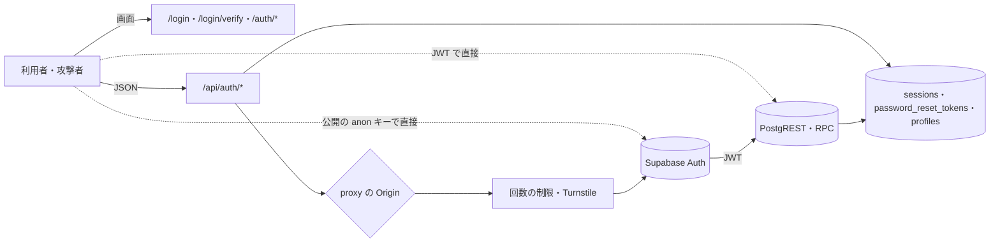

# AUTH の脅威

> 状態: 推定（コードを読んで起こした。ユーザーの確認は未） | 確認日: 2026-11-01 | 対象: ログイン・メール OTP・会員登録・パスワード再設定・Google のログイン・TOTP・ログアウト・トークンの更新・ヘッダー、その裏の Supabase Auth と `sessions`・`password_reset_tokens`・`profiles` の DB | 基準コミット: `973dc336`（読んだのは作業ツリー。本文の `ファイル:行` の行番号は、この基準コミットのコードを指す）

---

## 概要

AUTH（ログインと認証、ヘッダー）の領域で考える脅威を、1つずつ `THR-AUTH-NNN` の項目で書く。過去のセキュリティレビューの指摘と、2026-10-24 にコードと DB の移行を読み直して気づいた点の両方を拾った。

| 項目 | 内容 |
| --- | --- |
| 項目の数 | 35（THR-AUTH-001〜035） |
| 守りがある物 | パスワードと OTP の総当たり（001・002）、OTP だけのログイン（003）、保留の延長（004）、漏洩・短いパスワード（014）、列挙の応答（016）、再設定のリンク（018）、メールの住所の差し替え（019）、パスワード変更・ログアウト後のセッション（020・021）、乗っ取った session でのパスワード変更（034。2026-11-01、波 6 でアプリの窓口を作った。窓口は移行 M3 と切り替えの後に動く）、Cookie の属性（024）、CSRF（025）、ヘッダーの出し分け（028）、応答の本文のトークンとキャッシュ（022。2026-10-28 に proxy の no-store まで直した） |
| 波 5 で塞いだ物 | Supabase Auth を直接呼んでメール OTP を飛ばす（005）と、aal1 の JWT で DB を触る（010）。アプリの窓口は 2026-10-29 に塞いだ（アプリのログインを通った結び付いた session だけを通す。ADR-0417・0419）。DB は移行 M2 を当てた DB で塞がる（ADR-0418。M2 は 2026-10-29 に本番適用済み）。残る危険は、パスワードとメールの受信箱の両方を盗まれ、正規の 2 段を踏まれる場合（会員。管理者は TOTP が上乗せ） |
| 守りが欠ける・弱い物 | メールの確認のリンクの入口（006・007）、TOTP の総当たり（009）、表の権限（011）、回数の制限の IP（013）、直接の登録・変更（015）、トークンを JS に渡す（023）、ログインの後の送り先の open redirect（026。画面は消し、確かめの部品に置き換える作業中）、本番の設定（029）、監査の抜け（030）、会員登録の宛先単位の制限（016）、認証の関数を anon・authenticated が呼べる（012、本番は未確認）、ログアウト時に refresh の Cookie が無いと Supabase のセッションを切らない（021）、初めての TOTP の登録の乗っ取り（031）、戻り先の控えの番号の盗み・使い回し（032。控えを作る作業中）、新しい表・関数に広い権限が自動で付く（033。決まりと試験を足した。試験は手元の DB でまだ流していない） |
| 対策の書き先 | 対策のセキュリティ要件 `SEC-AUTH-NNN` は要件の文書（`docs/02_Requirements/areas/auth.md`）に書く。下の「対策」の欄は読み手のための写し |
| 状態の付け方 | 全部「推定」。実装と過去のレビューから起こし、ユーザーの確認を受けていないため（`.claude/skills/documentation-guide/SKILL.md` の 7）。コードで確かめた物も、本番の設定・ライブラリの既定・推論に頼る物も同じ。どれも実行しての確かめはしていない |

---

## 範囲と根拠

- 範囲: `scripts/trace/scope.json` の AUTH の src（`src/app/login/**`・`src/app/auth/**`・`src/app/api/auth/**`・`src/components/Header.tsx`・`LoginModal.tsx`・`RegisterModal.tsx`・`AuthTabs.tsx`・`AuthResultScreen.tsx`・`src/hooks/useTurnstileWidget.ts`・`src/lib/format-countdown.ts`）
- 範囲の外だが脅威の入口になるので見た物: `src/proxy.ts`（Origin の確かめ・守りの見出し）、`src/features/auth/middleware/rateLimit.ts`・`src/features/auth/ratelimit/index.ts`（回数の制限）、`src/features/auth/services/login-2fa-session.ts`・`password-reset-session.ts`（署名した Cookie）、`src/lib/auth/authenticate.ts`・`request-token.ts`・`admin-rbac.ts`（認証と管理の認可）、`src/lib/cookie.ts`、`src/lib/redirect.ts`、`src/lib/turnstile.ts`、`src/lib/audit.ts`、`src/lib/orders/status/status-session.ts`、`supabase/config.toml`（手元の Supabase Auth の設定）、`supabase/migrations/20260901102912_remote_schema.sql`・`20260921011535_harden_security_definer_search_path.sql`・`20261023175712_group_g0_permissions.sql`（表・RLS・権限・関数）、`node_modules/@supabase/ssr` の Cookie の既定値
- 出どころのレビュー: `docs/05_Quality/reviews/security/security_review_overview.md`・`security_review_login.md`・`security_review_signup.md`・`security_review_auth_callback.md`・`security_review_auth_password_reset.md`・`security_review_auth_verified.md`、`docs/05_Quality/reviews/code/2026-04-18-login-review.md`・`2026-04-18-signup-review.md`・`2026-04-18-auth-security-review.md`・`2026-04-29-login-additional-review.md`。どのレビューも当時の記録で、今の状態は 2026-10-24 にコードを読み直して決めた
- 全体のセキュリティ要件は `docs/02_Requirements/requirements.md` の 5.4 節（NFR-SEC-001〜012・AC-SEC-001）。AUTH に当てはまる物は各項目の根拠に `（範囲外）` を付けて書いた
- ASVS は OWASP ASVS 4.0.3 の項目番号。当てはめに自信の無い物は「（当てはめは推定）」、番号を決められない物は「ASVS 未対応付け」と書いた
- 外した物: Supabase Storage の署名つき URL は AUTH の範囲で使わない（TOTP の QR は data URI で、置き場を通らない。`src/app/auth/verified/page.tsx:318-325`）。署名つき URL に近い「メールのリンクの印」と「署名した Cookie」は THR-AUTH-018・027 で扱う。ヘッダーの自動非表示（`src/components/Header.tsx:84-110`）は見た目の働きで、入力を差し込む面が無い（推定）

### 入口と守りの位置

- 実線の矢印はアプリが用意した道、点線はアプリを通らない道（THR-AUTH-005・010・011・015）
- メール OTP の2段目、Turnstile、16 文字・漏洩の照合、アプリの回数の制限は、どれも `/api/auth/*` の中にだけある。点線の道はこれを通らない
- `GET` の窓口（`/api/auth/confirm`・`/api/auth/oauth/*`・`/api/auth/password-reset/link`）は proxy の Origin の確かめの外（状態を変える方法の `POST`・`PUT`・`PATCH`・`DELETE` だけを見る。`src/proxy.ts:42,147-158`）

---

## 脅威の一覧

### THR-AUTH-001 パスワードの総当たり・リスト型攻撃

| 属性 | 値 |
| --- | --- |
| 守るもの | 会員・管理者・サポーターのアカウント |
| 脅威 | 攻撃者が、よくあるパスワードや他のサイトから漏れたメールとパスワードの組を、ログインの窓口に大量に試す |
| 起こり方 | `/api/auth/login` へ組を送り続ける。IP 単位で 50 回／600 秒、Turnstile を通った後にメール単位で 5 回／600 秒の制限がある（`src/app/api/auth/login/route.ts:12-18,27-44`）。Turnstile は本番で鍵が無ければ断り、本番の外では飛ばす（`src/lib/turnstile.ts:8-14`） |
| 影響 | アカウントの乗っ取り。会員の住所・注文、管理者なら管理の操作に届く（管理は TOTP が別にある） |
| 対策 | SEC-AUTH-001 |
| ASVS | V2.2.1 |
| 根拠 | 守りがある。メール単位の数え方を Turnstile の後に置くのは、他人のメールで枠を使い切らせる締め出しを防ぐため（`login/route.ts:35-37`）。IP の数え方の弱さは THR-AUTH-013、窓口を通らない道は THR-AUTH-005 で扱う。全体の NFR-SEC-008（範囲外）の強いパスワードの方針に当てはめた |
| 状態 | 推定 |
| 出どころ | `docs/05_Quality/reviews/code/2026-04-18-auth-security-review.md`、`docs/05_Quality/reviews/security/security_review_login.md:29-58` |

### THR-AUTH-002 メール OTP の総当たり

| 属性 | 値 |
| --- | --- |
| 守るもの | ログインの2段目（メールの確認コード） |
| 脅威 | パスワードを知った攻撃者が、8 桁のコードを当てるまで試す |
| 起こり方 | `/api/auth/otp/verify` へコードを送り続ける。IP 単位 30 回／600 秒、保留の Cookie の宛先で 5 回／600 秒、上限に当たると保留の Cookie を捨てる（`src/app/api/auth/otp/verify/route.ts:11-17,36-70`）。type は email に固定（`:78-82`） |
| 影響 | 2段目が破られ、パスワードだけでログインされる |
| 対策 | SEC-AUTH-002 |
| ASVS | V2.2.1 |
| 根拠 | 守りがある。過去のレビューは IP 単位しか無いと指摘し（`security_review_login.md:36`）、FREQ-335 で直した。数える宛先を本文ではなく Cookie から取るのは、他人の枠を潰す締め出しを防ぐため（`otp/verify/route.ts:36-38`） |
| 状態 | 推定 |
| 出どころ | `docs/05_Quality/reviews/security/security_review_login.md:36`、`docs/02_Requirements/requirements.md` の FREQ-335 の行 |

### THR-AUTH-003 パスワードを通らずにメール OTP だけでログインする

| 属性 | 値 |
| --- | --- |
| 守るもの | 2段階のログインの順番（パスワード → メール OTP） |
| 脅威 | 被害者のメールを読める攻撃者が、パスワードを知らずにアプリの窓口から OTP だけでログインする |
| 起こり方 | `/api/auth/otp/verify` に、宛先とコードだけを送る。今は「パスワード確認済み」の署名した保留の Cookie が無いと 401（`otp/verify/route.ts:27-34`）。宛先も Cookie から取り、本文の宛先は見ない（`:28`） |
| 影響 | 2段階のうちパスワードの段が消える |
| 対策 | SEC-AUTH-003 |
| ASVS | ASVS 未対応付け |
| 根拠 | アプリの窓口には守りがある。Cookie の署名は HMAC と定数時間の比べ方（`src/features/auth/services/login-2fa-session.ts:82-92`）。同じ迂回をアプリの外で行う道は THR-AUTH-005 で扱う |
| 状態 | 推定 |
| 出どころ | `docs/superpowers/specs/2026-09-04-login-otp-dedicated-screen-design.md`（実装から推定で照らした） |

### THR-AUTH-004 保留の2段目の状態を延ばす・宛先を差し替える

| 属性 | 値 |
| --- | --- |
| 守るもの | 「パスワード確認済み」の保留の状態と、再送のメールの宛先 |
| 脅威 | 攻撃者が保留の Cookie を持ち続け、再送を繰り返して窓を延ばす。または再送の宛先を他人のアドレスに変えて、店のドメインからメールを送らせる |
| 起こり方 | `/api/auth/login/resend` を繰り返す。今は元の iat を引き継ぎ、30 分の絶対上限で切る（`src/app/api/auth/login/resend/route.ts:89-100`、`login-2fa-session.ts:10-15`）。宛先は Cookie からだけ取る（`resend/route.ts:14-18`）。再送の枠はログインと共有（`:34-58`） |
| 影響 | 総当たりの窓が延びる。他人へのメールの踏み台になる |
| 対策 | SEC-AUTH-004 |
| ASVS | V3.3.2 |
| 根拠 | 守りがある（FREQ-336）。30 分は「5 分の期限と 60 秒の待ちで約 5 回の再送」に合わせた値（`login-2fa-session.ts:12-14`） |
| 状態 | 推定 |
| 出どころ | `docs/02_Requirements/requirements.md` の FREQ-336 の行 |

### THR-AUTH-005 アプリを通らず Supabase Auth を直接呼んでメール OTP の2段目を飛ばす

| 属性 | 値 |
| --- | --- |
| 守るもの | 2段階のログイン、会員の情報（`profiles` の氏名・電話・住所）と注文の履歴 |
| 脅威 | 会員のパスワードを知った攻撃者が、公開の anon キーで Supabase Auth を直接呼び、メール OTP を通らずに会員の JWT を得る。メールを読める攻撃者は、パスワード無しの OTP・マジックリンクで JWT を得る |
| 起こり方 | anon キーは画面に配る公開の値。`/auth/v1/token?grant_type=password` を直接呼べば、パスワードだけで access token と refresh token が返る（Supabase Auth の標準の動き）。アプリの認証は JWT の署名・期限・iss・aud と session の生存だけを見て、どの方法でログインしたか（`amr`）を見ない（`src/lib/auth/authenticate.ts:97-108,139,163`）。PostgREST も同じ JWT を受け、`profiles` の本人の行（`supabase/migrations/20260901102912_remote_schema.sql:3691-3710`）と本人の注文（`:3635`）を返す。Turnstile・アプリの回数の制限も通らない |
| 対処の状況 | 波 5 の Task 3（2026-10-29）で、アプリの窓口側は塞いだ。認証の確かめ（`authenticateRequest`）と管理の認可（`admin-rbac` の `checkAuthSessionLiveness`）が、アプリのログインを通った session（自前の `sessions` に GoTrue の `session_id` を残した失効していない行があり、GoTrue 側でも生きている）だけを通す（RPC `is_app_session_active`。旗 `AUTH_REQUIRE_APP_SESSION` が有効な間。既定。ADR-0417・0419）。OTP だけで直に取った通行証も断る（`amr` に `otp` が付くため `amr` では断れない）。更新（`refresh`）は結び付いた行の続きにだけ通し、前の行が無い・`auth_session_id` が空の refresh token は GoTrue を呼ぶ前に 401 にする（結び付いていない session が更新で結び付いた session に洗われるのを防ぐ。SEC-AUTH-005-AC-05）。アプリを通らず任意の session（パスワードだけ・OTP だけ・anon キーで作った物）の通行証で PostgREST の直叩きをする道は、移行 M2（`has_permission` と会員の表の RESTRICTIVE の方針）を当てた DB で塞がる（2026-10-29 に E2E の `test.fail` を外した。M2 は 2026-10-29 に本番適用済み）。本物の `mfa.verify` の前後で `session_id` が変わらないことは本番の前の確認として残る（手元の補助では変わらないと実測した。2026-10-29、Task 0）。残る危険は、パスワードとメールの受信箱の両方を盗まれた攻撃者が正規の 2 段（パスワード → メール OTP）を踏む場合で、会員の 2 段はアプリ独自の方針（NIST の AAL2 ではない）であり防げない。管理者は TOTP が上乗せになる。本人へのログインの通知メールは波 5 の別件。E2E は Task 5（2026-10-29）で書いた（`FR-LOGIN-031`：password grant・OTP だけの通行証が窓口で 401、PostgREST で 0 行（M2 の後）、refresh で洗えない。`FR-LOGIN-030`：本物のログインの session が更新・ログアウトの前後で期待どおり。流すのは controller） |
| 影響 | FREQ-58・FR-LOGIN-007 の「パスワードとメール OTP の2段階」が、アプリの窓口を通る人にしか効かない。パスワードの漏れだけで、会員の個人情報と注文の履歴に届く。管理は aal2 を求めるので守られる（`src/lib/auth/admin-rbac.ts:240-249`）。ただし DB の側は THR-AUTH-010 |
| 対策 | SEC-AUTH-005 |
| ASVS | V4.1.1（当てはめは推定） |
| 根拠 | 2段目の守りがアプリの窓口だけにあり、トークンを出す Supabase Auth の側に無い。2026-10-24 の読み直しで見つけた。実際に直接呼んでの確かめはしていない。本番の Supabase の設定（captcha・回数の制限）も見ていない。全体の NFR-SEC-005（範囲外）・NFR-SEC-008（範囲外）に照らした |
| 状態 | 推定 |
| 出どころ | 実装から推定 |

### THR-AUTH-006 メールの確認のリンクの入口で、パスワードとメール OTP を飛ばす

| 属性 | 値 |
| --- | --- |
| 守るもの | 2段階のログイン |
| 脅威 | 被害者のメールを読める攻撃者が、マジックリンク・メール変更・再設定の型のリンクを `/api/auth/confirm` に通し、パスワードも OTP も無しにアプリの session の Cookie を得る |
| 起こり方 | `/api/auth/confirm` は type に `signup`・`email`・`magiclink`・`recovery` の4つを受け、Supabase で印を確かめたら session を保存する（`src/app/api/auth/confirm/route.ts:8-9,47-48,58-81`）。印は THR-AUTH-005 の直接の呼び出し（`/auth/v1/otp`・`/auth/v1/recover`）でも作れる。2026-10-26 に、`signup` 以外（`email`・`magiclink`・`recovery`・不明な値）の type では `verifyOtp` を呼ばず（印を消費せず）`/login` へ 303 で送るようにした。この行の `confirm/route.ts` の行番号は基準コミット時点の記述 |
| 影響 | メールが読めるだけでログインできる。メール OTP を2段目にした意味が薄れる。ログインのメールの型（`supabase/templates/magic_link.html`）は `{{ .Token }}` だけを使うが、Supabase は型の文を変えても token_hash の道を閉じない（推定） |
| 対策 | SEC-AUTH-006 |
| ASVS | ASVS 未対応付け |
| 根拠 | FREQ-335 はログインの OTP の検証で type を email に固定したが、確認のリンクの入口は4つの型を受けたまま。会員登録の確認に要るのは `signup` だけ（`src/app/api/auth/register/route.ts:155-165`）。 |
| 状態 | 推定 |
| 出どころ | 実装から推定 |

### THR-AUTH-007 他人の端末を攻撃者のアカウントでログインさせる（ログインの CSRF）

| 属性 | 値 |
| --- | --- |
| 守るもの | 利用者がどのアカウントで操作しているか。入力した住所・カード以外の個人情報・お気に入り |
| 脅威 | 攻撃者が自分のアカウントの確認のリンクを被害者に開かせ、被害者の端末を攻撃者のアカウントでログインさせる。被害者は気づかずに住所を保存し、注文する |
| 起こり方 | `/api/auth/confirm` は `GET` で、印が正しければ開いた端末に session の Cookie を書く（`confirm/route.ts:27,56-81`）。開いた人と印を作った人を結ぶ物が無い。`GET` なので proxy の Origin の確かめの外（`src/proxy.ts:147-158`）。Google の戻りは PKCE の検証の Cookie が端末に結ぶので同じ攻撃は通らない（`src/app/api/auth/oauth/start/route.ts:85-98`、`oauth/callback/route.ts:91-106`）。この行の行番号は基準コミット時点の記述。2026-10-26 に、登録の送信で必ず作る控えを「番号 + 登録したメール」のハッシュで結び、`/api/auth/confirm` が session を作る前に、確認した利用者のメールで同じ式を作って控えを使い切るようにした（ADR-0413）。当たらない時は session を作らず、GoTrue 側の session を `signOut({ scope: 'local' })` で失効させ、`/login?registered=1` へ送る。番号だけを結ぶ形では、被害者が自分の登録の途中に攻撃者のメールの確認リンクを同じブラウザで開くと、被害者の有効な Cookie が通ってしまう。メールを式に混ぜたので、別のメールの印では必ず外れる |
| 影響 | 被害者の住所・電話・注文が攻撃者のアカウントに入り、攻撃者が後で読む。ゲストのカートとお気に入りも攻撃者のアカウントへ合わさる（`confirm/route.ts:78-81`）。残る穴: 控えの Cookie の名前に `__Host-` の頭が無いので、同じ親ドメインの別のサブドメインを攻撃者が持つと、攻撃者のメールに結んだ控えを被害者のブラウザへ投げ込めて、攻撃者のメールの印で session を作らせられる（cookie tossing。波 1-A の設計のまま変えていない）。被害者のブラウザに攻撃者のメールで登録を送らせる道は、`proxy.ts` の Origin の確かめと Turnstile に頼っている |
| 対策 | SEC-AUTH-007 |
| ASVS | V4.2.2（当てはめは推定） |
| 根拠 | どのレビューにも無く、2026-10-24 の読み直しで気づいた。実際に開いての確かめはしていない |
| 状態 | 推定 |
| 出どころ | 実装から推定（2026-10-24 の読み直し） |

### THR-AUTH-008 Google でのログインがメール OTP を通らない

| 属性 | 値 |
| --- | --- |
| 守るもの | 2段階のログイン（FR-LOGIN-007） |
| 脅威 | Google のアカウントを乗っ取った攻撃者が、メール OTP 無しで会員としてログインする |
| 起こり方 | `/api/auth/oauth/callback` は Google の code を session に替え、そのまま Cookie を書いて `/account` へ送る（`src/app/api/auth/oauth/callback/route.ts:106-174`）。メール OTP の段は無い。管理者・サポーターは `/auth/verified` で TOTP を求める（`src/app/auth/verified/page.tsx:145-161`） |
| 影響 | 会員は Google の守り（Google 側の2段階）に頼る。管理は aal2 で守られる |
| 対策 | SEC-AUTH-008 |
| ASVS | ASVS 未対応付け |
| 根拠 | FR-LOGIN-007 は「全員がパスワードとメール OTP」と書くが、OTP の専用画面の設計は Google をスコープ外とした（`docs/superpowers/specs/2026-09-04-login-otp-dedicated-screen-design.md:240-247`）。要件と実装のどちらが正しいかは決めていない。ゲスト注文の紐付け（FREQ-265（範囲外））を呼ばない点は機能の食い違いで、脅威ではない |
| 状態 | 推定 |
| 出どころ | 実装から推定 |

### THR-AUTH-009 TOTP の総当たり

| 属性 | 値 |
| --- | --- |
| 守るもの | 管理者・サポーターの3段目（TOTP、aal2） |
| 脅威 | パスワードとメールを手に入れた攻撃者が、6 桁の TOTP を当てるまで試す |
| 起こり方 | `/api/auth/mfa/verify` へコードを送り続ける。制限は IP 単位の 20 回／600 秒だけで、アカウント単位の制限が無い（`src/app/api/auth/mfa/verify/route.ts:21-29`）。失敗は `console.error` だけで監査に残さない（`:73-76`）。IP は偽れる（THR-AUTH-013）。2026-10-26 に、利用者単位の枠（5 回／600 秒。鍵は検証済みの `claims.sub` だけ）を役割の確認の前に足し、成功と失敗を監査に残すようにした。この行の行番号と「監査に残さない」は基準コミット時点の記述 |
| 影響 | 管理の操作に届く（注文・会計・権限の画面） |
| 対策 | SEC-AUTH-009 |
| ASVS | V2.2.1（当てはめは推定） |
| 根拠 | ログインと OTP にはアカウント単位の制限と監査があるのに、TOTP だけに無い。Supabase Auth 側の検証の回数の制限は、アプリのサーバーの IP にかかるので、攻撃者ごとには効かない（推定）。全体の NFR-SEC-005（範囲外）に照らした |
| 状態 | 推定 |
| 出どころ | `docs/05_Quality/reviews/security/security_review_auth_verified.md:30-` |

### THR-AUTH-010 TOTP を済ませていない管理者の JWT で DB を直接触る

| 属性 | 値 |
| --- | --- |
| 守るもの | 管理の権限で読み書きできる表（注文・明細・商品・ルック・ニュース・取扱店・会計など） |
| 脅威 | 管理者・サポーターのパスワード（とメール）を手に入れた攻撃者が、TOTP を通らない `aal1` の JWT で、アプリの窓口を通らず PostgREST から表を読み書きする |
| 起こり方 | THR-AUTH-005 の直接の呼び出しで `aal1` の JWT を得る。RLS の `has_permission` は ACL の表だけを見て JWT の `aal` を見ない（`supabase/migrations/20261023175712_group_g0_permissions.sql:186-216`。移行のどこにも `aal` の字が無い）。例: 注文の読み書きの方針（`20260901102912_remote_schema.sql:3640-3658`）。2026-10-29（波 5 の Task 6）に、移行 M2 `sec_has_permission_aal2_member_rls`（2026-10-29 に本番適用済み）を書いた。`has_permission` の本体に「`aal` が `aal2`」と「結び付いた生きた session」（ADR-0417・0418）を足し、これを使う約 100 の方針が書き換えなしで従う。`has_permission` を使わず `auth.uid() = user_id` で本人の行を返す `profiles`・`orders`・`order_items` には、結び付いた生きた session を求める RESTRICTIVE の方針を足す。M2 を当てるまで、この穴は開いたまま。当てた瞬間に、結び付いていない session は DB で 0 行・権限なしになり、旗では戻せない（戻すのは移行の ROLLBACK）。残る危険: パスワードとメールの受信箱の両方を盗まれた攻撃者がアプリの正規のログインを踏む場合（管理者は TOTP が上乗せ） |
| 影響 | 管理の TOTP（FREQ-540（範囲外））の守りが、アプリの窓口だけになる。パスワードの漏れだけで、全会員の注文の読み出しや改ざんに届く。直接の書き換えはアプリの監査にも残らない |
| 対策 | SEC-AUTH-010 |
| ASVS | V4.3.1 |
| 根拠 | 管理の窓口は aal2 を求める（`src/lib/auth/admin-rbac.ts:240-249`）が、同じ守りが DB に無い。NEWS の THR-NEWS-002 と同じ根で、aal2 を出す窓口（`/api/auth/mfa/verify`）が AUTH にあるので AUTH でも書く。注文まわりの作り直しが移行を書き換え中で、方針の行はずれうる。実際に叩いての確かめはしていない |
| 状態 | 推定 |
| 出どころ | 実装から推定（2026-10-24 の DB の移行の読み直し）、`docs/05_Quality/security/threats/news.md` の THR-NEWS-002 |

### THR-AUTH-011 認証の表の権限が広く、RLS の拒否だけで守っている

| 属性 | 値 |
| --- | --- |
| 守るもの | `sessions`（refresh token のハッシュ）、`password_reset_tokens`（再設定の印のハッシュ）、`rate_limit_counters`、`audit_logs`、`profiles` |
| 脅威 | anon・会員の JWT で PostgREST から表を読み書きし、再設定の印やセッションの記録を盗む・消す、回数の数を消す、監査を消す |
| 起こり方 | 5つの表とも anon・authenticated に、TRUNCATE・TRIGGER・REFERENCES・MAINTAIN を含む全部の権限を付けたまま（`remote_schema.sql:4142,4184,4190,4192,4200`、数の連番 `:4082`）。今は RLS の「anon・authenticated は全部拒む」方針で塞ぐ（`:3313-3330,3661-3677,3712-3728,3747-3763`）。`profiles` は本人の行だけを許す（`:3691-3710`）。**2026-10-26 に直した**: 移行 `sec_grants_hardening` が5つの表と連番の権限を anon・authenticated から全部外し（RLS の全拒否の方針は残す）、`profiles` は anon の権限を全部、authenticated の TRUNCATE・REFERENCES・TRIGGER・MAINTAIN を外した。service_role の権限は明示で付けた |
| 影響 | 方針を1つ消す・書き間違えるだけで全部が開く。TRUNCATE は RLS を受けない（PostgREST からは出せないが、権限としては残る） |
| 対策 | SEC-AUTH-011 |
| ASVS | V4.1.3 |
| 根拠 | 守りは RLS の1段だけ。表の権限は Supabase の既定のまま。NEWS の THR-NEWS-021 と同じ形。全体の NFR-SEC-005（範囲外）・NFR-SEC-011（範囲外）（監査の改ざん防止）に照らした |
| 状態 | 推定 |
| 出どころ | 実装から推定 |

### THR-AUTH-012 直接の RPC で会員の有無を調べる・他人のセッションを切る

| 属性 | 値 |
| --- | --- |
| 守るもの | 会員の有無、他人のセッション、回数の制限の数、再設定の印の掃除 |
| 脅威 | anon・会員の JWT で、認証の関数を PostgREST の RPC として直接呼ぶ |
| 起こり方 | `find_auth_user_id_by_email`・`revoke_auth_session`・`revoke_auth_sessions_for_user`・`is_auth_session_active`・`increment_rate_limit_counter`・`cleanup_password_reset_tokens` を呼ぶ。移行は6つとも PUBLIC から外し、postgres・service_role に許す（`remote_schema.sql:3926-3928,3956-3958,3968-3978,4000-4006`）が、Supabase の既定の権限が anon・authenticated に直接付けた EXECUTE は外していない。移行から作った手元の DB では、6つとも anon・authenticated が呼べる。`has_permission` だけは anon から外した（`20260921011535_harden_security_definer_search_path.sql:92`）。満たさない点は SEC-AUTH-012 に書いた |
| 影響 | 開くと、メールで会員の有無を調べられ（列挙）、他人を締め出せ、回数の制限を水増し・消費できる |
| 対策 | SEC-AUTH-012 |
| ASVS | V4.1.3 |
| 根拠 | 開いていれば、公開の anon の鍵だけで会員の有無の列挙・他人のセッションの失効・回数の水増しができる。権限を確かめる単体テスト `tests/unit/migrations/092_lock_down_rpc_surface.test.ts` がある（中身は未確認）。本番の `proacl` は未確認 |
| 状態 | 推定 |
| 出どころ | 実装から推定（2026-10-24 の DB の移行の読み直し） |

### THR-AUTH-013 回数の制限を IP の偽り・窓の境目で越える、全員を止める

| 属性 | 値 |
| --- | --- |
| 守るもの | 総当たり（001・002・009）と踏み台（004・016）の守り、ログインの使える状態 |
| 脅威 | 攻撃者が送り元の IP を偽って IP 単位の制限を越える。または Supabase Auth 側の IP の枠を使い切り、全員のログインを止める |
| 起こり方 | 直した点（2026-10-28、波 4 の Task 2）: 送り元は共有の `getClientIp`（`src/lib/request-ip.ts`）が Vercel の見出し（`x-vercel-forwarded-for`→`x-real-ip`）だけから取る。以前は `x-forwarded-for` の先頭、無ければ `x-real-ip` から無条件に取っていた（`rateLimit.ts`）。Turnstile に渡す IP も同じ関数（`login/route.ts`、`password-reset/request/route.ts`、`register/route.ts`）。取れない時の鍵は `null` で、全員が 1 つの枠になる（厳しい側）。429・503 には `Cache-Control: no-store` を付ける。残る点: 窓は時刻で切った固定の枠で、境目で最大2倍通る（`rateLimit.ts`）。数えの DB の失敗は制限の部品が自分で捕まえて 503 で断る（`rateLimit.ts`）。直した点（2026-10-28、波 4 の Task 4）: 以前は各窓口が `await import()` した制限の部品の呼び出しを `try/catch` で囲み、例外を記録だけして先へ進んでいた（`Rate limit middleware error ...`。`src/app/api/auth/` の 14 窓口・19 か所）ので、読み込みや呼び出しが落ちるとログイン・OTP・TOTP・再設定の守りが無いのと同じになっていた。先頭の静的な `import` に替えて `try/catch` を外し、呼び出しが投げたら窓口は先へ進まず 5xx で断る。Supabase Auth は全部の呼び出しをアプリのサーバーの IP から受けるので、Supabase 側の IP の枠（手元は `supabase/config.toml:196-208`）は全員で共有になる（推定）。確かめ（2026-10-28、波 4 の Task 5）: E2E の送り元の分け方を `x-real-ip` に書き換え（AUTH 系 13 ファイルと共通の補助）、`FR-LOGIN-035` の SEC-AUTH-013-AC-01 は固定の `x-real-ip` に毎回変える `x-forwarded-for` を付けて 31 回目が 429 になることを見る（`test.fail` の印を外した。E2E の実行は波 4 の最後の確認） |
| 影響 | IP 単位だけの窓口（TOTP・確認のリンク・トークンの更新）の総当たりの守りが消える。Supabase 側の枠を使い切られると、正しい利用者もログイン・登録できない |
| 対策 | SEC-AUTH-013 |
| ASVS | V2.2.1（当てはめは推定） |
| 根拠 | 制限が DB に届かない時は 503 で断る（`rateLimit.ts`、ADR-0009（範囲外））。送り元は Vercel の見出しだけを信じ、`x-forwarded-for` は読まない（ADR-0416）。Vercel が `x-vercel-forwarded-for`・`x-real-ip` を上書きすることは未確認で（本番はまだデプロイしていない。最初の preview で実測する）、前段に別の中継を置く時は段数の設計が要る。過去のレビューの X-05。NEWS の THR-NEWS-010 と同じ根 |
| 状態 | 推定 |
| 出どころ | `docs/05_Quality/reviews/security/security_review_overview.md:40` |

### THR-AUTH-014 漏洩済み・短いパスワードを使わせる

| 属性 | 値 |
| --- | --- |
| 守るもの | 会員のアカウント |
| 脅威 | 利用者が他のサイトで漏れたパスワードや短いパスワードを使い、リスト型攻撃で破られる |
| 起こり方 | 会員登録とパスワード再設定で弱いパスワードを入れる。今は 16 文字以上・UTF-8 で 72 バイト以内（`src/features/auth/schemas/common.ts:33`。72 バイトは GoTrue の上限。2026-11-01 追加）、構成の決まり無し、HIBP の k-匿名で照合（`register/route.ts:122-132`、`password-reset/confirm/route.ts:98-111`）。照合先が落ちた時は止めずに監査に残す |
| 影響 | THR-AUTH-001 の成功率が上がる |
| 対策 | SEC-AUTH-014 |
| ASVS | V2.1.1、V2.1.7、V2.1.9 |
| 根拠 | アプリの窓口には守りがある（FREQ-323）。照合先が落ちた時に通すのは、外の障害で登録を止めない判断（推定、ADR の候補）。アプリを通らない道は THR-AUTH-015。全体の NFR-SEC-008（範囲外）に当てはめた |
| 状態 | 推定 |
| 出どころ | `docs/02_Requirements/requirements.md` の FREQ-323 の行 |

### THR-AUTH-015 アプリを通らない会員登録・パスワード変更で、パスワードの決まりと Turnstile を飛ばす

| 属性 | 値 |
| --- | --- |
| 守るもの | パスワードの決まり（16 文字・漏洩の照合）、会員登録のボット対策 |
| 脅威 | 攻撃者が anon キーで `/auth/v1/signup` を直接呼んで、ボットで大量に登録する。乗っ取った session で `/auth/v1/user` を直接呼び、再認証なしにパスワードを変える。同じ道でアカウントのメールを自分の宛先に差し替え、その後に再設定して乗っ取りを続ける |
| 起こり方 | 手元の Supabase は 2026-11-01（切り替えの日。手元だけ）まで、登録を許し（`supabase/config.toml:175,220`）、最小の長さ 6・構成の決まり無し（`:181,184`）、captcha は無効（`:213-216`）、パスワード変更に再認証を求めなかった（`secure_password_change = false`、`:227`）。波 6 の切り替えで、最小の長さ 16（構成の決まりは課さない）・captcha（Turnstile）・`secure_password_change` を有効にした（`supabase/config.toml`）。24 時間以内の session には再認証が要らず、この窓は設定で変えられない。「現行パスワードの要求」は Supabase CLI の `config.toml` に鍵が無く手元で設定できない。メールの差し替えに新旧両方の確認を求める設定（`double_confirm_changes`）は手元では true（`:223`）、本番は未確認。アプリの 16 文字・HIBP・Turnstile・回数の制限は `/api/auth/register` と再設定の中にだけある |
| 影響 | 短いパスワードの会員ができる。ボットの登録で店のドメインからメールが出る。乗っ取った人がパスワードやメールを変えて本人を締め出す |
| 対策 | SEC-AUTH-015 |
| ASVS | V2.1.1、V2.1.7、V3.7.1 |
| 根拠 | 守りがアプリの窓口だけにある。本番のダッシュボードの値は見ていない。Supabase の漏洩の照合は Pro 以上でしか使えない（`register/route.ts:122-123` のコメント） |
| 状態 | 推定 |
| 出どころ | 実装から推定 |

### THR-AUTH-016 会員登録・再設定でアカウントの有無を知られる、メールの踏み台にされる

| 属性 | 値 |
| --- | --- |
| 守るもの | 誰が会員かという情報、店のメールの評判 |
| 脅威 | 攻撃者が任意のメールを会員登録・再設定に送り、応答の違いで会員かどうかを調べる。他人の宛先へ店のドメインからメールを送らせる |
| 起こり方 | 会員登録は登録済みでも同じ 202 を返し、本人にだけメールで知らせ、送信を応答の外（`after`）に出す（`register/route.ts:12-39,147-152`）。この「すでに登録されています」の通知はアプリが自分で送り、回数の制限は偽れる IP 単位の 20 回／時（`register/route.ts:47`）と Turnstile だけで、宛先単位の制限が無かった。ログインと再設定には宛先単位の制限がある。そのため既存の会員へ店のドメインからメールを送り続けられた。2026-10-26 に、Turnstile と漏洩の確かめの後（控えの作成と既存会員の照会の前）に、検証済みの小文字のメールを subject にした 5 回／時の枠を足した。再設定は有無によらず 200 で、アカウントが無ければ送らない（`password-reset/request/route.ts:71-79,141-145`）。ただし再設定は、アカウントがある時だけ DB に2回書いてから返す（`:79-113`）ので、応答の時間に差が出うる（推定）。2026-11-01 から、未確認の会員がもう一度登録すると、「すでに登録されています」の代わりに確認メールを送り直す（応答は同じ 202。SEC-AUTH-016-AC-04）。他人が先に登録した未確認のアカウントでも、送り直しで確定するのは先に登録した人のパスワードなので、本人が確定のリンクを開くと、先に登録した人がそのパスワードを知るアカウントになる（先回りの乗っ取り）。本人が別のパスワードで登録し直しても最初のパスワードは変わらず、確定の後に入れなくなるので、確認メールの雛形に「最初に登録したときのパスワードをお使いください。思い出せない場合はパスワードの再設定から」の 1 行を全員に同じ文で入れた（有無は明かさない。2026-11-01）。毎回のログインに本人の受信箱へのメール OTP が要り、DB は結び付いた session を求める（ADR-0418）ので、パスワードだけでは入れない |
| 影響 | 会員を狙った標的型の詐欺メール、漏れた組の絞り込み、既存の会員への通知のメールの連打 |
| 対策 | SEC-AUTH-016 |
| ASVS | ASVS 未対応付け |
| 根拠 | 公開の道の応答の中身には守りがある（FREQ-320）。会員登録の宛先単位の制限は、2026-10-26 までは無かった（`register/route.ts:47,147-151`。基準コミット時点）。登録の 201 の分岐は Confirm email が OFF の時だけ通り、その時は新規と既存で応答が変わる（`register/route.ts:181-191`、THR-AUTH-029）。管理の経路の 409 は THR-AUTH-017（2026-10-26 に枝ごと削除） |
| 状態 | 推定 |
| 出どころ | `docs/05_Quality/reviews/security/security_review_signup.md:57`、`docs/02_Requirements/requirements.md` の FREQ-320 の行 |

### THR-AUTH-017 管理の登録の経路が公開の窓口に同居する

| 属性 | 値 |
| --- | --- |
| 守るもの | 会員の作成の権限、会員の有無 |
| 脅威 | 管理の鍵 `ADMIN_API_KEY` を推測・漏洩で得た攻撃者が、公開の窓口から会員を作り、409 で有無を調べる |
| 起こり方 | `/api/auth/register` は `x-admin-token`（または Bearer）があれば管理の作成に切り替える（`register/route.ts:53-102`）。鍵は `!==` で比べ定数時間でない（`:64`）。Turnstile・漏洩の照合を通らず、登録済みなら 409（`:91-94`）。src から呼ぶ所は無く、テストだけが使う。2026-10-26 に、この枝（管理の鍵の確認・`createUser`・401・500・409）を削除し、`x-admin-token`・Bearer を付けても公開の登録として扱うようにした。本番の環境変数 `ADMIN_API_KEY` の削除は運用で行う（`src` から読む所は無くなった）。上の行番号は基準コミット時点の記述 |
| 影響 | 鍵が漏れると、ボット対策も列挙対策も無い登録の窓が開く |
| 対策 | SEC-AUTH-017 |
| ASVS | ASVS 未対応付け |
| 根拠 | 過去のレビューが「管理と公開が同じ窓口」と指摘し、今も同じ（`security_review_signup.md:59`）。管理のユーザー作成は別の窓口 `/api/admin/create-user`（範囲外）にある |
| 状態 | 推定 |
| 出どころ | `docs/05_Quality/reviews/security/security_review_signup.md:59` |

### THR-AUTH-018 パスワード再設定のリンクの漏れ・使い回し

| 属性 | 値 |
| --- | --- |
| 守るもの | パスワード再設定のリンクの印と、アカウント |
| 脅威 | メールの転送・端末の履歴・リンクの検査の仕組みからリンクを得た攻撃者が、パスワードを変える。前に使った・古いリンクを使い回す |
| 起こり方 | 印は 32 バイトの乱数で、DB にはハッシュだけを置く（`password-reset/request/route.ts:92-106`）。期限 10 分（`:15-17`）、新しく出すと前の印を無効にする（`:80-90`）。リンクを開いた時は消費せず、パスワードを変えた時に1回だけ消費する（`password-reset/link/route.ts:28-58`、`confirm/route.ts:113-135`）。全部の応答に `Referrer-Policy: no-referrer`（`src/proxy.ts:235`） |
| 影響 | アカウントの乗っ取り |
| 対策 | SEC-AUTH-018 |
| ASVS | V2.5.6、V2.7.2 |
| 根拠 | 守りがある（FREQ-319・332）。消費を遅らせるのは、企業のリンクの検査が先に踏んで印を潰すのを防ぐため（`link/route.ts:28-34`）。使われなかった印の行を掃除する関数 `cleanup_password_reset_tokens` はあるが、呼ぶ所が無い（`remote_schema.sql:1378,3926-3928`。台帳の W-06 で後回し）。行はハッシュで、期限の切れた印は通らないので害は小さい（推定） |
| 状態 | 推定 |
| 出どころ | `docs/05_Quality/reviews/security/security_review_auth_password_reset.md:30-34`、`docs/05_Quality/reviews/code/2026-09-25-working-diff-security-review.md:306` |

### THR-AUTH-019 メールのリンクの住所を差し替える

| 属性 | 値 |
| --- | --- |
| 守るもの | 確認・再設定のメールのリンクの行き先と、その中の印 |
| 脅威 | 攻撃者が要求の Host・`x-forwarded-host` を偽り、店のメールの中のリンクを攻撃者のサイトへ向けて印を盗む |
| 起こり方 | 会員登録・再設定は要求から作った住所でリンクを作る（`register/route.ts:116,155`、`password-reset/request/route.ts:52,118`）。今は許可の一覧に無い住所なら送らない（`register/route.ts:117-120`、`request/route.ts:53-57`） |
| 影響 | 再設定の印の窃取によるアカウントの乗っ取り |
| 対策 | SEC-AUTH-019 |
| ASVS | ASVS 未対応付け |
| 根拠 | 守りがある（FREQ-509（範囲外）、波1 の J-17 で直した）。結合テストが `x-forwarded-host` の許可を試す（`tests/integration/api/auth/confirm.test.ts:157,170`、`site-url-guard.test.ts:51-97`） |
| 状態 | 推定 |
| 出どころ | `docs/superpowers/plans/2026-10-23-launch-fixes-wave1.md:150` |

### THR-AUTH-020 パスワードを変えた後も盗まれたセッションが残る

| 属性 | 値 |
| --- | --- |
| 守るもの | 乗っ取りからの立ち直り |
| 脅威 | セッションを盗んだ攻撃者が、本人がパスワードを変えた後もログインを続ける |
| 起こり方 | 再設定の完了で、自前の `sessions` と Supabase の全部のセッションを切る（`password-reset/confirm/route.ts:23-50,156`）。切るのに失敗しても成功で返し、`console.error` だけに残す（`:39-49`）。本人に変更を知らせる（`:170-183`） |
| 影響 | 失効に失敗すると、攻撃者のセッションが残る |
| 対策 | SEC-AUTH-020 |
| ASVS | V3.3.3 |
| 根拠 | 守りがある。失敗でも成功を返すのは、パスワードは既に変わっていて 500 の方が利用者に不利だから（`confirm/route.ts:27-28`） |
| 状態 | 推定 |
| 出どころ | `docs/05_Quality/reviews/code/2026-04-18-auth-security-review.md` |

### THR-AUTH-021 ログアウトしてもサーバーのセッションが残る

| 属性 | 値 |
| --- | --- |
| 守るもの | ログアウトした後のアカウント |
| 脅威 | 共有の端末や盗まれた refresh token で、ログアウトの後もログインを続ける |
| 起こり方 | ログアウトは JWT の session_id で Supabase のセッションを切り、取れなければ利用者の全部のセッションを切る（`src/app/api/auth/logout/route.ts:19-79`）。ただし refresh の Cookie が無い時はサーバーのセッションを切らない（ADR-0407）。Cookie は必ず消し、常に 200（`:8-9`）。ログインの1段目のパスワードの確認でも Supabase のセッションが1つできるが、使わずに捨て、切らない（`login/route.ts:46-49`。応答に出さないので害は無いと推定） |
| 影響 | 失効しないと、refresh token が期限まで使える |
| 対策 | SEC-AUTH-021 |
| ASVS | V3.3.1 |
| 根拠 | 通常の道は守りがある（FREQ-514（範囲外）の AC-03）。refresh の Cookie が無い時はサーバーのセッションを切らない（SEC-AUTH-021 は一部満たさない）。トークンの更新は自前の表の失効の印も見る（`refresh/route.ts:44-58`） |
| 状態 | 推定 |
| 出どころ | `docs/05_Quality/reviews/security/security_review_login.md`の 6 |

### THR-AUTH-022 トークン・秘密を JS が読める所に出す、応答がキャッシュに残る

| 属性 | 値 |
| --- | --- |
| 守るもの | access token、Supabase の利用者の記録、TOTP の秘密 |
| 脅威 | 画面に差し込まれたスクリプトが応答の本文からトークンを盗む。共有の端末・中継のキャッシュに応答が残る |
| 起こり方 | トークンの更新の応答の本文に access token と利用者の記録（`src/app/api/auth/refresh/route.ts:101`）、公開の会員登録の 201 に access token（`register/route.ts:191`）、OTP の検証の応答に Supabase の利用者の記録のまるごと（`otp/verify/route.ts:89-95`）を入れる。TOTP の登録は秘密と URI を返す（`mfa/enroll-totp/route.ts:141-152`）。2026-10-26 に、更新の成功の本文は `{ ok: true }`、OTP の検証の成功の本文は `{ user: { id, email, role }, message }` だけにした（登録の 201 の本文も 2026-10-26 に `{ user: { id, email } }` だけにした）。以前は、これらと、ログイン・TOTP の確認・MFA の状態の応答に `Cache-Control: no-store` が無かった（`me` と再設定の link・確認のリンクには付けていた。`me/route.ts:12-17`、`password-reset/link/route.ts:21-26`、`confirm/route.ts:19-24`）。2026-10-28 に、共有の `src/proxy.ts` が `/api/auth` 配下の全部の応答（Origin 拒否の 403 も）に `no-store` を付けるようにして塞いだ（ADR-0415、DD-AUTH-037）。`/api/auth/me` の応答からメールの住所は 2026-10-26 に外した（`id`・役割・`mfaVerified` だけ。SEC-HOME-016・SEC-PRIVACY-016） |
| 影響 | Cookie を HttpOnly にした守りが、応答の本文で崩れる。秘密がキャッシュに残る |
| 対策 | SEC-AUTH-022 |
| ASVS | V8.2.1 |
| 根拠 | 過去のレビューが「登録の 201 で access token を返す」「トークンの応答に no-store が無い」と指摘した（`security_review_signup.md:56`、`security_review_login.md:38`）。TOTP の秘密は登録に要るので出すこと自体は避けられない。全体の NFR-SEC-009（範囲外）に照らした |
| 状態 | 推定 |
| 出どころ | `docs/05_Quality/reviews/security/security_review_signup.md:56`、`docs/05_Quality/reviews/security/security_review_login.md:38` |

### THR-AUTH-023 Google でのログインが JS から読める Cookie にトークンを書く

| 属性 | 値 |
| --- | --- |
| 守るもの | Google でログインした会員の access token と refresh token |
| 脅威 | 画面に差し込まれたスクリプトが Cookie からトークンを盗む |
| 起こり方 | Google の開始と戻りは `@supabase/ssr` の client を使い、client が書く Cookie をそのまま応答に移す（`oauth/start/route.ts:84-98,119-121`、`oauth/callback/route.ts:90-104,154-156`）。Cookie の属性を渡していないので、ライブラリの既定（`httpOnly: false`、`node_modules/@supabase/ssr/dist/main/utils/constants.js`）になる。戻りで code を session に替えると、ライブラリが session を Cookie に書く（推定） |
| 影響 | アプリの Cookie（`sb-access-token`・`sb-refresh-token`）は HttpOnly なのに、同じトークンが読める Cookie にも残る（推定） |
| 対策 | SEC-AUTH-023 |
| ASVS | V3.4.2 |
| 根拠 | どのレビューにも無く、2026-10-24 の読み直しで気づいた。ブラウザで Cookie を見ての確かめはしていない |
| 状態 | 推定 |
| 出どころ | 実装から推定（2026-10-24 の読み直し） |

### THR-AUTH-024 認証の Cookie の属性が弱い

| 属性 | 値 |
| --- | --- |
| 守るもの | access token・refresh token・保留の2段目・再設定の Cookie |
| 脅威 | スクリプト・平文の通信・別のサイトからの送信で Cookie を盗む・使う |
| 起こり方 | `src/lib/cookie.ts:18-45,72-88` が HttpOnly・本番で Secure・SameSite（トークンは Lax、保留の2段目と再設定は Strict）を付ける。CSRF の印の Cookie だけは画面が読むので HttpOnly でない（`:48-55`） |
| 影響 | トークンの窃取、別のサイトからのなりすましの送信 |
| 対策 | SEC-AUTH-024 |
| ASVS | V3.4.1、V3.4.2、V3.4.3 |
| 根拠 | 守りがある。結合テストが属性を試す（`tests/integration/api/auth/cookieFlags.test.ts:72,100,151`）。Secure は `NODE_ENV` が production の時だけ |
| 状態 | 推定 |
| 出どころ | 実装から推定 |

### THR-AUTH-025 状態を変える認証の窓口への CSRF

| 属性 | 値 |
| --- | --- |
| 守るもの | ログイン・ログアウト・TOTP・再設定の操作 |
| 脅威 | 攻撃者のサイトが被害者のブラウザから認証の窓口へ送信させる |
| 起こり方 | `/api` の `POST`・`PUT`・`PATCH`・`DELETE` は proxy が Origin（無ければ Referer）を許可の一覧と比べる（`src/proxy.ts:22-27,147-158,165-203`）。許可の一覧が設定されていない時は、要求の `x-forwarded-proto`・`x-forwarded-host`・`host` から比べる元を作る（`:135-145,185-202`）。ログアウトだけは CSRF の印も確かめる（`logout/route.ts:100-115`） |
| 影響 | 被害者の TOTP の登録の操作や、再設定の完了の送信 |
| 対策 | SEC-AUTH-025 |
| ASVS | V4.2.2 |
| 根拠 | 守りがある（FREQ-327）。過去のレビューの X-03（`/api/auth/*` が Origin の保護の外）は今は直った（`security_review_overview.md:38`）。`GET` の窓口のログインの CSRF は THR-AUTH-007 |
| 状態 | 推定 |
| 出どころ | `docs/05_Quality/reviews/security/security_review_overview.md:38`、`docs/05_Quality/reviews/security/security_review_auth_verified.md:30` |

### THR-AUTH-026 ログインの後の送り先を使った open redirect

| 属性 | 値 |
| --- | --- |
| 守るもの | 利用者（ログインの後に偽のサイトへ送られない） |
| 脅威 | 攻撃者が `/auth/callback?next=//攻撃者のサイト` や、`next`・`redirect_to` にタブ文字を混ぜたリンク（`/%09/evil.example`）を配り、店のサイトを経由して偽のサイトへ送る |
| 起こり方 | 2 つの穴があった。(1) 画面 `/auth/callback` は `next` が `/` で始まるかだけを見て、ログイン済みなら `router.replace(next)` で送るので、`//` で始まる値が通る。(2) 共有関数 `sanitizeRedirectPath` は `//`・`\` を断るが、タブ・改行を含む値を断らず、ブラウザがタブを取り除いて外の住所として読む（`/%09/evil.example`）。確認のメールのリンク・Google の開始と戻り・登録の 4 つの窓口がこの関数を使っていた |
| 影響 | 店のドメインを信じた利用者が偽のログイン画面に入力する |
| 対策 | SEC-AUTH-026、SEC-AUTH-032 |
| ASVS | V5.1.5 |
| 根拠 | 過去のレビューの X-02 が Open のまま残っていた。画面はどこからも呼ばれない（Google の戻り先は `/api/auth/oauth/callback`）が、URL を直接開けば動く。2026-10-25 のユーザーの決定で、画面は消し、共有関数は戻り先の確かめの部品 1 つに置き換え、行き先は URL の値ではなくサーバーに控えた戻り先で決める（ADR-0412） |
| 状態 | 推定 |
| 出どころ | `docs/05_Quality/reviews/security/security_review_overview.md:37`、`docs/05_Quality/reviews/security/security_review_auth_callback.md:30-31`、`.superpowers/sdd/2026-10-25-security-gap-fixes/wave1a-decisions.md` |

### THR-AUTH-027 1つの鍵で複数の署名を兼ねる

| 属性 | 値 |
| --- | --- |
| 守るもの | 保留の2段目の Cookie、再設定の Cookie、注文の状況のセッション |
| 脅威 | 1つの鍵が漏れると、3つの印を全部偽れる。用途を取り違えた印を別の窓口に通す |
| 起こり方 | 専用の鍵が無い時、3つとも `JWT_SECRET` で署名する（`login-2fa-session.ts:27`、`src/features/auth/services/password-reset-session.ts:18`、`src/lib/orders/status/status-session.ts:33`）。payload の `purpose` で用途を分けるので取り違えは断る（`login-2fa-session.ts:97`、`password-reset-session.ts:82`、`status-session.ts:112`） |
| 影響 | 鍵が漏れると、パスワード無しで2段目の保留を作る・他人のパスワードを変える |
| 対策 | SEC-AUTH-027 |
| ASVS | ASVS 未対応付け |
| 根拠 | 取り違えは防げているが、鍵の漏れの影響が広い。本番の環境変数に専用の鍵があるかは未確認（本番は未デプロイ）。全体の NFR-SEC-009（範囲外）に当てはめた |
| 状態 | 推定 |
| 出どころ | 実装から推定 |

### THR-AUTH-028 画面の表示だけで管理の入口を出し分ける

| 属性 | 値 |
| --- | --- |
| 守るもの | 管理の画面と操作 |
| 脅威 | 一般の会員が画面の判定を書き換え、ヘッダーの MANAGE・LOADING や `/auth/verified` の管理の流れを出して管理の操作に入る |
| 起こり方 | ヘッダーは `/api/auth/me` の役割で MANAGE・LOADING を出し分ける（`src/components/Header.tsx:79,203-217,340-367`）。`/auth/verified` も役割で振り分ける（`src/app/auth/verified/page.tsx:137-169`）。役割は JWT の `app_metadata`（利用者が書き換えられない）から読む（`me/route.ts:40`） |
| 影響 | 画面に入口が出るだけで、操作はサーバーで断られる（推定） |
| 対策 | SEC-AUTH-028 |
| ASVS | V4.1.1 |
| 根拠 | 守りがある。表示は飾りで、管理の窓口は `admin-rbac` が DB の ACL と aal2 で判定する（`admin-rbac.ts:178,240-249`）。役割を `user_metadata` から読むと利用者が書き換えられるので、`app_metadata` から読むことを守りとして残す |
| 状態 | 推定 |
| 出どころ | 実装から推定 |

### THR-AUTH-029 本番の Supabase Auth の設定が守りの前提と違う

| 属性 | 値 |
| --- | --- |
| 守るもの | メール OTP の期限、列挙対策、TOTP、パスワードの決まり |
| 脅威 | ダッシュボードの設定の漏れで、コードの守りの前提が崩れる |
| 起こり方 | コードは、OTP の期限 300 秒（`login-2fa-session.ts:5-8`）、Confirm email が ON（`register/route.ts:181-184`）、TOTP が使えること、8 桁のコードを前提にする。手元の設定は 2026-11-01（切り替えの日。手元だけ）まで、OTP 3600 秒（`supabase/config.toml:234`）、確認なし（`:225`）、TOTP の登録・確認が無効（`:307-309`）、最小の長さ 6（`:181`）、captcha 無効（`:213-216`）だった。波 6 の切り替えで、OTP 300 秒・確認あり・TOTP 有効・最小の長さ 16・captcha 有効にそろえた（`supabase/config.toml`） |
| 影響 | 確認なしなら登録の応答で会員の有無が分かり（THR-AUTH-016）、access token を本文で返す（THR-AUTH-022）。OTP が長く生きる。手元の E2E・結合の結果は本番の前提を確かめていない |
| 対策 | SEC-AUTH-029 |
| ASVS | ASVS 未対応付け |
| 根拠 | 本番のダッシュボードの値を見ていない。台帳の開店の準備にあるのは Site URL と 8 桁のコードの型だけ（`docs/05_Quality/reviews/code/2026-09-25-working-diff-security-review.md:268,287`）。保留の Cookie が 5 分なので、OTP の使える窓は Cookie で 5 分に絞られる（推定） |
| 状態 | 推定 |
| 出どころ | 実装から推定 |

### THR-AUTH-030 認証の出来事が監査に残らない

| 属性 | 値 |
| --- | --- |
| 守るもの | 不正の気づきと、後からの追跡 |
| 脅威 | 攻撃者の試行や成功が監査に残らず、気づけない |
| 起こり方 | ログイン・OTP・登録・再設定・ログアウト・トークンの更新は `logAudit` に残す。TOTP の確認は成功も失敗も監査に残さず（`mfa/verify/route.ts:73-76,83-123`。残すのは保存の失敗だけ `:115-120`）、TOTP の登録も残さない（`mfa/enroll-totp/route.ts:31-157`）。2026-10-26 に、確認と登録の成功・失敗を `mfa_verify`・`mfa_enroll`（取り外しは `mfa_factor_remove`）で残すようにした。再設定の後の失効の失敗も `console.error` だけ（`password-reset/confirm/route.ts:39-49`）。監査の書き込みの失敗は警告だけで握りつぶす（`src/lib/audit.ts:67-70,87-89`） |
| 影響 | TOTP の総当たり（THR-AUTH-009）や管理の要素の差し替えに気づけない |
| 対策 | SEC-AUTH-030 |
| ASVS | V7.1.3 |
| 根拠 | 全体の NFR-SEC-005（範囲外）・NFR-SEC-011（範囲外）に当てはめた。監査は個人情報を伏せてから書く（`audit.ts:48`） |
| 状態 | 推定 |
| 出どころ | 実装から推定 |

### THR-AUTH-031 管理者・サポーターの初めての TOTP の登録を先に取られる

| 属性 | 値 |
| --- | --- |
| 守るもの | 管理者・サポーターの3段目（TOTP、aal2）と、その先の管理の操作 |
| 脅威 | 管理者・サポーターのパスワードを手に入れた攻撃者が、持ち主より先に自分の認証アプリを TOTP として登録し、aal2 になる |
| 起こり方 | `/api/auth/mfa/enroll-totp` は認証と役割（admin・supporter）だけを見て、aal を見ない（`src/app/api/auth/mfa/enroll-totp/route.ts:51-66`）。確かめ済みの TOTP が無ければ aal1 のトークンだけで登録でき（`:74-115`）、`/auth/verified` も TOTP の無い管理者に自動で登録させる。aal1 のトークンは Supabase Auth を直接呼ぶ password grant で得られ、メール OTP も要らない（THR-AUTH-005）。持ち主が登録の途中で残した未確認の要素も、同じ aal1 で外せる（`:99-104`）。2026-10-26 に局所の守りを足した: 通行証の `amr` に 2 段目を通った方法が無ければ 403 で断り、監査に残す。残った穴だった、Supabase Auth へ OTP だけを直接送って得た通行証（`amr` に `otp` が付く）が通ることは、2026-10-29（波 5 の Task 3）に塞いだ。認証の確かめがアプリのログインを通った結び付いた session だけを通すので、`enroll-totp` はその通行証に 401 を返し、`mfa_enroll`（`denied`、`app_session_required`）を監査に残す（SEC-AUTH-031-AC-02。旗が有効な間）。本人へのメールの通知は残る |
| 影響 | 攻撃者の認証アプリで aal2 になり、管理の操作（注文・会計・権限の画面）に届く（`src/lib/auth/admin-rbac.ts:240-249` は aal2 だけを見る）。持ち主は後から自分の TOTP を登録できない |
| 対策 | SEC-AUTH-031 |
| ASVS | ASVS 未対応付け（初めての登録の経路を直接扱う項目が無い） |
| 根拠 | THR-AUTH-009 は確かめの総当たり、THR-AUTH-030 は監査だけで、初めての登録の道を扱う項目が無かった。TOTP の無い管理者がいる間は、パスワードだけで管理に届く |
| 状態 | 推定 |
| 出どころ | 実装から推定（2026-10-24 の見直しで気づいた） |

### THR-AUTH-032 戻り先の控えの番号の盗み・使い回し・総当たり

| 属性 | 値 |
| --- | --- |
| 守るもの | ログイン直後の行き先と、その控え（戻り先の道筋と、控えを引く番号） |
| 脅威 | 他人の控えの番号を盗む。番号を総当たりで当てる。別の端末で使う。使い終えた番号を使い回す。ログインの用途（login）と登録の用途（signup）の控えを取り違える |
| 起こり方 | 番号が URL・応答の本文・ログ・Referer に出ると、盗まれる。番号が短いか予測できると、当てられる。表に番号そのものがあると、DB を読めた人が使える。使った後も残ると、2 回使える。ログアウトの後も Cookie が残ると、共用の端末で次の人のログインに前の人の戻り先が使われる。同じ親ドメインの別のサブドメインや平文の通信から `sb-return-intent` を差し込まれると、被害者が攻撃者の控えを使う形になる（残る危険。戻り先は許可した内部の頁に限るので影響は小さい） |
| 影響 | 利用者が意図しない頁へ送られる（戻り先は内部の頁に限るので、外のサイトへは出ない。SEC-AUTH-026）。他人の戻り先の道筋（検索条件など）が読まれる |
| 対策 | SEC-AUTH-032（128 ビット以上の乱数・HttpOnly・SameSite=Lax・表にはハッシュだけ・1 回で使い切る・短い期限・ログアウトで消す。ADR-0412） |
| ASVS | V3.2・V5.1.5・V8.3 |
| 根拠 | 2026-10-25 のユーザーの決定で、戻り先をサーバーに控え、番号だけを渡すことにした。控えと番号を新しく持つので、その扱いの脅威を考える |
| 状態 | 推定 |
| 出どころ | `.superpowers/sdd/2026-10-25-security-gap-fixes/wave1a-decisions.md` |

### THR-AUTH-033 新しい表・関数に広い権限が自動で付き、権限の一覧が見張られていない

| 属性 | 値 |
| --- | --- |
| 守るもの | 公開スキーマ（`public`）の表・列・関数・連番の権限、とくに anon・authenticated が持つ書き込み・TRUNCATE |
| 脅威 | 次の移行が新しい表や関数を作った時に、権限を明示せず、Supabase の既定で anon・authenticated に全権限が付いたままになる。権限を締めた移行の後で、別の移行が黙って広い権限を足し戻す |
| 起こり方 | 公開スキーマの表は、作った時に anon・authenticated・postgres・service_role へ8権限が全部付く（`remote_schema.sql` の GRANT）。`ALTER DEFAULT PRIVILEGES` は0件。移行の書き手が REVOKE と GRANT を書き忘れても、移行は通る。権限の一覧を確かめる試験が無いと、表の権限が RLS の1段目の門として働いているかを、だれも見ない。Supabase 公式も、既定の権限は project ごとに違い、自動で付く権限は外される方向だと案内する（Hardening the Data API） |
| 影響 | 新しい表で RLS の方針を書き違えただけで、anon の鍵から行を読み・書き・消せる。TRUNCATE は RLS を受けない。気づくのが本番に出た後になる |
| 対策 | SEC-AUTH-033（移行が GRANT・REVOKE を明示する決まり。権限の一覧と歯止めを DB 結合テストで守る。ADR-0414、DATA-AUTH-006） |
| ASVS | V4.1.3 |
| 根拠 | 波 2 が表の権限を締めても、決まりと試験が無いと次の移行で戻る。設計書 I8 が「権限の一覧を見張る試験と、GRANT を明示する決まり」を求めた。他領域の表（会計・問い合わせ・注文・カート・権限）の広い権限はこの波で直さず、試験の既知の例外に載せる |
| 状態 | 推定 |
| 出どころ | `.superpowers/sdd/2026-10-25-security-gap-fixes/design-final.md` の I8、`.superpowers/sdd/2026-10-25-security-gap-fixes/wave2-decisions.md` |

### THR-AUTH-034 乗っ取った session でパスワードを変えられ、本人が締め出される

| 属性 | 値 |
| --- | --- |
| 守るもの | 会員のパスワードと、会員が持つ session の主導権 |
| 脅威 | session（アクセストークン）を盗んだ人が、現行パスワードを知らないままパスワードを変えて、本人を締め出し、居座る。現行パスワードを推測できる人が、変更の窓口で試行を繰り返す。コードのメールを本人の受信箱へ撒く。変更の後も、盗まれた session が生き残る |
| 起こり方 | アプリにパスワード変更の窓口が無く、変える道は Supabase の `/auth/v1/user` を直接呼ぶ道（SEC-AUTH-015）だけだった。GoTrue の `secure_password_change` は、session の作成から 24 時間以内なら再認証なしで変えるのを許し、その窓は設定で変えられない。新しく窓口を作る時は、現行パスワードの確かめ（`start`）が総当たりの窓口になりうる。確認コードは 8 桁（10 の 8 乗通り）で、使い捨て・試行の上限・session への結び付けが無いと破られる |
| 影響 | 本人がログインできなくなり、注文の履歴・配送先などの個人情報を盗まれ続ける。盗まれた session が残ると、パスワードを変えても居座られる |
| 対策 | SEC-AUTH-034（`start` で現行パスワードを確かめ、メールの 8 桁のコードを今の session に結んで 10 分・使い捨て・5 回の誤りで使えなくする。`confirm` は書式と漏洩の照合の後にコードを使い切り、変更の後に全 session を失効し、認証の Cookie を消し、通知する。本人ごと 10 分 5 回・IP ごと 20 回。管理者・サポーターは aal2。監査に固定の符号だけ。ADR-0421、DD-AUTH-041、DATA-AUTH-009・010）。GoTrue 側も `secure_password_change`・現行パスワードの要求・変更の通知・最小長 16 を有効にする（SEC-AUTH-015） |
| ASVS | V2.1.5、V2.1.6、V2.2.3、V3.3.3 |
| 根拠 | 残る危険は、現行パスワードを知る人が GoTrue を直に叩いて変えることだけ。ただしログインにメールのコードが要るので、パスワードだけを盗まれても入れず、実害は小さい。メールの受信箱とパスワードの両方を盗まれた場合は、正規の 2 段を踏まれるのでアプリでは止められない。会員の 2 段（パスワード＋メール）は NIST SP 800-63B-4 の AAL2 ではなく、アプリ独自の方針である |
| 状態 | 推定 |
| 出どころ | `.superpowers/sdd/2026-10-25-security-gap-fixes/wave6-decisions.md`（パスワードの変更）、`docs/superpowers/plans/2026-11-01-wave6-captcha-password-change-config.md`（Task 5・7、Review Focus 3〜6） |

### THR-AUTH-035 Supabase の captcha の拒否が利用者の誤りに紛れ、全員が入れない・登録できない故障が見えない

| 属性 | 値 |
| --- | --- |
| 守るもの | ログインと会員登録の可用性、故障の検知 |
| 脅威 | Supabase の captcha をオンにした後、アプリのサーバーの呼び出しが管理者として免除されなくなる（鍵の種類の違い、GoTrue の挙動の変更）。Supabase は 400 `captcha_failed` を返すが、アプリがこれを資格情報の誤り（401）や重複（202）に丸めると、全員が入れなくなっても誤りの表示と監査の内訳が普通の失敗と見分けられない |
| 起こり方 | `login` は `signInWithPassword` の `error` を全部 401 にする。`register` は `already`・`duplicate` の文を重複として 202 にする。免除は公式の文書に無い GoTrue の挙動で、アプリのサーバーが持つ鍵が管理者として扱われるかは、設定を切り替えて初めて分かる |
| 影響 | 本番の captcha をオンにした瞬間に、全利用者がログイン・登録できなくなる。監視に上がらず、気付くのが遅れる |
| 対策 | SEC-AUTH-035（captcha の拒否を `isCaptchaRejection` で見分け、5xx と監査 `supabase_captcha_rejected`。auth だけの client を毎回作り、DB に使い回さない。ADR-0420、DD-AUTH-040） |
| ASVS | V2.2.1（当てはめは推定） |
| 根拠 | Supabase の captcha を有効にして直の呼び出しを塞ぐ（SEC-AUTH-015）ための、アプリ側の前提。塞ぐ側の副作用として、アプリの呼び出しが免除されなくなる故障が生まれる |
| 状態 | 推定 |
| 出どころ | `docs/superpowers/plans/2026-11-01-wave6-captcha-password-change-config.md`（Review Focus 2・9） |

### THR-AUTH-036 店員のパスキーの表や窓が書き換えられ、店員でない人が管理の入口の条件を満たす

| 属性 | 値 |
| --- | --- |
| 守るもの | 管理の入口（パスキーを2本以上持つ店員だけが入る）、登録の窓、認めたパスキーの控え |
| 脅威 | 会員や外の人が、認めたパスキーの控え・登録の窓・設定の行を直に書き換える。または他人のセッションの窓を自分の物として開ける。認めの行が、鍵が消えた後も数に入り続ける |
| 起こり方 | PostgREST から表・関数を直に叩く。`passkey_window_open` に他人の `session_id` を渡す。引き金が動かない道（`TRUNCATE`・`DISABLE TRIGGER`）で鍵だけを消す |
| 影響 | 鍵を持たない人が「認めたパスキー2本」の条件を満たして管理に入る。他人のセッションに鍵を足される |
| 対策 | SEC-AUTH-036（表は `private` で権限なし・関数は `service_role` だけ・窓は持ち主とセッションを合わせる・数は鍵が実在する分だけ。ADR-0464、DD-AUTH-043） |
| ASVS | V4.1.3（当てはめは推定） |
| 根拠 | 設計 5-2・5-5 の「アプリが認めたパスキーだけ数える」が、表の権限と数え方で崩れると、管理の入口の3つ目の条件が飾りになる。引き金が動かない道は設計の残る危険に書いてある |
| 状態 | 推定 |
| 出どころ | `docs/superpowers/specs/2026-11-07-passkey-auth-design.md`（5-2・5-5・10） |

### THR-AUTH-037 フックが壊れて全員のログインが止まる、または壊れた入力を店員がすり抜ける

| 属性 | 値 |
| --- | --- |
| 守るもの | 全員のログインと更新（トークンの発行）、店員の入口 |
| 脅威 | Custom Access Token フックの関数が例外を投げ、トークンが出せなくなる。逆に、壊れた入力（`user_id` が不正・`claims` や `amr` の形が違う）を「お客さん」として通し、店員がパスキー無しで入る。会員や外の人がフックの関数を直に呼ぶ |
| 起こり方 | GoTrue が壊れた形の `event` を渡す。関数の誤りや表の欠け（設定の行が無い）。PostgREST からフックの関数を叩く |
| 影響 | 全員が締め出される（店の入口が止まる）。または、店員の締め付けが飾りになる |
| 対策 | SEC-AUTH-037（例外を投げない・店員か判らなければ拒否・`supabase_auth_admin` だけに `execute`。ADR-0464、DD-AUTH-044） |
| ASVS | V4.1.3（当てはめは推定） |
| 根拠 | 設計 5-2。フックはトークンを出す全部の道で走るので、故障の影響が全員に及ぶ。本番へは有効にする前に手元で試し（段3）、有効にした後に壊れた時は設定でフックを外す手順を運用に持つ |
| 状態 | 推定 |
| 出どころ | `docs/superpowers/specs/2026-11-07-passkey-auth-design.md`（5-2・10）、`docs/superpowers/plans/2026-11-16-passkey-stage1a-foundation.md`（Task 5、Review Focus 3） |

---

### THR-AUTH-038 鍵が消されたのに認めの控えが残る、または足し・消しが記録されない

| 属性 | 値 |
| --- | --- |
| 守るもの | 認めたパスキーの数え方（管理の入口の3つ目の条件）、店長への知らせ |
| 脅威 | 鍵を GoTrue の窓口・直叩きで消した・差し替えたのに、認めの控えが残り、管理の入口の数が実際より多く見える。または、足し・消しの記録が無く、乗っ取りに気づけない。引き金を止める・outbox を壊す |
| 起こり方 | 店員や外の人が GoTrue を直に叩く。表の持ち主か superuser が `TRUNCATE`・`DISABLE TRIGGER`・`session_replication_role = replica` を使う。outbox への書き込みが落ちる |
| 影響 | 管理の権限が実際の鍵より多く見える（ただし数え方が実在の鍵（`id`・`user_id`・`credential_id` が同じ物）と突き合わせるので、消された鍵と `credential_id` が変わった鍵は数えず防げる。`public_key` だけの変更を引き金の迂回で通された場合は、手作業で認めの行を消すまで数えられる）。知らせの取りこぼし |
| 対策 | SEC-AUTH-038（引き金で認めの行を消す・数え方の突き合わせ・outbox の失敗を握る。ADR-0465、DD-AUTH-045） |
| ASVS | V7.1.1・V4.1.3（当てはめは推定） |
| 根拠 | 設計 5-4。引き金は GoTrue の表に付くので、GoTrue の更新で消える・本番で作れない恐れがある（設計 8-2 の3、未確認） |
| 状態 | 推定 |
| 出どころ | `.superpowers/sdd/2026-11-16-passkey-stage1a-foundation/task-6-brief.md`、`docs/superpowers/specs/2026-11-07-passkey-auth-design.md`（5-4・8-2）、`docs/superpowers/plans/2026-11-16-passkey-stage1a-foundation.md`（Task 6、Review Focus 4・5） |

### THR-AUTH-039 認めた鍵が消された後も、JWT の印のせいで管理の権限が残る

| 属性 | 値 |
| --- | --- |
| 守るもの | 管理の入口の3つ目の条件（認めたパスキーが2本以上）、管理の機能と管理の表 |
| 脅威 | 認めた鍵が消された（または差し替えられた）後も、JWT の `staff_passkeys_ok` が真のまま残り、判定が印を信じて管理の権限が続く。または、印を偽った JWT で通ろうとする |
| 起こり方 | 店員のアカウントを奪った人が、GoTrue を直に叩いて認めた鍵を消す・差し替える。店員が鍵を無くして店長が消す。JWT の期限（最長1時間）の間、印は変わらない |
| 影響 | 条件を満たさない店員（認めた鍵が2本未満）が、最長1時間、管理の機能と管理の表を使える |
| 対策 | SEC-AUTH-039（印を判定に使わず、判定のたびに DB で数える。ADR-0463、DD-AUTH-047） |
| ASVS | V4.1.3・V3.3.1（当てはめは推定） |
| 根拠 | 設計 5-2 の3つ目の条件の変更（オーナー決定 2026-11-16）。JWT は署名されていても、中身は出した時の値で古くなる |
| 状態 | 推定 |
| 出どころ | `.superpowers/sdd/2026-11-16-passkey-stage1a-foundation/task-8-brief.md`、`docs/superpowers/specs/2026-11-07-passkey-auth-design.md`（5-2・12 の18・12-2 の8）、`docs/superpowers/plans/2026-11-16-passkey-stage1a-foundation.md`（Task 8、Review Focus 1・2・5） |

### THR-AUTH-040 切り替えの後、管理の入口にパスキー以外の抜け道が残る

| 属性 | 値 |
| --- | --- |
| 守るもの | 管理の入口の3つの条件（パスキー・24時間以内・認めたパスキー2本以上）、管理の機能と管理の表 |
| 脅威 | `has_permission`・`admin-rbac` の切り替えで `aal2` の枝を置き換えた後も、パスワード・メールのコード・TOTP の通行証、または JWT の `aal`・印の偽装で、管理の機能・管理の表に入れる |
| 起こり方 | 店員のパスワードやメールを奪った人が、GoTrue を直に叩いて通行証を取る。`aal2` の JWT・`staff_passkeys_ok: true` の claims を作る。お客さんが管理の表を読もうとする |
| 影響 | 条件を満たさない人が、管理の機能と管理の表を使える |
| 対策 | SEC-AUTH-040（`aal` を見ない・印を信じない・フックが店員のパスワード・メールのコードを拒否する・数えられなければ閉じる）、SEC-AUTH-039、ADR-0463・ADR-0464、DD-AUTH-048 |
| ASVS | V4.1.3・V3.3.1・V2.8（当てはめは推定） |
| 根拠 | 設計 5-2。切り替えは1つのコミットで行い、試験の道具も同時に作り直して、抜け道が無いことを E2E・結合・単体で確かめる |
| 状態 | 推定 |
| 出どころ | `.superpowers/sdd/2026-11-16-passkey-stage1a-foundation/task-9-brief.md`、`docs/superpowers/specs/2026-11-07-passkey-auth-design.md`（5-2・12 の18）、`docs/superpowers/plans/2026-11-16-passkey-stage1a-foundation.md`（Task 9、Review Focus 1〜3） |

### THR-AUTH-041 旗を切っている間に、認めていない鍵で入った session で管理 API を使い続けられる

| 属性 | 値 |
| --- | --- |
| 守るもの | 管理の入口の3つ目の条件（認めたパスキーが2本以上）と、5-5（アプリで認めた鍵だけ）、管理の API |
| 脅威 | 条件1の `amr` の `passkey` は、どの鍵で入ったかを区別せず、条件3は認めた鍵の本数を数えるだけ。認めていない鍵で入った session を止めているのは「アプリに結び付いた session だけ通す」決まりだが、API がこの決まりを旗 `AUTH_REQUIRE_APP_SESSION` に頼ると、旗が切れている間は止まらない（RLS の `has_permission` は旗に関係なく止める） |
| 起こり方 | 障害の手当てで旗を切っている間に、店員の session が盗まれる。盗んだ人がその session で GoTrue に自分の鍵を直に登録し、その鍵で GoTrue に直にログインして、新しい `passkey` の `amr` を毎日作り直す。認めた鍵は本人の2本のまま数えられる |
| 影響 | API は service role でデータを読むので RLS に止められず、24時間の上限を越えて、管理 API を使い続けられる |
| 対策 | SEC-AUTH-039。`admin-rbac` は旗に関わらず結び付いた生きた session を求める（`checkAuthSessionLiveness(session_id, true)`。ADR-0463）。旗の手順書には「店員がいる間は旗を切らない」を足す |
| ASVS | V3.3.1・V4.1.3（当てはめは推定） |
| 根拠 | 段1a の最終レビュー I-4。DB の `has_permission` が常に `app_session_is_live` を求めるのと同じにそろえた。旗を切った時に効かなくなるのは、旗の対象の一般の窓口だけ |
| 状態 | 推定 |
| 出どころ | `.superpowers/sdd/2026-11-16-passkey-stage1a-foundation/final-review.md`（I-4）、`docs/03_BasicDesign/decisions/ADR-0463-staff-entry-by-passkey-conditions.md` |

### THR-AUTH-042 古い認めの行が黙って効かない、登録の窓の中の認めが同時に呼ばれて上限を超える

| 属性 | 値 |
| --- | --- |
| 守るもの | 5-5（アプリで認めた鍵だけ。窓の免除は最初の2本まで）、認めの表 `private.approved_passkeys` |
| 脅威 | (1) 同じ `passkey_id` の認めの行が別の `credential_id` で残ると、1a の `passkey_approve` は黙って何もせず、窓口は認めたつもりで先へ進むが、鍵は数えに入らない（突き合わせで外れる）。(2) 登録の窓の中で、2つの接続が同時に「今は1本」と数えて別々の新しい鍵を認めると、上限（2本）を超えた鍵が認められる |
| 起こり方 | (1) 引き金を迂回して鍵の `credential_id` を書き換えた異常の時だけ当たる（窓口は新しい `passkey_id` だけを認めるため）。(2) 窓の中の店員が同時に2つの登録を終わらせる、または窓が開いたまま要求を重ねる |
| 影響 | (1) 認めたはずの鍵で入れない・原因が見えない。(2) 窓の免除の「最初の2本まで」が破れ、窓の中で3本目以降を認められる |
| 対策 | SEC-AUTH-041（古い行は `23505` で失敗させる・窓の認めは利用者ごとの取引の錠の中で数え直し、上限以上なら `55000`）、DD-AUTH-050 |
| ASVS | V4.2.1・V11.1.4（当てはめは推定） |
| 根拠 | 段1b の Task 1。数えてから足すまでの間を錠で1つにし、失敗を窓口の 500 と監査で見えるようにした |
| 状態 | 推定 |
| 出どころ | `.superpowers/sdd/2026-11-17-passkey-stage1b-server-endpoints/task-1-brief.md`、`docs/superpowers/specs/2026-11-07-passkey-auth-design.md`（5-5） |

### THR-AUTH-043 始めの窓口が、IP の添え書き無し・古い鍵・本番に残った開発用の IP で GoTrue を呼ぶ

| 属性 | 値 |
| --- | --- |
| 守るもの | 5-1（始め (a)）の GoTrue の回数の制限をお客さんごとに掛けること、4-2（本番の環境の見張り） |
| 脅威 | (1) 添え書き無し・`sb_secret_` でない鍵で呼ぶと、全員が1つの IP として数えられ、1人の失敗が全員の制限になる、または制限が効かない。(2) 開発用の IP が本番に残ると、全員が同じ IP になる。(3) 利用者の入力が GoTrue への本文・ヘッダーに混ざる。(4) 鍵・トークンが誤りの文やログに残る |
| 起こり方 | 本番の鍵が JWT の形のまま、環境変数の設定ミス、開発の設定のコピー、GoTrue の誤りの本文に鍵が含まれる |
| 影響 | ログインの始めが全員で止まる、または回数の制限が効かず総当たりの足場になる。鍵が漏れる |
| 対策 | SEC-AUTH-042（鍵の形の確かめ・添え書きの付け方・開発用の IP の三重の条件・環境の見張り・打ち切り・誤りの文の掃除）、DD-AUTH-051 |
| ASVS | V2.2.1・V7.1.1（当てはめは推定） |
| 根拠 | 段1b の Task 2。設計 5-1・4-2 |
| 状態 | 推定 |
| 出どころ | `.superpowers/sdd/2026-11-17-passkey-stage1b-server-endpoints/task-2-brief.md`、`docs/superpowers/specs/2026-11-07-passkey-auth-design.md`（5-1・4-2） |

### THR-AUTH-044 条件を満たさない店員が、行き先・戻り先の判定をすり抜けて `/admin` に着く

| 属性 | 値 |
| --- | --- |
| 守るもの | 5-2・6-2（管理の入口はパスキー・24時間・認めた2本） |
| 脅威 | (1) 行き先の判定が古い `aal2` のままだと、パスキーで入った店員は `aal` が `aal1` のままなので、いつも 2 段目に送られて入れない。または逆に、TOTP の `aal2` だけで `/admin` へ送られる。(2) 戻り先に `/admin` を入れた控えで、条件を飛ばして `/admin` へ着く。(3) 型の合わない JWT の値（文字列の時刻・文字列 `"true"`）を「満たす」と読み違える。(4) Google・メールのリンクの戻りが店員を `/admin` へ送る |
| 起こり方 | 判定の置き換え漏れ、呼び手が `viewer` の形を誤る、JWT の型の確かめ漏れ |
| 影響 | 条件を満たさない店員が管理の画面の骨組みへ着く（データは管理の窓口と RLS が DB で数えて止める）。条件を満たす店員が入れない |
| 対策 | SEC-AUTH-043（`claims` だけから `evaluateStaffEntry` で出す・型の合わない値は偽・出口の確かめは `staffEntryOk` が真の店員だけ・`oauth/callback`・`confirm` は常に偽）、DD-AUTH-054 |
| ASVS | V4.1.1・V3.3.1（当てはめは推定） |
| 根拠 | 段1b の Task 5。設計 5-2・6-2 |
| 状態 | 推定 |
| 出どころ | `.superpowers/sdd/2026-11-17-passkey-stage1b-server-endpoints/task-5-brief.md`、`docs/superpowers/specs/2026-11-07-passkey-auth-design.md`（5-2・6-2） |

### THR-AUTH-045 UV の無い応答・`id` と `rawId` の食い違い・認めていない鍵で、店員がログインの終わりをすり抜ける

| 属性 | 値 |
| --- | --- |
| 守るもの | 5-3（UV の門）・5-5（認めたパスキー）・6-2（管理の入口は認めた鍵2本） |
| 脅威 | (1) UV の印の無い応答（PIN・生体を求めない鍵）で入る。(2) 認めた鍵の `id` に、直に足した（認めていない）鍵の `rawId`・署名を付けて、認めの確かめを避ける。(3) GoTrue を直に叩いて足した鍵で、店員がアプリのセッションを作る。(4) 拒否した後も、GoTrue のセッションが生きてトークンが渡る。(5) 失敗の本文の違いで、鍵の有無・登録の有無を調べられる |
| 起こり方 | ブラウザが `userVerification: required` を無視する・応答を改ざんする・GoTrue を直に叩いて鍵を足す・アプリが `id` で引き GoTrue が `rawId` で引く食い違い |
| 影響 | 認めていない鍵で管理の入口に近づく。不要な生きたセッションが残る。鍵の有無が漏れる |
| 対策 | SEC-AUTH-044（UV の門・`id` と `rawId` の一致・`rawId` で認めを引く・認めていない鍵のセッションを終わらせる・理由を分けない本文）、DD-AUTH-055 |
| ASVS | V2.8.1・V4.1.1・V3.3.1（当てはめは推定） |
| 根拠 | 段1b の Task 6。設計 5-1・5-3・5-5 |
| 状態 | 推定 |
| 出どころ | `.superpowers/sdd/2026-11-17-passkey-stage1b-server-endpoints/task-6-brief.md`、`docs/superpowers/specs/2026-11-07-passkey-auth-design.md`（5-1・5-3・5-5） |

### THR-AUTH-046 窓が閉じた後・認めた鍵が2本ある店員・結び付かないセッションで、パスキーの登録をすり抜けて鍵を認めさせる

| 属性 | 値 |
| --- | --- |
| 守るもの | 5-5（認めたパスキー）・6-1・6-2（登録の窓）・10（窓の免除は最初の2本まで） |
| 脅威 | (1) 始めの後に窓が閉じる・期限が来ても、終わりで再確認しないと鍵が足される。(2) メールのコードを読めた人が、窓の残りの30分で3本目を認めさせる。(3) 旗 `AUTH_REQUIRE_APP_SESSION` を切った間に、結び付かないセッションで鍵を認めさせる。(4) 別の人・別のセッションの窓を使い回す。(5) 認めが落ちて、GoTrue にだけ鍵が残る（本人は使える鍵を足したつもりになる）。(6) 認めた鍵が0本の店員（お客さんのパスキーで入ってから店員に上げられた人など）が、5分以内のパスキーでの入り直しだけで鍵を認めさせる（認めた鍵を既に持つ店員だけが入り直しで足せる。0本の店員は窓だけ）。(7) 5分より古いパスキーでの入り直しや、10分より古い・Google だけのお客さんの入り方で登録する |
| 起こり方 | 始めだけで確かめる・窓の免除に本数の上限が無い・店員の確かめが旗に従う・認めの書き込みの失敗を無視する |
| 影響 | 認めていない・不要な鍵が管理の入口の鍵として数えられる、または使えない鍵が残る |
| 対策 | SEC-AUTH-045（始め・終わりの両方で条件をやり直す・窓の免除は2本未満の間だけ・店員は旗に関わらず結び付いた生きたセッション・認めが落ちたら鍵を消す）、DD-AUTH-056 |
| ASVS | V3.3.1・V4.1.1・V2.2.1（当てはめは推定） |
| 根拠 | 段1b の Task 7。設計 5-5・6-1・6-2・10 |
| 状態 | 推定 |
| 出どころ | `.superpowers/sdd/2026-11-17-passkey-stage1b-server-endpoints/task-7-brief.md`、`docs/superpowers/specs/2026-11-07-passkey-auth-design.md`（5-5・6-1・6-2・10）、`docs/superpowers/plans/2026-11-17-passkey-stage1b-server-endpoints.md`（Task 7） |

### THR-AUTH-047 窓口を使って店員の認めた鍵を2本未満に減らす・他人の鍵の有無を探る・一覧から鍵の値が漏れる

| 属性 | 値 |
| --- | --- |
| 守るもの | 5-4（パスキーの管理）・5-5（認めたパスキー）・6-2（削除で2本を切る時は止める） |
| 脅威 | (1) 盗まれたセッションや誤操作で、店員の認めた鍵を1本以下に減らす。(2) 他人の鍵の `id` を送り、404 と他の応答の差で鍵の有無を探る。(3) GoTrue の一覧の応答に公開鍵・`credential_id` が入り、窓口がそのまま返す。(4) 同時の2つの削除で下限をすり抜ける |
| 起こり方 | 削除の止めが画面だけにある・GoTrue の誤りを分けて返す・一覧の応答をそのまま写す・確かめと削除が別の取引 |
| 影響 | 管理の入口が閉じる（店員が入れない）、他人の鍵の有無が分かる、鍵の値が出る |
| 対策 | SEC-AUTH-046（サーバーの止め・404 のそろえ・許可リスト方式）、DD-AUTH-057。同時の削除は受け入れる（下回った店員は入口で止まり、引き金の知らせが出る） |
| ASVS | V4.1.1・V4.2.1・V7.4.1（当てはめは推定） |
| 根拠 | 段1b の Task 8。設計 5-4・5-5・6-2 |
| 状態 | 推定 |
| 出どころ | `.superpowers/sdd/2026-11-17-passkey-stage1b-server-endpoints/task-8-brief.md`、`docs/superpowers/specs/2026-11-07-passkey-auth-design.md`（5-4・5-5・6-2）、`docs/superpowers/plans/2026-11-17-passkey-stage1b-server-endpoints.md`（Task 8） |

### THR-AUTH-048 拒否された店員の更新の後に、セッションが生きたまま残る

| 属性 | 値 |
| --- | --- |
| 守るもの | 5-2（更新の拒否）・5-5（認めたパスキー） |
| 脅威 | 登録の窓が閉じた・認めた鍵が2本未満になった・パスキーでの入り直しが24時間を過ぎた店員の更新がフックに拒否された後、アプリが Cookie だけを消すと、`auth.sessions` と `public.sessions` の行が残り、前のアクセストークンが最長1時間、`/api/auth/me` やお客さんの機能で使われ続ける |
| 起こり方 | 拒否と一時の不調を区別せず Cookie を消すだけにする・終わらせる処理の失敗を無視して Cookie を残す |
| 影響 | 期限の切れた店員のセッションが残り、画面の表示（`mfaVerified: false`）と「ログイン状態」が食い違う。セッションの数を数える段3の土台が崩れる |
| 対策 | SEC-AUTH-047（印つきの403だけ終わらせる・終わらせる処理が落ちても Cookie を消して 401）、DD-AUTH-058。管理の入口は24時間の条件で別に止まる（1a） |
| ASVS | V3.3.1・V3.3.2（当てはめは推定） |
| 根拠 | 段1b の Task 9。設計 5-2 |
| 状態 | 推定 |
| 出どころ | `.superpowers/sdd/2026-11-17-passkey-stage1b-server-endpoints/task-9-brief.md`、`docs/superpowers/specs/2026-11-07-passkey-auth-design.md`（5-2）、`docs/superpowers/plans/2026-11-17-passkey-stage1b-server-endpoints.md`（Task 9） |

### THR-AUTH-049 メールのコードのログイン・新規の窓口で、登録の有無を探られる・確定を総当たりされる・他人のアドレスで送信の枠を使い切られる

| 属性 | 値 |
| --- | --- |
| 守るもの | 設計 6-1（メールのコードのログイン）・SEC-AUTH-016（列挙の対策） |
| 脅威 | (1) 始めの応答の差（状態・本文・Cookie・時間）で、アドレスの登録の有無や店員かどうかが分かる。(2) Turnstile を通した誰かが、他人のアドレスの保留の Cookie を取り、8桁のコードを総当たりする。(3) 他人のアドレスで始めを繰り返し、本人の送信の枠を使い切る・本人のコードを上書きする。(4) 作っただけで一度も入らないアカウントが溜まる。(5) 旧の登録で未確認のアドレスに先にパスワードを付けた人が、サーバーの確認済みの扱いでログインできてしまう |
| 起こり方 | 登録済みなら別の応答にする・確定の枠を宛先だけで数える・サーバーで未確認のアカウントを確認済みにする |
| 影響 | アドレスの列挙、他人のアカウントの乗っ取り、本人のログインの妨害 |
| 対策 | SEC-AUTH-048（応答を同じにする・確認済みのパスワード無しのアカウントを本人の確かめに使わない）、SEC-AUTH-049（保留の Cookie ごとと宛先ごとの枠・使い切ったら閉じる・始めと再送で同じ枠）、DD-AUTH-059。未確認の旧の登録はサーバーで確認済みにしない |
| ASVS | V2.2.1・V2.5.2・V3.3.2（当てはめは推定） |
| 根拠 | 段2 の Task 1。設計 6-1 |
| 状態 | 推定 |
| 出どころ | `.superpowers/sdd/2026-11-17-passkey-stage2-customers/task-1-brief.md`、`docs/superpowers/specs/2026-11-07-passkey-auth-design.md`（6-1）、`docs/superpowers/plans/2026-11-17-passkey-stage2-customers.md`（Task 1。作り手の判断 3・4、調整役の判断 3） |

## 未確認事項

- 本番の Supabase Auth の設定（OTP の期限・Confirm email・最小の長さ・漏洩の照合・captcha・TOTP・回数の制限・`secure_password_change`・現行パスワードの要求）。手元の `supabase/config.toml` は波 6 の切り替えで本番の前提にそろえたが、本番の実際の値は Management API で読むまで未確認（THR-AUTH-015・029）
- 公開の anon キーで `/auth/v1/token`・`/auth/v1/otp`・`/auth/v1/signup`・`/auth/v1/user` を直接呼んで、アプリの守りを飛ばせるかは、実際に叩いて確かめていない（THR-AUTH-005・006・015）
- 本番の DB で、認証の6つの関数の `proacl` に anon・authenticated が残っているか（THR-AUTH-012）。手元の DB は移行から作ったので残っている
- `aal1` の JWT で PostgREST から管理の表を読めるかは、実際に叩いて確かめていない（THR-AUTH-010）
- `/api/auth/confirm` を他人の端末で開かせた時に、その端末が攻撃者のアカウントでログインしないかは、結合テストの写しと E2E（書いただけで未実行）でしか見ていない。本物の DB の関数との通し・本番の Cookie の動き（`__Host-` の頭が無いことによる cookie tossing を含む）は確かめていない（THR-AUTH-007）
- Google のログインの後に、`@supabase/ssr` が書く Cookie の名前と属性（THR-AUTH-023）。ブラウザで見ていない
- 本番の中継（Vercel など）が `x-forwarded-for` を上書きするか、Supabase Auth がアプリのサーバーの IP で数えるか（THR-AUTH-013）。本番のアプリはまだデプロイしていない
- 本番の環境変数に `LOGIN_2FA_SESSION_SECRET`・`PASSWORD_RESET_SESSION_SECRET`・`ORDER_STATUS_SESSION_SECRET` があるか（THR-AUTH-027）
- 再設定の申請の応答時間が、アカウントの有無で測れるほど違うか（THR-AUTH-016）
- 本番の Supabase Auth の `double_confirm_changes`（メールの差し替えに新旧両方の確認を求める設定）が ON か。手元は true（`supabase/config.toml:223`）（THR-AUTH-015）
- 本番に TOTP をまだ登録していない管理者・サポーターがいるか（THR-AUTH-031）。いれば、その間はパスワードだけで管理に届く
- 本番で `sb-return-intent` に `__Host-` の接頭辞を付けるか（別のサブドメインや平文の通信からの差し込みを防ぐ。今の Cookie の名前の付け方と合わないので、この波では決めていない。THR-AUTH-032）
- 権限の一覧の結合テストの「既知の例外」（会計・問い合わせ・注文・カート・権限の表）が実態と合うか。手元の DB でまだ流していない。流した最初の結果で、落ちた表が本当に例外か・今回直すかを決める（THR-AUTH-033）
