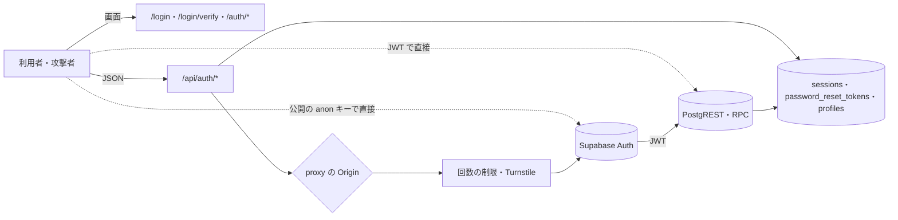

# AUTH の脅威

> 状態: 推定（コードを読んで起こした。ユーザーの確認は未） | 確認日: 2026-10-24 | 対象: ログイン・メール OTP・会員登録・パスワード再設定・Google のログイン・TOTP・ログアウト・トークンの更新・ヘッダー、その裏の Supabase Auth と `sessions`・`password_reset_tokens`・`profiles` の DB | 基準コミット: `973dc336`（読んだのは作業ツリー。本文の `ファイル:行` の行番号は、この基準コミットのコードを指す）

---

## 概要

AUTH（ログインと認証、ヘッダー）の領域で考える脅威を、1つずつ `THR-AUTH-NNN` の項目で書く。過去のセキュリティレビューの指摘と、2026-10-24 にコードと DB の移行を読み直して気づいた点の両方を拾った。

| 項目 | 内容 |
| --- | --- |
| 項目の数 | 31（THR-AUTH-001〜031） |
| 守りがある物 | パスワードと OTP の総当たり（001・002）、OTP だけのログイン（003）、保留の延長（004）、漏洩・短いパスワード（014）、列挙の応答（016）、再設定のリンク（018）、メールの住所の差し替え（019）、パスワード変更・ログアウト後のセッション（020・021）、Cookie の属性（024）、CSRF（025）、ヘッダーの出し分け（028） |
| 守りが欠ける・弱い物 | Supabase Auth を直接呼んでメール OTP を飛ばす（005）、メールの確認のリンクの入口（006・007）、TOTP の総当たり（009）、DB が aal2 を見ない（010）、表の権限（011）、回数の制限の IP（013）、直接の登録・変更（015）、トークンを JS に渡す（022・023）、`/auth/callback` の open redirect（026）、本番の設定（029）、監査の抜け（030）、会員登録の宛先単位の制限（016）、認証の関数を anon・authenticated が呼べる（012、本番は未確認）、ログアウト時に refresh の Cookie が無いと Supabase のセッションを切らない（021）、初めての TOTP の登録の乗っ取り（031） |
| 対策の書き先 | 対策のセキュリティ要件 `SEC-AUTH-NNN` は要件の文書（`docs/02_Requirements/areas/auth.md`）に書く。下の「対策」の欄は読み手のための写し |
| 状態の付け方 | 全部「推定」。実装と過去のレビューから起こし、ユーザーの確認を受けていないため（`.claude/skills/documentation-guide/SKILL.md` の 7）。コードで確かめた物も、本番の設定・ライブラリの既定・推論に頼る物も同じ。どれも実行しての確かめはしていない |

---

## 範囲と根拠

- 範囲: `scripts/trace/scope.json` の AUTH の src（`src/app/login/**`・`src/app/auth/**`・`src/app/api/auth/**`・`src/components/Header.tsx`・`LoginModal.tsx`・`RegisterModal.tsx`・`AuthTabs.tsx`・`AuthResultScreen.tsx`・`src/hooks/useTurnstileWidget.ts`・`src/lib/format-countdown.ts`）
- 範囲の外だが脅威の入口になるので見た物: `src/proxy.ts`（Origin の確かめ・守りの見出し）、`src/features/auth/middleware/rateLimit.ts`・`src/features/auth/ratelimit/index.ts`（回数の制限）、`src/features/auth/services/login-2fa-session.ts`・`password-reset-session.ts`（署名した Cookie）、`src/lib/auth/authenticate.ts`・`request-token.ts`・`admin-rbac.ts`（認証と管理の認可）、`src/lib/cookie.ts`、`src/lib/redirect.ts`、`src/lib/turnstile.ts`、`src/lib/audit.ts`、`src/lib/orders/status/status-session.ts`、`supabase/config.toml`（手元の Supabase Auth の設定）、`supabase/migrations/20260901102912_remote_schema.sql`・`20260921011535_harden_security_definer_search_path.sql`・`20261023175712_group_g0_permissions.sql`（表・RLS・権限・関数）、`node_modules/@supabase/ssr` の Cookie の既定値
- 出どころのレビュー: `docs/05_Quality/reviews/security/security_review_overview.md`・`security_review_login.md`・`security_review_signup.md`・`security_review_auth_callback.md`・`security_review_auth_password_reset.md`・`security_review_auth_verified.md`、`docs/05_Quality/reviews/code/2026-04-18-login-review.md`・`2026-04-18-signup-review.md`・`2026-04-18-auth-security-review.md`・`2026-04-29-login-additional-review.md`。どのレビューも当時の記録で、今の状態は 2026-10-24 にコードを読み直して決めた
- 全体のセキュリティ要件は `docs/02_Requirements/requirements.md` の 5.4 節（NFR-SEC-001〜012・AC-SEC-001）。AUTH に当てはまる物は各項目の根拠に `（範囲外）` を付けて書いた
- ASVS は OWASP ASVS 4.0.3 の項目番号。当てはめに自信の無い物は「（当てはめは推定）」、番号を決められない物は「ASVS 未対応付け」と書いた
- 外した物: Supabase Storage の署名つき URL は AUTH の範囲で使わない（TOTP の QR は data URI で、置き場を通らない。`src/app/auth/verified/page.tsx:318-325`）。署名つき URL に近い「メールのリンクの印」と「署名した Cookie」は THR-AUTH-018・027 で扱う。ヘッダーの自動非表示（`src/components/Header.tsx:84-110`）は見た目の働きで、入力を差し込む面が無い（推定）

### 入口と守りの位置

- 実線の矢印はアプリが用意した道、点線はアプリを通らない道（THR-AUTH-005・010・011・015）
- メール OTP の2段目、Turnstile、16 文字・漏洩の照合、アプリの回数の制限は、どれも `/api/auth/*` の中にだけある。点線の道はこれを通らない
- `GET` の窓口（`/api/auth/confirm`・`/api/auth/oauth/*`・`/api/auth/password-reset/link`）は proxy の Origin の確かめの外（状態を変える方法の `POST`・`PUT`・`PATCH`・`DELETE` だけを見る。`src/proxy.ts:42,147-158`）

---

## 脅威の一覧

### THR-AUTH-001 パスワードの総当たり・リスト型攻撃

| 属性 | 値 |
| --- | --- |
| 守るもの | 会員・管理者・サポーターのアカウント |
| 脅威 | 攻撃者が、よくあるパスワードや他のサイトから漏れたメールとパスワードの組を、ログインの窓口に大量に試す |
| 起こり方 | `/api/auth/login` へ組を送り続ける。IP 単位で 50 回／600 秒、Turnstile を通った後にメール単位で 5 回／600 秒の制限がある（`src/app/api/auth/login/route.ts:12-18,27-44`）。Turnstile は本番で鍵が無ければ断り、本番の外では飛ばす（`src/lib/turnstile.ts:8-14`） |
| 影響 | アカウントの乗っ取り。会員の住所・注文、管理者なら管理の操作に届く（管理は TOTP が別にある） |
| 対策 | SEC-AUTH-001 |
| ASVS | V2.2.1 |
| 根拠 | 守りがある。メール単位の数え方を Turnstile の後に置くのは、他人のメールで枠を使い切らせる締め出しを防ぐため（`login/route.ts:35-37`）。IP の数え方の弱さは THR-AUTH-013、窓口を通らない道は THR-AUTH-005 で扱う。全体の NFR-SEC-008（範囲外）の強いパスワードの方針に当てはめた |
| 状態 | 推定 |
| 出どころ | `docs/05_Quality/reviews/code/2026-04-18-auth-security-review.md`、`docs/05_Quality/reviews/security/security_review_login.md:29-58` |

### THR-AUTH-002 メール OTP の総当たり

| 属性 | 値 |
| --- | --- |
| 守るもの | ログインの2段目（メールの確認コード） |
| 脅威 | パスワードを知った攻撃者が、8 桁のコードを当てるまで試す |
| 起こり方 | `/api/auth/otp/verify` へコードを送り続ける。IP 単位 30 回／600 秒、保留の Cookie の宛先で 5 回／600 秒、上限に当たると保留の Cookie を捨てる（`src/app/api/auth/otp/verify/route.ts:11-17,36-70`）。type は email に固定（`:78-82`） |
| 影響 | 2段目が破られ、パスワードだけでログインされる |
| 対策 | SEC-AUTH-002 |
| ASVS | V2.2.1 |
| 根拠 | 守りがある。過去のレビューは IP 単位しか無いと指摘し（`security_review_login.md:36`）、FREQ-335 で直した。数える宛先を本文ではなく Cookie から取るのは、他人の枠を潰す締め出しを防ぐため（`otp/verify/route.ts:36-38`） |
| 状態 | 推定 |
| 出どころ | `docs/05_Quality/reviews/security/security_review_login.md:36`、`docs/02_Requirements/requirements.md` の FREQ-335 の行 |

### THR-AUTH-003 パスワードを通らずにメール OTP だけでログインする

| 属性 | 値 |
| --- | --- |
| 守るもの | 2段階のログインの順番（パスワード → メール OTP） |
| 脅威 | 被害者のメールを読める攻撃者が、パスワードを知らずにアプリの窓口から OTP だけでログインする |
| 起こり方 | `/api/auth/otp/verify` に、宛先とコードだけを送る。今は「パスワード確認済み」の署名した保留の Cookie が無いと 401（`otp/verify/route.ts:27-34`）。宛先も Cookie から取り、本文の宛先は見ない（`:28`） |
| 影響 | 2段階のうちパスワードの段が消える |
| 対策 | SEC-AUTH-003 |
| ASVS | ASVS 未対応付け |
| 根拠 | アプリの窓口には守りがある。Cookie の署名は HMAC と定数時間の比べ方（`src/features/auth/services/login-2fa-session.ts:82-92`）。同じ迂回をアプリの外で行う道は THR-AUTH-005 で扱う |
| 状態 | 推定 |
| 出どころ | `docs/superpowers/specs/2026-09-04-login-otp-dedicated-screen-design.md`（実装から推定で照らした） |

### THR-AUTH-004 保留の2段目の状態を延ばす・宛先を差し替える

| 属性 | 値 |
| --- | --- |
| 守るもの | 「パスワード確認済み」の保留の状態と、再送のメールの宛先 |
| 脅威 | 攻撃者が保留の Cookie を持ち続け、再送を繰り返して窓を延ばす。または再送の宛先を他人のアドレスに変えて、店のドメインからメールを送らせる |
| 起こり方 | `/api/auth/login/resend` を繰り返す。今は元の iat を引き継ぎ、30 分の絶対上限で切る（`src/app/api/auth/login/resend/route.ts:89-100`、`login-2fa-session.ts:10-15`）。宛先は Cookie からだけ取る（`resend/route.ts:14-18`）。再送の枠はログインと共有（`:34-58`） |
| 影響 | 総当たりの窓が延びる。他人へのメールの踏み台になる |
| 対策 | SEC-AUTH-004 |
| ASVS | V3.3.2 |
| 根拠 | 守りがある（FREQ-336）。30 分は「5 分の期限と 60 秒の待ちで約 5 回の再送」に合わせた値（`login-2fa-session.ts:12-14`） |
| 状態 | 推定 |
| 出どころ | `docs/02_Requirements/requirements.md` の FREQ-336 の行 |

### THR-AUTH-005 アプリを通らず Supabase Auth を直接呼んでメール OTP の2段目を飛ばす

| 属性 | 値 |
| --- | --- |
| 守るもの | 2段階のログイン、会員の情報（`profiles` の氏名・電話・住所）と注文の履歴 |
| 脅威 | 会員のパスワードを知った攻撃者が、公開の anon キーで Supabase Auth を直接呼び、メール OTP を通らずに会員の JWT を得る。メールを読める攻撃者は、パスワード無しの OTP・マジックリンクで JWT を得る |
| 起こり方 | anon キーは画面に配る公開の値。`/auth/v1/token?grant_type=password` を直接呼べば、パスワードだけで access token と refresh token が返る（Supabase Auth の標準の動き）。アプリの認証は JWT の署名・期限・iss・aud と session の生存だけを見て、どの方法でログインしたか（`amr`）を見ない（`src/lib/auth/authenticate.ts:97-108,139,163`）。PostgREST も同じ JWT を受け、`profiles` の本人の行（`supabase/migrations/20260901102912_remote_schema.sql:3691-3710`）と本人の注文（`:3635`）を返す。Turnstile・アプリの回数の制限も通らない |
| 影響 | FREQ-58・FR-LOGIN-007 の「パスワードとメール OTP の2段階」が、アプリの窓口を通る人にしか効かない。パスワードの漏れだけで、会員の個人情報と注文の履歴に届く。管理は aal2 を求めるので守られる（`src/lib/auth/admin-rbac.ts:240-249`）。ただし DB の側は THR-AUTH-010 |
| 対策 | SEC-AUTH-005 |
| ASVS | V4.1.1（当てはめは推定） |
| 根拠 | 2段目の守りがアプリの窓口だけにあり、トークンを出す Supabase Auth の側に無い。2026-10-24 の読み直しで見つけた。実際に直接呼んでの確かめはしていない。本番の Supabase の設定（captcha・回数の制限）も見ていない。全体の NFR-SEC-005（範囲外）・NFR-SEC-008（範囲外）に照らした |
| 状態 | 推定 |
| 出どころ | 実装から推定 |

### THR-AUTH-006 メールの確認のリンクの入口で、パスワードとメール OTP を飛ばす

| 属性 | 値 |
| --- | --- |
| 守るもの | 2段階のログイン |
| 脅威 | 被害者のメールを読める攻撃者が、マジックリンク・メール変更・再設定の型のリンクを `/api/auth/confirm` に通し、パスワードも OTP も無しにアプリの session の Cookie を得る |
| 起こり方 | `/api/auth/confirm` は type に `signup`・`email`・`magiclink`・`recovery` の4つを受け、Supabase で印を確かめたら session を保存する（`src/app/api/auth/confirm/route.ts:8-9,47-48,58-81`）。印は THR-AUTH-005 の直接の呼び出し（`/auth/v1/otp`・`/auth/v1/recover`）でも作れる |
| 影響 | メールが読めるだけでログインできる。メール OTP を2段目にした意味が薄れる。ログインのメールの型（`supabase/templates/magic_link.html`）は `{{ .Token }}` だけを使うが、Supabase は型の文を変えても token_hash の道を閉じない（推定） |
| 対策 | SEC-AUTH-006 |
| ASVS | ASVS 未対応付け |
| 根拠 | FREQ-335 はログインの OTP の検証で type を email に固定したが、確認のリンクの入口は4つの型を受けたまま。会員登録の確認に要るのは `signup` だけ（`src/app/api/auth/register/route.ts:155-165`）。 |
| 状態 | 推定 |
| 出どころ | 実装から推定 |

### THR-AUTH-007 他人の端末を攻撃者のアカウントでログインさせる（ログインの CSRF）

| 属性 | 値 |
| --- | --- |
| 守るもの | 利用者がどのアカウントで操作しているか。入力した住所・カード以外の個人情報・お気に入り |
| 脅威 | 攻撃者が自分のアカウントの確認のリンクを被害者に開かせ、被害者の端末を攻撃者のアカウントでログインさせる。被害者は気づかずに住所を保存し、注文する |
| 起こり方 | `/api/auth/confirm` は `GET` で、印が正しければ開いた端末に session の Cookie を書く（`confirm/route.ts:27,56-81`）。開いた人と印を作った人を結ぶ物が無い。`GET` なので proxy の Origin の確かめの外（`src/proxy.ts:147-158`）。Google の戻りは PKCE の検証の Cookie が端末に結ぶので同じ攻撃は通らない（`src/app/api/auth/oauth/start/route.ts:85-98`、`oauth/callback/route.ts:91-106`） |
| 影響 | 被害者の住所・電話・注文が攻撃者のアカウントに入り、攻撃者が後で読む。ゲストのカートとお気に入りも攻撃者のアカウントへ合わさる（`confirm/route.ts:78-81`） |
| 対策 | SEC-AUTH-007 |
| ASVS | V4.2.2（当てはめは推定） |
| 根拠 | どのレビューにも無く、2026-10-24 の読み直しで気づいた。実際に開いての確かめはしていない |
| 状態 | 推定 |
| 出どころ | 実装から推定（2026-10-24 の読み直し） |

### THR-AUTH-008 Google でのログインがメール OTP を通らない

| 属性 | 値 |
| --- | --- |
| 守るもの | 2段階のログイン（FR-LOGIN-007） |
| 脅威 | Google のアカウントを乗っ取った攻撃者が、メール OTP 無しで会員としてログインする |
| 起こり方 | `/api/auth/oauth/callback` は Google の code を session に替え、そのまま Cookie を書いて `/account` へ送る（`src/app/api/auth/oauth/callback/route.ts:106-174`）。メール OTP の段は無い。管理者・サポーターは `/auth/verified` で TOTP を求める（`src/app/auth/verified/page.tsx:145-161`） |
| 影響 | 会員は Google の守り（Google 側の2段階）に頼る。管理は aal2 で守られる |
| 対策 | SEC-AUTH-008 |
| ASVS | ASVS 未対応付け |
| 根拠 | FR-LOGIN-007 は「全員がパスワードとメール OTP」と書くが、OTP の専用画面の設計は Google をスコープ外とした（`docs/superpowers/specs/2026-09-04-login-otp-dedicated-screen-design.md:240-247`）。要件と実装のどちらが正しいかは決めていない。ゲスト注文の紐付け（FREQ-265（範囲外））を呼ばない点は機能の食い違いで、脅威ではない |
| 状態 | 推定 |
| 出どころ | 実装から推定 |

### THR-AUTH-009 TOTP の総当たり

| 属性 | 値 |
| --- | --- |
| 守るもの | 管理者・サポーターの3段目（TOTP、aal2） |
| 脅威 | パスワードとメールを手に入れた攻撃者が、6 桁の TOTP を当てるまで試す |
| 起こり方 | `/api/auth/mfa/verify` へコードを送り続ける。制限は IP 単位の 20 回／600 秒だけで、アカウント単位の制限が無い（`src/app/api/auth/mfa/verify/route.ts:21-29`）。失敗は `console.error` だけで監査に残さない（`:73-76`）。IP は偽れる（THR-AUTH-013） |
| 影響 | 管理の操作に届く（注文・会計・権限の画面） |
| 対策 | SEC-AUTH-009 |
| ASVS | V2.2.1（当てはめは推定） |
| 根拠 | ログインと OTP にはアカウント単位の制限と監査があるのに、TOTP だけに無い。Supabase Auth 側の検証の回数の制限は、アプリのサーバーの IP にかかるので、攻撃者ごとには効かない（推定）。全体の NFR-SEC-005（範囲外）に照らした |
| 状態 | 推定 |
| 出どころ | `docs/05_Quality/reviews/security/security_review_auth_verified.md:30-` |

### THR-AUTH-010 TOTP を済ませていない管理者の JWT で DB を直接触る

| 属性 | 値 |
| --- | --- |
| 守るもの | 管理の権限で読み書きできる表（注文・明細・商品・ルック・ニュース・取扱店・会計など） |
| 脅威 | 管理者・サポーターのパスワード（とメール）を手に入れた攻撃者が、TOTP を通らない `aal1` の JWT で、アプリの窓口を通らず PostgREST から表を読み書きする |
| 起こり方 | THR-AUTH-005 の直接の呼び出しで `aal1` の JWT を得る。RLS の `has_permission` は ACL の表だけを見て JWT の `aal` を見ない（`supabase/migrations/20261023175712_group_g0_permissions.sql:186-216`。移行のどこにも `aal` の字が無い）。例: 注文の読み書きの方針（`20260901102912_remote_schema.sql:3640-3658`） |
| 影響 | 管理の TOTP（FREQ-540（範囲外））の守りが、アプリの窓口だけになる。パスワードの漏れだけで、全会員の注文の読み出しや改ざんに届く。直接の書き換えはアプリの監査にも残らない |
| 対策 | SEC-AUTH-010 |
| ASVS | V4.3.1 |
| 根拠 | 管理の窓口は aal2 を求める（`src/lib/auth/admin-rbac.ts:240-249`）が、同じ守りが DB に無い。NEWS の THR-NEWS-002 と同じ根で、aal2 を出す窓口（`/api/auth/mfa/verify`）が AUTH にあるので AUTH でも書く。注文まわりの作り直しが移行を書き換え中で、方針の行はずれうる。実際に叩いての確かめはしていない |
| 状態 | 推定 |
| 出どころ | 実装から推定（2026-10-24 の DB の移行の読み直し）、`docs/05_Quality/security/threats/news.md` の THR-NEWS-002 |

### THR-AUTH-011 認証の表の権限が広く、RLS の拒否だけで守っている

| 属性 | 値 |
| --- | --- |
| 守るもの | `sessions`（refresh token のハッシュ）、`password_reset_tokens`（再設定の印のハッシュ）、`rate_limit_counters`、`audit_logs`、`profiles` |
| 脅威 | anon・会員の JWT で PostgREST から表を読み書きし、再設定の印やセッションの記録を盗む・消す、回数の数を消す、監査を消す |
| 起こり方 | 5つの表とも anon・authenticated に、TRUNCATE・TRIGGER・REFERENCES・MAINTAIN を含む全部の権限を付けたまま（`remote_schema.sql:4142,4184,4190,4192,4200`、数の連番 `:4082`）。今は RLS の「anon・authenticated は全部拒む」方針で塞ぐ（`:3313-3330,3661-3677,3712-3728,3747-3763`）。`profiles` は本人の行だけを許す（`:3691-3710`） |
| 影響 | 方針を1つ消す・書き間違えるだけで全部が開く。TRUNCATE は RLS を受けない（PostgREST からは出せないが、権限としては残る） |
| 対策 | SEC-AUTH-011 |
| ASVS | V4.1.3 |
| 根拠 | 守りは RLS の1段だけ。表の権限は Supabase の既定のまま。NEWS の THR-NEWS-021 と同じ形。全体の NFR-SEC-005（範囲外）・NFR-SEC-011（範囲外）（監査の改ざん防止）に照らした |
| 状態 | 推定 |
| 出どころ | 実装から推定 |

### THR-AUTH-012 直接の RPC で会員の有無を調べる・他人のセッションを切る

| 属性 | 値 |
| --- | --- |
| 守るもの | 会員の有無、他人のセッション、回数の制限の数、再設定の印の掃除 |
| 脅威 | anon・会員の JWT で、認証の関数を PostgREST の RPC として直接呼ぶ |
| 起こり方 | `find_auth_user_id_by_email`・`revoke_auth_session`・`revoke_auth_sessions_for_user`・`is_auth_session_active`・`increment_rate_limit_counter`・`cleanup_password_reset_tokens` を呼ぶ。移行は6つとも PUBLIC から外し、postgres・service_role に許す（`remote_schema.sql:3926-3928,3956-3958,3968-3978,4000-4006`）が、Supabase の既定の権限が anon・authenticated に直接付けた EXECUTE は外していない。移行から作った手元の DB では、6つとも anon・authenticated が呼べる。`has_permission` だけは anon から外した（`20260921011535_harden_security_definer_search_path.sql:92`）。満たさない点は SEC-AUTH-012 に書いた |
| 影響 | 開くと、メールで会員の有無を調べられ（列挙）、他人を締め出せ、回数の制限を水増し・消費できる |
| 対策 | SEC-AUTH-012 |
| ASVS | V4.1.3 |
| 根拠 | 開いていれば、公開の anon の鍵だけで会員の有無の列挙・他人のセッションの失効・回数の水増しができる。権限を確かめる単体テスト `tests/unit/migrations/092_lock_down_rpc_surface.test.ts` がある（中身は未確認）。本番の `proacl` は未確認 |
| 状態 | 推定 |
| 出どころ | 実装から推定（2026-10-24 の DB の移行の読み直し） |

### THR-AUTH-013 回数の制限を IP の偽り・窓の境目で越える、全員を止める

| 属性 | 値 |
| --- | --- |
| 守るもの | 総当たり（001・002・009）と踏み台（004・016）の守り、ログインの使える状態 |
| 脅威 | 攻撃者が送り元の IP を偽って IP 単位の制限を越える。または Supabase Auth 側の IP の枠を使い切り、全員のログインを止める |
| 起こり方 | 送り元を `x-forwarded-for` の先頭、無ければ `x-real-ip` から無条件に取る（`src/features/auth/middleware/rateLimit.ts:4-16`）。Turnstile に渡す IP も同じ（`login/route.ts:28`、`password-reset/request/route.ts:37`、`register/route.ts:109`）。窓は時刻で切った固定の枠で、境目で最大2倍通る（`rateLimit.ts:21-23`）。数えの DB の失敗は制限の部品が自分で捕まえて 503 で断る（`rateLimit.ts:45-64`）。各窓口の外側の catch（例 `login/route.ts:16-18`）が握りつぶして先へ進むのは、制限の部品の読み込みの失敗だけ。Supabase Auth は全部の呼び出しをアプリのサーバーの IP から受けるので、Supabase 側の IP の枠（手元は `supabase/config.toml:196-208`）は全員で共有になる（推定） |
| 影響 | IP 単位だけの窓口（TOTP・確認のリンク・トークンの更新）の総当たりの守りが消える。Supabase 側の枠を使い切られると、正しい利用者もログイン・登録できない |
| 対策 | SEC-AUTH-013 |
| ASVS | V2.2.1（当てはめは推定） |
| 根拠 | 制限が DB に届かない時は 503 で断る（`rateLimit.ts:45-64`、ADR-0009（範囲外））。中継（Vercel など）が `x-forwarded-for` を上書きするかは未確認で、本番はまだデプロイしていない。過去のレビューの X-05。NEWS の THR-NEWS-010 と同じ根 |
| 状態 | 推定 |
| 出どころ | `docs/05_Quality/reviews/security/security_review_overview.md:40` |

### THR-AUTH-014 漏洩済み・短いパスワードを使わせる

| 属性 | 値 |
| --- | --- |
| 守るもの | 会員のアカウント |
| 脅威 | 利用者が他のサイトで漏れたパスワードや短いパスワードを使い、リスト型攻撃で破られる |
| 起こり方 | 会員登録とパスワード再設定で弱いパスワードを入れる。今は 16 文字以上（`src/features/auth/schemas/common.ts:33`）、構成の決まり無し、HIBP の k-匿名で照合（`register/route.ts:122-132`、`password-reset/confirm/route.ts:98-111`）。照合先が落ちた時は止めずに監査に残す |
| 影響 | THR-AUTH-001 の成功率が上がる |
| 対策 | SEC-AUTH-014 |
| ASVS | V2.1.1、V2.1.7、V2.1.9 |
| 根拠 | アプリの窓口には守りがある（FREQ-323）。照合先が落ちた時に通すのは、外の障害で登録を止めない判断（推定、ADR の候補）。アプリを通らない道は THR-AUTH-015。全体の NFR-SEC-008（範囲外）に当てはめた |
| 状態 | 推定 |
| 出どころ | `docs/02_Requirements/requirements.md` の FREQ-323 の行 |

### THR-AUTH-015 アプリを通らない会員登録・パスワード変更で、パスワードの決まりと Turnstile を飛ばす

| 属性 | 値 |
| --- | --- |
| 守るもの | パスワードの決まり（16 文字・漏洩の照合）、会員登録のボット対策 |
| 脅威 | 攻撃者が anon キーで `/auth/v1/signup` を直接呼んで、ボットで大量に登録する。乗っ取った session で `/auth/v1/user` を直接呼び、再認証なしにパスワードを変える。同じ道でアカウントのメールを自分の宛先に差し替え、その後に再設定して乗っ取りを続ける |
| 起こり方 | 手元の Supabase は登録を許し（`supabase/config.toml:175,220`）、最小の長さ 6・構成の決まり無し（`:181,184`）、captcha は無効（`:213-216`）、パスワード変更に再認証を求めない（`secure_password_change = false`、`:227`）。メールの差し替えに新旧両方の確認を求める設定（`double_confirm_changes`）は手元では true（`:223`）、本番は未確認。アプリの 16 文字・HIBP・Turnstile・回数の制限は `/api/auth/register` と再設定の中にだけある |
| 影響 | 短いパスワードの会員ができる。ボットの登録で店のドメインからメールが出る。乗っ取った人がパスワードやメールを変えて本人を締め出す |
| 対策 | SEC-AUTH-015 |
| ASVS | V2.1.1、V2.1.7、V3.7.1 |
| 根拠 | 守りがアプリの窓口だけにある。本番のダッシュボードの値は見ていない。Supabase の漏洩の照合は Pro 以上でしか使えない（`register/route.ts:122-123` のコメント） |
| 状態 | 推定 |
| 出どころ | 実装から推定 |

### THR-AUTH-016 会員登録・再設定でアカウントの有無を知られる、メールの踏み台にされる

| 属性 | 値 |
| --- | --- |
| 守るもの | 誰が会員かという情報、店のメールの評判 |
| 脅威 | 攻撃者が任意のメールを会員登録・再設定に送り、応答の違いで会員かどうかを調べる。他人の宛先へ店のドメインからメールを送らせる |
| 起こり方 | 会員登録は登録済みでも同じ 202 を返し、本人にだけメールで知らせ、送信を応答の外（`after`）に出す（`register/route.ts:12-39,147-152`）。この「すでに登録されています」の通知はアプリが自分で送り、回数の制限は偽れる IP 単位の 20 回／時（`register/route.ts:47`）と Turnstile だけで、宛先単位の制限が無い。ログインと再設定には宛先単位の制限がある。そのため既存の会員へ店のドメインからメールを送り続けられる。再設定は有無によらず 200 で、アカウントが無ければ送らない（`password-reset/request/route.ts:71-79,141-145`）。ただし再設定は、アカウントがある時だけ DB に2回書いてから返す（`:79-113`）ので、応答の時間に差が出うる（推定） |
| 影響 | 会員を狙った標的型の詐欺メール、漏れた組の絞り込み、既存の会員への通知のメールの連打 |
| 対策 | SEC-AUTH-016 |
| ASVS | ASVS 未対応付け |
| 根拠 | 公開の道の応答の中身には守りがある（FREQ-320）。会員登録の宛先単位の制限は無い（`register/route.ts:47,147-151`）。登録の 201 の分岐は Confirm email が OFF の時だけ通り、その時は新規と既存で応答が変わる（`register/route.ts:181-191`、THR-AUTH-029）。管理の経路の 409 は THR-AUTH-017 |
| 状態 | 推定 |
| 出どころ | `docs/05_Quality/reviews/security/security_review_signup.md:57`、`docs/02_Requirements/requirements.md` の FREQ-320 の行 |

### THR-AUTH-017 管理の登録の経路が公開の窓口に同居する

| 属性 | 値 |
| --- | --- |
| 守るもの | 会員の作成の権限、会員の有無 |
| 脅威 | 管理の鍵 `ADMIN_API_KEY` を推測・漏洩で得た攻撃者が、公開の窓口から会員を作り、409 で有無を調べる |
| 起こり方 | `/api/auth/register` は `x-admin-token`（または Bearer）があれば管理の作成に切り替える（`register/route.ts:53-102`）。鍵は `!==` で比べ定数時間でない（`:64`）。Turnstile・漏洩の照合を通らず、登録済みなら 409（`:91-94`）。src から呼ぶ所は無く、テストだけが使う |
| 影響 | 鍵が漏れると、ボット対策も列挙対策も無い登録の窓が開く |
| 対策 | SEC-AUTH-017 |
| ASVS | ASVS 未対応付け |
| 根拠 | 過去のレビューが「管理と公開が同じ窓口」と指摘し、今も同じ（`security_review_signup.md:59`）。管理のユーザー作成は別の窓口 `/api/admin/create-user`（範囲外）にある |
| 状態 | 推定 |
| 出どころ | `docs/05_Quality/reviews/security/security_review_signup.md:59` |

### THR-AUTH-018 パスワード再設定のリンクの漏れ・使い回し

| 属性 | 値 |
| --- | --- |
| 守るもの | パスワード再設定のリンクの印と、アカウント |
| 脅威 | メールの転送・端末の履歴・リンクの検査の仕組みからリンクを得た攻撃者が、パスワードを変える。前に使った・古いリンクを使い回す |
| 起こり方 | 印は 32 バイトの乱数で、DB にはハッシュだけを置く（`password-reset/request/route.ts:92-106`）。期限 10 分（`:15-17`）、新しく出すと前の印を無効にする（`:80-90`）。リンクを開いた時は消費せず、パスワードを変えた時に1回だけ消費する（`password-reset/link/route.ts:28-58`、`confirm/route.ts:113-135`）。全部の応答に `Referrer-Policy: no-referrer`（`src/proxy.ts:235`） |
| 影響 | アカウントの乗っ取り |
| 対策 | SEC-AUTH-018 |
| ASVS | V2.5.6、V2.7.2 |
| 根拠 | 守りがある（FREQ-319・332）。消費を遅らせるのは、企業のリンクの検査が先に踏んで印を潰すのを防ぐため（`link/route.ts:28-34`）。使われなかった印の行を掃除する関数 `cleanup_password_reset_tokens` はあるが、呼ぶ所が無い（`remote_schema.sql:1378,3926-3928`。台帳の W-06 で後回し）。行はハッシュで、期限の切れた印は通らないので害は小さい（推定） |
| 状態 | 推定 |
| 出どころ | `docs/05_Quality/reviews/security/security_review_auth_password_reset.md:30-34`、`docs/05_Quality/reviews/code/2026-09-25-working-diff-security-review.md:306` |

### THR-AUTH-019 メールのリンクの住所を差し替える

| 属性 | 値 |
| --- | --- |
| 守るもの | 確認・再設定のメールのリンクの行き先と、その中の印 |
| 脅威 | 攻撃者が要求の Host・`x-forwarded-host` を偽り、店のメールの中のリンクを攻撃者のサイトへ向けて印を盗む |
| 起こり方 | 会員登録・再設定は要求から作った住所でリンクを作る（`register/route.ts:116,155`、`password-reset/request/route.ts:52,118`）。今は許可の一覧に無い住所なら送らない（`register/route.ts:117-120`、`request/route.ts:53-57`） |
| 影響 | 再設定の印の窃取によるアカウントの乗っ取り |
| 対策 | SEC-AUTH-019 |
| ASVS | ASVS 未対応付け |
| 根拠 | 守りがある（FREQ-509（範囲外）、波1 の J-17 で直した）。結合テストが `x-forwarded-host` の許可を試す（`tests/integration/api/auth/confirm.test.ts:157,170`、`site-url-guard.test.ts:51-97`） |
| 状態 | 推定 |
| 出どころ | `docs/superpowers/plans/2026-10-23-launch-fixes-wave1.md:150` |

### THR-AUTH-020 パスワードを変えた後も盗まれたセッションが残る

| 属性 | 値 |
| --- | --- |
| 守るもの | 乗っ取りからの立ち直り |
| 脅威 | セッションを盗んだ攻撃者が、本人がパスワードを変えた後もログインを続ける |
| 起こり方 | 再設定の完了で、自前の `sessions` と Supabase の全部のセッションを切る（`password-reset/confirm/route.ts:23-50,156`）。切るのに失敗しても成功で返し、`console.error` だけに残す（`:39-49`）。本人に変更を知らせる（`:170-183`） |
| 影響 | 失効に失敗すると、攻撃者のセッションが残る |
| 対策 | SEC-AUTH-020 |
| ASVS | V3.3.3 |
| 根拠 | 守りがある。失敗でも成功を返すのは、パスワードは既に変わっていて 500 の方が利用者に不利だから（`confirm/route.ts:27-28`） |
| 状態 | 推定 |
| 出どころ | `docs/05_Quality/reviews/code/2026-04-18-auth-security-review.md` |

### THR-AUTH-021 ログアウトしてもサーバーのセッションが残る

| 属性 | 値 |
| --- | --- |
| 守るもの | ログアウトした後のアカウント |
| 脅威 | 共有の端末や盗まれた refresh token で、ログアウトの後もログインを続ける |
| 起こり方 | ログアウトは JWT の session_id で Supabase のセッションを切り、取れなければ利用者の全部のセッションを切る（`src/app/api/auth/logout/route.ts:19-79`）。ただし refresh の Cookie が無い時はサーバーのセッションを切らない（ADR-0407）。Cookie は必ず消し、常に 200（`:8-9`）。ログインの1段目のパスワードの確認でも Supabase のセッションが1つできるが、使わずに捨て、切らない（`login/route.ts:46-49`。応答に出さないので害は無いと推定） |
| 影響 | 失効しないと、refresh token が期限まで使える |
| 対策 | SEC-AUTH-021 |
| ASVS | V3.3.1 |
| 根拠 | 通常の道は守りがある（FREQ-514（範囲外）の AC-03）。refresh の Cookie が無い時はサーバーのセッションを切らない（SEC-AUTH-021 は一部満たさない）。トークンの更新は自前の表の失効の印も見る（`refresh/route.ts:44-58`） |
| 状態 | 推定 |
| 出どころ | `docs/05_Quality/reviews/security/security_review_login.md`の 6 |

### THR-AUTH-022 トークン・秘密を JS が読める所に出す、応答がキャッシュに残る

| 属性 | 値 |
| --- | --- |
| 守るもの | access token、Supabase の利用者の記録、TOTP の秘密 |
| 脅威 | 画面に差し込まれたスクリプトが応答の本文からトークンを盗む。共有の端末・中継のキャッシュに応答が残る |
| 起こり方 | トークンの更新の応答の本文に access token と利用者の記録（`src/app/api/auth/refresh/route.ts:101`）、公開の会員登録の 201 に access token（`register/route.ts:191`）、OTP の検証の応答に Supabase の利用者の記録のまるごと（`otp/verify/route.ts:89-95`）を入れる。TOTP の登録は秘密と URI を返す（`mfa/enroll-totp/route.ts:141-152`）。これらと、ログイン・TOTP の確認・MFA の状態の応答に `Cache-Control: no-store` が無い（`me` と再設定の link・確認のリンクには付ける。`me/route.ts:12-17`、`password-reset/link/route.ts:21-26`、`confirm/route.ts:19-24`） |
| 影響 | Cookie を HttpOnly にした守りが、応答の本文で崩れる。秘密がキャッシュに残る |
| 対策 | SEC-AUTH-022 |
| ASVS | V8.2.1 |
| 根拠 | 過去のレビューが「登録の 201 で access token を返す」「トークンの応答に no-store が無い」と指摘した（`security_review_signup.md:56`、`security_review_login.md:38`）。TOTP の秘密は登録に要るので出すこと自体は避けられない。全体の NFR-SEC-009（範囲外）に照らした |
| 状態 | 推定 |
| 出どころ | `docs/05_Quality/reviews/security/security_review_signup.md:56`、`docs/05_Quality/reviews/security/security_review_login.md:38` |

### THR-AUTH-023 Google でのログインが JS から読める Cookie にトークンを書く

| 属性 | 値 |
| --- | --- |
| 守るもの | Google でログインした会員の access token と refresh token |
| 脅威 | 画面に差し込まれたスクリプトが Cookie からトークンを盗む |
| 起こり方 | Google の開始と戻りは `@supabase/ssr` の client を使い、client が書く Cookie をそのまま応答に移す（`oauth/start/route.ts:84-98,119-121`、`oauth/callback/route.ts:90-104,154-156`）。Cookie の属性を渡していないので、ライブラリの既定（`httpOnly: false`、`node_modules/@supabase/ssr/dist/main/utils/constants.js`）になる。戻りで code を session に替えると、ライブラリが session を Cookie に書く（推定） |
| 影響 | アプリの Cookie（`sb-access-token`・`sb-refresh-token`）は HttpOnly なのに、同じトークンが読める Cookie にも残る（推定） |
| 対策 | SEC-AUTH-023 |
| ASVS | V3.4.2 |
| 根拠 | どのレビューにも無く、2026-10-24 の読み直しで気づいた。ブラウザで Cookie を見ての確かめはしていない |
| 状態 | 推定 |
| 出どころ | 実装から推定（2026-10-24 の読み直し） |

### THR-AUTH-024 認証の Cookie の属性が弱い

| 属性 | 値 |
| --- | --- |
| 守るもの | access token・refresh token・保留の2段目・再設定の Cookie |
| 脅威 | スクリプト・平文の通信・別のサイトからの送信で Cookie を盗む・使う |
| 起こり方 | `src/lib/cookie.ts:18-45,72-88` が HttpOnly・本番で Secure・SameSite（トークンは Lax、保留の2段目と再設定は Strict）を付ける。CSRF の印の Cookie だけは画面が読むので HttpOnly でない（`:48-55`） |
| 影響 | トークンの窃取、別のサイトからのなりすましの送信 |
| 対策 | SEC-AUTH-024 |
| ASVS | V3.4.1、V3.4.2、V3.4.3 |
| 根拠 | 守りがある。結合テストが属性を試す（`tests/integration/api/auth/cookieFlags.test.ts:72,100,151`）。Secure は `NODE_ENV` が production の時だけ |
| 状態 | 推定 |
| 出どころ | 実装から推定 |

### THR-AUTH-025 状態を変える認証の窓口への CSRF

| 属性 | 値 |
| --- | --- |
| 守るもの | ログイン・ログアウト・TOTP・再設定の操作 |
| 脅威 | 攻撃者のサイトが被害者のブラウザから認証の窓口へ送信させる |
| 起こり方 | `/api` の `POST`・`PUT`・`PATCH`・`DELETE` は proxy が Origin（無ければ Referer）を許可の一覧と比べる（`src/proxy.ts:22-27,147-158,165-203`）。許可の一覧が設定されていない時は、要求の `x-forwarded-proto`・`x-forwarded-host`・`host` から比べる元を作る（`:135-145,185-202`）。ログアウトだけは CSRF の印も確かめる（`logout/route.ts:100-115`） |
| 影響 | 被害者の TOTP の登録の操作や、再設定の完了の送信 |
| 対策 | SEC-AUTH-025 |
| ASVS | V4.2.2 |
| 根拠 | 守りがある（FREQ-327）。過去のレビューの X-03（`/api/auth/*` が Origin の保護の外）は今は直った（`security_review_overview.md:38`）。`GET` の窓口のログインの CSRF は THR-AUTH-007 |
| 状態 | 推定 |
| 出どころ | `docs/05_Quality/reviews/security/security_review_overview.md:38`、`docs/05_Quality/reviews/security/security_review_auth_verified.md:30` |

### THR-AUTH-026 `/auth/callback` の画面からの open redirect

| 属性 | 値 |
| --- | --- |
| 守るもの | 利用者（ログインの後に偽のサイトへ送られない） |
| 脅威 | 攻撃者が `/auth/callback?next=//攻撃者のサイト` のリンクを配り、店のサイトを経由して偽のサイトへ送る |
| 起こり方 | 画面は `next` が `/` で始まるかだけを見る（`src/app/auth/callback/page.tsx:19-22`）。ログイン済みなら `router.replace(next)` で送る（`:53-54`）。`//` で始まる値が通る。サーバーの側の `sanitizeRedirectPath` は `//`・`\` を断る（`src/lib/redirect.ts:101-111`） |
| 影響 | 店のドメインを信じた利用者が偽のログイン画面に入力する |
| 対策 | SEC-AUTH-026 |
| ASVS | V5.1.5 |
| 根拠 | 過去のレビューの X-02 が Open のまま。この画面はどこからも呼ばれない（Google の戻り先は `/api/auth/oauth/callback`。`oauth/start/route.ts:81`）が、URL を直接開けば動く |
| 状態 | 推定 |
| 出どころ | `docs/05_Quality/reviews/security/security_review_overview.md:37`、`docs/05_Quality/reviews/security/security_review_auth_callback.md:30-31` |

### THR-AUTH-027 1つの鍵で複数の署名を兼ねる

| 属性 | 値 |
| --- | --- |
| 守るもの | 保留の2段目の Cookie、再設定の Cookie、注文の状況のセッション |
| 脅威 | 1つの鍵が漏れると、3つの印を全部偽れる。用途を取り違えた印を別の窓口に通す |
| 起こり方 | 専用の鍵が無い時、3つとも `JWT_SECRET` で署名する（`login-2fa-session.ts:27`、`src/features/auth/services/password-reset-session.ts:18`、`src/lib/orders/status/status-session.ts:33`）。payload の `purpose` で用途を分けるので取り違えは断る（`login-2fa-session.ts:97`、`password-reset-session.ts:82`、`status-session.ts:112`） |
| 影響 | 鍵が漏れると、パスワード無しで2段目の保留を作る・他人のパスワードを変える |
| 対策 | SEC-AUTH-027 |
| ASVS | ASVS 未対応付け |
| 根拠 | 取り違えは防げているが、鍵の漏れの影響が広い。本番の環境変数に専用の鍵があるかは未確認（本番は未デプロイ）。全体の NFR-SEC-009（範囲外）に当てはめた |
| 状態 | 推定 |
| 出どころ | 実装から推定 |

### THR-AUTH-028 画面の表示だけで管理の入口を出し分ける

| 属性 | 値 |
| --- | --- |
| 守るもの | 管理の画面と操作 |
| 脅威 | 一般の会員が画面の判定を書き換え、ヘッダーの MANAGE・LOADING や `/auth/verified` の管理の流れを出して管理の操作に入る |
| 起こり方 | ヘッダーは `/api/auth/me` の役割で MANAGE・LOADING を出し分ける（`src/components/Header.tsx:79,203-217,340-367`）。`/auth/verified` も役割で振り分ける（`src/app/auth/verified/page.tsx:137-169`）。役割は JWT の `app_metadata`（利用者が書き換えられない）から読む（`me/route.ts:40`） |
| 影響 | 画面に入口が出るだけで、操作はサーバーで断られる（推定） |
| 対策 | SEC-AUTH-028 |
| ASVS | V4.1.1 |
| 根拠 | 守りがある。表示は飾りで、管理の窓口は `admin-rbac` が DB の ACL と aal2 で判定する（`admin-rbac.ts:178,240-249`）。役割を `user_metadata` から読むと利用者が書き換えられるので、`app_metadata` から読むことを守りとして残す |
| 状態 | 推定 |
| 出どころ | 実装から推定 |

### THR-AUTH-029 本番の Supabase Auth の設定が守りの前提と違う

| 属性 | 値 |
| --- | --- |
| 守るもの | メール OTP の期限、列挙対策、TOTP、パスワードの決まり |
| 脅威 | ダッシュボードの設定の漏れで、コードの守りの前提が崩れる |
| 起こり方 | コードは、OTP の期限 300 秒（`login-2fa-session.ts:5-8`）、Confirm email が ON（`register/route.ts:181-184`）、TOTP が使えること、8 桁のコードを前提にする。手元の設定は OTP 3600 秒（`supabase/config.toml:234`）、確認なし（`:225`）、TOTP の登録・確認が無効（`:307-309`）、最小の長さ 6（`:181`）、captcha 無効（`:213-216`） |
| 影響 | 確認なしなら登録の応答で会員の有無が分かり（THR-AUTH-016）、access token を本文で返す（THR-AUTH-022）。OTP が長く生きる。手元の E2E・結合の結果は本番の前提を確かめていない |
| 対策 | SEC-AUTH-029 |
| ASVS | ASVS 未対応付け |
| 根拠 | 本番のダッシュボードの値を見ていない。台帳の開店の準備にあるのは Site URL と 8 桁のコードの型だけ（`docs/05_Quality/reviews/code/2026-09-25-working-diff-security-review.md:268,287`）。保留の Cookie が 5 分なので、OTP の使える窓は Cookie で 5 分に絞られる（推定） |
| 状態 | 推定 |
| 出どころ | 実装から推定 |

### THR-AUTH-030 認証の出来事が監査に残らない

| 属性 | 値 |
| --- | --- |
| 守るもの | 不正の気づきと、後からの追跡 |
| 脅威 | 攻撃者の試行や成功が監査に残らず、気づけない |
| 起こり方 | ログイン・OTP・登録・再設定・ログアウト・トークンの更新は `logAudit` に残す。TOTP の確認は成功も失敗も監査に残さず（`mfa/verify/route.ts:73-76,83-123`。残すのは保存の失敗だけ `:115-120`）、TOTP の登録も残さない（`mfa/enroll-totp/route.ts:31-157`）。再設定の後の失効の失敗も `console.error` だけ（`password-reset/confirm/route.ts:39-49`）。監査の書き込みの失敗は警告だけで握りつぶす（`src/lib/audit.ts:67-70,87-89`） |
| 影響 | TOTP の総当たり（THR-AUTH-009）や管理の要素の差し替えに気づけない |
| 対策 | SEC-AUTH-030 |
| ASVS | V7.1.3 |
| 根拠 | 全体の NFR-SEC-005（範囲外）・NFR-SEC-011（範囲外）に当てはめた。監査は個人情報を伏せてから書く（`audit.ts:48`） |
| 状態 | 推定 |
| 出どころ | 実装から推定 |

### THR-AUTH-031 管理者・サポーターの初めての TOTP の登録を先に取られる

| 属性 | 値 |
| --- | --- |
| 守るもの | 管理者・サポーターの3段目（TOTP、aal2）と、その先の管理の操作 |
| 脅威 | 管理者・サポーターのパスワードを手に入れた攻撃者が、持ち主より先に自分の認証アプリを TOTP として登録し、aal2 になる |
| 起こり方 | `/api/auth/mfa/enroll-totp` は認証と役割（admin・supporter）だけを見て、aal を見ない（`src/app/api/auth/mfa/enroll-totp/route.ts:51-66`）。確かめ済みの TOTP が無ければ aal1 のトークンだけで登録でき（`:74-115`）、`/auth/verified` も TOTP の無い管理者に自動で登録させる。aal1 のトークンは Supabase Auth を直接呼ぶ password grant で得られ、メール OTP も要らない（THR-AUTH-005）。持ち主が登録の途中で残した未確認の要素も、同じ aal1 で外せる（`:99-104`） |
| 影響 | 攻撃者の認証アプリで aal2 になり、管理の操作（注文・会計・権限の画面）に届く（`src/lib/auth/admin-rbac.ts:240-249` は aal2 だけを見る）。持ち主は後から自分の TOTP を登録できない |
| 対策 | SEC-AUTH-031 |
| ASVS | ASVS 未対応付け（初めての登録の経路を直接扱う項目が無い） |
| 根拠 | THR-AUTH-009 は確かめの総当たり、THR-AUTH-030 は監査だけで、初めての登録の道を扱う項目が無かった。TOTP の無い管理者がいる間は、パスワードだけで管理に届く |
| 状態 | 推定 |
| 出どころ | 実装から推定（2026-10-24 の見直しで気づいた） |

---

## 未確認事項

- 本番の Supabase Auth の設定（OTP の期限・Confirm email・最小の長さ・漏洩の照合・captcha・TOTP・回数の制限・`secure_password_change`）。手元の `supabase/config.toml` と違う前提でコードを書いている（THR-AUTH-015・029）
- 公開の anon キーで `/auth/v1/token`・`/auth/v1/otp`・`/auth/v1/signup`・`/auth/v1/user` を直接呼んで、アプリの守りを飛ばせるかは、実際に叩いて確かめていない（THR-AUTH-005・006・015）
- 本番の DB で、認証の6つの関数の `proacl` に anon・authenticated が残っているか（THR-AUTH-012）。手元の DB は移行から作ったので残っている
- `aal1` の JWT で PostgREST から管理の表を読めるかは、実際に叩いて確かめていない（THR-AUTH-010）
- `/api/auth/confirm` を他人の端末で開かせた時に、その端末が攻撃者のアカウントでログインするかは確かめていない（THR-AUTH-007）
- Google のログインの後に、`@supabase/ssr` が書く Cookie の名前と属性（THR-AUTH-023）。ブラウザで見ていない
- 本番の中継（Vercel など）が `x-forwarded-for` を上書きするか、Supabase Auth がアプリのサーバーの IP で数えるか（THR-AUTH-013）。本番のアプリはまだデプロイしていない
- 本番の環境変数に `LOGIN_2FA_SESSION_SECRET`・`PASSWORD_RESET_SESSION_SECRET`・`ORDER_STATUS_SESSION_SECRET` があるか（THR-AUTH-027）
- 再設定の申請の応答時間が、アカウントの有無で測れるほど違うか（THR-AUTH-016）
- 本番の Supabase Auth の `double_confirm_changes`（メールの差し替えに新旧両方の確認を求める設定）が ON か。手元は true（`supabase/config.toml:223`）（THR-AUTH-015）
- 本番に TOTP をまだ登録していない管理者・サポーターがいるか（THR-AUTH-031）。いれば、その間はパスワードだけで管理に届く
