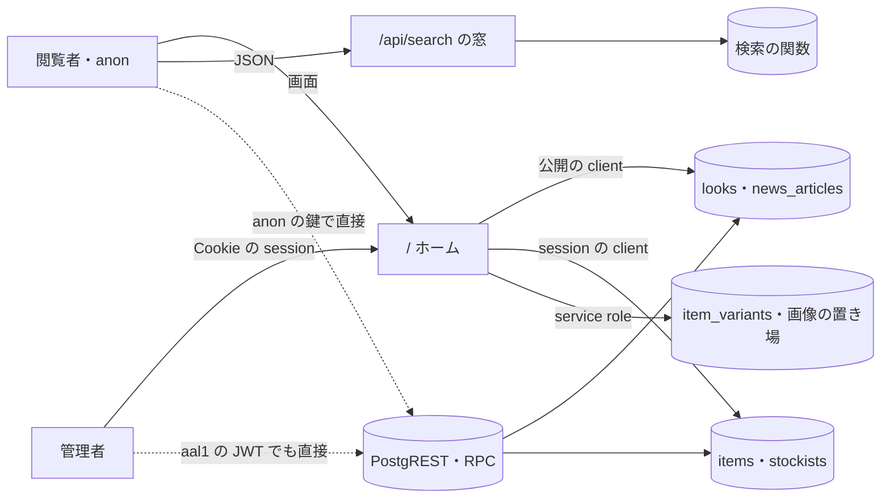

# HOME の脅威

> 状態: 推定（コードを読んで起こした。ユーザーの確認は未） | 確認日: 2026-10-24 | 対象: ホーム `/` の画面と、ホームが集めて出す商品・LOOK・NEWS・取扱店・検索の窓の道 | 基準コミット: `a03beaff`（本文の `ファイル:行` は、この脅威の文書が日付つきの証拠として残す行番号で、このコミットの内容を指す。コードを読み直す時は関数・部品の名前でたどる）

---

## 概要

HOME（ホーム `/`）の領域で考える脅威を、1つずつ `THR-HOME-NNN` の項目で書く。ホームは利用者の入力を受けず、ほかの領域の公開の取得を7つ並べて呼ぶ集め口なので、脅威の多くは「集めた先の道」と「全部の頁にかかる共有の守り」にある。過去のレビューの指摘と、2026-10-24 にコードと DB の移行を読み直して気づいた点の両方を拾った。

| 項目 | 内容 |
| --- | --- |
| 項目の数 | 20（THR-HOME-001〜020）。うち 011・012・019 は検索の窓の話で、持ち主の SEARCH の脅威（THR-SEARCH-006・010・021）へ移して「廃止」で残した |
| 守りがある物 | 下書きを出さない絞り（001）、枠への埋め込みと守りの見出し（010）、ホームの描画に生の HTML が無い・字は React が逃がす（008）、在庫の実数を直接読ませない（006） |
| 守りが欠ける・弱い物 | 公開の読みがセッションの権限で動く（002）、DB の管理の権限が aal2 を見ない（003）、原価の列を anon が直接読める（004）、表の権限が広い（005）、商品の画像の署名が7日（007）、使わない CDN の許可（009）、1つの取得の失敗で頁が落ちる（014）、原価の履歴の表が誰にでも開いている（020） |
| 対策の書き先 | 対策のセキュリティ要件 `SEC-HOME-NNN` は要件の文書（`docs/02_Requirements/areas/home.md`）に書く。下の「対策」の欄は読み手のための写し |
| 状態の付け方 | 全部「推定」。コードで確かめた物も、ユーザーの確認を受けていないので「推定」にした。どれも実行しての確かめはしていない |

---

## 範囲と根拠

- 範囲: `scripts/trace/scope.json` の HOME の src（`src/app/page.tsx`・`src/features/home/**`・`src/components/animations/TextReveal.tsx`）
- 範囲の外だが、ホームが呼ぶので見た物: `src/lib/items/public.ts`・`src/lib/items/availability.ts`・`src/lib/storage/item-images.ts`（ITEM）、`src/lib/look/server.ts`（LOOK）、`src/features/news/services/public.ts`（NEWS）、`src/features/stockist/services/public.ts`（STOCKIST）、`src/features/search/components/SearchHomePreview.tsx`・`src/app/api/search/route.ts`（SEARCH）、`src/app/layout.tsx`・`src/proxy.ts`・`src/features/auth/middleware/rateLimit.ts`・`src/lib/redirect.ts`・`src/lib/supabase/server.ts`・`src/contexts/*`・`next.config.ts`（共有）、`supabase/migrations/20260901102912_remote_schema.sql`・`20260919065336_add_variant_inventory_tables.sql`・`20261023175712_group_g0_permissions.sql`（表・RLS・権限）
- 出どころのレビュー: `docs/05_Quality/reviews/security/security_review_home.md`（2026-04 の版・2026-04-29 の追記・2026-06-27 の再レビュー）、`docs/05_Quality/reviews/code/2026-04-18-home-review.md`。どのレビューも当時の記録なので、今の状態は 2026-10-24 にコードを読み直して決めた。2026-04-18 の Must Fix 3件（Cookie の記録・LOOK の関連商品の公開の絞り・検索の回数の制限）は、今のコードで直っている（`src/lib/supabase/server.ts:85-86`、`src/lib/look/server.ts:118-122,197-201`、`src/app/api/search/route.ts:29-35`）
- 全体のセキュリティ要件は `docs/02_Requirements/requirements.md` の 5.4 節（NFR-SEC-001〜012・AC-SEC-001）。HOME に当てはまる物は各項目の根拠に書いた
- ASVS は OWASP ASVS 4.0.3 の項目番号。当てはめに自信のある物だけ書き、ほかは「ASVS 未対応付け」と書いた
- 外した物: ホームは `searchParams` を読まず、生の HTML を描かない（`src/app/page.tsx` 全体、`TextReveal.tsx:57-76`）。検索の窓の `q` は端末で読み React の子として描く（`SearchHomePreview.tsx:10,61`）。結果の行き先はサーバーが id から作る（`src/features/search/services/search.service.ts:139,264,285`）。どれもスクリプトの差し込みの面が無いので項目にしない（推定）。ただし `q` の字がそのまま店の案内の文に出る道（文の差し込み）は、持ち主の SEARCH の THR-SEARCH-021 が持つ

### 入口と守りの位置

- 実線はアプリが用意した道、点線はアプリを通らない道（THR-HOME-003・004・005）
- `/api/search` だけが回数の制限を通る。ホームの画面と PostgREST・RPC は通らない（THR-HOME-013。`/api/search` の回数の制限は SEARCH の THR-SEARCH-006）
- 全部の応答の前に `src/proxy.ts` が CSP と守りの見出しを付ける（THR-HOME-008・009・010）。図では省いた

---

## 脅威の一覧

### THR-HOME-001 下書きの商品・LOOK・NEWS・取扱店がホームの集め口から漏れる

| 属性 | 値 |
| --- | --- |
| 守るもの | 非公開（`private`）の商品・LOOK・NEWS・取扱店の名前・画像・中身 |
| 脅威 | 閲覧者が、発表前の物をホームで見る |
| 起こり方 | ホームが並べて呼ぶ7つの取得（`src/app/page.tsx:49-57`）のどれかが `status='published'` の絞りを落とす。今は全部が絞る（`src/lib/items/public.ts:51,84`、`src/lib/look/server.ts:44,68`、`src/features/news/services/public.ts:19,44`、`src/features/stockist/services/public.ts:26`）。anon の RLS も公開済みだけを許す（`supabase/migrations/20260901102912_remote_schema.sql:3462-3465,3535-3539,3786-3789`） |
| 影響 | 発表前のコレクション・取扱店の情報が先に知られる。ブランドの発表の段取りが崩れる |
| 対策 | SEC-HOME-001 |
| ASVS | V4.1.1 |
| 根拠 | 過去のレビューは「Fixed」とした（`security_review_home.md:37`）。ただし ITEM と取扱店は session の client で読むので、管理者が開くとアプリの絞りだけが守りになる（THR-HOME-002）。この性質をホームで試すテストは無い。全体の NFR-SEC-005（権限管理）をホームの公開の線引きに当てはめた |
| 状態 | 推定 |
| 出どころ | `docs/05_Quality/reviews/security/security_review_home.md:29,37` |

### THR-HOME-002 ホームの公開の読みが、閲覧者の session の権限で動く

| 属性 | 値 |
| --- | --- |
| 守るもの | 非公開の商品・取扱店と、公開の読みの最小権限の線 |
| 脅威 | 管理の権限を持つ人がホームを開いた時に、その人の権限で表を読む。将来の改修で絞りが落ちると、下書きがホームに出て、そのまま描かれる |
| 起こり方 | `getPublishedItems`・`getPublishedItemsCount`・`getPublicStockists` が `createClient` を引数無しで呼んで読む（`src/lib/items/public.ts:46,79`、`src/features/stockist/services/public.ts:21`）。引数無しでは Bearer も `sb-access-token` も渡さず、`@supabase/ssr` の Cookie（`sb-<ref>-auth-token`）だけを読む（`src/lib/supabase/server.ts:22,34,54-98`）。この Cookie を付けるのは Google OAuth のログインだけ（`src/app/api/auth/oauth/callback/route.ts:153-155`）で、メール・パスワード・OTP のログインは `sb-access-token` だけを付ける（`src/features/auth/services/register.ts:70`）。だから管理者の権限で読まれるのは、OAuth の Cookie を持つ session のときだけ。ほかは anon の権限で読む。authenticated の RLS は `admin.items.read`・`admin.stockists.read` を持つ人に下書きも許す（`remote_schema.sql:3489-3492,3781-3784`）。LOOK・NEWS は session を持たない公開の client で読む（`src/lib/look/server.ts:37,63`、`src/features/news/services/public.ts:11-14`） |
| 影響 | 守りがアプリの `.eq('status','published')` の1段になる。管理者がホームで下書きを公開済みと取り違える |
| 対策 | SEC-HOME-002 |
| ASVS | V4.1.3 |
| 根拠 | 2026-04-29 の追記の Medium の指摘で、今も Open のまま。`src/app/layout.tsx:22` の `force-dynamic` で毎回サーバーで描くので、管理者の結果が他人に渡るキャッシュは無い（推定） |
| 状態 | 推定 |
| 出どころ | `docs/05_Quality/reviews/security/security_review_home.md:64`、実装から推定（Cookie の読み方。2026-10-24 の読み直し） |

### THR-HOME-003 管理の権限を持つ人の2要素認証の済んでいない session で、ホームに出る商品の表を直接触る

| 属性 | 値 |
| --- | --- |
| 守るもの | 下書きの商品と、ホームに出る商品の中身の正しさ |
| 脅威 | `admin.items.*` を持つ人の、パスワードだけで得た `aal1` の session を手に入れた者が、下書きの商品を読み、ホームに出る行を書き換える・消す |
| 起こり方 | `aal1` の JWT で PostgREST の `items` を直接叩く。RLS の `has_permission` は ACL の表だけを見て `aal` を見ない（`supabase/migrations/20261023175712_group_g0_permissions.sql:186-216`、`remote_schema.sql:3473-3492`） |
| 影響 | 2要素認証の守りがアプリの窓口だけになる。パスワードが漏れると、ホームの見た目（商品名・画像の道筋）の改ざんに届く |
| 対策 | SEC-HOME-003 |
| ASVS | V4.3.1 |
| 根拠 | NEWS の THR-NEWS-002 と同じ形で、`items` の持ち主は ITEM（範囲に無い）なので、HOME が表をホームに出す側として書く。`looks`・`look_items` は LOOK の THR-LOOK-003、`stockists` は STOCKIST の THR-STOCKIST-003 が持つので、ここには書かない（二重に書くと文がずれる）。実際に叩いての確かめはしていない。全体の NFR-SEC-008（RBAC）に照らした |
| 状態 | 推定 |
| 出どころ | 実装から推定（2026-10-24 の DB の移行の読み直し） |

### THR-HOME-004 anon の鍵で、公開済みの商品の原価と内部の注記を直接読む

| 属性 | 値 |
| --- | --- |
| 守るもの | 商品の原価（`pattern_cost`・`mass_production_cost`）と内部の注記（`product_note`） |
| 脅威 | 誰でも、ブラウザに出ている anon の鍵で、公開済みの商品の原価を読む |
| 起こり方 | `items` に anon・authenticated の表の単位の SELECT がある（`remote_schema.sql:4160`）。RLS は行だけを絞り、公開済みの行の全部の列を許す（`:3462-3465`）。PostgREST に `select=pattern_cost,mass_production_cost,product_note` を送れば届く。列の単位の権限を絞る移行は無い（`items` の原価の列は `remote_schema.sql:587-588,594` だけに出る）。ホームのアプリは列を選んで読み（`src/lib/items/public.ts:6-7`）、原価を出さない。原価の履歴の表 `item_cost_history` の道は、もっと重いので THR-HOME-020 に分けた |
| 影響 | 原価と値付けの考えが競合や利用者に知られる。内部の注記が出る |
| 対策 | SEC-HOME-004 |
| ASVS | V4.1.3 |
| 根拠 | どのレビューにも無く、2026-10-24 にホームが読む表の列と権限を突き合わせて気づいた。原価を使うのは管理の画面だけ（`src/app/api/admin/kpi/cost-profit/route.ts:357,653`）、`product_note` も管理の画面だけ（`src/app/api/admin/items/route.ts:30`）。注文の表は列の単位で絞った前例がある（`supabase/migrations/20260927100900_hide_internal_order_columns.sql:20,53`）。表の持ち主は ITEM（範囲に無い）。実際に叩いての確かめはしていない |
| 状態 | 推定 |
| 出どころ | 実装から推定（2026-10-24 の突き合わせ） |

### THR-HOME-005 ホームに出る商品の表に、anon・authenticated へ要らない権限まで付いている

| 属性 | 値 |
| --- | --- |
| 守るもの | `items` の中身と形 |
| 脅威 | RLS の方針の書き違い・足し違いが1つ入った時に、anon が行を書き換える・消す |
| 起こり方 | `items` に anon・authenticated へ DELETE・INSERT・UPDATE・TRUNCATE・TRIGGER・REFERENCES・MAINTAIN を含む全部の権限を付けている（`remote_schema.sql:4160`）。今は RLS に anon の書きの方針が無いので書けない。在庫の表は権限を剥がしてから付け直した（`supabase/migrations/20260919065336_add_variant_inventory_tables.sql:104-113`）が、`items` は剥がしていない |
| 影響 | 守りが RLS の1段だけになる。誤りが入るとホームの中身の改ざん・消去に届く |
| 対策 | SEC-HOME-005 |
| ASVS | V4.1.3 |
| 根拠 | 在庫の移行の注記が「新しい表に全権限を自動で付ける」と書き、同じ考えで剥がした（`20260919065336_add_variant_inventory_tables.sql:108-110`）。NEWS の `news_articles` も同じ形（THR-NEWS-021）。`items` の持ち主は ITEM（範囲に無い）。`looks`・`look_items` は LOOK の THR-LOOK-004、`stockists` は STOCKIST の THR-STOCKIST-008 が持つので、ここには書かない |
| 状態 | 推定 |
| 出どころ | 実装から推定（2026-10-24 の DB の移行の読み直し） |

### THR-HOME-006 service role の読みと署名で、RLS を通らずに非公開の物に届く

| 属性 | 値 |
| --- | --- |
| 守るもの | 在庫の実数、商品の画像の置き場の中の物 |
| 脅威 | 商品の行の `image_url` を書き換えられる者（管理の権限を持つ人、または THR-HOME-003 の道）が、置き場の別の物をホームの応答に出させる。または在庫の読みの絞りが落ちて、非公開の商品の在庫の有無が出る |
| 起こり方 | ホームの商品の在庫の有無は service role で `item_variants` を読む（`src/lib/items/availability.ts:61-66`）。絞りは `items.status='published'` の条件だけ。画像の署名も service role で、道筋が置き場の中ならどこでも署名する（`src/lib/storage/item-images.ts:18-53,92-98`）。道筋にできない値と署名の失敗は、元の値をそのまま返す（`:93-94,98,137-140`） |
| 影響 | 置き場に商品の画像以外の物を置いた時に、それがホームから配られる。外の住所を入れられると、ホームが外の画像を読む |
| 対策 | SEC-HOME-006 |
| ASVS | ASVS 未対応付け |
| 根拠 | 過去のレビューは「署名は service role、DB の読みは公開の client で分離済み」と書く（`security_review_home.md:37`）が、在庫の読みも service role で RLS を通らない（食い違いは TM-HOME-28）。在庫の表は anon・authenticated の直接の読みを閉じている（`20260919065336_add_variant_inventory_tables.sql:104-113`）ので、直接の道は無い |
| 状態 | 推定 |
| 出どころ | 実装から推定（service role の読みが RLS を通らない点。過去のレビューとの食い違いは TM-HOME-28） |

### THR-HOME-007 ホームに出した商品の画像の署名つき URL が7日開ける

| 属性 | 値 |
| --- | --- |
| 守るもの | 非公開にした・消した商品の画像 |
| 脅威 | 前にホームの HTML を受け取った者が、商品を非公開にした後も画像を開く |
| 起こり方 | 商品の画像の署名は7日有効（`src/lib/storage/item-images.ts:4`）。署名した URL はサーバーの中の表に期限の1分前まで残し、同じ道筋には同じ URL を返す（`:5,7,60-80`）。LOOK・NEWS は1時間（`src/lib/storage/look-images.ts:14`、`src/lib/storage/news-images.ts:4`）。ただし LOOK のカードの関連商品の画像は、LOOK の取得（`src/lib/look/server.ts` の `hydrateLooks`）が ITEM の商品の画像の署名（`signItemImageUrl`）を通すので、同じ7日になる |
| 影響 | 誤って公開した商品を戻しても、最大7日、画像が見える。署名つき URL は取り消せない |
| 対策 | SEC-HOME-007 |
| ASVS | ASVS 未対応付け |
| 根拠 | 過去のレビューの Medium の指摘で、今も Open のまま。署名を残す表には件数の上限が無い（THR-HOME-013 の負荷にも効く）。`src/lib/storage/item-images.ts` は ITEM（範囲に無い）の物 |
| 状態 | 推定 |
| 出どころ | `docs/05_Quality/reviews/security/security_review_home.md:33` |

### THR-HOME-008 ホームの描画にスクリプトや style を差し込まれる

| 属性 | 値 |
| --- | --- |
| 守るもの | 閲覧者の端末で動くホームの画面 |
| 脅威 | 攻撃者が商品名・LOOK の題などに仕込んだ文で、ホームにスクリプトや `<style>` を差し込む |
| 起こり方 | ホームは生の HTML を描かず、字は React が逃がす（`src/app/page.tsx` 全体、`TextReveal.tsx:57-76`）。CSP は script に nonce を求める（`src/proxy.ts:105-112`）。`TextReveal` の1文字ずつの動きと、区画の字の大きさ（ITEM の価格・SCROLL・ABOUT の本文など）は style の属性に頼るので、`style-src` には `'unsafe-inline'` を付け、`<style>` の要素は `style-src-elem` で `'self'` に締める（`src/proxy.ts:91-103,121-122`、`TextReveal.tsx:63-71`） |
| 影響 | 差し込みが通ると、閲覧者の操作の乗っ取り・情報の持ち出し |
| 対策 | SEC-HOME-008 |
| ASVS | V14.4.3 |
| 根拠 | 守りがある。`'unsafe-inline'` は属性だけに効き、要素の差し込みを前提とする CSS の持ち出しは塞がる（`src/proxy.ts:91-95` の注記）。`src/styles/globals.css:912-913` の注記は「`'unsafe-inline'` が無い」と古いまま（TM-HOME-21）。全体の NFR-SEC-003（入力検証と XSS 対策・CSP）に当てはめた |
| 状態 | 推定 |
| 出どころ | `docs/05_Quality/reviews/code/2026-04-18-home-review.md:56`、FREQ-280（`docs/02_Requirements/requirements.md:1464`） |

### THR-HOME-009 使わない CDN と広い接続先の許可を、乗っ取りや持ち出しに使われる

| 属性 | 値 |
| --- | --- |
| 守るもの | ホームの画面で動くスクリプトと、閲覧者の情報 |
| 脅威 | `cdn.jsdelivr.net` の上の物が乗っ取られる・誰でも置ける物を読ませる。差し込みが通った時に、別の Supabase のプロジェクトへ情報を送る |
| 起こり方 | CSP の `script-src`・`style-src`・`style-src-elem`・`font-src` が `https://cdn.jsdelivr.net` を許す（`src/proxy.ts:96,102,109,123`）が、`src` のどこも CDN を読まない（`src/proxy.ts` のほかに `cdn.jsdelivr` の字が無い）。`connect-src`・`img-src` は `https://*.supabase.co` を全部許す（`src/proxy.ts:71,86`） |
| 影響 | CDN の乗っ取りで、全部の頁でスクリプトが動く。持ち出しの先が開いている |
| 対策 | SEC-HOME-009 |
| ASVS | V14.2.3 |
| 根拠 | 過去のレビューの Medium の指摘で、今も Open のまま。`src/proxy.ts` は範囲外の共有部品で、全部の頁に同じ CSP がかかる |
| 状態 | 推定 |
| 出どころ | `docs/05_Quality/reviews/security/security_review_home.md:34` |

### THR-HOME-010 ホームを枠に埋め込まれ、平文に落とされ、種類を取り違えさせられる

| 属性 | 値 |
| --- | --- |
| 守るもの | ホームの操作の見た目と、閲覧者の通信 |
| 脅威 | 攻撃者のサイトがホームを iframe に埋めて上に偽の UI を重ねる。応答の種類を取り違えさせる。平文の通信に落とす。行き先へ元の住所を漏らす |
| 起こり方 | 守りの見出しが無い応答を返す時に起こる。今は `src/proxy.ts` が全部の応答（`matcher` は `/:path*`、`:246`）に `frame-ancestors 'none'`（`:118`）・`X-Frame-Options: DENY`・`X-Content-Type-Options: nosniff`・`Strict-Transport-Security`・`Referrer-Policy: no-referrer` を付ける（`:234-239`） |
| 影響 | クリックジャッキング・通信の盗み見 |
| 対策 | SEC-HOME-010 |
| ASVS | V14.4.4、V14.4.5、V14.4.6、V14.4.7 |
| 根拠 | 守りがある。過去のレビューの High の指摘で「Fixed」。全体の NFR-SEC-001（TLS・HSTS）・NFR-SEC-003（CSP）に当てはめた |
| 状態 | 推定 |
| 出どころ | `docs/05_Quality/reviews/security/security_review_home.md:28`、`docs/05_Quality/reviews/code/2026-04-18-home-review.md:54` |

### THR-HOME-011 検索の窓の回数の制限を、偽の送り元の見出しで外す

| 属性 | 値 |
| --- | --- |
| 守るもの | 検索の関数と DB の余力、公開の中身の一覧 |
| 脅威 | 第三者が、ホームの検索の窓の道（`/api/search?preview=true`）を大量に叩く |
| 起こり方 | 持ち主の SEARCH の THR-SEARCH-006 が同じ道を持つ。ここには書かない |
| 影響 | THR-SEARCH-006 を見る |
| 対策 | SEC-HOME-011（廃止。持ち主の SEARCH の SEC-SEARCH-006 が正） |
| ASVS | V11.1.4 |
| 根拠 | 窓口は SEARCH、回数の制限は共有の部品で、同じ道を SEARCH の THR-SEARCH-006 が持つ。二重に書くと「今のコードは満たさない」が2つの領域に残り、片方を直すともう片方が古くなるので、SEARCH を正にして廃止にした。番号は使い回さないので項目は残す |
| 状態 | 廃止 |
| 出どころ | `docs/05_Quality/reviews/security/security_review_home.md:63` |

### THR-HOME-012 検索の窓の応答が、検索語ごと中継のキャッシュに残る

| 属性 | 値 |
| --- | --- |
| 守るもの | 閲覧者の検索語と、検索の結果の新しさ |
| 脅威 | 中継の CDN・共有のキャッシュが `/api/search` の応答を保ち、別の利用者に渡す |
| 起こり方 | 持ち主の SEARCH の THR-SEARCH-010 が同じ道を持つ。ここには書かない |
| 影響 | THR-SEARCH-010 を見る |
| 対策 | SEC-HOME-012（廃止。持ち主の SEARCH の SEC-SEARCH-010 が正） |
| ASVS | V8.2.1 |
| 根拠 | 窓口は SEARCH で、同じ道を SEARCH の THR-SEARCH-010（`/api/suggest` と 429・503 も含む）が持つ。二重に書くと文がずれるので、SEARCH を正にして廃止にした。番号は使い回さないので項目は残す |
| 状態 | 廃止 |
| 出どころ | `docs/05_Quality/reviews/security/security_review_home.md:32` |

### THR-HOME-013 ホームを大量に開かれ、1回ごとの DB と署名の呼び出しで止まる

| 属性 | 値 |
| --- | --- |
| 守るもの | サーバーと DB の余力、ホームの使える状態 |
| 脅威 | 第三者がホームを大量に開く |
| 起こり方 | ホームは `force-dynamic` で毎回サーバーで描き（`src/app/layout.tsx:19-22`）、1回ごとに7つの取得（`src/app/page.tsx:49-57`）、在庫の読み（`availability.ts:61-66`）、LOOK の関連商品の読み（`src/lib/look/server.ts:180-201`）、画像の署名を呼ぶ。商品は10件取って8件だけ描く（`page.tsx:22`。TM-HOME-03）。画面の頁には回数の制限が無い（`src/proxy.ts` に回数の制限の呼び出しが無い）。商品の画像の署名を残す表に件数の上限が無い（`item-images.ts:7`） |
| 影響 | DB の接続と処理を使い切られ、ホームと全部の頁が遅くなる。サーバーの記憶の量が増え続ける |
| 対策 | SEC-HOME-013 |
| ASVS | ASVS 未対応付け |
| 根拠 | `force-dynamic` は CSP の nonce のために要る（`layout.tsx:19-21` の注記）ので、頁の結果のキャッシュで逃げられない。どのレビューにも無く、2026-10-24 の読み直しで気づいた。中継の守り（Vercel の防御など）は本番が無く確かめていない |
| 状態 | 推定 |
| 出どころ | 実装から推定（2026-10-24 の読み直し） |

### THR-HOME-014 1つの取得の失敗でホームが落ちる、または黙って空になる

| 属性 | 値 |
| --- | --- |
| 守るもの | ホームの使える状態 |
| 脅威 | 設定の誤り・DB の権限の欠け・Supabase の障害で、ホームが開けなくなる。空の節が出ても気づけない |
| 起こり方 | 7つは `Promise.all` で並べて待つ（`src/app/page.tsx:41-57`）。各取得は DB の失敗を空・0 にするが、service role の client を作る所は try の外にあり、鍵が無いと例外を投げる（`src/lib/supabase/server.ts:137-143`、`src/lib/items/public.ts:69`、`src/features/news/services/public.ts:11-14`、LOOK は公開済みの LOOK が1件以上ある時の `src/lib/look/server.ts` の `hydrateLooks`。画像の署名のためで、LOOK の取得そのものが投げる）。1つが投げると頁ごと失敗し、`src/app/error.tsx` も無い。逆に、PostgREST の前に動く `private.set_request_context` の権限が欠けると、全部の読みが空になる（BUG-PUBLIC-001。`docs/04_DetailDesign/pages/01_home.md` の DD-HOME-001 の異常フロー） |
| 影響 | ホームが既定の失敗の画面になる。または全部の節が空のまま出て、障害に気づくのが遅れる |
| 対策 | SEC-HOME-014 |
| ASVS | ASVS 未対応付け |
| 根拠 | 失敗の時の流れの点検と、運用の記録の BUG-PUBLIC-001 から起こした。NEWS の脅威の「公開の一覧は毎回 service role の client を作り、その失敗が一覧全体を止める」（THR-NEWS-019）と同じ形 |
| 状態 | 推定 |
| 出どころ | `docs/04_DetailDesign/pages/01_home.md` の DD-HOME-001 の異常フロー（BUG-PUBLIC-001）、実装から推定 |

### THR-HOME-015 失敗の記録に、DB の誤りの中身を丸ごと出す

| 属性 | 値 |
| --- | --- |
| 守るもの | DB の形・問い合わせの中身と、閲覧者の端末の記録 |
| 脅威 | サーバーの記録を読める人や、閲覧者の端末の開発者の道具から、内部の情報を得る |
| 起こり方 | ホームが呼ぶ取得は、Supabase の error を丸ごと `console.error` に渡す（`src/lib/items/public.ts:61,87`、`src/lib/items/availability.ts:69,96`、`src/features/stockist/services/public.ts:36`、`src/lib/look/server.ts:54,71`）。検索の窓は端末で失敗を詳しく記録する（`SearchHomePreview.tsx:33`） |
| 影響 | 表の名前・列・問い合わせの形が記録に残る。記録の外への持ち出しで内部の形が知られる |
| 対策 | SEC-HOME-015 |
| ASVS | ASVS 未対応付け |
| 根拠 | 端末の記録は 2026-04-29 の追記の Low の指摘で、今も Open のまま。サーバーの記録は NEWS の脅威（THR-NEWS-018）と同じ形。どの部品も範囲外 |
| 状態 | 推定 |
| 出どころ | `docs/05_Quality/reviews/security/security_review_home.md:66` |

### THR-HOME-016 ホームを開くだけで、認証とカートの窓口を呼び、要らない個人の情報まで受け取る

| 属性 | 値 |
| --- | --- |
| 守るもの | 利用者の id・メールの住所と、認証の窓口の余力 |
| 脅威 | 共有の端末・拡張機能・記録の道具が、ホームを開いただけで流れる応答から利用者の id とメールの住所を得る |
| 起こり方 | 全部の頁にかかる `LoginProvider` が、開いた時に必ず `/api/auth/me` を呼ぶ（`src/contexts/LoginContext.tsx:248-250`）。応答は `id` と `email` を返す（`src/app/api/auth/me/route.ts:49-50`）が、画面は役割と2要素認証の済みしか使わない。`CartProvider` はプライバシーの頁のほかで、開いた時にカートとお気に入りを読む（`src/contexts/Providers.tsx:29`、`src/contexts/CartContext.tsx:157-164`） |
| 影響 | 要らない個人の情報が端末に流れる。未ログインの訪問でも認証の窓口が毎回動く |
| 対策 | SEC-HOME-016 |
| ASVS | ASVS 未対応付け |
| 根拠 | 過去のレビューの Medium 2件・Low 1件で、今も Open のまま。部品は共有（`src/contexts/*`・`src/app/api/auth/me`）で、HOME の範囲の外。全体の NFR-SEC-010（個人情報のマスキング）に当てはめた |
| 状態 | 推定 |
| 出どころ | `docs/05_Quality/reviews/security/security_review_home.md:30,31,36` |

### THR-HOME-017 使わない外の画像の場所の許可を、最適化の中継に使われる

| 属性 | 値 |
| --- | --- |
| 守るもの | サーバーの最適化の処理の余力と、画像の出どころ |
| 脅威 | 第三者が、許可された外の場所や別の Supabase のプロジェクトの画像を `/_next/image` に通させる。許可した外の場所が乗っ取られる |
| 起こり方 | `next.config.ts:35-78` の `remotePatterns` が `placehold.co`・`readdy.ai`・`public.readdy.ai` と、`*.supabase.co` の public・sign・authenticated の道を全部許す。CSP の `img-src` も `placehold.co`・`readdy.ai` を許す（`src/proxy.ts:82-84`）。ホーム自体は手元の画像だけを使う（`src/app/page.tsx:70`、ABOUT の `/about.png`） |
| 影響 | 他人の画像のためにサーバーの処理と費用を使われる。THR-HOME-006 で外の住所を入れられた時に、その画像がホームに出る |
| 対策 | SEC-HOME-017 |
| ASVS | V12.6.1 |
| 根拠 | 過去のレビューは「Partially Fixed」（`readdy.ai` は legacy・demo の用として残す）とした。`*.supabase.co` の広さは NEWS の THR-NEWS-022 と同じ。`next.config.ts` は範囲外の共有の設定 |
| 状態 | 推定 |
| 出どころ | `docs/05_Quality/reviews/security/security_review_home.md:35` |

### THR-HOME-018 OG の画像と頁の住所が、設定の誤りで別の場所を指す

| 属性 | 値 |
| --- | --- |
| 守るもの | 共有された時のホームの見え方と、住所の正しさ |
| 脅威 | 設定の誤りで、SNS に共有したホームの OG の画像の住所が別のドメインや `localhost` を指す |
| 起こり方 | ホームの OG の画像は `/mainphoto.png`（`src/app/page.tsx:35`）で、`src/app/layout.tsx:28` の `metadataBase` が絶対の住所にする。元は環境変数4つのどれか、無ければ `http://localhost:3000`（`src/lib/redirect.ts:1,64-72`）。要求の見出しからは作らないので、見出しの偽りでは変わらない |
| 影響 | 共有のカードの画像が出ない・別の場所の画像が出る。ブランドの見え方が崩れる |
| 対策 | SEC-HOME-018 |
| ASVS | ASVS 未対応付け |
| 根拠 | サイトの住所の設定の欠けから起こした（2026-10-24 の読み直し）。本番の環境変数は本番が無く確かめていない。`getSiteUrl` は共有の部品 |
| 状態 | 推定 |
| 出どころ | 実装から推定（2026-10-24 の読み直し） |

### THR-HOME-019 細工したリンクで、ホームの検索の窓に偽の案内の文を出させる

| 属性 | 値 |
| --- | --- |
| 守るもの | ホームの公式の画面の言葉の信用と、閲覧者の判断 |
| 脅威 | 攻撃者が `/?q=` に偽の案内を入れたリンクを配り、開いた人に店の言葉として読ませる |
| 起こり方 | 持ち主の SEARCH の THR-SEARCH-021 が同じ道を持つ。ここには書かない |
| 影響 | THR-SEARCH-021 を見る |
| 対策 | SEC-HOME-019（廃止。持ち主の SEARCH の SEC-SEARCH-021 が正） |
| ASVS | ASVS 未対応付け |
| 根拠 | HOME で起こした時は SEARCH の脅威に同じ道が無かったが、今は SEARCH が THR-SEARCH-021 で持つ。部品は SEARCH の `SearchHomePreview` なので、SEARCH を正にして廃止にした。番号は使い回さないので項目は残す |
| 状態 | 廃止 |
| 出どころ | 実装から推定（2026-10-24 の点検） |

### THR-HOME-020 誰でも使える方針と全部の権限で、原価の履歴の表を直接読み・書き換え・消される

| 属性 | 値 |
| --- | --- |
| 守るもの | 原価の履歴（`item_cost_history` の `pattern_cost`・`mass_production_cost`・`pdf_url`）と、その正しさ |
| 脅威 | 誰でも（anon の鍵を持つ者も）、下書きを含む全部の商品の原価の履歴を読み、書き換え、消す |
| 起こり方 | `item_cost_history` に全員（PUBLIC）へ読み・書き・消しを無条件で許す `"Allow all"` の方針があり（`remote_schema.sql:3456-3459`）、anon・authenticated に全部の権限も付いている（`:4158`）。PostgREST でこの表を直接叩けば届く。列は `remote_schema.sql:557-566`。後の移行にこの表を直す物は無い。`src/` にこの表を使うコードは無い（移行の外に参照が無い。推定） |
| 影響 | 行があれば、原価と値付けの考えが誰にでも知られ、`pdf_url` の書き換えや履歴の消去もできる。使っていない表に行が無ければ、害は表が開いている事実に留まる |
| 対策 | SEC-HOME-020 |
| ASVS | V4.1.3 |
| 根拠 | 2026-10-24 に THR-HOME-004 の突き合わせで気づいた。表の持ち主は ITEM・ADMIN だが、どちらの文書にもこの表の項目が無かったので、見つけた HOME で起こした。今のコードは満たさない。実際に叩いての確かめと、本番に行があるかの確認はしていない |
| 状態 | 推定 |
| 出どころ | 実装から推定（2026-10-24 の DB の移行の読み直し） |

---

## 未確認事項

- `aal1` の JWT で PostgREST から下書きの `items` を読めるか（THR-HOME-003）、anon の鍵で `items` の原価の列を読めるか（THR-HOME-004）は、実際に叩いて確かめていない
- 本番の Supabase の `items` の列の権限と、画像の置き場 `item-images` の公開の設定（THR-HOME-004・006）。移行と手元しか見ていない
- 本番の環境変数 `NEXT_PUBLIC_SITE_URL` などの値（THR-HOME-018）
- 管理者の session でホームを開いた時に、本当に下書きが出ないか（THR-HOME-001・002）。管理の試し用の利用者で開いてはいない
- 原価の列の扱い（THR-HOME-004）・`items` の権限（THR-HOME-005）・原価の履歴の表（THR-HOME-020）の持ち主 ITEM は範囲に無い。どの領域の要件で直すかはユーザーに決めてもらう。`looks`・`look_items`・`stockists` の分は LOOK・STOCKIST の脅威が持つ
- 対策の `SEC-HOME-001`〜`020` は要件の文書（`docs/02_Requirements/areas/home.md`）に書いた。残りは受け入れ条件の E2E が未作成
- `item_cost_history` の `"Allow all"` の方針と全部の権限（THR-HOME-020）は、表の持ち主（ITEM・ADMIN）の脅威の文書に無い。持ち主が決まるまで HOME で持つ（TM-HOME-53）。実際に叩いての確かめと、本番に行があるか、`src/` が本当に使っていないかは確かめていない
- 検索の窓の回数の制限・応答のキャッシュ・URL の語の埋め込み（THR-HOME-011・012・019）は SEARCH の THR-SEARCH-006・010・021 を正にして廃止にした。この分け方はユーザーに確かめる
