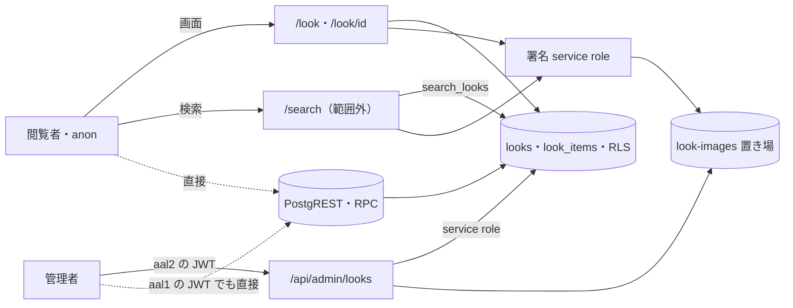

# LOOK の脅威

> 状態: 推定（コードを読んで起こした。ユーザーの確認は未） | 確認日: 2026-10-28 | 対象: LOOK の公開の画面（`/look`・`/look/<id>`）・管理のルックの窓口と画面・画像の置き場 `look-images`・`looks`・`look_items` の DB | 基準コミット: `a03beaff`（作業ツリー。この文書の `ファイル:行` の行番号は、このコミットの作業ツリーを読んだ時の物）

---

## 概要

LOOK（ルック・コーディネート）の領域で考える脅威を、1つずつ `THR-LOOK-NNN` の項目で書く。過去のセキュリティレビューの指摘と、2026-10-24 にコードと DB の移行を読み直して気づいた点の両方を拾った。

| 項目 | 内容 |
| --- | --- |
| 項目の数 | 23（THR-LOOK-001〜023） |
| 守りがある物 | 非公開の LOOK を公開の道へ出さない（001）、署名の前に自分の道筋だけに絞り失敗は `null`（007・008。2026-10-28）、`og:image` を同一オリジンの窓口に（006。2026-10-28）、画面の XSS（017）、管理の窓口の権限と aal2（019。カードの操作ボタンも 2026-10-26 から窓口の `meta.canManage` で出し分け）、管理の窓口の回数・大きさの制限（012）、監査の記録（020）、Origin の確かめ（018）、画像の中身と保存名（013。2026-10-26）、画像の後始末（014。2026-10-26）、管理の入口の id と JSON（016 の管理の分。2026-10-26）、内部の誤りの文言を出さない（021 の管理の分。2026-10-26）、取り出しの失敗の分け方（022 の管理の分。2026-10-26） |
| 守りが欠ける・弱い物 | 非公開の商品の ID が `look_items` から読める（002）、DB が aal2 を見ない（003）、表の権限が広い（004。波 2 で直した）、全件の取得と署名（009）、検索の関数の件数に上限が無い（010）、更新の途中の失敗（015）、DB の段に入力の制約が無い（023）。「新規作成」のボタンが役で出る件（019 の残り）は 2026-10-28 の波 4 で直した |
| 対策の書き先 | 対策のセキュリティ要件 `SEC-LOOK-NNN` は要件の文書（`docs/02_Requirements/areas/look.md`）に書く。下の「対策」の欄は読み手のための写し |
| 状態の付け方 | どれもコードを読んで起こし、ユーザーの確認を受けていないので「推定」。実行しての確かめはしていない |

---

## 範囲と根拠

- 範囲: `scripts/trace/scope.json` の LOOK の src（`src/app/look/**`・`src/app/api/admin/looks/**`・`src/app/admin/look/create/page.tsx`・`src/app/admin/look/edit/**`・`src/app/admin/look/types.ts`・`src/components/LookSection.tsx`・`src/features/look/**`・`src/lib/look/**`・`src/lib/storage/look-images.ts`）
- 範囲の外だが脅威の入口・守りになるので見た物: `src/proxy.ts`（Origin の確かめ）、`src/features/auth/middleware/rateLimit.ts`（回数の制限）、`src/lib/auth/admin-rbac.ts`（管理の認可と aal2）、`src/lib/audit.ts`（監査）、`src/features/search/services/search.service.ts`（検索の LOOK）、`src/app/admin/page.tsx`（LOOK のタブ。別の作業が書き換え中なので行番号ではなく `case 'LOOK'` の所で指す）、`src/app/admin/look/LookForm.tsx`（範囲外のフォーム）、`next.config.ts`（画像の最適化）、`supabase/migrations/20260901102912_remote_schema.sql`（表・RLS・権限・検索の関数）、`supabase/migrations/20261023175712_group_g0_permissions.sql`（`has_permission`）、`supabase/seed.sql`（置き場）、旧 `migrations/018_create_looks_and_look_images_bucket.sql`・`030_make_look_images_bucket_private.sql`（今の CI は当てない）
- 出どころのレビュー: `docs/05_Quality/reviews/security/security_review_look.md`・`security_review_look_id.md`、`docs/05_Quality/reviews/code/2026-04-18-look-review.md`・`2026-04-18-look-detail-review.md`・`2026-04-29-look-id-review.md`。レビューの「状態」は当時の記録なので、今の状態は 2026-10-24 にコードを読み直して決めた
- 読み直し: 2026-10-24 にコード・DB の移行・設定を読み直して起こした。実行しての確かめはしていない
- 全体のセキュリティ要件は `docs/02_Requirements/requirements.md` の 5.4 節（NFR-SEC-001〜012・AC-SEC-001）。LOOK に当てはまる物は、各項目の根拠に書いた
- NEWS と同じ共有部品の脅威（画像の最適化の中継の `remotePatterns`、守りの見出し）は `docs/05_Quality/security/threats/news.md` の THR-NEWS-022・023 にあり、ここでは繰り返さない

### 入口と守りの位置

- 実線の矢印はアプリが用意した道、点線はアプリを通らない道（THR-LOOK-002・003・004・010）
- 回数の制限は管理の変更の窓口（作成・更新・状態・削除）だけが通る。公開の画面・管理の一覧の取得・PostgREST・RPC は通らない（THR-LOOK-009・010・012）
- 管理の窓口の前には `src/proxy.ts` の Origin の確かめがある（THR-LOOK-018）。図では省いた
- 公開の画面の DB の読み出しは anon の鍵（RLS が効く）、署名だけ service role（RLS が効かない）で行う（`src/lib/look/server.ts:172-177`）

---

## 脅威の一覧

### THR-LOOK-001 公開前の LOOK が公開の道から漏れる

| 属性 | 値 |
| --- | --- |
| 守るもの | 非公開（`private`）の LOOK のテーマ・説明文・画像の道筋 |
| 脅威 | 閲覧者・一般会員が、公開前の LOOK を読む |
| 起こり方 | `/look`・`/look/<id>`・検索（`search_looks`、SEARCH の範囲）・anon と一般会員の JWT での PostgREST の直接の読み出しで、`status='private'` の行を求める。取り出しの絞り（`.eq('status','published')`）か RLS のどちらかが崩れると届く |
| 影響 | 発表前のコレクションのスタイリングが先に知られる。ブランドの発表の段取りが崩れる |
| 対策 | SEC-LOOK-001 |
| ASVS | V4.1.1 |
| 根拠 | 守りは2段ある。DB の RLS（`supabase/migrations/20260901102912_remote_schema.sql:3535-3538,3562-3565`）と、公開の取り出しの絞り（`src/lib/look/server.ts:44,68,91`）、検索の関数の中の絞り（`remote_schema.sql:2197`）。過去のレビューも「Fixed」とした。ただし手元の見本の LOOK は7件とも公開済み（`supabase/seed.sql:120-136`）で、この性質を試すテストが無い。片方を外しても今のテストは通る（推定）。全体の NFR-SEC-005（範囲外。権限管理）を LOOK の公開の線引きに当てはめた |
| 状態 | 推定 |
| 出どころ | `docs/05_Quality/reviews/security/security_review_look.md:50`、`docs/05_Quality/reviews/security/security_review_look_id.md:48` |

### THR-LOOK-002 公開の LOOK に紐づく非公開の商品の ID が読める

| 属性 | 値 |
| --- | --- |
| 守るもの | 発売前の商品の存在と ID |
| 脅威 | 閲覧者が、公開の LOOK に紐づいた非公開の商品の ID を集め、発売前の商品があることを知る |
| 起こり方 | anon の鍵で PostgREST の `look_items` を直接読む。anon の読み出しの方針は「親の LOOK が公開」だけを条件にし、商品の公開を見ない（`remote_schema.sql:3499-3504`。authenticated も同じ `:3528-3533`）。管理の窓口は紐づける商品が有るかだけを見て、公開かどうかを見ない（`src/app/api/admin/looks/route.ts:186-189,209`、`src/app/api/admin/looks/[id]/route.ts:249-252,273`）ので、非公開の商品を紐づけられる。**2026-10-26 に直した**: 移行 `sec_rls_predicates_and_constraints` が `look_items` の anon・authenticated の読みの方針を作り直し、「親の LOOK が公開」かつ「紐づく商品が公開」を条件にした（管理の読みの枝は `has_permission('admin.looks.read')` のまま。波 5 で aal2 を足す）。この移行を当てた DB でだけ満たす。管理の窓口は引き続き非公開の商品を紐づけられる（意図は未確認） |
| 影響 | 発売前の商品の数と ID が分かる。商品の窓口の別の弱さと組み合わさると、中身まで探られる |
| 対策 | SEC-LOOK-002 |
| ASVS | V4.1.1 |
| 根拠 | 過去のレビューで High として3回指摘され、今も直っていない。画面の表示は公開の商品に絞る（`src/lib/look/server.ts:122,201`）ので、漏れるのは ID だけ。全体の NFR-SEC-005（範囲外）に照らした |
| 状態 | 推定 |
| 出どころ | `docs/05_Quality/reviews/security/security_review_look.md:42`、`docs/05_Quality/reviews/security/security_review_look_id.md:42`、`docs/05_Quality/reviews/code/2026-04-18-look-detail-review.md:37-41` |

### THR-LOOK-003 権限を持つ人が2要素認証を飛ばして DB を直接書き換える

| 属性 | 値 |
| --- | --- |
| 守るもの | 非公開の LOOK と、LOOK・関連商品の中身の正しさ |
| 脅威 | `admin.looks.read`・`admin.looks.manage` を持つ人の、2要素認証を済ませていない（`aal1`）session を手に入れた者が、非公開の LOOK を読み、LOOK と関連商品を書き換える・消す |
| 起こり方 | パスワードだけで得た `aal1` の JWT で、管理の窓口を通らず PostgREST の `looks`・`look_items` を直接叩く。RLS の `has_permission` は役割と権限の表だけを見て、`aal` も session の生き死にも見ない（`remote_schema.sql:3512-3526,3546-3565`、`supabase/migrations/20261023175712_group_g0_permissions.sql:186-216`）。**書き込みの側は 2026-10-26 に直した**: 移行 `sec_grants_admin_tables` が anon・authenticated から `looks`・`look_items` の INSERT・UPDATE・DELETE を外したので、`aal1` の JWT でも PostgREST から書けない（権限の誤り `42501`。この移行を当てた DB でだけ満たす。ADR-0414）。読みの側（非公開の LOOK を読める）は `has_permission` の `aal2` の確かめを足すまで残る（波 5） |
| 影響 | 2要素認証の守りが管理の窓口だけになる。直接の書き込みは、管理の窓口の回数の制限・画像の確かめ・紐づける商品の確かめ・監査の記録（`src/features/look/services/admin-audit.ts:7-30`）を全部通らない。`image_urls` に好きな道筋を入れられるので、THR-LOOK-007 の入口にもなる。入力の形を DB で確かめない点は THR-LOOK-023 |
| 対策 | SEC-LOOK-003 |
| ASVS | V4.3.1 |
| 根拠 | 管理の窓口は `aal2` を求める（`src/lib/auth/admin-rbac.ts:240-249`）が、同じ守りが DB に無い。PostgREST が `aal1` の JWT を受けるのは Supabase の標準の動き。実際に叩いての確かめはしていない。全体の NFR-SEC-008（範囲外。RBAC）と FREQ-540（範囲外。DB の ACL・session・2要素で管理の操作を守る）に照らした |
| 状態 | 推定 |
| 出どころ | 実装から推定（2026-10-24 のコードと DB の移行の読み直し） |

### THR-LOOK-004 anon・authenticated に要らない表の権限を付けている

| 属性 | 値 |
| --- | --- |
| 守るもの | `looks`・`look_items` の中身と、表そのもの |
| 脅威 | RLS の方針の書き損じや、RLS の効かない操作で、anon・一般会員が表を書き換える・空にする |
| 起こり方 | `looks`・`look_items` に、anon・authenticated へ SELECT のほか INSERT・UPDATE・DELETE・TRUNCATE・TRIGGER・REFERENCES・MAINTAIN を付けている（`remote_schema.sql:4168,4170`）。今は RLS が書き込みを止めるが、TRUNCATE は RLS の外にあり、守りが RLS の1段だけになる。**2026-10-26 に直した**: 移行 `sec_grants_admin_tables` が anon・authenticated の権限を SELECT だけにした。管理の書き込みは全部 service role の窓口で行い（`looks`・`look_items` の窓口は元から service role）、RLS の書き込み方針は消さずに二重の守りとして残した（この移行を当てた DB でだけ満たす。ADR-0414） |
| 影響 | 方針を1つ書き損じると、誰でも LOOK を書き換えられる |
| 対策 | SEC-LOOK-004 |
| ASVS | V4.1.3 |
| 根拠 | どのレビューにも無く、2026-10-24 の DB の移行の読み直しで気づいた。PostgREST には表を空にする道が無いので、今すぐ届く道は無い（推定）。全体の NFR-SEC-006（範囲外。最小権限）を DB の権限に当てはめた |
| 状態 | 推定 |
| 出どころ | 実装から推定（2026-10-24 の DB の移行の読み直し） |

### THR-LOOK-005 画像の置き場が公開になり、非公開の LOOK の画像が見える

| 属性 | 値 |
| --- | --- |
| 守るもの | 非公開の LOOK の画像 |
| 脅威 | 閲覧者が、置き場の公開の URL から非公開の LOOK の画像を開く |
| 起こり方 | 置き場 `look-images` が `public=true` になっている、または `storage.objects` に誰でも読める方針がある時に、`/storage/v1/object/public/look-images/<道筋>` を開く。以前は今の CI が当てる `supabase/migrations/` に置き場の定義が無く、手元の見本 `supabase/seed.sql:10-14` が `public=false` で作るだけで、大きさと種類の上限も無かった。**2026-10-26 に直した**: 移行 `sec_storage_buckets` が `look-images` を `public=false`・5MB・JPEG/PNG/WebP/GIF の 4 種類で入れ、本番にある行は `ON CONFLICT (id) DO UPDATE` で合わせる。`storage.objects` に置き場を名指しする方針は作らず、あれば移行の自己検査が止める（ADR-0164。この移行を当てた DB でだけ満たす） |
| 影響 | 発表前の画像が出る。道筋は uuid なので推測は難しいが、一度出た URL は LOOK を非公開にしても開ける |
| 対策 | SEC-LOOK-005 |
| ASVS | ASVS 未対応付け |
| 根拠 | 2026-04-18 のレビューで置き場が公開だった（Must Fix）。直した先は旧い `migrations/030_make_look_images_bucket_private.sql:9-11` で、大きさ・種類の上限も旧い `migrations/018_create_looks_and_look_images_bucket.sql:68-77` にあった。本番の置き場の今の設定と `storage.objects` の方針は、移行を当てる前に読んで確かめる（`wave2-task-8-report.md` の SQL。読むだけ） |
| 状態 | 推定 |
| 出どころ | `docs/05_Quality/reviews/code/2026-04-18-look-detail-review.md:43-46`、`docs/05_Quality/reviews/security/security_review_look.md:48` |

### THR-LOOK-006 外へ出した署名つき URL で、非公開にした後も画像が見える

| 属性 | 値 |
| --- | --- |
| 守るもの | 非公開にした・消した LOOK の画像 |
| 脅威 | 前に頁を受け取った者や、頁を読み込んだ SNS・検索のクローラーが、LOOK を非公開にした後も画像を開く |
| 起こり方 | 署名つき URL は1時間有効で、LOOK を非公開にしても取り消せない（`src/lib/storage/look-images.ts:12-14`）。詳細の頁は署名つき URL を `og:image` に入れる（`src/app/look/[id]/page.tsx:81`）。一覧のカードは最適化つきの `next/image` に署名つき URL を渡す（`src/features/look/components/PublicLookGrid.tsx:89-105`）ので、最適化の画像のキャッシュにも残りうる（長さの `minimumCacheTTL` は `next.config.ts` に指定が無い）。`/look`・`/look/<id>` は `revalidate`・`dynamic` の方針を書いていない。**2026-10-28 に塞いだ**: `og:image` は署名を含まない同一オリジンの窓口 `GET /look/<id>/og` にした（`src/app/look/[id]/og/route.ts`、API-LOOK-007、ADR-0165）。窓口は公開の LOOK だけの先頭の画像を、検証した道筋のバイトで返し、`Cache-Control: public, max-age=300, s-maxage=300`・`nosniff`・`Set-Cookie` なし。非公開にすると最長 300 秒（共有キャッシュの分）で消える。最適化のキャッシュは `minimumCacheTTL: 3600`（`next.config.ts`）、頁は根の `layout.tsx` の `force-dynamic` で要求ごとに描く。窓口に回数の制限は付けない（公開の LOOK の数に限られ、`s-maxage` で CDN が受ける。クエリの付け替えで置き場を叩かれる量は波 4 で見直す） |
| 影響 | 誤って公開した LOOK を戻しても、最大1時間（キャッシュに残ればそれ以上）画像が見える。共有された後は画像が切れる |
| 対策 | SEC-LOOK-006（実装済み。ADR-0165） |
| ASVS | ASVS 未対応付け |
| 根拠 | 期限つきの署名は過去のレビューで守りとして認められた。頁のキャッシュの方針が無い点は Medium・Low として Open のまま。`og:image` と最適化のキャッシュは2026-10-24 のコードと DB の移行の読み直しで見つけた |
| 状態 | 推定 |
| 出どころ | `docs/05_Quality/reviews/security/security_review_look.md:49,97`、`docs/05_Quality/reviews/security/security_review_look_id.md:46` |

### THR-LOOK-007 画像の道筋を書き換えて、置き場の別の物に署名させる

| 属性 | 値 |
| --- | --- |
| 守るもの | 置き場 `look-images` の中の、LOOK の画像でない物 |
| 脅威 | LOOK の行の `image_urls` を書き換えられる者（管理の権限を持つ人、または THR-LOOK-003 の道）が、置き場の別の物の署名つき URL を公開の頁に出させる |
| 起こり方 | 従来は、署名の前に道筋が `looks/` の下にあるか、`..` などの区切りを含まないかを確かめず、素の道筋は先頭の `/` を外すだけ、URL の形は復号した道筋をそのまま返していた（`extractLookImageObjectPath`）。service role で署名する（`src/lib/look/server.ts`）ので RLS も効かない。検索の結果の画像も同じ関数で署名する（`src/features/search/services/search.service.ts`、SEARCH の範囲）。**2026-10-28 に塞いだ**: `signLookImageUrl` は共有の `parseOwnObjectPath`（`src/lib/storage/safe-object-path.ts`、DD-SEARCH-011）を通し、自分の origin 1 つ・バケット `look-images`・`looks/` の下の安全な文字だけを署名する（`extractLookImageObjectPath` は管理の後始末だけが使う） |
| 影響 | 置き場に LOOK の画像以外の物を置いた時に、それが公開の頁から配られる |
| 対策 | SEC-LOOK-007（実装済み。ADR-0316） |
| ASVS | ASVS 未対応付け |
| 根拠 | 過去のレビューで High（境界の無さ）と Low（`..` を拒まない）として指摘され、今も残る。今の置き場には LOOK の画像しか置かないので害は小さい（推定） |
| 状態 | 推定 |
| 出どころ | `docs/05_Quality/reviews/security/security_review_look.md:95,99` |

### THR-LOOK-008 署名や取り出しに失敗した時に、素の道筋や外の URL をそのまま返す

| 属性 | 値 |
| --- | --- |
| 守るもの | 置き場の構成と、閲覧者の端末が読み込む先 |
| 脅威 | DB の `image_urls` が汚れた時や、署名・関連の取り出しが失敗した時に、置き場の素の道筋や外のサイトの URL が頁に出る |
| 起こり方 | 従来は、道筋にできない値も署名の失敗も元の値を返していた（`signLookImageUrl`）。一覧は `look_items` の取り出しに失敗すると署名していない元の道筋のまま LOOK を返す経路があった（今は取り出しの失敗を `failFetch` で投げる）。詳細のギャラリーと管理の一覧は最適化を通さずに画像を出す（`src/features/look/components/LookImageGallery.tsx`、`src/components/LookSection.tsx`）ので、外の URL も `next.config.ts` の許可の表を通らずにそのまま読み込まれる。**2026-10-28 に塞いだ**: `signLookImageUrl` は道筋にできない値と署名の失敗で `null` を返し、`signLookImageUrls` は結果から外す。`look/server.ts` の `mapLookRowToListItem` は生の `image_urls` を載せず `imageUrls: []` にして、呼び手が署名した値だけで埋める。失敗の記録は種類 `invalid_path`・`sign_failed` だけ |
| 影響 | 置き場の道筋が外に出る。汚れた値が外の URL なら、閲覧者の端末が第三者のサイトへ要求を送る（閲覧の追跡など） |
| 対策 | SEC-LOOK-008（署名の側は実装済み。ADR-0316） |
| ASVS | V4.1.5 |
| 根拠 | 署名の fail-open は過去のレビューで Low・Medium として Open のまま。一覧の失敗の時の素の道筋は2026-10-24 のコードと DB の移行の読み直しで見つけた。全体の NFR-SEC-003（範囲外。入力検証）に照らした |
| 状態 | 推定 |
| 出どころ | `docs/05_Quality/reviews/security/security_review_look.md:46`、`docs/05_Quality/reviews/code/2026-04-29-look-id-review.md:36-46` |

### THR-LOOK-009 公開の LOOK を毎回全件取り、全部の画像に署名して負荷をかける

| 属性 | 値 |
| --- | --- |
| 守るもの | DB と置き場の処理の余力、要らない項目 |
| 脅威 | 自動の道具が `/look`・`/look/<id>` を繰り返し開き、DB の読み出しと署名の処理を使い切らせる |
| 起こり方 | 一覧は件数の上限なしに全部の公開の LOOK を取り（`src/app/look/page.tsx:32`、`src/lib/look/server.ts:36-59`）、全部の画像に署名する（`server.ts:237-244`）。詳細も前後の移動のために全件を取り（`src/app/look/[id]/page.tsx:89`）、頁の情報のために別の道で1件をもう一度取って署名する（`:62`）。一覧では表示しない説明文・関連商品の価格と画像まで取る（`server.ts:41-43,197-221`）。公開の画面に回数の制限は無い。**2026-10-26 に公開の分を直した**（`ADR-0159`）: 一覧は `getPublishedLookList` で説明文を取らず新しい順に 100 件で切り、詳細は現在の LOOK を `getPublishedLookById` の 1 件で取って前後は `getAdjacentPublishedLooks` で 1 件ずつだけ取る。署名は 100 件分までに収まる。関連商品の価格は今のカードが出すので残す（Q11）。上の行番号は直す前のコードの物 |
| 影響 | LOOK が増えるほど1回の表示の重さが増え、繰り返しの要求で頁が遅くなる・止まる。Storage の費用も増える |
| 対策 | SEC-LOOK-009 |
| ASVS | ASVS 未対応付け |
| 根拠 | 過去のレビューで Medium として Open のまま。詳細の単体の取得は頁の情報の道にだけ入り、本体には入っていない。全体の NFR-PERF-005・007（範囲外）にも照らした |
| 状態 | 推定 |
| 出どころ | `docs/05_Quality/reviews/security/security_review_look.md:44,45,96`、`docs/05_Quality/reviews/security/security_review_look_id.md:43` |

### THR-LOOK-010 LOOK の検索の関数を直接叩いて、件数と回数の制限を迂回する

| 属性 | 値 |
| --- | --- |
| 守るもの | DB の処理の余力 |
| 脅威 | 自動の道具が、アプリを通らずに PostgREST の RPC で LOOK の検索を繰り返し、大きな件数を求める |
| 起こり方 | `search_looks` は anon・authenticated に実行を許し（`remote_schema.sql:4012-4014`）、`LIMIT limit_count` を上限に丸めずに使う（`:2173-2203`）。検索の文字の長さにも上限が無い。未使用（削除の判断待ち）の `search_public_looks` は PUBLIC に実行を開いている（`:2267-2290,4022`）。PostgREST の `max_rows` は手元で 1000、本番は未確認。**2026-10-26 に直した**: 移行 `sec_search_functions` が `search_looks` の件数を 1〜8 に丸め（NULL・0・負の値も）、検索語を先頭 100 字に切り、`search_public_looks` を DROP せず PUBLIC・anon・authenticated から EXECUTE を外した。この移行を当てた DB でだけ満たす。`max_rows` の本番の値は運用の確認が残る（ADR-0315） |
| 影響 | 1回で大量の行を返させ、`ILIKE` の全件の走査を繰り返させて DB を圧迫する |
| 対策 | SEC-LOOK-010 |
| ASVS | V11.1.4 |
| 根拠 | 関数は SECURITY INVOKER で `status='published'` に絞るので、非公開の LOOK は出ない。検索の画面と呼び出しは SEARCH の範囲（`src/features/search/services/search.service.ts:212,338`）で、関数が読むのは LOOK の表なのでここに置いた |
| 状態 | 推定 |
| 出どころ | 実装から推定（2026-10-24 のコードと DB の移行の読み直し） |

### THR-LOOK-011 回数の制限の送り元を偽って制限を逃れる

| 属性 | 値 |
| --- | --- |
| 守るもの | 管理の変更の窓口の回数の制限の効き目と、数えの表の大きさ |
| 脅威 | 管理の権限を持つ session を手に入れた者が、送るたびに `x-forwarded-for` を変えて、送り元ごとの制限を逃れる |
| 起こり方 | 基準コミット時点は、回数の制限が送り元を `x-forwarded-for` の先頭、無ければ `x-real-ip` から無条件に取っていた（`src/features/auth/middleware/rateLimit.ts`）。2026-10-28（波 4）に、共有の `getClientIp`（`src/lib/request-ip.ts`）が Vercel の見出し（手元の E2E は `CLIENT_IP_HEADER` が信じる `x-real-ip`）だけから取る形に直した（ADR-0416）。LOOK の管理の変更の窓口は送り元と操作者の2段で数える（`src/features/look/services/admin-rate-limit.ts:39-66`） |
| 影響 | 基準コミット時点は送り元の段が効かず、操作者の段が同じ上限で残るので1人の操作者の回数は止まった。今は `x-forwarded-for` を読まないので偽って送り元の枠を増やせない。取れない配置は `ip null` の 1 つの枠になる（厳しい側）。操作者の段は元から残る |
| 対策 | SEC-LOOK-011 |
| ASVS | V11.1.4 |
| 根拠 | 過去のレビューで High・Medium として指摘され、今も残る。`rateLimit.ts` は範囲外の共有部品で、LOOK 以外も同じ関数を通る。波 4 で直した。Vercel が `x-vercel-forwarded-for`・`x-real-ip` を上書きするかは本番の構成で変わる（未デプロイなので未確認。配備前に preview で実測する） |
| 状態 | 推定 |
| 出どころ | `docs/05_Quality/reviews/security/security_review_look.md:43`、`docs/05_Quality/reviews/security/security_review_look_id.md:44` |

### THR-LOOK-012 管理の窓口の乱用で、置き場と処理を使い切る

| 属性 | 値 |
| --- | --- |
| 守るもの | 置き場の容量と、管理の窓口の可用性 |
| 脅威 | 管理の権限を持つ session を手に入れた者や、誤った自動の操作が、大量の作成・更新・巨大な画像を送る |
| 起こり方 | 変更の窓口は回数の制限（作成10回・更新15回・状態30回・削除30回を10分ごと、`admin-rate-limit.ts:17-22`）、1枚5MB（`src/app/api/admin/looks/route.ts:24-25,166`）、1回6枚・20MB（`admin-rate-limit.ts:6-7,68-80`）、1時間60MB（`:8,82-111`）で止める。ただし1時間の量は作成と更新で別々に数える（`:96`）ので、合わせると120MB まで上がる。一覧と1件の取得（`route.ts:388-432`、`[id]/route.ts:58-110`）には回数の制限が無く、一覧は全部の LOOK の全部の画像に署名する（`route.ts:420-425`） |
| 影響 | 置き場の容量と費用が増える。消し残しの画像（THR-LOOK-014）と重なると、容量がたまり続ける |
| 対策 | SEC-LOOK-012 |
| ASVS | V12.1.1、V12.1.3 |
| 根拠 | 回数と大きさの多層の制限は過去のレビューで「Fixed」とされ、今も同じ。数えが失敗した時は 503 で止める（`admin-rate-limit.ts:107-110`）。作成と更新を分けて数える点は2026-10-24 のコードと DB の移行の読み直しで見つけた（意図かは未確認） |
| 状態 | 推定 |
| 出どころ | `docs/05_Quality/reviews/security/security_review_look.md:52-53` |

### THR-LOOK-013 中身や名前を偽った画像を置き場に入れる

| 属性 | 値 |
| --- | --- |
| 守るもの | 置き場と、画像を開く閲覧者 |
| 脅威 | 管理の権限を持つ者や乗っ取られた session が、画像の種類を偽ったファイルや、名前に区切りを含むファイルを上げる |
| 起こり方 | 種類は端末の申告（`File.type`）だけを見た。保存の名前の拡張子は送ったファイル名の最後の `.` の後ろをそのまま使い、名前に `/` を含むと保存の道筋に区切りが入った。置き場への書き込みの種類も申告の値を渡した。**2026-10-26 に直した**: `prepareLookImage`（`src/features/look/services/admin-images.ts`）が中身の先頭の印（JPEG・PNG・GIF・WebP）を読み、申告と食い違えば 400 `Unsupported image type`。確かめは大きさの確かめの直後・1時間の量の枠を使う前・置き場に書く前に済ませる（偽の画像で枠を消費させない）。保存名は `buildLookImagePath` が `looks/<UTC の日付>/<uuid>.<検出した種類の拡張子>` を作り、送られた名前を使わない。置き場への書き込みの種類も検出した種類。監査にはファイル名も中身も残さない（申告の種類と枚数だけ） |
| 影響 | 画像でない物が LOOK の画像として配られる。拡張子と中身が食い違う物が置かれる |
| 対策 | SEC-LOOK-013 |
| ASVS | V12.2.1、V12.3.1 |
| 根拠 | 2026-10-24 のコードと DB の移行の読み直しで見つけた。旧い移行の置き場の種類の上限（`migrations/018_create_looks_and_look_images_bucket.sql:73`）も申告の値を見るだけで、中身は見ない。全体の NFR-SEC-003（範囲外。入力検証）に照らした |
| 状態 | 推定 |
| 出どころ | 実装から推定（2026-10-24 のコードと DB の移行の読み直し） |

### THR-LOOK-014 消した・差し替えた LOOK の画像が置き場に残る

| 属性 | 値 |
| --- | --- |
| 守るもの | 消した・差し替えた LOOK の画像と、置き場の容量 |
| 脅威 | 消したつもりの画像が置き場に残り、署名つき URL を作れる者（service role）や、置き場を読める誤った設定から見える |
| 起こり方 | 削除は LOOK の行だけを消し、置き場の画像を消さなかった。更新で画像を差し替えた時の古い画像も、作成と更新の途中で失敗した時に上げ終えた画像も消さなかった。**2026-10-26 に直した**: 順は「行を先に変える → 置き場を消す」。削除は存在確認で `image_urls` を行を消す前に読み、行の削除が成功した後に消す。差し替えは行の更新が成功した後に古い画像を消し、更新が失敗したらこの要求で上げた新しい画像を消す（2026-10-26 の `admin_update_look` から、行と関連が1取引なので、関連の保存の失敗でも行は戻り、新しい画像を消し古い画像は消さない。古い画像は関数が返す更新前の `image_urls` で決め、同時の PUT で残骸にならない。ADR-0163）。作成は途中の失敗（2枚目の上げ・行の保存・関連の保存）で上げ終えた画像を消す。消す道筋は `isOwnLookImagePath` で1本ずつ「`looks/` の下の安全な文字だけ」を確かめ、`..`・外の URL・別の置き場・古い見本の道筋（`e2e/look-1-1.png` など。波 2 で見本は `looks/e2e/` に移った）は消さない側に倒れる。E2E の用意は見本の画像を行に指さず、試験ごとの画像（`looks/e2e-fixture/`）を指して、後始末とアプリの削除が見本を消さないようにする。置き場の削除は service role で行い、失敗は記録（名前と符号だけ）と監査の `metadata`（`image_cleanup`・`orphaned_count`）に残すだけで応答は変えない |
| 影響 | 消したはずの画像が残り続ける。置き場の容量がたまる |
| 対策 | SEC-LOOK-014 |
| ASVS | ASVS 未対応付け |
| 根拠 | 2026-10-24 のコードと DB の移行の読み直しで見つけた。`docs/03_BasicDesign/api/api-spec.md:214-219` は削除で画像も消すと書き、コードと食い違う（`api-spec.md` は別の作業が書き換え中で直さない） |
| 状態 | 推定 |
| 出どころ | 実装から推定（2026-10-24 のコードと DB の移行の読み直し） |

### THR-LOOK-015 更新の途中で失敗し、公開中の LOOK の関連商品が消えたまま残る

| 属性 | 値 |
| --- | --- |
| 守るもの | 公開中の LOOK と関連商品の組の正しさ |
| 脅威 | 更新の途中の DB の失敗で、公開中の LOOK が関連商品0件のまま、または新しい中身と古い関連の混ざった形で残る |
| 起こり方 | 更新は「LOOK の行の更新 → 関連の全削除 → 関連の追加」を別々の要求で行い、まとまり（トランザクション）にしない（`src/app/api/admin/looks/[id]/route.ts:347-421`）。関連の追加（`:403`）が失敗しても、前の2つは戻さない。**2026-10-26 に直した**: 移行 `sec_rls_predicates_and_constraints` の DB の関数 `admin_update_look` が3つを1取引で行い（途中で失敗すれば行の更新も戻る）、窓口の PUT はその rpc を1回呼ぶだけにした。行は `FOR UPDATE` で締めるので、同時の PUT は順に走る。画像の無い PUT は `_image_urls` に NULL を渡して今の画像を関数に保たせる。窓口と関数は同じ日に当てる（ADR-0163） |
| 影響 | 公開の頁から関連の商品が消える。売り場の導線が壊れる |
| 対策 | SEC-LOOK-015 |
| ASVS | ASVS 未対応付け |
| 根拠 | 2026-10-24 のコードと DB の移行の読み直しで見つけた。作成は関連の追加の失敗で LOOK の行を消して戻す（`src/app/api/admin/looks/route.ts:335`）が、更新には戻しが無い |
| 状態 | 推定 |
| 出どころ | 実装から推定（2026-10-24 のコードと DB の移行の読み直し） |

### THR-LOOK-016 入口で確かめない値が取り出しに渡る

| 属性 | 値 |
| --- | --- |
| 守るもの | 一貫した入力の検証と、誤りの返し方 |
| 脅威 | 形の合わない `id`・本文を送り、思わない分岐や 500 を起こさせる |
| 起こり方 | 公開の詳細は `id` を `Number()` で変えるだけだった（`src/app/look/[id]/page.tsx:61,88`）。**2026-10-26 に公開の分を直した**: `parseLookId` が正の整数の 10 進の文字だけを通し、`1e3`・`1.5`・`0`・`01`・前後の空白・17 桁以上は DB を呼ばずに見つからない扱いにする。管理の1件の窓口は `id` を確かめずに文字のまま取り出しに渡した。状態の変更（PATCH）は本文が JSON でないと例外になり 500 を返した（作成・更新は 400）。**2026-10-26 に管理の分も直した**: 4つのハンドラーとも、権限と回数の確かめの後・DB に触れる前に `parseLookId` で確かめ、合わなければ 400 `Invalid look id`（監査には id の生の値でなく長さだけ）。PATCH は `request.json()` の失敗を 400 `Invalid request`（監査 `Invalid JSON`）にして更新しない。同じ商品 ID を2回送ると「Some linked items do not exist」になる（`route.ts:209`、`[id]/route.ts:273`） |
| 影響 | 直ちに注入にはならない。誤りの返し方が揃わず、監視と利用者の案内がずれる |
| 対策 | SEC-LOOK-016 |
| ASVS | V5.1.3 |
| 根拠 | 過去のレビューで Low として Open のまま。PATCH の 500 と重なった ID は2026-10-24 のコードと DB の移行の読み直しで見つけた。全体の NFR-SEC-003（範囲外。入力検証）・NFR-SEC-007（範囲外。パラメータ化クエリ）に照らした。取り出しは supabase-js の組み立てを通すので、SQL の注入の道は無い（推定） |
| 状態 | 推定 |
| 出どころ | `docs/05_Quality/reviews/security/security_review_look.md:47`、`docs/05_Quality/reviews/security/security_review_look_id.md:45`、`docs/05_Quality/reviews/code/2026-04-29-look-id-review.md:58-65` |

### THR-LOOK-017 テーマ・説明文に仕込んだスクリプトが閲覧者の端末で動く

| 属性 | 値 |
| --- | --- |
| 守るもの | 閲覧者の端末 |
| 脅威 | LOOK の文字を書き換えられる者が、テーマ・説明文・関連商品の名前にスクリプトを仕込む |
| 起こり方 | 公開の一覧・詳細・頁の情報・管理の一覧で、DB の文字を画面に出す時に起こる。今は React の自動のエスケープだけで出し、生の HTML を差し込む書き方は LOOK の範囲に無い（2026-10-24 に `src/app/look`・`src/features/look`・`src/lib/look`・`src/components/LookSection.tsx`・`src/app/admin/look` を検索して0件） |
| 影響 | 閲覧者の端末でスクリプトが動き、session や操作を奪われる |
| 対策 | SEC-LOOK-017 |
| ASVS | V5.3.3 |
| 根拠 | 守りがある。過去のレビューも生の HTML を使わないことを確かめた。CSP の nonce（`src/proxy.ts:215-234`、範囲外）が2段目の守り。全体の NFR-SEC-003（範囲外。XSS・CSP）に当てはめた |
| 状態 | 推定 |
| 出どころ | `docs/05_Quality/reviews/security/security_review_look.md:130` |

### THR-LOOK-018 管理の操作を他のサイトから送らせる

| 属性 | 値 |
| --- | --- |
| 守るもの | LOOK のデータの正しさ |
| 脅威 | 攻撃者のサイトが、ログイン中の管理者のブラウザに LOOK の作成・更新・状態の変更・削除を送らせる |
| 起こり方 | `/api/admin/looks*` の POST・PUT・PATCH・DELETE を他のオリジンから送る。今は `src/proxy.ts` が状態を変える `/api` の要求の Origin・Referer を確かめ、合わなければ 403 で止める（`src/proxy.ts:146-156,166-213`）。許可のオリジンが設定されていない時は、要求の `x-forwarded-proto`・`x-forwarded-host`・`host` から比べる元を作る（`:140-144,185-202`） |
| 影響 | 管理者の知らない間に LOOK が公開・非公開・削除される |
| 対策 | SEC-LOOK-018 |
| ASVS | V4.2.2 |
| 根拠 | 守りがある。`src/proxy.ts` は範囲外の共有部品。LOOK の窓口は CSRF の token を確かめない。FREQ-327（範囲外）は Origin の確かめを proxy の1か所にまとめると決めた。全体の NFR-SEC-003（範囲外。CSRF）に当てはめた |
| 状態 | 推定 |
| 出どころ | 実装から推定（`docs/03_BasicDesign/architecture/system-overview.md` の該当の記述） |

### THR-LOOK-019 権限の無い人が管理の操作をする・管理の画面を見る

| 属性 | 値 |
| --- | --- |
| 守るもの | LOOK のデータと非公開の LOOK |
| 脅威 | ログインしていない人、2要素を済ませていない人、`admin.looks.*` の権限を外された人が、管理の窓口を叩く・管理の画面を開く |
| 起こり方 | 窓口は操作ごとに `authorizeAdminPermission` で権限と `aal2` を確かめる（読み出しは `admin.looks.read`、変更は `admin.looks.manage`。`src/app/api/admin/looks/route.ts` の POST・GET の `authorizeAdminPermission`、`[id]/route.ts` の GET・PUT・PATCH・DELETE のそれ、`src/lib/auth/admin-rbac.ts:240-249`）。画面の側は作成と編集の頁が端末の側だけで動き、頁を開く前に認可を確かめない（`src/app/admin/look/create/page.tsx:1-7`、`src/app/admin/look/edit/[id]/page.tsx:1-30`）。管理の LOOK のタブは役（`admin`）で出し分け（`src/app/admin/page.tsx` の `case 'LOOK'`）、`LookSection` の編集・公開・削除のボタンは権限で出し分けなかった。**2026-10-26 にカードの3つのボタンを、2026-10-28（波 4）に「新規作成」を直した**: `GET /api/admin/looks` が `meta.canManage` を添える。はじめは `admin.looks.manage` の認可をもう一度行う暫定の作りだったが、波 4 で `admin-rbac.ts` の認可の成功の結果が権限の集合（`permissions`）を返すようにし、`canManage` はその集合から作る 1 回の認可にした（集合が無ければ false。ADR-0166。ADR-0161 の暫定を解いた）。`LookSection` は `canManage === true` の時だけ「新規作成」とカードの3つのボタンを出す（読み込み中・失敗・`meta` なし・偽は出さない）。以前は「新規作成」を `src/app/admin/page.tsx` のヘッダーが役で出していたが、ヘッダーの分岐を消した |
| 影響 | 窓口が止めるのでデータには届かない。権限の無い人にも作成のフォームの頁を直に開けば見え、送ると 403 になる（「新規作成」とカードの3つのボタンは出なくなった。作成の頁の入口の確かめは無い） |
| 対策 | SEC-LOOK-019 |
| ASVS | V4.1.3、V4.3.1 |
| 根拠 | 窓口の守りは過去のレビューで確かめられた。権限を役割ごとに切り替えられるようになった（`docs/superpowers/specs/2026-10-23-group-g-design.md:565-566`）ので、役で出す画面と権限で止める窓口がずれうる。`admin-rbac.ts` は範囲外の共有部品。全体の NFR-SEC-005・008（範囲外。権限管理・RBAC）と FREQ-316（範囲外。管理 API の認可を1つの道にまとめる）・FREQ-519（範囲外。役割ごとの操作の設定）に当てはめた |
| 状態 | 推定 |
| 出どころ | `docs/05_Quality/reviews/code/2026-04-18-look-review.md`、実装から推定（2026-10-24 のコードと DB の移行の読み直し） |

### THR-LOOK-020 管理の操作の跡が残らず、不正や誤りを追えない

| 属性 | 値 |
| --- | --- |
| 守るもの | LOOK の変更の証跡 |
| 脅威 | 誰がいつ LOOK を公開・削除したかを後から追えず、不正や誤りを否認される |
| 起こり方 | 管理の窓口の作成・更新・状態・削除は、成功も失敗も `logAdminLookAudit` で残す（`src/features/look/services/admin-audit.ts:7-30`）。基準コミット時点は送り元の IP を渡さなかったが、2026-10-28（波 4）に共有の `getAuditRequestContext`（`getClientIp` の値。取れなければ `null`、`x-forwarded-for` は読まない）で IP とブラウザの名乗りを渡す形に直した（ADR-0462）。監査の書き込みの失敗は警告だけで握りつぶす（`src/lib/audit.ts:67-70,87-89`、範囲外）。DB を直接書き換えた時（THR-LOOK-003）は何も残らない |
| 影響 | 基準コミット時点は、乗っ取られた session での変更を送り元から追えなかった。今は IP が入る（取れない配置では `null`）。IP は個人情報にあたりうる。保存期間は法令対応の後回しの決めに従う。監査の表が止まっても気づけない |
| 対策 | SEC-LOOK-020 |
| ASVS | ASVS 未対応付け |
| 根拠 | 監査の無さは 2026-04-18 のレビューで Must Fix とされ、直った（`security_review_look.md:54` で Fixed）。IP を渡さない点は2026-10-24 のコードと DB の移行の読み直しで見つけた。全体の NFR-SEC-005・011（範囲外。監査ログ）に当てはめた |
| 状態 | 推定 |
| 出どころ | `docs/05_Quality/reviews/code/2026-04-18-look-review.md:46`、`docs/05_Quality/reviews/security/security_review_look.md:54` |

### THR-LOOK-021 応答や記録から内部の情報が漏れる

| 属性 | 値 |
| --- | --- |
| 守るもの | 置き場と DB の構成 |
| 脅威 | 管理の窓口の応答やサーバーの記録から、置き場・DB の内部の誤りの文言が外へ出る |
| 起こり方 | 画像の書き込みの失敗の文言をそのまま応答に入れた。Supabase の error や例外を丸ごと記録に渡した。**2026-10-26 に管理の窓口を直した**: 応答は `Failed to upload image` ちょうど、`console.error` は全部 `describeErrorForLog`（名前と符号だけ）。公開の取り出し（`src/lib/look/server.ts`）の記録は Task 4 で直した |
| 影響 | 置き場の名前・上限・道筋の決まりが分かる。記録に要らない情報がたまる |
| 対策 | SEC-LOOK-021 |
| ASVS | V7.4.1 |
| 根拠 | 2026-10-24 のコードと DB の移行の読み直しで見つけた。応答に出るのは管理の権限を持つ人だけなので、害は小さい（推定） |
| 状態 | 推定 |
| 出どころ | 実装から推定（2026-10-24 のコードと DB の移行の読み直し） |

### THR-LOOK-022 取り出しの失敗が「0件」「見つからない」に見えて気づけない

| 属性 | 値 |
| --- | --- |
| 守るもの | 公開の頁と管理の画面の使える状態、障害に気づく力 |
| 脅威 | DB や置き場の障害の時に、利用者には LOOK が無いように見え、運用者も気づけない |
| 起こり方 | 公開の一覧の取り出しは失敗すると空の配列を返した（`src/lib/look/server.ts:51-56`）。詳細はその結果で探すので、障害でも「Look not found」の画面を状態 200 で返した（`src/app/look/[id]/page.tsx:89-100`）。**2026-10-26 に公開の分を直した**: `/look` と詳細は DB の失敗を `LookFetchError` として投げ、`src/app/look/error.tsx` の誤りの画面に出す（`error.message`・`stack` は画面にも記録にも出さず、記録は名前と符号と `digest` だけ）。ホームの LOOK の区画は空の配列のまま（ホーム全体を落とさない）。詳細の前後の LOOK だけは添え物として握る。管理の1件の取得は DB のどんな失敗も 404 にした。**2026-10-26 に管理の分も直した**: 1件の取得・更新・状態の変更・削除の存在確認を `maybeSingle` にし、`error` は 500 `Failed to fetch look`（記録は名前と符号だけ）、行が無い時だけ 404 にする。更新は行を確かめる前に画像を置き場に上げない |
| 影響 | 障害の間、公開の LOOK が全部無いように見える。検索エンジンには中身の薄い頁に見える |
| 対策 | SEC-LOOK-022 |
| ASVS | ASVS 未対応付け |
| 根拠 | 2026-10-24 のコードと DB の移行の読み直しで見つけた。not found を同じ道で 200 で返すのは `docs/03_BasicDesign/ui/screen-list.md:20` の「同じルートに未存在表示」に沿う意図かもしれない（未確認） |
| 状態 | 推定 |
| 出どころ | 実装から推定（2026-10-24 のコードと DB の移行の読み直し） |

### THR-LOOK-023 DB の段に入力の制約が無く、直接の書き込みが窓口の確かめを飛ばす

| 属性 | 値 |
| --- | --- |
| 守るもの | LOOK の中身の正しさと、公開の一覧・詳細・検索の余力 |
| 脅威 | `admin.looks.manage` を持つ人の session（THR-LOOK-003 の aal1 の道を含む）で、窓口を通らずに長さや形の外れた値を表に書く |
| 起こり方 | テーマ（200字）・説明文（4000字）の上限は窓口の入力の形（`src/app/api/admin/looks/route.ts` の `createLookSchema`）にしか無く、`image_urls` の道筋の形は窓口が保存の道筋を自分で作ることにしか無い。表は `theme` が text の NOT NULL、`theme_description` が text の NOT NULL、`image_urls` が text の配列の NOT NULL で、season の2列と status の CHECK のほかに制約が無い（`supabase/migrations/20260901102912_remote_schema.sql` の `looks` の定義）。PostgREST で直接 insert・update すれば、上限の無い長さの文字や、置き場の外を指す道筋を入れられる。**2026-10-26 に直した**: 移行 `sec_rls_predicates_and_constraints` が `looks` に `theme`（1〜200字）・`theme_description`（4000字）・`image_urls`（`looks/` の下の安全な道筋だけ。NULL の要素と改行を含む要素も断る）の CHECK を `NOT VALID` で足した。既存の行は検査しないので、本番の旧い行は点検してから別の移行で `VALIDATE` する（ADR-0162）。この移行を当てた DB でだけ満たす |
| 影響 | 公開の一覧・詳細・検索が大きな行を読んで遅くなる。画面の表示が崩れる。置き場の外を指す道筋は THR-LOOK-007 の道につながる。直接の書き換えは窓口の回数の制限（THR-LOOK-012）と監査（THR-LOOK-020）にも残らない |
| 対策 | SEC-LOOK-023 |
| ASVS | V5.1.4（当てはめは推定） |
| 根拠 | どのレビューにも無く、2026-10-24 の文書の見直しで気づいた。窓口の確かめ（DRV-LOOK-009）だけでは、窓口を通らない書き込みを止められない。NEWS が同じ形を THR-NEWS-025 で受けている |
| 状態 | 推定 |
| 出どころ | 実装から推定（2026-10-24 の見直し） |

---

## 未確認事項

- 本番の Supabase の置き場 `look-images` の公開の設定・大きさと種類の上限・`storage.objects` の方針（THR-LOOK-005）。移行 `sec_storage_buckets` は書いたが本番にはまだ当てていない。本番の今の値は適用の前に読んで確かめる（読むだけ。値は報告に残す）
- 本番の PostgREST の `max_rows`（THR-LOOK-010）。手元は 1000
- 本番の Vercel が `x-vercel-forwarded-for`・`x-real-ip` を上書きするか（THR-LOOK-011、THR-LOOK-020 の IP）。本番のアプリはまだデプロイしていない。配備前に最初の preview で偽の見出しを送って実測する（ADR-0416）
- 監査の IP の保存期間と開示（THR-LOOK-020）。法令対応の後回しの決めに従い、ここでは決めない（ADR-0462）
- `aal1` の JWT で PostgREST から非公開の LOOK を読み書きできるか（THR-LOOK-003）、anon で `look_items` から非公開の商品の ID が読めるか（THR-LOOK-002）は、実際に叩いて確かめていない
- multipart のファイル名が `/` を残すかと、置き場が道筋を正すか（THR-LOOK-013）
- `next/image` の最適化のキャッシュの長さの既定と、署名つき URL の期限がどう組み合わさるか（THR-LOOK-006）
- 管理の窓口で非公開の商品を LOOK に紐づけてよいか（THR-LOOK-002）。発売前のコーディネートを先に作る運用なら意図どおりで、要件の決めが要る
- 1時間のアップロード量を作成と更新で別々に数えるのが意図か（THR-LOOK-012）
- 対策の `SEC-LOOK-001`〜`023` は要件の文書（`docs/02_Requirements/areas/look.md`）に書いた
