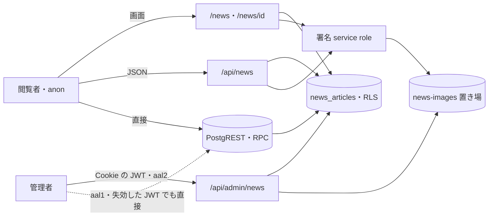

# NEWS の脅威

> 状態: 推定（コードを読んで起こした。ユーザーの確認は未） | 確認日: 2026-10-24 | 対象: NEWS の公開の画面・`/api/news`・管理のニュース・画像の置き場・`news_articles` の DB | 基準コミット: `a03beaff`（本文の `ファイル:行` は、この脅威の文書が日付つきの証拠として残す行番号で、このコミットの内容を指す。コードを読み直す時は関数・部品の名前でたどる）

---

## 概要

NEWS（お知らせ）の領域で考える脅威を、1つずつ `THR-NEWS-NNN` の項目で書く。過去のセキュリティレビューの指摘と、2026-10-24 にコードを読んで気づいた点の両方を拾った。

| 項目 | 内容 |
| --- | --- |
| 項目の数 | 25（THR-NEWS-001〜025） |
| 守りがある物 | 下書きを外へ出さない（001）、本文の XSS（012）、管理の権限と aal2（014）、監査の記録（015）、守りの見出し（023）。過去に直った指摘（公開の置き場・回数の制限・service role の素通り・監査の無さ・Cookie の記録）も、守りがある脅威として残した |
| 穴がありうる物（満たすかどうかは対応する `SEC-NEWS` の本文だけに書く） | DB が aal2 を見ない（002）、置き場の設定が移行に無い（003）、署名の失敗で元の値を返す（007）、回数の制限の IP を偽れる（010）、画像の中身と拡張子（016）、画像の消し残し（017）、編集のページの道筋の書き換え（024）、DB の段に入力の制約が無い（025）など |
| 対策の書き先 | 対策のセキュリティ要件 `SEC-NEWS-NNN` は要件の文書（`docs/02_Requirements/areas/news.md`）に書く。下の「対策」の欄は読み手のための写し |
| 状態の付け方 | どの項目もコードとレビューから起こし、ユーザーの確認を受けていないので「推定」（`.claude/skills/documentation-guide/SKILL.md` の 7）。どれも実行しての確かめはしていない |

---

## 範囲と根拠

- 範囲: `scripts/trace/scope.json` の NEWS の src（`src/app/news/**`・`src/app/api/news/**`・`src/app/api/admin/news/**`・`src/app/admin/news/**`・`src/app/actions/news.ts`・`src/components/NewsSection.tsx`・`src/features/news/**`・`src/lib/news-data.ts`・`src/lib/storage/news-images.ts`・`src/types/news.ts`）
- 範囲の外だが脅威の入口になるので見た物: `src/proxy.ts`（Origin の確かめ・守りの見出し）、`src/features/auth/middleware/rateLimit.ts`（回数の制限）、`src/lib/auth/admin-rbac.ts`（管理の認可）、`src/lib/audit.ts`（監査）、`src/features/search/services/search.service.ts`（検索の NEWS）、`next.config.ts`（画像の最適化）、`supabase/migrations/20260901102912_remote_schema.sql`（表・RLS・権限・検索の関数）、`supabase/seed.sql`（置き場）
- 出どころのレビュー: `docs/05_Quality/reviews/security/security_review_news.md`・`security_review_news_id.md`・`security_review_actions.md`・`security_review_overview.md`、`docs/05_Quality/reviews/code/2026-04-18-news-review.md`・`2026-04-18-news-id-security-review.md`・`2026-04-18-actions-news-security-review.md`・`2026-04-29-news-review.md`・`2026-04-29-news-id-additional-security-review.md`。どのレビューも「当時の記録で、今の状態は確かめていない」と書くので、今の状態は 2026-10-24 にコードを読み直して決めた
- 全体のセキュリティ要件は `docs/02_Requirements/requirements.md` の 5.4 節（NFR-SEC-001〜012・AC-SEC-001）。NEWS に当てはまる物は、各項目の根拠に書いた
- ASVS は OWASP ASVS 4.0.3 の項目番号。当てはめに自信の無い物は「（当てはめは推定）」、番号を決められない物は「ASVS 未対応付け」と書いた
- 外した物: ヘッダーから NEWS の分類へのリンク（`src/components/Header.tsx:14,35-41`）は固定の一覧から作るので、入力を差し込む面が無い（推定）。BLOG が DB の分類に無く0件になる話は機能の食い違いで、脅威ではない

### 入口と守りの位置

- 実線の矢印はアプリが用意した道、点線はアプリを通らない道（THR-NEWS-002）
- `/api/news` だけが回数の制限を通る。画面と PostgREST・RPC は通らない（THR-NEWS-008・009）
- 管理の窓口の前には `src/proxy.ts` の Origin の確かめがある（THR-NEWS-013）。図では省いた

---

## 脅威の一覧

### THR-NEWS-001 公開前の記事が公開の道から漏れる

| 属性 | 値 |
| --- | --- |
| 守るもの | 非公開（`private`）の記事の題・概要・本文・画像の道筋 |
| 脅威 | 閲覧者・一般会員が、公開前の記事を読む |
| 起こり方 | `/news`・`/news/<id>`・`/api/news`・検索（`search_news`）・anon と一般会員の JWT での PostgREST の直接の読み出しで、`status='private'` の行を求める。取り出しの絞り（`.eq('status','published')`）か RLS のどちらかが崩れると届く。`/news/<id>` と管理の `[id]` の id は連番の数（bigint）なので総当たりで数えられるが、公開の取り出し（`getPublishedNewsDetailById`）は非公開の行を存在しない行と同じ `null`（画面は `notFound()` の 404）にするので、応答の違いから非公開の記事の有無は分からない。管理の `[id]` の GET は認可（`authorizeAdminPermission`）の後でだけ引き、取り出しの失敗と無い行を同じ 404 にする（`[id]/route.ts` の GET）。別の脅威は立てない（推定） |
| 影響 | 発表前のコレクション・コラボ・イベントが先に知られる。ブランドの発表の段取りが崩れる |
| 対策 | SEC-NEWS-001 |
| ASVS | V4.1.1 |
| 根拠 | 守りは2段ある。DB の RLS（`supabase/migrations/20260901102912_remote_schema.sql:3567-3570,3594-3597`）と、公開の取り出しの絞り（`src/features/news/services/public.ts:19,44,66,88`）、検索の関数の中の絞り（`remote_schema.sql:2230`）。過去のレビューも「維持」と評価した。ただしこの性質を試すテストが無く、手元の見本の記事は全部公開済み（`supabase/seed.sql:142-168`）なので、片方を外しても今のテストは通る。全体の NFR-SEC-005（権限管理）を NEWS の公開の線引きに当てはめた |
| 状態 | 推定 |
| 出どころ | `docs/05_Quality/reviews/security/security_review_news.md:52`、`docs/05_Quality/reviews/security/security_review_news_id.md:48-49` |

### THR-NEWS-002 権限を持つ人の session で、2要素認証と失効の確かめを飛ばして DB を直接触る

| 属性 | 値 |
| --- | --- |
| 守るもの | 非公開の記事と、記事の中身の正しさ |
| 脅威 | `admin.news.read`・`admin.news.manage` を持つ人の、2要素認証を済ませていない（`aal1`）session、またはログアウト・失効の後も期限の残る access token を手に入れた者が、下書きを読み、記事を書き換える・消す |
| 起こり方 | パスワードだけで得た `aal1` の JWT で、アプリの窓口を通らず PostgREST の `news_articles` を直接叩く。RLS の `has_permission` は ACL だけを見て `aal` を見ない（`remote_schema.sql:3578-3597`、`supabase/migrations/20261023175712_group_g0_permissions.sql:186-216`。移行のどこにも `aal` の記述が無い）。同じ `has_permission` は session が生きているかも見ず、`auth.uid()` と ACL の表だけで決める。ログアウトした・管理者が失効させた session の access token でも、期限が切れるまでは PostgREST で同じ読み書きができる（推定） |
| 影響 | 2要素認証の守りがアプリの窓口だけになる。パスワードが漏れると下書きの漏れ・記事の改ざん・消去に届く。直接の書き換えは監査の記録にも残らない（THR-NEWS-015） |
| 対策 | SEC-NEWS-002 |
| ASVS | V4.3.1 |
| 根拠 | 管理の窓口は `aal2` を求め（`src/lib/auth/admin-rbac.ts:240-249`）、`checkAuthSessionLiveness` で session の失効も確かめる（`admin-rbac.ts:200-225`）が、どちらの守りも DB に無い。PostgREST が `aal1` の JWT を受けるのは Supabase の標準の動き。実際に叩いての確かめはしていない。全体の NFR-SEC-008（RBAC）・FREQ-540（範囲外。DB の ACL・session・aal2 で管理操作を守る）に照らした |
| 状態 | 推定 |
| 出どころ | 実装から推定（2026-10-24 の DB の移行の読み直し） |

### THR-NEWS-003 画像の置き場が公開になり、非公開の記事の画像が見える

| 属性 | 値 |
| --- | --- |
| 守るもの | 非公開の記事の画像 |
| 脅威 | 閲覧者が、置き場の公開の URL から非公開の記事の画像を開く |
| 起こり方 | 置き場 `news-images` が `public=true` になっている、または `storage.objects` に誰でも読める方針がある時に、`/storage/v1/object/public/news-images/<道筋>` を開く。置き場の定義は移行に無く、手元の見本 `supabase/seed.sql:10-14` が `public=false` で作るだけ。大きさと種類の上限も置き場に無い |
| 影響 | 発表前の画像が出る。道筋は uuid なので推測は難しいが、一度出た URL は記事を非公開にしても開ける |
| 対策 | SEC-NEWS-003 |
| ASVS | V12.4.1（当てはめは推定） |
| 根拠 | 2026-04-18 のレビューで置き場が公開だった（Critical）。直した先は旧い `migrations/013_create_news_images_bucket.sql:6-9` で、今の CI が当てる `supabase/migrations/` には無い。本番の置き場の設定は移行の外にあり、確かめていない |
| 状態 | 推定 |
| 出どころ | `docs/05_Quality/reviews/code/2026-04-18-news-id-security-review.md:45-48`、`docs/05_Quality/reviews/security/security_review_news.md:53` |

### THR-NEWS-004 外へ出した署名つき URL で、非公開にした後も画像が見える

| 属性 | 値 |
| --- | --- |
| 守るもの | 非公開にした・消した記事の画像 |
| 脅威 | 前に応答を受け取った者が、記事を非公開にした後も画像を開く |
| 起こり方 | 署名つき URL は1時間有効で、記事を非公開にしても取り消せない（`src/lib/storage/news-images.ts:4,59-61`）。公開の一覧・詳細・`/api/news` は画面で画像を出さないのに `image_url` を取り、署名して返す（`src/features/news/services/public.ts:18,33,65,76`）ので、署名つき URL が出る先が広い。管理の一覧は署名つき URL を `next/image` に渡すので、最適化の画像のキャッシュにも残りうる（`src/components/NewsSection.tsx:101-107`。キャッシュの長さは `next.config.ts` で指定が無い） |
| 影響 | 誤って公開した記事を戻しても、最大1時間（キャッシュに残ればそれ以上）画像が見える |
| 対策 | SEC-NEWS-004、SEC-NEWS-005 |
| ASVS | ASVS 未対応付け |
| 根拠 | 期限つきの署名は過去のレビューで守りとして認められた。非公開にした後の残り方と、使わない `image_url` を返す点はレビューとコードの読み直しで見つけた。最適化のキャッシュの長さは Next.js の既定に頼り、確かめていない |
| 状態 | 推定 |
| 出どころ | `docs/05_Quality/reviews/security/security_review_news_id.md:51`、`docs/05_Quality/reviews/security/security_review_news.md:48,73` |

### THR-NEWS-005 署名つき URL を含む応答が共有のキャッシュに残る

| 属性 | 値 |
| --- | --- |
| 守るもの | 署名つき URL と、公開の取り出しの結果の新しさ |
| 脅威 | 中継の CDN・共有のキャッシュが応答を保ち、別の利用者に古い応答や署名つき URL を渡す |
| 起こり方 | `/api/news` の成功の応答（`src/app/api/news/route.ts:39`）、失敗の応答（`:42`）、回数の制限の 429・503（`src/features/auth/middleware/rateLimit.ts:30-31,50-54`）に `Cache-Control` が無い。`Vary` も無い |
| 影響 | 非公開にした記事の応答が残る。429 が残ると、別の利用者まで断られる |
| 対策 | SEC-NEWS-006 |
| ASVS | V8.2.1 |
| 根拠 | 過去のレビューの Medium・Low の指摘。今のコードが満たすかは SEC-NEWS-006 を見る。`X-Content-Type-Options` だけは `src/proxy.ts:237` が全部の応答に付ける |
| 状態 | 推定 |
| 出どころ | `docs/05_Quality/reviews/security/security_review_news.md:47,49,92`、`docs/05_Quality/reviews/security/security_review_news_id.md:43`、`docs/05_Quality/reviews/code/2026-04-29-news-review.md:39-43` |

### THR-NEWS-006 画像の道筋を書き換えて、置き場の別の物に署名させる

| 属性 | 値 |
| --- | --- |
| 守るもの | 置き場 `news-images` の中の、記事の画像でない物 |
| 脅威 | 記事の行の `image_url` を書き換えられる者（管理の権限を持つ人、または THR-NEWS-002 の道）が、置き場の別の物の署名つき URL を公開の応答に出させる |
| 起こり方 | 署名の前に、道筋が `news/` の下にあるか、URL のホストが自分の Supabase かを確かめない（`src/lib/storage/news-images.ts:15-52,79-84`）。service role で署名するので RLS も効かない。検索の結果の画像も同じ関数で署名する（`src/features/search/services/search.service.ts:163,190,302-305`） |
| 影響 | 置き場に記事の画像以外の物を置いた時に、それが公開の応答から配られる |
| 対策 | SEC-NEWS-007 |
| ASVS | ASVS 未対応付け |
| 根拠 | 過去のレビューで3回指摘された。今のコードが満たすかは SEC-NEWS-007 を見る。今の置き場には記事の画像しか置かないので害は小さい（推定） |
| 状態 | 推定 |
| 出どころ | `docs/05_Quality/reviews/security/security_review_news.md:90`、`docs/05_Quality/reviews/security/security_review_news_id.md:95`、`docs/05_Quality/reviews/code/2026-04-29-news-review.md:23-28`、`docs/05_Quality/reviews/code/2026-04-29-news-id-additional-security-review.md:18-21` |

### THR-NEWS-007 署名に失敗した時に、置き場の素の道筋を返す

| 属性 | 値 |
| --- | --- |
| 守るもの | 置き場の中の道筋と、改ざんの兆し |
| 脅威 | 署名の失敗・道筋の読めない値を、そのまま応答に載せる（開く側へ倒れる） |
| 起こり方 | 道筋にできない値は元の値を返し（`src/lib/storage/news-images.ts:79-82`）、署名の失敗も元の道筋を返す（`:84-85`）。失敗を記録に残さない（`:63-67`） |
| 影響 | 非公開の置き場の道筋が外へ出る。DB の値を書き換えられた時に、外の URL がそのまま閲覧者へ渡る。失敗や改ざんに気づけない |
| 対策 | SEC-NEWS-008 |
| ASVS | V4.1.5 |
| 根拠 | 過去のレビューの Medium・Low の指摘。今のコードが満たすかは SEC-NEWS-008 を見る。検索の結果の画像にも同じことが言える |
| 状態 | 推定 |
| 出どころ | `docs/05_Quality/reviews/security/security_review_news.md:46`、`docs/05_Quality/reviews/security/security_review_news_id.md:44,96-97`、`docs/05_Quality/reviews/code/2026-04-29-news-id-additional-security-review.md:25-33` |

### THR-NEWS-008 公開の記事をまとめて吸い出し、DB に負荷をかける

| 属性 | 値 |
| --- | --- |
| 守るもの | DB と画像の署名の処理の余力（使える状態） |
| 脅威 | 自動の道具が、公開の窓口を続けて叩き、全部の記事を取り続ける |
| 起こり方 | `/api/news` には回数の制限（`news:list`、10分に60回）と件数の上限（最大20、既定12）がある（`src/app/api/news/route.ts:4-5,10-15,25-32`）。一方 `/news` の画面は回数の制限を通らず、件数の上限も付けずに全部を取り、1件ずつ署名する（`src/app/news/page.tsx:32`、`src/features/news/services/public.ts:26-34`）。`/news/[id]` も回数の制限を通らず、1回の要求で記事1件の取り出しを2回（`generateMetadata` とページ。署名も2回、`src/app/news/[id]/page.tsx:65,91`）と、前後の記事のために公開済みの全部の記事の題の取り出し（`getPublishedNewsNavigation`、件数の上限なし、`public.ts:85-95`）をする。`/news/[id]` の id を総当たりで続けて叩く道も回数の制限を通らず、外れた id でも取り出しを走らせる（上のとおり）。どこからも使われていない Server Action `getLatestNews`（`src/app/actions/news.ts:11-13`）も、export されているので外から呼べる窓口になる（推定） |
| 影響 | 記事の数に比例して DB と署名の呼び出しが増え、画面が遅くなる・止まる |
| 対策 | SEC-NEWS-009 |
| ASVS | V11.1.4 |
| 根拠 | `/api/news` の回数の制限と件数の上限は、2026-04-18 の Critical の指摘を受けて足し、2026-04-29 に直ったと記録された。画面の取り出しの上限と使われない Server Action の扱いは SEC-NEWS-009 を見る。個別の公開 API（`/api/news/[id]`）は今は無く、足す時は同じ守りが要るとレビューが書く |
| 状態 | 推定 |
| 出どころ | `docs/05_Quality/reviews/code/2026-04-18-news-review.md:30`、`docs/05_Quality/reviews/code/2026-04-18-news-id-security-review.md:40-43`、`docs/05_Quality/reviews/security/security_review_news.md:45,51`、`docs/05_Quality/reviews/security/security_review_news_id.md:82,98`、`docs/05_Quality/reviews/security/security_review_actions.md:35,37` |

### THR-NEWS-009 PostgREST・RPC を直接叩いて、アプリの制限を迂回する

| 属性 | 値 |
| --- | --- |
| 守るもの | DB の余力 |
| 脅威 | 閲覧者が anon の鍵で PostgREST・RPC を直接叩き、回数の制限も件数の上限も通らずに読む |
| 起こり方 | anon は `news_articles` の公開済みの行を直接読める（`remote_schema.sql:3567-3570,4172`）。`search_news` は anon が呼べ、`limit_count` に上限が無い（`remote_schema.sql:2206-2237,4018`）。使われていない `search_public_news` も PUBLIC に開いている（`:4024`）。PostgREST の1回の行数の上限は手元で `max_rows = 1000`（`supabase/config.toml:18`）、本番は未確認 |
| 影響 | THR-NEWS-008 と同じ負荷を、アプリの守りの外から掛けられる。公開済みの記事だけなので、漏れの害は無い |
| 対策 | SEC-NEWS-010 |
| ASVS | V11.1.4 |
| 根拠 | どのレビューにも無く、2026-10-24 の突き合わせで気づいた。同じ形の前例として、ゲストのカートの RPC を直接叩く道を塞いだ FREQ-322（範囲外）がある |
| 状態 | 推定 |
| 出どころ | 実装から推定（2026-10-24 の突き合わせ） |

### THR-NEWS-010 回数の制限の送り元を偽って制限を逃れる

| 属性 | 値 |
| --- | --- |
| 守るもの | 回数の制限の効き目と、数えの表の大きさ |
| 脅威 | 自動の道具が、送るたびに `x-forwarded-for` を変えて、別の送り元のふりをする |
| 起こり方 | 回数の制限は送り元を `x-forwarded-for` の先頭、無ければ `x-real-ip` から無条件に取る（`src/features/auth/middleware/rateLimit.ts:4-16`）。`/api/news` は `subject` を渡さない（`src/app/api/news/route.ts:10-15`）。呼ばれるたびに数えの行を DB に足す（`rateLimit.ts:25-26`） |
| 影響 | `/api/news` の制限が効かない。偽った送り元の数だけ数えの行が増え、DB を圧迫する |
| 対策 | SEC-NEWS-011 |
| ASVS | V11.1.4 |
| 根拠 | 過去のレビューで繰り返し指摘された（news は High、全体のまとめ X-05 は Low）。今のコードが満たすかは SEC-NEWS-011 を見る。中継（Vercel など）が見出しを上書きするかは、本番の構成で変わる（未デプロイなので未確認） |
| 状態 | 推定 |
| 出どころ | `docs/05_Quality/reviews/security/security_review_news.md:42,70`、`docs/05_Quality/reviews/security/security_review_news_id.md:42`、`docs/05_Quality/reviews/code/2026-04-29-news-review.md:14-19`、`docs/05_Quality/reviews/security/security_review_overview.md:40` |

### THR-NEWS-011 入口で確かめない値が取り出しに渡る

| 属性 | 値 |
| --- | --- |
| 守るもの | 取り出しの正しさと DB の余力 |
| 脅威 | 閲覧者・管理者が、想定外の `category`・`id`・`limit` を送る |
| 起こり方 | `/api/news` の `category` は許可の一覧も長さの上限も確かめずに取り出しへ渡す（`src/app/api/news/route.ts:22,34-37`、`src/features/news/services/public.ts:22-24`）。詳細の `[id]` も数として確かめずに渡す（`src/app/news/[id]/page.tsx:65,91`、`public.ts:54-67`）。管理の `[id]` も同じ（`src/app/api/admin/news/[id]/route.ts:47`） |
| 影響 | SQL の差し込みにはならない（PostgREST が引数として渡す）。長い値・壊れた値が DB まで届き、失敗の形がそろわない |
| 対策 | SEC-NEWS-012 |
| ASVS | V5.1.3、V5.1.4 |
| 根拠 | 過去のレビューで3回指摘された。今のコードが満たすかは SEC-NEWS-012 を見る。公開の画面の `category` は許可の一覧で確かめ、外れたら ALL にする（`src/app/news/page.tsx:10-15`、`PublicNewsGrid.tsx:43-62`）。DB の分類は CHECK で5つに決まる（`remote_schema.sql:669`）。管理の入力は zod で確かめる（`src/app/api/admin/news/route.ts:8-15`）。全体の NFR-SEC-003（入力検証）・NFR-SEC-007（パラメータ化クエリ）を NEWS に当てはめた |
| 状態 | 推定 |
| 出どころ | `docs/05_Quality/reviews/security/security_review_news.md:43,50,54,119`、`docs/05_Quality/reviews/security/security_review_news_id.md:45-47,73`、`docs/05_Quality/reviews/security/security_review_actions.md:38` |

### THR-NEWS-012 本文に仕込んだスクリプトが閲覧者の端末で動く

| 属性 | 値 |
| --- | --- |
| 守るもの | 閲覧者の端末と session |
| 脅威 | 管理の権限を持つ人（または乗っ取った者）が、題・概要・本文に HTML やスクリプトを入れ、閲覧者の端末で動かす（保存された XSS） |
| 起こり方 | 今は本文を React の文字として出し、`dangerouslySetInnerHTML` を使わない（`src/app/news/[id]/page.tsx:191-201`、`src/features/news/components/PublicNewsGrid.tsx:378`）。使われていない `ArticleBody.tsx` は Markdown のリンク・画像の URL をそのまま `href`・`src` に入れ、`javascript:` などを外さない（`src/features/news/components/ArticleBody.tsx:25-32`）。これを画面につなぐと道ができる |
| 影響 | 閲覧者の session の乗っ取り・偽の画面 |
| 対策 | SEC-NEWS-013 |
| ASVS | V5.3.3 |
| 根拠 | 過去のレビューは「N/A・Fixed」とし、リッチテキストの HTML を出すなら見直すと書く。uiux のレビューは `ArticleBody` で本文を出したと書くが、今の画面はつないでいない。全体の NFR-SEC-003（XSS 対策と CSP）を NEWS の本文に当てはめた |
| 状態 | 推定 |
| 出どころ | `docs/05_Quality/reviews/code/2026-04-18-news-id-security-review.md:31-32,50-52`、`docs/05_Quality/reviews/security/security_review_news_id.md:52,125`、`docs/05_Quality/reviews/security/security_review_news.md:120` |

### THR-NEWS-013 管理の操作を他のサイトから送らせる

| 属性 | 値 |
| --- | --- |
| 守るもの | 記事の中身と公開の状態 |
| 脅威 | 攻撃者のサイトが、ログイン中の管理者のブラウザに、記事の作成・書き換え・公開の切り替え・削除を送らせる（CSRF） |
| 起こり方 | 管理のニュースの窓口（`src/app/api/admin/news/route.ts:54`、`src/app/api/admin/news/[id]/route.ts:76,189,243`）は CSRF の token（`x-csrf-token`）を確かめない。守りは `src/proxy.ts` の Origin・Referer の確かめ（`/api` の下の POST・PUT・PATCH・DELETE 全部、`src/proxy.ts:22-27,146-157`）だけ。許可のオリジンが設定されていない時は、要求の見出しから作ったオリジンと比べる（`src/proxy.ts:140-144,185-202`） |
| 影響 | 記事の改ざん・誤った公開・消去。他のサイトからの書き換えは SameSite=Lax の Cookie が付かないので届きにくいが、Origin の確かめが要求の見出しから比べる元を作る時（許可のオリジンの設定が無い時）や、同じサイトの別のサブドメインを攻撃者が使える時は、Cookie だけで通る（推定） |
| 対策 | SEC-NEWS-014 |
| ASVS | V4.2.2 |
| 根拠 | 管理の窓口は Cookie の access token で認証する。`clientFetch` は `Authorization` を付けず、`credentials:'same-origin'` で Cookie を送り（`src/lib/client-fetch.ts:174-221`）、窓口は Bearer が無ければ access の Cookie から token を取る（`src/lib/auth/request-token.ts:57-58`）。ブラウザが自分で付ける Cookie で認証するので、他のサイトからの送信を断る守りは、proxy の Origin・Referer の確かめ（`src/proxy.ts:166-203`）と、access の Cookie の SameSite=Lax（`src/lib/cookie.ts:44`）の2つだけになる。`clientFetch` は書き換えに `x-csrf-token` を付けるが、窓口はそれを確かめないので守りに数えない（満たすかは SEC-NEWS-014 を見る）。token を重ねて確かめるかは、FREQ-327-REQ-03（範囲外。Origin の確かめを proxy の1か所にまとめ、ルートごとに重ねない）と、ほかの管理 API が `requireCsrfOrDeny` を呼ぶ形が食い違い、決まっていない。全体の NFR-SEC-003（CSRF 対策）に当てはめた |
| 状態 | 推定 |
| 出どころ | `docs/05_Quality/reviews/security/security_review_overview.md:38-39`（同じ形の X-03・X-04）、実装から推定 |

### THR-NEWS-014 権限の無い人が管理の操作をする

| 属性 | 値 |
| --- | --- |
| 守るもの | 記事の中身・公開の状態・非公開の記事 |
| 脅威 | 管理の権限を持たない人（一般会員・お知らせの権限の無いサポーター）が、管理の窓口で記事を読む・変える |
| 起こり方 | 管理の窓口を直接叩く。管理の画面の殻は誰でも開ける（`src/app/admin/news/create/page.tsx:1-6` は client の頁で、サーバーで守らない） |
| 影響 | 下書きの漏れ・記事の改ざん・消去 |
| 対策 | SEC-NEWS-015 |
| ASVS | V4.1.3、V4.3.1 |
| 根拠 | 守りがある。窓口は `authorizeAdminPermission` で、JWT の確かめ・session の生存・DB の ACL の `admin.news.read`・`admin.news.manage`・`aal2` を全部見る（`src/lib/auth/admin-rbac.ts:178-256`、`src/app/api/admin/news/route.ts:56,173`）。DB の操作は利用者の JWT の client で行い、RLS の `has_permission` も効く（`route.ts:95,179`）。2026-04-18 には service role で RLS を素通りしていた（Critical）が直った。画面のボタンは役で出し分け、窓口は権限で守る（`src/app/admin/page.tsx:197-207,1116-1118`）ので、ボタンが出ても窓口が 403 で断る形になる。全体の NFR-SEC-005・NFR-SEC-008 に当てはめた |
| 状態 | 推定 |
| 出どころ | `docs/05_Quality/reviews/code/2026-04-18-actions-news-security-review.md:32-35`、`docs/superpowers/specs/2026-10-23-group-g-design.md:550,555,563-564` |

### THR-NEWS-015 管理の操作の跡が残らず、不正や誤りを追えない

| 属性 | 値 |
| --- | --- |
| 守るもの | 誰がいつ何を変えたかの記録 |
| 脅威 | 記事を変えた人を後から特定できない。存在しない記事への操作を成功と記録する |
| 起こり方 | 管理の窓口は作成・書き換え・公開の切り替え・削除・画像の書き込みの失敗を、成功と失敗の両方で監査に残す（`src/app/api/admin/news/route.ts:26-52,111-115,138-142,150-162`、`src/app/api/admin/news/[id]/route.ts:134-138,166-180,222-234,259-269`）。ただし PUT・PATCH・DELETE は対象の行が0件でも 200 を返し、成功として記録する（`[id]/route.ts:160-182,216-236,253-271`）。監査の書き込みの失敗は警告だけで握りつぶす（`src/lib/audit.ts:67-70,87-89`）。PostgREST を直接叩いた変更は記録に残らない（THR-NEWS-002） |
| 影響 | 不正・誤操作の調べができない。存在しない id への操作が成功に見える |
| 対策 | SEC-NEWS-016 |
| ASVS | ASVS 未対応付け |
| 根拠 | 2026-04-18 に監査の記録が無い（Critical）と指摘され、git `6896bb16` で足した。IP は見出しを偽れるので残さない（`route.ts:26-28`）。0件の成功と、直接の変更が残らない点は 2026-10-24 にコードを読んで気づいた。全体の NFR-SEC-005（監査ログ）・NFR-SEC-011（監査ログの保持）に当てはめた |
| 状態 | 推定 |
| 出どころ | `docs/05_Quality/reviews/code/2026-04-18-actions-news-security-review.md:37-40`、`docs/05_Quality/reviews/code/2026-04-18-news-review.md:37,44` |

### THR-NEWS-016 中身や名前を偽った画像を置き場に入れる

| 属性 | 値 |
| --- | --- |
| 守るもの | 置き場と、画像を開く閲覧者・管理者の端末 |
| 脅威 | 管理の権限を持つ人（または乗っ取った者）が、画像でないファイルを画像と偽って書き込む |
| 起こり方 | 画像の種類は送る側が申告する `File.type` だけで確かめ、中身のしるし（ファイルの頭）は見ない（`src/app/api/admin/news/route.ts:87`、`src/app/api/admin/news/[id]/route.ts:113`）。直す時（PUT）は保存の名前の拡張子を送ったファイルの名前から取る（`[id]/route.ts:121`）ので、`.html` などの拡張子のファイルが置き場に入りうる。作る時（POST）は確かめた種類から拡張子を決める（`route.ts:18-23,98-99`）。置き場には大きさと種類の上限が無い（`supabase/seed.sql:10-14`） |
| 影響 | 置き場に想定外のファイルが残る。`contentType` は確かめた種類のままなので、ブラウザが HTML として開く害は小さい（推定） |
| 対策 | SEC-NEWS-017 |
| ASVS | V12.2.1、V12.3.1、V12.1.1 |
| 根拠 | どのレビューにも無く、2026-10-24 にコードを読んで気づいた。5MB の上限はアプリにある（`route.ts:24,91-93`） |
| 状態 | 推定 |
| 出どころ | 実装から推定 |

### THR-NEWS-017 消した・差し替えた記事の画像が置き場に残る

| 属性 | 値 |
| --- | --- |
| 守るもの | 消した・非公開にした記事の画像と、置き場の容量 |
| 脅威 | 記事を消しても画像が置き場に残り、道筋か古い署名つき URL を知る者が開く。置き場が無駄に埋まる |
| 起こり方 | 削除（DELETE）は DB の行だけを消す（`src/app/api/admin/news/[id]/route.ts:253-256`）。画像の差し替え（PUT）は古い画像を消さない（`[id]/route.ts:147-163`）。作成で DB への保存に失敗した時も、上げた画像を消さない（`src/app/api/admin/news/route.ts:137-146`） |
| 影響 | 消したつもりの画像が残る。THR-NEWS-003 の設定が崩れた時に開ける物が増える |
| 対策 | SEC-NEWS-018 |
| ASVS | ASVS 未対応付け |
| 根拠 | `docs/03_BasicDesign/api/api-spec.md:225` は DELETE を「News と画像を削除」と書くが、コードは画像を消さない。どのレビューにも無く、2026-10-24 にコードを読んで気づいた |
| 状態 | 推定 |
| 出どころ | 実装から推定 |

### THR-NEWS-018 記録や応答から内部の情報が漏れる

| 属性 | 値 |
| --- | --- |
| 守るもの | DB の構造・接続の情報・Cookie と token |
| 脅威 | 記録を読める者（ホスティングの記録の閲覧者など）や、応答を受けた者が、内部の情報を得る |
| 起こり方 | `/api/news` と管理の窓口は、例外を丸ごと `console.error` に渡す（`src/app/api/news/route.ts:41`、`src/app/api/admin/news/route.ts:117,144,166,189,201`）。応答の本文は固定の文なので、応答からは漏れない（`route.ts:42`）。2026-04-18 には `src/lib/supabase/server.ts` が Cookie の頭や token の一部を記録に書いていた（Critical） |
| 影響 | 記録から DB の構造や失敗の中身が分かる |
| 対策 | SEC-NEWS-019 |
| ASVS | V7.1.1 |
| 根拠 | Cookie・token の記録は直った（今の `src/lib/supabase/server.ts:86,106` は値を含まない警告だけ）。例外を丸ごと記録する点は Low の指摘で、満たすかは SEC-NEWS-019 を見る。例外の中身に何が入るかは確かめていない |
| 状態 | 推定 |
| 出どころ | `docs/05_Quality/reviews/security/security_review_news.md:93`、`docs/05_Quality/reviews/code/2026-04-29-news-review.md:45-49`、`docs/05_Quality/reviews/code/2026-04-18-actions-news-security-review.md:27-30` |

### THR-NEWS-019 取り出しの失敗が「0件」「無い」に見えて気づけない

| 属性 | 値 |
| --- | --- |
| 守るもの | 障害・RLS の崩れに気づく力と、公開の画面の使える状態 |
| 脅威 | DB・RLS・service role の障害が起きても、画面は「記事が無い」と見せ、誰も気づかない |
| 起こり方 | 公開の取り出しは Supabase の `error` を見ず `data` だけを使う（`src/features/news/services/public.ts:30,73,95`）。管理の一覧は取得の失敗と0件を同じ「ニュース記事がありません」で出す（`src/components/NewsSection.tsx:29-37,91-93`）。管理の1件の取得は DB のどんな失敗も 404 にする（`src/app/api/admin/news/[id]/route.ts:64-66`）。公開の一覧は毎回 service role の client を作って署名するので、その失敗が一覧全体を止める（`public.ts:11-14,32-34`） |
| 影響 | 障害や RLS の設定の崩れ（THR-NEWS-001 の守りの片方が崩れた時を含む）が長く見過ごされる。署名の障害で一覧の文字まで出なくなる |
| 対策 | SEC-NEWS-020 |
| ASVS | ASVS 未対応付け |
| 根拠 | 公開の取り出しの `error` と service role の作り方は過去のレビューの Medium の指摘で、満たすかは SEC-NEWS-020 を見る。管理側の2つは 2026-10-24 にコードを読んで気づいた |
| 状態 | 推定 |
| 出どころ | `docs/05_Quality/reviews/security/security_review_news.md:44,91`、`docs/05_Quality/reviews/code/2026-04-29-news-review.md:30-35`、`docs/05_Quality/reviews/security/security_review_actions.md:36` |

### THR-NEWS-020 管理の窓口を回数の制限なしで叩かれる

| 属性 | 値 |
| --- | --- |
| 守るもの | DB と置き場の容量・余力 |
| 脅威 | 乗っ取った管理の session や、誤った作りの道具が、作成・画像の書き込みを続けて送る |
| 起こり方 | 管理のニュースの窓口に回数の制限の呼び出しが無い（`src/app/api/admin/news/route.ts:1-204`、`src/app/api/admin/news/[id]/route.ts:1-276`）。1回で最大5MBの画像を置き場に書き込める |
| 影響 | 置き場と DB が埋まる。THR-NEWS-017 と重なると、消えない画像が積み上がる |
| 対策 | SEC-NEWS-021 |
| ASVS | V11.1.4 |
| 根拠 | 窓口は aal2 の管理者だけに開くので起こりにくい（推定）。どのレビューにも無く、2026-10-24 にコードを読んで気づいた |
| 状態 | 推定 |
| 出どころ | 実装から推定 |

### THR-NEWS-021 anon・authenticated に要らない表の権限を付けている

| 属性 | 値 |
| --- | --- |
| 守るもの | `news_articles` の行の全部 |
| 脅威 | RLS の方針の書き損じや、RLS の効かない操作で、閲覧者が表を変える・空にする |
| 起こり方 | `news_articles` に anon・authenticated へ DELETE・INSERT・MAINTAIN・REFERENCES・SELECT・TRIGGER・TRUNCATE・UPDATE を全部付けている（`supabase/migrations/20260901102912_remote_schema.sql:4172`）。守りは RLS だけ。TRUNCATE は RLS の対象外。PostgREST からは TRUNCATE を呼べないので、今の道は無い（推定） |
| 影響 | 将来 RLS の方針を書き損じると、閲覧者が記事を書き換え・消去できる |
| 対策 | SEC-NEWS-022 |
| ASVS | V4.1.3 |
| 根拠 | Supabase の既定の付与のまま残った形（推定）。どのレビューにも無く、2026-10-24 に移行を読んで気づいた |
| 状態 | 推定 |
| 出どころ | 実装から推定 |

### THR-NEWS-022 画像の最適化の中継を、別の Supabase のプロジェクトに使われる

| 属性 | 値 |
| --- | --- |
| 守るもの | サーバーの最適化の処理の余力と、キャッシュの容量 |
| 脅威 | 第三者が自分の Supabase のプロジェクトの画像を、このサイトの `/_next/image` に通させる |
| 起こり方 | `next.config.ts:35,54-71` の `remotePatterns` が `*.supabase.co` の `/storage/v1/object/public/**`・`sign/**`・`authenticated/**` を全部許す。どのプロジェクトの URL でも最適化に通る。最適化した画像のキャッシュの長さ（`minimumCacheTTL`）は指定が無い |
| 影響 | サーバーの処理と費用を他人の画像のために使われる。THR-NEWS-004 の残り方も長くなる |
| 対策 | SEC-NEWS-023 |
| ASVS | V12.6.1 |
| 根拠 | どのレビューにも無く、2026-10-24 の突き合わせで気づいた。`next.config.ts` は範囲外の共有の設定で、NEWS 以外の画像も同じ設定を通る |
| 状態 | 推定 |
| 出どころ | 実装から推定（2026-10-24 の突き合わせ） |

### THR-NEWS-023 守りの見出しが無く、枠の中への埋め込み・種類の取り違え・平文の通信を許す

| 属性 | 値 |
| --- | --- |
| 守るもの | 閲覧者の端末と通信 |
| 脅威 | 攻撃者のサイトが NEWS の画面を枠に埋めて操作を誘う、応答の種類をブラウザに取り違えさせる、平文の通信に落とす |
| 起こり方 | 守りの見出しが無い応答を返す時に起こる。今は `src/proxy.ts` が全部の応答（`matcher` は `/:path*`、`src/proxy.ts:246`）に CSP の nonce・`X-Content-Type-Options: nosniff`・`X-Frame-Options: DENY`・`Strict-Transport-Security` を付ける（`src/proxy.ts:234-240`） |
| 影響 | クリックジャッキング・スクリプトの差し込み・通信の盗み見 |
| 対策 | SEC-NEWS-024 |
| ASVS | V14.4.3、V14.4.4、V14.4.5、V14.4.7 |
| 根拠 | 守りがある。過去のレビューは「確認済み」とした。`src/proxy.ts` は範囲外の共有部品なので、NEWS の文書から守りの在りかとして指す。全体の NFR-SEC-001（TLS・HSTS）・NFR-SEC-003（CSP）に当てはめた |
| 状態 | 推定 |
| 出どころ | `docs/05_Quality/reviews/security/security_review_news_id.md:126`、`docs/05_Quality/reviews/security/security_review_overview.md:58` |

### THR-NEWS-024 編集のページの道筋を書き換えて、管理者の要求を別の窓口へ送らせる

| 属性 | 値 |
| --- | --- |
| 守るもの | 管理者の session で届く、同じオリジンの `/api` の窓口と、そこにある情報 |
| 脅威 | 攻撃者が細工した編集のページのリンクを管理者に開かせ、管理者の Cookie と CSRF の token を付けた要求を、記事の窓口でない別の `/api/...` に送らせる（利用者の端末の側の道筋の書き換え） |
| 起こり方 | 編集のページは URL の `id` を確かめずに `clientFetch(`/api/admin/news/${articleId}`)` に入れ（`src/app/admin/news/edit/[id]/page.tsx:22,38`）、同じ値で PUT の `submitUrl` を作る（`:94`）。`id` に `..%2F..%2F<道>` のような値を入れたリンクを開くと、戻した `..` を道がたたみ、GET が同じオリジンの別の窓口へ飛ぶ（推定）。保存を押すと、`clientFetch` が付ける `x-csrf-token` と Cookie 付きの PUT もそこへ飛ぶ。同じオリジンからの送信なので proxy の Origin の確かめも通る |
| 影響 | 管理者の権限で、記事と関係の無い窓口の GET と PUT を起こされる。GET の応答の `error` は画面の文に出る。どの窓口に届くか、`useParams` が `%2F` をどう戻すかで害の大きさが変わる（推定） |
| 対策 | SEC-NEWS-012 |
| ASVS | V5.1.3（当てはめは推定） |
| 根拠 | どのレビューにも無く、2026-10-24 のセキュリティの見直しで気づいた。記事の id は数なので、道に入れる前に数だけかを確かめれば道が閉じる。実際に開いての確かめはしていない |
| 状態 | 推定 |
| 出どころ | 実装から推定（2026-10-24 の見直し） |

### THR-NEWS-025 DB の段に入力の制約が無く、直接の書き込みが窓口の確かめを飛ばす

| 属性 | 値 |
| --- | --- |
| 守るもの | 記事の中身の正しさと、公開の一覧・詳細・検索の余力 |
| 脅威 | `admin.news.manage` を持つ人の session（THR-NEWS-002 の aal1・失効の道を含む）で、窓口を通らずに長さや形の外れた値を表に書く |
| 起こり方 | 題・概要・本文の長さの上限（200・2000・10000 字）と `image_url` の形は、窓口の zod と画像の確かめ（`src/app/api/admin/news/route.ts:8-15,83-108`）にしか無い。表は `title`・`image_url`・`content`・`detailed_content` が text の NOT NULL だけで、長さと形の CHECK が無い（`supabase/migrations/20260901102912_remote_schema.sql:660-665`）。PostgREST で直接 insert・update すれば、上限の無い長さの文字や、置き場の外を指す `image_url` を入れられる。公開日は列の型が date なので、形は DB でも守られる |
| 影響 | 公開の一覧・詳細・検索が大きな行を読んで遅くなる。画面の表示が崩れる。置き場の外を指す `image_url` は THR-NEWS-006・007 の道につながる。直接の書き換えは監査にも残らない（THR-NEWS-015） |
| 対策 | SEC-NEWS-025 |
| ASVS | V5.1.4（当てはめは推定） |
| 根拠 | どのレビューにも無く、2026-10-24 のセキュリティの見直しで気づいた。窓口の確かめ（DRV-NEWS-009）だけでは、窓口を通らない書き込みを止められない |
| 状態 | 推定 |
| 出どころ | 実装から推定（2026-10-24 の見直し） |

---

## 未確認事項

- 本番の Supabase の置き場 `news-images` の公開の設定と `storage.objects` の方針（THR-NEWS-003）。移行に無く、本番の値を見ていない
- 本番の PostgREST の `max_rows`（THR-NEWS-009）。手元は 1000
- 本番の中継（Vercel など）が `x-forwarded-for` を上書きするか（THR-NEWS-010）。本番のアプリはまだデプロイしていない
- `aal1` の JWT で PostgREST から非公開の記事を読めるか（THR-NEWS-002）、Origin の無い送信が断られるか（THR-NEWS-013）は、実際に叩いて確かめていない
- `next/image` の最適化のキャッシュの長さの既定と、Supabase の署名つき URL の応答の `Cache-Control` がどう組み合わさるか（THR-NEWS-004・022）
- 例外を丸ごと記録した時に、どの情報が記録に入るか（THR-NEWS-018）
- 管理のニュースの窓口に CSRF の token を重ねて確かめるか（THR-NEWS-013）。FREQ-327-REQ-03（範囲外）との食い違いをユーザーに決めてもらう。`docs/05_Quality/reports/trace-matrix.md` の「食い違い」節にも載せる
- 失効させた session の access token で PostgREST から `news_articles` を読めるか（THR-NEWS-002）は、実際に叩いて確かめていない
- 編集のページの `id` に `%2F` を含めた時に `useParams` がどう戻し、要求がどの窓口へ届くか（THR-NEWS-024）は、開いて確かめていない
