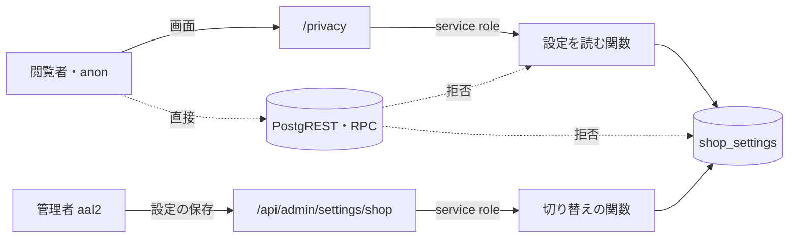

# PRIVACY の脅威

> 状態: 推定（コードを読んで起こした。ユーザーの確認は未） | 確認日: 2026-10-28 | 対象: `/privacy` の画面と、その画面が読むショップの設定（配送の追跡のオン・オフ） | 基準コミット: `973dc336`

---

## 概要

PRIVACY（プライバシーポリシーの頁）の領域で考える脅威を、1つずつ `THR-PRIVACY-NNN` の項目で書く。過去のセキュリティレビューの指摘と、2026-10-24 にコードと DB の移行を読んで気づいた点の両方を拾った。

| 項目 | 内容 |
| --- | --- |
| 項目の数 | 11（THR-PRIVACY-001〜011） |
| 守りがある物 | 設定の関数と表を anon・一般会員が直接読めない（001）、設定を読めない時に頁を失敗にする（003）、追跡の切り替えは aal2 の管理者だけ（005）、枠への埋め込みの禁止（007） |
| 穴がありうる物（満たすかどうかは対応する SEC の本文だけに書く） | 公開の頁が受け取る設定の欄（001。SEC-PRIVACY-002）、回数の制限と重い数え上げ（002。SEC-PRIVACY-003・004）、DB が使えない間の方針の読めなさ（004。SEC-PRIVACY-009）、公表の中身と実際の扱いの差（006。SEC-PRIVACY-011・012）、閲覧だけで配る識別子の Cookie と会員のメール（008。SEC-PRIVACY-015・016）、窓口のメール箱（009。SEC-PRIVACY-017） |
| 対策の書き先 | 対策のセキュリティ要件 `SEC-PRIVACY-NNN` は要件の文書に書く。下の「対策」の欄は読み手のための写し |
| 状態の付け方 | どれもコード・移行・過去のレビューから起こし、ユーザーの確認を受けていないので「推定」（documentation-guide の 7）。どれも実行しての確かめはしていない |

---

## 範囲と根拠

- 範囲: `scripts/trace/scope.json` の PRIVACY の src（`src/app/privacy/**`。ファイルは `src/app/privacy/page.tsx` の1本だけ）
- 範囲の外だが脅威の入口になるので見た物: `src/lib/orders/tracking/delivery-store.ts`（設定を読む関数、配送の追跡の部品）、`src/lib/supabase/server.ts`（service role の client、共有部品）、`src/proxy.ts`（守りの見出し・Cookie、共有部品）、`src/contexts/Providers.tsx`・`src/contexts/LoginContext.tsx`・`src/app/api/auth/me/route.ts`（全頁で動く共有部品）、`src/app/api/admin/settings/shop/route.ts`（追跡の切り替えの窓口、ADMIN）、`src/lib/auth/admin-rbac.ts`（管理の認可）、`supabase/migrations/20261011222930_order_refund_records.sql`（`shop_settings` の RLS と権限）、`supabase/migrations/20261021220816_delivery_tracking_records.sql`（設定の書き換えの見張り）、`supabase/migrations/20261021221140_delivery_tracking_admin.sql`（設定の関数と権限）
- 出どころのレビュー: `docs/05_Quality/reviews/security/security_review_privacy.md`、`docs/05_Quality/reviews/code/2026-04-18-privacy-review.md`・`2026-04-29-privacy-review.md`、`docs/05_Quality/reviews/uiux/uiux_review_privacy.md`。どれも当時の記録なので、今の状態は 2026-10-24 にコードを読み直して決めた
- 全体のセキュリティ要件は `docs/02_Requirements/requirements.md` の 5.4 節（NFR-SEC-001〜012・AC-SEC-001）。PRIVACY に当てはまる物は、各項目の根拠に `（範囲外）` を付けて書いた
- ASVS は OWASP ASVS 4.0.3 の項目番号。当てはめに自信のある物だけ書き、ほかは「ASVS 未対応付け」と書いた
- 外した物:
  - 署名つき URL: この頁は使わない。OGP の画像は公開の固定の道筋 `/mainphoto.png`（`src/app/privacy/page.tsx`）
  - 利用者の入力: この頁は入力を受けない。`/contact` への内部リンクだけ（`page.tsx`）。問い合わせの入力の脅威は CONTACT（範囲外）
  - 解析・広告の道具: src に無い（`gtag`・`google-analytics`・`@vercel/analytics` の当たりは0）。INT-DATA-003（範囲外）の解析のマスクは当てはまらない
  - Turnstile の常時読み込み（`2026-04-18-privacy-review.md`）: 今はログインの窓を開いた時だけ読む（`src/components/LoginModal.tsx`）。公表の書き方の抜けは THR-PRIVACY-006 に入れた
  - cart・wishlist の自動の取得（同じファイルの次の指摘）: `/privacy` では止めた（`src/contexts/Providers.tsx`）
  - forwarded の見出しの信頼（`2026-04-29-privacy-review.md`）: 状態を変える窓口の Origin の話で、この頁は状態を変えない

### 入口と守りの位置

- 実線の矢印はアプリが用意した道、点線はアプリを通らない道。点線の先は権限の取り上げと RLS で断る（THR-PRIVACY-001・005）
- `/privacy` は回数の制限を通らない（THR-PRIVACY-002）
- 全部の応答に `src/proxy.ts` が守りの見出しを付ける。`session_id` の Cookie は `/cart`・`/checkout`・`/api/checkout` の応答だけに付く（THR-PRIVACY-007・008）。図では省いた

---

## 脅威の一覧

### THR-PRIVACY-001 公開の頁の処理に、設定を変えた担当者のメールが渡る

| 属性 | 値 |
| --- | --- |
| 守るもの | 追跡の設定を最後に変えた担当者のメール（`updated_by_email`）と、取り込み待ちの件数 |
| 脅威 | 閲覧者が担当者のメールを知る。または後の変更で、そのメールが頁や記録に出る |
| 起こり方 | (1) anon・一般会員の鍵で PostgREST の `rpc/get_delivery_tracking_settings` を叩く、または `shop_settings` を直接 select する。(2) `/privacy` は service role で設定を読み、担当者のメールと件数を含む結果を受け取る（`src/app/privacy/page.tsx`、`src/lib/orders/tracking/delivery-store.ts`、`supabase/migrations/20261021221140_delivery_tracking_admin.sql`）。今の頁は `enabled` だけを描く（`page.tsx`） |
| 影響 | 店の担当者のメールが外へ出ると、なりすましのメールや狙った攻撃の手がかりになる |
| 対策 | SEC-PRIVACY-001、SEC-PRIVACY-002 |
| ASVS | V4.1.3 |
| 根拠 | (1) の道は閉じている。関数は anon・authenticated から取り上げ service role だけに許す（`20261021221140_delivery_tracking_admin.sql`）。表は RLS の拒否の方針と権限の取り上げで閉じる（`supabase/migrations/20261011222930_order_refund_records.sql`）。結合テストが権限を確かめる（`tests/integration/db/delivery_tracking_admin.integration.test.ts`）。(2) の受け取る欄の絞り込みは SEC-PRIVACY-002 を参照。全体の NFR-SEC-010（範囲外）の個人情報のマスクと NFR-SEC-005（範囲外）の権限管理を当てはめた |
| 状態 | 推定 |
| 出どころ | 実装から推定 |

### THR-PRIVACY-002 頁の連打で DB の重い数え上げを走らせる

| 属性 | 値 |
| --- | --- |
| 守るもの | DB の処理能力と、店全体の頁の使える状態 |
| 脅威 | ログイン無しの者が `/privacy` を繰り返し開き、DB に負荷をかける |
| 起こり方 | `/privacy` は request のたびに描き（`page.tsx`）、そのたびに設定の関数を呼ぶ。関数は `enabled` のほかに、発送・追跡の変更・登録の表をつないだ取り込み待ちの件数まで数える（`20261021221140_delivery_tracking_admin.sql`）。頁にも `src/proxy.ts` にも回数の制限が無いので、見出しを偽って制限を抜ける必要すら無い |
| 影響 | 発送の数が増えるほど1回の数え上げが重くなる。連打で DB が詰まると、注文・決済の処理まで遅れる |
| 対策 | SEC-PRIVACY-003、SEC-PRIVACY-004 |
| ASVS | V11.1.4 |
| 根拠 | 運用の文書が「プライバシーポリシーを開くたびに、取り込みの件数まで数える関数を呼ぶ。『オンか』だけを読む軽い関数に替える」を、追跡をオンにする前に直すコードに挙げた（`docs/06_Operations/webhook-queue-operations.md`）。今は追跡がオフで発送の行が少ないので害は小さい（推定） |
| 状態 | 推定 |
| 出どころ | `docs/06_Operations/webhook-queue-operations.md` |

### THR-PRIVACY-003 公表する委託の一覧が、実際の扱いと食い違う

| 属性 | 値 |
| --- | --- |
| 守るもの | 公表したプライバシーポリシーの正しさ（委託先の一覧） |
| 脅威 | 頁が、17TRACK へ渡していないのに渡すと書く、または渡しているのに書かない。古い版が中継のキャッシュに残る |
| 起こり方 | (1) 設定を読めない時に、一文を出さない（または出す）側へ黙って倒す。(2) 一文の条件を鍵の有無にして、設定と食い違わせる。(3) 中継の CDN が古い応答を保つ |
| 影響 | 個人情報の提供先を誤って公表する。個人情報保護法の公表・通知の義務に反し、利用者の信頼を失う |
| 対策 | SEC-PRIVACY-005、SEC-PRIVACY-006、SEC-PRIVACY-007 |
| ASVS | V8.3.3 |
| 根拠 | (1) は、読めない時は頁の失敗にする形で守る（`page.tsx`、単体テスト `tests/unit/components/PrivacyPage.test.tsx`）。(2) は、条件をショップの `enabled` にした（`page.tsx`、同テスト、配送の追跡の追加の設計の決定 25 `docs/superpowers/specs/2026-10-21-delivery-status-design.md`）。(3) は、request ごとに描く頁なので Next.js が共有のキャッシュを止める見出しを付ける見込み（推定。応答の見出しは確かめていない）。キャッシュの方針を仕様に書いていない点は過去のレビューの Open の指摘 |
| 状態 | 推定 |
| 出どころ | `docs/05_Quality/reviews/security/security_review_privacy.md`、`docs/superpowers/specs/2026-10-21-delivery-status-design.md` |

### THR-PRIVACY-004 DB が使えない間、プライバシーポリシーそのものが読めない

| 属性 | 値 |
| --- | --- |
| 守るもの | プライバシーポリシーを本人がいつでも知り得る状態と、誤りの頁の中身 |
| 脅威 | DB の障害・負荷（THR-PRIVACY-002）・service role の鍵の誤りで、頁が描けなくなる。誤りの頁に中の事情が出る |
| 起こり方 | 設定を読めないと頁が例外で終わる（`page.tsx`）。受け皿の `src/app/privacy/error.tsx`（2026-10-26）が、窓口の案内だけを出す。方針の本文・委託の一覧・誤りの文は出さない。`src/app/` 直下には `error.tsx`・`global-error.tsx` が無い |
| 影響 | 公表すべき方針が読めない時間ができる（個人情報保護法の「本人の知り得る状態」）。開発の設定のまま公開すると、誤りの中身が出る恐れがある |
| 対策 | SEC-PRIVACY-008、SEC-PRIVACY-009 |
| ASVS | V7.4.1 |
| 根拠 | THR-PRIVACY-003 の守り（読めない時は失敗にする）の裏側。誤りの頁が本番で中身を伏せる（digest だけを出す）のは Next.js の標準の動きで、確かめていない（推定）。正しさと使える状態の両立は、案内だけを出す誤りの画面で図った（ADR-0354。ユーザーの確認は未）。誤りの画面の HTTP 状態が 500 のままかは未実測 |
| 状態 | 推定 |
| 出どころ | 実装から推定（個人情報保護法の「本人の知り得る状態」の公表の求めから、推定） |

### THR-PRIVACY-005 権限の無い者が追跡を切り替え、公表の文を書き換える

| 属性 | 値 |
| --- | --- |
| 守るもの | 公表の文（委託の一文の出し分け）と、それを決める `shop_settings` の追跡の設定 |
| 脅威 | 管理の権限を持たない者、または2要素認証を済ませていない（`aal1`）管理者の session を得た者が、追跡のオン・オフを変える |
| 起こり方 | (1) PostgREST で `rpc/admin_set_delivery_tracking` を叩く、または `shop_settings` を直接 update する。DB の RLS の `has_permission` は aal を見ない（`supabase/migrations/20261023175712_group_g0_permissions.sql`）ので、表や関数に `authenticated` の許しがあれば aal1 で届く。(2) 設定の保存の窓口 `/api/admin/settings/shop` を叩く |
| 影響 | 17TRACK へ渡していないのに渡すと公表する、またはその逆。設定の変更で発送の取り込みも動く |
| 対策 | SEC-PRIVACY-010 |
| ASVS | V4.3.1 |
| 根拠 | (1) の道は閉じている。切り替えの関数は service role だけに許し（`20261021221140_delivery_tracking_admin.sql`）、表は anon・authenticated に RLS の拒否と権限の取り上げ（`20261011222930_order_refund_records.sql`）、切り替えの関数を通らない書き換えは見張りが断る（`supabase/migrations/20261021220816_delivery_tracking_records.sql`）。`has_permission` に頼る方針がこの表に無いので、aal を見ない弱さはここには届かない。(2) の窓口は `admin.settings.manage` と aal2（`src/lib/auth/admin-rbac.ts`）、CSRF の token、回数の制限、監査の記録を通す（`src/app/api/admin/settings/shop/route.ts`）。全体の NFR-SEC-008（範囲外）の RBAC、NFR-SEC-005（範囲外）の監査ログ、FREQ-540（範囲外）の DB の ACL・aal2 の守りに照らした |
| 状態 | 推定 |
| 出どころ | 実装から推定（2026-10-24 の DB の移行の読み直し） |

### THR-PRIVACY-006 公表の中身が、実際に個人情報を渡す先・使い道と合わない

| 属性 | 値 |
| --- | --- |
| 守るもの | 公表したプライバシーポリシーの正しさ（委託先・外部サービス・利用目的・改定日） |
| 脅威 | 店が、実際の扱いと違う方針を公表し続ける |
| 起こり方 | (1) 9 節「Cookie 及び外部サービスの利用」に、Stripe のほかの外部サービス（メール送信の Resend、DB の Supabase、Cloudflare Turnstile）の名前が無かった（2026-10-26 に事業者名で 9 節へ入れて直した。`page.tsx`）。(2) 利用目的にメールマガジン・キャンペーンの案内があるが、その機能は無い（メールマガジンの行は 2026-10-26 に削除。キャンペーンの 2 行は、将来の機能のためとしてユーザーが残すと決めた受け入れた差。`page.tsx`）。(3) 追跡をオンにして委託の一覧が変わっても「最終改定日」は変わらない（`page.tsx`。2026-10-26 に、追跡の設定の更新時刻に追従させて直した。ADR-0353）。(4) 頁に GDPR・EU の記載が無い（LEGAL-006（範囲外）） |
| 影響 | 本人が渡す先を知らないまま個人情報が外へ出る。法令の公表・通知の義務と、国外移転の情報提供の義務に反する恐れがある |
| 対策 | SEC-PRIVACY-011、SEC-PRIVACY-012 |
| ASVS | V8.3.3 |
| 根拠 | どれも法務の判断が要る（推定）。(1) は直した（事業者名で 9 節へ。法人名は法務の確認前）。(2) はメールマガジンだけ直し、キャンペーンはユーザーが残すと決めた。(3) は直した（最終改定日は基準日と追跡を切り替えた日の遅いほう。ADR-0353）。Stripe の扱いは FR-CHECKOUT-002（範囲外）・NFR-COMP-001（範囲外）と合う |
| 状態 | 推定 |
| 出どころ | 実装から推定（`src/app/privacy/page.tsx` の文と実際の外部サービスの利用の突き合わせ） |

### THR-PRIVACY-007 頁を枠に埋め込む・外の script を差し込む

| 属性 | 値 |
| --- | --- |
| 守るもの | 頁の表示の正しさと、閲覧者の操作 |
| 脅威 | 外のサイトが頁を枠に入れて重ね押しを誘う。注入した script が偽の方針や偽の窓口を見せる |
| 起こり方 | 外のサイトの iframe に `/privacy` を入れる。許した外のドメインから script を読ませる |
| 影響 | 偽の窓口へ個人情報の請求を送らせる。方針の文を書き換えて見せる |
| 対策 | SEC-PRIVACY-013、SEC-PRIVACY-014 |
| ASVS | V14.4.3、V14.4.7 |
| 根拠 | `src/proxy.ts` が全部の応答に `frame-ancestors 'none'` と `X-Frame-Options: DENY`、nonce つきの CSP、HSTS、`nosniff` を付ける（`src/proxy.ts`、matcher は全部の道）。CSP の許可先は全頁で同じ。使っていない jsDelivr は 2026-10-28 に外した（`ADR-0108`）。Stripe.js の許可は、`next/link` の遷移で CSP が変わらず決済の頁だけに絞ると `/cart` から進んだ時に決済の部品が止まるので、全頁に残すと決めた（ユーザーの決定 Q29。過去のレビューの Open（High）はこの判断で閉じた）。Turnstile はヘッダーのログインの窓が使うので、許可先に要る。`/privacy` の見出しを確かめる E2E は無い（Open、Low）。全体の NFR-SEC-001（範囲外）の HSTS と NFR-SEC-003（範囲外）の CSP を当てはめた |
| 状態 | 推定 |
| 出どころ | `docs/05_Quality/reviews/security/security_review_privacy.md` |

### THR-PRIVACY-008 方針を読むだけの閲覧者に、識別子とメールを配る

| 属性 | 値 |
| --- | --- |
| 守るもの | 閲覧者を追える識別子と、ログイン中の会員のメール |
| 脅威 | 方針を読みに来ただけの閲覧者に、店が長く残る識別子を付ける。全頁の応答に会員のメールが載る |
| 起こり方 | (1) 過去は Cookie の無い request のたびに、どの頁でも `session_id` を発行していた（`src/proxy.ts` の `proxy`）。2026-10-28 に、発行を許可リストの道（`/cart`・`/checkout`・`/api/checkout`）だけにした。`session_id` の読み手は決済の流れだけなので、他の頁には配らない（`shouldIssueSessionCookie`、`ADR-0355`、`DD-PRIVACY-004`）。ログインの成功で `session_id` を新しく発行して回す処理（`src/features/auth/services/register.ts`）は別の仕組みで残り、許可リストの外の `/api/auth/*` の応答にも `Set-Cookie` が付く（セッション固定への守り）。(2) 全頁で動く `LoginProvider` が表示のたびに `/api/auth/me` を呼び（`src/contexts/LoginContext.tsx`）、応答にメールが入っていた（`src/app/api/auth/me/route.ts`。2026-10-26 に外した。`id` は残す） |
| 影響 | 必要の無い識別子で閲覧が結び付けられる。script の注入があった時に、会員のメールを読まれる |
| 対策 | SEC-PRIVACY-015、SEC-PRIVACY-016 |
| ASVS | ASVS 未対応付け |
| 根拠 | どちらも共有部品の話で、直すと全頁に響く。頁の 9 節は Cookie を「ログイン状態の保持やショッピングカートの管理」に使うと書くので、`session_id` の発行は書いた目的の中にある。ただし `/privacy` ではカートを止めている（`src/contexts/Providers.tsx`）ので、発行の要は無い。全体の NFR-SEC-010（範囲外）の個人情報のマスクを当てはめた |
| 状態 | 推定 |
| 出どころ | `docs/05_Quality/reviews/security/security_review_privacy.md`、`docs/05_Quality/reviews/code/2026-04-29-privacy-review.md` |

### THR-PRIVACY-009 開示などの請求が、窓口に届かない

| 属性 | 値 |
| --- | --- |
| 守るもの | 本人が開示・訂正・利用停止などを請求できること |
| 脅威 | 頁に書いた窓口のメール箱が無い・誰も見ていないので、請求が消える |
| 起こり方 | 本人が 10 節・12 節に従い `privacy@lefildesheures.com` へ送る（`page.tsx`） |
| 影響 | 法令の期間内に請求に応えられない。本人の権利を損ない、苦情・行政の指導につながる |
| 対策 | SEC-PRIVACY-017 |
| ASVS | ASVS 未対応付け |
| 根拠 | この住所はリポジトリでこの頁の1か所だけに出てくる。運用の文書にも開店の準備の表にも、メール箱を作る・受信を確かめる行が無い（`docs/05_Quality/reviews/code/2026-09-25-working-diff-security-review.md` に privacy の行が無い）。メール箱が本当に無いかは確かめていない |
| 状態 | 推定 |
| 出どころ | 実装から推定（頁の 10 節・12 節の約束から、推定） |

### THR-PRIVACY-010 平文の窓口のメールが集められ、迷惑メールに埋もれる

| 属性 | 値 |
| --- | --- |
| 守るもの | 窓口のメール箱と、そこへ届く請求 |
| 脅威 | 機械が頁から住所を集め、迷惑メールを送る |
| 起こり方 | 頁の本文に住所を平文で載せる（`page.tsx`。`mailto:` のリンクではない） |
| 影響 | 迷惑メールに本物の請求が埋もれ、見落とす（THR-PRIVACY-009 と同じ害に至る） |
| 対策 | SEC-PRIVACY-018 |
| ASVS | ASVS 未対応付け |
| 根拠 | 過去のレビューの Open（Low）。住所の表示は FREQ-100-AC-02 が求めるので、住所を隠す対策は取れない。受ける側で守る |
| 状態 | 推定 |
| 出どころ | `docs/05_Quality/reviews/security/security_review_privacy.md` |

### THR-PRIVACY-011 他人になりすまして、開示の請求で個人情報を得る

| 属性 | 値 |
| --- | --- |
| 守るもの | 会員・購入者の保有個人データ（氏名・住所・注文の履歴など） |
| 脅威 | 他人のメールや名前を名乗った者が、開示の請求でその人の個人情報を受け取る |
| 起こり方 | 窓口のメールやお問い合わせのフォームから、他人の名で開示を請求する。頁は「ご本人であることを確認」すると書く（`page.tsx`）が、確かめ方の手順が無い |
| 影響 | 個人情報の漏えい。漏えいの報告の義務に当たる恐れがある |
| 対策 | SEC-PRIVACY-019 |
| ASVS | ASVS 未対応付け |
| 根拠 | 開示の請求を扱う手順が運用の文書に無い（推定。`docs/06_Operations/` に開示の請求の手順の当たりが無い）。コードの話ではなく運用の話 |
| 状態 | 推定 |
| 出どころ | 実装から推定（頁の 10 節の文） |

---

## 未確認事項

- `/privacy` の応答の `Cache-Control` の実際の値（THR-PRIVACY-003）。本番の中継（Vercel など）の扱いも見ていない。本番の頁は未公開（2026-10-24 時点）
- 本番で、誤りの頁が中身を伏せるか（THR-PRIVACY-004）
- `privacy@lefildesheures.com` のメール箱が在るか、誰が見るか（THR-PRIVACY-009・010）
- 委託先・外部サービスをどこまで名前で書くか、GDPR を書くか（THR-PRIVACY-006）は法務の判断。ユーザーと税理士・専門家に確かめる
- 追跡をオンにする前に、設定の読み取りを軽い関数に替える予定（`docs/06_Operations/webhook-queue-operations.md`）。替えると THR-PRIVACY-001・002 の起こり方が変わる
- 17TRACK の運営会社名と国を委託の一文に入れるか（`docs/superpowers/specs/2026-10-21-delivery-status-design.md`）はユーザーの判断待ち
