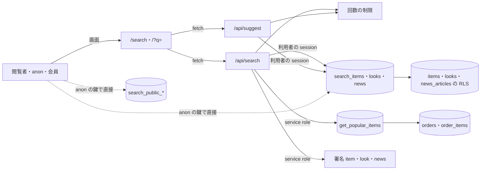

# SEARCH の脅威

> 状態: 推定（コードを読んで起こした。ユーザーの確認は未） | 確認日: 2026-10-24 | 対象: `/search` の画面・ホームの `/?q=` の窓・`/api/search`・`/api/suggest`・検索の DB の関数（`search_items`・`search_looks`・`search_news`・`search_public_*`・`get_popular_items`） | 基準コミット: `973dc336`（作業ツリー。本文の `ファイル:行` の行番号は、この基準コミットの時点のそのファイルの行を指す）

---

## 概要

SEARCH（サイト内の横断検索）の領域で考える脅威を、1つずつ `THR-SEARCH-NNN` の項目で書く。過去のセキュリティレビューの指摘と、2026-10-24 にコードと移行を読んで気づいた点の両方を拾った。

| 項目 | 内容 |
| --- | --- |
| 項目の数 | 21（THR-SEARCH-001〜021） |
| 守りがある物 | 下書きを出さない（001・002）、検索条件への差し込み（003）、購入数を出さない（009）、Referer での漏れ（012）、表示での XSS（013）。過去に直った指摘（フィルタ文字列の連結・回数の制限の無さ・Cookie の記録・検索の履歴の保存）も、守りがある脅威として残した |
| 守りが欠ける・弱い物 | 入口の確かめの不揃い（004）、送り元を偽れる回数の制限（006）、RPC の直接の呼び出しに件数の上限が無い（007）、使われない関数が PUBLIC に開く（008）、応答に `Cache-Control` が無い（010）、ITEM の署名つき URL が7日（014）、署名の失敗で元の値を返す（015）、失敗が0件に見える（017）、回数の制限で他人を締め出せる（020）、ホームの文に語を入れて偽の知らせを出せる（021）など |
| 対策の書き先 | 対策のセキュリティ要件 `SEC-SEARCH-NNN` は要件の文書（`docs/02_Requirements/areas/search.md`）に書く。下の「対策」の欄は読み手のための写し |
| 状態の付け方 | 出どころが過去のレビューの指摘で、今のコードでも同じ形を確かめた物は「現行」。実装から起こした物（出どころが「実装から推定」）と、本番の設定や推論に頼る物は「推定」（`.claude/skills/documentation-guide/SKILL.md` の 7）。どれも実行しての確かめはしていない |

---

## 範囲と根拠

- 範囲: `scripts/trace/scope.json` の SEARCH の src（`src/app/search/**`・`src/app/api/search/**`・`src/app/api/suggest/**`・`src/features/search/**`）
- 範囲の外だが脅威の入口になるので見た物: `src/features/auth/middleware/rateLimit.ts`（回数の制限）、`src/lib/supabase/server.ts`（利用者の session の client と service role の client）、`src/lib/storage/item-images.ts`・`look-images.ts`・`news-images.ts`（署名）、`src/proxy.ts`（守りの見出し）、`supabase/migrations/20260901102912_remote_schema.sql`（検索の関数・表の RLS・権限）、`supabase/migrations/20261013001143_order_return_receipts.sql`（`get_popular_items` の最後の定義）、`supabase/config.toml`（PostgREST の行数の上限）
- 出どころのレビュー: `docs/05_Quality/reviews/security/security_review_search.md`、`docs/05_Quality/reviews/code/2026-04-18-search-review.md`・`2026-04-29-search-additional-security-review.md`。どれも当時の記録なので、今の状態は 2026-10-24 にコードを読み直して決めた
- 全体のセキュリティ要件は `docs/02_Requirements/requirements.md` の 5.4 節（NFR-SEC-001〜012・AC-SEC-001）。SEARCH に当てはまる物は、各項目の根拠に `NFR-SEC-00N（範囲外）` の形で書いた
- NEWS の脅威と同じ形の物は、検索に固有の所だけをここに書き、NEWS の分は `THR-NEWS-NNN（範囲外）` として指す（`search_news` の直接の呼び出しは THR-NEWS-009（範囲外）、画像の最適化の中継は THR-NEWS-022（範囲外））
- ASVS は OWASP ASVS 4.0.3 の項目番号。当てはめに自信の無い物は「（当てはめは推定）」、番号を決められない物は「ASVS 未対応付け」と書いた
- 外した物: `/search?q=` の頁に `noindex` が無く、サイト内検索の結果の頁が検索エンジンに載りうる点（NFR-SEO-004（範囲外））は、守る物が無いので脅威にしていない。ヘッダーの検索のアイコン（`src/components/Header.tsx`）は固定の道筋へのリンクで、入力を差し込む面が無い

### 入口と守りの位置

- 実線の矢印はアプリが用意した道、点線はアプリを通らない道（THR-SEARCH-007・008）
- 回数の制限と1種別8件の上限は `/api/search`・`/api/suggest` だけが通る。PostgREST の直接の呼び出しは通らない
- 検索の関数は SECURITY DEFINER を付けない（呼び手の権限で動く）ので、表の RLS も効く。人気商品の関数だけが SECURITY DEFINER で、service_role だけが呼べる
- 守りの見出し（CSP・`Referrer-Policy` など）は `src/proxy.ts` が全部の応答に付ける。図では省いた

---

## 脅威の一覧

### THR-SEARCH-001 公開前の商品・ルック・ニュースが検索とサジェストから漏れる

| 属性 | 値 |
| --- | --- |
| 守るもの | 非公開の商品・ルック・ニュースの題・説明・本文・画像の道筋 |
| 脅威 | 閲覧者が、検索の語やサジェストで公開前の物の題や本文を引く |
| 起こり方 | `/search`・`/?q=`・`/api/search`・`/api/suggest` に、下書きの題や本文に含まれる語を送る。検索の関数の中の `status = 'published'` の絞りか、表の RLS のどちらかが崩れると届く。サジェストは題そのものを候補として返すので、題が一番先に漏れる |
| 影響 | 発表前のコレクション・ルック・お知らせが先に知られる。ブランドの発表の段取りが崩れる |
| 対策 | SEC-SEARCH-001 |
| ASVS | V4.1.1 |
| 根拠 | 守りは2段ある。検索の関数の中の絞り（`supabase/migrations/20260901102912_remote_schema.sql:2163,2197,2230`）と、anon の表の読み出しの RLS（`remote_schema.sql:3462-3465,3535`）。人気商品も公開済みだけを数える（`supabase/migrations/20261013001143_order_return_receipts.sql:1763`）。過去のレビューも「Fixed」とした。ただし下書きを入れて試すテストが無い（今の E2E は人気商品の詳細の頁が開けるかだけを見る `e2e/FR-SEARCH-008-popular-items-by-purchases.spec.ts:37-39`）。NFR-SEC-005（範囲外）の権限管理を、検索の公開の線引きに当てはめた |
| 状態 | 現行 |
| 出どころ | `docs/05_Quality/reviews/security/security_review_search.md:50` |

### THR-SEARCH-002 管理の権限を持つ session では、RLS が下書きを検索の関数に通す

| 属性 | 値 |
| --- | --- |
| 守るもの | 非公開の商品・ルック・ニュース |
| 脅威 | 管理の読み取りの権限を持つ人の session（2要素認証を済ませていない `aal1` を含む）を手に入れた者が、検索の関数から下書きを引く |
| 起こり方 | 検索は利用者の Cookie の session で client を作り（`src/lib/supabase/server.ts:15-60`、`src/features/search/services/search.service.ts:218,353`）、関数は呼び手の権限で動く。authenticated の表の RLS は `status='published'` か `has_permission('admin.items.read')`・`admin.looks.read` のどちらかで通す（`remote_schema.sql:3489-3492,3562-3565`）。`has_permission` は ACL だけを見て `aal` を見ない。だから管理の session では、関数の中の絞り（`remote_schema.sql:2163,2197,2230`）だけが下書きを止めている |
| 影響 | 関数の中の絞りが外れる・書き換わると、管理の session でパスワードだけを得た者が、画面からでも PostgREST からでも下書きを引ける |
| 対策 | SEC-SEARCH-002 |
| ASVS | V4.3.1（当てはめは推定） |
| 根拠 | 今は関数の中の絞りがあるので漏れない。RLS が `aal` を見ない点は NEWS の THR-NEWS-002（範囲外）と同じ形で、表の持ち主は ITEM（範囲に無い）・LOOK・NEWS。検索の側では「関数の中の絞りを RLS に任せない」ことを守りとして持つ。実際に叩いての確かめはしていない。FREQ-540（範囲外）の DB の ACL・session・aal2 で管理の操作を守る考えに照らした |
| 状態 | 推定 |
| 出どころ | 実装から推定（2026-10-24 の移行の読み直し） |

### THR-SEARCH-003 検索の語で検索の条件を書き換える

| 属性 | 値 |
| --- | --- |
| 守るもの | DB の検索の条件と、DB の中の公開していない列・行 |
| 脅威 | 閲覧者が、`q` に PostgREST のフィルタの記号（`,().`）や ILIKE の記号（`%`・`_`）、SQL の字を入れて、条件を広げる・別の条件を足す |
| 起こり方 | 2026-04-18 の時点では、入力を `.or(...)` のフィルタの文字列につないでいた。今は `search_items`・`search_looks`・`search_news` に引数として渡し（`src/features/search/services/search.service.ts:222-226,356-360`）、関数の中で `%`・`_` を逃がして `ESCAPE '\'` を付ける（`remote_schema.sql:2165-2167,2199-2200,2232-2234`）。`\` そのものは逃がさないので、語の `\%`・`\_` は置き換えの後に `\\%`・`\\_`（字の `\` の後に生きたワイルドカード）になり、`\` を含む行に広く当たる。語の末尾の `\` は後ろの `%` を字に変えて模様を変える。SQL の差し込みにはならないが、ワイルドカードの差し込みは限られた形で残る（2026-10-24 に移行を読んで推定） |
| 影響 | 条件を書き換えられると、公開していない行や列に届く。ワイルドカードで全件の一致になる。今の `\` の道で広がるのは、公開済みの行の中の一致だけ |
| 対策 | SEC-SEARCH-003 |
| ASVS | V5.3.4 |
| 根拠 | 2026-04-18 の Must Fix の指摘を受けて RPC の引数に変え、2026-04-29 のレビューで Fixed とした。全体の NFR-SEC-007（範囲外）のパラメータ化クエリを検索に当てはめた。台帳（`docs/05_Quality/reviews/code/2026-09-25-working-diff-security-review.md`）の R-40（お問い合わせの `ilike` が `%`・`_` を逃がさない）と同じ種類の道を、検索は関数の中で塞いでいる |
| 状態 | 現行 |
| 出どころ | `docs/05_Quality/reviews/code/2026-04-18-search-review.md:48-53`、`docs/05_Quality/reviews/security/security_review_search.md:49,118` |

### THR-SEARCH-004 入口の確かめの決まりが検索とサジェストで違う

| 属性 | 値 |
| --- | --- |
| 守るもの | 入口の守りの正しさと、守りの思い違いを防ぐこと |
| 脅威 | 閲覧者が、サジェストでは断られる値（制御文字）を検索の窓口に送り、DB の関数まで届かせる |
| 起こり方 | `/api/search` の `q` は前後の空白を落として100字までを確かめるだけ（`src/app/api/search/route.ts:18`）。`/api/suggest` は制御文字も断る（`src/app/api/suggest/route.ts:18,25-27`）。サジェストのコメントは `,().` も断ると書くが、正規表現は制御文字だけを見る（`suggest/route.ts:15-18`）。`tab` は4つの値に絞る（`route.ts:19`） |
| 影響 | 差し込みにはならない（THR-SEARCH-003 の守りがある）。ただ守りの層の数を読み違え、コメントを信じて引数の渡し方を変えると守りが消える |
| 対策 | SEC-SEARCH-004 |
| ASVS | V5.1.3（当てはめは推定） |
| 根拠 | 過去のレビューの Low・Important の指摘で、今も直っていない。旧版の詳細設計（`git show 40acae8a:docs/04_DetailDesign/pages/19_search.md` の API 仕様の表）は「不正クエリ（過長・禁止文字）は 400」と書いたが、検索の窓口は禁止文字を見ない。書き直した今の詳細設計にこの決まりは無く、引き継がなかった物として残る（`docs/04_DetailDesign/pages/19_search.md` の「旧版から引き継がなかった節」）。全体の NFR-SEC-003（範囲外）の入力検証に当てはめた |
| 状態 | 現行 |
| 出どころ | `docs/05_Quality/reviews/code/2026-04-18-search-review.md:64-69`、`docs/05_Quality/reviews/security/security_review_search.md:46,117` |

### THR-SEARCH-005 検索とサジェストを続けて叩き、DB と署名の処理を詰まらせる

| 属性 | 値 |
| --- | --- |
| 守るもの | DB・画像の署名の処理・回数の制限の数えの表の余力（使える状態） |
| 脅威 | 自動の道具が、公開の検索とサジェストを続けて叩く。普通の利用者の操作でも呼び出しが多い |
| 起こり方 | 窓口は回数の制限を通す（`search:public` 120回・`search:preview` 20回・`suggest:public` 200回、どれも600秒、`src/app/api/search/route.ts:40-50`、`src/app/api/suggest/route.ts:42-52`）。制限の DB が落ちると 503 で閉じる（`src/features/auth/middleware/rateLimit.ts:45-64`）。1回の検索で3つの関数と、人気商品の関数・最大28枚の署名を呼ぶ（`search.service.ts:202-203,222-226,314-318`）。`preview` を決めるのは呼ぶ側で、2つの数えは別々なので、1つの送り元で合わせて140回使える（`route.ts:43-44`）。`tab` はサーバーで結果を絞らないのに、画面はタブを切り替えるたびに検索を呼び直す（`search.service.ts:199,322`、`src/features/search/components/SearchPageClient.tsx:287-320`）。サジェストは1文字ごとに待たずに呼ぶ（`SearchPageClient.tsx:322-359`） |
| 影響 | DB と署名の呼び出しが増え、画面が遅くなる・止まる。普通の利用者が速く打つと 200回に届き、サジェストが出なくなる（推定） |
| 対策 | SEC-SEARCH-005 |
| ASVS | V11.1.4 |
| 根拠 | 回数の制限は 2026-04-18 の Important の指摘を受けて足し、Fixed とされた。デバウンスと最小の入力長が無い点は Low の指摘で Open のまま。2つの数えとタブの呼び直しは 2026-10-24 にコードを読んで気づいた。公開の検索に監査の記録（NFR-SEC-005（範囲外））は付けていない。監査は管理の操作が対象と読んだ（推定） |
| 状態 | 現行 |
| 出どころ | `docs/05_Quality/reviews/code/2026-04-18-search-review.md:57-62`、`docs/05_Quality/reviews/security/security_review_search.md:51,91`、`docs/05_Quality/reviews/code/2026-04-29-search-additional-security-review.md:46-51` |

### THR-SEARCH-006 回数の制限の送り元を偽って制限を逃れる

| 属性 | 値 |
| --- | --- |
| 守るもの | 検索とサジェストの回数の制限の効き目と、数えの表の大きさ |
| 脅威 | 自動の道具が、送るたびに `x-forwarded-for` を変えて別の送り元のふりをする |
| 起こり方 | 回数の制限は送り元を `x-forwarded-for` の先頭、無ければ `x-real-ip` から無条件に取る（`src/features/auth/middleware/rateLimit.ts:4-16`）。検索とサジェストは `subject` を渡さない（`src/app/api/search/route.ts:41-46`、`src/app/api/suggest/route.ts:43-48`）。呼ばれるたびに数えの行を DB に足す（`rateLimit.ts:26`） |
| 影響 | THR-SEARCH-005 の制限が効かない。偽った送り元の数だけ数えの行が増え、DB を圧迫する |
| 対策 | SEC-SEARCH-006 |
| ASVS | V11.1.4 |
| 根拠 | 過去のレビューの High の指摘で、今も残る。`rateLimit.ts` は範囲外の共有部品で、NEWS の THR-NEWS-010（範囲外）と同じ根の問題。中継（Vercel など）が見出しを上書きするかは本番の構成で変わる（未デプロイなので未確認） |
| 状態 | 現行 |
| 出どころ | `docs/05_Quality/reviews/security/security_review_search.md:42` |

### THR-SEARCH-007 PostgREST から検索の関数を直接叩き、アプリの制限を迂回する

| 属性 | 値 |
| --- | --- |
| 守るもの | DB の余力と、公開済みの商品・ルックのまとめての吸い出しの手間 |
| 脅威 | 閲覧者が anon の鍵で `/rest/v1/rpc/search_items`・`search_looks` を直接叩き、回数の制限も8件の上限も通らずに読む |
| 起こり方 | `search_items`・`search_looks` は anon・authenticated に EXECUTE を付け（`remote_schema.sql:4010,4014`）、`limit_count` をそのまま `LIMIT` に使い上限に丸めない（`remote_schema.sql:2170,2203`）。空の語（`search_query` が空の字なら模様は `'%%'`）は公開済みの全部の行に一致し、`limit_count` に NULL を渡すと `LIMIT NULL` で件数の上限が無くなる（負の値は誤りで止まる）。`%`・`_` 1字の語は字として逃がすので、その字を含む行にだけ一致する。PostgREST の1回の行数の上限は手元で `max_rows = 1000`（`supabase/config.toml:18`）、本番は未確認。`search_news` の分は THR-NEWS-009（範囲外）が扱う |
| 影響 | 公開済みの行だけなので漏れの害は無い。DB に重い一致を何度でも掛けられ、公開の商品・ルックを一度にまとめて取れる |
| 対策 | SEC-SEARCH-007 |
| ASVS | V11.1.4 |
| 根拠 | どのレビューにも無く、2026-10-24 の突き合わせで気づいた。アプリは利用者の session の client から関数を呼ぶので、anon・authenticated の EXECUTE を外すだけでは検索が止まる。同じ形の前例に、ゲストのカートの RPC を直接叩く道を塞いだ FREQ-322（範囲外）がある。`tests/integration/db/order_refund_records.integration.test.ts:1204` も `get_popular_items(100000)` を呼んでおり、検索の系の関数に件数の上限が無いことが分かる |
| 状態 | 推定 |
| 出どころ | 実装から推定（2026-10-24 の突き合わせ） |

### THR-SEARCH-008 使われていない検索の関数が誰にでも開いている

| 属性 | 値 |
| --- | --- |
| 守るもの | DB の余力と、守りの面の狭さ |
| 脅威 | 閲覧者が anon の鍵で `search_public_items`・`search_public_looks`・`search_public_news` を直接叩き、ワイルドカードを入れて重い一致を掛ける |
| 起こり方 | 3つの関数は PUBLIC・anon・authenticated に EXECUTE を付ける（`remote_schema.sql:4020,4022,4024`）。件数は20に丸める（`remote_schema.sql:2264,2291,2319`）が、語の `%`・`_` を逃がさず ILIKE につなぐ（`remote_schema.sql:2259-2261,2287-2288,2314-2316`）。src のどこからも呼ばれない |
| 影響 | 差し込みではない（引数として渡る）。`%_%_%_` のような模様で重い一致を掛けられる（推定）。使われない入口が残るので、守りを見直す時に見落とす |
| 対策 | SEC-SEARCH-008 |
| ASVS | V4.1.3（当てはめは推定） |
| 根拠 | 使われていないコードとして見つけ、定義を読み直して PUBLIC に開いていて逃がしも無いと分かった。DB の物なので直すのは範囲外（移行は直さない）。読めるのは公開済みの行だけ（`remote_schema.sql:2257`） |
| 状態 | 推定 |
| 出どころ | 実装から推定（2026-10-24 の突き合わせ） |

### THR-SEARCH-009 商品ごとの売れ行きが人気商品の道から漏れる

| 属性 | 値 |
| --- | --- |
| 守るもの | 商品ごとの購入数（売れ行き）と、注文の表の行 |
| 脅威 | 閲覧者が、人気商品の応答や関数から購入数を読む。権限の強い client を公開の道で使うので、作りの誤りが注文の表に届く |
| 起こり方 | `get_popular_items` は SECURITY DEFINER で注文の表を集め、購入数の列を返す（`supabase/migrations/20261013001143_order_return_receipts.sql:1753-1765`）。EXECUTE は service_role だけ（`order_return_receipts.sql:2233-2234`）。検索の窓口は匿名の要求でも毎回 service role の client を作って呼び（`src/features/search/services/search.service.ts:202-203`）、購入数を落とすのは `mapPopularItem` の写し方だけ（`search.service.ts:133-143`） |
| 影響 | 購入数が出ると、商品ごとの売れ行きが競合や第三者に知られる。service role の client を別の取り出しに使い回すと、RLS を通らずに注文の表を読む道ができる |
| 対策 | SEC-SEARCH-009 |
| ASVS | V4.1.3 |
| 根拠 | FREQ-186-REQ-02 が「購入数を出さない・service_role だけ」と決めた。今の応答に購入数は無い（`e2e/FR-SEARCH-008-popular-items-by-purchases.spec.ts:34-35`、`e2e/FR-SEARCH-017-item-meta-price.spec.ts:59-70`）。anon・authenticated に EXECUTE が無いことを試すテストは無い（`tests/unit/migrations/060_create_get_popular_items_rpc.test.ts` は古い移行の字を見るだけ）。FREQ-186-REQ-02 の SECURITY INVOKER との食い違いは SEC-SEARCH-009 と [trace-matrix.md](../../reports/trace-matrix.md) の「食い違い」節（TM-SEARCH-04）に書いた |
| 状態 | 現行 |
| 出どころ | `docs/02_Requirements/requirements.md` の FREQ-186-REQ-02・AC-02、`docs/superpowers/plans/2026-10-12-returns-stage1.md`（anon・authenticated から EXECUTE を外す） |

### THR-SEARCH-010 検索語と署名つき URL を含む応答が共有のキャッシュに残る

| 属性 | 値 |
| --- | --- |
| 守るもの | 利用者の検索語と、応答に入る署名つき URL（ITEM は7日有効） |
| 脅威 | 中継の CDN・共有のキャッシュが応答を保ち、別の利用者に古い応答・検索語・署名つき URL を渡す |
| 起こり方 | `/api/search` の成功の応答（`src/app/api/search/route.ts:58-63`）と失敗の応答（`route.ts:37,66`）、`/api/suggest` の応答（`src/app/api/suggest/route.ts:39,55,58`）、回数の制限の 429・503（`src/features/auth/middleware/rateLimit.ts:30-31,50-54`）に `Cache-Control` が無い。画面の fetch は `cache: 'no-store'` を付ける（`src/features/search/components/SearchPageClient.tsx:290,334`）が、これは利用者の端末の側だけの指定 |
| 影響 | 誰かの検索語や途中まで打った語が別の利用者に見える。非公開にした商品の署名つき URL が残る。429 が残ると別の利用者まで断られる |
| 対策 | SEC-SEARCH-010 |
| ASVS | V8.2.1 |
| 根拠 | 過去のレビューの Medium の指摘で、今も直っていない。署名つき URL が入る点はコードを読み直して足した。NEWS の THR-NEWS-005（範囲外）と同じ形。全体の NFR-PERF-007（範囲外）の Cache-Control の設定も、検索の窓口では満たしていない |
| 状態 | 現行 |
| 出どころ | `docs/05_Quality/reviews/security/security_review_search.md:43-44` |

### THR-SEARCH-011 検索語が URL と端末に残る

| 属性 | 値 |
| --- | --- |
| 守るもの | 利用者の検索語（個人の関心・名前などを含みうる） |
| 脅威 | 同じ端末を使う人や、URL を受け取った人が、前の利用者の検索語を見る |
| 起こり方 | 検索語は `/search?q=` に書き換えて残す（`src/features/search/components/SearchPageClient.tsx:361-380`）。ブラウザの履歴・共有した URL・中継の記録に残る。以前は検索の履歴を `search.history` として localStorage に平文で残していたが、FREQ-189 で撤去した（今の `SearchPageClient.tsx` に localStorage は無い） |
| 影響 | 共有の端末で検索語が残る。URL を共有すると検索語も渡る |
| 対策 | SEC-SEARCH-011 |
| ASVS | V8.3.1（当てはめは推定） |
| 根拠 | `q` を URL に残すのは FR-SEARCH-001 の決めた形で、レビューは残る危険（Medium）とした。履歴の保存（Low）は撤去で解消した。端末に新しく保存しないことを守りとして持つ |
| 状態 | 現行 |
| 出どころ | `docs/05_Quality/reviews/security/security_review_search.md:45,47` |

### THR-SEARCH-012 外へ移る時の Referer で検索語が漏れる

| 属性 | 値 |
| --- | --- |
| 守るもの | 利用者の検索語 |
| 脅威 | `/search?q=` の頁から外のサイトへ移る時や外の物を読む時に、参照元の URL として検索語が外へ送られる |
| 起こり方 | 守りの見出しが無いと、ブラウザの既定で参照元の URL を送る。今は `src/proxy.ts` が全部の応答（`matcher` は `/:path*`、`src/proxy.ts:246`）に `Referrer-Policy: no-referrer` を付ける（`src/proxy.ts:235`） |
| 影響 | 外のサイト・外の画像の置き場の記録に検索語が残る |
| 対策 | SEC-SEARCH-012 |
| ASVS | V14.4.6 |
| 根拠 | 2026-04-29 のレビューの Medium の指摘。今は全体の見出しで解消したと読んだ。`src/proxy.ts` は範囲外の共有部品なので、守りの在りかとして指す |
| 状態 | 現行 |
| 出どころ | `docs/05_Quality/reviews/security/security_review_search.md:89`、`docs/05_Quality/reviews/code/2026-04-29-search-additional-security-review.md:30-35` |

### THR-SEARCH-013 結果と候補の表示でスクリプトが動く

| 属性 | 値 |
| --- | --- |
| 守るもの | 閲覧者の端末と session |
| 脅威 | 商品・ルック・ニュースの題や本文に HTML を入れた者（管理の権限を持つ人か乗っ取った者）、または `q` に HTML を入れた URL を踏ませた者が、閲覧者の端末でスクリプトを動かす |
| 起こり方 | 結果の題と候補のラベルは、検索語で区切って `mark`・`span` の中に React の文字として出す（`src/features/search/components/SearchPageClient.tsx:104-128,151-170,203`）。区切りの正規表現は語を逃がしてから作る（`SearchPageClient.tsx:100-102,110,157`）。`dangerouslySetInnerHTML` は使わない。結果のリンクは id から作り（`search.service.ts:254,276,297`）、候補のリンクは `encodeURIComponent` で語を入れる（`search.service.ts:371,378,385`）。ホームの窓は応答の題を文字として出す |
| 影響 | 閲覧者の session の乗っ取り・偽の画面 |
| 対策 | SEC-SEARCH-013 |
| ASVS | V5.3.3 |
| 根拠 | 守りがある。過去のレビューも XSS を指摘していない。語の長さが100字までなので、正規表現が重くなる心配も小さい（推定）。CSP の nonce は `src/proxy.ts:234`（範囲外）が付ける。全体の NFR-SEC-003（範囲外）の XSS 対策を検索の表示に当てはめた |
| 状態 | 現行 |
| 出どころ | `docs/05_Quality/reviews/code/2026-04-18-search-review.md:73` |

### THR-SEARCH-014 外へ出た ITEM の署名つき URL で、非公開にした後も7日画像が見える

| 属性 | 値 |
| --- | --- |
| 守るもの | 非公開にした・消した商品とルックの画像 |
| 脅威 | 前に検索の応答を受け取った者が、商品を非公開にした後も画像を開く |
| 起こり方 | 検索の結果の画像は種別ごとの関数で署名する（`src/features/search/services/search.service.ts:147-169`）。ITEM の署名つき URL は7日有効で、同じ道筋なら作った URL をサーバーの記憶に持って誰にでも使い回す（`src/lib/storage/item-images.ts:4-7,55-81`）。LOOK と NEWS は1時間（`src/lib/storage/look-images.ts:14`、`src/lib/storage/news-images.ts:4`）。署名つき URL は取り消せない。画面は `next/image` に渡すので、最適化の画像のキャッシュにも残りうる（`SearchPageClient.tsx:187-193`、中継の設定は THR-NEWS-022（範囲外）） |
| 影響 | 誤って公開した商品を戻しても、最大7日（キャッシュに残ればそれ以上）画像が見える |
| 対策 | SEC-SEARCH-014 |
| ASVS | ASVS 未対応付け |
| 根拠 | コードを読み直して見つけた。NEWS の THR-NEWS-004（範囲外）の ITEM・LOOK 版。`lib/storage` は範囲外（ITEM は範囲に無い、LOOK は LOOK の範囲）で、検索の側からは期限を渡していない（既定値に頼る） |
| 状態 | 推定 |
| 出どころ | 実装から推定（2026-10-24 の突き合わせ） |

### THR-SEARCH-015 署名に失敗した時に、ITEM・LOOK の元の値をそのまま返す

| 属性 | 値 |
| --- | --- |
| 守るもの | 置き場の中の道筋と、改ざんの兆し |
| 脅威 | 署名の失敗や道筋にできない値を、そのまま検索の応答に載せる（開く側へ倒れる） |
| 起こり方 | ITEM と LOOK の署名の関数は、道筋を取り出せない値は元の値を返し、署名の失敗も元の値を返す（`src/lib/storage/item-images.ts:92-98`、`src/lib/storage/look-images.ts:89-95`）。失敗を記録に残さない（`item-images.ts:70-72`、`look-images.ts:68-70`）。検索はその値を `imageUrl` として返す（`src/features/search/services/search.service.ts:166`） |
| 影響 | 非公開の置き場の道筋や、DB に書かれた外の URL が閲覧者へ渡る。失敗や改ざんに気づけない |
| 対策 | SEC-SEARCH-015 |
| ASVS | V4.1.5 |
| 根拠 | コードを読み直して見つけた。NEWS の THR-NEWS-007（範囲外）の ITEM・LOOK 版。外のホストの URL は `next/image` の許可の一覧で断られうる（推定）が、JSON の応答には載る |
| 状態 | 推定 |
| 出どころ | 実装から推定（2026-10-24 の突き合わせ） |

### THR-SEARCH-016 画像の道筋を書き換えて、置き場の別の物に署名させる

| 属性 | 値 |
| --- | --- |
| 守るもの | 置き場 `item-images`・`look-images` の中の、公開の画像でない物 |
| 脅威 | 商品・ルックの行の画像の値を書き換えられる者（管理の権限を持つ人、または THR-SEARCH-002 の道）が、置き場の別の物の署名つき URL を検索の応答に出させる |
| 起こり方 | 署名の前に、道筋が決まった場所の下にあるか、URL のホストが自分の Supabase かを確かめない（`src/lib/storage/item-images.ts:9-53`、`src/lib/storage/look-images.ts:21-57`）。service role で署名するので、置き場の RLS も効かない（`search.service.ts:202,314-318`） |
| 影響 | 置き場に公開の画像以外の物を置いた時に、それが検索の応答から配られる |
| 対策 | SEC-SEARCH-016 |
| ASVS | ASVS 未対応付け |
| 根拠 | コードを読み直して見つけた。NEWS の THR-NEWS-006（範囲外）の ITEM・LOOK 版。今の置き場には公開の画像しか置かないので害は小さい（推定） |
| 状態 | 推定 |
| 出どころ | 実装から推定（2026-10-24 の突き合わせ） |

### THR-SEARCH-017 取り出しの失敗が「検索結果はありません」に見えて気づけない

| 属性 | 値 |
| --- | --- |
| 守るもの | 障害・RLS の崩れ・権限の誤りに気づく力と、検索の使える状態 |
| 脅威 | DB・関数・権限の障害が起きても、画面は「検索結果はありません」と見せ、誰も気づかない |
| 起こり方 | 検索は3つの関数の失敗を記録だけして、0件として続ける（`src/features/search/services/search.service.ts:228-240`）。サジェストは関数の失敗を見ず、記録もしない（`search.service.ts:362-364`）。人気商品の失敗も空の一覧にする（`search.service.ts:177-180`）。応答は 200 で `empty: true` になる（`search.service.ts:328`） |
| 影響 | 障害や、関数の EXECUTE を誤って外した時（THR-SEARCH-007 の直し方を誤った時を含む）に、長く見過ごされる。利用者は「無い」と思って離れる |
| 対策 | SEC-SEARCH-017 |
| ASVS | ASVS 未対応付け |
| 根拠 | 取り出しの失敗の扱いを読んで脅威に上げた。NEWS の THR-NEWS-019（範囲外）と同じ形。台帳（`docs/05_Quality/reviews/code/2026-09-25-working-diff-security-review.md`）の R-10（取得に失敗すると空のデータを返す、在庫 API）と同じ種類。全体の NFR-AVAIL-002（範囲外）の監視・アラートに照らした |
| 状態 | 推定 |
| 出どころ | 実装から推定（2026-10-24 の突き合わせ） |

### THR-SEARCH-018 記録に検索語や DB の誤りの中身が残る

| 属性 | 値 |
| --- | --- |
| 守るもの | 利用者の検索語と、DB の構造・SQL の情報 |
| 脅威 | 記録を読める者（ホスティングの記録の閲覧者など）が、利用者の検索語や DB の内部の情報を得る |
| 起こり方 | 窓口と検索のサービスは、例外や Supabase の誤りを丸ごと `console.error` に渡す（`src/app/api/search/route.ts:65`、`src/app/api/suggest/route.ts:57`、`src/features/search/services/search.service.ts:178,229,232,235`）。応答の本文は固定の文なので、応答からは漏れない（`route.ts:66`、`suggest/route.ts:58`）。2026-04-18 には Cookie・token の断片を記録に書いていた |
| 影響 | 記録から検索語や DB の構造・失敗の中身が分かる |
| 対策 | SEC-SEARCH-018 |
| ASVS | V7.1.2（当てはめは推定） |
| 根拠 | Cookie・token の記録は直った（今の `src/lib/supabase/server.ts` に値を出す `console.log` は無い）。例外を丸ごと記録する点は Medium の指摘で Open のまま。例外の中身に検索語が入るかは確かめていない |
| 状態 | 推定 |
| 出どころ | `docs/05_Quality/reviews/code/2026-04-18-search-review.md:41-46`、`docs/05_Quality/reviews/security/security_review_search.md:90`、`docs/05_Quality/reviews/code/2026-04-29-search-additional-security-review.md:37-42` |

### THR-SEARCH-019 応答の見出しで内部の処理の時間が分かる

| 属性 | 値 |
| --- | --- |
| 守るもの | サーバーの内部の状態（処理の重さ） |
| 脅威 | 攻撃者が、応答の見出しの処理時間を見て、重い語や DB の負荷の具合を探る |
| 起こり方 | `/api/search` の成功の応答に `x-search-duration-ms` を付ける（`src/app/api/search/route.ts:60-62`） |
| 影響 | 直接の漏れではない。THR-SEARCH-005・007 の重い語を選ぶ手がかりになる |
| 対策 | SEC-SEARCH-019 |
| ASVS | ASVS 未対応付け |
| 根拠 | 過去のレビューの Low の指摘で、今も残る。画面とテストはこの見出しを読まない（推定） |
| 状態 | 現行 |
| 出どころ | `docs/05_Quality/reviews/security/security_review_search.md:48` |

### THR-SEARCH-020 回数の制限を使い切らせて、ほかの利用者の検索を止める

| 属性 | 値 |
| --- | --- |
| 守るもの | ほかの利用者の検索・サジェスト・ホームのプレビューが使える状態 |
| 脅威 | 攻撃者が、狙った利用者と同じ送り元として数えられる呼び出しを続けて送り、その利用者の分の回数を使い切らせる |
| 起こり方 | 回数の制限は送り元の IP だけで数え、`subject` を持たない（`src/features/auth/middleware/rateLimit.ts:4-16`、`src/app/api/search/route.ts:41-46`、`src/app/api/suggest/route.ts:43-48`）。攻撃者は `x-forwarded-for` に相手の IP を書いて `search:preview` を21回（上限20）、`search:public` を121回（上限120）送れる。同じ IP の後ろの利用者（携帯の CGNAT・会社）は1つの数えを分け合う。GET は送り元の確かめ（Origin）の対象外なので（`src/proxy.ts:11-12`）、外のサイトの頁が `` のような呼び出しを閲覧者の端末から送らせ、閲覧者の分を使える |
| 影響 | 狙われた利用者は600秒、ホームのプレビューと検索が 429 で出なくなる（画面は失敗の文か、プレビューの区画が消えるだけ） |
| 対策 | SEC-SEARCH-020 |
| ASVS | V11.1.4（当てはめは推定） |
| 根拠 | 2026-10-24 のセキュリティの点検で気づいた。THR-SEARCH-006 は制限を逃れる側と数えの表の増え方だけを扱い、他人を締め出す側を扱っていなかった。共有部品の `rateLimit.ts`（範囲外）の数え方の問題で、THR-SEARCH-006 と根は同じ。中継が見出しを上書きするかは本番の構成で変わる（未デプロイなので未確認） |
| 状態 | 推定 |
| 出どころ | 実装から推定（2026-10-24 のセキュリティの点検） |

### THR-SEARCH-021 ホームの `/?q=` の文に語を入れて、偽の知らせを出す

| 属性 | 値 |
| --- | --- |
| 守るもの | ブランドのホームの文の信頼（閲覧者が店の知らせだと思う文） |
| 脅威 | 攻撃者が、休業・返金・お詫びなどの偽の文を `q` に入れた `/?q=` のリンクを配り、ホームの上に攻撃者の選んだ文を出す |
| 起こり方 | ホームのプレビューは、URL の `q` を前後の空白を除いてそのまま「「{語}」に関連する結果をホーム上で即時プレビューしています。」の文に埋める（`src/features/search/components/SearchHomePreview.tsx:20,71`）。窓口が 400 を返す100字を超える語では区画ごと出ないので、出せるのは100字まで。React は字を逃がすのでスクリプトは動かない（THR-SEARCH-013）が、文としては出る。検索のページの0件の見出し「「{語}」の検索結果はありません」（`src/features/search/components/SearchPageClient.tsx:704-709`）も同じ形で語を出す |
| 影響 | 閲覧者が偽の知らせを店の文と思い、偽の連絡先や手続きに誘われる。ブランドの信頼を落とす |
| 対策 | SEC-SEARCH-021 |
| ASVS | ASVS 未対応付け |
| 根拠 | 2026-10-24 のセキュリティの点検で気づいた。THR-SEARCH-013 はスクリプトが動くことだけを扱い、文を偽る側を扱っていなかった。検索のページの0件の見出しは FR-SEARCH-004 が語を出すよう求めるので、直すかはホームの文と分けて決める |
| 状態 | 推定 |
| 出どころ | 実装から推定（2026-10-24 のセキュリティの点検） |

---

## 未確認事項

- 本番の PostgREST の `max_rows`（THR-SEARCH-007）。手元は 1000
- 本番の中継（Vercel など）が `x-forwarded-for` を上書きするか（THR-SEARCH-006）。本番のアプリはまだデプロイしていない
- 管理の読み取りの権限を持つ `aal1` の session で、検索の関数や表から下書きを読めるか（THR-SEARCH-002）は、実際に叩いて確かめていない
- `search_public_*` にワイルドカードを並べた語で、どれだけ重くなるか（THR-SEARCH-008）
- `next/image` の最適化のキャッシュの長さと、ITEM の7日の署名つき URL がどう組み合わさるか（THR-SEARCH-014）
- 例外を丸ごと記録した時に、検索語が記録に入るか（THR-SEARCH-018）
- 本番の中継が `x-forwarded-for` を上書きする時に、同じ IP の後ろの利用者（携帯の CGNAT・会社）がどれだけ1つの数えを分け合うか（THR-SEARCH-020）
- ホームの文に語を出すことを、受け入れる危険とするか直すか（THR-SEARCH-021）。ユーザーの判断が要る
