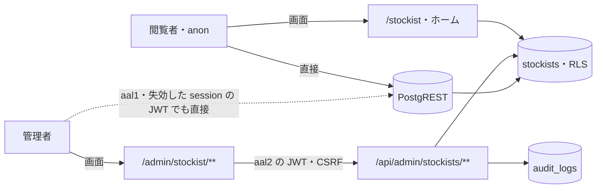

# STOCKIST の脅威

> 状態: 推定（コードを読んで起こした。ユーザーの確認は未） | 確認日: 2026-10-29 | 対象: 公開の取扱店（`/stockist`・ホームの取扱店の節）・管理の取扱店（`/admin/stockist/**`・`/api/admin/stockists/**`）・`stockists` の DB | 基準コミット: `4facf63b`（作業ツリーに別の作業の未コミットの差分あり。取扱店のファイルは含まない。本文の `ファイル:行` の行番号は、この基準コミットの時点のコードを指す）

---

## 概要

STOCKIST（取扱店）の領域で考える脅威を、1つずつ `THR-STOCKIST-NNN` の項目で書く。過去のセキュリティレビューの指摘と、2026-10-24 にコードと DB の移行を読んで気づいた点の両方を拾った。

| 項目 | 内容 |
| --- | --- |
| 項目の数 | 21（THR-STOCKIST-001〜021） |
| 守りがある物 | 非公開の店舗を外へ出さない（001）、なりすましの送信（004）、管理の窓口の権限と aal2（006）、回数の制限（007）、公開の画面への差し込み（016・017）。過去に直った指摘（CSRF の無さ・回数の制限の無さ・監査の無さ・service role の素通り）も、守りがある脅威として残した |
| 守りが欠ける・弱い物 | DB が aal2 と有効な session を見ない（003）、表の権限が広い（008）、管理の応答の過剰返却とキャッシュ（009・010）、入力の形（011）、監査の記録の正しさと網羅（012・013）、誤りの中身を返す（014）、公開の取り出しが閲覧者の session を使う（002）、認可で断った要求を回数に数えない（020）、断った要求を監査しない（021）など。2026-10-26 に、002・009・011・013・014・018 の窓口の分を直した（各項目の「起こり方」の末尾に書いた。DB の道・共有の部品の分は残る） |
| 対策の書き先 | 対策のセキュリティ要件 `SEC-STOCKIST-NNN` は要件の文書（`docs/02_Requirements/areas/stockist.md`）に書く。下の「対策」の欄は読み手のための写し。番号は脅威と同じ番号にそろえた |
| 状態の付け方 | 全部「推定」。どれもコードと移行を読んで起こし、ユーザーの確認を受けていない（スキルの 7 の決まり）。ユーザーが確かめた物から「現行」にする。どれも実行しての確かめはしていない |

---

## 範囲と根拠

- 範囲: `scripts/trace/scope.json` の STOCKIST の src（`src/app/stockist/**`・`src/app/admin/stockist/**`・`src/app/api/admin/stockists/**`・`src/components/StockistSection.tsx`・`src/features/stockist/**`）
- 範囲の外だが脅威の入口になるので見た物: `src/proxy.ts`（Origin の確かめ・守りの見出し）、`src/lib/csrfMiddleware.ts`（CSRF の token）、`src/features/auth/middleware/rateLimit.ts`（回数の制限）、`src/lib/auth/admin-rbac.ts`（管理の認可）、`src/lib/audit.ts`（監査）、`src/lib/supabase/server.ts`（DB の client）、`src/lib/client-fetch.ts`（CSRF の見出しを付ける）、`src/app/admin/layout.tsx`（管理の頁の殻）、`supabase/migrations/20260901102912_remote_schema.sql`（表・RLS・権限）、`supabase/migrations/20261023175712_group_g0_permissions.sql`（`has_permission`）、`supabase/migrations/20260921011535_harden_security_definer_search_path.sql`（`has_permission` の EXECUTE）、`supabase/config.toml`（PostgREST の `max_rows`）、`supabase/seed.sql`（手元の見本）
- 出どころのレビュー: `docs/05_Quality/reviews/security/security_review_stockist.md`・`security_review_home.md`・`security_review_admin.md`、`docs/05_Quality/reviews/code/2026-04-18-stockist-review.md`・`2026-04-29-stockist-review-addendum.md`。どのレビューも当時の記録なので、今の状態は 2026-10-24 にコードを読み直して決めた
- 読み直し: 取扱店のコードと移行を読み直し、Data API の道・権限の付け方・編集の頁のパス・物理削除・CSRF の飛ばし・回数の制限の順番を特に確かめた。読み直しで見つけた点を過去のレビューの記述より優先した
- 全体のセキュリティ要件は `docs/02_Requirements/requirements.md` の 5.4 節（NFR-SEC-001〜012・AC-SEC-001）。STOCKIST に当てはまる物は、各項目の根拠に書いた。管理の操作の守りは FREQ-316（範囲外。認可を1つの道に）・FREQ-327（範囲外。変更の API は既定で Origin を見る）・FREQ-540（範囲外。DB の ACL・有効な session・2要素認証）にも照らした
- ASVS は OWASP ASVS 4.0.3 の項目番号。当てはめに自信の無い物は「（当てはめは推定）」、番号を決められない物は「ASVS 未対応付け」と書いた
- 外した物:
  - 署名つき URL・置き場: 取扱店は画像を持たず、表にも画像の列が無い（`remote_schema.sql:888-902`）。地図も埋め込まず、Google Maps の検索へのリンクだけ（`src/features/stockist/components/PublicStockistGrid.tsx:68-75`）。使われない埋め込みの URL の定数（`src/features/stockist/services/public.ts:4-5`）は固定の文字で、入力が入らない
  - 取扱店専用の RPC: 無い。表に付く関数は更新日時の trigger（`remote_schema.sql:2538,3067-3070`）だけで、trigger の関数は直接は呼べない（推定）。`has_permission` は authenticated が RPC で呼べるが、答えるのは呼んだ本人の権限だけなので脅威に数えなかった
  - 作成がいつも 500 になる恐れ（`type` 列が NOT NULL で既定値なし、`remote_schema.sql:890,901`）は機能の食い違いで、脅威ではない。`docs/05_Quality/reports/trace-matrix.md` の「食い違い」節に載せた。2026-10-26 に移行 `stockists_type_optional` で `type` の NOT NULL を外して直した（列と CHECK は残す。決定 Q21）。`type` を列ごと消す案は、見本・E2E の補助・結合試験の全書き換えと本番の種別の消失を伴うので後回しにした

### 入口と守りの位置

- 実線の矢印はアプリが用意した道、点線はアプリを通らない道（THR-STOCKIST-003）
- 管理の窓口だけが回数の制限・CSRF の token・監査を通る。公開の画面と PostgREST の直接の道は通らない（THR-STOCKIST-003・018）
- 管理の窓口の前には `src/proxy.ts:206` の Origin の確かめがある（THR-STOCKIST-004・005）。図では省いた

---

## 脅威の一覧

### THR-STOCKIST-001 非公開の店舗が公開の道から漏れる

| 属性 | 値 |
| --- | --- |
| 守るもの | 非公開（`private`）の店舗の名前・住所・電話・営業時間・定休日 |
| 脅威 | 閲覧者・一般会員が、まだ出さない取扱店を知る |
| 起こり方 | `/stockist`・ホームの取扱店の節・anon と一般会員の JWT での PostgREST の直接の読み出しで、`status='private'` の行を求める。取り出しの絞り（`.eq('status','published')`）か RLS のどちらかが崩れると届く |
| 影響 | 取引を始める前の店舗や、取引をやめた店舗が先に・後まで出る。相手の店との約束を破る |
| 対策 | SEC-STOCKIST-001 |
| ASVS | V4.1.1 |
| 根拠 | 守りは2段ある。公開の取り出しの絞り（`src/features/stockist/services/public.ts:26`）と、anon の RLS（`supabase/migrations/20260901102912_remote_schema.sql:3786-3789`）・authenticated の RLS（`:3781-3784`、公開済みか `admin.stockists.read` を持つ人だけ）。過去のレビューは「Fixed」とした。ただし手元の見本の店舗は全部公開（`supabase/seed.sql:170-178`）で、E2E の `FR-STOCKIST-003` も非公開を出さないことを見ていないので、片方を外しても今のテストは通る。全体の NFR-SEC-005（権限管理）を取扱店の公開の線引きに当てはめた |
| 状態 | 推定 |
| 出どころ | `docs/05_Quality/reviews/security/security_review_stockist.md:49` |

### THR-STOCKIST-002 公開の取り出しが閲覧者の session の権限で動く

| 属性 | 値 |
| --- | --- |
| 守るもの | 非公開の店舗と、公開の画面の権限の線引き |
| 脅威 | `admin.stockists.read` を持つ人がログインしたまま公開の画面を開いた時に、公開の取り出しが管理の権限で DB を読む |
| 起こり方 | 公開の取り出しが、要求を渡さない共有の client（`createClient()`）を使う（`src/features/stockist/services/public.ts:1,21`）。この形ではアプリのログインの Cookie（`sb-access-token`）は読まない（`src/lib/auth/request-token.ts:49-58,107-118`）。session を引き継ぐのは、Google OAuth のログインが付ける `@supabase/ssr` の Cookie（`sb-<ref>-auth-token`）がある時だけで、その時は Cookie を読む client がその session で動く（`src/lib/supabase/server.ts:54-110`、`src/app/api/auth/logout/route.ts:156-160`）。メールとパスワードでログインした管理者では anon で動く（推定）。authenticated の RLS は管理の権限を持つ人に非公開の行も返す（`remote_schema.sql:3781-3784`）ので、Google OAuth でログインした管理者の時は、守りがアプリの絞り（`public.ts:26`）の1段だけになる。閲覧者の session に頼らない client（`src/lib/supabase/server.ts:116-130` の `createPublicClient`）は既にある。2026-10-26 に、公開の取り出し（`getPublicStockists`）を `createPublicClient()`（Cookie を引き継がない anon の client）に替えた。管理者がログインしたままでも、公開の画面は anon の権限で動く（SEC-STOCKIST-002） |
| 影響 | 今は絞りで出ない。絞りを外す・書き換える変更が入ると、ログイン中の管理者の画面にだけ非公開の店舗が出て、気づきにくい。公開の頁が閲覧者ごとに違う結果になりうる |
| 対策 | SEC-STOCKIST-002 |
| ASVS | V4.1.3（当てはめは推定） |
| 根拠 | ホームのレビューの Medium の指摘で、今も直っていない。公開の道は最小の権限で読む、という全体の NFR-SEC-005 に照らした |
| 状態 | 推定 |
| 出どころ | `docs/05_Quality/reviews/security/security_review_home.md:64` |

### THR-STOCKIST-003 権限を持つ人の aal1・失効した session の token で DB を直接書き換える

| 属性 | 値 |
| --- | --- |
| 守るもの | 取扱店のデータの正しさと、管理の操作の監査の網羅 |
| 脅威 | `admin.stockists.read`・`admin.stockists.manage` を持つ人の、2要素認証を済ませていない（`aal1`）session、または失効させた session の access token を手に入れた者が、非公開の店舗を読み、店舗を作る・書き換える・消す |
| 起こり方 | 公開の anon キーと手に入れた JWT で、アプリの窓口を通らず PostgREST の `stockists` を直接叩く。RLS の判定 `has_permission` は ACL だけを見て、`aal` も session が有効かも見ない（`remote_schema.sql:3765-3784`、`supabase/migrations/20261023175712_group_g0_permissions.sql:186-215`）。access token の期限までは、失効させた session の token でも通る（推定）。**書き込みの側は 2026-10-26 に直した**: 移行 `sec_grants_admin_tables` が anon・authenticated から `stockists` の INSERT・UPDATE・DELETE を外したので、`aal1` の JWT でも失効させた session の token でも PostgREST から書けない（権限の誤り `42501`。この移行を当てた DB でだけ満たす。ADR-0414）。管理の窓口の書き込みは、移行の前に service role へ移した（ADR-0267）。読みの側（非公開の店を読める）は、波 5 の移行 M2 が `has_permission` に `aal2` と結び付いた生きた session の確かめを足して塞ぐ（2026-10-29 に書いた。controller が当てるまで未適用。当てた DB で満たす。ADR-0418） |
| 影響 | 2要素認証と session の失効の守りが、アプリの窓口だけになる。パスワードが漏れると店舗の改ざん・消去に届く。直接の書き換えは回数の制限・CSRF・監査（`logAudit`）を全部通らないので、跡も残らない |
| 対策 | SEC-STOCKIST-003 |
| ASVS | V4.3.1 |
| 根拠 | 管理の窓口は aal2（`src/lib/auth/admin-rbac.ts:241`）と session が有効か（`:201,205`）を求めるが、同じ守りが DB に無い。注文で同じ形をしているのが台帳の R-04。PostgREST が aal1 の JWT を受けるのは Supabase の標準の動き。実際に叩いての確かめはしていない。全体の NFR-SEC-008（RBAC）・FREQ-540（範囲外。DB の ACL・有効な session・2要素認証で管理操作を守る）に照らした |
| 状態 | 推定 |
| 出どころ | 実装から推定（取扱店のコードと移行を読み直した）、`docs/05_Quality/reviews/code/2026-09-25-working-diff-security-review.md:154`（R-04、同じ形の指摘） |

### THR-STOCKIST-004 なりすましの送信で管理の変更をさせる

| 属性 | 値 |
| --- | --- |
| 守るもの | 取扱店のデータ |
| 脅威 | 別のサイトが、ログイン中の管理者のブラウザから取扱店の作成・書き換え・公開の切り替え・削除を送らせる |
| 起こり方 | 管理者が別のサイトを開いた時に、そのサイトが `/api/admin/stockists`・`/api/admin/stockists/<id>` へ POST・PUT・PATCH・DELETE を送る |
| 影響 | 店舗の中身が書き換わる・消える・非公開の店舗が公開になる |
| 対策 | SEC-STOCKIST-004 |
| ASVS | V4.2.2 |
| 根拠 | 守りは2段ある。`src/proxy.ts:206` が `/api` の変更の要求の Origin を確かめ（FREQ-327（範囲外））、各窓口が CSRF の token を確かめる（`src/app/api/admin/stockists/route.ts:68-72`、`src/app/api/admin/stockists/[id]/route.ts:93-97,195-199,290-294`、`src/lib/csrfMiddleware.ts:12-50`）。弱い所が2つある。refresh の Cookie が無い時は token を確かめない（`csrfMiddleware.ts:15`。Authorization の見出しだけで呼ぶ時で、見出しは別のサイトから付けられないので害は小さい）。拒否の結果を応答に変える `toCsrfDenyResponse` は、`Response` でも試験用の形でもない値を「通す」に倒す（`src/features/stockist/services/admin-security.ts:41-43`）。今の `requireCsrfOrDeny` はその値を返さないので、今は起きない（推定）。2026-04-18 のレビューの P1 で、今は直っている。全体の NFR-SEC-003（CSRF 対策）に照らした |
| 状態 | 推定 |
| 出どころ | `docs/05_Quality/reviews/code/2026-04-18-stockist-review.md:41-46`、`docs/05_Quality/reviews/security/security_review_stockist.md:48` |

### THR-STOCKIST-005 別のサイトからの送信で管理者の回数の枠を使い切らせる

| 属性 | 値 |
| --- | --- |
| 守るもの | 管理者が取扱店を直せる状態 |
| 脅威 | 別のサイトが管理者のブラウザから変更の要求を何度も送り、管理者の変更の枠（20回/600秒）を使い切らせる |
| 起こり方 | 窓口は回数の制限を CSRF の token の確かめより前に数える（`route.ts:63-72`、`[id]/route.ts:88-97,190-199,285-294`）。token が違って 403 になる要求でも、操作者の枠を1つ使う |
| 影響 | 最長 600 秒、本人が取扱店を直せない |
| 対策 | SEC-STOCKIST-005 |
| ASVS | ASVS 未対応付け |
| 根拠 | 別のサイトからの変更の要求は、窓口に届く前に `src/proxy.ts:206` の Origin の確かめで止まる。Cookie が SameSite なら、そもそも認証が付かない。害は小さい（推定）。コードを読み直して挙げた |
| 状態 | 推定 |
| 出どころ | 実装から推定（取扱店のコードと移行を読み直した） |

### THR-STOCKIST-006 権限の無い人が管理の窓口を使う

| 属性 | 値 |
| --- | --- |
| 守るもの | 取扱店のデータと非公開の店舗 |
| 脅威 | 未ログインの人・一般会員・取扱店の権限を持たない管理者（サポーター）・2要素認証を済ませていない人が、管理の窓口で読む・変える |
| 起こり方 | `/api/admin/stockists` の GET・POST、`/api/admin/stockists/<id>` の GET・PUT・PATCH・DELETE を、token 無し・権限の無い token・aal1 の token で呼ぶ |
| 影響 | 非公開の店舗が漏れる。店舗が書き換わる・消える |
| 対策 | SEC-STOCKIST-006 |
| ASVS | V4.1.1 |
| 根拠 | 全部の窓口が `authorizeAdminPermission` を通る（`route.ts:27,58`、`[id]/route.ts:46,83,185,280`）。読みは `admin.stockists.read`、変更は `admin.stockists.manage`。認可は署名を確かめた JWT・session が有効か・DB の ACL・aal2 の順に見る（`src/lib/auth/admin-rbac.ts:178-262`）。読みの DB の client は利用者の JWT の物（`createClient(request)`）で、RLS が2段目になる。書き込みは認可・回数の制限・CSRF の後に service role の client で行う（ADR-0267。2026-10-26。表の書き込みの権限を外すため）ので、窓口の認可が書き込みの唯一の守りになる。2026-04-18 のレビューの service role の素通りは、認可の後の書き込みだけ service role に戻した。権限の名前と、店長は可・サポーターは不可の決まりは権限の移行で本番に当たっている（`group_g0_permissions.sql:18-19,51`）。ただし 401・403・MFA の道を試すテストが無い（`tests/unit/api/admin/stockists-security.test.ts` は回数の制限と CSRF だけ）。全体の NFR-SEC-005・008 と FREQ-316（範囲外。認可を1つの道に）に照らした |
| 状態 | 推定 |
| 出どころ | `docs/05_Quality/reviews/security/security_review_stockist.md:47,50`、`docs/05_Quality/reviews/code/2026-04-18-stockist-review.md:64-69` |

### THR-STOCKIST-007 漏れた session で大量に列挙・書き換える

| 属性 | 値 |
| --- | --- |
| 守るもの | 取扱店のデータと、管理の窓口・DB の使える状態 |
| 脅威 | 管理者の session を手に入れた者が、短い時間に多くの読み・書き換え・削除を送る |
| 起こり方 | 管理の窓口を繰り返し呼ぶ。回数の制限の送り元の IP は `x-forwarded-for` の先頭、無ければ `x-real-ip` を無条件に信じる（`src/features/auth/middleware/rateLimit.ts:4-16`）ので、見出しを毎回変えると IP の枠をすり抜ける。PostgREST の直接の道（THR-STOCKIST-003）は回数の制限を全く通らない |
| 影響 | 店舗の一斉の書き換え・消去。DB の負荷 |
| 対策 | SEC-STOCKIST-007 |
| ASVS | V11.1.4 |
| 根拠 | 読み 120回/600秒・変更 20回/600秒で、IP と操作者の2本で数える（`src/features/stockist/services/admin-security.ts:6-8,71-102`）。操作者の枠は見出しを変えても減らないので、IP の偽りだけでは抜けられない。制限の DB が落ちた時は 503 で閉じる（`rateLimit.ts` の catch）。2026-04-18 のレビューの P1 で、今は直っている。IP の信頼は Low の指摘として残る |
| 状態 | 推定 |
| 出どころ | `docs/05_Quality/reviews/code/2026-04-18-stockist-review.md:48-53`、`docs/05_Quality/reviews/security/security_review_stockist.md:45`、`docs/05_Quality/reviews/security/security_review_admin.md:41` |

### THR-STOCKIST-008 表・連番の権限が広く、RLS の外の操作が残る

| 属性 | 値 |
| --- | --- |
| 守るもの | 取扱店の表の中身と、番号の連番 |
| 脅威 | RLS が止めない操作（TRUNCATE・TRIGGER・REFERENCES など）や連番の書き換えを、anon・authenticated の権限で行う |
| 起こり方 | `stockists` の表に anon・authenticated へ DELETE・INSERT・MAINTAIN・REFERENCES・SELECT・TRIGGER・TRUNCATE・UPDATE を全部付けている（`remote_schema.sql:4202`）。連番 `stockists_id_seq` にも anon・authenticated へ UPDATE を付けている（`:4086`）。RLS は TRUNCATE を止めない。**2026-10-26 に直した**: 移行 `sec_grants_admin_tables` が `stockists` の anon・authenticated の権限を SELECT だけにし、連番 `stockists_id_seq` の anon・authenticated の権限を全部外した（service_role には USAGE・SELECT を明示）。RLS の書き込み方針は消さずに二重の守りとして残した（この移行を当てた DB でだけ満たす。ADR-0414） |
| 影響 | 今の PostgREST は TRUNCATE や連番の操作を出さないので、今の API からは打てない（推定）。DB へ別の道（関数の追加・権限の誤り）ができた時に、表を空にされる・番号を狂わされる |
| 対策 | SEC-STOCKIST-008 |
| ASVS | V4.1.3 |
| 根拠 | 多層防御の穴。RLS の方針だけに頼り、表の権限で最小にしていない。NEWS の表も同じ形。コードを読み直して挙げた。全体の NFR-SEC-005 に照らした |
| 状態 | 推定 |
| 出どころ | 実装から推定（取扱店のコードと移行を読み直した） |

### THR-STOCKIST-009 管理の応答が全部の列を返す

| 属性 | 値 |
| --- | --- |
| 守るもの | 管理だけで使う列（今は `type`・作成日時・更新日時。将来足す内部の列） |
| 脅威 | 管理の応答を見た者・応答を写した先が、画面で使わない列まで手に入れる |
| 起こり方 | 管理の一覧と1件の取得が `select('*')` で全列を返す（`src/app/api/admin/stockists/route.ts:41`、`src/app/api/admin/stockists/[id]/route.ts:60`）。2026-10-26 に、一覧と1件の `select` を `ADMIN_STOCKIST_COLUMNS`（`id, name, address, phone, time, holiday, status, updated_at` の 8 列）に絞った。`type`・`created_at` は返さない（SEC-STOCKIST-009） |
| 影響 | 今は即座の漏れは無い。内部のメモや運用の印の列を足すと、黙って外へ出る |
| 対策 | SEC-STOCKIST-009 |
| ASVS | ASVS 未対応付け |
| 根拠 | 過去のレビューの Medium の指摘で、今も直っていない。公開の取り出しは6列だけを返す（`public.ts:7-16,25`）ので、管理だけが広い |
| 状態 | 推定 |
| 出どころ | `docs/05_Quality/reviews/security/security_review_stockist.md:43-44` |

### THR-STOCKIST-010 管理の応答が共有のキャッシュに残る

| 属性 | 値 |
| --- | --- |
| 守るもの | 非公開の店舗を含む管理の応答 |
| 脅威 | 中継の CDN・共有のキャッシュ・ブラウザのキャッシュが管理の応答を保ち、別の利用者や後から端末を使う人に渡す |
| 起こり方 | 管理の窓口の成功・失敗の応答（`route.ts:46,49,52`、`[id]/route.ts:65,68,71`）と、回数の制限の 429・503（`src/features/auth/middleware/rateLimit.ts:30-31,50-54`）に `Cache-Control` が無かった。2026-10-26 に、各 route の `export` を `withNoStore`（`private, no-store`）で包んで直した（SEC-STOCKIST-010）。`proxy.ts` が route の前に返す Origin の 403 には付かない（波 3） |
| 影響 | 非公開の店舗の一覧が残る。429 が残ると別の利用者まで断られる |
| 対策 | SEC-STOCKIST-010 |
| ASVS | V8.2.1 |
| 根拠 | 2026-04-29 の追加のレビューの Medium の指摘で、2026-10-26 に直した（route の範囲）。`X-Content-Type-Options` だけは `src/proxy.ts:237` が全部の応答に付ける |
| 状態 | 推定 |
| 出どころ | `docs/05_Quality/reviews/code/2026-04-29-stockist-review-addendum.md:18`、`docs/05_Quality/reviews/security/security_review_stockist.md:89` |

### THR-STOCKIST-011 入力の形を確かめず、不正な値が店舗に入る

| 属性 | 値 |
| --- | --- |
| 守るもの | 取扱店のデータの正しさと、公開の画面の見え方 |
| 脅威 | 権限を持つ人（または THR-STOCKIST-003 の道）が、制御文字・見えない文字・電話でない字を店舗の値に入れる |
| 起こり方 | 作成と書き換えの確かめは、必須・長さ・公開状態の2値だけ（`route.ts:16-23`、`[id]/route.ts:16-23`）。電話・営業時間・定休日に許可の文字の決まりが無い。DB にも長さや形の制約が無い（`remote_schema.sql:888-902`）。2026-10-26 に、`src/features/stockist/schemas.ts` の `stockistWriteSchema` で形を許可制にした。店名・住所・営業時間・定休日は制御文字・書式文字・行区切り・段落区切りを含まない 1 行、電話は数字・`+`・`-`・括弧・空白（半角と全角）だけを許す（SEC-STOCKIST-011）。DB の制約は無いままなので、DB を直接書く道は閉じていない（SEC-STOCKIST-003 の範囲） |
| 影響 | 公開の画面の表示が崩れる。電話のリンクは数字と `+` 以外を消して作る（`PublicStockistGrid.tsx:84`）ので、表示の番号とかける番号が食い違う。監査の記録が汚れる（THR-STOCKIST-012） |
| 対策 | SEC-STOCKIST-011 |
| ASVS | V5.1.3 |
| 根拠 | 過去のレビューの Low の指摘で、今も直っていない。React は文字として出すので台本は動かない（THR-STOCKIST-016）。全体の NFR-SEC-003（入力検証）に照らした |
| 状態 | 推定 |
| 出どころ | `docs/05_Quality/reviews/security/security_review_stockist.md:46` |

### THR-STOCKIST-012 監査の記録を偽る・汚す

| 属性 | 値 |
| --- | --- |
| 守るもの | 管理の操作の監査の記録の信頼 |
| 脅威 | 管理の窓口を呼ぶ者が、監査に残る送り元の IP を偽る。店名に改行や制御文字を入れて、記録を読み違えさせる |
| 起こり方 | 監査の `ip` に `x-forwarded-for` の先頭をそのまま入れていた（`route.ts`、`[id]/route.ts` の変更の 4 つ）。監査の `detail` に店名をそのまま入れる。2026-10-28（波 4）に、IP を `getClientIp`（`src/lib/request-ip.ts`）から取るようにした。Vercel の `x-vercel-forwarded-for`・`x-real-ip`（E2E は `CLIENT_IP_HEADER` を立てて `x-real-ip`）だけを読み、`x-forwarded-for` は読まず、形が IP でなければ null（ADR-0416）。店名の改行・制御文字は、共有の `maskAuditEvent` が `detail` と `metadata` の文字列から除く（Task 7） |
| 影響 | 不正や誤りの調べで、送り元を追えない・記録の行を読み違える。直した後の残りは、前段に中継を置くと送り元が中継の IP になること（本番は Vercel 直で中継を置かない前提。置く時は `TRUSTED_PROXY_HOPS` の設計が要る。ADR-0416）と、信頼する見出しが無い環境では行の `ip` が null になること |
| 対策 | SEC-STOCKIST-012 |
| ASVS | ASVS 未対応付け |
| 根拠 | 2026-04-29 の追加のレビューの Low の指摘と、2026-10-24 の読み直しで見つけた店名の扱い。監査は共有の `src/lib/audit.ts` が書き、伏せ字はそちらの決まりに頼る。全体の NFR-SEC-011（監査ログの改ざん防止）に照らした |
| 状態 | 推定 |
| 出どころ | `docs/05_Quality/reviews/code/2026-04-29-stockist-review-addendum.md:19`、`docs/05_Quality/reviews/security/security_review_stockist.md:90` |

### THR-STOCKIST-013 変更の跡が正しく残らず、消した店舗を戻せない

| 属性 | 値 |
| --- | --- |
| 守るもの | 管理の操作の監査の網羅と、取扱店のデータを戻せる状態 |
| 脅威 | 誤操作・不正な操作の後に、何が変わったかを追えない・戻せない |
| 起こり方 | 書き換え・公開の切り替え・削除は、対象の行が0件でも DB は誤りを返さず、200 と「成功」の監査になる（`[id]/route.ts:128-138,156-168,230-233,251-263,301-304,322-334`、推定）。削除は物理削除で、監査には id だけを残す（`:329`）。削除の確かめは画面の `confirm` だけ（`src/components/StockistSection.tsx:68`）。認可が確かめる token と DB へ送る token が同じとは限らない。認可は期限の猶予を見ずに token を確かめる（`src/lib/auth/authenticate.ts:60-63,87-110`、`src/lib/auth/admin-rbac.ts:185`）が、読みの DB の client は期限まで5秒以下の token を送らず、Cookie を読む client に落ちる（`src/lib/auth/request-token.ts:69-70,107-118`、`src/lib/supabase/server.ts:22,34,54`）。その client は Google OAuth の Cookie（`sb-<ref>-auth-token`）があればその別の session で、無ければ anon で動く。書き込みは 2026-10-26 に service role の client へ移したので、この落ち方の影響を受けない（ADR-0267）。監査の書き込みの失敗は警告だけで握りつぶす（`src/lib/audit.ts:67-70,87-89`、共有部品）。DB の直接の道（THR-STOCKIST-003）は監査に何も残さない。2026-10-26 に、PUT・PATCH・DELETE が変えた行を `.select()` で受け取り、0 行は 404 と結果 `failure` の監査にした。削除の成功の監査には `metadata.deleted = { id, name, address, status }` を残す。書き込みは service role の client で行い RLS は行を隠さないので、0 行は「その id の店が無い」だけを表し、aal2 でない session は書き込みの前に 403 で止まる。token の期限の落ち込み（読みの DB の client が anon か別の session に落ちる件）は未確認のまま（SEC-STOCKIST-013） |
| 影響 | 消した店舗の名前・住所を監査から戻せない。無い店舗への操作が成功に見える。監査の抜けに気づけない |
| 対策 | SEC-STOCKIST-013 |
| ASVS | ASVS 未対応付け |
| 根拠 | 2026-04-18 のレビューの Important（監査が無い）は直り、成功・失敗・誤りを記録する（`route.ts:81-90,119-128,132-142` など）。残る網羅と完全性の穴は、コードを読み直して見つけた。全体の NFR-SEC-005・011（監査ログ）に照らした |
| 状態 | 推定 |
| 出どころ | `docs/05_Quality/reviews/code/2026-04-18-stockist-review.md:57-62` |

### THR-STOCKIST-014 誤りの応答と記録から内部の様子が漏れる

| 属性 | 値 |
| --- | --- |
| 守るもの | 入力の制約の中身と、DB の内部の様子 |
| 脅威 | 管理の窓口を呼ぶ者が、誤りの応答から項目ごとの制約を知る。サーバーの記録から DB の誤りの中身が漏れる |
| 起こり方 | 検証の誤りで `parsed.error.flatten()` をそのまま返す（`route.ts:91-97`、`[id]/route.ts:117-123,219-225`）。本文が JSON でない時は 400 でなく例外の 500 になる（`route.ts:77,147-150`、`[id]/route.ts:102,171-173,204,266-268`）。Supabase の誤りや例外を丸ごと `console.error` に渡す（`route.ts:45,51,118,148`、`[id]/route.ts:70,141,172,236,267,307,338`）。2026-10-26 に、検証の誤りは `{ error: 'Invalid request', fields: [項目の名前] }` の固定の本文にし（`toInvalidStockistResponse`）、壊れた JSON は 400 `{ error: 'Invalid request' }` と結果 `failure` の監査にした。DB の誤りの記録は `{ code }` だけにした。窓口の外側の `catch` と公開の取り出しの記録も `describeErrorForLog` で名前と符号だけにした（SEC-STOCKIST-014） |
| 影響 | 窓口を探る手がかりが増える。記録を見られる人に DB の内部の名前や値が出る |
| 対策 | SEC-STOCKIST-014 |
| ASVS | V7.4.1（当てはめは推定） |
| 根拠 | 2026-04-29 の追加のレビューの Low の指摘で、2026-10-26 に直した。応答は権限を持つ人にしか届かないので害は小さい。JSON の壊れと記録の中身は 2026-10-24 の読み直しで見つけた |
| 状態 | 推定 |
| 出どころ | `docs/05_Quality/reviews/code/2026-04-29-stockist-review-addendum.md:23`、`docs/05_Quality/reviews/security/security_review_stockist.md:91` |

### THR-STOCKIST-015 編集の頁の id で、ほかの管理 API を呼ばせる

| 属性 | 値 |
| --- | --- |
| 守るもの | 管理者の権限で動くほかの管理 API |
| 脅威 | 管理者に細工した編集の頁の URL を開かせ、取扱店でない管理 API へ GET や PUT を送らせる |
| 起こり方 | 編集の頁が URL の id を確かめずに、そのまま API の道に入れる（`src/app/admin/stockist/edit/[id]/page.tsx:11,26`、送るのは `StockistForm` の PUT）。id が `..` や `/` を含む形で戻ると、道が別の管理 API に変わる。変更の要求には `clientFetch` が CSRF の見出しを付ける（`src/lib/client-fetch.ts:182-195`）ので、CSRF の守りでは止まらない |
| 影響 | 管理者の権限で、意図しない管理 API の読み出しや書き換えが起きる |
| 対策 | SEC-STOCKIST-015 |
| ASVS | ASVS 未対応付け |
| 根拠 | クライアント側のパスの辿り。Next 16 の `useParams` が `%2F` を `/` に戻すかは確かめていない。窓口の側は id を正の整数だけに絞る（`[id]/route.ts:29-36`）が、道が変わると取扱店の窓口に届かない。コードを読み直して挙げた |
| 状態 | 推定 |
| 出どころ | 実装から推定（取扱店のコードと移行を読み直した） |

### THR-STOCKIST-016 店舗の値で公開の画面に台本や別の URL を差し込む

| 属性 | 値 |
| --- | --- |
| 守るもの | 公開の画面の閲覧者 |
| 脅威 | 店舗の値を書ける者（権限を持つ人、または THR-STOCKIST-003 の道）が、店名・住所・電話に台本や URL を入れ、閲覧者のブラウザで動かす・別のサイトへ連れて行く |
| 起こり方 | 店舗の値は公開の格子のカードに出る。住所は Google Maps の検索のリンクの問い合わせに、電話は `tel:` のリンクに入る（`src/features/stockist/components/PublicStockistGrid.tsx:68-75,83-85`） |
| 影響 | 閲覧者の session の乗っ取り・偽のサイトへの誘導 |
| 対策 | SEC-STOCKIST-016 |
| ASVS | V5.3.3（当てはめは推定） |
| 根拠 | 値は React の文字として出し、`dangerouslySetInnerHTML` は使わない（取扱店のファイルを検索して該当なし）。住所は `encodeURIComponent` で固定の頭の後ろにだけ入れ、別のタブは `rel="noopener noreferrer"`（`:69-71`）。電話は数字と `+` 以外を消す（`:84`）。過去のレビューは「地図 URL は固定定数」としたが、今は住所から作るので前提が変わった。全体の NFR-SEC-003（XSS 対策）に照らした |
| 状態 | 推定 |
| 出どころ | `docs/05_Quality/reviews/security/security_review_stockist.md:51,118` |

### THR-STOCKIST-017 URL の pref で絞り込みを壊す

| 属性 | 値 |
| --- | --- |
| 守るもの | 公開の取扱店の画面の表示 |
| 脅威 | 細工した `/stockist?pref=…` の URL を開かせ、画面を壊す・ありえない絞り込みを見せる |
| 起こり方 | 画面は URL の `pref`（都道府県の名前のカンマ区切り）を読んで絞る（`PublicStockistGrid.tsx:168-176,189-194`） |
| 影響 | 表示が崩れる・店舗が無いように見える |
| 対策 | SEC-STOCKIST-017 |
| ASVS | V5.1.3（当てはめは推定） |
| 根拠 | `pref` の値は県名の許可の一覧（`STOCKIST_REGIONS` から作る `ALL_PREFECTURES`、`:179-181`）に無い物を捨てる（`:190-194`）。選択が空なら全件を出す（`:309-312`）。値はサーバーへ送らず、DB の問い合わせにも入らない。長さの上限は無い |
| 状態 | 推定 |
| 出どころ | 実装から推定（取扱店のコードと移行を読み直した） |

### THR-STOCKIST-018 公開の読み出しを大量に叩く

| 属性 | 値 |
| --- | --- |
| 守るもの | 公開の取扱店の画面と DB の使える状態 |
| 脅威 | 誰でも、`/stockist` の画面と anon の PostgREST の直接の読み出しを大量に繰り返す |
| 起こり方 | `/stockist` は要求ごとに動的に描き（`src/app/stockist/page.tsx:27`）、公開の取扱店を上限なしで全部取る（`src/features/stockist/services/public.ts:29-31`、呼び手は上限を渡さない `page.tsx:29`）。画面にも PostgREST の直接の道にも回数の制限が無い。PostgREST の行の上限は手元で 1000（`supabase/config.toml:18`）、本番は確かめていない。2026-10-26 に、`getPublicStockists` が件数の上限 200（`PUBLIC_STOCKIST_FETCH_LIMIT`）を必ず掛けるようにした。`max_rows` を本番で設定するか・画面の回数の制限は、本番の構成で決める事柄のまま（SEC-STOCKIST-018） |
| 影響 | DB の負荷が上がり、ほかの画面が遅くなる。店舗は公開の情報なので、写されることは害に数えない |
| 対策 | SEC-STOCKIST-018 |
| ASVS | V11.1.4（当てはめは推定） |
| 根拠 | 店舗は数件の前提で全件を取る作りにした。前提が崩れた時と、中継の守り（本番の CDN・WAF）が無い時の備え。中継の設定は見ていない |
| 状態 | 推定 |
| 出どころ | 実装から推定（2026-10-24 の読み直し） |

### THR-STOCKIST-019 権限の無い人が管理の作成・編集の頁を開く

| 属性 | 値 |
| --- | --- |
| 守るもの | 管理の画面の作りと、管理者の操作の流れ |
| 脅威 | 未ログインの人・権限の無い人が `/admin/stockist/create`・`/admin/stockist/edit/<id>` を開き、フォームを見る・送る |
| 起こり方 | 頁の入口に権限の確かめが無い（`src/app/admin/layout.tsx:18-41`、`src/proxy.ts` に `/admin` の判定が無い）。作成の頁は 2026-10-28（波 4）に、フォームを出す前に `GET /api/admin/stockists/access` を呼び、通るまで「読み込み中...」、401・403 は固定の誤りの文だけを出すようにした（ADR-0269）。編集の頁は、1 件の取得（読みの権限）が通るとフォームを出す作りのまま |
| 影響 | 編集の頁では、`admin.stockists.read` だけを持つ人にフォームの作りが見える（作成の頁は直した）。データは API が守る（THR-STOCKIST-006）ので、送っても 401・403 で止まる（推定） |
| 対策 | SEC-STOCKIST-019 |
| ASVS | ASVS 未対応付け |
| 根拠 | 守りは窓口の認可に頼る形。頁の入口で止めると、権限の無い人に管理の画面を見せずに済む。害は小さい（推定）。コードを読み直して見つけた |
| 状態 | 推定 |
| 出どころ | 実装から推定（取扱店のコードと移行を読み直した） |

### THR-STOCKIST-020 認可で断られる要求を際限なく送り、DB に往復をさせる

| 属性 | 値 |
| --- | --- |
| 守るもの | 管理の窓口と DB（session の生存の確かめ・ACL の照会）の使える状態 |
| 脅威 | 登録しただけの一般会員・取扱店の権限を持たない人・aal1 の session の持ち主が、管理の窓口を繰り返し呼ぶ |
| 起こり方 | 6つの窓口とも、回数の制限は認可が通った後に呼んでいたので、401・403 になる要求は送り元の枠にも操作者の枠にも数えなかった。署名の正しい token なら、1回ごとに session の生存の RPC と ACL の照会で DB を2往復させる（`src/lib/auth/admin-rbac.ts`）。token の無い要求は署名の確かめ（JWKS による手元の確かめ）で止まり、DB には届かない（推定）。2026-10-28（波 4）に、送り元の枠を窓口の最初（認可の前）に移し、操作者の枠は認可の後に残した。窓口の順序は「送り元の枠 → （道の id の形）→ 認可 → 操作者の枠 → （変更だけ）CSRF」で、新しい `GET /api/admin/stockists/access` も同じ（`admin-security.ts` の `enforceAdminStockistIpRateLimit`・`enforceAdminStockistActorRateLimit`。ADR-0259） |
| 影響 | 直した後の残りは、送り元の枠が未ログインの 401・権限の無い 403・CSRF の拒否も数えるので、同じ送り元（同じ事務所）の店長が巻き添えで 429 になりうること。Vercel では送り元は単一の接続元なので、巻き添えは同じ接続元の人に限る |
| 対策 | SEC-STOCKIST-020 |
| ASVS | V11.1.4（当てはめは推定） |
| 根拠 | THR-STOCKIST-007 は漏れた管理者の session、THR-STOCKIST-006 は認可の正しさだけを扱い、認可で断られる要求の量は扱っていなかった。2026-10-24 の脅威の見直しで見つけた。全体の NFR-SEC-005 に照らした |
| 状態 | 推定 |
| 出どころ | 実装から推定（2026-10-24 の見直し） |

### THR-STOCKIST-021 認可で断られた要求の跡が残らない

| 属性 | 値 |
| --- | --- |
| 守るもの | 管理の操作の監査の網羅 |
| 脅威 | 権限の無い人・aal1 の session の持ち主が、管理の窓口を探っても気づかれない |
| 起こり方 | 認可で断った時（401・403・`MFA required`・503）は `console.warn` を出すだけで、監査の記録（`logAudit`）を書かなかった。2026-10-28（波 4）に、共有の `admin-rbac.ts` が操作者が分かる拒否（失効した session の 401・権限不足の 403・aal1 の 403）に `denial` を付け、取扱店の 6 つの窓口と `access` が拒否の枝で `auditAuthzDenial`（`src/lib/auth/audit-authz-denial.ts`）を呼ぶようにした。token の無い 401・失効を確認できない 503・内部の誤りの 500 は残さない。洪水の防止は操作者ごとに 10 分 20 行まで、21 回目にまとめの 1 行、以降と数えの失敗は書かない（ADR-0268） |
| 影響 | 直した後の残りは、取扱店の窓口以外の管理の窓口は拒否を監査に残さないこと（この波の範囲外）と、操作者が分からない探りは監査に残らないこと（送り元の枠と、サーバーの記録に頼る） |
| 対策 | SEC-STOCKIST-021 |
| ASVS | V7.2.2（当てはめは推定）、V7.1.3 |
| 根拠 | THR-STOCKIST-012・013 は認可を通った後の変更の記録だけを扱っていた。認可は共有の部品（`admin-rbac.ts`）なので、直すと取扱店の外にも響く。2026-10-24 の脅威の見直しで見つけた。全体の NFR-SEC-005・011（監査ログ）に照らした |
| 状態 | 推定 |
| 出どころ | 実装から推定（2026-10-24 の見直し） |

---

## 未確認事項

- 本番の DB で、aal1 の JWT・失効させた session の JWT で `stockists` を直接書けるか（THR-STOCKIST-003）。DB とログインの流れは動かしていない
- 本番の `stockists` の表・連番の権限が移行の写しと同じか（THR-STOCKIST-008）
- Next 16 の `useParams` が `%2F` を `/` に戻すか（THR-STOCKIST-015）
- 本番の PostgREST の `max_rows`、中継の CDN・WAF の回数の制限とキャッシュの設定（THR-STOCKIST-010・018）
- 本番の Cookie の SameSite の値（THR-STOCKIST-004・005）
- 書き換え・削除の対象が0件の時に、Supabase の client が誤りを返さないこと（THR-STOCKIST-013）。コードを読んだだけで、実行はしていない
- 期限まで5秒以下の token で管理の変更を送った時に、DB の client が anon か別の session に落ちるか（THR-STOCKIST-013）。動かしていない
- Google OAuth でログインした管理者で、公開の取扱店の取り出しが管理の権限で動くか（THR-STOCKIST-002）。動かしていない
