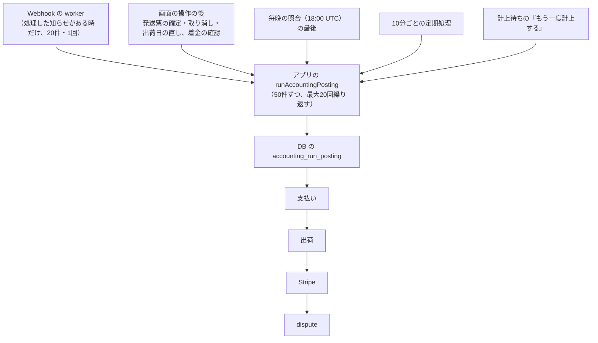

# 会計の前受金・出荷の日の売上・Stripe の運用（会計の作り直し 計画2）

> 状態: 運用手順（2026-11-09 時点で本番に未適用。手元の DB で確認済み） | 確認日: 2026-11-09 | 対象: 移行 S6〜S14（`supabase/migrations/20261108150000` 〜 `20261108230000_accounting_p2_*.sql`）、計上係、10分ごとの定期処理、Stripe の知らせの受け取りの種類（13種 → 18種）、計上待ちの画面、照合

## 概要

計画2は、売上を「支払いの日」から「出荷した日」に移す。支払いは前受金（2150）に入れ、発送票の確定で送った分だけ売上（4010）にする。Stripe の手数料・入金・着金、カード会社からの支払いの取り消し（dispute）も1件ずつ仕訳にする。仕訳にできない出来事は捨てず、理由つきで「計上待ち」に残す。KPI の「売上」は「受注高」に名前が変わり、月の KPI の記録は専用の表に入る。

この文書は、運用する人が「何がいつ動くか」「計上待ちをどう読むか」「Stripe の宛先をどう変えるか」「本番に当てる前に何を確かめるか」を引くための手引き。仕訳の流れの詳細は [計上係のシーケンス](../04_DetailDesign/sequence/accounting-posting.md)、移行の台帳は [DB 移行](db-migrations.md)。

| 項目 | 内容 |
| --- | --- |
| 計上係 | `public.accounting_run_posting`（DB）を、アプリの `runAccountingPosting` が呼ぶ。何回流しても同じ結果。出来事1件の失敗は保留して続ける |
| 呼ぶ場所 | Webhook の worker の後、画面の操作の後（発送票の確定・取り消し・出荷日の直し、着金の確認）、毎晩の照合の最後、10分ごとの定期処理、計上待ちの画面の「もう一度計上する」 |
| 定期処理 | 10分ごと `POST /api/cron/accounting-post`。登録の SQL は `supabase/pending/schedule_accounting_post.sql`（保留中）。止まりの見張りは `ops_job_heartbeats` の `accounting_post`（30分） |
| Stripe の宛先 | 受け取りの種類は18種。`charge.dispute.*` の5種が新しい。コードだけ出しても Stripe の宛先に足すまで届かない。今の本番には宛先が無いので、開店の準備の手順 5 で18種を購読する |
| 本番への当て方 | 計画1の S0〜S5 が本番にあること、普段の開発の接続先のオーナー確認、S6 前の発送票の件数が0件であることが前提。CLI の `db push --linked --include-all` で S6 → S14 の順 |
| 戻せるか | 仕訳が入る前（S7〜S14 は種類ごとの仕訳が無い間）だけ。仕訳は消せない。詳細は[DB 移行](db-migrations.md)の計画2の節 |
| 関連 | 計画1の運用: [会計の仕訳の土台の運用](accounting-p1-journal-foundation.md)、Stripe の知らせの運用: [Webhook と定期処理の手順書](webhook-queue-operations.md) |

## 範囲と根拠

| 項目 | 内容 |
| --- | --- |
| 対応要求 | FREQ-562（支払いを前受金で残す）、FREQ-563（出荷の日の売上）、FREQ-564（出荷の取り消しと出荷日の直し）、FREQ-565（Stripe の手数料・入金・着金）、FREQ-566（Stripe の照合）、FREQ-567（dispute を受け取る）、FREQ-568（dispute の仕訳）、FREQ-569（計上待ちと前受金の確認）、FREQ-570（保存した仕訳で数える）、FREQ-571（受注高・受注残の照合）、FREQ-572（KPI を受注高にする）、FREQ-573（月の KPI の表）、FREQ-574（出荷の年末の照合と運送会社の受付日）。要件と受け入れ条件は[要件定義書](../02_Requirements/requirements.md) |
| 計画・設計 | [会計の作り直し 計画2](../superpowers/plans/2026-11-04-accounting-p2-deferred-revenue-stripe.md)、[設計](../superpowers/specs/2026-11-03-accounting-redesign-design.md) |
| 調査時点 | 2026-11-09 のソース。手元の Supabase で確かめた。本番の DB と本番の Stripe は読んでいない |

## 1. 計上係の仕組み



| 論点 | 内容 |
| --- | --- |
| 何をするか | 支払い（前受金）→ 出荷（売上・取り消し・日の直し）→ Stripe（手数料・税額調整・入金・着金・入金の失敗）→ dispute（引かれた時・確定・戻り）の順に、まだ仕訳になっていない出来事を仕訳にする |
| 何回流しても同じ | 出来事ごとに印（`dedupe_key`）があり、同じ出来事は1本だけ。同時に2か所から流しても、鍵の順（`(190521,1)` → `(190525,0)` → `(190525, hashtext(期間))`、`private.accounting_lock_all`）で1つずつ進む |
| 1件の失敗 | 出来事1件ごとに別の枠で処理する。失敗した1件の途中までの書き込みは戻り、「計上待ち」に理由つきで残る。ほかの出来事は計上を続ける。生の例外の文は残さず、固定の記号（`error_code`・`error_sqlstate`）だけ残す |
| 入口の呼び出し元 | 画面の操作と Webhook は応答や知らせの処理を計上の失敗で失敗にしない（失敗はログの `[accounting.posting]` に入口の名前と記号だけ）。取りこぼしは10分ごとの定期処理が拾う |
| 数の意味 | 返す数は `payments`・`shipments`・`stripe`・`disputes`（作った仕訳の数）、`parked`（新しく保留した数＋保留し直した数）、`resolved`、`hasMore`。額が0の出荷と dispute の `no_revenue` は保留して同時に閉じるので、`parked` にも数える |
| 失敗した時の見方 | ① `ops_job_heartbeats` の `accounting_post` の最後の成功（30分止まると店への知らせ）。② 管理画面の「計上待ち」の件数と理由。③ アプリのログの `[accounting.posting]`。④ 定期処理の応答の `openPending`（未解決の件数） |

## 2. 計上待ちの見方

管理画面 ACCOUNTING の「計上待ち」タブに、仕訳にできていない出来事が理由つきで並ぶ。多くの理由は、前の段の仕訳が入る・日が直る・期間ができるなど、状況が変われば次の計上で自動で入る。人が手で閉じられるのは次の2つだけ（権限 `admin.accounting.entries.correct`、メモ必須）。

| 手で閉じてよい理由 | 意味 | 閉じる前に確かめること |
| --- | --- | --- |
| `before_cutover` | 新しい帳簿を始めた日より前の出来事 | 前の帳簿ですでに扱った出来事か |
| `no_revenue` | 仕訳にする額が0円（交換の品だけの発送票など） | 本当に売上が無い出荷か |

お金が動く行（支払い・手数料・入金など）は、仕訳が入るまで閉じられない。閉じると Stripe のお金が帳簿から見えなくなるため。

| 理由 | 何が起きているか | 次にすること |
| --- | --- | --- |
| `payment_journal_missing` | 出荷した注文の支払いの仕訳がまだ無い | 支払いが入ると自動で計上。入らない時は支払い側の保留（`amount_mismatch`・`no_order` など）を見る |
| `order_not_postable` | 送料が0でない・1着ごとの支払額が無い・合計が合わない（詳細の `reason`: `shipping`・`units_missing`・`units_sum`） | 注文の内容を確かめる。送料を取る運用は計画2では扱わない |
| `amount_mismatch` | Stripe の取引の総額が注文の支払額と違う | 取引が同期し直されると、もう一度確かめる |
| `no_order` | Stripe の支払いに注文が結び付かない | 下の「注文と結び付かない支払い」を読む。手では閉じられない |
| `units_insufficient` | 送る着の数が、まだ送っていない着の数より多い | その発送票自体を取り消した時だけ消える（他の発送票の取り消しでは直らない。確定した番号の時点で数えるため） |
| `shipment_date_mismatch` | 発送ごとの出荷日と発送票の出荷日が食い違う | 出荷日が直ると自動で計上 |
| `deferred_revenue_short` | 出荷の額が、その注文の前受金の残りより多い（詳細 `shortage`） | 支払いや戻しが入ると自動で計上。dispute で前受金が引かれた後の出荷に出る形は未確認事項 10 |
| `period_missing` | その日を含む会計期間が無い（詳細 `entry_date`）。`cause` が `sole_ended_not_switched` なら、やめた日より後の日 | 設定・期間のタブで期間を作る。やめた日より後なら、やめた日を確かめて事業の形を法人へ切り替える |
| `posting_error` | 仕訳を入れる処理が失敗した（詳細 `error_code`・`error_sqlstate`・出来事の日） | 元の記録や設定を直して「もう一度計上する」。直せない時は記号を運用の担当へ渡す。確認済みにはできない |
| `before_cutover` | 上の表 | 上の表 |
| `unknown_category` | Stripe の残高の取引に、知らない種類がある | 種類の対応が足されると自動で計上。足すのは開発の作業 |
| `payout_mismatch` | 入金の中身の合計と額が合わない | Stripe の精算のタブで照合が済むと自動で計上 |
| `dispute_refund_overlap` | dispute のある注文に成功した返金がある | 二重に費用にしないため止めている。返金や返品の仕訳と合わせた後に計上（計画3） |
| `dispute_return_refund_pending` | dispute のある注文に返品の返金待ちがある | 返金や返品の仕訳が入った後に計上（計画3） |
| `dispute_withdrawal_missing` | dispute の段の待ち。詳細 `waiting_on` で3通り: `dispute_account_unassigned`（確定した損失を置く科目が未定）、`dispute_withdrawn`（出荷が引かれた時の仕訳を待つ）、それ以外（前の段の仕訳か、決着を待つ。`dispute_status` が付くと決着待ち） | 科目の待ちは設定・期間の「原因ごとの科目」で決めて、Stripe 精算のタブの「科目の決定待ち」を振り替える。ほかは自動 |
| `dispute_shipment_pending` | 引かれた時より前に確定した発送票で、出荷の仕訳がまだ無い物がある | 出荷の仕訳が入ると自動で計上 |
| `shipment_lines_mismatch` | 発送票の明細と、発送ごとの明細の品ごとの数量が食い違う | 直ると自動で計上 |
| `no_revenue` | 上の表 | 上の表 |

### 注文と結び付かない支払い（`no_order`）の扱い

支払いの番号（payment intent）が無い売上の取引は、`no_order` で保留され、仕訳にならない（自動の仕訳もしない）。手で閉じるボタンも出さない。理由: 閉じるとお金が動いた記録だけが帳簿から消えるため（Ruling P2-T4-N1-final）。残高の照合では「計上待ちの取引」の欄に出続ける。

オーナーの道: Stripe の管理画面でその支払いが何かを確かめる（注文以外の入金か、取り込みの漏れか）。仕訳を入れる訂正の入口は計画6で足す。それまで行は残る。本番の注文は試しだけなので、開店前は件数が0であることを確かめる。

## 3. 10分ごとの定期処理の登録

| 項目 | 内容 |
| --- | --- |
| 入口 | `POST /api/cron/accounting-post`（`CRON_SECRET` の Bearer。最大120秒） |
| 登録の SQL | `supabase/pending/schedule_accounting_post.sql`（`accounting-post`、`*/10 * * * *`）。保留中のまま。本番の公開時に、[手順書](webhook-queue-operations.md)の「開店のときの順番」の手順 3 で、ほかの定期処理と一緒に新しい版の移行にして当てる |
| 前提 | pg_cron と pg_net が有効。Vault に `cron_secret` と `app_base_url`。値はこの文書にも書かない。Vault の秘密が無いと、SQL は送る前に例外で止まり、実行の記録に `failed` が残る |
| 待ち時間 | pg_net は60秒で待つのをやめる。係は最大20回まで繰り返すので、長い時は応答が `timed_out` になるが、実行は続く。成功かどうかは `ops_job_heartbeats` の `accounting_post` で見る |
| 止まりの知らせ | 最後の成功から30分たつと、店へ「定期処理が止まっています（会計の計上）」のメール。一度も成功していない処理には出ないので、登録の直後に最初の成功を確かめる |
| 確かめ方 | 手順書の 6「実行の記録と、その直後の応答」の SQL で `jobname` を `accounting-post` にする。応答の `data` に `payments`・`shipments`・`stripe`・`disputes`・`parked`・`resolved`・`hasMore`・`openPending` |

## 4. Stripe の受け取りの種類を変える手順

受け取り口が保存する知らせの種類は、13種から18種になった（`src/lib/stripe/handled-webhook-events.ts`）。新しい5種は次のとおり。

`charge.dispute.created`・`charge.dispute.updated`・`charge.dispute.closed`・`charge.dispute.funds_withdrawn`・`charge.dispute.funds_reinstated`

18種の全部: `checkout.session.completed`・`checkout.session.async_payment_succeeded`・`checkout.session.async_payment_failed`・`checkout.session.expired`・`payment_intent.succeeded`・`payment_intent.payment_failed`・`refund.created`・`refund.updated`・`refund.failed`・`charge.refunded`・`payout.paid`・`payout.failed`・`payout.reconciliation_completed`・上の5種。

**コードだけ変えても、知らせは届かない。** Stripe の宛先で購読の種類を足して初めて届く。順番は次のとおり。

1. **コードを先に出す。** 5種を処理する版を出すまでは、Stripe から届いても保存せず200を返すだけで害はない。
2. **Stripe の管理画面で宛先（`<公開した URL>/api/webhook/stripe`）を開き、イベントの追加で5種を足す。**
3. **テストモードの宛先で `stripe trigger charge.dispute.created` などを流し、dispute の表に1行入ることを確かめる。** 確かめる場所は管理画面の「カード会社からの支払いの取り消し」の一覧（Stripe 精算のタブ）。
4. **本番の宛先は、開店の準備の「Stripe の知らせの宛先を登録する」（[手順書](webhook-queue-operations.md)の手順 5）で作る時に、18種を購読する。** 今の本番には宛先が無い。

購読の種類を戻す・減らす時は、先に処理する版を戻さず、宛先から外すだけにする。処理する版を先に戻すと、まだ届く知らせが「保存しない」扱いになり、あとで足し直しても取りこぼした分は Stripe が3日間だけ送り直す。

毎晩の照合（`stripe-reconcile`）は、dispute の取りこぼしも拾う: 未解決の dispute を全件（上限500件）と直近30日の一覧を読み直す。知らせが届かなくても、遅れて拾える。ただし Stripe は知らせの履歴を30日しか持たないので、30日を超えて確定した dispute の確定の時刻は取れず、取れた時刻が無い時は取引の時刻で代える（未確認事項 7）。

## 5. 照合の見方

管理画面 ACCOUNTING の「照合」タブ。どの欄も「説明のつかない差」が0円であれば合っている。0円でなければ赤字で出る。

| 照合 | 何を比べるか | 読み方 |
| --- | --- | --- |
| Stripe の残高 | Stripe の残高と、帳簿（1160 と 1130 の Stripe 分）の差。差が、仕訳になっていない取引の種類で説明できるか | 欄は5つ（返金の元本〔返金の仕訳は計画3〕、計上待ちの取引、知らない種類の取引、入金の取引〔仕訳がまだ〕、残高の補充）。dispute の取り消しは、仕訳が入ると仕訳済みに数える。「説明のつかない差」= 差 − 欄の合計 |
| 手数料の月 1段目 | 日本時間の月の手数料の合計と、UTC の月の合計の差 | 月の境目をまたぐ取引（日本時間では翌月、UTC では前月など）で説明する。「説明のつかない差」が0であること |
| 手数料の月 2段目 | UTC の合計と、Stripe の適格請求書の合計（手で入れる）の差 | 翌月の消費税の調整で説明する。請求書の合計を入れるまで「未入力」。**符号の向きは暫定**（本物の請求書と調整で確かめるまで。未確認事項 3） |
| 帳簿の手数料と取引の差 | 取引の手数料の合計と、帳簿の手数料（6280・1480）の差 | 手数料の取り消しも含めて見る |
| 受注高 1段目 | 期首の受注残 ＋ 受注高 − 売上高 ＋ 例外 ＝ 期末の受注残 | 例外は dispute の仮払い分、返品の2130の動き、その他。「説明のつかない差」は出荷の仕訳の前受金の動きと売上の額が合わない時だけ出る |
| 受注高 2段目 | 帳簿の売上高 ＝ 受注高の売上の分 ＋ 他の4010 − 他の4020 | dispute の確定した損失を勘定ごとに出す |
| 年末の出荷 | 12/25〜1/10 の範囲で確定・取り消した発送票を並べ、確かめた印を付ける | 運送会社の受付日の確認はオプション（設定・期間で切り替える。既定はオフ）。確かめた後に出荷日か追跡が変わると「確かめた後で日付か追跡が変わりました」が出る |

「受注高」は帳簿の売上高ではなく、申告には使わない。出荷しても小さくならない。KPI の画面からは「照合」へ案内の link がある。

## 6. 月の KPI の記録の表と Meta 連携の表

- 月の KPI の記録の表 `admin_kpi_monthly_records` は、旧 `migrations/063` にだけ定義があり、`supabase/migrations/` に無かった。このため本番では月の記録の保存が失敗していた疑いがある。S13 が `supabase/migrations/` で作る（`value numeric`、`(month_key, metric_key)` 一意、`service_role` の SELECT だけ。書くのは `admin_set_kpi_monthly_records`・`system_upsert_kpi_monthly_records`）。
- 本番に当てる前に、本番にこの表が**まだ無い**ことを読むだけの SQL で確かめる（旧 063 を手で当てていると S13 の `CREATE TABLE` が失敗して全部戻る）。
- Meta 連携の表（`admin_meta_kpi_connections`・`admin_meta_kpi_sync_runs`）は、同じ事情の疑いがある。`supabase/migrations/` には無く、旧 `migrations/079` にだけ定義がある。本番にあるかは読んで確かめる。作るかどうかは計画2の外で、オーナーが決める（未確認事項 6）。
- 画面側: 旧の月の記録の route にあった「表が無い」の 503 の分岐はやめた。保存の失敗は 403（権限）・400（形）・500（それ以外）の3つ。

## 7. 本番で `stripe-backfill` を流さない

本番の Stripe の残高の取引を読む `POST /api/admin/accounting/stripe-backfill` と、毎晩の `stripe-reconcile` は、本番では読むだけにする。本番で `stripe-backfill` を流さず、本番の DB に試しの仕訳・期間・Stripe の行を作らない（仕訳は消せないため）。本番の注文は試しだけで0件。Stripe は**テストモードだけ**で種類と形を読んで確かめる（本番の Stripe には触らない）。

## 8. 普段の開発の接続先のオーナー確認（計画1の Task 16 Step 0 を引き継ぐ）

本番に当てる前に、オーナーが `npm run dev` の接続先が手元の Supabase であることを確かめる。理由、確かめる人、記録する内容は[計画1の運用の手引き](accounting-p1-journal-foundation.md#本番適用前の普段の開発の接続先のオーナー確認)と同じ。環境変数の値は Claude も書き手も読まない。記録は確認した日と確認済みかどうかだけ。

| 確認日 | 確認済み |
| --- | --- |
| 2026-11-08 | はい（計画1の記録。`.env.development.local` で手元に切り替えた） |

計画2を当てる前に、この記録が有効か（切り替えが残っているか）をオーナーに確かめる。済んでいなければ当てずに報告する。

## 9. S6 を当てる前の発送票の件数（Task 16 Step 6）

S6 は、確定済み・取り消し済みの発送票が1件でもあると止まる（`acc_s6_slip_fact_backfill`。発送票ごとに確定の番号を後から振れないため）。本番に当てる前に、件数だけを読む。

```sql
select count(*) filter (where stage = 'confirmed') as confirmed_count,
       count(*) filter (where stage = 'cancelled') as cancelled_count
from public.shipment_slips;
```

- どちらも0であること（発送票の明細や相手は読まない）。
- **0でない時、または適用の途中で S6 の assert（`acc_s6_slip_fact_backfill`）が止まった時は、当てずに報告してオーナーと対応を決める。** 状態別の件数と止めた理由を残す。発送票の清掃、assert の無効化、番号の推測による補完をその場で行わない。S6 は1つの取引なので、止まれば S6 は巻き戻ったまま。S7 以後へ進まない。既に確定した発送票の事実を移しかえる設計は別に行う。
- 読んだ後に件数が増えて assert で止まった場合も同じ。

そのほかの事前の読み取り（数だけ。書かない）: 計画1の S0〜S5 が当たっていること（`accounting_journal_entries` の件数と、`permissions` の `admin.accounting.%` が6件）、`admin_kpi_monthly_records` と Meta 連携の表が**まだ無い**こと、`accounting_settings.cutover_on`、`orders` の払い済みの件数（0のはず）、`stripe_balance_transactions`・`stripe_refunds`・`stripe_payouts`・`order_fulfillments` の件数。

## 10. 適用の方法

計画1のとおり、CLI の `npx supabase db push --linked --include-all`。S6 → S14 の順で、途中で止めたい時はあとのファイルを一時的に外して当てる（計画1の Ruling T16-cli）。MCP の `apply_migration` は使わない。大きいファイル（S6 は約95KB、S9 は約88KB、S11 は約90KB）を手で写すとずれるため。適用の後は読むだけで確かめる: 各移行の assert が通ったこと、`admin_kpi_monthly_records` が空で存在すること、`accounting_pending_events` が0件、`accounting_settings` が変わっていないこと、権限が38件のまま。本番に書いて確かめることはしない。

## 運用の注意

- E2E の後に DB 結合を流すときは先に `npm run db:reset` する（計画1と同じ）。計画2のコミットする試験（`ACCOUNTING_COMMIT_SUITE=1`）も、単独で流し、前後に `db reset` を挟む。
- 計画2の E2E（`FR-ADMIN-132`〜`136`）は、`db reset` の直後に流す。dispute の spec は原因（16種のうち設定の無いもの）を1回に3つ使うので、1回の `db reset` で5回までしか流せない。
- 仕訳・期間・保留の行・Stripe の行・科目の設定は消せない。手元の DB は `npm run db:reset` で戻す（本番では使えない）。
- 科目の設定が無いと、dispute の確定した損失は「確定・科目の決定待ち」の仮払金に置かれ、遅れて戻ったお金も計上待ちに残る。開店前に、原因ごとの振り替え先の科目を入れる。消費税の区分は、課税事業者になる前に税理士と決める。
- 判断待ちの dispute のある注文を含む発送票は、画面と route で確定が止まる（409 `DISPUTE_HOLD`）。DB の中の止めは計画3で入れる。
- 計画3が入るまで、出荷前に返金した注文の売上と前受金は正しくない。実際の注文を受ける開店は計画3の後。

## 未確認事項

確かめるものと時期を書く。どれも推測で埋めていない。

| # | 内容 | 確かめること・時期 |
| --- | --- | --- |
| 1 | `tax_fee` が消費税の調整の取引か | Stripe のテストモードを読む（Task 16。Stripe MCP は再認証が要る）。違えば `unknown_category` で計上待ちに止まる |
| 2 | 手数料の内訳（`fee_details`）の形。消費税が取引ごとに `type='tax'` で入るか、請求書の月の調整だけか | 同上。分けられない時の既定は課税10%（免税の間は税込み1本）。手数料の契約の形は税理士 |
| 3 | 手数料の月 2段目の符号。現在は `(UTC の合計 − 請求書) ＋ 翌月の調整の費用` を0と見る暫定 | 本物の請求書と調整で確かめる（Task 16）。逆なら1つの符号を反転する |
| 4 | 運送会社の受付日に `in_transit` の最初の日を使う | 追跡をオンにした後に、17TRACK の集荷の細かい状態を見て決める |
| 5 | 仕訳の「遅れ」の印 `is_late`。取引の保存時刻 `synced_at` は同期のたびに上書きされるので、遅れの側に寄る | 古い取引を読み直した時に印が付きうる。実害は印だけ |
| 6 | Meta 連携の表が移行に無い疑い（上の 6） | 本番を読む（Task 16 Step 6）。作る作業はオーナーが決める |
| 7 | Stripe は知らせの履歴を30日しか持たない。作成から30日を超えて確定した dispute は、確定の時刻が取れず取引の時刻で代える | 確定が遅れた dispute が出た時、確定の日の年がずれていないか見る |
| 8 | 入金を取り込み直す（payout の再同期）と、残高の取引の `payment_intent_id`・`order_id` が空になる | 仕訳は取引の番号と dispute の注文で追うので、計上には影響しない。照合の説明の付き方が変わらないか見る |
| 9 | dispute の取引で想定外の種類・符号の組は、キーが付かず計上待ちに残る。dispute の取引の選び方は、S11 が種類だけ、S9 の対応は `type='adjustment'` も要る | Stripe のテストモードで dispute の取引の形を読む（Task 16 Step 4） |
| 10 | 引かれた時より後に確定した発送票と、その dispute の「引かれた時」の仕訳（W）の間で、どちらかが止まったままになる形。出荷が先に入ると、W が前受金の不足（`deferred_revenue_short`）で止まる。W が先に入ると、その発送票の出荷が `deferred_revenue_short` で止まる。出荷の係は、未計上の W がある注文の発送票を W まで待たせる（`dispute_withdrawal_missing`、`waiting_on` が `dispute_withdrawn`）ので、互いに待ち合う形にはならないが、W が入れない原因（期間が無い、前受金の不足など）が続くと、後の発送票も待つ。通常は、画面と route が、判断待ちで引かれた取引のある注文を含む発送票の確定を止める。この形になるのは、dispute の知らせが届く前（同期の窓）に確定した発送票だけ。回復: W の止まった原因を直す、dispute に勝って戻り（R）が入り前受金が戻る、またはその発送票を取り消す。dispute に負けた場合の出荷の扱いは決まっていない | 計画3で DB の中の止めを入れる。起きた時は、止まった行の理由と詳細で見る |
| 11 | 切り替えの日をまたぐ入金と dispute。前の部分が `before_cutover` になると、後の段が `dispute_withdrawal_missing` で待ち、手で閉じられない。期首の 1160 も入れていないので、Stripe の残高の照合は切り替えの前の取引の分も数える | 本番の注文は切り替えの前が0件の想定。初めて跨る取引が出たら、オーナーと扱いを決める |
| 12 | dispute の確定より前の戻りが、確定の後に保存された時は、確定の前の日付の「遅れの戻り」（L）になる。日付が確定と別の年をまたぐと、年ごとの利益が通常の経路と違う | 同じ読み取りで保存される前提（遅れて来ない）。年をまたいだ時だけ気をつける |
| 13 | 「出荷前に取り消された分」の欄の dispute の額は全期間の合計で、後から入る追い付きで過去の月の値が変わる | 計画3で月ごとの考えを決める |
| 14 | 月の記録のうち、受注高の変更前に保存した月は、注文を作った月の支払い済みの数（`src:created_paid_orders`）が無く、CVR が空になる | 画面で空の月を見つけたら手で入れ直す。入れ直すまで空 |
| 15 | 客単価・LTV は、別の月にまたがる取り消しで下がりうる。年の客単価の割る数は旧のまま。年の選択肢は受注高のある月から作る | 数字の動きが不自然な時の説明に使う |
| 16 | 同じ支払い（payment intent）に2つ目の残高の取引があっても、2つ目の分は仕訳にならない（1つの支払いに1本の仕訳。店は1回の確定で請求する） | 残高の照合や受注高の照合に差が出た時の候補 |
| 17 | 最初に銀行の番号だけで入れた残高の補充は、後から Stripe の取引の番号と結び付けられない（画面は Stripe の取引の番号を尋ねる） | 補充を入れる時に Stripe の番号を一緒に入れる |
| 18 | 店は KPI の上書き（月の記録の保存）の監査の記録をまだ残さない | 後の作業。route に監査を足す |
| 19 | 5種の購読の実機の確かめ（`stripe trigger`）。手元のコードは SDK の型と突き合わせたが、Stripe の画面での宛先の追加はまだ | テストモードの宛先で確かめる |
| 20 | 計上待ちの `units_insufficient` の画面の文は、前は「取り消しで着が戻ると自動で計上されます」と読め、その発送票以外の取り消しでも直るように見えた。正しくは、その発送票自体を取り消した時だけ消える | 済み（2026-11-09）。画面の文を「この発送票を取り消すと、この行は閉じます。」に直した |
| 21 | 計画2は、一般の仕訳や取り消しを人が入れる入口を開かない。そういう入口を開く計画は、自動の種類（`payment_confirmed`・`shipment_confirmed` など）を人が入れる仕訳の許可一覧から外すか、拒むかを決める | 手で仕訳を入れる計画の設計の時 |
