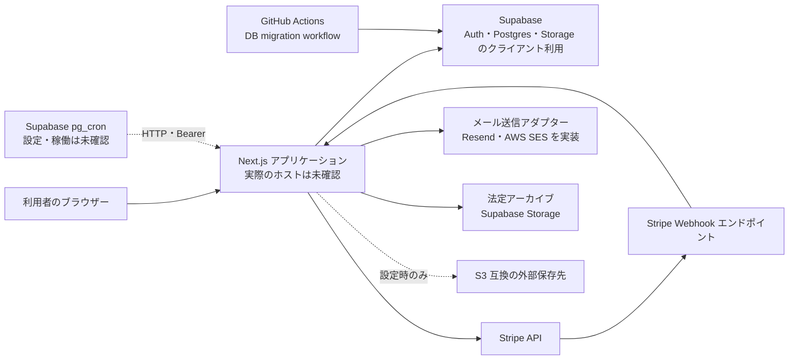

# 配置構成

## 概要

この図はリポジトリのコードとワークフローから確認できる連携経路を表す。アプリの本番ホスティング先、実際の環境変数、外部サービスの契約・稼働状態、ジョブの登録状況はこのリポジトリだけでは確認できない。`README.md` には Vercel デプロイ時の注意があるが、現在の配置先を確定する証拠ではない。

## 構成図

| 経路 | リポジトリで確認した根拠 | 稼働状況 |
| --- | --- | --- |
| アプリと Supabase | `@supabase/supabase-js`、`@supabase/ssr`、`src/lib/legal-archive/supabase-storage.ts` | 接続先と本番状態は未確認 |
| 決済 | `src/app/api/webhook/stripe/route.ts`、`src/app/api/checkout/`、`src/app/api/cron/stripe-reconcile/route.ts` | 本番 Webhook の登録・配信は未確認 |
| メール | `src/lib/mail/adapters/resend.ts`、`src/lib/mail/adapters/ses.ts` | どちらのアダプターが本番で選ばれるか未確認 |
| 外部アーカイブ | `src/lib/legal-archive/s3-storage.ts` | 必要な環境設定と保存実績は未確認 |
| DB 変更 | `.github/workflows/db-migrations.yml` は PR で dry run、push/workflow_dispatch で `supabase db push` を構成 | 実際の実行・適用履歴は未確認 |
| 定期処理 | `src/app/api/cron/`、`supabase/pending/`の登録 SQL、`docs/06_Operations/webhook-queue-operations.md`（開店のときの順番と確かめ方） | 登録・実行・成功は未確認 |

## 運用上の参照先

| 目的 | 文書・設定 |
| --- | --- |
| DB マイグレーションと台帳 | `docs/06_Operations/db-migrations.md`、`.github/workflows/db-migrations.yml` |
| シークレットと Stripe 同期 | `docs/06_Operations/secrets.md`、`docs/06_Operations/webhook-queue-operations.md`、`README.md` |
| 本番ビルドの前に要る環境変数 | `NEXT_PUBLIC_SITE_URL`・`NEXT_PUBLIC_SUPABASE_URL` は Vercel の Production に**ビルドの前**に設定する。無い、または `SUPABASE_URL` と別の origin だとビルドが落ちる（`next.config.ts` の `assertBuildEnv`、`ADR-0206`）。詳しくは `docs/06_Operations/secrets.md` の「ビルドの前に要る環境変数」。`VERCEL_ENV=production` の配備だけが対象で、実際の設定は未確認 |
| 注文証憑の保存・復元確認 | `docs/06_Operations/legal-archive.md` |
| KPI 旧セットアップ手順 | `docs/06_Operations/kpi-migration-setup.md`。対象環境と現行 DB 手順との整合を確認してから使用する |

## 送り元の IP と前段の中継（2026-10-28、ADR-0416）

| 項目 | 内容 |
| --- | --- |
| 前提 | 本番は Vercel に直接置き、前段に Cloudflare などの中継を置かない。送り元の IP は `x-vercel-forwarded-for`、`x-real-ip` の順に読む（`VERCEL=1` の時だけ。`x-forwarded-for` は読まない）。設計判断は [ADR-0416](../03_BasicDesign/decisions/ADR-0416-auth-client-ip-vercel-headers-only.md) |
| 中継を置く時 | 見出しが中継の IP に変わるので、そのまま置くと全員が同じ送り元になる。置く前に、段数を決める `TRUSTED_PROXY_HOPS` の設計を足す（今回は作らない） |
| E2E | E2E の固定の環境（`E2E_FIXED_ENV`）が `CLIENT_IP_HEADER=x-real-ip` を入れる。`E2E_FIXED_ENV` は `buildE2EOverrides` の中だけで混ぜ、その環境は既存の見張り（`findUnsafeE2ESettings`）が手元の Supabase であることを保証する。旗の専用の見張りは足さない。詳しくは[シークレット管理方針](secrets.md)の `CLIENT_IP_HEADER` |
| 最初の preview での実測（配備の前に必ず） | preview の URL に、偽の `x-real-ip: 203.0.113.7` と偽の `x-forwarded-for: 203.0.113.8` と偽の `x-vercel-forwarded-for: 203.0.113.9` を付けて `GET` を送り、アプリが受け取る送り元（監査の行の `ip`、または回数の制限の枠）が偽の値ではなく、リクエスト元の実際の IP になることを確かめる。偽の値が通るなら配備を止める。結果は日付つきでこの節に書く |
| 状態 | 本番は未デプロイで、Vercel が見出しを上書きすることは未実測 |

本番構成を確定する際は、ホスティング管理画面、GitHub Actions 実行履歴、Supabase の migration・cron・Storage の状態、Stripe の Webhook 設定、メール提供元の設定を別途照合する。
