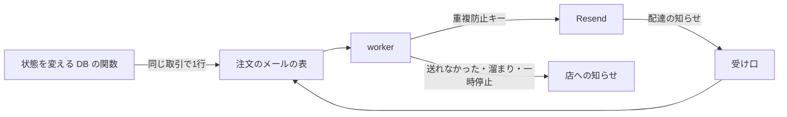

# 注文のメールの手順書

> 対象: お客様への注文のメール（注文確認・入金待ち・支払い期限切れ・取消・発送・返金・返品。発送は発送ごと、返金は返金ごと、返品は返品ごと・受け取りごとに1通）の送信・やり直し・一時停止・配達の状態と、店への知らせ（返金待ちの返品を含む）
> 設計: [グループ D 設計書](../superpowers/specs/2026-10-09-order-email-outbox-design.md)、Stripe の知らせと定期処理: [手順書](webhook-queue-operations.md)

---

## 概要

注文のメールは、注文の状態を変える DB の関数が「注文のメール」の表に1行書き、毎分の worker（Stripe の知らせの worker の続き）と、行を書いた窓口の返事の後の worker が送る。この手順書は、公開のときにやること、本番の Resend とつないだ通しの確かめ、店へ知らせのメールが届いたときの調べ方、配達の知らせの鍵の入れ替え、状態の確かめ方をまとめる。値（鍵・合言葉）はこの文書にもチャットにもコミットにも残さない。E-3 段2の返品・キャンセルの申し込みの6種類、店への知らせと再送しない時の対応は10節。

| 場面 | 見る節 |
|---|---|
| 公開のとき | 1 |
| 本番の Resend とつないだ通しの確かめ | 2 |
| 店へ知らせのメールが届いた | 3 |
| 配達の知らせの鍵を入れ替える | 4 |
| 状態を確かめる | 5 |
| 配達の見回りが失敗する・上限を確かめる | 6 |
| 発送のメール（発送ごとに1通）・発送を取り消した時 | 7 |
| 返金のお知らせ・支払い済みのキャンセルのお知らせ・Stripe 側の返金のメール・店への要対応の知らせ | 8 |
| 返品のメール（受付・受け取り・お返し）・店への返金待ちの知らせ・返金のお知らせと発送のお知らせの返品の書き分け | 9 |
| 返品・キャンセルの申し込みの受付・お断り・店への知らせ（6種類） | 10 |

| 仕組み | いつ | どこで |
|---|---|---|
| 送る | 毎分（Stripe の知らせの後に10秒まで）と、行を書いた窓口の返事の後 | `POST /api/cron/process-stripe-webhooks`・`after()` |
| 配達の状態 | Resend の知らせが届いたとき | `POST /api/webhook/resend-delivery` |
| 配達の見回り | 1時間ごと（毎分の worker の最後、店への知らせの点検の後） | Resend の API（Full access の鍵が要る） |
| 店への知らせの点検 | 毎分の worker と毎時の期限切れの見回り | `runOrderEmailOpsChecks`・`POST /api/cron/expire-pending-orders` |
| 本文の片付け | 毎日 4:40（19:40 UTC） | DB の中だけ（送信済みの本文は45日を過ぎた分を消し、受付済みの番号は3日） |



---

## 1. 公開のときにやること

### 1-1 本番の移行の順番と照合

移行は戻さない。直す時は前へ進める移行で直す。[移行 A](../../supabase/migrations/20261009095633_order_email_outbox.sql) を当ててから [移行 B](../../supabase/migrations/20261009095736_order_email_enqueue.sql) を当てる。B は古い `private.order_emails` の印を、送らない `legacy_suppressed` の行として移し、古い表を消す。古い表は B の後には無いので、種類ごとの件数は当てる前に控える。実際の順は次のとおり。

1. 当てる前に、入金待ちのまま残る試しの注文を、お客様に知らせない取消として片付けておく。有効な払込票は管理画面が409で断るので、期限切れの確定を待つか開発者に相談し、強制的に状態を書き換えない。
2. 当てる前に、古い表の種類ごとの件数と合計を控える（下の SQL の前半）。
3. A、B の順に当てる。
4. 当てた後に、新しい表の `legacy_suppressed` の行を種類ごとに数え、控えと照合する（下の SQL の後半）。公開前の試しの行を取りやめる 1-2 より前に行う。

照合は、Supabase のダッシュボード（本番のプロジェクト）→ SQL Editor で、次の読むだけの SQL を流す。種類ごとの件数と、合計8行・2注文が同じことを確かめる（8行・2注文は2026-10-09の確認値。違えば適用・公開を止めてユーザーへ知らせる）。

```sql
-- 当てる前（B の後はこの表は無い）。種類ごとの件数を控える
select kind, count(*) from private.order_emails group by kind order by kind;
select count(*) as rows, count(distinct order_id) as orders from private.order_emails;

-- A → B を当てた後。公開前の試しの行を取りやめるより前に照合する
select kind, count(*) from private.order_email_outbox
where last_error_code = 'legacy_suppressed' group by kind order by kind;
select count(*) as rows, count(distinct order_id) as orders from private.order_email_outbox
where last_error_code = 'legacy_suppressed';
```

### 1-2 公開前の送信待ちの確かめ

1-1 の移行と照合の後、`MAIL_PROVIDER` などの本番の環境変数を入れる前に、本番の `private.order_email_outbox` に溜まった送信待ち・送信中・やり直し待ちの行を確かめる。普段の開発で本番の DB につないだ `next dev` から決済・発送・取消を試すと、状態を変える DB の関数は同じ取引で送る予定の行を書く。開発の worker は環境の門で止まるため、行は残り、公開後の最初の worker が本物の Resend から試しの注文の宛先へ送ってしまう。実在の他人の宛先なら個人情報が届き、架空の宛先なら跳ね返りで送信の評価が下がる。

次の読むだけの SQL を、Supabase のダッシュボード（本番のプロジェクト）→ SQL Editor で流す。件数と、注文番号・種類・作った時刻だけを見る。宛先・件名・本文は出さない。

```sql
-- 送信待ち・送信中・やり直し待ちの件数
select status, count(*)
from private.order_email_outbox
where status in ('pending', 'sending', 'retry_wait')
group by status order by status;

-- 対象の一覧（注文番号は管理画面と同じ ORD-＋UUID の先頭8文字）
select 'ORD-' || upper(left(order_id::text, 8)) as order_number, kind, created_at
from private.order_email_outbox
where status in ('pending', 'sending', 'retry_wait')
order by created_at, seq;
```

公開前の試しの行があれば、上の件数と一覧をユーザーに見せ、取りやめる行について**明示の承認を得てから**、次の書き換えの SQL を同じ SQL Editor で流す。環境変数の設定・公開・worker の起動より先に行う。値の欄は承認された注文番号・種類・作った時刻だけに置き換え、承認されていない行は含めない。`sending` の担当の印と期限も消して表の制約を守り、本文を消す。変更の件数と返る一覧が承認したものと合うこと、上の読むだけの SQL で対象が残っていないことを確かめる。

```sql
-- 明示の承認を得た後だけ流す。VALUES には承認された行だけを並べる
with approved(order_number, kind, created_at) as (
  values ('<承認した注文番号>'::text, '<承認した種類>'::text, '<承認した作成時刻>'::timestamptz)
)
update private.order_email_outbox as e
set status = 'skipped', last_error_code = 'legacy_suppressed',
    subject = null, body_text = null, body_erased_at = now(), finished_at = now(),
    lease_token = null, lease_expires_at = null
from approved as a
where 'ORD-' || upper(left(e.order_id::text, 8)) = a.order_number
  and e.kind = a.kind and e.created_at = a.created_at
  and e.status in ('pending', 'sending', 'retry_wait')
returning 'ORD-' || upper(left(e.order_id::text, 8)) as order_number, e.kind, e.created_at;
```

移行を本番に当てた後から公開までは、本番の DB で注文の状態を変える試し（決済・発送・取消）をしない。移行の後に、入金待ちのまま残る試しの注文を初めて見つけた場合も、試しの取消で新しい行を増やさず、公開を止めてユーザーに知らせる（移行の前の片付けは 1-1）。

### 1-3 公開の設定

| 順 | やること | 誰が | 確かめ方 |
|---|---|---|---|
| 0 | 1-1 の移行の照合と、1-2 の公開前の送信待ちの確かめを済ませる。試しの行の取りやめは明示の承認の後だけ | ユーザーと Claude | 移行前後の種類別件数が同じ8行・2注文で、公開前の試しの送信待ちが残っていない |
| 1 | Vercel の環境変数 `MAIL_PROVIDER` を `resend`（小文字）にし、`RESEND_API_KEY`・`MAIL_FROM_ADDRESS`（確かめ済みのドメインのアドレス）・`SHOP_ALERT_EMAIL` を入れる。`RESEND_API_KEY` は Full access にする（送信専用の鍵だと、配達の見回りが「鍵の設定」で止まる。送信と Webhook は動く） | ユーザー | この文書の5節（状態を確かめる）の SQL「送信の一時停止」で `paused` が false（この表の順5とは別） |
| 2 | Resend の管理画面の Webhooks で宛先 `<公開した URL>/api/webhook/resend-delivery` を作り、`email.delivered`・`email.delivery_delayed`・`email.bounced`・`email.complained`・`email.suppressed`・`email.failed` の6つを選ぶ。出た署名の鍵（`whsec_` で始まる）を Vercel の `RESEND_DELIVERY_WEBHOOK_SECRET` に入れて出し直す。お問い合わせの返信の宛先（`/api/contact/inbound`・`RESEND_WEBHOOK_SECRET`）とは別の宛先・別の鍵にする | ユーザー | Resend の管理画面で宛先が有効 |
| 3 | 2 の通しの確かめ | ユーザー（試しの注文）、Claude（確かめる） | 2 の表 |
| 4 | Vercel の「System Environment Variables を自動で公開」が有効なことを確かめる | ユーザー | `VERCEL_ENV` が実行時に見える。見えないと preview でも環境の門を通って動く |
| 5 | Vercel の環境変数 `NEXT_PUBLIC_SITE_URL` に本番の https のサイトを入れる（E-5 以降の注文メールの状況ページのリンクの元。未設定だと `http://localhost:3000/order-status/…` が入り、保存済みの本文は後から直らない）。`NEXT_PUBLIC_*` はビルドの時に埋め込まれるので、本番のビルドの前に設定する。詳しくは12節の「本番URL・鍵・ログ」 | ユーザー | 値を報告へ転記せず、正しい https のサイトを指すことを確かめる |
| 6 | Resend のクリック追跡（Click Tracking）を注文のメールで有効にしない（有効だとトークン入りの状況ページの URL が Resend の転送用の URL に書き換わり、開くたびにクリックの記録にも残る）。詳しくは12節の「本番URL・鍵・ログ」 | ユーザー | Resend の管理画面で、注文のメールを送るドメインのクリック追跡が無効なこと |

- 本番の `MAIL_PROVIDER` は `resend`（小文字）を入れる。これは送り手を選ぶ設定の値で、秘密ではない。`resolveMailProvider` は大文字小文字まで完全一致で見るので、`Resend` と入れると送信を止め、店への知らせも届かない。ほかの送り手でも注文のメールは送らずに止める（重複防止キーの無い送り手で送らないため）。手元のメール受け（`local`）は手元の Supabase とだけ使い、ほかの DB と組み合わせると `config_provider` で一時停止する。
- 宛先を登録するまでの間も、読み取り権限のある鍵なら1時間ごとの見回りが配達の状態を拾う（6）。

### 環境の門

`orderEmailWorkerDisabledReason` は、`VERCEL_ENV` が設定されて production でない公開（preview・development）と、手元でない DB につないだ `next dev` を止める。この環境では送信（`runOrderEmailWorker`）・点検（`runOrderEmailOpsChecks`）・配達の見回り（`runOrderEmailDeliveryCheckIfDue`）は DB に触れず、心拍や知らせ済みの印も書かない。Resend の受け口（`POST /api/webhook/resend-delivery`）にはこの門は無い。

手元で `next build && next start` を本番の DB に向けない。この門は手元の本番ビルドを止めず、`MAIL_PROVIDER` が無いと既定の SES が選ばれて、本番の DB に `config_provider` の一時停止を書く。`VERCEL_ENV` が実行時に見えないと preview の判定もできないため、公開前に上の順4を確かめる。

## 2. 本番の Resend とつないだ通しの確かめ（公開の後・開店の前（お客様がいない時だけ））

公開の後・開店の前の、お客様がいない時だけ行う。1-3 の順1・2（環境変数と配達の知らせの宛先）を済ませた本番で、試しの注文の宛先を Resend の試し用の宛先にして、次を確かめる。試しの注文は確かめた後に取り消すか返金する。

あわせて、Resend の鍵（`RESEND_API_KEY`）を一時的に誤った値にし、試しの行で送信を試みる。ORDER タブの上に「お客様への注文のメールの送信を止めています」と原因が出ることを確かめる。正しい値に戻して出し直し、送る対象の1件を毎分の worker が試し、15分以内に自動で再開すること、状態を読み直すと帯が消えることを確かめる。worker が動く本番の実行環境で行う（preview・development は環境の門で止まる）。結果を下の欄に残す。開店後のお客様のいる環境では行わない。

| 宛先 | 確かめること |
|---|---|
| `delivered@resend.dev` | 管理画面の履歴に「配達済み」 |
| `bounced@resend.dev` | 「届かなかった」と「注意」、1時間以内に店へ「届かなかった注文のメール」 |
| `complained@resend.dev` | 「迷惑メールにされた」と「注意」、店への知らせ |
| `suppressed@resend.dev` | 「送信先が止められている」と「注意」、店への知らせ |

| 日付 | 宛先 | 結果 | 確かめた人 |
|---|---|---|---|
| （まだ） | | | |

## 3. 店へ知らせのメールが届いたとき

知らせは種類ごとに1時間に1回まで。お客様の氏名・住所・メールアドレスは入れず、注文番号と原因だけを書く。

### 送れなかった

件名「【要対応】送れなかった注文のメール（N件）」。やり直しても送れなかったか、このメールだけの問題で送らなかった。

1. 管理画面の ORDER タブで、その注文の「履歴」を開き、原因を見る。
2. 原因が「宛先の形が不正」なら、お客様のメールアドレスの誤りを疑い、ほかの手段（電話など）でお客様に確かめる。
3. 直せる原因なら、「お客様へ再送」で送り直す。

原因が `idempotency_conflict`（同じ送信の印で中身が違う）なら、[送信の一時停止の節の送信元を変える時の注意](#送信の一時停止)を確かめる。送信元の変更などで、同じキーの前の試行と中身が違うと Resend が409を返し、やり直さず「送れなかった」にする。前の試行が送られていないか Resend の記録を照合し、開発者に連絡する。必要な再送は新しい行・新しいキーになる。

一覧の行の名前が「店への知らせ（返金待ち）のメール」の時は、お客様ではなく、店のアドレス（環境変数 `SHOP_ALERT_EMAIL`）に宛てた知らせが送れなかったことを指す。この知らせの文は、今のまま「お客様への注文のメールを送れませんでした」と書かれ、種類で書き分けない。お客様に連絡する必要は無い。`SHOP_ALERT_EMAIL` が店のアドレスとして正しいかを、Vercel の環境変数で確かめ（値は画面にもチャットにも出さない）、返金待ちの返品が残っていないかを、管理画面の ORDER タブの一覧の上の「返金待ち {n}件」で確かめる（9-1・9-2）。この知らせは再送できない（履歴に「お客様へ再送」は出ない）。

### 届かなかった

件名「【要確認】届かなかった注文のメール（N件）」。Resend が送った後に、相手のメールの会社で届かなかった・止められた。

| 状態 | 意味 | やること |
|---|---|---|
| 届かなかった | 宛先が無い・受け取りの拒否 | 宛先の誤りを疑い、ほかの手段でお客様に確かめる |
| 迷惑メールにされた | お客様が迷惑メールと報告した | 再送しない。必要ならほかの手段で連絡する |
| 送信先が止められている | 前に届かなかった宛先で、Resend が送らない | 宛先の誤りを疑う。Resend の管理画面の Suppressions を確かめる |
| 送信サービスで送れなかった | Resend の中で送れなかった | Resend の管理画面のそのメールの記録を確かめる |

一覧の行の名前が「店への知らせ（返金待ち）のメール」の時は、店のアドレス（環境変数 `SHOP_ALERT_EMAIL`）が受け取れていない。この知らせの文も、今のまま「お客様への注文のメールが…」と書かれる。お客様に連絡する必要は無い。上の「送れなかった」と同じく、`SHOP_ALERT_EMAIL` の値と、返金待ちの返品が残っていないか（一覧の上の「返金待ち {n}件」）を確かめる（9-1・9-2）。

### 送信の一時停止

店主が気づく道は、管理画面の ORDER タブの上に出る「お客様への注文のメールの送信を止めています」の帯である。帯は止めている時だけ出て、原因と再開の案内を示す（E2E `FR-ADMIN-067`）。止まった時の店への知らせのメールも、止まった原因と同じ送信の道（同じ鍵・送信元・上限）を通るので、それらの設定が原因なら届かない。サイトの住所の設定だけが原因なら、店への知らせ自体は止めない。

件名「【要対応】注文のメールの送信を止めています」。鍵・送信元のドメイン・送り手・サイトの住所・送信の上限の問題で、送信全体を止めている。メールは消えずに残り、直ると試した1件が送れた時点で自動で再開する（15分ごと。1日の上限は日本時間 9時の後）。

一時停止を書き直しても、`quota_daily` 以外は「次に1件試す時刻」（`next_probe_at`）を延ばさない。`quota_daily` だけは次の UTC 0時（日本時間 9時）に決め直す。

| 原因 | 直し方 |
|---|---|
| 送信の鍵の設定 | Vercel の `RESEND_API_KEY` が Resend の有効な鍵か確かめ、入れ直して出し直す |
| 送信元のドメインの設定 | Resend の管理画面で送信元のドメインの確かめ（DNS）が通っているか、`MAIL_FROM_ADDRESS` がそのドメインか確かめる |
| 送信サービスの設定 | `MAIL_PROVIDER` が `resend`（小文字）か、`MAIL_FROM_ADDRESS` が入っているか確かめる。`resolveMailProvider` は完全一致なので、`Resend` は誤りで全部止まり、店への知らせも届かない |
| サイトの住所の設定（`config_site_url`） | Vercel の本番の環境変数 `NEXT_PUBLIC_SITE_URL`（無ければ `NEXT_PUBLIC_BASE_URL`・`BASE_URL`・`NEXT_PUBLIC_VERCEL_URL` の順）を正しい https の住所に直し、再デプロイする。次の probe（1件だけ試す送信）が成功すると自動で再開する |
| 1日の送信の上限・1か月の送信の上限 | Resend の利用の上限を確かめ、必要なら上のプランにする |

サイトの住所の確認は `VERCEL_ENV` が `production` の時だけ行う。URL として読めない・https でない・localhost（末尾の点や子のホストを含む）・127.0.0.0/8・::1・0.0.0.0 の住所では、注文のメールを取り出す前、本文を作って保存する前に止める。送信待ちの行はそのまま残す。手元・preview の localhost の使い方は変わらない。保存済みの本文は書き換えないので、導入前に不正なリンク入りの本文が保存されていた場合は、再開前に開発者へ相談する（同じ重複防止キーの本文を変えない）。

パスワードの再設定と会員登録は、実際にメールへ入る住所を同じ条件で確かめる。不正なら送らず、件名「【要対応】サイトの住所の設定を確かめてください」の店への知らせ（`site_url_invalid`、種類ごとに1時間に1回まで）を出す。知らせにはサイトの住所の値や要求の origin を入れない。再設定は登録の有無によらず同じ200を返し、会員登録は503と「ただいま会員登録を受け付けられません。時間をおいてお試しください。」を返してアカウントを作らない。この2つのメールは自動で送り直さず、設定を直した後にお客様がもう一度手続きを行う。Supabase 自身が送るログインの確認コードなどの Site URL は別の設定である。

注文の「履歴」の上の表示と、5 の「送信の一時停止」でも確かめる。

Resend の重複防止キーは24時間だけ効く。一時停止や待つ時間の指示（`Retry-After`、最大1日）で24時間を越えて送り直すと、前の試行が Resend に届いていた場合に2通目になりうる。長い一時停止の後は、管理画面の履歴で送信済みでない行を確かめ、必要に応じて Resend の記録も照合する。

送信待ち・やり直し待ちの行があるうちに送信元（`MAIL_FROM_ADDRESS`）を変えると、前の試行の中身と違うため Resend が409を返し、やり直さず「送れなかった」（`idempotency_conflict`）になることがある。前の試行が送られていないか Resend の記録を照合し、開発者に連絡する。必要な手の再送は新しい行・新しいキーになる。送信元を変える前に待ちの行を確かめる。

### 溜まり

件名「【要確認】注文のメールの送信が遅れています」。書いてから15分以上送れていないメールがある。

1. 5 の「送信の一時停止」で止まっていないか確かめる（止まっていれば上の節）。
2. 5 の「最後の成功」で `order_email_worker` が新しいか確かめる（古ければ次の節）。
3. 原因が「送信サービスの一時的な失敗」「送信の回数の制限」なら、やり直しで送れるのを待つ（通常は約4時間。待つ時間の指示や一時停止で延びる場合は、上の24時間の注意も確かめる）。

### worker の停止

件名「【要確認】定期処理が止まっています（注文のメールの送信）」。注文のメールの worker が15分以上成功していない。[Stripe の知らせの手順書](webhook-queue-operations.md)の「定期処理が止まったとき」に沿って、毎分の定期処理（`process-stripe-webhooks`）の実行の記録と応答を確かめる。

### 原因の記号

| 記号 | 名前 | 扱い |
|---|---|---|
| `provider_unavailable` | 送信サービスの一時的な失敗 | やり直す |
| `rate_limited` | 送信の回数の制限 | 待つ時間の指示に従ってやり直す |
| `network_error` | 通信の失敗・送信の8秒の待機切れ | 同じ重複防止キーでやり直す（24時間の注意は上の節） |
| `db_unavailable` | データベースの一時的な失敗 | やり直す |
| `lease_expired` | 処理の中断 | やり直す（同じ重複防止キーの24時間の有効期間内は2通目にならない） |
| `unexpected_error` | 想定外の失敗 | やり直す |
| `config_api_key`・`config_sender_domain`・`config_provider`・`config_site_url`・`quota_daily`・`quota_monthly` | 設定の問題 | 送信全体を止める |
| `invalid_message` | 宛先の形が不正 | 送れなかった |
| `idempotency_conflict` | 同じ送信の印で中身が違う | やり直さず送れなかった。前の試行を Resend の記録で照合し、開発者に連絡。必要な手の再送は新しい行・新しいキー（[送れなかった](#送れなかった)） |
| `source_missing` | 注文の情報が足りない | 送れなかった（開発者に連絡） |
| `superseded` | 注文の状態が変わったため | 取りやめ（入金待ち・支払い期限切れのメールと、予定を書いた後、送る前に返金が失敗・エラーになった返金のお知らせ・キャンセルのお知らせ。DB の `skip_order_email` は、返金に結び付く行にはその返金が失敗・エラーの時だけ受ける。店への知らせ（返金待ち）は、送る前に返金待ちの品が無くなった時だけ取りやめ、DB はその返品の返金待ちが0の時だけ受ける。返品のお客様あてのメールは、注文がどの状態でも取りやめない。グループ E-3） |
| `no_recipient` | 宛先が無い | 取りやめ（店への知らせ（返金待ち）のメールは、`SHOP_ALERT_EMAIL` が設定に無い時にこうなる。再送できず、二度と届かない。ログには設定が無いことだけを出し、値は出さない。9-1） |
| `legacy_suppressed` | 移行前の注文のため | 取りやめ（移行で移した印、または明示の承認で取りやめた公開前の試しの行） |
| `fulfillment_cancelled` | 発送の取消 | 取りやめ（取り消した時に送る前・やり直し待ちだったその発送のメール。やり直し待ちの行は届いている恐れがあり、送った後に取り消しても、お客様に取消のメールは行かない。必要なら店からお客様に連絡する。7 の表を参照） |
| `return_cancelled` | 返品の取消 | 取りやめ（返品を取り消した時に、まだ送っていない（送信待ち・やり直し待ちの）返品の受付のお知らせ。DB が直に書く記号。グループ E-3） |

## 4. 配達の知らせの鍵の入れ替え

1. Resend の管理画面で、その宛先の署名の鍵を作り直す（古い鍵も24時間は署名に並ぶ）。
2. 24時間のうちに、新しい鍵を Vercel の `RESEND_DELIVERY_WEBHOOK_SECRET` に入れて出し直す（受け口は並んだ署名のどれか1つが合えば通す）。
3. 出し直した後、Resend の管理画面でその宛先の配達の記録が成功（200）になっているのを確かめる。

## 5. 状態を確かめる（本番は読むだけ）

この節の SQL は、Supabase のダッシュボード（本番のプロジェクト）→ SQL Editor で流す。読むだけの SQL だけを流し、書き込みの文は流さない。アプリのログは、Vercel → このプロジェクトの Logs で見る。

```sql
-- 状態ごとの件数
select status, count(*) from private.order_email_outbox group by status order by status;

-- 送信の一時停止
select * from public.get_order_email_send_state();

-- 注文のメールの worker と配達の見回りの最後の成功・失敗
select * from public.get_ops_heartbeats() where job like 'order_email%';

-- 15分以上送れていないメール
select * from public.get_order_email_backlog(900);
```

## 6. 配達の見回りの権限と上限

配達の見回りは毎分の worker の最後、店への知らせの点検の後に、1時間に1回だけ動く。心拍（`order_email_delivery_check`）は Resend を読む前に書くので、途中で止まっても次の分に繰り返さない。見回りで見つけた不達は次の分の点検で店へ知らせる。

Resend の読み取りの権限が要る。`RESEND_API_KEY` が送信専用の鍵だと、読み取り対象のある毎時の見回りが `config_api_key` で失敗する。店への知らせは無く、心拍に残るだけなので、5 の「最後の成功・失敗」を確かめる。Full access の鍵にするか、受け口の `RESEND_DELIVERY_WEBHOOK_SECRET` を登録して配達の知らせを受ける。送信専用の鍵でも送信と受け口は動く。

| 上限 | 決まり |
|---|---|
| 1回の時間枠 | 8秒（`DELIVERY_CHECK_BUDGET_MS`） |
| 読む間 | 1秒（`DELIVERY_CHECK_READ_INTERVAL_MS`） |
| 1件の待機 | 5秒（`DELIVERY_CHECK_READ_TIMEOUT_MS`）。通信自体は中断せず、遅れて返った結果は使わない |
| 読む件数 | 最大50件。送ってから3日以内で状態が無い・配達の遅れのメールだけ |

古い順に取得した対象を、Resend を読む前に混ぜる。先頭の状態が決まらないメールだけが毎回の時間枠を使わず、後ろのメールも読めるようにする。

8秒は次の読み取りを始める前に確認する時間枠で、開始済みの読み取りと DB の処理を含む厳密な実行上限ではない。回数の制限・通信の不調・待機切れはその回をやめ、次の1時間に回す。読めた0件で失敗がある時は `provider_unavailable` を心拍に残す。Resend の最後の状態が `opened`・`clicked` のメールは配達済みとして扱う。

送信の1回の待機も8秒（`ORDER_EMAIL_SEND_TIMEOUT_MS`）で打ち切り、`network_error` の一時的な失敗として同じ重複防止キーでやり直す。重複防止キーの24時間の限りは3を参照する。

## 7. 発送のメールは発送ごとに1通（グループ E-1）

2026-10-10 から、発送のメールは注文ではなく発送ごとに1通送る（[グループ E-1 設計書](../superpowers/specs/2026-10-10-partial-fulfillment-design.md) の 8 章）。在庫の品を先に送り、受注生産の品を後から送ると、メールも2通になる。

| 決まり | 内容 |
| --- | --- |
| 行を書く時 | 発送の関数（`admin_create_fulfillment`）が、発送の画面の「お客様に発送のメールを送る」が入っている時だけ、同じ取引で発送のメールの行を1つ書く。行は発送の番号（`fulfillment_id`）を持つ。外した発送には行を書かない |
| 本文 | その発送の商品と数・配送業者・追跡番号・追跡のリンク。値段は書かない。未発送の品が残る発送だけに「残りの商品は、準備ができ次第お送りします。」を書く。この判断は発送した時点で決め（この発送で全部を送ったか＝`completes_order`）、あとで再送しても変えない |
| 再送 | 管理画面の注文の「履歴」のメールの行（種類が「発送（n回目）」）の「お客様へ再送」から、発送ごとに再送する。取り消した発送のメールは再送できない（決済完了・発送済みの注文で、発送が取り消されていない時だけ） |
| 発送を取り消した時 | 取り消した時に送る前（`pending`）・やり直し待ち（`retry_wait`）だったその発送のメールは、取りやめ（`fulfillment_cancelled`）になる。やり直し待ちの行には、送信の時間切れ（8秒）の時点で Resend がもう受け付けていた物がありうるので、取りやめても届いている恐れがある。送っている途中（`sending`）の行は、worker が材料を読む前に取消が来れば取りやめ、読んだ後なら送られることがある。すでに送ったメールはそのまま。お客様には取消のメールを送らない。届いた恐れがあれば、店からお客様に連絡する（確かめ方は 7-1） |

### 7-1 公開前の送信待ちの確かめ

グループ E-1 の移行（[移行 A](../../supabase/migrations/20261010120303_order_fulfillments.sql)・[移行 B](../../supabase/migrations/20261010122320_fulfillment_order_emails.sql)。1-1 の移行 A・B はグループ D の移行で、別）を本番に当てた後も、1-2 と同じく、公開前に本番で発送を試さない。試すと、発送ごとのメールの行が本番に溜まり、公開後の最初の worker が試しの注文の宛先へ送ってしまう。

[1-2](#1-2-公開前の送信待ちの確かめ) の読むだけの SQL は、メールの種類を絞らずに送信待ち・送信中・やり直し待ちの行を数えるので、発送のメールも入る。公開前の確かめ（1-3 の順 0）はそれで足りる。ここは、発送のメールだけの内訳を見たい時と、取りやめた発送のメールを調べる時の補足。次の読むだけの SQL を、Supabase のダッシュボード（本番のプロジェクト）→ SQL Editor で流す。

```sql
-- 発送のメールの行を、状態ごとに数える
select status, count(*) as rows
from private.order_email_outbox
where kind = 'shipped'
group by status order by status;

-- 発送を取り消して取りやめた発送のメール（理由は fulfillment_cancelled）。attempts は送ろうとした回数
select 'ORD-' || upper(left(order_id::text, 8)) as order_number, attempts, created_at
from private.order_email_outbox
where kind = 'shipped' and last_error_code = 'fulfillment_cancelled'
order by created_at;
```

期待する結果は、公開前は `pending`・`sending`・`retry_wait` の行が0（1つめの SQL に出ない）。1以上なら、1-2 と同じく件数と一覧をユーザーに見せ、明示の承認の後だけ、1-2 の書き換えの SQL で取りやめる。2つめの SQL に出る行は、発送を取り消したので取りやめた行。`attempts`（送ろうとした回数）が0の行は一度も送っていないので、届いていない。1以上の行は届いている恐れがあるので、Resend の送信の記録で確かめ、届いていれば店からお客様に連絡する（すでに送った発送を取り消した場合は、ここに出ない。上の表のとおり、店からお客様に連絡する）。

## 8. 返金のお知らせと、支払い済みのキャンセルのお知らせ（グループ E-2）

2026-10-11 から、返金したお客様に返金のお知らせを、支払い済みの注文をキャンセルしたお客様にキャンセルのお知らせを、どちらも返金ごとに1通送る（[グループ E-2 設計書](../superpowers/specs/2026-10-11-refund-and-cancel-design.md) の 8 章）。

| 決まり | 内容 |
| --- | --- |
| 行を書く時 | 返金の結果を書く DB の関数が、Stripe が返金を受け付けた時（保留か成功に初めてなった時）に、同じ取引で1行書く。残高不足（`insufficient_funds`）で保留の返金は、成功するまで書かない。行は返金の番号（`refund_id`）を持ち、返金ごとに1行 |
| 返金のお知らせ（種類 `refund`） | 送る返金: 管理画面の返金（「お客様に返金のメールを送る」が入っている時）、Stripe の画面からの返金、取り消した注文への入金の自動の返金①。送らない返金: 支払い済みのキャンセルと自動の取消②（キャンセルのお知らせに書く）、前からの写し、エラー、失敗（予定を書いた後、送る前に失敗・エラーになった返金も、worker が取りやめ（`superseded`）にして送らない）。再送は作らない |
| キャンセルのお知らせ（種類 `canceled`・書き分け `paid`） | 支払い済みの注文のキャンセル（「お客様にキャンセルのお知らせを送る」が入っている時）と自動の取消②で、返金ごとに1通。理由の文は在庫切れとお客様の依頼の時だけ書き、不正の疑い・その他では書かない。返金額の文は、全額の時は「お支払いいただいた ￥{n}（全額）を返金いたします。」、前に一部を返金していて返金額が受け取った額に満たない時は「お支払いいただいた金額のうち、残りの ￥{n} を返金いたします。」。「お支払いは発生していません。」は未入金の注文の取消のメールだけに残す。「取り消す → 返金が失敗して戻る → もう一度取り消す」の時も2通目が届く。再送は、注文がキャンセルの間はできる（最後に送った、または送るのをあきらめた（`sent` か `dead`）取消の行のうち、返金が失敗・エラーでない行の書き分けと返金の番号を写して文を作る。写せる行が無ければ再送できない） |
| 本文 | 件名は返金が「【Le Fil des Heures】ご返金のお知らせ（注文番号）」、キャンセルが「【Le Fil des Heures】ご注文取消のお知らせ（注文番号）」。返金額と（あれば）うち送料、返金した商品と数、発送前の商品を返金した時は「返金した商品はお送りしません。」（まだ送る商品があれば「ほかの商品はこれまでどおりお送りします。」）、①は「このご注文はお支払いの前に取り消し済みのため、お支払いいただいた金額を全額返金いたします。」、お金が戻る時期、問い合わせの案内 |
| お金が戻る時期の文 | 返金の記録の支払いの種類（Stripe の支払いから読んだ値）で書き分ける。カード・Link「ご返金は、カード会社によって5〜10営業日ほどで反映されます。」、PayPay「ご返金は、PayPay 残高にすぐ反映されます。」、コンビニ払い「Stripe（決済代行会社）から、返金先の口座を入力していただくためのメールが届きます。{YYYY年M月D日}までにご入力ください。期限を過ぎると返金できなくなります。」、分からない「ご返金が反映されるまでの日数は、お支払いの方法によって異なります。」。コンビニ払いの日付は、日本時間で期限の1分後の日付の前日＝その日のうちに入れれば必ず間に合う最後の日（[refund-messages.ts](../../src/lib/orders/refund/refund-messages.ts) の `konbiniDeadlineLastDay`。お客様の注文の画面の日付も同じ） |
| 返金が失敗した時 | お客様へは自動のメールを送らない。店へ「【要対応】返金の失敗」のメール（8-2）を送るので、店からお客様に連絡する。キャンセルのお知らせを送っていた注文が支払い済みに戻った時は、その旨が店へのメールに書かれる |

### 8-1 Stripe 側の返金のメールを切る（開店前）

Stripe は、設定が入っていると返金のたびにお客様へ返金のメールを送る。こちらの返金のお知らせと二重になるので、開店前に本番の Stripe の設定「顧客に返金のメールを送信する」を切る。

1. 本番の Stripe（テストの Stripe ではない）にログインし、顧客向けのメールの設定を開く。メニューの位置は Stripe の画面の変更で変わりうるので、設定の名前「顧客に返金のメールを送信する」で探す
2. 「顧客に返金のメールを送信する」を切って保存する
3. コンビニ払いの口座の入力のお願いのメールは、Stripe が返金先をお客様に聞くためのメールで、こちらからは送れないので、切らない（コンビニ払いを本番で使うかは、開店前に決める。全体の決定の 8 章）

確かめ方: Stripe の設定の画面で、その設定が切れていることを見る。本番で返金を試して確かめることはしない（8-3）。

### 8-2 店へ「要対応」のメールが届いたとき

要対応（支払いの要対応と、返金の失敗）が1件できるごとに、店へ1通届く。件名は「【要対応】{理由の名前}」（例「【要対応】返金の失敗」）。本文は、理由、注文番号、Stripe の支払い（返金の失敗は Stripe の返金の番号）、検知時刻と「次にやること」で、お客様の氏名・住所・メールアドレスは入れない。「次にやること」の文は次のとおり。

| 要対応の理由 | 次にやること |
| --- | --- |
| 返金の失敗 | 前に「失敗の理由: {言葉}」「確保し直せなかった商品: {品名 × 数}」（足りない時）「キャンセルのお知らせを送った注文です。お客様への連絡が要ります。」（支払い済みのキャンセルか支払額の違いの自動の取消で、お客様に知らせる指定のまま、Stripe が返金を受け付けた後に失敗した時。受け付ける前の、作ったその場で失敗が返った時は、お知らせが出ていないので入らない。残高不足の保留から失敗した時は見分けないので入る）の行が入り、続けて「お客様に連絡し、別の方法で返金するか、管理画面からもう一度返金してください。」。管理画面の ORDER タブの要対応で「もう一度返金する」を押すか、別の方法で返したら「解決済みにする」 |
| 取り消した注文への入金 | ①がオンで返金できた時「自動で全額を返金しました。対応は要りません。」、①で返金できなかった時「自動の返金ができませんでした。管理画面の注文から返金してください。」、①がオフの時「管理画面の注文から返金してください。」 |
| 支払額の違い | ②で取り消せた時「自動で全額を返金し、注文を取り消しました。」、②がオフか取り消せなかった時「管理画面で差額を返金するか、注文をキャンセルしてください。解決済みにするまで発送できません。」 |
| 注文を作れない支払い | 「支払いを確かめ、管理画面から返金するか、お客様に連絡して注文を登録してください。お客様には確認中の案内を送っています。」 |
| 注文と支払いの矛盾・想定外の支払い状態 | 「管理画面と Stripe の記録で支払いの状態を確かめてください。未入金の注文は管理画面の「注文を取り消して解決」で閉じられます。」 |
| Stripe に支払いが無い | 「管理画面と Stripe の記録で支払いがあるか確かめてください。未入金の注文は管理画面の「注文を取り消して解決」で閉じられます。」 |

自動の返金①②は、失敗しても自動ではやり直さない。①②のオン・オフは、管理画面の SETTINGS（店長だけ）で変える。

### 8-3 公開前の送信待ちの確かめ

グループ E-2 の移行（[移行 A](../../supabase/migrations/20261011222930_order_refund_records.sql)・[移行 B](../../supabase/migrations/20261011223147_order_refund_requests.sql)・[移行 C](../../supabase/migrations/20261011223453_order_refund_results.sql)）を本番に当てた後も、1-2 と同じく、公開前に本番で返金・キャンセルを試さない。普段の開発は本番の DB につないでいるので、試すと、返金のお知らせの行が本番に溜まり、公開後の最初の worker が試しの注文の宛先へ送ってしまう。

[1-2](#1-2-公開前の送信待ちの確かめ) の読むだけの SQL は、メールの種類を絞らずに送信待ち・送信中・やり直し待ちの行を数えるので、返金のお知らせも入る。公開前の確かめ（1-3 の順 0）はそれで足りる。ここは、返金に結び付く行だけの内訳を見たい時の補足。次の読むだけの SQL を、Supabase のダッシュボード（本番のプロジェクト）→ SQL Editor で流す。

```sql
-- 返金のお知らせと、返金に結び付くキャンセルのお知らせの行を、種類と状態ごとに数える
select kind, status, count(*) as rows
from private.order_email_outbox
where kind = 'refund' or (kind = 'canceled' and refund_id is not null)
group by kind, status order by kind, status;
```

期待する結果は、公開前は `pending`・`sending`・`retry_wait` の行が0。1以上なら、1-2 と同じく件数と一覧をユーザーに見せ、明示の承認の後だけ、1-2 の書き換えの SQL で取りやめる。

## 9. 返品のメールと、店への返金待ちの知らせ（グループ E-3）

段1の返品のメール4種類に加え、E-3 段2は10節の申し込みのメール6種類を送る（[グループ E-3 設計書](../superpowers/specs/2026-10-12-returns-design.md) の 9 章）。返品のメールの行も、状態を書く DB の関数が同じ取引で書き、worker が送る。履歴からの再送は作らず（`RESEND_NOT_ALLOWED`）、注文がどの状態でも取りやめない（その時の事実を伝えるため。例外は、取り消した返品のまだ送っていない受付のお知らせと、返金待ちが無くなった店への知らせ。取消と同時に送っている途中のお知らせは取りやめない。まれな重なり）。金額は全角の `￥` と桁区切りで書く。

| 種類（`kind`） | 履歴の名前 | 宛先 | 行を書く時 |
| --- | --- | --- | --- |
| `return_accepted` | 返品の受付のお知らせ | お客様（注文の配送先のメール） | 返品を作る時に「お客様に返品の受付のお知らせを送る」が入っていた時。返品ごとに1行。件名「【Le Fil des Heures】返品の受付のお知らせ（注文番号）」 |
| `return_received` | 返品の受け取りのお知らせ | お客様 | 返金のお知らせが出ない受け取り（交換・相談・返金が0円・今返金が Stripe に受け付けられずエラーか失敗になった時）で、「お客様に知らせる」が入っていた時。受け取りごとに1行。件名「【Le Fil des Heures】返品をお受け取りしました（注文番号）」 |
| `return_sent_back` | 品物のお返しのお知らせ | お客様 | 受け取った品が全部お返しの受け取り（お店のメッセージを必ず伝えるので、お客様に知らせるを外せない）。受け取りごとに1行。件名「【Le Fil des Heures】品物をお返しします（注文番号）」 |
| `return_refund_pending_shop` | 店への知らせ（返金待ち） | 店（環境変数 `SHOP_ALERT_EMAIL`） | サポートの受け取りで、記録の選び方が consult になった時だけ。今返金・0円・返金の品0点では予定しない。受け取りごとに1行で、同じ番号で送り直しても2通にならない。件名「【要対応】返金待ちの返品があります（注文番号）」 |

返金のお知らせと発送のお知らせは、返品に結び付く時だけ書き分ける。

| 種類 | 書き分け | 内容 |
| --- | --- | --- |
| `refund`（返金のお知らせ） | `return` | 「ご注文（注文番号）の返金の手続きをいたしました。」の次の行に、受け取りと一緒の返金なら「ご返品いただいた商品をお受け取りしました（返品番号 …）。」を入れ、交換の品の節とお返しの節（ある時）を足す。額を決めて後で返した返金なら「ご返品いただいた商品のご返金です（返品番号 …）。」を入れる。どちらも「返金した商品はお送りしません。」は出さない。返金のお知らせは再送を作らない（8） |
| `shipped`（発送のお知らせ） | 交換の品の行がある発送だけ | 発送の品の行の前に「ご返品いただいた品の、交換の品をお送りしました。」を入れ、交換の品の行の末尾に「（交換の品）」を付ける |

受付のお知らせ（`return_accepted`）の返送のしかたは、返送不要でなければ「下記の返送先へお送りください。」の次に下の表の文を書き、続けて返送先（名前・〒郵便番号と住所・電話番号）を書く。返送料が0円の時は、差し引く物が無いので、差し引きの文を書かない。

| 返送のしかた | 返送料の負担 | 返送料の定額 | 書く文 |
| --- | --- | --- | --- |
| 返送不要 | — | — | 「品物のご返送は不要です。」だけ（返送先は書かない） |
| お客様が送る・お店の送り状 | お店 | — | 「返送料は当店が負担いたします。着払いでお送りください。」 |
| お客様が送る | お客様 | — | 「恐れ入りますが、返送料はお客様のご負担でお送りください。」 |
| お店の送り状 | お客様 | 1円以上 | 「当店がご用意する送り状でお送りください。返送料 ￥{n} をご返金額から差し引きます。」 |
| お店の送り状 | お客様 | 0円 | 「当店がご用意する送り状でお送りください。」だけ（差し引きの文は書かない） |

- 注文確認・期限切れ・取消などの「注文の内容」の段落は、お客様が注文した品（`order_items.line_kind = 'order'`）だけを書き、返品の交換で足した品の行（￥0）は載せない。発送のお知らせだけは、発送の品に交換の品の行がある時に、その行の末尾に「（交換の品）」を付けて載せる
- 作って送る交換の品は、お知らせに「お作りしてお送りします。お届けの目安は {n}日ほどです。」と書く。目安の日数は、交換の色・サイズの商品の `made_to_order_lead_days`。無い・0日の品は「お作りしてお送りします。」だけにする。受付のお知らせには、作って送る行の末尾の注記だけを書き、目安は書かない
- 手数料のお支払い待ちの交換の品があれば、「交換の品は、手数料 ￥{n} のお支払いを確かめてからお送りします。お支払いの方法は、別にご案内いたします。」を書く。お支払いの方法の案内は、店からお客様へ別に連絡する
- 返金が0円になった受け取り（手数料が商品の額以上）の「返品をお受け取りしました」には、「今回のご返品では、ご返金の額が0円のため、ご返金はございません。」を書く。額を決めて返金で0円にした時は、メールを送らない（額を相談した中で店が伝える）
- 受け取りの記録の選び方が相談（返金の額をこれから決める）の受け取りの「返品をお受け取りしました」には、「ご返金の額は、確かめてから改めてご連絡いたします。」を書く。返金する品が0点の受け取り（覆われた品だけ・交換だけ・お返しだけ）は、選び方が相談でも記録が `none` になるので、この一文は書かない。今返金が Stripe に受け付けられなかった受け取り（Stripe にその場で断られた時、答えが分からないまま見回りがエラーにした時、返金を作ったその場で失敗の状態になった時）も、返金のお知らせが出ないので、同じ一文を書いた「返品をお受け取りしました」を DB がその時に予定する（「お客様に知らせる」を入れた受け取りだけ）。Stripe が受け付けた後で失敗した時（受け付けた時の返金のお知らせで足りる）と、額を決めて返金（受け取りとは別の返金）がエラーや失敗になった時は、この知らせは足さない

### 9-1 店への知らせ（返金待ち）の宛先

宛先は環境変数 `SHOP_ALERT_EMAIL`（ほかの店への知らせと同じ。1-3 の順1）。設定が無い間、この知らせは送らずに取りやめ（`no_recipient`）になり、アプリのログに「SHOP_ALERT_EMAIL is not configured」と行の番号だけを出す（値は出さない）。この知らせは再送できないので、取りやめになると二度と届かない。本番の Vercel の環境変数に `SHOP_ALERT_EMAIL` があることを、開店前に必ず確かめる（値は画面にもチャットにも出さない）。サポートが受け取って返金待ちになった返品は、管理画面の ORDER タブの一覧の上の「返金待ち {n}件」にも出るので、メールが届かなかった時もそこから見つけられる。

取りやめた行は、次の読むだけの SQL で探す。Supabase のダッシュボード（本番のプロジェクト）→ SQL Editor で流す。注文番号と時刻だけを見る。

```sql
-- 宛先の設定が無くて取りやめになった、店への知らせ（返金待ち）
select 'ORD-' || upper(left(order_id::text, 8)) as order_number, created_at
from private.order_email_outbox
where kind = 'return_refund_pending_shop' and last_error_code = 'no_recipient'
order by created_at;
```

1行以上出たら、`SHOP_ALERT_EMAIL` を入れて出し直したうえで、出た注文の返品が返金待ちのままか、管理画面の一覧で確かめる（店長が「額を決めて返金する」で返す）。

### 9-2 店へ「返金待ちの返品があります」が届いたとき

サポートが返品の品を受け取り、返金を店長に任せる印。本文は、返品の番号（`{注文番号}-R{n}`）、受け取った人（サポート）、受け取った返金の品、計算どおりの額で、お客様の氏名・住所・メールアドレスとメッセージは入れない。

1. 管理画面の ORDER タブの一覧の上の「返金待ち {n}件」を押すか、その注文の「額を決めて返金する」を押す（店長だけ。サポートには出ない）。
2. 返金の画面で、内訳と額（計算どおり）を確かめ、手数料・送料があれば直して「￥{n} を返金する」を押す。額を0にすると「返金しないで終える」になる。
3. 返金を受け付けると、お客様に返金のお知らせ（「ご返品いただいた商品のご返金です」）が1通届く。

この知らせが送られる前に、店長が先に「額を決めて返金する」を済ませて返金待ちが0になっていた時は、知らせは取りやめ（`superseded`）になり、届かない。もう知らせることが無いので、対応は要らない（履歴のメールの行は「取りやめ」になる）。

### 9-3 公開前の送信待ちの確かめ

グループ E-3 の移行（[移行 A](../../supabase/migrations/20261012235910_order_return_records.sql)・[移行 B](../../supabase/migrations/20261013000456_order_return_actions.sql)・[移行 C](../../supabase/migrations/20261013001143_order_return_receipts.sql)）を本番に当てた後も、1-2 と同じく、公開前に本番で返品を試さない。移行 A〜C は、アプリを出す（開店のときの順 1）より先に、A・B・C の順で当てる（[開店のときの順番](webhook-queue-operations.md#1-開店のときの順番)の注意）。普段の開発は本番の DB につないでいるので、試すと、返品のメールの行が本番に溜まり、公開後の最初の worker が試しの注文の宛先へ送ってしまう。

[1-2](#1-2-公開前の送信待ちの確かめ) の読むだけの SQL は、メールの種類を絞らずに送信待ち・送信中・やり直し待ちの行を数えるので、返品のメールも入る。公開前の確かめ（1-3 の順 0）はそれで足りる。ここは、返品に結び付く行だけの内訳を見たい時の補足。次の読むだけの SQL を、Supabase のダッシュボード（本番のプロジェクト）→ SQL Editor で流す。

```sql
-- 返品のメールと、返品に結び付く返金のお知らせの行を、種類と状態ごとに数える
select kind, status, count(*) as rows
from private.order_email_outbox
where kind in ('return_accepted', 'return_received', 'return_sent_back', 'return_refund_pending_shop',
               'return_requested', 'return_declined', 'return_request_shop',
               'cancel_request_received', 'cancel_request_declined', 'cancel_request_shop')
   or (kind = 'refund' and variant = 'return')
group by kind, status order by kind, status;
```

期待する結果は、公開前は `pending`・`sending`・`retry_wait` の行が0。1以上なら、1-2 と同じく件数と一覧をユーザーに見せ、明示の承認の後だけ、1-2 の書き換えの SQL で取りやめる。

## 10. 返品・キャンセルの申し込みのメール（E-3 段2 / FREQ-484）

### 10-1 種類・送り先・予定

| kind | 履歴の名前（画面では末尾に「のメール」） | 宛先 | 予定する時 |
| --- | --- | --- | --- |
| return_requested | 返品のお申し込みの受付のお知らせ | 注文の shipping_email | customer_request_return の新しい申し込み |
| return_declined | 返品のお申し込みについてのお知らせ | 注文の shipping_email | admin_decline_return。いつも送る |
| return_request_shop | 店への知らせ（返品の申し込み） | SHOP_ALERT_EMAIL | customer_request_return の新しい申し込み |
| cancel_request_received | キャンセルのお申し込みの受付のお知らせ | 注文の shipping_email | customer_request_cancel の新しい申し込み |
| cancel_request_declined | キャンセルのお申し込みについてのお知らせ | 注文の shipping_email | admin_decline_cancel_request。いつも送る |
| cancel_request_shop | 店への知らせ（キャンセルの申し込み） | SHOP_ALERT_EMAIL | customer_request_cancel の新しい申し込み |

どれも variant は NULL、origin は auto。返品の3種類は return_id、キャンセルの3種類は cancel_request_id を持ち、受け取りの番号は持たない。返品ごと・種類ごと／キャンセルの申し込みごと・種類ごとに一意。注文ごとの索引からは外すため、同じ注文の別の返品にも予定できる。送り直しは予定を増やさず、worker の起動は新しい記録の時だけ。承認のメールは既存の return_accepted で、お客様に知らせるを選んだ時だけ。closed・resolved の操作では新しい申し込みメールを作らない。

### 10-2 件名と本文

段1と同じく、宛名は今の `greeting`、問い合わせの案内は今の `contactLine`、店の名前は今の書き方。品の行は段1の `・{品名}（{色} / {サイズ}） × {数}`（色・サイズの書き方は段1と同じ）。

- 返品のお申し込みの受付（`return_requested`。お客様）: 件名 `【Le Fil des Heures】返品のお申し込みを受け付けました（{注文番号}）`。本文: 宛名・空行・`ご注文（{注文番号}）の返品のお申し込みを受け付けました（返品番号 {注文番号}-R{n}）。`・空行・`お申し込みの商品:` と行ごとに `・{品名}（{色} / {サイズ}） × {数}（理由: {理由}／ご希望: 返金）` か `・{品名}（{色} / {サイズ}） × {数}（理由: {理由}／ご希望: 交換 {色} / {サイズ}）`・空行・`内容を確かめて、ご連絡いたします。`・空行・問い合わせの案内・空行・店の名前
- 返品のお申し込みについて（`return_declined`。お客様）: 件名 `【Le Fil des Heures】返品のお申し込みについて（{注文番号}）`。本文: 宛名・空行・`ご注文（{注文番号}）の返品のお申し込み（返品番号 {注文番号}-R{n}）は、お受けすることができませんでした。`・空行・`当店より:`・お店のメッセージ（書かれたまま）・空行・問い合わせの案内・空行・店の名前
- 店への知らせ（返品の申し込み）（`return_request_shop`。送り先は店）: 件名 `【要対応】返品の申し込みが届きました（{注文番号}）`。本文: `お客様から返品の申し込みが届きました（返品番号 {注文番号}-R{n}）。`・空行・`申し込みの商品:` と行ごとに `・{品名}（{色} / {サイズ}） × {数}（理由: {理由}／ご希望: 返金／写真 {n}枚）`（交換は `ご希望: 交換 {色} / {サイズ}`）・空行・`管理画面の注文の一覧で「申し込みを確かめる」を押して、承認するかお断りしてください。`
- キャンセルのお申し込みの受付（`cancel_request_received`。お客様）: 件名 `【Le Fil des Heures】キャンセルのお申し込みを受け付けました（{注文番号}）`。本文: 宛名・空行・`ご注文（{注文番号}）のキャンセルのお申し込みを受け付けました。`・空行・`お申し込みの商品:` と品の行・空行・`内容を確かめて、ご連絡いたします。`・空行・問い合わせの案内・空行・店の名前
- キャンセルのお申し込みについて（`cancel_request_declined`。お客様）: 件名 `【Le Fil des Heures】キャンセルのお申し込みについて（{注文番号}）`。本文: 宛名・空行・`ご注文（{注文番号}）のキャンセルのお申し込みは、お受けすることができませんでした。`・空行・`当店より:`・お店のメッセージ（書かれたまま）・空行・問い合わせの案内・空行・店の名前
- 店への知らせ（キャンセルの申し込み）（`cancel_request_shop`。送り先は店）: 件名 `【要対応】キャンセルの申し込みが届きました（{注文番号}）`。本文: `お客様からキャンセルの申し込みが届きました。`・空行・`申し込みの商品:` と品の行・空行・`管理画面の注文の一覧で「キャンセルの申し込み」を押して、品を外すかお断りしてください。`
- お客様の詳しい内容・ご連絡事項は、店への知らせにも入れない（個人の事情が入りうるため。管理画面で見る）。写真はメールに付けない

### 10-3 送り直せない時・届かない時

新しい6種類は履歴から再送できない（窓口が DB より先に409 `今の注文の状態では、このメールは再送できません。`で断る。監査の detail は `Resend not allowed`）。DB の request_order_email_resend は変更せず、新しい種類は INVALID_EMAIL_KIND で拒否する。注文の状態が変わっても superseded にしない。宛先が無い時は no_recipient。店の宛先の設定が無ければ、値を含めず警告と行の番号だけを記録し、取りやめたメールを自動で復活させない。

3節の「送れなかった」「届かなかった」で、新しい種類の名前を見分ける。店への2種類はお客様への配達失敗ではない。SHOP_ALERT_EMAIL の設定の有無と、管理画面の一覧の「返品の申し込み {n}件」「キャンセルの申し込み {n}件」から未処理を確かめる。お客様の4種類も再送できないので、配達の記録を確認し、必要な連絡を店が別の手段で行う。行を直接書き直して再送しない。worker の門、一時停止、回数制限、本文と受付済み番号の保持期間は既存の運用を使う。

### 10-4 公開前・登録後の確認（本番では読むだけ）

E-3 段2の移行 D・E・F はアプリ公開より前、写真の定期処理はアプリ公開後の開店時に登録する。2026-10-21 に本番へ適用済み（20261020144439・20261020144842・20261020150415）。1-2 の種類を絞らない送信待ちの確認に、今回の6種類も含まれる。公開前に本番で申し込みを試すと予定が残る。取りやめは件数をユーザーに見せて明示の承認後だけで、削除しない。

```sql
select kind, status, count(*) as rows
from private.order_email_outbox
where kind in ('return_requested', 'return_declined', 'return_request_shop',
               'cancel_request_received', 'cancel_request_declined', 'cancel_request_shop')
group by kind, status
order by kind, status;

select kind, status, last_error_code, count(*) as rows
from private.order_email_outbox
where kind in ('return_request_shop', 'cancel_request_shop')
group by kind, status, last_error_code
order by kind, status, last_error_code;
```

宛先・本文・署名つきリンクは照会結果にも報告にも出さない。Mailpit の確認は手元の到達の証拠で、本番の Resend の配達の証拠ではない。開店前の2節の確認で種類・履歴・送り先の役割を確認する。

## 11. 配送のメール（E-4 / FREQ-492）

[配送の詳細設計](../superpowers/specs/2026-10-21-delivery-status-design.md)・[実装計画](../superpowers/plans/2026-10-21-delivery-status.md)を参照。以下は実装後の契約であり、既存の決定の本文は履歴として残す。

E-5 以降に作る新しいお客様向け本文は12節に従う。下の配達済みの `ご注文の確認はこちら: {注文の画面のリンク}` の行は、12節で `ご注文の状況はこちら: {orderStatusUrl}` の行に置き換えた（E-4 の時点の並びは履歴として残す）。

kindの正は19種類（16→19）: `paid`・`awaiting_payment`・`payment_expired`・`canceled`・`shipped`・`refund`・`return_accepted`・`return_received`・`return_sent_back`・`return_refund_pending_shop`・`return_requested`・`return_declined`・`return_request_shop`・`cancel_request_received`・`cancel_request_declined`・`cancel_request_shop`・`out_for_delivery`・`delivered`・`shipping_update`。

| 種類・履歴の名前 | 件名 | 予定に入れる条件 |
| --- | --- | --- |
| `out_for_delivery`・配達中のお知らせ | 【Le Fil des Heures】商品を配達中です（{注文番号}） | オンの追跡結果が配達中で、発送notify_customerがオン |
| `delivered`・配達済みのお知らせ | 【Le Fil des Heures】商品をお届けしました（{注文番号}） | 手または追跡で配達済み。手は発送と操作の両notifyがオン、追跡は発送notifyがオン |
| `shipping_update`・発送の更新 | 【Le Fil des Heures】発送の情報を更新しました（{注文番号}） | 番号/業者の直しのnotifyがオン。追跡オフでも送る |

3種類ともvariantはNULL、再送不可。窓口がDBより先に409「今の注文の状態では、このメールは再送できません。」で断り、履歴も再送ボタンを出さない。配送の誤りは先に番号や届いた日を直す。配達中・配達済みは（発送・tracking_version・kind）、更新はtracking_change_idで1通。次の版は別の通知として扱う。

旧版の配達中/配達済み・取り消した発送・配達済み後の配達中は送信直前にskipし、保存済み本文があっても送らずに終える。通知の選択は直した時の値がこの先にも効く。商品の行はその発送の品と数量だけで値段は書かず、既存 `formatShipmentItemLines` の ` x{数}` をそのまま使う（計画C-6の乗算記号は写し間違いという台帳の決定が正）。

### 本文と返品の日数

既存 `greeting`・`formatShipmentItemLines`・`contactLine`・`SHOP_NAME` を使う。以下の順に行を並べ、`空行` は空文字1行、末尾は店名（勝手に末尾の空行を増やさない）。商品はその発送の行だけ、`・{品名}（{色} / {サイズ}） x{数}`、値段は書かない。色・サイズの片方/両方が無い時の書き方は既存の関数と同じ。

- 配達中: 宛名 → 空行 → `ご注文の商品を配達中です。` → 空行 → `注文番号: {注文番号}` → 空行 → `配達中の商品:` → 商品の行 → 空行 → `配送業者: {配送業者}` → `追跡番号: {伝票番号}` → `追跡はこちら: {追跡のリンク}` → 空行 → 問い合わせの案内 → 空行 → 店名。
- 配達済み: 宛名 → 空行 → `ご注文の商品をお届けしました。` → 空行 → `注文番号: {注文番号}` → `お届け日: {M月D日}` → 空行 → `お届けした商品:` → 商品の行 → 空行 → `商品に不具合がございましたら、到着から {N} 日以内にご注文の画面またはお問い合わせからご連絡ください` → 空行 → `ご注文の確認はこちら: {注文の画面のリンク}` → 空行 → 問い合わせの案内 → 空行 → 店名。N は材料を読む時の `shop_return_settings.window_days`、NULL なら案内とその直後の空行を出さない。
- 発送の更新: 宛名 → 空行 → `ご注文の発送の情報を更新しました。` → 空行 → `注文番号: {注文番号}` → 空行 → `発送した商品:` → 商品の行 → 空行 → `配送業者: {新しい配送業者}` → `追跡番号: {新しい伝票番号}` → `追跡はこちら: {追跡のリンク}` → 空行 → `先にお知らせした伝票番号は使えません` → 空行 → 問い合わせの案内 → 空行 → 店名。

shipping_update は直しの行の新しい値、配達中/配達済みは claim の版の発送を使う。古い版や取消の判定は保存済みの本文があっても送る直前に行う。17TRACK の細かい状況・場所・文をメールへ入れない。付録の見本は説明書の写しであり、本物の HTTP・署名・課金・3社の追跡を確認済みと扱わない。

配達済みの案内の日数は材料取得時の `shop_return_settings.window_days`。無制限（NULL）は案内文と直後の空行を出さない。顧客への状況通知と、追跡接続の異常を `SHOP_ALERT_EMAIL` に1日1回送る店への運用通知は別系統。メール配達のdeliveredはメールが届いた状態であり、荷物のdeliveredではない。

19種類の型・再送拒否・旧版skip・本文はDB/単体/E2Eの別々の検証対象。本物の17TRACK・本番メール・実番号の確認は開店前の手順で実施し、この文書更新で確認済みとは扱わない。

## 12. 注文状況リンクと確認期限（E-5 / FREQ-500・503）

[詳細設計](../superpowers/specs/2026-10-22-order-status-page-design.md)・[実装計画](../superpowers/plans/2026-10-22-order-status-page.md)・[ページ仕様](../04_DetailDesign/pages/20_order_status.md)を参照。以下は運用の手順であり、本番の件数・設定・ログを今回取得した記録ではない。

### 対象メールと本文

お客様向け16種類は `paid`・`awaiting_payment`・`payment_expired`・`canceled`・`shipped`・`refund`・`return_accepted`・`return_received`・`return_sent_back`・`return_requested`・`return_declined`・`cancel_request_received`・`cancel_request_declined`・`out_for_delivery`・`delivered`・`shipping_update`。店向け3種類 `return_refund_pending_shop`・`return_request_shop`・`cancel_request_shop` は変更しない。

新しいお客様向け本文だけ、末尾を「空行 → `ご注文の状況はこちら: {orderStatusUrl}` → `お問い合わせの際は、注文番号（{orderNumber}）をお問い合わせフォームにご入力ください。` → 空行 → Le Fil des Heures」とする。リンクと問い合わせ文の間に空行を挟まない。deliveredの旧会員リンクとその空行は置き換える。paid/awaiting_paymentのお届け先からお客様の電話だけを削除し、名前・郵便番号・住所・建物と、返品先のお店の電話は残す。件名やその他の文を変更しない。

新本文の材料は `loadStatusUrl(orderId)` が用意し、`new URL('/order-status/' + token, getSiteUrl())` で絶対URLを作る。URLを作れない時は `source_missing`（配送3種類はtransient、ほかはpermanent）、DB失敗は `db_unavailable/transient`。1通の失敗でほかのメール処理を止めない。

### 21日と24時間と20回

`complete_order_email` のlease一致の成功でsentとなった `sent_at` に21日を足し、`GREATEST` で期限を戻さない。対象16種類だけが更新し、店向け・失敗・取りやめでは更新しない。本文の内容やoriginでは種類の判定を変えない。リンク行が無ければ何もしない。期限が進んだ時だけ不一致の合計20回を0に戻す。同時刻・古い完了・正解・429では戻さない。

確認印は24時間とverify_untilの早い方までで、21日間有効なCookieではない。延長メールが成功しても古い印のexpは延ばさない。期限NULL・過去・電話が短い場合は入力欄を出さず、持ち主のログインかお問い合わせを案内する。公開部分は期限後も同じリンクで見られる。

### 旧本文と送り直し待ちの確認

保存済みの `subject/body_text` は送り直しでも書き換えない。古いお客様の電話や旧会員リンクが残る場合がある。保存済み本文ではリンクを準備せずそのまま送る。既存注文へのリンクの一括作成・送信済みメールの一斉再送は行わず、次の新しい本文からリンクを作る。

Task 11でcontrollerが適用前に次の読むだけのSQLを実行し、状態ごとの件数だけを記録する。本文・宛先・token・注文IDを出力しない。旧本文を消去・書換え・一括skippedにせず、通常の再試行を継続する。これは上の過去の公開手順とは別のE-5の扱い（P28）。

```sql
SELECT status, count(*) AS saved_body_count
FROM private.order_email_outbox
WHERE status IN ('pending', 'sending', 'retry_wait')
  AND subject IS NOT NULL AND body_text IS NOT NULL
GROUP BY status
ORDER BY status;
```

### 本番URL・鍵・ログ

本番では `NEXT_PUBLIC_SITE_URL` の設定が必須。未設定だと16種類のメールに `http://localhost:3000/order-status/…` が入り、保存済みの本文は後から直らない。実装のgetSiteUrlにはNEXT_PUBLIC_BASE_URL・BASE_URL・NEXT_PUBLIC_VERCEL_URLの代替もあるが、それらも無い時はlocalhostへフォールバックし、URLの構文検査だけでは止められない。運用では代替に頼らず本番のNEXT_PUBLIC_SITE_URLを設定し、公開前に正しいhttpsのサイトを指すことを値を報告へ転記せず確認する。`NEXT_PUBLIC_*` の値はビルドの時にコードへ埋め込まれるので、本番のビルドの前に設定する。ビルドの後に環境変数だけを足しても、すでにできたビルドには入らず、設定してから再ビルド・再デプロイが要る。

Resendのクリック追跡（Click Tracking）は注文のメールで有効にしない。送った本文は追跡が無くても Resend の送信の記録に入るが、有効にすると、本文のトークン入りの状況ページのURLが Resend の転送用のURLに書き換わり、開くたびにトークン入りのURLが Resend のクリックの記録を通る。今の注文のメールは文だけでリンクの書き換えは起きないが、HTMLのメールを足す時に効くので、有効でないことを確かめてから公開する。

`ORDER_STATUS_SESSION_SECRET` はサーバー専用で、空なら非空の `JWT_SECRET` を使用する。両方無いと確認印を発行できない。鍵をログへ出さず、公開環境変数へ移さない。`.env.example` に足すのは空の専用鍵と説明の2行だけ。

本番のアクセスログ・解析・外部監視でtoken付きpathを記録しない設定を確認する。CDN/ホスティング・アプリ・解析の収集先ごとに `/order-status/*` と `/api/order-status/*` を除外するか、送信前にpathを伏せる。queryだけの削除では足りない。新しい合成リンクで確認し、リンク値・電話・Cookie・署名・秘密値・本文を確認結果や添付へ残さない。結果は記録の有無と件数だけにし、実URLを検索欄や報告へ貼らない。詳細は [適用と運用の確認](webhook-queue-operations.md)。
