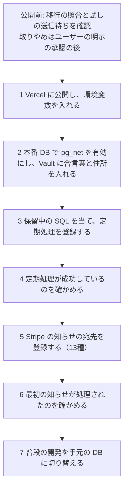

# Stripe の知らせのキューと定期処理の手順書

> 対象: Stripe の知らせ（Webhook）の受け取り口・キュー・worker、毎時の見回り、毎晩の照合、店への知らせ
> 設計: [グループ B 設計書](../superpowers/specs/2026-10-05-webhook-queue-operations-design.md)、保留中の SQL: [supabase/pending/README.md](../../supabase/pending/README.md)

---

## 概要

開店のときに定期処理を登録する順番、合言葉の入れ替え、Stripe の購読の設定、店へ知らせのメールが届いたときの調べ方をまとめる。値（合言葉・鍵）はこの文書にもチャットにもコミットにも残さない。E-3 段2の写真を消す処理は毎日4:20、最後の成功と49時間の遅れを以下で確認する。

| 場面 | 見る節 |
|---|---|
| 開店のとき | 1 |
| `CRON_SECRET` を入れ替える | 2 |
| Stripe の署名の合言葉を入れ替える | 3 |
| Stripe の知らせの購読を設定する | 4 |
| 店へ知らせのメールが届いた | 5 |
| 状態を確かめる | 6 |

| 定期処理 | 時刻（日本時間・UTC） | 入口 |
|---|---|---|
| worker | 毎分 | POST `/api/cron/process-stripe-webhooks`（Stripe の知らせの後に注文のメールも送る） |
| 見回り | 毎時0分 | POST `/api/cron/expire-pending-orders` |
| 照合 | 毎日 3:00（18:00 UTC） | POST `/api/cron/stripe-reconcile` |
| 実行の記録の掃除 | 毎日 4:00（19:00 UTC） | DB の中だけ（7日を残す） |
| 写真を消す処理（purge-return-photos、印 return_photo_purge） | 毎日4:20（19:20 UTC） | POST `/api/cron/purge-return-photos`（開店時に保留 SQL で登録） |
| 注文のメールの片付け（`order-email-retention`） | 毎日 4:40（19:40 UTC） | DB の中だけ（本文と受付済みの番号の片付け） |

---

## 1. 開店のときの順番



| 順 | やること | 誰が | 確かめ方 |
|---|---|---|---|
| 0 | 本番の環境変数（`MAIL_PROVIDER` など）を入れる前に、[注文のメールの手順書](order-email-operations.md)の1-1で移行前後を照合し、1-2の読むだけの SQL で送信待ち・送信中・やり直し待ちを確かめる。試しの行の取りやめはユーザーに見せ、明示の承認を得た後だけ | ユーザーと Claude | 古い印が種類ごとに同じ8行・2注文で、公開前の試しの送信待ちが残っていない（宛先を出さない） |
| 1 | 公開の前に、E-3 段2の移行 D・E・F が A〜C の後に当たっていることを確かめる（下の箇条書き）。Vercel に公開し、環境変数を入れる。`CRON_SECRET` は32文字以上のランダムな値（例: `node -e "console.log(require('crypto').randomBytes(32).toString('base64url'))"`）。`SHOP_ALERT_EMAIL`・`MAIL_FROM_ADDRESS`・`STRIPE_SECRET_KEY`（本番の鍵）も入れる。知らせのメールを送る設定（`MAIL_PROVIDER` は `resend`（小文字）、`RESEND_API_KEY`。本番の注文のメールは Resend でしか送らない。[注文のメールの手順書](order-email-operations.md)の1）も入れる。`resend` は秘密ではない設定値で、`Resend` と入れると完全一致の検証で止まり、店への知らせも届かない | ユーザー | 公開した URL で画面が開く。Vercel の環境変数に、`SHOP_ALERT_EMAIL`・`MAIL_FROM_ADDRESS` とメールを送る設定が入っている（無いと、知らせのメールは送られず、アプリのログに警告が出るだけになる） |
| 2 | 本番 DB で `create extension if not exists pg_net with schema extensions;` を流し、Vault に `cron_secret`（Vercel の `CRON_SECRET` と同じ値）と `app_base_url`（公開した URL。末尾の `/` は付けずに入れる）を入れる | 合言葉はユーザー（Vault の画面で入れる）、それ以外は Claude（許可を得て） | `select name from vault.decrypted_secrets where name in ('cron_secret', 'app_base_url');` が2行 |
| 3 | `supabase/pending/` の `schedule_stripe_webhook_worker.sql`・`schedule_expire_pending_orders.sql`・`schedule_stripe_reconcile.sql`・`schedule_return_photo_purge.sql` を、新しい version の移行にして当てる（`supabase/pending/README.md` の手順） | Claude（許可を得て） | `select jobname, schedule, active from cron.job order by jobname;` に、`cron-job-run-details-retention`（掃除。移行で登録済み）・`expire-pending-orders`・`process-stripe-webhooks`・`stripe-reconcile`・`order-email-retention`（毎日19:40 UTC、本文と受付済みの番号の片付け。グループ D の移行 A で登録）・`purge-return-photos`（毎日19:20 UTC）の6つが `active` で並ぶ。保持期限の別のジョブ（`checkout-drafts-retention`・`rate-limit-counters-retention`）が並んでいてもよい |
| 4 | 定期処理が成功しているのを確かめる | Claude | 6 の「実行の記録と、その直後の応答」の SQL（`jobname` を変えて使う）。worker は数分後に、`process-stripe-webhooks` の `status` が `succeeded`、応答の `status_code` が200。見回りは次の毎時0分の後、照合は次の 18:00 UTC の後に、`expire-pending-orders`・`stripe-reconcile` の実行の記録と応答（応答は実行から6時間以内に見る）、そして `ops_job_heartbeats` の `order_sweep`・`stripe_reconcile` の成功の時刻で確かめる。照合は最大300秒動き、pg_net は60秒で待つのをやめるので、応答が `timed_out` でも、`stripe_reconcile` の成功の時刻が新しければ成功（6 の「応答の見方」）。写真を消す処理は次の19:20 UTCの後、6節と下の写真の確認の SQL で200の uploads・photos と return_photo_purge の最初の成功を確認する。対象0でも成功時刻は更新される。掃除は次の 19:00 UTC の後に、6 の「定期処理ごとの実行の記録」の SQL（`cron-job-run-details-retention`。URL を呼ばないので応答は無い）で確かめる |
| 5 | Stripe の管理画面で知らせの宛先（`<公開した URL>/api/webhook/stripe`）を作り、4 の13種を購読し、署名の合言葉を Vercel の `STRIPE_WEBHOOK_SECRET` に入れて出し直す | ユーザー | Stripe の管理画面で宛先が有効 |
| 5b | Resend の配達の知らせの宛先を登録する（[注文のメールの手順書](order-email-operations.md)の1の順2） | ユーザー | Resend の管理画面で宛先が有効 |
| 5c | 本番の Stripe の設定「顧客に返金のメールを送信する」を切る（こちらの返金のお知らせと二重になるため。コンビニ払いの口座の入力のお願いのメールは切らない。グループ E-2。[注文のメールの手順書](order-email-operations.md)の 8-1） | ユーザー | Stripe の設定の画面で、その設定が切れている |
| 5d | 本番でコンビニ払いを使うかを決める（使うなら、口座の入力のお願いのメールは切らない。グループ E-2） | ユーザー | 決めた結果を台帳に残す |
| 5e | 管理画面の SETTINGS（題「ショップの設定」）で、自動の返金①（取り消した注文に届いた入金を、自動で全額返金する）がオン、②（支払額が注文と違う注文を、自動で全額返金して取り消す）がオフになっていることを確かめる（グループ E-2） | ユーザー | 画面の2つのトグルと「まだ変えていません」 |
| 5f | 状態の移り変わりを守る SQL（`supabase/pending/harden_order_state_transitions.sql`。グループ E-2 で表を直し、グループ E-3 で `shipped` から `paid` へ戻す理由に `return_exchange_added`（交換の品を足した時）も足した版）を当てるかを決める。当てる前に、`grep -n "return_exchange_added" supabase/pending/harden_order_state_transitions.sql` でこの理由が入っていることを確かめる（入っていないと、交換の品を足す受け取りが断られる）。当てるなら、当てる前に、全額返金で取り消した注文を戻す決まり（ファイルの `OLD.status = 'cancelled'` から始まる検査）に `private.order_cancelled_by_refund(OLD.id)` の確かめを足して、返金で取り消した注文だけに当てる（足さないと、未入金で取り消した注文に届いた入金の全額の返金が成功の後に失敗した時、失敗を記録できず `FAILED_FULL_REFUND_CANNOT_REMAIN_CANCELLED` で止まり、取り込みがやり直し続ける。その返金は、自動の返金①、管理画面の返金の画面の「すべて選ぶ」で返した全額の返金（取り消した注文でも決まりは同じ。P28）、Stripe の画面からの全額の返金のどれでも起きる）。新しい version の移行にして、ユーザーの許可を得て当てる | ユーザーと Claude | 決めた結果を台帳に残す |
| 5g | 返品の返送先をショップの設定に入れる。管理画面の SETTINGS（題「ショップの設定」）の「返品」の欄の「返送」のまとまりで、「返送先」（名前・郵便番号・住所・電話番号）を入れて「保存する」を押す。4つとも空の間は、返品を作れない。返品の受付のお知らせにも載る（グループ E-3） | ユーザー | SETTINGS の「返送」のまとまりに返送先が入っていて、「最後に変えた人」に変えた人と日時が出ている（本番で返品を作って確かめることはしない） |
| 5h | 本番の DB の役割の表に、権限 `admin.orders.return`（注文の返品）の行があり、店長（`admin`）とサポート（`supporter`）の役割に付いているかを、読むだけの SQL で確かめる。移行 A（`20261012235910_order_return_records.sql`）が入れるが、役割の行が無い DB では何も入らない（グループ E-3。下の SQL） | Claude（許可を得て） | 下の SQL の結果が2行（`admin`・`supporter`） |
| 5i | E-3 段2の「申し込み」で受付・種類・注意書きと理由の出す／ご希望／写真を確認し、返送先を入れる。受付は最初からオン、お客様の申し込みの種類の最初の値は「返品だけ」（`request_types = 'returns_only'`）。/legal・/terms の問い合わせの案内を申し込みに合わせる文章は店が確定する | ユーザー | 保存した設定と法的な案内が公開内容に合う |
| 5j | 非公開 return-photos の存在、10485760・image/jpeg・image/png と、サーバーの SUPABASE_URL（無ければ NEXT_PUBLIC_SUPABASE_URL）がブラウザから届くことを確認する | Claude とユーザー | 開店前に本番の写真の送信・管理画面の表示を1回確認する。リンクや秘密の値は出さない |
| 6 | 最初の知らせが処理されたのを確かめる。本番の鍵ではテストカードが使えず、テストモードの知らせは本番の宛先に届かない。少額の本番の決済を1回して、確かめた後に返金する（グループ E-2 から、返金のお知らせのメールがお客様の宛先に届く。5c で Stripe 側の返金のメールを切った後に行う。管理画面の返金の画面から返すと、返金の記録・在庫・メールの流れも確かめられる） | ユーザー（決済と返金）、Claude（確かめる） | `stripe_webhook_events` の新しい行（決済の知らせ。返金したら返金の知らせも）が `completed` |
| 7 | 普段の開発を手元の DB に切り替える（設計書 第7章） | Claude とユーザー | `npm run dev` の画面が手元の見本データを出す |

- 3 の前に、本番のキューと記録の表に、開発の実行で入った行が残っていないかを、読むだけの SQL で確かめる（6 の「キューの状態ごとの件数と、いちばん古い受け取り」「定期処理ごとの最後の成功・失敗」「知らせの回数の上限の状態」）。注文のメールの表 `private.order_email_outbox` の送信待ち・送信中・やり直し待ちも対象とし、こちらは環境変数を入れる前の順0で確かめる（[注文のメールの手順書](order-email-operations.md)の1-2。件数・注文番号・種類・作った時刻だけを出し、宛先を出さない）。普段の開発（`npm run dev`）は開店のときまで本番の DB につながっているので、テストモードの知らせで完了していない行・退避（`dead`）の行・開発の実行が書いた最後の成功の時刻や知らせの状態が残りうる。残っていると、登録の直後に「処理が遅れています」「止まっています」の知らせが出る。行が見つかったら、消す前にユーザーへ見せる。消すのは別の手順で、ユーザーの明示の承認を得てから、3 の前に行う（承認なしには消さない。消す文は、中身を見たうえでその場で決める）。注文のメールの試しの行は削除せず、承認後に `skipped`・`legacy_suppressed` として本文を消す。移行後から公開までは本番の DB で決済・発送・取消を試さない。入金待ちの試しの注文は移行前にお客様に知らせない取消にしておく。
- 3・4 を 5 より先にする。worker が動いているのを確かめてから、受け取り口を開ける（R-07）。
- `ops_job_heartbeats` の `webhook_worker` は、定期処理だけでなく、受け取り口が保存の後に動かす worker（`after()`）も更新する。定期処理が動いている証拠にならないので、4 の確かめには使わない。
- 一度も成功していない定期処理は、遅れの知らせの対象にならない。4 の確かめを省かない。

- グループ E-3（返品と交換）の移行 A〜C（`20261012235910_order_return_records.sql`・`20261013000456_order_return_actions.sql`・`20261013001143_order_return_receipts.sql`）は、アプリを本番に出す（順 1）より先に、ユーザーの許可を得て A・B・C の順に当てる（2026-10-13 に本番へ適用済み（20261012235910・20261013000456・20261013001143））。注文の一覧・履歴・発送の画面の材料・要対応・注文のメールの材料が、移行 A〜C の列と関数を読むので、アプリを先に出すと、注文の一覧ごと 500 になる。お客様の注文の画面と管理画面の KPI も、交換の品の列（`order_items.line_kind`）が無いと 500 になる（移行 A を当てていない DB につないだ普段の開発サーバーでも同じ）。E-3 段2の移行 D・E・F（`20261020144439_order_return_request_records.sql`・`20261020144842_order_return_customer_requests.sql`・`20261020150415_order_return_request_reviews.sql`）は、2026-10-21 に本番へ適用済み（20261020144439・20261020144842・20261020150415）。この3本も、アプリを本番に出す（順 1）より先に、ユーザーの許可を得て D・E・F の順に当てる。当てずに出すと、管理画面の注文の一覧（キャンセルの申し込みの件数を毎回数える）と商品のページ（返品不可の印を読む）が 500 になる。
- 5h の読むだけの SQL（Supabase のダッシュボード（本番のプロジェクト）→ SQL Editor）。結果が `admin`・`supporter` の2行ならよい。足りなければ、ユーザーの許可を得て、移行 A の権限の行を入れる文（`public.permissions` と `public.role_permissions` への `INSERT ... ON CONFLICT`）を同じ形で当てる。

```sql
select r.code as role_code
from public.role_permissions as rp
join public.roles as r on r.id = rp.role_id
join public.permissions as p on p.id = rp.permission_id
where p.code = 'admin.orders.return'
order by r.code;
```

## 2. `CRON_SECRET` の入れ替え

対象は worker・見回り・照合・Meta の同期の入口。法令アーカイブの入口は別の合言葉（`LEGAL_ARCHIVE_CRON_SECRET`）を使うので、この手順の対象外。

入れ替えの間の数分は、定期処理が401で断られる。見回り（毎時0分）の直後に行う。

1. 新しい値を作る（32文字以上。短いと全部の入口が断る）。
2. Vercel の `CRON_SECRET` を更新し、出し直す。
3. 本番 DB の Vault の `cron_secret` を、ユーザーが更新する（Claude は値を扱わない）。Supabase のダッシュボードの Vault の画面で、`cron_secret` の値を新しい値に変える。SQL Editor で `select vault.update_secret((select id from vault.secrets where name = 'cron_secret'), '<新しい値>');` を流す場合は、SQL Editor が問い合わせの文を保存するので、流した直後に、保存された問い合わせを削除する。値はどこにも残さない。
4. 次の worker の実行（1分以内）の応答が200になるのを、6 の `net._http_response` で確かめる。401のままなら、アプリのログ（Vercel → このプロジェクトの Logs）に出る理由を見る。`CRON_SECRET is shorter than 32 characters`（32文字未満）・`Authorization header does not match CRON_SECRET`（Vault の値と合わない）・`CRON_SECRET is not configured`（Vercel に未設定）・`Missing Authorization header`（合言葉のヘッダーが無い）。

## 3. Stripe の署名の合言葉の入れ替え

1. Stripe の管理画面で、宛先の署名の合言葉を入れ替える（古い合言葉も最大24時間は通る）。入れ替えの画面で、古い合言葉の失効は24時間後を選ぶ。すぐに失効させると、古い合言葉と新しい合言葉が重なる期間が無く、Vercel を直すまでの間に届く知らせがすべて署名不正になる。
2. その間に Vercel の `STRIPE_WEBHOOK_SECRET` を新しい値にして出し直す。
3. 署名不正の知らせ（5）が来ないこと、`stripe_webhook_events` に新しい行が `completed` で入ることを確かめる。

## 4. Stripe の知らせの購読（13種）

受け取り口は次の13種だけを保存する（`src/lib/stripe/handled-webhook-events.ts`）。ほかの種類は保存せずに200を返す。Stripe の宛先も同じ13種を購読する。

`checkout.session.completed`・`checkout.session.async_payment_succeeded`・`checkout.session.async_payment_failed`・`checkout.session.expired`・`payment_intent.succeeded`・`payment_intent.payment_failed`・`refund.created`・`refund.updated`・`refund.failed`・`charge.refunded`・`payout.paid`・`payout.failed`・`payout.reconciliation_completed`

本番の鍵（`sk_live_`・`rk_live_`）のアプリには本番の宛先、テストの鍵（`sk_test_`・`rk_test_`）のアプリにはテストの宛先をつなぐ。食い違うと「モード違い」の知らせが届き、その知らせは処理されない。鍵の頭がこの4つのどれでもないとき（引用符つきで貼った・`pk_` の鍵など）は、知らせを保存せずに500を返す。Stripe が最大3日送り直すので、鍵を直せば知らせは失われない。モード違いとして数え、店へ知らせる（メールの「このアプリの鍵」は「不明」になる）。

受け取り口は、`STRIPE_WEBHOOK_SECRET` と `STRIPE_SECRET_KEY` のどちらかが未設定だと500を返す。Stripe が後で送り直す。

## 5. 店へ知らせのメールが届いたとき

宛先は `SHOP_ALERT_EMAIL`。同じ種類は1時間に1回まで（支払いから作った注文は見回り1回につき1通、照合で見つかったことは照合1回につき1通）。署名不正とモード違いは受け取り口が送る。送れなかったときも、次の不正な要求では送り直さず、次に試すのは1時間後になる。溜まり・退避・遅れは、送れなかったとき、次の点検（worker と見回りの実行の終わり）でまた試す。

アプリや DB ごと止まったときは、知らせのメールは出ない（外からの見張りは入れていない）。pg_cron や pg_net だけが止まったときも、点検は受け取り口が保存の後に動かす worker（`after()`）の中でしか動かないので、Stripe の知らせが1通も届かない間は、遅れの知らせのメールも出ない。

メールが届かないときは、`SHOP_ALERT_EMAIL`・`MAIL_FROM_ADDRESS`・メールを送る設定（1 の手順1）が Vercel に入っているかと、アプリのログ（Vercel → このプロジェクトの Logs）の `[ops-alert] SHOP_ALERT_EMAIL or MAIL_FROM_ADDRESS is not configured`（宛先か送り元が未設定）・`[ops-alert] send failed`（送信に失敗）を見る。未設定のときは、メールを送らずにログへ警告を出すだけになる。

知らせごとの見出しは、メールの本文が名前で指している（`src/lib/ops/ops-alert-mail.ts`。支払いから作った注文のメールと、末尾の「原因の記号」を除く）。見出しの名前を変えるときは、メールの文も直す。

### 知らせが溜まったとき

- 件名: 【要確認】Stripe の知らせの処理が遅れています
- 何が起きたか: 受け取ってから15分以上たって完了していない知らせがある。メールには、状態ごとの件数・いちばん古い受け取りの時刻・原因の記号が出る
- やること: 定期処理（worker）が動いているかを、次の順に確かめる

1. 6 の「実行の記録と、その直後の応答」の SQL（`jobname` を `process-stripe-webhooks` にする）で、worker の実行の記録と応答を見る。`ops_job_heartbeats` の `webhook_worker` は、定期処理だけでなく、受け取り口が保存の後に動かす worker（`after()`）も更新する。定期処理が動いている証拠にならないので、これで判断しない。
2. 応答の `status_code` で切り分ける。worker（POST `/api/cron/process-stripe-webhooks`）は1回の呼び出しで、取り出せる Stripe の知らせが無くなるか35秒たつまで1件ずつ処理し、続いて注文のメールを10秒の予算で送る。その後に店への知らせの点検と配達の見回りが続く（アプリの実行上限は60秒）。失敗した知らせは原因の記号つきで記録して次へ進み、応答は200 `{processed, failed, stoppedBy}` になる。
   - 401: 合言葉が合っていない。2 に従う。アプリのログに `[cron] … unauthorized`（合言葉を断ったときにアプリが出す行）が出ていないのに401なら、アプリではなく、Vercel のデプロイの保護が返している。`app_base_url` が本番のドメインでなく、プレビューやデプロイごとの URL のときに起きる。本番のドメインを入れる
   - 3xx: `app_base_url` が別の URL へ転送されている。転送先の、最終の本番の URL を入れる
   - 502: DB から知らせを取り出せなかった（`stoppedBy` が `claim_error`）。worker が DB からキューを読めないので、Supabase のプロジェクトの状態を確かめる
   - 404・そのほかの5xx・`timed_out`（応答が返らないとき。`error_msg` に理由が入る）: アプリの公開を確かめる
   - 応答の行が無く、実行の記録の `status` が `failed`: ジョブが、送る前に止まった。たいていは Vault の `cron_secret` か `app_base_url` が無い（`return_message` に `vault secrets (app_base_url / cron_secret) are missing`（Vault の秘密が無い）と出る）。1 の手順2の確かめに戻る
3. 応答が200のまま溜まっているときは、メールの「やり直し待ち」に付く原因の記号（下の「原因の記号」の表）を見る。個々の知らせが失敗している。9回試しても失敗すると退避になり、「退避の知らせが来たとき」のメールが届く。

### 退避の知らせが来たとき

- 件名: 【要対応】処理を止めた Stripe の知らせ（N件）
- 何が起きたか: 9回試しても処理できず、退避した（これ以上やり直さない）
- やること: メールの原因の記号（下の「原因の記号」の表）を見る。注文の状態は毎時の見回りが、返金と会計は毎晩の照合が Stripe に合わせるので、知らせのやり直しは要らない。ただし、見回りが注文を作るのは直近24時間の Checkout Session の支払いだけ。それより古い、支払い済みで注文の無い Checkout Session は見回りでは拾えず、毎晩の照合のメール（「照合で見つかったことの知らせが来たとき」）に載る（載るのは直近7日の支払いで、それより古い分は照合の結果の `unmatchedPayments` の件数にだけ入る）。同じ原因が続くときは開発者へ。退避した知らせの一覧は 6 の「退避した知らせ」の SQL

### 定期処理が止まったとき

- 件名: 【要確認】定期処理が止まっています（毎時の見回り）
  - 何が起きたか: 見回りが2時間以上成功していない
  - やること: 6 の「実行の記録と、その直後の応答」の SQL（`jobname` を `expire-pending-orders` にする）で、実行の記録と応答を見る。401・3xx・応答の行が無く実行の記録が `failed` のときは、「知らせが溜まったとき」の 2 と同じ。500 は、注文を DB から読めなかったとき（`ops_job_heartbeats` の `order_sweep` の `last_error_code` が `db_unavailable`）なので、Supabase のプロジェクトの状態を確かめる。`last_error_code` がそれ以外の500、404・そのほかの5xx・`timed_out` は、アプリの公開とログを確かめる
- 件名: 【要確認】定期処理が止まっています（毎晩の照合）
  - 何が起きたか: 照合が25時間以上成功していない
  - やること: 6 の「実行の記録と、その直後の応答」の SQL（`jobname` を `stripe-reconcile` にする）で実行の記録と応答を見て、`ops_job_heartbeats` の `stripe_reconcile` の `last_error_code`（原因の記号）を見る。最初の遅れの知らせは、18:00 UTC の実行が失敗した約1時間後（最後の成功から25時間たった時点）に届く。応答は6時間残るので、知らせを見てすぐなら、失敗した実行の応答がまだ残っている。6時間以上たっていたら応答は消えているので、実行の記録（7日残る）と `ops_job_heartbeats` で見る（次の実行（18:00 UTC）の後6時間以内にも、応答を見られる）。401・3xx・実行の記録が `failed` のときは、「知らせが溜まったとき」の 2 と同じ。502 は、注文を DB から読めなかったか、Stripe の支払い・Payout の一覧を読めなかったとき（`last_error_code` が `db_unavailable`・`stripe_unavailable` など）。404・そのほかの5xx は、アプリの公開とログを確かめる。照合のルートは最大300秒動き、pg_net は60秒で待つのをやめるので、長い実行の応答は `timed_out` になるのが普通で、それだけでは失敗と判断しない。成功か失敗かは、`ops_job_heartbeats` の `stripe_reconcile` と、監査の行（`audit_logs` の `action = 'stripe.reconcile'`）で見る

- 件名: 【要確認】定期処理が止まっています（写真を消す処理）
  - 何が起きたか: 見回りの印 return_photo_purge の最後の成功が49時間より古い。知らせの鍵は job_stale_return_photo_purge。一度も成功していない処理には知らせが出ないため、登録直後の最初の成功を必ず確認する。
  - やること: purge-return-photos の cron の登録・実行を確認し、実行直後6時間以内に pg_net の応答を確認する。ジョブの succeeded は HTTP をキューに置けた証拠で、写真の消去の成功ではない。200 の data.uploads・data.photos と heartbeat の成功の時刻を見る。
  - 401 は Vault の cron_secret とアプリの CRON_SECRET の一致、3xx は最終の本番 app_base_url、404 はアプリの公開、HTTP が無く cron が failed は秘密の名前の存在を確認する。値・ジョブの command・Authorization は表示しない。502 は storage_unavailable・db_unavailable・unexpected_error の記号で切り分ける。アプリ全体が停止していれば通知も止まる。
  - 対象は1回500件まで。Storage API remove に成功した分だけ印を付け、失敗分は次の実行で残る。消去後の印付け失敗も同じ対象の再実行で回復する。storage.objects の SQL DELETE や行の purged_at の手修正で消したことにしない。設定・接続を直し、許可された運用経路で同じ POST を再実行して、残数と heartbeat を確認する。日次500件に届き続ける場合は対象の残数を毎回確認し、店と開発者で追加実行を判断する。

### 署名不正の知らせが来たとき

- 件名: 【要確認】署名の合わない Stripe の知らせが届いています
- 何が起きたか: 10分に5件以上、署名の合わない要求を断った
- やること: Vercel の `STRIPE_WEBHOOK_SECRET` と Stripe の宛先の合言葉が同じかを確かめる（入れ替えの途中なら 3）。同じなら外からの偽の知らせを断っているだけで、対応は要らない

### モード違いの知らせが来たとき

- 件名: 【要対応】Stripe の本番とテストの知らせが混ざっています
- 何が起きたか: 鍵と違うモードの知らせが届いた（処理していない）
- やること: メールの「届いた知らせ」と「このアプリの鍵」を見て、Stripe の宛先と `STRIPE_SECRET_KEY`・`STRIPE_WEBHOOK_SECRET` の組み合わせを直す（4）。「このアプリの鍵」が「不明」のときは、`STRIPE_SECRET_KEY` の頭が `sk_live_`・`rk_live_`・`sk_test_`・`rk_test_` のどれでもない

### 支払いから作った注文の知らせが来たとき

- 件名: 【要確認】支払いから作った注文（N件）
- 何が起きたか: Stripe に支払いがあったのに注文が無く、見回りが注文を作った
- やること: 管理画面の ORDER タブの「要対応・要確認」で注文を確かめ、お客様へ注文の内容を確認する。確認したら「確認済みにする」。メールが届かなかった回も、印の付いた注文は「要対応・要確認」に出る。メールの行に「要確認の印を付けられませんでした」とある注文は、ORDER タブの注文一覧には出るが、「要対応・要確認」には出ないので、メールの注文番号から注文一覧で探す

### 照合で見つかったことの知らせが来たとき

- 件名: 【要確認】毎晩の照合で注文の無い支払い・失敗が見つかりました（注文なし N件・失敗 M件）
- 何が起きたか: 毎晩の照合（18:00 UTC）が、注文の無い支払い、または合わせられなかった支払い・入金を見つけた。見つかった夜だけ、1回の実行につき1通届く（時間ごとの上限は無い）。メールにお客様の名前・住所・メールアドレスは書かないので、Stripe のダッシュボードで ID から探す
  - 注文の無い支払い: Stripe に成功した支払いがあるのに、注文が無い。お客様は支払い済みで、注文が無い状態。直近7日の支払い（全額返金済みを除く）だけが、PaymentIntent の ID・金額・支払いの時刻で並ぶ。注文を作るか返金するまで、7日の間は毎晩載る。毎時の見回りが注文を作るのは直近24時間の Checkout Session の支払いだけなので、それより古い支払いは見回りでは拾えず、この知らせで気づく
  - 合わせられなかった支払い・入金: 照合が1件ずつの処理に失敗した。PaymentIntent または Payout の ID と、原因の記号（下の「原因の記号」の表）が並ぶ
- やること: 次の順に確かめる

1. Stripe のダッシュボードで、メールの ID の支払い（`pi_…`）・入金（`po_…`）を探し、状態・金額・返金を確かめる。
2. 注文の無い支払いは、まず管理画面の ORDER タブで、その支払いの注文ができていないか確かめる（照合と毎時の見回りは 18:00 UTC に同時に動くので、直近24時間の支払いは見回りが同じ頃に注文を作ることがある。そのときは「支払いから作った注文」のメールも届く）。それでも無ければ、お客様に連絡して、注文を作るか、Stripe のダッシュボードで返金する。作った後・返金した後の夜の照合で、その支払いは載らなくなる（注文が付くか、全額返金済みになるため）。心当たりが無い、または注文の作り方が分からないときは開発者へ。
3. 合わせられなかった支払い・入金は、原因の記号を見る。`stripe_unavailable`・`db_unavailable` は一時的なことが多く、次の夜の照合でやり直されて消える。同じ ID が2夜続けて載るときは開発者へ。

- 載せる数: 支払いも失敗も、メールには20件まで書き、残りは「（ほかに N 件）」にまとめる。件名の件数は全件の数。上の20件を片付けると、次の夜の照合で続きが載る。監査ログ（`audit_logs` の `action = 'stripe.reconcile'`）の `metadata` にも、`unmatchedRecentPaymentIds`（20件まで）と `errors`（20件まで）が残る
- 送れなかったとき: この知らせは、送れなくても送り直さない（時間ごとの権利は取らない）。直近7日の支払いは次の夜も載り、失敗は次の夜の照合でやり直される。ただし、7日を過ぎた支払いは次の夜のメールには載らず、その夜の監査ログ（`unmatchedRecentPaymentIds`）と照合の件数（`unmatchedPayments`）にだけ残る。メールが届かないときの確かめ方は、この節の冒頭と同じ

### 原因の記号

次の記号が、「知らせが溜まったとき」・「退避の知らせが来たとき」・「照合で見つかったことの知らせが来たとき」のメールの「原因」、`stripe_webhook_events` の `last_error`、照合の応答の `errors[].reason` に出る。

| 原因の記号 | 意味 |
|---|---|
| `stripe_unavailable` | Stripe の通信の失敗・5xx・回数制限 |
| `db_unavailable` | DB の接続・タイムアウト・デッドロック |
| `not_converged` | 書いた後の読み直しが3回で収まらない |
| `lease_expired` | 処理の途中で担当の期限（5分）が切れた |
| `invalid_payload` | 保存した知らせの中身が壊れている |
| `unexpected_error` | 上のどれにも当たらない（開発者へ） |

## 6. 状態を確かめる（本番は読むだけ）

この節の SQL は、Supabase のダッシュボード（本番のプロジェクト）→ SQL Editor で流す。読むだけの SQL だけを流し、書き込みの文は流さない。アプリのログは、Vercel → このプロジェクトの Logs で見る。

```sql
-- 定期処理の登録
select jobid, jobname, schedule, active from cron.job order by jobname;

-- 直近の実行の記録（全部。worker が毎分動くので、見回り・照合・掃除は埋もれやすい。下の「定期処理ごと」を使う）
select j.jobname, d.status, d.return_message, d.start_time
from cron.job_run_details d join cron.job j using (jobid)
order by d.start_time desc limit 20;

-- 定期処理ごとの実行の記録（7日を残して毎日消える）。jobname を変えて使う
-- （process-stripe-webhooks・expire-pending-orders・stripe-reconcile・cron-job-run-details-retention）
select d.start_time, d.status, d.return_message
from cron.job_run_details d join cron.job j using (jobid)
where j.jobname = 'stripe-reconcile'
order by d.start_time desc limit 10;

-- アプリの応答（pg_net。既定で6時間残る）。どの定期処理への応答かを示す列は無い
select id, status_code, timed_out, error_msg, created
from net._http_response order by created desc limit 20;

-- 実行の記録と、その直後の応答（本文つき）。jobname を変えて使う。応答は6時間で消える
-- 主に見回りと照合に使う。worker は毎分動くので、90秒の窓に次の実行の応答も入る。worker に使うときは '90 seconds' を '55 seconds' にする
select d.start_time, d.status, r.status_code, r.timed_out, r.error_msg, r.content
from cron.job_run_details d
join cron.job j using (jobid)
left join net._http_response r
  on r.created >= d.start_time and r.created < d.start_time + interval '90 seconds'
where j.jobname = 'stripe-reconcile'
order by d.start_time desc limit 10;

-- 定期処理ごとの最後の成功・失敗（webhook_worker は受け取り口が動かした worker でも更新される）
select job, last_succeeded_at, last_failed_at, last_error_code
from public.ops_job_heartbeats order by job;

-- 知らせの回数の上限の状態（署名不正・モード違いの数と、種類ごとの最後に送った時刻）
select alert_key, window_started_at, window_count, last_sent_at, updated_at
from public.ops_alert_state order by alert_key;

-- キューの状態ごとの件数と、いちばん古い受け取り
select processing_status, count(*), min(received_at) as oldest_received_at
from public.stripe_webhook_events group by processing_status order by processing_status;

-- 退避した知らせ
select id as event_id, event_type, last_error, attempt_count, received_at, dead_at, dead_notified_at
from public.stripe_webhook_events where processing_status = 'dead'
order by dead_at desc limit 50;
```

応答の見方:

- 応答の表には、呼び出し先の列が無い。上の「実行の記録と、その直後の応答」は、実行の `start_time` の後、約1分半以内（pg_net は最長60秒待つ）の `created` を持つ行を、その実行の応答として並べる。worker は毎分動くので、この窓には次の実行の応答も入り、1つの実行に応答が2行並ぶことがある。この SQL は主に見回りと照合に使い、worker に使うときは窓を55秒（`interval '55 seconds'`）にする。
- 同じ時刻に複数の定期処理が動く（毎時0分は worker と見回り、18:00 UTC は照合も）。応答の行が複数並んだときは、`content`（応答の本文）で見分ける。worker は `processed`・`failed`・`stoppedBy`、見回りは `candidateCount`、照合は `data`（失敗のときは `Reconciliation failed`＝照合の失敗）を含む。401の本文は、どれも `Unauthorized`（認可されていない）。
- 照合のルートは最大300秒動くが、pg_net は60秒で待つのをやめる。長い実行の応答の行は `timed_out` が `true` になるのが普通で、失敗ではない。照合の成否は、`ops_job_heartbeats` の `stripe_reconcile`（成功の時刻・失敗の時刻・原因の記号）と、監査の行（`audit_logs` の `action = 'stripe.reconcile'`。`outcome` が `error` なら、1件ずつの失敗があった）で見る。
- 応答は6時間で消える。照合は1日に1回なので、応答を見るのは実行の後6時間以内。それより後は、実行の記録（7日残る）と `ops_job_heartbeats` で見る。

## 7. 写真を消す処理の登録と確認（E-3 段2）

E-3 段2の写真を消す処理は、D→E→F の DB の移行を本番に当てて照合し、アプリを公開してから、開店時に schedule_return_photo_purge.sql を新しい移行へ昇格して登録する。2026-10-21 に本番へ適用済み（20261020144439・20261020144842・20261020150415）。保留 SQL を置いただけではジョブは登録されない。Vault の app_base_url・cron_secret の名前の存在、アプリの CRON_SECRET との一致を値を表示せず確認する。SQL は [保留の一覧](../../supabase/pending/README.md) の手順で登録する。

```sql
-- 名前と実行時刻だけを見る。command は秘密を参照するため表示しない。
select jobname, schedule, active
from cron.job
where jobname = 'purge-return-photos';

-- 初回の成功が NULL でないことを登録翌日に確認し、以後毎日更新されることを見る。
select job, last_succeeded_at, last_failed_at, last_error_code
from public.ops_job_heartbeats
where job = 'return_photo_purge';

-- 実行の記録は7日保持。生の return_message は出さない。
select d.start_time, d.end_time, d.status
from cron.job_run_details d
join cron.job j using (jobid)
where j.jobname = 'purge-return-photos'
order by d.start_time desc
limit 10;

-- 応答は6時間保持。同時実行の応答も並びうるため uploads・photos と時刻で見分ける。
select r.created, r.status_code, r.timed_out,
       case when r.status_code = 200 then r.content::jsonb #>> '{data,uploads}' end as uploads,
       case when r.status_code = 200 then r.content::jsonb #>> '{data,photos}' end as photos
from cron.job_run_details d
join cron.job j using (jobid)
join net._http_response r
  on r.created >= d.start_time and r.created < d.start_time + interval '90 seconds'
where j.jobname = 'purge-return-photos'
order by d.start_time desc, r.created desc
limit 10;

-- 対象の残数だけを確認し、storage_path を表示しない。
select count(*) as targets_in_next_batch
from public.list_return_photo_purge_targets(500);
```

対象0件も200で最後の成功が進む。uploads と photos は成功して印を付けた数で、写真を消した時に同時に付く送り先の印を uploads に二重計上しない。置き場の物は未使用1日、返品の完了・取消・お断りから90日で対象になり、日次の実行時に消す。DB の行は残る。初回成功前の「知らせが無い」は運用開始の証拠にならない。監査は orders.return_photos.purge の数だけを見て、署名つきリンク・パス・原文のエラーを報告しない。

## 8. 配送の追跡（E-4 / FREQ-490〜497）

[配送の詳細設計](../superpowers/specs/2026-10-21-delivery-status-design.md)・[実装計画](../superpowers/plans/2026-10-21-delivery-status.md)を参照。以下は実装後の契約であり、既存の決定の本文は履歴として残す。

追跡は最初オフ。追跡を使わない店は17TRACKの口座・鍵・受け口の設定なしで運用でき、番号の直し・手の配達済み・返品期限は利用できる。オフの間は外への登録・読み直し・見回りは0回。

### 毎分の処理と心拍

新しいcron登録は不要。既存の毎分 `process-stripe-webhooks`（`POST /api/cron/process-stripe-webhooks`）に同居する。Stripe 35秒 → 注文メール10秒 → 配送追跡 → 運用点検とメール配達の見回りの順。入口60秒から後続用15秒を残して計算し、配送はmin(8秒,残り)、3秒未満は飛ばす。Stripeとメールの既存予算は変えず、飛ばした時も `delivery_tracking` の心拍を残す。発送作成・番号の直し・17TRACKの知らせのafter()も同じlease付きworkerを呼ぶ。

Stripeの受け口のafter()からも、`runWebhookWorker`内にある配送追跡が動き、借りの印とproviderの枠で同時実行を守る。

DBはA（記録）→B（管理）→C（追跡）の3移行。ファイルと権限/17列claimはERの配送の節。最初のオフと既存記録の補完はSQLに含まれ、定期処理を新たに登録するSQLは作らない。

### 接続・再試行・止め方

`TRACKING_17TRACK_API_KEY` と `TRACKING_17TRACK_BASE_URL` はサーバー専用。見本は両方空にする。BASE_URLが空なら `https://api.17track.net/track/v2.4`。設定する住所はhttps、手元のhttpは127.0.0.1・localhost・[::1]だけ。ほかは鍵なしと同じ扱い。鍵の値はAPIや画面に返さず有無だけ。

外へ渡すのは大文字の番号とcarrier（ヤマト100062・佐川100040・日本郵便10021）だけ。1回40件まで・1秒3回までをDBのprovider枠で守る。`register`・`retrack`・`gettrackinfo`・`stoptrack` を使い、`getRealTimeTrackInfo`・`deletetrack`・`changecarrier` は使わない。rejectedのcarrierが0でも大文字の番号で依頼の組が1つだけに定まる時に照合し、複数ならtransientにする。成功を推測しない。

| 条件 | 対応 |
| --- | --- |
| 登録の一時的失敗 | すぐ・5分・15分・1時間・6時間の5回、その後1日1回。番号不正とretrackの2回目（-18019905）は再試行なし |
| 読み直し | 6時間ごと。失敗は5分・15分・1時間、その後6時間。未知の状況は現状を保つ |
| 番号不正／情報なし | 不正はすぐ、情報なしは登録から72時間でtracking_not_found。登録成功ではこれと登録失敗の両方をautoで閉じる |
| 版ごとの期限 | 初版は発送・次版は直した時刻から30日。一度でも登録できた場合だけtracking_stalledを開き、未登録ならstopped/expiredだけ |
| 設定オフ／再オン | disabledと要対応auto、記録は保持。再オンは期限内・現版・取消なし・未配達のdisabledを同じ行で再開 |
| 番号の直し・取消 | まだ止まっていない行だけを止め、一度でも登録成功かつ同じ組の未停止行が無い時だけ外への停止印。送信直前も再確認 |
| 配達済み・期限切れ・設定オフ | 外へstoptrackを送らない |
| 手で閉じた要対応 | 同じ条件では開き直さず、いったん解消した後の新しい条件で再発を開く |

### 店への運用通知

宛先は既存 `SHOP_ALERT_EMAIL`。口座全体の失敗はpendingの予定を残し、個別の失敗数や要対応を増やさない。以下の種類ごとに1日1回まで。本文・署名・鍵・場所・配送会社の説明文・氏名住所を保存/ログ出力せず、調査は安全な記号と心拍で行う。

| 種類 | きっかけ・調べること |
| --- | --- |
| `delivery_tracking_account_error` | 口座全体の失敗。利用枠と鍵をユーザーが確認 |
| `delivery_tracking_key_missing` | 追跡オンの時だけ。鍵と接続先の設定を確認、予定は保つ |
| `delivery_tracking_signature_invalid` | 401が10分に5件以上。受け口と署名鍵の一致を確認、署名本文は集めない |
| `delivery_tracking_read_failed` | 読取の継続失敗またはDB失敗。workerの心拍と安全な原因記号を確認 |
| `delivery_tracking_unknown_status` | 状態の対応表を確認。未知の内容で既存の状態を上書きしない |

### 手元の作り物とE2E

共通見本は [v2.4.json](../../tests/fixtures/17track/v2.4.json)、作り物は [fake-17track.mjs](../../scripts/e2e/fake-17track.mjs)。127.0.0.1:4017で待ち受け、本物へ転送しない。E2Eが作り物の住所と試験用の鍵を入れ、窓口への知らせもその鍵で署名する。起動前と実行時の両方の見張りが、本番URL・省略された接続先・安全でない再利用を拒否する。

E2Eを流す時は、`.env.local` の `TRACKING_17TRACK_BASE_URL` を消すか作り物の住所 `http://127.0.0.1:4017/track/v2.4` にする。本番の住所が入っているとE2Eの見張りで止まる（実値を文書や報告へ写さない）。

作り物のコードと見本JSONのハッシュは `/__health` の `build`。契約版とbuildが同じ時だけ再利用し、buildが違う時は通常は停止口を使って自動で入れ替わる。止める口が無い古い作り物は文を出して止まるので、持ち主を確認して該当する作り物だけを手で止める。別のプロセスは止めない。`E2E_STRICT=1`（pre-push）はbuildの違う作り物を使い回さず、入れ替えもせず失敗する。作り物のコードや見本を直した後は、3000番のE2Eのアプリも止めてから流す。

本番ビルド・手元Supabase・Mailpit・作り物・390/768/1280のE2Eはcontrollerが行う。静的なリンク/ACの検査を、実17TRACK・DB適用・本番配達の証拠にしない。

### 手元の確かめの結果（2026-10-22、本番に当てる前）

手元の Supabase と作り物だけで測った結果。本物の 17TRACK・本番の DB・本番の配達は確かめていない。

| 確かめ | 結果 |
| --- | --- |
| 単体（`tests/unit`） | 375/378 スイート、9,146 件通過、8 件飛ばし（前から） |
| DB 結合（`tests/integration/db`、db reset の後） | 57 スイート、1,551 件通過、失敗 0、飛ばし 0 |
| 既存データでの予行演習（E-3 段2 まで reset → 既存の注文・発送・取消・返品を作る → A・B・C をファイルの全文で順に当てる） | 26 項目すべて違反 0、適用後の確かめ 12 項目すべて 0 |
| 定義と権限の指紋（`tmp/e4-fingerprint.sql`） | 308 行、missing 0、guard_failures 0。全部 reset で当てた形と予行演習の形で全体の md5 が同じ |
| E2E 全件（本番ビルド、`E2E_STRICT=1`） | 3,549 件中 3,324 件通過。新しい 8 本の 48 件と、E-4 で直した既存 6 本の 156 件は全部通過。前回の基準から通らなくなった 25 件は、単体で流し直すと通るか、前回の基準でも同じ試験が落ちていた物（E-4 が起こした失敗は 0） |

### 本番への適用（2026-10-22）

移行 3 本を MCP の apply_migration で続けて当て、その間に発送は作っていない。確かめは全部読み取りだけ。

| 確かめ | 結果 |
| --- | --- |
| 当てた版 | A `20261021220816_delivery_tracking_records`・B `20261021221140_delivery_tracking_admin`・C `20261021221410_delivery_tracking_sync` |
| 当てた文 | 3 本とも `supabase_migrations.schema_migrations` の `md5(statements[1])` と bytes がファイルと一致、statement は 1 つ |
| 定義と権限の指紋 | 308 行、missing 0、guard_failures 0、全体の md5 と行ごとの値が手元と一致 |
| 設定と記録 | 追跡はオフ。登録・配送の要対応・番号の直し・配送の 3 種類のメールはどれも 0 件 |
| 既存の件数 | 注文・注文の品・発送・返品・メールの件数は当てる前と同じ（当てた時点の本番の発送は 0 件） |

### 追跡をオンにする前の確認と担当（設計15章）

controllerは値を受け取らず、手順と結果の記録を用意する。鍵・実番号・署名・本文をこの表の記録に残さない。ここでは実サービスの確認は未実施。

| 手順 | する人 | 残す結果（初期: 未確認） |
| --- | --- | --- |
| 17TRACKの口座を作り鍵を出し、本番環境へ設定する | ユーザー | 設定したか（値なし） |
| 本番住所の `/api/webhook/17track` を受け口に登録する | ユーザー | 登録したか（値なし） |
| 無料の200件でヤマト・佐川・日本郵便の実番号を各1つ登録し状況を確認 | ユーザー、controllerが手順を用意 | 3社ごとの結果（番号なし） |
| ためた結果を読むgettrackinfoが件数を使わないか試す。使うなら見回り間隔の見直しを判断 | ユーザー | 消費の有無と次の判断 |
| 本物の知らせが1回届き401にならないか確認 | ユーザー、controllerが安全な結果だけ確認 | 成否と時刻（署名/本文なし） |
| 止めた番号のretrackを試しの番号で1回確認 | ユーザー | 成否（番号なし） |
| 200件が尽きる前に年払いの件数を購入、値段は17TRACKの画面で確認 | ユーザー | 準備の成否 |
| privacyの文、運営会社名と国を載せるか判断 | ユーザー | 採用した文と判断 |
| 佐川の追跡が復旧したか確認（設計書には2026-09-30から停止との記録） | ユーザー | 確認日と結果（現在の復旧状態は未確認） |

追跡オンの前にこの記録を確認する。追跡を使わない店は設定なしで運用できる。

### 追跡をオンにする前に直すコード（全体の最終レビューの申し送り）

追跡がオフの間は通らない道なので、開店そのものは止めない。オンにする前にまとめて直す。

| 直す物 | 内容 |
| --- | --- |
| 設定の読み取りが重い | worker が 17TRACK を呼ぶ前ごとと、プライバシーポリシーを開くたびに、取り込みの件数まで数える関数を呼ぶ。「オンか」だけを読む軽い関数に替え、プライバシーポリシーが読めない時の扱いを決める |
| 定期処理の結果の記録 | 途中でオフにされると前の失敗が隠れる。DB の失敗と本当の読み直しの失敗が同じ運用通知の枠を分け合う |
| retrack の答え | retrack の -18019902（登録していない）を登録し直しへ戻す。答えが届かなかった retrack の後の -18019905 を、gettrackinfo で確かめてから決める。本物での retrack の確認の時に、この2つの答えの形も見る |
| 署名の合わない知らせ | 合わない要求ごとに DB へ数を書く。送信元ごとの回数の制限か、記録をまとめる |
| 発送の行の守り | manual・tracking の印でも配送業者・番号を変えられる。印ごとに許す列を分ける |
| 配達済みのメールの住所の設定の誤り | サイトの住所の設定が壊れていると、配達済みのメールは店への知らせなしで送れないまま終わる。運用通知かログを足す |

## 9. 注文状況の適用とログの確認（E-5 / FREQ-498〜505）

[詳細設計](../superpowers/specs/2026-10-22-order-status-page-design.md)・[実装計画](../superpowers/plans/2026-10-22-order-status-page.md)・[メール運用](order-email-operations.md)を参照。Task 11の手順であり、今回の実施済み記録ではない。本番DB、サービス起動停止、reset、DB結合、E2E、Graphify更新はcontrollerの担当。

1. 適用前にpgcryptoの配置と `extensions.gen_random_bytes(integer)` の存在を読むだけで確認する。移行Aはextensionsへの作成と存在検査を持ち、別schemaなら `ORDER_STATUS_CRYPTO_UNAVAILABLE` で停止する。別の関数へ切り替えたり移設したりしない。
2. [移行A](../../supabase/migrations/20261023100000_order_status_links.sql) と [移行B](../../supabase/migrations/20261023100100_order_status_returns.sql) を A → B の順に適用してからアプリを公開する。各BEGIN/COMMIT、完全修飾・所有者・RLS・RESTRICTIVE拒否・service_roleのSELECTだけ・public関数のEXECUTEとprivate補助の拒否、NOTIFYを照合する。過去の移行は変えず、実際の版の記録はTask 11で行う。
3. `ORDER_STATUS_SESSION_SECRET`（空なら `JWT_SECRET`）と、本番の `NEXT_PUBLIC_SITE_URL` を確認する。鍵の値は受け取らず出力しない。URL未設定ではlocalhostを使い得るため必須設定とする。保存済み本文の誤ったリンクは設定変更後も直らない。
4. 適用前の保存済み未完了本文をメール運用のSQLで件数だけ確認する。本文・電話・宛先・tokenは表示しない。P28に従い本文を変えず通常の再試行を続ける。リンク一括作成と一斉再送はしない。
5. 本番のアクセスログ・解析・外部監視の設定でtoken付きpathを記録しないことを確認する。ホスティング/CDN、アプリのログ、解析SDK、例外監視の全収集経路でページとAPIのpathを除外または収集前に伏せる。元のURLが収集基盤に残ってから表示だけ伏せる方式では足りない。
6. controllerが手元の合成リンクで収集抑止を確認し、設定の名称・記録されないこと・件数だけを記録する。実token・Cookie・下4桁・署名・鍵・個人情報をログ・監査・エラー・queryや報告へ出さない。既存のno-referrer、APIのno-store、metadataの検索拒否も確認する。
7. controllerがDB結合後にresetを挟み、本番ビルドと手元Supabase/Mailpit・3幅390/768/1280で新10spec/30ケースと既存回帰を確認する。17TRACKはE-4の手元fakeだけ。今回の文書・静的試験の成功を実DB・メール・ブラウザ・本番の成功とは扱わない。

注文状況のための新しいcron登録や期限での全件削除は作らない。21日の更新は既存の `complete_order_email` の送信成功と同じ取引、24時間の印は専用APIで管理する。
