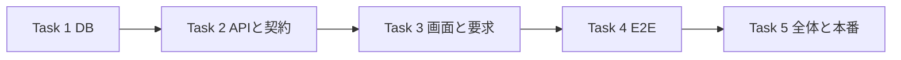

# グループ G-0 権限設定 実装計画

> **For agentic workers:** REQUIRED SUB-SKILL: Use superpowers:subagent-driven-development (recommended) or superpowers:executing-plans to implement this plan task-by-task. Steps use checkbox (`- [ ]`) syntax for tracking.

**Goal:** 店長が「権限」画面で既存の店長・サポーターの許可を分野別に切り替え、権限管理・利用者管理の店長固定、昇格とロックアウトの防止、変更・履歴の同時保存をDBでも保証する。

**Architecture:** 既存の `user_roles → roles → role_permissions → permissions` を認可の正本として使う。非公開の `private.admin_set_role_permissions` が役割単位で管理対象30コードだけを一括置換し、版の照合・再送判定・差分イベントを同じ取引で確定する。既存の利用者役割変更も専用関数で安全に更新し、設定メニューから独立した `/admin/settings/permissions` を開く。

**Tech Stack:** 現行の Next.js `^16.3.6`、React `^19.0.0`、TypeScript `^5`、Supabase Postgres 17、Zod `^4.3.6`、Jest、React Testing Library、Playwright。依存を増やさない。

**Spec:** [承認済みG設計](../specs/2026-10-23-group-g-design.md)の D29・8-1・9章・13章・14章。[現状調査8章](../specs/2026-10-23-group-g-research/facts.md)は入口の索引とし、実装時は以下の実コードも読む。形式は[波2計画](2026-10-23-launch-fixes-wave2.md)に合わせる。

## 概要

| Task | 中身 | 移行 | 新しい FREQ | 新しい E2E |
|---|---|---|---|---|
| 1 | 30コードの初期値、固定2権限、追記履歴、役割変更とDBの守り | 1本（`group_g0_permissions`） | 519・540のG-0部分 | FR-ADMIN-109・123のDB側 |
| 2 | 型・store・GET/POST・既存役割変更PATCH・操作監査 | — | 同上 | 同上のAPI側 |
| 3 | 「権限」画面・設定メニュー・要求と設計の追従 | — | 同上 | 同上の画面側 |
| 4 | E2E作成・実行（実行はcontroller） | — | — | FR-ADMIN-109・123 |
| 5 | 全体の確かめ・最終レビュー・本番前の読み取り・push・本番適用・改名 | — | — | — |

**決めたこと（ruling）**

- G-0だけを実装する。新しい役割・役割割当画面・注文/在庫/発注/発送票の画面は作らない。店長=`admin`、サポーター=`supporter`。一般利用者=`user`は権限表の編集対象にしない。既存の `PATCH /api/admin/users` の昇格/自己変更/最後の店長の保護はG-0に含める。
- 保存はcontroller指定の **`POST /api/admin/role-permissions`**。設計8-3のPUT案より今回の裁定を優先し、確認済みの変更をrequestKey付きで実行する一つの窓口に統一するため。GETは案どおり **`GET /api/admin/permissions`**。互換用PUTは作らず、設計のHTTPメソッド欄は今回の修正対象にしない。
- 1回の保存は1役割について管理対象30コード内の許可一覧全体。GET/保存結果も30コード内だけで、対象外の付与は返さず、削除も変更もしない。画面では1つのトグルを確認し、その1差分を反映した一覧を送る。複数差分のRPC呼出しも全体成功または全体取消。画面全体の一括保存や自動付与は作らない。
- 移行は1本にまとめる。コードの登録・初期付与・版・関数・直接更新の禁止が同時に有効になる必要があり、種データだけ別に適用する利点がないため。G-0の初期値合わせはこの移行で一度だけ行い、後続移行から再実行しない。
- 同時編集は `roles.permissions_version`、再送は `private.role_permission_requests` で管理する。差分ゼロの保存も受付記録を残す。イベントだけで再送を判定すると、差分ゼロと同キー異入力を判別できないため。
- `admin.permissions.manage`・`admin.users.manage`の2行は **「店長のみ・変更不可」** とし、両役割ともスイッチを置かない。DB関数とrole_permissions行トリガーでも店長からの解除・他役割への追加を拒否する。Shopify S9の「ユーザー/役割管理は付与可能な権限ではない」を根拠とし、今回オンライン再調査はしない。
- G-0では発送2コードも登録・初期付与・設定保存する。旧発送4RPCの停止はG-1、在庫窓口の新権限への切替はG-2、発送票窓口での発送権限の強制はG-3。FR-ADMIN-109での「発送権限の切替」はG-0では保存と再読込までを指す。旧発送・在庫APIをG-0で新コードへ切り替えない。
- 既存APIの認可はDB ACLを毎回読む（`src/lib/auth/admin-rbac.ts:102-153,156-245`）。`legacyPermissionMap`は初期値との整合確認専用。既存管理メニューの表示は許可一覧ではなく役割名で決まるため、画面に短い注記を出し、この境界をオーナーへの報告にも含める。既存管理画面全体のナビは作り直さない。
- DBの `has_permission` にはadmin/supporterの固定許可が残る（`20260901102912_remote_schema.sql:1762-1806`）。既存RLSでも解除を反映させるため、この関数の固定許可をDB ACL照会へ統一する。役割名だけで許可する枝を残さない。新業務のDB窓口の認可は各後続段階で追加する。

## Global Constraints

- 今回の文書改訂は本ファイルと設計書の裁定1関連箇所・改訂記録1行だけ。コード・その他文書・Graphify出力を変更せず、コミットしない。`.env*`を読まず、DB・E2E・Docker・ネットワークを実行しない。以下の実行手順は将来の実装用である。
- 実装はmaster。実装者はコミットせず、controllerが各TaskのFilesだけを確認・コミットする。現在の `.claude/CLAUDE.md`・`package.json`・`.superpowers/` の差分は保持する。ブランチ・worktreeを作らない。
- 適用済み移行は変更しない。新規移行は実装時のUTC実時刻で `supabase/migrations/<ts>_group_g0_permissions.sql`（現時点の末尾 `20261023082752` より後）。ローカルCLIの `migration new --help` を確認して作成し、UTF-8・BOMなし・LF、`BEGIN;`〜`COMMIT;`、最後に `NOTIFY pgrst, 'reload schema';`。
- `SECURITY DEFINER`本体はprivate schema、所有者`postgres`、`SET search_path = ''`、参照は完全修飾。公開RPC入口はservice_role専用。ブラウザにservice_roleの鍵を渡さない。
- 認可はDB ACL・active session・`aal2`。新APIは毎回 `authorizeAdminPermission('admin.permissions.manage', request)` を呼ぶ。POSTは認可→CSRF→IP/actorの回数制限→検証→RPC→操作監査の順。
- 秘密値・トークン・メール本文・住所・電話・署名URL・Storageキー・生のDBエラーをログ/エラー/報告へ出さない。今回 `.env*` の参照や接続設定の探索はしない。
- 文言・コード・列・応答は以下の値を使う。画面は値を文字として表示する。共通UI変更はSwitchToggleへの後方互換な`ariaLabel?: string`追加だけを許可する。Dialog・Button・BannerAlertは変更しない。
- 画面幅は390/768/1280px。画面全体は横にはみ出さず、権限表の見出しを持つスクロール領域内だけを横スクロールさせる。
- 実装前に該当の `node_modules/next/dist/docs/` を読む。単体は `npx.cmd jest <path> --runInBand`、型は `npx.cmd tsc --noEmit --incremental false`。単体・型の成功を実DB/ブラウザ/本番の証明としない。
- 単体は実装者、db reset・DB結合/別接続競合・本番ビルド・E2E・最終レビュー・push・本番適用はcontroller。RED/GREENの実数とskip/未確認の境界を報告する。コード変更後の `graphify update .` は将来のcontroller作業に含める。

## Review Focus

- ロックアウト: 固定2権限を解除できず、最後の有効な店長の除去はLAST_ADMIN_REQUIRED・409、自己役割変更も拒否すること → Task 1のDB/別接続試験、Task 2のPATCH単体、Task 3の直URL試験。
- サポーターの昇格: actor差替え、直接RPC、user_roles直接書込み、固定2権限の付与でも店長になれないこと → Task 1のDB拒否と行トリガー、Task 2の認可試験。
- 再送: 同キー同入力は元の結果を返し、差分ゼロでも記録され、途中の別変更を巻き戻さない。同キー異入力は409 → Task 1の受付記録試験、Task 3の通信失敗後の再送試験。
- 同時編集: 同じ版を見た2人の後勝ち上書きを避ける。勝者1件・409が1件、競合側は再読込してから再確認すること → Task 1の別接続試験、Task 3の409試験。
- 監査の欠落: grant/revokeの全差分がactor・時刻・要求キー付きで同時保存され、イベント追記失敗は全取消。UPDATE/DELETE/TRUNCATEも拒否 → Task 1のrollback/追記拒否、Task 2の操作監査試験。

---

### Task 1: 権限の初期値と、変更・履歴を一括保存するDBの入口

**Files:**
- Create: `supabase/migrations/<ts>_group_g0_permissions.sql`
- Test: `tests/integration/db/role_permissions.integration.test.ts`、`tests/integration/db/role_permissions_concurrency.integration.test.ts`（共に新規）
- Read: `supabase/migrations/20260901102912_remote_schema.sql:773-865,1005-1015,1762-1806,3679-3682,3737-3745,3798-3812,4186-4198,4224`、`20260921011535_harden_security_definer_search_path.sql:64-92`、`20261023061453_audit_read_permission.sql`、`20260919065355_add_stock_movements.sql:45-90`、`tests/integration/db/helpers/local-db.ts`、`tests/integration/db/audit_read_permission.integration.test.ts:19-22`

**Interfaces:**
- Produces: `private.admin_get_permissions(_actor_id uuid) RETURNS jsonb`、同じ引数/戻り値の `public.admin_get_permissions`。
- Produces: `private.admin_set_role_permissions(_actor_id uuid, _role_code text, _permission_codes text[], _expected_version bigint, _request_key uuid) RETURNS jsonb`、同じ引数/戻り値の `public.admin_set_role_permissions`。
- Produces: `private.admin_set_user_role(_actor_id uuid, _user_id uuid, _role_code text) RETURNS jsonb`、同じ引数/戻り値の `public.admin_set_user_role`。戻り値は`{ previousRole: string, role: 'admin'|'supporter'|'user' }`。
- 公開入口は `LANGUAGE sql SECURITY INVOKER SET search_path = ''` の委譲だけ。本体3本は `SECURITY DEFINER`。6本とも所有者postgres、EXECUTEをPUBLIC/anon/authenticatedから剥がしてservice_roleだけへ付ける。privateのUSAGEはservice_roleへ付け、PUBLIC/anon/authenticatedには付けない。
- GETのDB戻り値: `{ permissionCodes: string[], roles: [{ code: 'admin'|'supporter', version: string, permissionCodes: string[] }] }`。トップのpermissionCodesは全30、各役割の一覧はその30内の付与だけ。役割順admin→supporter、コードは辞書順、versionはbigintの10進文字列。同一SQL文のスナップショットで読む。
- 保存のDB戻り値: `{ role: { code, version, permissionCodes }, changedCount: number }`。コード一覧・差分件数・受付resultは30コード内だけ。保存直後の値を受付記録に入れ、同じ再送ではこの結果をそのまま返す。

**値（全30コード・初期値・表示順）**

以下の「操作」はTask 2の表示ラベルにも使う。店長は全行可。サポーターは「可」の8行だけ。一般利用者の上表30コードの付与は0件。既存20コードのIDを再利用し、新規10コードだけを追加する。

| 分野 | 操作 | permission code | 種別 | サポーター |
|---|---|---|---|---|
| 利用者 | 利用者の閲覧 | `admin.users.read` | 既存 | 可 |
| 利用者 | 利用者の管理 | `admin.users.manage` | 既存・固定 | 不可 |
| 商品 | 商品の閲覧 | `admin.items.read` | 既存 | 不可 |
| 商品 | 商品の管理 | `admin.items.manage` | 既存 | 不可 |
| お知らせ | お知らせの閲覧 | `admin.news.read` | 既存 | 不可 |
| お知らせ | お知らせの管理 | `admin.news.manage` | 既存 | 不可 |
| LOOK | LOOKの閲覧 | `admin.looks.read` | 既存 | 不可 |
| LOOK | LOOKの管理 | `admin.looks.manage` | 既存 | 不可 |
| 取扱店 | 取扱店の閲覧 | `admin.stockists.read` | 既存 | 不可 |
| 取扱店 | 取扱店の管理 | `admin.stockists.manage` | 既存 | 不可 |
| 注文 | 注文一覧・詳細・CSV・履歴・要対応の閲覧 | `admin.orders.read` | 既存 | 可 |
| 注文 | 未入金取消・取消申請審査・要確認解消・メール再送 | `admin.orders.manage` | 既存 | 可 |
| 問い合わせ | 問い合わせの閲覧 | `admin.contact.read` | 既存 | 可 |
| 問い合わせ | 問い合わせの管理 | `admin.contact.manage` | 既存 | 可 |
| 会計 | 会計の閲覧 | `admin.finance.read` | 既存 | 不可 |
| 会計 | 会計の管理 | `admin.finance.manage` | 既存 | 不可 |
| 監査 | 監査の閲覧 | `admin.audit.read` | 既存 | 不可 |
| 注文 | 返金・返金再試行・金額決定 | `admin.orders.refund` | 既存 | 不可 |
| ショップ設定 | ショップ設定 | `admin.settings.manage` | 既存 | 不可 |
| 注文 | 返品作成・審査・受取・検品・取消・開き直し・金額相談 | `admin.orders.return` | 既存 | 可 |
| 在庫 | 在庫一覧 | `admin.stock.read` | 新規 | 不可 |
| 在庫 | 入荷・棚卸・割当強制解除 | `admin.stock.manage` | 新規 | 不可 |
| 注文 | 割り当てを入れ替える | `admin.orders.allocate` | 新規 | 不可 |
| 発注 | 発注一覧・発注書・取引添付の閲覧/取得 | `admin.purchase_orders.read` | 新規 | 不可 |
| 発注 | 発注入力/確認/確定・数量/単価訂正・添付追加・打切り/再確定 | `admin.purchase_orders.manage` | 新規 | 不可 |
| 受け取り | 全部/一部受取・受取取消/訂正 | `admin.receiving.manage` | 新規 | 不可 |
| 発送 | 荷作り・発送票閲覧 | `admin.shipping.read` | 新規 | 可 |
| 発送 | 票の下書き/品物選択・発送・伝票訂正・手動配達済み・発送取消 | `admin.shipping.manage` | 新規 | 可 |
| 発送 | 確定後の出荷日訂正 | `admin.shipping.correct_date` | 新規 | 不可 |
| 権限管理 | 権限設定の閲覧・保存 | `admin.permissions.manage` | 新規・固定 | 不可 |

表示は分野を表の初出順でまとめ、同分野内はこの表の順。既存permissionのnameは変えず、新規permissionのnameには上表の操作ラベルを入れる。

**移行の中身**

- 既存のroles/permissions/role_permissionsは作り直さない。空のローカルresetにも備え、既存3コードのrolesが欠ける場合だけ `('admin','店長'),('supporter','サポーター'),('user','一般利用者')` を `ON CONFLICT (code) DO NOTHING` で補う。既存のname/IDは変えない。
- roles/permissionsの補完と初期付与の照合だけを、各1行の`-- BEGIN G0_PERMISSION_SEED_RECONCILE`と`-- END G0_PERMISSION_SEED_RECONCILE`で囲む。表/列/関数/トリガーのDDLは範囲外に置き、固定コード保護トリガーの作成はこの範囲の後。DB結合は`/^-- BEGIN G0_PERMISSION_SEED_RECONCILE\n([\s\S]*?)^-- END G0_PERMISSION_SEED_RECONCILE$/m`で中身だけ抽出してBEGIN/ROLLBACK内で実行する（K-3試験の抽出方式）。
- permissionsは上表の不足行を `ON CONFLICT (code) DO NOTHING` で補う。初期付与はadmin=全30、supporter=指定8、user=0へ一度合わせる。DELETEの条件は**role.code IN ('admin','supporter','user') AND permission.code IN (上表30コード) AND 初期値に無い組合せ**だけ。付ける行は `ON CONFLICT DO NOTHING`。他役割・30コード外の付与は保持する。初期構築は操作イベントに混ぜない。差分件数はTask 5で提示する。
- `public.roles.permissions_version bigint NOT NULL DEFAULT 0 CHECK (permissions_version >= 0)` を追加。成功した差分ありの保存だけ対象役割の版を1増やす。差分ゼロでは版を増やさない。
- `public.role_permission_events`: `id uuid PRIMARY KEY DEFAULT gen_random_uuid()`、`role text NOT NULL CHECK (role IN ('admin','supporter'))`、`permission_code text NOT NULL`、`action text NOT NULL CHECK (action IN ('grant','revoke'))`、`actor_id uuid NOT NULL`、`created_at timestamptz NOT NULL DEFAULT now()`、`request_key uuid NOT NULL`。`UNIQUE(request_key, role, permission_code)`、索引`(role, created_at, id)`。履歴のrole/code/actorは写しとして保持し、削除時に書き換わるFKを作らない。
- `private.role_permission_requests`: `request_key uuid PRIMARY KEY`、`actor_id uuid NOT NULL`、`role text NOT NULL`（同じ2役割のCHECK）、`permission_codes text[] NOT NULL`、`expected_version bigint NOT NULL CHECK (expected_version >= 0)`、`result jsonb NOT NULL`、`created_at timestamptz NOT NULL DEFAULT now()`。配列は重複を入力拒否した後に辞書順で保存し、配列順の違いは同入力と扱う。actor/role/一覧/expected_versionのいずれかが違う同キーは拒否。
- `private.reject_role_permission_mutation() RETURNS trigger` は固定エラー `ROLE_PERMISSION_IMMUTABLE`（SQLSTATE `55000`）を返す。両記録表に `<table>_no_update`・`<table>_no_delete` のBEFORE行トリガー、`<table>_no_truncate` のBEFORE文トリガーを付ける。同関数は所有者postgres・空search_path、PUBLIC/anon/authenticated/service_roleのEXECUTEを剥がす。所有者による通常SQLも拒否し、トリガー無効化まで防ぐとは扱わない。
- 両記録表はRLS有効、anon/authenticatedのrestrictive deny-all policy。PUBLIC/anon/authenticated/service_roleからALLをREVOKEし、service_roleにはSELECTだけ付け直す。UUIDを使うので新規sequenceはない。
- roles/permissions/role_permissionsもRLSを維持し、PUBLIC/anon/authenticated/service_roleの既存表権限を剥がしてservice_roleにSELECTだけ付け直す。既存の3本の `acl ... readable` policyは削除する。roles/permissionsのsequenceも同4者の権限を剥がす。これら3表の通常のservice_role直接INSERT/UPDATE/DELETE/TRUNCATEは許可しない。
- `REVOKE ALL ON TABLE public.user_roles FROM anon, authenticated;` のあと `GRANT SELECT ON TABLE public.user_roles TO authenticated;` で読む権限だけを戻す（TRUNCATE・TRIGGER・REFERENCES・MAINTAIN も残さない）。あわせて、`acl user_roles managed insert`・`acl user_roles managed update`・`acl user_roles managed delete`の3policyを削除する（基底schema:3798-3812,4224）。`user_roles`に対するservice_roleの既存権限とauthenticatedの既存SELECT契約は維持する。
- `private.guard_fixed_role_permissions() RETURNS trigger`（所有者postgres・SECURITY DEFINER・空search_path、PUBLIC/anon/authenticated/service_roleからEXECUTE剥奪）を作り、`role_permissions_fixed_guard`を`BEFORE INSERT OR UPDATE OR DELETE ON public.role_permissions FOR EACH ROW`で登録する。固定集合は`['admin.users.manage','admin.permissions.manage']`。OLDが店長の固定付与で、削除または別のrole/permissionへの更新なら`ROLE_PERMISSION_FIXED`・42501。NEWが店長以外の固定付与なら同エラー。正当な固定行への同値UPDATEは許可する。将来の移行を含むpostgresの通常DMLにも効かせる。
- `public.has_permission(permission_code text) RETURNS boolean` は既存の最新定義（基底schema＋search_path硬化移行）を基に、auth.uid()の有効なuser_roles（active、expires_atがNULLまたは未来）から当該コードを持つかだけを返す。uidなしはfalse。固定roleの許可を削除し、現在の`search_path = public, pg_temp`を空へ変更する。既存の所有者・STABLE・SECURITY DEFINER・EXECUTE（authenticated/service_role、anon不可）は維持する。

**保存関数の順序と拒否（本体は試験から実装する）**

1. `pg_catalog.pg_advisory_xact_lock(190519, 0)` で権限編集を直列化する。権限保存と既存利用者の役割変更の2窓口で共用する。
2. actorの有効なadminのuser_rolesと、そのadminにある`admin.permissions.manage`をDBで確認する。GET本体も同条件。app_metadata、legacy map、他役割の付与だけでは許可しない。
3. NULL・不明role・NULL要素・不明コード・重複コード・負の版を検証する。target roleがuserなら先に`ROLE_PERMISSION_ARGUMENT_INVALID`。登録済みでも30コード外は受け付けない。adminの一覧に固定2コードのいずれかが無い、またはsupporterの一覧にいずれかがある要求は`ROLE_PERMISSION_FIXED`で全体拒否する。
4. 受付記録に同キーがあれば全入力を比較し、一致すれば保存済みresultを返す。版比較より先に行い、別の保存が進んだ後の再送で巻き戻さない。
5. 対象roles行をFOR UPDATEで読み、expected_versionが違えば拒否。差分はその役割の30コード内だけで求める。role_permissionsのDELETE/INSERT・1差分1イベント・版更新・受付記録INSERTを1取引で行い、30コード外には触れない。どれかの失敗で全部rollbackする。

**既存利用者の役割変更（同じ移行）**

- `admin_set_user_role`は同じ`pg_advisory_xact_lock(190519, 0)`を先に取り、有効なadminのactorと`admin.users.manage`を再検証する。対象は既存のadmin/supporter/user、対象auth.users行をFOR UPDATEで読む。対象なしは`USER_NOT_FOUND`・P0002。
- 有効な店長は`user_roles.active = true AND (expires_at IS NULL OR expires_at > now())`で数える。変更後に0人なら`LAST_ADMIN_REQUIRED`・P0001（409）。その次に`_actor_id = _user_id`なら、同じ役割への要求も`SELF_ROLE_CHANGE_FORBIDDEN`・42501（403）。両条件に該当する最後の店長の自己降格はLAST_ADMIN_REQUIREDを優先する。
- 許可された変更は、対象利用者の現行user_rolesを無効化→指定roleをactive/期限NULLでupsert（assigned_by=actor、assigned_at=now()）→`auth.users.raw_app_meta_data`の`role`だけをjsonbで置換（他キー保持、updated_at=now()）する1取引。ACLまたはmetadata更新の失敗は全rollback。既存PATCHのAuth Admin API更新と別々のACL書込みをこのRPC1回へ置き換え、途中状態を残さない。新しい役割割当UIは作らない。

| DBの拒否シンボル | SQLSTATE | APIでの扱い |
|---|---|---|
| `ROLE_PERMISSION_ARGUMENT_INVALID` | `22023` | 400 |
| `ROLE_PERMISSION_FORBIDDEN` | `42501` | 403 |
| `ROLE_PERMISSION_FIXED` | `42501` | 403 |
| `ROLE_PERMISSION_VERSION_CONFLICT` | `P0001` | 409 |
| `ROLE_PERMISSION_REQUEST_KEY_CONFLICT` | `P0001` | 409 |
| `LAST_ADMIN_REQUIRED` | `P0001` | 409（既存users PATCH） |
| `SELF_ROLE_CHANGE_FORBIDDEN` | `42501` | 403（既存users PATCH） |
| `USER_NOT_FOUND` | `P0002` | 404（既存users PATCH） |

- [ ] **Step 1: DB結合の失敗する試験を書く。** `describeLocalDb`を使い、通常ケースはBEGIN/ROLLBACK。並行ファイルはbeforeAllでpostgres接続から変更対象のACL/版を退避し、afterAllで同じpostgres接続から差分で必ず復元する（固定2行は維持、失敗時もfinallyで接続を閉じる）。役割変更試験で変えたuser_roles/metadataも退避・復元し、他の有効adminが人数試験へ混ざらないようfixtureを隔離する。イベント/受付記録は削除せずrequest_keyで絞る。版は取得時の`startVersion`を使い、変更成功後は`expect(BigInt(saved.version)).toBe(BigInt(startVersion) + 1n)`。次表のtest名と期待を固定する。

| test名 | 入力と期待するassertion |
|---|---|
| `seeds the complete G0 matrix` | rolesの旧nameをadmin=`Administrator`、supporter=`Support`、user=`User`にし、既存role/permission IDを退避。supporterへ`admin.items.read`、userへ`admin.orders.read`、3役割へ30外の`test.g0.preserved`、別role=`test_g0_other`へ`admin.items.read`を付与。固定guardをfixture準備中だけ無効化してsupporter/userへの旧固定付与も用意し、seed実行前に再有効化する（全てBEGIN/ROLLBACK内）。抽出seedだけの実行後、30内はadmin30/supporter8/user0、旧name/ID不変、30外と別roleの付与保持、固定2コードは店長だけと比較する |
| `keeps permission management fixed` | 固定2コードをeachで検証。店長から解除→`{ message: 'ROLE_PERMISSION_FIXED', code: '42501' }`、supporterへ付与→同FIXED、target role user→`{ message: 'ROLE_PERMISSION_ARGUMENT_INVALID', code: '22023' }`。各要求前後のACL・版・イベント・受付記録は同一 |
| `protects fixed grants from future DML` | postgresの通常SQLで固定行DELETE/role・permissionのUPDATE、他roleへのINSERT/UPDATE→FIXED・42501。店長の同値UPDATEは成功。両固定コードをeachで検証 |
| `preserves grants outside the G0 catalog` | admin/supporterの30外付与を用意し、GET/保存結果/受付resultに含まれないこと、30内を一括変更しても30外の行が同一であることを比較 |
| `checks active admin ACL in the function` | supporter/user/期限切れadmin/無効admin/固定コードなしのactor→`ROLE_PERMISSION_FORBIDDEN`。固定コード欠落の異常fixtureもpostgresが同guardを準備中だけ無効化し、呼出し前に再有効化する取引内で作る。service_role専用RPCでもactorの有効ACLを検証する |
| `records every diff atomically` | supporterのshipping.read/manageを同時解除→`changedCount=2`、版はstartVersion+1、`action='revoke'`が2件、同actor/request_key、created_at非NULL。戻すとgrantが2件・版はstartVersion+2 |
| `replays without restoring stale ACL` | 同キー同入力は`expect(replay).toEqual(first)`、イベント/受付記録は増えない。別キーで次の変更後も元の再送は元結果を返し、最新ACLは変わらない |
| `records no-op and rejects key reuse` | 差分ゼロは`changedCount=0`・版不変・受付1件。配列順違いの再送も同結果。同キーのactor/role/コード/期待版変更はkey conflict |
| `rolls back when event insertion fails` | 試験用の追記拒否トリガーを取引内に置き、2差分保存を失敗させる。ACL・版・イベント・受付記録は全て元どおり |
| `denies direct access and mutation` | anon/authenticatedは表読書き・public/private RPC不可、service_roleはSELECT/RPCのみ。postgresの通常UPDATE/DELETE/TRUNCATEは両記録表とも`55000`。service_roleにも取引内だけDMLを仮付与してトリガー拒否を確認 |
| `uses ACL instead of role shortcuts in RLS` | authenticatedのJWT subを有効ACL利用者に設定。adminでも解除した`admin.items.manage`はfalse、supporterの`admin.orders.read`も解除後false、付け直すとtrue。無効/期限切れはfalse |
| `serializes stale edits and duplicate requests` | Aで共通ロックを保持しBの待ちをpg_locksで確認してcommit。同じstartVersionの別キーは`['saved','ROLE_PERMISSION_VERSION_CONFLICT']`、勝者の差分1組・最終版startVersion+1。逆順も成立。同キー同入力はsaved2件・イベント1組・受付1件・版startVersion+1、異入力はsaved1件とkey conflict1件。afterAllで元のACL/版へ復元 |
| `blocks supporter escalation through user_roles` | supporterのJWT subを設定しSET LOCAL ROLE authenticatedで自分のadmin割当INSERT・role_id/active UPDATE・他者のACL DELETEを試し全て42501。anonも同じ拒否。anon/authenticated に TRUNCATE・TRIGGER・REFERENCES の権限が無く、authenticated には SELECT だけがあることを has_table_privilege で確認。service_roleのINSERT/UPDATE/DELETE権限は残ることをhas_table_privilegeで確認 |
| `keeps at least one active admin and rejects self changes` | 有効admin1人の自己降格→`LAST_ADMIN_REQUIRED`・P0001、2人なら自己役割変更→`SELF_ROLE_CHANGE_FORBIDDEN`・42501（同role要求も拒否）。無効/期限切れadminを人数に含めない。別接続の相互降格後も有効admin>=1、拒否時のmetadata/ACL不変 |
| `updates user role and metadata atomically` | 別人の正当な役割変更でACLとraw_app_meta_data.roleが同時更新、他のmetadataキーは保持。試験用失敗で両方rollback |
| `retains the actor after account deletion` | 保存後に試験actorを削除してもイベントと受付記録のactor_idは同じUUID。履歴のUPDATEを伴わず削除が成立する |

- [ ] **Step 2（controller）: 既存DBへ接続せず、使い捨てローカルDBでREDを記録する。** `npx.cmd jest tests/integration/db/role_permissions.integration.test.ts tests/integration/db/role_permissions_concurrency.integration.test.ts --runInBand`。新関数/列なしの失敗を確認する。接続不可やskipをREDと数えない。
- [ ] **Step 3: 上記契約の移行1本を書く。** 初期値・表・権限・関数を同じ移行で定義する。後続で再利用する初期付与用の公開関数は作らない。
- [ ] **Step 4（controller）: db reset後にGREENと既存回帰を確認する。** 新規2ファイルと `audit_read_permission.integration.test.ts`・`order_refund_records.integration.test.ts`・`order_return_records.integration.test.ts` を同コマンドで流し、grants変更後も既存のfixtureと認可が動くことを確かめる。has_permissionを使う既存RLSのDB結合も、`npx.cmd jest tests/integration/db --runInBand`で確認する。成功/失敗/skip実数を残す。
- [ ] **Step 5（controller）: 対象ファイルだけコミットする。** `feat(admin): 権限の初期値と変更の追記履歴をDBで保証する（G-0）`

### Task 2: 権限の取得・保存API、既存役割変更と操作監査

**Files:**
- Create: `src/lib/auth/role-permission-types.ts`、`src/lib/auth/role-permission-catalog.ts`、`src/lib/auth/role-permission-store.ts`
- Create: `src/app/api/admin/permissions/route.ts`、`src/app/api/admin/role-permissions/route.ts`
- Modify: `src/lib/auth/admin-rbac.ts:6-84`（PermissionCodeとlegacyPermissionMapだけ）
- Modify: `src/app/api/admin/users/route.ts:171-366`（既存PATCHの役割変更だけ）
- Test: `tests/unit/lib/auth/role-permission-catalog.test.ts`、`tests/unit/lib/auth/role-permission-store.test.ts`、`tests/unit/api/admin/permissions-route.test.ts`、`tests/unit/api/admin/role-permissions-route.test.ts`、`tests/unit/api/admin/users-route.test.ts`（新規）、`tests/unit/lib/auth/admin-rbac.test.ts`（追加）
- Read: `src/app/api/admin/settings/shop/route.ts:221-265`、`src/lib/csrfMiddleware.ts`、`src/lib/audit.ts`、Next.jsローカルguide `01-app/01-getting-started/15-route-handlers.md`

**Interfaces:**
- Consumes: Task 1のpublic RPC3本。actorIdは認可済み`authz.userId`だけから渡す。
- Produces（types）: `PermissionRole = 'admin' | 'supporter'`、`PermissionRoleState = { code: PermissionRole; label: string; version: string; permissionCodes: PermissionCode[] }`、`PermissionDefinition = { code: PermissionCode; area: string; label: string; requires: PermissionCode[]; fixed: boolean; upcoming: boolean }`。
- Produces（types）: `PermissionsMatrix = { permissions: PermissionDefinition[]; roles: PermissionRoleState[] }`、`RolePermissionChange = { roleCode: PermissionRole; permissionCodes: PermissionCode[]; expectedVersion: string; requestKey: string }`、`RolePermissionChangeResult = { role: PermissionRoleState; changedCount: number }`。
- Produces（catalog）: `FIXED_PERMISSION_CODES = ['admin.users.manage', 'admin.permissions.manage'] as const`、`ROLE_PERMISSION_CATALOG: readonly PermissionDefinition[]`、`getMissingPermissionDependencies(permissionCodes: readonly PermissionCode[]): PermissionCode[]`（足りないコードを重複なし・辞書順で返す）。Task 1の表だけを定義元とする。
- Produces（store）: `getPermissionsMatrix(client: SupabaseClient, actorId: string): Promise<PermissionsMatrix>`、`setRolePermissions(client: SupabaseClient, actorId: string, change: RolePermissionChange): Promise<RolePermissionChangeResult>`。`SupabaseClient`は既存`@supabase/supabase-js`の型。RPCのsnake_case引数に変換し、戻り値を検証して表示定義/role labelを付ける。
- Produces（同store）: `setUserRole(client: SupabaseClient, actorId: string, userId: string, role: AppRole): Promise<{ previousRole: string; role: AppRole }>`（AppRoleは既存admin-rbacからtype import）。`admin_set_user_role`に`_actor_id/_user_id/_role_code`を渡す。
- Produces（store）: `RolePermissionStoreError extends Error`、`code: string | null`。PostgRESTエラーの**message全文とSQLSTATEのcodeの組がTask 1の表に完全一致**する場合だけ業務拒否へ変換する。substring/前方一致/SQLSTATEだけでは分類せず、未知の組と不正な戻り値は内部失敗。生のmessage/details/hintをrouteへ渡さない。
- Produces（routes）: `GET(request: Request): Promise<Response>`、`POST(request: Request): Promise<Response>`。成功は200の`{ data: PermissionsMatrix }` / `{ data: RolePermissionChangeResult }`。全応答を`Cache-Control: no-store`にする。
- Produces（既存route）: `PATCH(request: Request): Promise<Response>`。既存本文`{ userId: UUID, role: 'admin'|'supporter'|'user' }`・成功200`{ success: true }`・対象なし404`{ error: 'User not found' }`を維持し、新規の自己変更/最後の店長拒否だけ下表のcode付き本文にする。

**値**

- `PermissionCode`にTask 1の新10コードを追加する。legacy mapのadminは30、supporterは既存6＋shipping.read/manageの8、userは0。authorize本体をlegacy map参照へ変えない。固定権限はDB不整合の救済としてアプリ側で足さない。
- catalogのlabel/area/順はTask 1の表。fixedは固定2コードだけtrue。upcomingは新規10のうち`admin.permissions.manage`を除く9件だけtrue。GET/storeの全コード一覧・各役割一覧・保存結果は30コード内だけ。
- requiresは `admin.stock.manage → [admin.stock.read]`、`admin.orders.allocate → [admin.orders.read]`、`admin.purchase_orders.manage → [admin.purchase_orders.read]`、`admin.receiving.manage → [admin.purchase_orders.read]`、`admin.shipping.read → [admin.orders.read]`、`admin.shipping.manage → [admin.shipping.read, admin.orders.manage, admin.orders.read]`、`admin.shipping.correct_date → [admin.shipping.read, admin.orders.read]`。他は`[]`。不足を表示するが保存を拒否せず、自動で閲覧権限を付けない。新業務窓口では設計9-2の全コードANDを各段階で検証する。
- POST本文は`RolePermissionChange`の4フィールドだけ（Zod strict）。requestKeyはUUID、roleは既存2値、permissionCodesは0〜30要素・登録済み・重複なし、expectedVersionは`0`または先頭ゼロなしの10進文字列でbigint最大`9223372036854775807`以下。actor/role ID/任意のpermission名を受け取らない。
- CSRFは `const csrfResult = await requireCsrfOrDeny(); if (csrfResult instanceof Response) return csrfResult;` の判定。undefinedと旧成功オブジェクトは通す。応答にはno-storeを付けるが本文/ステータスは変えない。
- 回数制限は`enforceRateLimit`を`@/features/auth/middleware/rateLimit`からimportする。POSTは `endpoint: 'admin:role-permissions:update', limit: 30, windowSeconds: 600`、既存PATCHは`endpoint: 'admin:users:role-update', limit: 30, windowSeconds: 600`。各々IP、次に`subject: authz.userId`の2回。拒否応答をそのまま返し、RPCを呼ばない。
- PATCHも`authorizeAdminPermission('admin.users.manage', request)`→同じCSRF判定→IP/actor制限→既存本文検証→`setUserRole`→既存action`admin.users.role.update`の操作監査の順。新RPCが最後の店長/自己変更を検証する前にAuth metadataを変えない。GET /api/admin/usersの投影は変更しない。

| 条件/code | status | 新APIのerror本文・画面に使う文 |
|---|---|---|
| 不正JSON/strict違反/`ROLE_PERMISSION_ARGUMENT_INVALID` | 400 | `入力を確かめてください。` |
| `ROLE_PERMISSION_FORBIDDEN` | 403 | `権限を変更する権限がありません。` |
| `ROLE_PERMISSION_FIXED` | 403 | `権限管理と利用者管理は店長のみ・変更不可です。` |
| `LAST_ADMIN_REQUIRED` | 409 | `店長を1人以上残してください。` |
| `SELF_ROLE_CHANGE_FORBIDDEN` | 403 | `自分自身の役割は変更できません。` |
| `ROLE_PERMISSION_VERSION_CONFLICT` | 409 | `ほかの人が権限を変更しました。現在の設定を読み直してください。` |
| `ROLE_PERMISSION_REQUEST_KEY_CONFLICT` | 409 | `同じ要求番号で異なる変更は保存できません。現在の設定を読み直してください。` |
| GET内部失敗 `PERMISSION_LOAD_FAILED` | 500 | `権限を読み込めませんでした。` |
| POST内部失敗 `PERMISSION_UPDATE_FAILED` | 500 | `権限を保存できませんでした。` |

新API固有の拒否は`{ error: 上表の文, code: 上表のcode }`（不正本文のcodeも`ROLE_PERMISSION_ARGUMENT_INVALID`）。既存authorize/CSRF/rate limitの拒否は元の応答を保つ。

**操作監査**

- POSTで`logAudit`に `action: 'admin.permissions.update'`、`resource: 'role_permissions'`、`resource_id: roleCode`（検証前はnull）、`actor_id: authz.userId`、IP/UAを既存方式で渡す。actor_emailや受け取った本文全体は渡さない。
- metadataは検証済み`role_code`・`request_key`・成功時`changed_count`・`result_code`だけ。成功=`success / Role permissions saved / OK`、409=`conflict / Role permissions refused / 拒否code`、400/403=`failure / Role permissions refused / 拒否code`、内部失敗=`error / Failed to save role permissions / PERMISSION_UPDATE_FAILED`。
- 既存shop settings routeと同じく、認可失敗では即returnし`logAudit`を呼ばない。CSRF/回数制限の早期returnも監査0回。監査は認可・CSRF・制限を通過した要求から行い、未検証本文のrole/keyを監査へ入れない。監査自体の失敗で保存成功を失敗に変えない。再送で操作監査が増えても、DBの差分イベントは増えない。
- PATCHのLAST_ADMIN_REQUIREDは既存actionでoutcome=`conflict`、SELF_ROLE_CHANGE_FORBIDDENは`failure`、detail=`User role change refused`、metadataは検証済み`requested_role`と`result_code`だけ。成功時は既存`User role updated`とprevious_role/requested_roleを維持する。

- [ ] **Step 1: catalog/RBAC/storeの失敗する単体を書く。** supporterは指定8だけ、DB ACLが空ならtoken adminでも拒否、次要求ではACLを再取得。catalogは全30/固定2行、依存不足の辞書順を比較。storeのRPC引数を完全比較し、`{ message: 'ROLE_PERMISSION_FIXED', code: '42501' }`だけをFIXEDへ変換すること、同message+別SQLSTATE・同SQLSTATE+別message・余分な接頭辞/末尾付きmessageは内部失敗になることをeachで検証。30コード外はGET/保存結果へ出さない。
- [ ] **Step 2: GET/POST/PATCHの失敗する単体を書く。** GETは200/401/403/MFA/503/500。POST/PATCHはCSRF ResponseとIP/actorの429でRPC・監査0回、undefined/旧成功オブジェクトは通過。全routeで認可失敗は`expect(logAudit).not.toHaveBeenCalled()`。POSTの固定2権限/strict入力/競合をstatus/codeと比較。PATCHはsupporterの認可拒否、自分の変更403 SELF_ROLE_CHANGE_FORBIDDEN、最後の店長の自己降格409 LAST_ADMIN_REQUIRED、正常な別人変更200・RPC1回を検証し、Auth Admin API更新と直接user_roles書込みは0回。DB拒否ではACL/metadata更新が無く、409はconflict監査になることを固定する。
- [ ] **Step 3: 新規単体5ファイルと既存RBACを流してREDを確認する。** `npx.cmd jest tests/unit/lib/auth/role-permission-catalog.test.ts tests/unit/lib/auth/role-permission-store.test.ts tests/unit/api/admin/permissions-route.test.ts tests/unit/api/admin/role-permissions-route.test.ts tests/unit/api/admin/users-route.test.ts tests/unit/lib/auth/admin-rbac.test.ts --runInBand`。missing import/未定義・未実装ガードの失敗を確認する。
- [ ] **Step 4: types・catalog・storeを上記interfaceで実装する。** role labelはadmin=`店長`、supporter=`サポーター`。Task 1のRPC以外でACLを更新しない。
- [ ] **Step 5: GET/POSTと既存PATCHを上記順序・応答・監査で実装する。** GETはCSRF不要。認可/CSRF/制限の早期returnには監査を付けない。no-storeは全応答。内部エラーのconsole出力は固定の`[admin.permissions] operation failed`だけ。
- [ ] **Step 6: Step 3の単体と型を流してGREENを記録する。** 既存の `tests/unit/api/admin/shop-settings-route.test.ts` も回帰確認する。
- [ ] **Step 7（controller）: 対象ファイルだけコミットする。** `feat(admin): 権限マトリクスの取得と変更APIを追加する（G-0）`

### Task 3: 「権限」画面と設定メニュー、要求の追従

**Files:**
- Create: `src/app/admin/settings/permissions/page.tsx`、`src/components/RolePermissionsSection.tsx`
- Modify: `src/app/admin/page.tsx:1166-1168`（SETTINGSに権限への入口）、`tests/unit/components/AdminSettingsMenu.test.tsx`
- Modify: `src/components/ui/SwitchToggle/SwitchToggle.tsx`、`src/components/ui/SwitchToggle/SwitchToggle_type.ts`（ariaLabelの後方互換追加だけ）
- Test: `tests/unit/components/RolePermissionsSection.test.tsx`、`tests/unit/components/RolePermissionsPage.test.tsx`、`tests/unit/components/SwitchToggle.test.tsx`（新規）
- Docs: `docs/02_Requirements/requirements.md`、`docs/04_DetailDesign/pages/16_admin.md`、`docs/03_BasicDesign/api/route-inventory.md`
- Read: `src/components/ShopSettingsSection.tsx`、`src/components/ui/SwitchToggle/SwitchToggle.tsx`、`src/components/ui/Dialog/Dialog.tsx`、Next.jsローカルguide `01-app/01-getting-started/05-server-and-client-components.md`

**Interfaces:**
- Consumes: Task 2の型・catalog・GET/POST。読取は `clientFetch('/api/admin/permissions', { cache: 'no-store' })`。書込は`clientFetch('/api/admin/role-permissions', { method: 'POST', headers: { 'Content-Type': 'application/json' }, body: JSON.stringify(change) })`。CSRFヘッダーは既存clientFetchに任せる。
- Produces: `RolePermissionsSection(): React.JSX.Element`（Client Component）。独立pageは同部品を表示する薄いServer Component。初期取得に成功する前は表を出さず、直URLでもDB由来GETの成功を表示条件にする。メニュー非表示だけに依存しない。
- Produces: 既存`SwitchToggleProps`へ`ariaLabel?: string`を追加。`ariaLabel !== undefined`ならrole=switchのbuttonに`aria-label={ariaLabel}`を付け、label propも含めて可視テキストのspanは描画しない。未指定時は従来のlabel表示・操作を保つ。権限表はariaLabelに`${roleLabel}：${operationLabel}`を渡し、操作ラベルは表の行見出しにだけ出す。
- SETTINGSの既存ShopSettingsSectionの前に `nav aria-label="設定メニュー"` とリンク **「権限」**（href=`/admin/settings/permissions`）を置く。既存ショップ設定の見出しと操作は保つ。独立画面の **「管理画面に戻る」** は`/admin?tab=SETTINGS`。

**値（字のとおり）**

| 場所 | 文言/動作 |
|---|---|
| h1・説明 | `権限` / `役割ごとに、できる操作を設定します。` |
| メニュー表示の注記 | `管理メニューの表示は、権限の設定ではなく役割名で決まります。` |
| 表の列 | `操作`・`店長`・`サポーター`。分野見出しはTask 1の表 |
| 固定2行 | `admin.users.manage`・`admin.permissions.manage`の各行で、両役割の欄をまたいで`店長のみ・変更不可`。switchなし |
| 新業務9コードの注記 | `この権限は、対応する画面の公開後に使われます。` |
| switchのアクセシブル名 | `${roleLabel}：${operationLabel}`。例`サポーター：荷作り・発送票閲覧` |
| 依存不足 | role別に`操作に必要な権限が不足しています：${不足コードの操作ラベルを「、」で結合}。`。自動追加しない |
| 確認dialogの見出し | `権限を変更する` |
| 確認本文 | `${roleLabel}の「${operationLabel}」を${next ? '許可' : '解除'}します。変更しますか？` |
| 確認ボタン | `変更する` / `戻る` |
| 保存中の閉じる操作 | 確認/戻るボタンはdisabled。Esc・×・backdropでも閉じない。成功応答を処理してから閉じる |
| 読込/保存中 | `読み込み中...` / `保存しています...` |
| 成功（role=status） | `権限を保存しました。` |
| 読込エラーの操作 | Task 2の読込失敗文＋`再読み込み` |
| 通信例外・保存5xxの操作 | 下表の結果不明文＋`同じ変更を再送` / `現在の設定を読み直す` |
| 版/要求キー競合の操作 | 下表の該当文＋`現在の設定を読み直す`。自動再保存しない |

**拒否応答の表示優先表（code → reason → status）**

上から最初に一致する行の固定文だけを使う。既知codeが無ければ既知reason、次にstatusへ進み、body.errorや未知のreasonをそのまま表示しない。POST以外にも同じコードの表示規則を適用できる契約とする。

| 優先条件 | 想定status | 画面の日本語（字のとおり） |
|---|---|---|
| code=`ROLE_PERMISSION_FORBIDDEN` | 403 | `権限を変更する権限がありません。` |
| code=`ROLE_PERMISSION_FIXED` | 403 | `権限管理と利用者管理は店長のみ・変更不可です。` |
| code=`LAST_ADMIN_REQUIRED` | 409 | `店長を1人以上残してください。` |
| code=`SELF_ROLE_CHANGE_FORBIDDEN` | 403 | `自分自身の役割は変更できません。` |
| code=`ROLE_PERMISSION_ARGUMENT_INVALID` | 400 | `入力を確かめてください。` |
| code=`ROLE_PERMISSION_VERSION_CONFLICT` | 409 | `ほかの人が権限を変更しました。現在の設定を読み直してください。` |
| code=`ROLE_PERMISSION_REQUEST_KEY_CONFLICT` | 409 | `同じ要求番号で異なる変更は保存できません。現在の設定を読み直してください。` |
| 既知codeなし、reason=`MFA required` | 403 | `2要素認証が必要です` |
| 既知codeなし、reason=`CSRF validation failed` | 403 | `安全確認に失敗しました。ページを開き直してください。` |
| 既知code/reasonなし、status=401 | 401 | `ログインし直してください。` |
| 同、status=403（plain 403） | 403 | `アクセス権限がありません` |
| 同、status=409 | 409 | `変更が競合しました。現在の設定を読み直してください。` |
| 同、status=429 | 429 | `操作が多すぎます。しばらく待ってから、もう一度お試しください。` |
| 同、初回/再読込GETの5xx（PERMISSION_LOAD_FAILEDを含む） | 500〜599 | `権限を読み込めませんでした。` |
| 同、保存POSTの5xx（PERMISSION_UPDATE_FAILEDを含む）/通信例外 | 500〜599 | `保存結果を確認できませんでした。同じ変更を再送するか、現在の設定を読み直してください。` |
| 同、その他の4xx | 400〜499 | `入力を確かめてください。` |

- [ ] **Step 1: 画面/メニューとSwitchToggleの失敗する単体を書く。** 店長のSETTINGSに「権限」リンク、supporterはORDERだけ。直URLで403なら表なし、GET成功なら全30コード・2役割・メニュー表示の注記。固定2行はswitch0件、他は上表の名前。固定2コード以外を全解除したadminもこの画面と戻るリンクを使える。共通SwitchToggleはariaLabel指定時に`getByRole('switch', { name: 'サポーター：荷作り・発送票閲覧', exact: true })`で見つかり、label文字列はDOMに無く、未指定なら従来labelを表示する。
- [ ] **Step 2: 保存フローの失敗する単体を書く。** 確認前/「戻る」はPOST0回・値不変。「変更する」でUUIDを1回作り、読込済み一覧の1コードだけを変更して期待版付きPOST。応答を保留し、保存中のEsc・モバイル×・backdrop・戻る操作を各々試して`expect(dialog).toBeVisible()`、全switch/確認/戻るはdisabled、POSTは1回。成功後に返ったrole/版を採用して閉じ、成功文と焦点復帰。保存前のEsc/×/backdropは閉じる。
- [ ] **Step 3: 再送/競合と表示優先の失敗する単体を書く。** 結果不明は本文/キー/版を保持し、同じ変更の再送は完全同一本文、別トグル不可。版/キー競合409は再読込まで編集不可、新しい変更は新UUID/版で再確認。遅い応答は再読込を上書きしない。表示表をeachで検証し、FIXED+MFA reasonではcodeの文、未知code+CSRF reasonではreasonの文、未知code/reason+403ではplain 403の文。依存不足で閲覧コードを自動追加しない。
- [ ] **Step 4: 新規3ファイルと既存メニューの単体を流してREDを確認する。** `npx.cmd jest tests/unit/components/RolePermissionsSection.test.tsx tests/unit/components/RolePermissionsPage.test.tsx tests/unit/components/SwitchToggle.test.tsx tests/unit/components/AdminSettingsMenu.test.tsx --runInBand`。
- [ ] **Step 5: ariaLabel・部品・page・SETTINGSのリンクを上記契約で実装する。** 390/768は表内スクロール、1280は全列。table/th・分野見出し・焦点移動を保つ。Dialogは`fullScreenOnMobile`とchildrenのdisabled対応ボタンを使い、共通`onClose`を`isSaving`中は何もしない関数にしてEsc/×/backdropを全て遮断する。組込みonConfirmの自動closeを使わない。既存roleだけで取得成功を代用しない。
- [ ] **Step 6: Step 4の単体と型を流してGREENを記録する。** `tests/unit/components/ShopSettingsSection.test.tsx`も流し、従来ショップ設定の操作を確認する。
- [ ] **Step 7: 要求・管理画面設計・API一覧を更新する。** 要求行は既存FREQ-518と同じ列形式、REQは各`-REQ-01`。下表のACに単体/DB/E2Eへの相対リンクと担当Taskを付ける。FREQ-520〜539を消費せず、540はG-0部分の実装済み範囲と後段の未実装範囲を分けて記載する。管理画面設計に表/固定/再送/版、API一覧にGET/POSTと認可を追記し、承認済み設計は変更しない。

| 要求 | G-0で追加する受入条件 |
|---|---|
| FREQ-519 | AC-01: 分野/2役割/30コード内だけの取得・保存と初期30・8・0。AC-02: 固定2行はswitchなし、DB関数/行トリガーで解除/付与拒否。AC-03: 確認後の1変更と監査の同時保存、保存中は閉じない。AC-04: 再送/差分ゼロ/同キー異入力。AC-05: 同時編集409/再読込。AC-06: 390/768/1280・アクセシブル名・キーボード操作 |
| FREQ-540 | AC-01: ACL・active session・aal2で許可。AC-02: supporter/userの昇格、user_roles直接DML、自己役割変更を拒否し、有効な店長を1人以上保持。AC-03: ACL直接更新とイベント改変拒否、has_permissionの固定許可撤去。AC-04: 初期発送2コードの対応・後続移行は既存設定を再投入しない（新コードはadminのみON CONFLICT DO NOTHING、固定2コードを保護）。後段の業務窓口のAND条件は各段階でACを追加 |

- [ ] **Step 8（controller）: 対象ファイルだけコミットする。** `feat(admin): 分野別の権限画面と設定メニューを追加する（G-0）`

### Task 4: G-0のE2Eを作り、controllerが本番ビルドで流す

**Files:**
- Create: `e2e/FR-ADMIN-109-permission-settings.spec.ts`、`e2e/FR-ADMIN-123-group-g-permissions.spec.ts`、`e2e/permission-settings-test-utils.ts`
- Read: `e2e/FR-ADMIN-092-shop-return-settings.spec.ts`、`e2e/order-email-test-utils.ts`、`e2e/refund-test-utils.ts`、`playwright.config.ts`、`scripts/e2e/environment.ts`

**Interfaces:**
- Consumes: Task 1〜3の固定契約。helperは `withPermissionScenario(run: (client: PgClient) => Promise<void>): Promise<void>`（ローカルDB限定・共有ACL/版を復元）、`createPermissionActor(client: PgClient, role: AppRole): Promise<string>`（auth.usersのroleと有効なuser_rolesを合わせた試験actor）、`mockPermissionUiBridge(page: Page, client: PgClient, actorId: string): Promise<void>`（GET/POSTを実DB RPCへ橋渡し）。既存`PgClient`型は`tests/integration/db/helpers/local-db.ts`から使う。
- **E2EはUI→bridge→実DBであり、完全なroute-to-DB経路ではない。** 実routeの認可/MFA/CSRF/rate limit/監査成功はTask 2の単体、DBのgrants/トリガー/競合はTask 1で別に確認する。未差替えHTTP拒否試験と区別し、この境界を件数とともにオーナーへ報告する。

- [ ] **Step 1: FR-ADMIN-109を書く。** ファイルのトップレベルで`test.describe.configure({ mode: 'serial' })`。390×844、768×1024、1280×900でSETTINGS→権限、初期30/8、固定2行、新役割入力なし、メニュー注記、発送2権限の解除/再読込/再付与、確認取消、保存中のEsc/×/backdrop無効、2重送信、同一再送、2タブの競合/再読込を試す。bridgeの解除2差分をDBイベント/ACLと照合し、成功版は開始版+1（各保存ごと）で比較。viewport内のdialog、ページoverflowなし、表内スクロール、正確なswitch名、キーボード操作をassertする。
- [ ] **Step 2: FR-ADMIN-123のG-0部分を書く。** 同じく`test.describe.configure({ mode: 'serial' })`。同3幅でsupporter/user/権限なしの直URLは表なし。session表示は既存mockAdminSessionAs方式、拒否はbridgeの実DB関数で確認。未認証の本物GET/POSTは差替えなしのrequest contextで401。認可/MFA/CSRFはTask 2、user_roles昇格/最後の店長/自己変更はDB結合+PATCH単体と照合する。設定後の既存admin.orders.readもAPI単体+has_permissionのDB結合と照合。後段の画面への成功試験や常時skipの空ケースを作らない。
- [ ] **Step 3: helperの共有状態を隔離する。** postgresのscenario接続で、snapshot取得より前に`SELECT pg_catalog.pg_advisory_lock(190520, 0)`を実行する（session lock。保存RPCの190519と別キー）。scenario全体で保持し、finallyで30コード内のACLと版を差分で元へ戻す。固定2行と30外は触れず、さらに内側のfinallyで`SELECT pg_catalog.pg_advisory_unlock(190520, 0)`を必ず実行して接続を閉じる。これにより別プロセス/別ファイルのscenarioも直列化する。追記表は削除/更新せずrequest_keyで絞り、残りはresetで清掃する。実メール/外部サービスは呼ばない。
- [ ] **Step 4（controller）: db reset→DB結合→再度db resetを行う。** 3000番アプリを止め、`npm.cmd run db:reset`→Task 1のGREEN/既存回帰コマンド→もう一度`npm.cmd run db:reset`の順。DB結合がcheckout用関数をDROPするため、2回目のresetを省略してE2Eへ進まない。localhostガード/CLI失敗は止め、HTTPヘルスで代用しない。
- [ ] **Step 5（controller）: 2回目のreset後、本番ビルド＋ローカルSupabaseでE2Eを流す。** `$env:E2E_STRICT='1'`、`Remove-Item Env:E2E_DEV_SERVER -ErrorAction SilentlyContinue`の後、`npx.cmd playwright test e2e/FR-ADMIN-109-permission-settings.spec.ts e2e/FR-ADMIN-123-group-g-permissions.spec.ts --project=chromium --workers=1`。既存設定がbuild/startする。成功/失敗/skip、bridgeである境界と役割名によるメニュー表示をオーナーへ報告する。終了後の3000番アプリは稼働させたままにする。
- [ ] **Step 6（controller）: 対象ファイルだけコミットする。** `test(admin): 権限設定とG-0の認可を3画面幅で確かめる`

### Task 5（controller）: 全体の確かめ・最終レビュー・本番

- [ ] **Step 1: 最終差分の検証をまとめる。** 型・lint・単体、`db reset→DB結合全体→db reset→本番ビルドE2E`の順で、既存と新規109/123を検証する。既存失敗は開始時との差、bridge境界と役割名によるメニュー表示を報告し、後段を合格と数えない。validate-docs/report:traceabilityは生成差分を確認してFiles外を取り込まない。実装後の`graphify update .`と`graphify hook status`を確認し、Graphify出力は機能Filesと区別する。
- [ ] **Step 2: 最終レビュー（Opus、effort high）を行う。** Review Focusの5点、30内だけの取得/削除範囲と30外保持、固定2行、user_rolesの昇格/最後の店長/自己変更、message+SQLSTATE完全一致、保存中の閉じる操作、serial/session lock、既存DB RLSに残る役割固定経路を確認する。user_roles以外のACL表のservice_role直接更新は拒否、user_rolesのservice_role権限は保持する。指摘修正後は該当検証を再実行し再レビューする。
- [ ] **Step 3: 本番前の読み取りは件数だけを取得・提示する（ID/メールを取得・出力しない）。** ①auth.users.raw_app_meta_data.roleがadmin/supporterなのに、同roleの有効user_roles（active、期限NULLまたは未来）を持たない人数をrole別に数え、各0件を確認。②有効な店長の人数（distinct user_id）を数え、1以上を確認。③30コードについてrole code×permission codeごとの現在付与件数、role別総数、初期値との差のgrant/revoke件数、30外の付与件数だけを取得する。既存role名がAdministratorでもcodeで判定する。照合漏れ・店長0・固定コードの店長以外への付与・未レビューの差分があれば適用前に止め、修復内容を確定してから再読取する。30外は正常な保持対象で、存在自体を異常扱いしない。④`admin_set_user_role` の所有者（postgres）が本番で `auth.users` を更新できること（`has_table_privilege('postgres', 'auth.users', 'UPDATE')`）を読み取りで確かめる。できなければ適用前に止める。G-1のデータ清掃は行わない。
- [ ] **Step 4: md5とファイルの文字を比較する。** 本番has_permissionの`md5(pg_get_functiondef(...))`を移行前ローカルと比較し、所有者/search_path/ACL/RLSも照合。新規6RPC/2記録表/版列が未適用であることを確認する。ファイルはUTF-8、U+3000が0、先頭BOM（EF BB BF）なし、CRLF/CRが0であることをバイト検査し、`(Get-FileHash -Algorithm MD5 <migration>).Hash.ToLower()`と`(Get-Item <migration>).Length`を記録する。不一致/禁止文字があれば適用しない。
- [ ] **Step 5: pushする。** 3000番アプリを止め、対象コミットと未関係差分の分離、pre-push結果を確認してmasterをpushする。将来のpush/本番接続はこの文書作成では実行しない。
- [ ] **Step 6: 移行1本を本番へ適用し、適用後を照合する。** 適用直前にStep 3/4を再確認し、検証済みファイルの全文を変更せずapply_migrationへ渡す。`supabase_migrations.schema_migrations`の適用version行から`md5(statements[1]) AS statement_md5, octet_length(statements[1]) AS statement_bytes, array_length(statements, 1) AS statement_count`だけを読み、count=1・MD5/バイト数が手元ファイルと完全一致することを確認する。さらに30内のadmin30/supporter8/user0、固定2権限、30外の保持件数、店長>=1・metadata/ACL不一致0、grants/RLS/トリガー、初期版0、新規6RPCとhas_permissionの定義md5を照合する。実利用者の権限を試しに変更せず、既存データを削除/resetしない。
- [ ] **Step 7: 改名と記録を行う。** 本番適用versionへ`<ts>_group_g0_permissions.sql`の時刻だけを合わせ、suffix/SQL本文を保つ（同versionなら改名不要）。改名前後のファイルMD5と本番`md5(statements[1])`一致、同suffix1本、ローカル/本番履歴一致を確認する。要求表のG-0部分と適用結果、E2Eはbridgeである境界、メニューは役割名依存であることをオーナーへ報告し、`chore(admin): G-0の本番適用と移行番号を記録する`で対象だけコミットしてpushする。FREQ-540全体と後段を完了扱いにしない。
