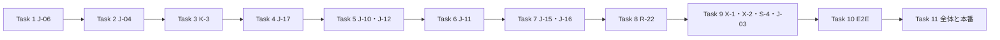

# 開店前の直し 波1 実装計画

> **For agentic workers:** REQUIRED SUB-SKILL: Use superpowers:subagent-driven-development (recommended) or superpowers:executing-plans to implement this plan task-by-task. Steps use checkbox (`- [ ]`) syntax for tracking.

**Goal:** 2026-10-22〜23 にユーザーが決めた小さな直し（J-03・J-04・J-06・J-10・J-11・J-12・J-15・J-16・J-17・K-3）と、台帳の残りの不具合（R-22・X-1・X-2・お知らせの分類・S-4）を、開店前に片付ける。

**Architecture:** 各直しは独立している。DB を変える4つ（J-06・J-04・K-3・J-17）は1つずつ別の移行にし、関数を直す時は最新の定義を写して必要な行だけ変える。画面の直しは共通の部品（`Dialog`・`OrderReturnsSection`・`OrderStatusAccess`）の中で閉じ、呼ぶ側の契約を変えない。メールの止め方は既存の注文メールの一時停止（pause）に新しい理由を1つ足して乗せる。

**Tech Stack:** 現行の Next.js `^16.3.6` App Router、React `^19`、TypeScript `^5`、Supabase Postgres 17、`@stripe/react-stripe-js`（checkout）、zod `^4`、Jest / ts-jest `^29`、`@testing-library/react ^16`、`@playwright/test ^1.58`。依存を増やさない。

**Spec:** [判断表の5章「決定の記録」](../../05_Quality/reviews/code/2026-10-22-decision-sheet.md)（J-03・J-04・J-06・J-10〜J-12・J-15〜J-17・K-3 の行）と[台帳の2章](../../05_Quality/reviews/code/2026-09-25-working-diff-security-review.md)（R-22・X-1・X-2・S-4。詳細は6章）。下調べは `tmp/w1/facts.md`（行番号つき。各タスクの実装者はそこの該当節を読む）。

## 概要

11タスクを番号順に進める。Task 1〜9 は実装（Codex）、Task 10 は E2E の実行（controller）、Task 11 は全体の確かめ・本番適用・push。

| Task | 中身 | 移行 | 新しい FREQ | 新しい E2E |
|---|---|---|---|---|
| 1 | J-06 キャンセルの理由を6つに・Stripe の理由・メールの文 | あり（A） | 506 | FR-ADMIN-105 |
| 2 | J-04 返金の失敗の解決はメモ必須 | あり（B） | 507 | FR-ADMIN-106 |
| 3 | K-3 監査ログは店長だけ | あり（C） | 508 | —（DB 結合と単体） |
| 4 | J-17 本番でサイトの住所が正しくない時はメールを止めて知らせる | あり（D） | 509 | —（単体。本番の条件は手元で再現しない） |
| 5 | J-10・J-12 確認の画面の「戻る」・注文番号の見出し・スマホの「×」 | なし | 510 | FR-ADMIN-107 |
| 6 | J-11 支払い方法はカード → PayPay | なし | 511 | FR-CHECKOUT-052 |
| 7 | J-15・J-16 注文の状況のページ | なし | 512・513 | FR-ORDER-009・010 |
| 8 | R-22 CSRF の拒否を見落とす5つの窓口 | なし | 514 | —（単体と結合） |
| 9 | X-1・X-2・お知らせの分類、S-4、J-03 | なし | 515 | FR-ADMIN-108 |
| 10 | E2E の実行（新しい8本と直した既存） | — | — | — |
| 11 | 全体の確かめ・文書・最終レビュー・本番適用・push・改名 | — | — | — |

**決めたこと（ruling）**

- J-02（取り消せない仕上がりの行に理由を出す）はこの計画から外し、G に回す。G は「仕上がり」を手で付ける仕組みをやめる（G の提案 7章 Q2）。今直すと G で消える。古い仕上がりの履歴をどう見せるかは G の設計で決める。
- J-17 の範囲: 注文のメール（送る予定を DB に持つ outbox）は、止めた後に設定を直せば自動で送り直す。パスワードの再設定・会員登録の確認と通知は、送らずにお店へ知らせるだけにする（お客様がもう一度頼めば送られる。再設定の鍵は10分で切れるので、後から送り直す意味が無い）。Supabase が自分で送るメール（ログインの確認コードなど）は Supabase の管理画面の Site URL で決まるので、台帳の4章「開店の準備」に確かめる行を足す（Task 11）。
- J-12 の注文番号の書き方は今の画面と同じ `ORD-XXXXXXXX`（`toOrderNumber`）。決定の「#1234」は例。
- J-10 は、返金と支払い済みのキャンセルの流れの中で「何もせずに閉じる」ボタンを全部「戻る」にする（読み込みの失敗・確認中・結果不明の時の「閉じる」も含む）。返品の審査の画面の「閉じる」は別の段なので変えない。
- X-2 は台帳の記述と向きが逆で、`native` の選択欄に `onValueChange` を渡している。`onChange` に直す。
- 移行は4本に分ける（理由・メモ・権限・メールの停止の理由）。タスクごとにレビューでき、本番適用の後の改名も1本ずつ合わせられる。

## Global Constraints

- 作業は master だけ。実装者はコミットしない。controller が指定のファイルだけをコミットする。`.claude/CLAUDE.md`・`package.json`・`.superpowers/` の今の差分に触れない。
- 適用済みの移行（`supabase/migrations/` の既存ファイル）を直さない。新しい移行は `supabase/migrations/YYYYMMDDHHMMSS_snake_case.sql`（今の UTC の実時刻。`20261022084944` より後）。`BEGIN;`〜`COMMIT;`、最後に `NOTIFY pgrst, 'reload schema';`。
- 関数を直す時は、`supabase/migrations/` 全体を検索して**最後に定義された版**を写し、決めた行だけ変える。`SECURITY DEFINER`・`SET search_path = ''`・所有者・`GRANT`/`REVOKE` は元のまま書き直す。古い版を写して後の直し（例: `private.begin_order_refund_core` の返品対応）を消さない。
- 画面とメールの文はこの計画の字のとおり。値は文字として出す。`dangerouslySetInnerHTML` を使わない。
- サイトの住所・秘密の鍵・トークン・電話番号・メールの宛先の値をログ・監査・エラー・試験の出力に出さない。`.env*` を読まない。
- 要求管理: `docs/02_Requirements/requirements.md` に、今の最大 FREQ-505 の次から各タスクの FREQ 行を足す（形は59行の見出しと1689行の FREQ-505 と同じ。受け付け基準は「〇〇が表示されること」の形、E2E・単体・DB 結合への相対リンク、担当 Task を書く）。新しい E2E は `e2e/FR-{CATEGORY}-{NNN}-{kebab}.spec.ts`（ADMIN は105から、ORDER は009から、CHECKOUT は052から）。E2E は mobile 390・tablet 768・desktop 1280 の3つの画面幅。
- E2E と DB 結合の試験は controller が流す（Codex の作業場所からは手元の Supabase と Docker に届かない）。実装者は書くだけで、単体の試験と型を流す。E2E は本番ビルド（`next build && next start`）と手元の Supabase に対して流す。dev サーバーでは流さない。
- PowerShell では `npx.cmd`・`npm.cmd`。型は `npx.cmd tsc --noEmit --incremental false`。単体は `npx.cmd jest <path>`。
- graphify は `.venv/Scripts/python.exe -m graphify query "<question>"`。`graphify update` は流さない（コミットのフックが作り直す）。
- 実装者は subagent を立てない。報告は report ファイルに書き、戻り値は状態・変えたファイル・試験の結果の1行・気になる点だけ。

## Review Focus

- 古い注文に保存された前の4つの理由のコード（`customer_request`・`stock_unavailable`・`suspected_fraud`・`other`）と理由なし（null）でも、管理の履歴とメールの文が今までどおり作れること → Task 1 の試験。
- 送信中（busy）の返金・キャンセルの画面で、新しい「×」を押しても閉じないこと（今の閉じ止めを迂回しない） → Task 5 の試験。
- 注文の状況のページで、読み直しを待っている間に確認の期限が来たら、個人情報をすぐ消すこと → Task 7 の試験。
- サイトの住所の見張りが、手元と E2E（`VERCEL_ENV` が無い）では何も止めず、お店への知らせのメール自体も止めないこと → Task 4 の試験。
- ログアウトで CSRF が拒まれても、200 と Cookie の消去は今までどおり返し、サーバー側のログインの取り消しだけをしないこと → Task 8 の試験。
- システムが自動で解決する返金の失敗（`resolve_payment_exception_by_system`）はメモ無しのまま通ること → Task 2 の試験。

---

### Task 1: キャンセルの理由を6つにする（J-06）

**Files:**
- Create: `supabase/migrations/<ts>_order_cancel_reasons.sql`
- Modify: `src/lib/orders/order-payment-types.ts`（`CANCEL_REASONS` とラベル）、`src/lib/orders/refund/refund-service.ts:105`、`src/lib/orders/email/order-email-compose.ts`（`PAID_CANCEL_LEADS`・`composeCanceled`・`MATERIAL_ORDER_COLUMNS`）、`src/lib/orders/order-confirmation-email.ts`（`OrderEmailRow` に `cancel_reason`）、`e2e/order-email-test-utils.ts:392`（`E2eCancelReason`）
- Test: facts.md「J-06」の試験の表にある既存の試験（単体・DB 結合・E2E）の更新、`e2e/FR-ADMIN-105-cancel-reasons.spec.ts`（新規）
- Docs: `docs/02_Requirements/requirements.md` に FREQ-506

**Interfaces:**
- Produces: `CANCEL_REASONS = ['customer_request', 'payment_declined', 'suspected_fraud', 'stock_unavailable', 'shop_error', 'other'] as const`（この順が画面の並び）。`CancelReason` 型はここから作る。

**値（字のとおり）**

| コード | 表示 | Stripe の reason | 支払い済みのキャンセルのメールの冒頭 | 未入金の取消のメールの冒頭 |
|---|---|---|---|---|
| customer_request | お客様の都合 | requested_by_customer | ご依頼により、ご注文を取り消しました。 | 今のまま（前の状態の文） |
| payment_declined | 支払いの拒否 | 付けない | お支払いを確認できなかったため、ご注文を取り消しました。 | お支払いを確認できなかったため、ご注文を取り消しました。 |
| suspected_fraud | 不正 | fraudulent | ご注文を取り消しました。 | 今のまま |
| stock_unavailable | 在庫切れ | 付けない | 商品をご用意できなくなったため、ご注文を取り消しました。ご迷惑をおかけし、申し訳ございません。 | 支払い済みと同じ文 |
| shop_error | お店の誤り | 付けない | 当店の不手際により、ご注文を取り消しました。ご迷惑をおかけし、誠に申し訳ございません。 | 支払い済みと同じ文 |
| other | その他 | 付けない | ご注文を取り消しました。 | 今のまま |

- 未入金の取消のメールは、冒頭の文だけを差し替える。「お支払いは発生していません。」の行は残す。理由が null の時は今のまま。
- 「付けない」は Stripe へ `reason` の項目を送らない（`null` を送らない）。`refund-stripe.ts` は null なら省く作りなので、`refund-service.ts` が null を返せばよい。
- 「その他」のメモ必須は今のまま。

- [ ] **Step 1: 試験を先に直す。** 単体: `order-payment-types.test.ts` は新しい移行を読み、6つの値・2つの値の CHECK（`orders_cancel_reason_check`・`order_refunds_cancel_reason_value_check`）・3つの関数（`admin_cancel_failed_order`・`release_stock_for_unpaid_order`・`private.begin_order_refund_core`）が同じ6つを使うことを確かめる。`refund-service.test.ts` は6つの対応（上の表）。`order-email-compose.test.ts` は支払い済み6つ＋null、未入金6つ×前の状態2種、列の一覧に `cancel_reason`。`OrderPaidCancelDialog.test.tsx`・`OrderCancelDialog.test.tsx` は6つの選択肢と順番。API の試験は新しい2つの値が通り、知らない値が400。DB 結合（`order_payment_columns`・`order_refund_records`・`release_stock_by_order`・`payment_exceptions`・`order_refund_requests`・`order_refund_results`・`order_email_enqueue`）に新しい2つの値の保存と、6つ以外の拒否を足す。古い4つのコードの行が今までどおり読めて、履歴のラベルが新しい名前（customer_request → お客様の都合、suspected_fraud → 不正）になる試験も足す。
- [ ] **Step 2: 単体を流して落ちることを見る。** `npx.cmd jest tests/unit/lib/orders tests/unit/components/OrderPaidCancelDialog.test.tsx tests/unit/components/OrderCancelDialog.test.tsx tests/unit/api/admin` → 新しい期待で FAIL。
- [ ] **Step 3: 移行を書く。** 2つの値の CHECK を落として6つで作り直す（source と理由の有無の対応の `order_refunds_cancel_reason_check` は触らない）。3つの関数は最新の定義を写し、4つの値の検証を6つにする。
- [ ] **Step 4: コードを直す。** 上の表どおり。未入金のメールの素材の SELECT に `cancel_reason` を足し、`OrderEmailRow` の型にも足す。
- [ ] **Step 5: 単体と型が通ることを見る。** Step 2 の命令と `npx.cmd tsc --noEmit --incremental false` → PASS。
- [ ] **Step 6: E2E と FREQ を書く。** `FR-ADMIN-105-cancel-reasons.spec.ts`: 未入金の取消と支払い済みのキャンセルの画面に6つの理由がこの順で出ること、「在庫切れ」で取り消した未入金の注文のメール（Mailpit）の冒頭が表の文であること。既存の `FR-ADMIN-063`・`075`・`083` の4つの前提を6つに直す。FREQ-506（要求: キャンセルの理由を Shopify と同じ6つから選べ、理由に合ったお知らせを送ること）。
- [ ] **Step 7（controller）: DB 結合を流す。** `npx.cmd jest tests/integration/db/<上の7本>` → PASS。
- [ ] **Step 8（controller）: コミット。** `feat(orders): キャンセルの理由を Shopify と同じ6つにし、理由に合ったお知らせの文にする（J-06）`

### Task 2: 返金の失敗を解決する時はメモを必須にする（J-04）

**Files:**
- Create: `supabase/migrations/<ts>_payment_exception_refund_failed_note.sql`
- Modify: `src/components/AttentionInbox.tsx:224-250`、`src/app/api/admin/payment-exceptions/[id]/resolve/route.ts:203-218`
- Test: `tests/unit/components/AttentionInbox.test.tsx`、`tests/unit/api/admin/order-attention-route.test.ts`、`tests/integration/db/payment_exceptions.integration.test.ts`、`tests/integration/db/order_refund_results.integration.test.ts`（自動解決の回帰）、`e2e/FR-ADMIN-106-refund-failure-note-required.spec.ts`（新規）
- Docs: FREQ-507、`docs/04_DetailDesign/sequence/order-administration.md:277`・`docs/04_DetailDesign/pages/16_admin.md:201` の「任意」を「返金の失敗は必須」に

**値**
- 返金の失敗（`reason = 'refund_failed'`）の時だけ、メモの欄の名前を「メモ（必須・店内のみ）」にする。ほかの理由は「メモ（任意・店内のみ）」のまま。
- 空や空白だけの時は「解決済みにする」を押せない。欄の下に「返金の失敗を解決するときは、確かめた内容をメモに入力してください。」を出す。
- DB: 人が解決する `resolve_payment_exception` で、行を押さえた後、`reason = 'refund_failed'` かつメモが空白なら既存の `RESOLUTION_NOTE_REQUIRED` で断る。自動解決の `resolve_payment_exception_by_system` は変えない。列の NOT NULL は付けない。
- API: RPC のエラーに `RESOLUTION_NOTE_REQUIRED` が含まれたら400 と上と同じ文を返す。注文や Stripe を読みに行かない今の作りを保つ。

- [ ] **Step 1: 試験を先に書く。** 画面: 返金の失敗で欄の名前・空/空白で押せない・1文字で押せる・500文字・ほかの理由は任意のまま。API: RPC が `RESOLUTION_NOTE_REQUIRED` を返したら400と文。DB: refund_failed を null・空白で直接呼ぶと断られ、メモ付きは保存される。ほかの理由はメモ無しで通る。自動解決はメモ無しで通る。
- [ ] **Step 2: 単体を流して落ちることを見る。** `npx.cmd jest tests/unit/components/AttentionInbox.test.tsx tests/unit/api/admin/order-attention-route.test.ts` → FAIL。
- [ ] **Step 3: 移行とコードを書く。**
- [ ] **Step 4: 単体と型が通ることを見る。**
- [ ] **Step 5: E2E と FREQ と文書を書く。** `FR-ADMIN-106`: 返金の失敗の要対応で、メモが空の間は押せず、入れると解決できること。FREQ-507。
- [ ] **Step 6（controller）: DB 結合を流す。** `payment_exceptions`・`order_refund_results` → PASS。
- [ ] **Step 7（controller）: コミット。** `feat(admin): 返金の失敗を解決する時のメモを必須にする（J-04）`

### Task 3: 監査ログを読む権限を店長に付ける（K-3）

**Files:**
- Create: `supabase/migrations/<ts>_audit_read_permission.sql`
- Test: `tests/unit/lib/auth/admin-rbac.test.ts`、`tests/integration/api/admin/audit-logs.test.ts`、DB 結合 `tests/integration/db/audit_read_permission.integration.test.ts`（新規。形は `tests/integration/db/order_refund_records.integration.test.ts:1091-1124`）
- Docs: FREQ-508

**値**
- facts.md「K-3」の形（`supabase/migrations/20261011222930_order_refund_records.sql:295-304`）で、`('admin.audit.read', '監査ログの閲覧')` を `permissions` に入れ（`ON CONFLICT (code) DO UPDATE SET name = EXCLUDED.name`）、`roles.code = 'admin'` だけに結ぶ（`ON CONFLICT DO NOTHING`）。ほかの役割の今の結び付きは消さない（本番の今の状態は Task 11 で読んでから当てる）。
- `legacyPermissionMap` は既に admin にだけあるので変えない。

- [ ] **Step 1: 試験を書く。** DB 結合: 取引の中で roles を用意し、移行の文を当てると admin だけが `admin.audit.read` を持ち、supporter・user は持たない。2回当てても件数が変わらない。単体: admin=true、supporter=false、user=false、403 の時に DB を読まない。
- [ ] **Step 2: 移行を書く。** 単体と型を流す。
- [ ] **Step 3: FREQ-508 を書く。** E2E は「—（DB 結合・単体で検証）」。
- [ ] **Step 4（controller）: DB 結合を流す。**
- [ ] **Step 5（controller）: コミット。** `feat(admin): 監査ログを読む権限を店長の役割にだけ付ける（K-3）`

### Task 4: 本番でサイトの住所が正しくない時はメールを止めて知らせる（J-17）

**Files:**
- Create: `src/lib/site-url-guard.ts`（server-only）、`supabase/migrations/<ts>_order_email_site_url_pause.sql`
- Modify: `src/lib/orders/email/order-email-types.ts:123-181`（理由 `config_site_url` と表示「サイトの住所の設定」）、`src/lib/orders/email/order-email-worker.ts`（claim の前の確かめ）、`src/lib/orders/status/status-email.ts:13-25`、`src/app/api/auth/password-reset/request/route.ts:110-128`、`src/app/api/auth/register/route.ts:23-35,142-167`、ops の知らせ（`src/lib/ops/ops-alert-mail.ts`）
- Test: facts.md「J-17」の試験の表の単体（URL・worker・sender・types・store・ops・ops-alert-mail・auth）と DB 結合 `order_email_outbox`
- Docs: FREQ-509、`docs/06_Operations/order-email-operations.md`（止める理由の表と、直し方: Vercel の環境変数を直して作り直すと、次の見回りで自動で送り直す）

**Interfaces:**
- Produces: `checkSiteUrlForEmail(): { ok: true; origin: string } | { ok: false; code: 'config_site_url' }` in `src/lib/site-url-guard.ts`。`process.env.VERCEL_ENV === 'production'` の時だけ確かめ、それ以外は常に `ok: true`（今の `getSiteUrl()` の値）。

**値**
- 本番で `ok: false` にするのは、URL として読めない・`https:` でない・ホストが `localhost`（末尾の点を含む）・`*.localhost`・`127.0.0.0/8`・`::1`・`0.0.0.0` の時。`localhost.example.com` は通す。
- 注文のメール: worker は claim と本文作りの前に `checkSiteUrlForEmail()` を見て、`ok: false` なら既存の一時停止を理由 `config_site_url` で掛け、既存の「注文のメールを止めた」知らせ（帯と `order_email_paused` の ops の知らせ）を出す。行は pending のまま残り、設定を直した後の既存の試しの送信（probe）で再開する。`status-email.ts` のリンク作りも同じ判定で `ok: false` なら作らずに止める（念のための二重の守り）。
- 移行: 止める理由の CHECK と一時停止の関数（最新の定義）が受け付ける値に `config_site_url` を足す。
- パスワードの再設定と会員登録: 本番で `ok: false` なら、メールを送らず、お店へ ops の知らせ（新しい種類 `site_url_invalid`、件名と本文にサイトの住所の値を入れない）を出す。パスワードの再設定は、今と同じ「受け付けました」の答えを返す（登録の有無を漏らさないため）。会員登録は503と「ただいま会員登録を受け付けられません。時間をおいてお試しください。」を返し、アカウントを作らない。
- お店への知らせのメール（`sendOpsAlertMail`）にはこの見張りを入れない（知らせ自体を止めないため）。`sendMail` にも入れない。

- [ ] **Step 1: 試験を先に書く。** `site-url-guard`: `VERCEL_ENV` 無し・preview では何でも ok。production で未設定（localhost に落ちる）・http・`https://localhost`・`https://localhost.`・`https://127.0.0.1`・`https://[::1]` は ng、`https://shop.example.com`・`https://localhost.example.com` は ok。worker: ng なら claim を呼ばず、pause を `config_site_url` で掛ける。再設定と登録: ng なら送信の関数を呼ばず、知らせを出し、再設定は今と同じ200、登録は503。ops の知らせの本文に URL が無い。DB 結合: `config_site_url` で止められ、既存の probe と再開が動く。
- [ ] **Step 2: 単体を流して落ちることを見る。**
- [ ] **Step 3: 実装する。**
- [ ] **Step 4: 単体と型が通ることを見る。** 既存の `status-email.test.ts` の「手元では localhost を許す」も通ること。
- [ ] **Step 5: FREQ-509 と運用の文書を書く。** E2E は「—（本番の条件は手元で再現しない。単体・DB 結合で検証）」。
- [ ] **Step 6（controller）: DB 結合を流す。** `order_email_outbox` → PASS。
- [ ] **Step 7（controller）: コミット。** `feat(email): 本番でサイトの住所が正しくない時はメールを止めてお店に知らせる（J-17）`

### Task 5: 確認の画面の「戻る」・注文番号の見出し・スマホの「×」（J-10・J-12）

**Files:**
- Modify: `src/components/OrderRefundDialog.tsx:285-291`、`src/components/RefundFlowContent.tsx:38-58`、`src/components/OrderPaidCancelDialog.tsx:100`、`src/app/admin/page.tsx:1397-1400`（未入金の取消の見出し）、`src/components/ui/Dialog/Dialog.tsx`・`Dialog.css`
- Test: `tests/unit/components/Dialog.test.tsx`、`OrderRefundDialog.test.tsx`・`OrderRefundDialog.prefill.test.tsx`・`OrderPaidCancelDialog.test.tsx`・`OrderCancelDialog.test.tsx`、`e2e/refund-test-utils.ts:295-306`、`e2e/FR-ADMIN-074`・`075`・`063`、`e2e/FR-ADMIN-107-dialog-order-number-close.spec.ts`（新規）
- Docs: FREQ-510

**値**
- 見出し: 「返金（注文 ORD-XXXXXXXX）」「注文をキャンセルする（注文 ORD-XXXXXXXX）」、未入金の取消も今の見出しの後ろに「（注文 ORD-XXXXXXXX）」。番号は開いた時から持っている注文の ID を `toOrderNumber` に通す（読み込み中・失敗でも同じ見出し）。お客様の名前は出さない。
- 返金と支払い済みのキャンセルの流れの「何もせずに閉じる」ボタンは全部「戻る」（`backLabel` と `RefundFlowContent` の固定の「閉じる」）。金額を決めるボタンなど、ほかの意味の「キャンセル」は変えない。
- `Dialog`: `fullScreenOnMobile` の時だけ、見出しの行の右に「×」のボタン（`type="button"`、読み上げの名前「閉じる」、アイコンは既存の部品の物を使う）。画面の幅が768px未満の時だけ見える（CSS）。押すと `onClose` を呼ぶ（呼ぶ側の閉じ止めがそのまま効く）。開いた時の最初のフォーカスは今と同じ要素のまま（×を最初にしない）。

- [ ] **Step 1: 試験を先に書く。** `Dialog`: fullScreenOnMobile の時だけ×があり、押すと onClose、Escape・Tab の閉じ込め・閉じた後のフォーカスの戻りが今のまま、最初のフォーカスが×でない。返金: 見出しに番号、戻るのボタン（通常・読み込みの失敗・確認中・結果不明）、送信中は×でも閉じない。キャンセル2つ: 見出しに番号。
- [ ] **Step 2: 単体を流して落ちることを見る。**
- [ ] **Step 3: 実装する。**
- [ ] **Step 4: 単体と型が通ることを見る。** `Dialog` を使うほかの12の画面の単体（facts.md「J-12」の表）も流して通ること。
- [ ] **Step 5: E2E と FREQ を書く。** `FR-ADMIN-107`: 390px で返金の画面が全画面になり右上の×で閉じられ、見出しに注文番号があること。768・1280 では×が出ないこと。既存の E2E の見出しと「キャンセル」の期待を直す。FREQ-510。
- [ ] **Step 6（controller）: コミット。** `feat(admin): 返金・キャンセルの確認の画面に注文番号と「戻る」をそろえ、スマホの全画面に「×」を足す（J-10・J-12）`

### Task 6: 支払い方法はカード → PayPay の順（J-11）

**Files:**
- Modify: `src/app/checkout/_components/FinalConfirmationStep.tsx:397-402`
- Test: `tests/unit/components/FinalConfirmationStep.test.tsx`、`e2e/FR-CHECKOUT-052-payment-method-order.spec.ts`（新規）
- Docs: FREQ-511

**値**
- `<PaymentElement options>` に `paymentMethodOrder: ['card', 'paypay']` を足す。今の `layout`（accordion・defaultCollapsed false・radios always・spacedAccordionItems false）は変えない。使える支払い方法を減らしたり増やしたりしない。

- [ ] **Step 1: 試験を書く。** 単体: PaymentElement の mock が受け取った options に `paymentMethodOrder` が `['card','paypay']` で入り、layout が今のまま。既存の PayPay を選んだ時の動きの試験が通る。
- [ ] **Step 2: 落ちることを見て、直し、通ることを見る。**
- [ ] **Step 3: E2E と FREQ を書く。** `FR-CHECKOUT-052`: 最終確認の画面の Stripe の欄で、最初の支払い方法がカードであること（Stripe の iframe の中の並び。既存の `FR-CHECKOUT-022`・`037` の見方に合わせる）。FREQ-511。
- [ ] **Step 4（controller）: コミット。** `feat(checkout): 支払い方法の並びをカード → PayPay に固定する（J-11）`

### Task 7: 注文の状況のページ（J-15・J-16）

**Files:**
- Modify: `src/features/account/returns/OrderReturnsSection.tsx:244,315-325`、`src/features/order-status/components/OrderStatusAccess.tsx:17-105`、必要なら `OrderStatusVerifyForm.tsx`
- Test: `tests/unit/features/account/returns/OrderReturnsSection.test.tsx`、`tests/unit/features/order-status/OrderStatusPublic.test.tsx`・`OrderStatusPrivate.test.tsx`・`OrderStatusAccess.test.tsx`、`e2e/FR-ORDER-009-no-shipping-needed-before-verify.spec.ts`・`e2e/FR-ORDER-010-keep-display-on-return.spec.ts`（新規）、既存 `FR-ORDER-001`・`002`・`004`・`005`
- Docs: FREQ-512（J-15）・FREQ-513（J-16）

**値（J-15）**
- 公開の表示（`readOnly`）でも、返品の状態が `accepted`・`partially_received` で返送の方法が `not_required` の時だけ「品物のご返送は不要です。」を出す。返送が要る時の送り先・送料・伝票番号は今どおり確かめた後だけ。確かめた後の表示で同じ文が2回出ないように、private の側の重複を外す。公開の型・API・DB には何も足さない。

**値（J-16）**
- 同じリンク（token）・同じ注文・同じログインの状態（`isLoggedIn`）で読み直す時は、答えが来るまで今の表示と下4桁の欄（同じ入力の要素と値）を残す。
- 次の時はすぐ消す: 初めて開いた時、token か注文が変わった、ログインの状態が変わった（ログアウト）、`SESSION_EXPIRED`、確認の期限が来た。読み直しの答えが none・401・locked・expired・unavailable・通信の失敗なら、残していた表示を消して新しい答えに従う。
- 確認の期限のタイマーは読み直しを始めても止めない（期限は読み直しと別に見張る）。古い答えを捨てる今の仕組み（generation・abort）と、描く前の照合は残し、照合に token を足す。

- [ ] **Step 1: 試験を先に書く。** J-15: 公開で not_required の時に文が1回、返送が要る時は住所が無い、対象外の状態では出ない、確かめた後も1回。J-16: 読み直しの答え待ちの間、個人情報と同じ入力の要素と値が残る。その間に期限・ログアウト・SESSION_EXPIRED・別の token・別の注文が来たらすぐ消える。遅い GET と遅い確認の POST の答えは捨てる。
- [ ] **Step 2: 単体を流して落ちることを見る。**
- [ ] **Step 3: 実装する。**
- [ ] **Step 4: 単体と型が通ることを見る。**
- [ ] **Step 5: E2E と FREQ を書く。** `FR-ORDER-009`: 確かめる前に「品物のご返送は不要です。」が出て、返送先の住所は出ない。`FR-ORDER-010`: 下4桁を途中まで入れて `visibilitychange` で戻っても、入れた数字と表示が残る（既存 `FR-ORDER-004:38` の起こし方を使う）。FREQ-512・513。
- [ ] **Step 6（controller）: コミット。** `feat(order-status): 返送不要の文を確かめる前にも出し、戻った時の読み直しで表示を消さない（J-15・J-16）`

### Task 8: CSRF の拒否を見落とす5つの窓口を直す（R-22）

**Files:**
- Modify: `src/app/api/checkout/create-session/route.ts:62-68,488-489`、`src/app/api/profile/route.ts:67,235-249,304-317`、`src/app/api/profile/addresses/route.ts:55,193-206`、`src/app/api/auth/logout/route.ts:22,91-124`
- Test: `tests/unit/api/checkout/create-session-route.test.ts:551-564`、`tests/integration/api/profile.test.ts:177-232`、`tests/unit/api/profile/addresses-route.test.ts`（新規）、`tests/unit/api/auth/logout-guest-shopping.test.ts:125-137`、`tests/integration/api/auth/logout.test.ts:73-109`、`tests/unit/lib/csrf.middleware.test.ts`
- Docs: FREQ-514

**値**
- 判定は `value instanceof Response`（`src/features/stockist/services/admin-security.ts:37-38` と同じ）。`'_body' in value` を消す。
- 決済・プロフィールの POST と DELETE・住所の PUT: 拒否の応答（403、DB の失敗の500）をそのまま返し、後ろの処理（本文の読み取り・DB・Stripe・削除）に進まない。
- ログアウト: 拒否の時はサーバー側のログインの取り消し（sessions の更新・取り消しの RPC）をせず、今どおり200と Cookie の消去を返す。

- [ ] **Step 1: 試験を先に直す。** `_body` 付きの作り物をやめ、本物の `NextResponse.json(..., { status: 403 })` と500を使う。4つの窓口で同じ応答が返り、後ろの処理の mock が呼ばれない。ログアウトは取り消しの mock が呼ばれず、200と Cookie の消去。
- [ ] **Step 2: 単体を流して落ちることを見る。**
- [ ] **Step 3: 直す。**
- [ ] **Step 4: 単体・結合・型が通ることを見る。** `tests/integration/api/` のこれらは mock の試験で、Codex の場所でも流せる。
- [ ] **Step 5: FREQ-514 を書く。** 要求: なりすましの送信を403で断ること。E2E は「—（単体・結合で検証）」。
- [ ] **Step 6（controller）: コミット。** `fix(security): CSRF の拒否の応答を見落としていた5つの窓口を直す（R-22）`

### Task 9: 選択欄の受け渡し・日付頼みの試験・購入履歴の試験（X-1・X-2・お知らせ・S-4・J-03）

**Files:**
- Modify: `src/components/UserSection.tsx:187-192`、`src/app/auth/verified/page.tsx:359-364`、`src/app/admin/news/NewsForm.tsx:210-215`、`e2e/FR-ADMIN-018-monthly-record-input.spec.ts:119-121`、`e2e/FR-ACCOUNT-014-order-detail-button.spec.ts`、`docs/02_Requirements/requirements.md:1263`（FREQ-79）
- Test: `tests/unit/components/UserSection.test.tsx`（新規）、`tests/unit/app/auth/verified-page.test.tsx`（新規。既存の置き場所があればそこ）、`tests/unit/components/NewsForm.test.tsx`、`e2e/FR-ADMIN-108-select-fields.spec.ts`（新規）
- Docs: FREQ-515

**値**
- X-1・お知らせ: `dropdown` の選択欄なので `onValueChange`（値の文字列）で受ける。役割の変更は今の `handleRoleChange` に値を渡す。お知らせは `category` を直接更新する。
- X-2: `native` の選択欄なので `onChange`（`event.target.value`）で `selectedFactorId` を更新する。
- `SingleSelect` 自体と、正しく動いているほかの35か所は変えない。
- S-4: 3つの画面幅に共通の `beforeEach` で、ページを開く前に `await page.clock.setFixedTime(new Date('2026-06-15T03:00:00Z'));`。製品のコードは変えない。
- J-03: `FR-ACCOUNT-014` の試験名・コメント・リンクの選び方を FREQ-88 の「行全体が注文詳細へのリンク」に合わせる（注文番号を含む行のリンクを押して詳細へ行き、href を確かめる）。FREQ-79 の行の要件に「FREQ-88 で置き換え」と書く。`FR-ACCOUNT-005` は既に直っているので触らない。

- [ ] **Step 1: 試験を先に書く。** 役割を選ぶと PATCH の role が選んだ値で、失敗したら元に戻る。確認の方法を2つから2つ目に選ぶと verify の factorId が2つ目。お知らせの分類を選ぶと送る FormData の category がその値（新規と編集）。
- [ ] **Step 2: 落ちることを見て、直し、通ることを見る。** `SingleSelect.combobox.test.tsx` も通ること。
- [ ] **Step 3: E2E と FREQ を書く。** `FR-ADMIN-108`: 管理画面のユーザー一覧で役割を選ぶと変更が送られ、お知らせの編集で分類を選ぶと保存されること（既存の管理画面の E2E の API の差し替えの形に合わせる）。FREQ-515（要求: 管理画面とログインの確認の選択欄で選んだ値が反映されること）。S-4 と J-03 の E2E の直し。
- [ ] **Step 4（controller）: コミット。** `fix(ui): 選択欄の受け渡しの食い違いを直し、日付頼みと古い購入履歴の E2E を直す（X-1・X-2・S-4・J-03）`

### Task 10（controller）: E2E を流す

- [ ] **Step 1:** 3000番に残っている E2E 用のアプリを止める（自分たちの `next start` だけ）。手元の Supabase が動いているかを見る（Docker を起動・停止しない。止まっていればユーザーに伝える）。`npm.cmd run db:reset` で4本の新しい移行を当てる。
- [ ] **Step 2:** 新しい E2E 8本（FR-ADMIN-105〜108、FR-CHECKOUT-052、FR-ORDER-009・010）と、直した既存（FR-ADMIN-018・063・074・075・078・083、FR-ACCOUNT-014、FR-ORDER-001・002・004・005）を流す: `npx.cmd playwright test e2e/FR-ADMIN-105 ...`。
- [ ] **Step 3:** 落ちた物は CLAUDE.md の切り分け（単体で流し直す → 他の画面幅 → タイムアウトか期待の違いか）で、実装の欠陥なら該当 Task の実装者に戻す。
- [ ] **Step 4:** 結果を ledger に書く。

### Task 11（controller）: 全体の確かめ・文書・最終レビュー・本番適用・push・改名

- [ ] **Step 1: 全部を流す。** `npx.cmd tsc --noEmit --incremental false`、`npm.cmd run lint`、`npx.cmd jest`（単体・mock の結合）、DB 結合の全部（db reset の後）、E2E の全部（前回 2026-10-22 の 196 failed / 3355 passed / 3579件と比べ、増えた失敗が今回の変更によるものでないことを確かめる）。
- [ ] **Step 2: 文書。** 台帳の2章（R-22・X-1・X-2・S-3（K-3）・S-4 を「直った」、J-03・J-04・J-06・J-10〜J-12・J-15〜J-17 を3章で「実装済み」）、4章に「Supabase の管理画面の Site URL を本番の住所にする」の行。
- [ ] **Step 3: 最終レビュー（Opus エフォート high）。** 波1の全部の差分。指摘は1回の直しと1回の確かめで片付ける。
- [ ] **Step 4: 本番の前の読み取り。** 本番の DB で、`admin.audit.read` の今の結び付き（どの役割に付いているか）と、`orders.cancel_reason`・`order_refunds.cancel_reason` に6つ以外の値が無いことを読む。admin 以外に付いていたらユーザーに伝えて止める。
- [ ] **Step 5: push。** pre-push の E2E（`E2E_STRICT=1`）の前に3000番の E2E のアプリを止める。
- [ ] **Step 6: 本番適用。** Supabase MCP の `apply_migration` で4本を順に当て、`schema_migrations` の `md5(statements[1])` をファイルと突き合わせる。当てた版の名前にファイルを改名してコミットし、push する。
- [ ] **Step 7: 報告。** 版・確かめの結果・残り（J-02 は G、Supabase の Site URL は開店の準備）をユーザーに伝える。
