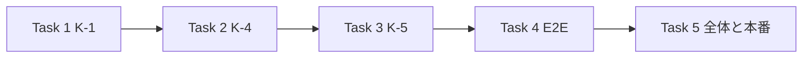

# 開店前の直し 波2 実装計画

> **For agentic workers:** REQUIRED SUB-SKILL: Use superpowers:subagent-driven-development (recommended) or superpowers:executing-plans to implement this plan task-by-task. Steps use checkbox (`- [ ]`) syntax for tracking.

**Goal:** 2026-10-22〜23 にユーザーが決めた K-1（送料は無料に固定）・K-4（商品から外した色・サイズの組み合わせを止める）・K-5（Stripe のエラーの後の下書きを片付ける）を、開店前に片付ける。

**Architecture:** 送料はもう0円で計算しているので、残っている500円（使われない関数と DB の既定値）と文を片付ける。外した色・サイズは、読み手が全部見ている `item_variants.is_active` を DB の同期の1か所で正しく保ち、「注文する」の DB 関数でも止めた組み合わせを断る。Stripe のエラーの後は、画面の番号の無い下書きだけを片付ける DB 関数を足し、押し直しで新しい下書きと新しい重複防止キーにする。

**Tech Stack:** 現行の Next.js `^16.3.6`、React `^19`、TypeScript `^5`、Supabase Postgres 17、Stripe（`stripe` Node SDK・Checkout Session）、Jest、Playwright。依存を増やさない。

**Spec:** [判断表の5章](../../05_Quality/reviews/code/2026-10-22-decision-sheet.md)（K-1・K-4・K-5 の行と3章の K-1・K-4・K-5 の節）と[台帳](../../05_Quality/reviews/code/2026-09-25-working-diff-security-review.md)の S-1・R-13・R-08・R-23（6章の詳細）。下調べは `tmp/w2/facts.md`（行番号つき。実装者は該当の節を読む）。

## 概要

| Task | 中身 | 移行 | 新しい FREQ | 新しい E2E |
|---|---|---|---|---|
| 1 | K-1 送料の残り物と文 | あり（A: `orders.shipping_amount` の既定を0） | 516 | FR-TERMS-005 |
| 2 | K-4 外した色・サイズを止める | あり（B: 同期と「注文する」） | 517 | FR-ITEM-DETAIL-067 |
| 3 | K-5 Stripe のエラーの後の下書き | あり（C: 片付けの関数） | 518 | FR-CHECKOUT-053 |
| 4 | E2E の実行（controller） | — | — | — |
| 5 | 全体の確かめ・最終レビュー・本番の前の読み取り・push・本番適用・改名・台帳 | — | — | — |

**決めたこと（ruling）**

- 波2（K-1）と波3（K-4・K-5）は、どれも小さいので1つの計画にまとめる。
- K-1: 下調べで、決済はもう送料0円で計算していると分かった（`checkout-pricing.service.ts:23`）。500円は使われない関数 `calculateCheckoutAmounts` と DB の `orders.shipping_amount DEFAULT 500` にだけ残る。お金の動きは変えず、残り物を消して文をそろえる。台帳の S-1・W-01 の「決済は500円を取る」は誤りだったと台帳に書く（Task 5）。
- K-1: 送料が0円の注文は、どの画面でも「無料」と出す（カート・入力画面・最終確認・メールは既に「無料」。会員の注文の詳細と注文の状況のページの「￥0」をそろえる）。昔の送料つきの注文は今どおり額を出す。
- K-1: 決済の明細に送料を足す枝（`create-session/route.ts:975-984`）は、0円なら通らないので残す（最小の変更）。
- K-1: 前から落ちていた E2E のうち、送料の文に関わる2本（FR-LEGAL-002・FR-CART-002）を今の文に合わせて直す。送料と関わらない FR-CHECKOUT-003（税の行）は触らない。
- K-4: 止める所は DB の同期1か所。読み手は既に全部 `is_active` を見ている。色・サイズの行と組み合わせは消さない（在庫・番号・履歴を残し、戻したら有効に戻す）。戻した色の並び（position・hex）の更新はしない。
- K-4: 「注文する」の道（`_shown_in_stock_variant_ids IS NOT NULL`）だけ、止めた・引けない組み合わせを既存の理由 `item_unavailable` で断る。お金が動いた後の照合の道は今どおり注文を作る。
- K-4: 管理画面の在庫の欄では、止めた組み合わせに「止めた」の印を出す（隠さない。在庫が残っていると合計を見誤るため）。
- K-5: 片付けるのは Stripe の `sessions.create` が投げた時だけ。ただし `idempotency_key_in_use`（同時に2回押した時）は片付けない（先の方の成功を潰さないため）。DB の claim・reserve・attach の失敗は対象外。

## Global Constraints

- 作業は master だけ。実装者はコミットしない。controller が指定のファイルだけをコミットする。`.claude/CLAUDE.md`・`package.json`・`.superpowers/` の今の差分に触れない。
- 適用済みの移行を直さない。新しい移行は `supabase/migrations/YYYYMMDDHHMMSS_snake_case.sql`（今の UTC の実時刻。`20261023061456` より後）。`BEGIN;`〜`COMMIT;`、最後に `NOTIFY pgrst, 'reload schema';`。全角空白・BOM・CRLF を入れない。
- 関数を直す時は、`supabase/migrations/` 全体で最後に定義された版を写し、決めた行だけ変える。`SECURITY DEFINER`・`SET search_path = ''`・所有者・`GRANT`/`REVOKE` は元のまま。
- 画面の文はこの計画の字のとおり。値は文字として出す。
- 秘密の値・`.env*` を読まない・出さない。
- 要求管理: `docs/02_Requirements/requirements.md` に FREQ-516 から（形は FREQ-505 と同じ）。新しい E2E は 390・768・1280 の3つの画面幅。E2E と DB 結合は controller が流す。実装者は単体と型を流す。
- PowerShell: `npx.cmd jest <path>`、`npx.cmd tsc --noEmit --incremental false`。Bash は壊れているので使わない。
- 実装者は subagent を立てない。報告は report ファイル、戻り値は短く。

## Review Focus

- 昔の送料つきの注文（500円・800円）の表示・返金・メールが今までどおり額を出すこと → Task 1 の試験。
- 色を外して戻すと、同じ組み合わせ（同じ番号・同じ在庫）が有効に戻ること。名前を変えた色は古い方が止まり新しい方が有効になること → Task 2 の DB 結合。
- 色の無い昔の商品（color_id が空の組み合わせ）や、サイズだけの変更で、関係ない組み合わせを止めないこと → Task 2 の DB 結合。
- 同時に2回押した時（`idempotency_key_in_use`）に、先の方の成功を片付けで潰さないこと → Task 3 の単体。
- 片付けの関数は、画面の番号の入った下書き・別の見分けの値・別の session の下書きを変えないこと → Task 3 の DB 結合。

---

### Task 1: 送料の残り物と文をそろえる（K-1）

**Files:**
- Create: `supabase/migrations/<ts>_orders_shipping_default_zero.sql`（`ALTER TABLE public.orders ALTER COLUMN shipping_amount SET DEFAULT 0;` だけ）
- Modify: `src/features/checkout/services/checkout-draft.service.ts:308-329`（`calculateCheckoutAmounts` を消す。使っていない import も消す）、`src/lib/orders/customer-order-view.ts:112`、`src/app/terms/page.tsx:94`、`src/app/ui/page.tsx:238,1527`、`e2e/FR-LEGAL-002-shipping-included-fees.spec.ts:27`、`e2e/FR-CART-002-005-006-007-summary-session-empty.spec.ts:18`
- Test: `tests/unit/api/orders/order-detail-progress.test.ts:214`、`tests/unit/lib/orders/customer-order-view.test.ts`（足す）、`e2e/FR-TERMS-005-no-shipping-charge.spec.ts`（新規）
- Docs: FREQ-516

**値（字のとおり）**
- 会員の注文の詳細と注文の状況のページの送料: 送料が0なら「無料」、0より大きければ今どおりの額（`formatCurrency`）。
- 規約: 「ユーザーは、商品代金及び送料等を、以下のいずれかの方法により支払うものとします」を「ユーザーは、商品代金を、以下のいずれかの方法により支払うものとします」にする。
- /ui の見本: 238行の文を「送料は無料です（商品価格に含みます）。」、1527行を「送料無料（商品価格に含みます）」にする。
- FR-LEGAL-002 は /legal の今の文「無料（商品価格に含みます）」を確かめる。FR-CART-002 はカートの今の言葉「送料」と「無料」を確かめる。/legal とカートの画面は変えない。

- [ ] **Step 1: 試験を先に書く。** customer-order-view: 送料0は「無料」、500・800は「￥500」「￥800」。order-detail-progress の期待を「無料」に。FR-TERMS-005（3つの画面幅）: 規約に「送料」の字が出ないこと、/ui に「¥500」「一律」が出ないこと。
- [ ] **Step 2: 落ちることを見て、直し、通ることを見る。** `npx.cmd jest tests/unit/lib/orders/customer-order-view.test.ts tests/unit/api/orders/order-detail-progress.test.ts tests/unit/api/checkout/create-session-route.test.ts` と型。
- [ ] **Step 3: FREQ-516 を書く。**（要求: 送料は無料に固定し、どこでも同じ言葉で示すこと）
- [ ] **Step 4（controller）: DB 結合 `order_items_variant`・`place_order_from_checkout_draft` を流す。コミット。** `feat(checkout): 送料の残り物を片付け、無料の言葉をそろえる（K-1）`

### Task 2: 商品から外した色・サイズの組み合わせを止める（K-4）

**Files:**
- Create: `supabase/migrations/<ts>_item_variant_retire.sql`
- Modify: `src/app/admin/item/ItemStockSection.tsx`（止めた印）
- Test: `tests/integration/db/backfill_variants.integration.test.ts`（足す）、`tests/integration/db/place_order_from_checkout_draft.integration.test.ts`（足す・337行の意味を書き分ける）、`tests/unit/components/ItemStockSection.test.tsx`（無ければ作る）、`e2e/FR-ITEM-DETAIL-067-retired-variant.spec.ts`（新規）
- Docs: FREQ-517

**移行の中身**
- `public.backfill_item_variants(uuid)` の最新の定義（`20260921121038_retire_item_stock_quantity.sql:217-322`。後の定義が無いことを確かめる）を写し、足した後の同じ関数の中で、その商品の組み合わせの `is_active` を「今の `items.colors` にその色の名前があり（今の色が0なら color_id が空）、かつ今の `items.sizes` にそのサイズの名前がある（今のサイズが0なら size_id が空）」に合わせる。値が変わる行だけ更新する。
- `public.place_order_from_checkout_draft` の最新の定義（`20261008220944_cart_checkout_rpcs.sql:229-538`。後の定義が無いことを確かめる）を写し、`_shown_in_stock_variant_ids IS NOT NULL`（注文するの道）の時だけ、明細の組み合わせが引けない、または `is_active` が偽なら、今の `item_unavailable` の断り方と同じ形で断る。照合の道（`IS NULL`）は今どおり。
- 当てた時に今の全商品へ1回効かせるため、移行の最後で全商品について `backfill_item_variants` を呼ぶ（またはその商品ごとの `is_active` の更新を1回行う）。

**値**
- 管理画面の在庫の欄で、`is_active` が偽の行に「止めた」を出す。

- [ ] **Step 1: 試験を先に書く。** DB 結合: 色を外すとその色の組み合わせが止まる・戻すと同じ番号・同じ在庫で有効に戻る・名前を変えると古い方が止まり新しい方が有効・サイズも同じ・色の無い昔の商品に色を足すと空の組み合わせが止まる・関係ない組み合わせは変わらない。「注文する」の道で止めた組み合わせは `item_unavailable`、照合の道は注文を作る。単体: 止めた行に「止めた」。E2E（3つの画面幅）: 外した色が商品の詳細に出ず、再購入で「この商品は現在お求めいただけません。」（既存の文）。
- [ ] **Step 2: 落ちることを見て（単体）、移行とコードを書き、通ることを見る。**
- [ ] **Step 3: FREQ-517 を書く。**（要求: 商品から外した色・サイズはどこからも買えず、戻すと元どおり買えること）
- [ ] **Step 4（controller）: db reset の後に DB 結合（backfill_variants・place_order_from_checkout_draft・place_order_shown_stock・cart_wishlist_ownership・item_variants・item_checkout_guards）を流す。コミット。** `feat(items): 商品から外した色・サイズの組み合わせを止め、戻すと有効に戻す（K-4）`

### Task 3: Stripe のエラーの後の下書きを片付ける（K-5）

**Files:**
- Create: `supabase/migrations/<ts>_retire_unattached_checkout_draft.sql`
- Modify: `src/app/api/checkout/create-session/route.ts:1042-1044`
- Test: `tests/unit/api/checkout/create-session-route.test.ts`、`tests/integration/db/checkout_session_claim.integration.test.ts`（足す）、`e2e/FR-CHECKOUT-053-retry-after-session-error.spec.ts`（新規）
- Docs: FREQ-518

**Interfaces:**
- Produces: `public.retire_unattached_checkout_draft(_draft_id uuid, _session_id text, _request_version integer, _request_fingerprint text) RETURNS boolean`。`status = 'created' AND checkout_session_id IS NULL` で4つが一致する行だけ `status = 'failed'` にし、変えたら true。`SECURITY DEFINER`・`SET search_path = ''`、EXECUTE は `service_role` だけ（`retire_expired_checkout_draft` と同じ権限の形。列の型と名前はその関数と `claim_checkout_draft` に合わせる）。

**値**
- `stripe.checkout.sessions.create` だけを try で囲む。投げたら、エラーの `code` が `idempotency_key_in_use` でない時に限り片付けの関数を呼ぶ（失敗は飲み込み、監査に固定の記号だけ残す）。その後、元のエラーを投げ直して今の catch に任せる（応答は今と同じ）。
- 片付けた後の押し直しは、claim が新しい下書きを作るので、新しい番号の重複防止キーになる。

- [ ] **Step 1: 試験を先に書く。** 単体: `StripeAPIError` で片付けの関数を呼んで503、次の要求のキーが新しい下書きの番号、片付けが失敗しても同じ503、`idempotency_key_in_use` では呼ばない、成功の時は呼ばない。DB 結合: 条件どおりの行だけ failed、番号のある下書き・別の見分けの値・別の session は変えない、片付けた後の claim は新しい番号。E2E（3つの画面幅）: 窓口を1回目503・2回目成功に差し替え、押し直しで決済の画面に進める。
- [ ] **Step 2: 落ちることを見て、書き、通ることを見る。**
- [ ] **Step 3: FREQ-518 を書く。**（要求: 決済の画面を作れなかった時は、すぐに押し直して作り直せること）
- [ ] **Step 4（controller）: db reset の後に DB 結合（checkout_session_claim・checkout_session_expiry・cart_checkout_rpcs）を流す。コミット。** `fix(checkout): Stripe のエラーの後は下書きを片付け、押し直しで作り直す（K-5）`

### Task 4（controller）: E2E を流す

- [ ] 3000番の E2E のアプリを止め、db reset。波2で触った E2E（FR-TERMS-005、FR-ITEM-DETAIL-067、FR-CHECKOUT-053、FR-LEGAL-002、FR-CART-002）と関係する既存（FR-CHECKOUT-043・045・048、FR-ITEM-DETAIL-065、FR-ACCOUNT-013〜020・031〜033、FR-ORDER-001、FR-CHECKOUT-008・023・026・034）を流す。落ちたら単体で流し直し、環境か実装かを切り分ける。

### Task 5（controller）: 全体の確かめ・最終レビュー・本番

- [ ] 型・lint・単体の全部・db reset の後の DB 結合の全部・E2E の全部（前回 3641件 3414 passed / 199 failed と比べる）。
- [ ] 最終レビュー（Opus エフォート high）。指摘は1回の直しと1回の確かめ直し。
- [ ] 本番の前の読み取り: `backfill_item_variants`・`place_order_from_checkout_draft` の定義が手元の写し元と同じこと（md5 を比べる）、今の色・サイズに無い組み合わせの数とそのうち在庫のある数（当てると止まる件数）、`orders.shipping_amount` の既定。止まる件数はユーザーに報告する。
- [ ] push（3000番のアプリを止めてから）→ 本番適用（3本、md5 を比べる）→ 改名 → 台帳（S-1・W-01 の前提の直し、R-13・R-08・R-23・S-1 を直った）→ push。
