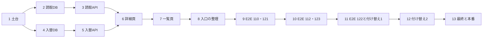

# グループ G-4 注文一覧表・注文の詳細・操作の移設・全件CSV 実装計画

> **For agentic workers:** REQUIRED SUB-SKILL: Use superpowers:subagent-driven-development (recommended) or superpowers:executing-plans to implement this plan task-by-task. Steps use checkbox (`- [ ]`) syntax for tracking.

**Goal:** 注文を「品物 × ステータス × 数量のまとまり」を1行とする12列の一覧表（`/admin/orders`）と注文の詳細頁（`/admin/orders/[id]`）で見られるようにし、返金・未入金取消・支払い済み取消・返品の作成/審査/受取/返金・キャンセル申請の審査・割当の入替を詳細頁から行えるようにする。旧い11列・支払い済みだけのCSVを、同じ12列で「絞り込みに合う全行」を同一時点で出すCSVに置き換え、旧い一覧・dialogの入口を整理する。

**Architecture:** 読取は G-2・G-3 と同じく `_actor_id` を取りDBが権限を確かめる関数にする。一覧・CSV・詳細は同じ内部関数 `private.group_g_order_item_rows`（G-1 の `group_g_item_state_ranges` の投影＋行金額の分割＋返金の配分）から作るので、数が食い違わない。書込みは新しい1本（`admin_swap_order_allocations`。G-1 が作った `transfer` の対で割当を直接移す）だけで、先頭で共通 advisory を取る。返金・取消・返品・申請の既存 route と dialog は変えず、置き場だけを詳細頁へ移す（J-12 の挙動もそのまま）。詳細頁の読取は DB の関数（原本・金額・品物の行・要対応の要約）と、旧い一覧 route から取り出した TS の要約の組立て（返金・返品・配送の要約）を1つの route で束ねる。

**Tech Stack:** 現行の Next.js `^16.3.6`、React `^19.0.0`、TypeScript `^5`、Supabase Postgres 17・PostgREST、Zod `^4.3.6`、`pg`、`tsx`、Jest、React Testing Library、Playwright。依存を増やさない。

**Spec:** [承認済みG設計](../specs/2026-10-23-group-g-design.md)の2章（画面表・ナビ・行のキーボード操作）・3章（3-1 の12列・絞り込み・20行・並び、3-2 のCSVと詳細、3-3 の行金額の分割）・6章（12状態・非表示2状態・管理と客の言葉・注文enum維持）・7章（7-3 の入替と全体ロック順）・8章（8-3 の窓口と境界）・9章（9-1〜9-3）・11章・12章（客向け画面とメールは変えない）・13章（13-1 の FREQ-520・523・536〜541 の G-4 部分、13-2 の FR-ADMIN-110・112・121・122・123、13-3 の G-4 に当たる行）・14章 G-4 行。基盤は [G-1計画](2026-10-24-group-g1-allocation.md)・[G-2計画](2026-10-24-group-g2-purchasing.md)・[G-3計画](2026-10-25-group-g3-shipping.md)と本番適用済みの移行（G-1 `20261023211425`、G-2 `20261024153505`・`20261024180500`、G-3 `20261025053324`・`20261025070821`・`20261025100130`・`20261025134538`）。台帳は `.superpowers/sdd/2026-10-24-group-g1-allocation/progress.md`・`…/2026-10-24-group-g2-purchasing/progress.md`・`…/2026-10-25-group-g3-shipping/progress.md` と G-3 の `final-review.md`。オーナーの判断は [判断表](../../05_Quality/reviews/code/2026-10-22-decision-sheet.md) の J-01（旧CSVを品物ごとの表で置き換える）・J-12（返金/取消の画面に注文番号、モバイルの×）。形式は G-1〜G-3 計画に合わせる。発注・受取・荷作り・発送票・会計の変更は作らない。

## 概要

| Task | 中身 | 移行 | FREQ | E2E |
|---|---|---|---|---|
| 1 | G-3 持ち越し（発送票の注文別の索引 M2・下書きの期限の境目 M3）と割当の理由 `allocation_swap` | 1本目（foundation）を作成 | 523基盤・540 | DB/単体 |
| 2 | 読取: 品物の行（金額の分割・返金の配分）・一覧・全件CSVの材料・詳細の材料・品物の状態の履歴 | 2本目（reads）を作成 | 520・536〜538 | DB |
| 3 | 読取のstore・CSV・API（一覧/CSV/詳細/履歴の拡張）と、旧い一覧 route の組立ての取り出し | — | 536〜539 | 単体 |
| 4 | 割当の入替: 書込み1本と候補の読取・許可一覧 75→76・並行・末尾 assert | 3本目（swap）を作成 | 523・540 | DB/DB並行 |
| 5 | 入替の store・API・権限の目録（`admin.orders.allocate` の「準備中」を外す） | — | 523・540 | 単体 |
| 6 | 注文の詳細頁（操作の移設・履歴の欄・入替dialog・J-12・更新後の読み直し） | — | 539・523 | 単体 |
| 7 | 注文一覧表の頁（12列・絞り込み・20行・CSV）・ORDER タブの入口化・要対応の欄の移設・旧一覧の撤去 | — | 536〜538・539 | 単体 |
| 8 | 入口の整理: 荷作り表/発送票から詳細へのリンク・旧い履歴dialogの撤去・旧い410の窓口6本の撤去・文書と route 数 | — | 539・540 | 単体 |
| 9 | E2E 道具（DB橋渡し）＋ FR-ADMIN-110・121 | — | 520・536〜538 | 2ファイル |
| 10 | E2E FR-ADMIN-112 ＋ FR-ADMIN-123(G-4) | — | 523・540 | 2ファイル |
| 11 | E2E FR-ADMIN-122 ＋ 返金/取消/要対応/履歴の既存E2Eの付け替え | — | 539・541 | 1ファイル＋書換15 |
| 12 | 返品/キャンセル申請/一覧の表示/配送/その他の既存E2Eの付け替えと整理 | — | 539・541 | 書換・削除 |
| 13（controller） | 全体検証・最終レビュー・本番の読取と適用・記録（pushしない） | — | — | 全件baseline比較 |

**決めたこと（ruling）**

- 範囲は設計14章の G-4 行（注文一覧12列・詳細・返金/取消/返品/入替の移設・全件CSV・残る旧一覧/dialog入口の整理）と、G-3 の最終レビューが G-4 へ持ち越した物だけ。作らない物: 会計・KPI の日付基準の変更、お客様向けの画面・メールの変更、新しい顧客メール、発注/受取/荷作り/発送票の機能変更、在庫履歴の表示の直し（G-1 の「発送取消の戻しが入荷と表示される」の件と G-2 の「書類検索の表のA4印刷の幅」の件は、一覧・詳細の作業が触れないので範囲外。開店前の報告に1行ずつ残す）。
- 移行は **3本**: `supabase/migrations/<ts1>_group_g4_orders_foundation.sql`＝G-3 持ち越しの索引と下書きの期限の境目・割当イベントの理由の追加、見込み 15〜30 KB。`<ts2>_group_g4_orders_reads.sql`＝品物の行・一覧・CSV・詳細・状態の履歴の読取（書込みなし）、見込み 55〜90 KB。`<ts3>_group_g4_orders_swap.sql`＝入替の書込み1本と候補の読取・許可一覧・末尾 assert、見込み 35〜60 KB。**ファイルの大きさに上限は設けない**（本番は `npx.cmd supabase db push --linked` でファイルごとに1取引で当てる）。バイト数と MD5 は記録し、150 KB を超えたらレビューの報告に書く。各ファイルは自身の末尾 assert（`-- G4A/G4B/G4C_FINAL_ASSERT_BEGIN/END`）を持つ。
- **データを変える文は書かない**（清掃・補完・権限行の再投入なし）。本番の変更はスキーマ・関数・1つの索引・1つの CHECK の作り直しだけ。`admin.orders.allocate` の権限行は G-0 が全コードを登録済みで、店長に付与済み・サポーターは不可（設計9-2）。この段階で権限行は触らない。
- **G-3 持ち越しの扱い（台帳 `.superpowers/sdd/2026-10-25-group-g3-shipping/progress.md` の Task 13 の行）:** M2（`shipment_slip_fulfillments(order_id)` の索引）→ Task 1。M3（確定が `expires_at < now()` で、読取と画面は `expires_at <= now()` で期限切れと呼ぶ差）→ Task 1 が `private.admin_confirm_shipment_slip` を `CREATE OR REPLACE` して `<=` にそろえる。`CREATE OR REPLACE` は同じ `pg_proc` の行を更新するので **OID・所有者・ACL・属性が保たれ**、書き手の許可一覧（OID の集合）は動かない（Task 1 の試験が OID の不変を証明する）。M4（G-3 の2ファイルの先頭に `BEGIN;` の前の注記がある）と M5（`restrict_fulfillment_record_update` が日本語の注記2行を落とした）は **直さない**: どちらも適用済みの G-3 の移行ファイルを編集することになり（適用後は編集しない）、動作の差も無い。台帳に「未実施・理由」を1行残す。
- **読取の方式:** 一覧・CSV・詳細・状態の履歴・入替の候補はすべて DB 関数で、最後の引数が `_actor_id uuid`（権限の組を DB が毎回確かめ、足りなければ `GROUP_G_FORBIDDEN / 42501`）。private 本体は SECURITY DEFINER・`search_path=''`・所有者 postgres、public 入口は service_role 専用の `LANGUAGE sql SECURITY INVOKER` 委譲（G-2・G-3 と同じ）。PostgREST は行数が 1000 を超えると**黙って切る**（G-1 台帳の Minor 3）ので、**一覧は1回20行（最大100行）、CSV・詳細は `jsonb` の1つの値で返し、履歴は最新300行までで切ったことを `truncated` で知らせる**。複数回に分けて読んで1つの表にする作りは採らない（同一時点にならないため）。
- **一覧の1行 = 1つの注文明細 × 1つの状態**（12状態の中で数量が0より大きい物）。1つの明細に同じ状態の離れた区間が複数あっても1行に合算する（数量・金額・返金額は区間ごとに計算してから足し、阻害理由は和集合）。並びは `注文日 DESC → order_id → order_item_id → 状態の定義順 → 最初の区間の開始`（設計3-1。最後の1つは同じ状態が離れた時の安定のために足す）。ページは20行（`ORDER_ITEM_PAGE_SIZE`）。総行数と注文数を分けて返す。`payment_in_progress`・`abandoned` の注文は投影が出さないので常に除かれる（設計3-1）。
- **行金額の分割（設計3-3）:** 行の元の金額 `net = order_items.line_total − private.order_line_discounts(order_id) の行別割引`（交換の行は 0）。状態の区間 `[a,b)`（0始まり・半開）の金額は `floor(net×b/Q) − floor(net×a/Q)`（`Q` は明細の数量。bigint の整数除算）。3点100円なら `33・33・34`、分け直しても総和は `net`。**返金額の配分（明細の成功した商品返金は、その明細の行に全額が付く）:** 成功した返金（`order_refunds.status='succeeded'`）の `order_refund_lines` だけを、明細ごとに、次の3つの種類に分けて配る。(a)`before_shipment=true`→`cancelled`、(b)`before_shipment=false` かつ返金に `return_id` あり→`returned`、(c)`before_shipment=false` かつ `return_id` なし→`delivered`、次に `shipped`。種類ごとに `R=Σamount`・`n=Σquantity`、対象の状態の区間を（状態の優先順→区間の開始）に並べた数量の合計を `T`、`m=min(n, T)` とする。**`m≥1` なら `R` の全額を先頭の `m` 個の数量に `floor(R×j/m) − floor(R×(j−1)/m)`（`j` は 1〜`m` の通し番号）で割る**（分母は `n` でなく `m`。同じ1点への部分返金が2回〔`n=2`・`T=1`〕でも、`R` は全額その1点の行に付く）。**`T=0`**（対象の状態の数量が無い）なら、その明細の**全区間**を（`status_rank` の昇順→区間の開始）に並べた数量の合計 `Q` を `T` とし、`m=min(n, Q)` で同じ式に回す（どの返金も自分の明細の行に付く。ほかの明細へは付かない）。区間の返金額は、その区間に入る数量の分の和（閉じた式: 種類の中で区間の前に積んだ数量 `s` と、区間のうち先頭の `m` 個に入る数量 `c` で `floor(R×(s+c)/m) − floor(R×s/m)`）。種類ごとの額を足したものが区間の返金額で、**明細の行の返金額の和は、その明細の成功した `order_refund_lines.amount` の和に一致する**。行に配らないのは**送料と調整額だけ**で、詳細の `amounts.refundNotAttached` は、成功した返金の `shipping_amount + adjustment_amount` の和を `order_refunds` から**直接合算**した値（差で出さない。調整額には負もあり、そのまま足す）。処理中（`awaiting_response`・`pending`）と失敗/エラーの返金は行の返金額に含めない（処理中の額は詳細の `refundProcessingAmount`）。**交換の行（`line_kind='exchange'`）の裁定:** 単価と金額は 0 のまま。**返金額は、その交換の行自身の成功した商品返金〔E-3 が交換品を返品して `exchange_paid_amount` を返す返金など、`order_refund_lines` がその交換の `order_item` を指す物〕だけ**を、ほかの明細と同じ種類ごとの規則で付ける（設計3-3「その行の商品返金だけ」）。元の返品行の額・返金を交換の行へ移さない（元の行が返金されても、自分の返金の無い交換の行は ¥0）。これで「明細の行の返金額の和＝その明細の成功した商品返金の和」が交換の行にも成り立つ。
- **絞り込み:** 日付（`dateFrom`/`dateTo`。日本時間の暦日）・注文ID（注文番号、または決済ID `pi_…`）・顧客名・メールアドレス・要対応は**注文単位**、商品名・色・サイズ・状態は**行単位**（合う行だけが出る。注文の共通欄は全行に付く）。要対応は「未解決の `payment_exceptions` がある、`review_reason` があり `reviewed_at` が空、`order_fulfillment_attention` に未解決がある」のどれか（`private.group_g_order_attention_ids`）。**一覧の注文の上限（controller の裁定）:** 総行数を出すために条件に合う注文を全部投影する作りの歯止めとして、一覧が1回に読む注文は、注文単位の絞り込み（品物の絞り込みは「その明細を持つ注文」として含み、状態は行単位なので含めない）に合う注文のうち**新しい `5000` 件〔`注文日 DESC → order_id`〕まで**とする。超えても**断らない**: 新しい5000件だけを読み、DB が `ordersCapped: true` と `ordersCap`（上限の値）を返し、画面は件数の近くに必ず注記を出して、黙って切らない（文は「画面の言葉」の表）。試験で小さい値を使えるよう、上限は `LEAST(5000, 設定値)`（設定 `app.group_g_list_cap_orders`。既定は未設定＝5000。**上げる側には効かない**。CSV の上限と同じ仕組みで、試験は取引内の `SET LOCAL`〔`set_config(…, true)`〕か、専用の接続で `set_config(…, false)` して `finally` で `RESET` する）。**CSV は別の規則**: 一覧の5000件の上限は CSV に及ぼさず、CSV は条件に合う**全行**を出し、行が `LEAST(20000, 設定 app.group_g_export_cap_rows)` を超える時（条件に合う注文が20000件を超える時も、行は注文数以上なので同じ）は黙って切らず `GROUP_G_EXPORT_TOO_LARGE` で断る（本文は注文日で絞るよう案内する）。**決済ID:** 旧い一覧にあった金額の範囲の検索は引き継がない（設計3-1の絞り込みに無く、行ごとの金額では範囲の意味が曖昧になる）。**決済ID〔`pi_…`〕の検索は残す**: 注文IDの欄の値が `pi_` で始まる（大文字小文字を問わない）時は、注文番号でなく `orders.payment_intent_id` の前方一致（`ILIKE <エスケープした値> || '%'`）で引く（Stripe のメールや争議から注文へ着く唯一の道。新しい絞り込みの項目も列も足さない）。**注文日の初期値（owner の決定）:** 一覧は**全期間から始める**（Shopify と同じ）。`注文日（から）` は空で、最初の読みにも `dateFrom` は付かない（利用者が選んだ時だけ付く）。
- **CSV（設計3-2）:** サーバーで DB 関数 `export_admin_order_item_rows` を1回（STABLE の1文＝1つのスナップショット）呼び、絞り込みに合う**全行**を同じ12列・同じ順で出す。`GET /api/admin/order-items/export`。`admin.orders.read` を毎回確かめる。UTF-8 BOM・全セルを `"` で囲み `"` は二重化・セル内の改行は保つ・行区切りは `\r\n`（最後の行の後にも付ける）。顧客入力などの**文字のセル**は先頭が `= + - @` かタブ/CR/LF なら先頭に `'` を足して式として評価されないようにする（数値のセルは整数だけなので対象外）。件数の上限は 20,000 行（`ORDER_ITEM_EXPORT_MAX_ROWS`）で、超えたら CSV を作らず `GROUP_G_EXPORT_TOO_LARGE`。旧い CSV（`admin/page.tsx` の `handleExportOrdersCsv`＝表示分のうち支払い済みだけを11列で出す）は**削除**し、ブラウザの取得済み行から CSV を作る経路は残さない。
- **詳細頁の読取:** `GET /api/admin/orders/[id]`（新設）が、DB 関数 `get_admin_order_detail`（原本・配送先・金額・品物の行・要対応の要約・実行者の権限の旗）と、旧い一覧 route から取り出した TS の要約の組立て（`buildAdminOrderSummary`＝支払い状態・返金の要約・返品の要約・配送の要約・取消の種類と払込期限・支払額の確認・不足している配送先の項目。Stripe の PaymentIntent の確認を含む）と、発送票のリンク（G-3 の `listAdminOrderShipmentSlips`。`admin.shipping.read` が無い人には `slips: null`）を1つの JSON にまとめる。旧い一覧 route `GET /api/admin/orders`（`src/app/api/admin/orders/route.ts`）は**削除**する（呼び手は旧い ORDER タブだけで、Task 7 が消す）。ボタンを出すかどうかは、役割の名前ではなく DB が返す `permissions` の旗（`read`・`manage`・`refund`・`return`・`allocate`・`shippingRead`）で決める。初期値では今と同じ（店長は全部、サポーターは `refund`・`allocate` が偽）。
- **操作の移設:** 返金・未入金取消・支払い済み取消・返品の作成/審査/受取/返金・キャンセル申請の審査・メール再送・確認済みにする・履歴は、**既存の route・dialog・hook を変えずに**、注文の詳細頁（`AdminOrderDetailSection`）から開く。dialog の props・文言・J-12（見出しに注文番号、390px では画面いっぱいと右上の×）は今のまま。詳細頁は操作の後に詳細・履歴・要対応の数を**読み直し**、読み直しに失敗したら古い値を成功のように見せず `最新の状態を読み込めませんでした。` を出す。要対応の欄（`AttentionInbox`）とメール停止の帯は注文一覧表の頁へ移し、欄の「もう一度返金する」「返品の返金をもう一度」「履歴を開く」は詳細頁への遷移（`?open=refund`・`?open=returns`・`#order-history`）にする。
- **履歴:** 既存の集約履歴（`GET /api/admin/orders/[id]/history`）を再利用し、新しい配列 `itemStates` と `itemStatesTruncated` を足す（品物・数量・変更前後の状態・人または自動・時刻・理由・参照＝発送票/発注書の受取/入替の相手の注文）。画面は旧 `OrderHistoryDialog` を `OrderHistoryPanel`（頁に埋め込む形）に改め、詳細頁の「変更履歴」の欄にする。メールの中身の表示・再送はこの欄の中にそのまま残る。
- **入替（設計7-3・FREQ-523）:** G-1 が作った `transfer` の対（出し手の割当の残数を減らし、受け手の新しい `paid` の割当を同じ操作で作る。台帳 `stock_movements` の行は持たない）で、同じ variant の割当を直接移す。「解放して FIFO に渡す」作りは採らない（G-1 台帳の持ち越し「transfer を使うか release＋allocate の対にするか」の答え）。空き在庫 F・手元の在庫・割当の総数は不変で、**FIFO は呼ばない**（余りが出ないため）。条件は `GROUP_G_SWAP_*` の表（共通の値）。**入金済みの判定は投影と同じ**: 注文の `status IN ('paid','shipped')`（交換の行は出荷済みの注文に付くことが多いので `paid` だけにしない。未入金・取消・失敗の注文は断る）。数量の確かめは投影の `in_production`/`ready` の区間から取るので、出荷済み・手数料待ちの数は自然に入らない。**出し手（donor）の明細に `cancel_requested` の区間か `refund_processing` の阻害理由つきの区間が1つでもあれば断る**（設計7-3「申請/返金対象外」。そうでない出し手では割当の数＝発送準備中の数なので、入替で出し手の発送準備中が必ず `q` 減り、両注文の状態の履歴が残る）。候補の一覧にも出さない。権限は `admin.orders.allocate` ＋ `admin.orders.read`（窓口とDB）。理由（1〜200字）は必須で、`private.group_g_operations.result` に残し、両注文の履歴に出す。冪等は `group_g_operations` の operation `allocation_swap`（request_key＋指紋）。割当の履歴の理由コードは `allocation_swap`（Task 1 で CHECK に足す）、品物の状態の履歴の理由も `allocation_swap`。
- **J-09（管理の「進み具合」と「支払い」の重複列）:** 一覧はその2つの列を持たない（品物のステータス1列に統合）ので満たす。詳細の `注文情報` の進み具合の印は今の `progress.label` のまま残し（既存のE2Eと文言を変えない）、そこに支払いの言葉〔未決済・決済失敗〕が残る重複は**既知の持ち越し**として開店前の報告に1行書く。
- **旧い入口の行き先（削除 or 移設の全件）:** 下の表。
- **push はしない**（ownerが G-4 以降までまとめてpushと決定）。Task 13 はコミット一覧を記録して止める。

**旧い入口の行き先**

| 現在の入口 | G-4 での行き先 | 証明 |
|---|---|---|
| `OrderSection`（ORDER タブの11列の一覧・各行の操作） | 削除。一覧は `AdminOrderItemListSection`、行の操作は詳細頁 | Task 7 の単体、E2E 121・122 |
| `admin/page.tsx` の一覧の状態・絞り込み・ページ・旧CSV・各dialogの state と handler | 削除（`fetchAttention` と `attentionTotal` のバッジ用の読取だけ残す） | Task 7 |
| ORDER タブ | `注文一覧表` への入口（`/admin/orders`）だけを出す。バッジと KPI の「（ORDER で確認）」は残る | Task 7、E2E 123 |
| `AttentionInbox`・メール停止の帯 | `/admin/orders` の頁へ移る | Task 7、E2E 060・067 |
| `OrderHistoryDialog`（一覧・要対応・荷作り表から開く） | `OrderHistoryPanel`（詳細頁に埋め込む）。荷作り表と発送票の注文IDは詳細頁へのリンク | Task 6・8 |
| `OrderRefundDialog`・`OrderPaidCancelDialog`・`OrderCancelDialog`・`OrderCancelRequestDialog`・`OrderReturnsDialog`（と返品の4つの子dialog/form） | 変更なしで詳細頁に置く | Task 6、E2E 122 |
| `GET /api/admin/orders`（旧い一覧） | 削除 → `GET /api/admin/order-items`・`…/export`・`GET /api/admin/orders/[id]` | Task 3 |
| `orders/[id]/completions`（POST）・`…/completions/[completionId]/cancel`（POST）・`orders/[id]/fulfillments`（GET・POST）・`…/fulfillments/[fulfillmentId]/cancel`・`…/tracking`・`…/delivered`（POST）の6ファイル7メソッド（G-1 から 410 を返すだけの窓口） | 削除（404 になる）。旧い4つのDB関数の `LEGACY_FULFILLMENT_DISABLED` は残す。呼び手が0件の証明は `src e2e tests` を対象に Task 8（窓口）と Task 12（停止文の module）で行う | Task 8・12、E2E 123・117 |
| `status`（POST）・`review`（POST）・`refund`（GET・POST）・`refund/confirm`・`returns`（GET・POST）・`returns/materials`・`cancel-requests`（GET）・`emails/resend`・`emails/[emailId]`・`history`（GET）・`returns/[returnId]/*`・`cancel-requests/[cancelRequestId]/*`・`order-attention`・`order-attention/deliveries/[attentionId]/resolve`・`payment-exceptions/[id]/resolve` | 変更なし（呼び手が詳細頁と一覧の頁に変わるだけ）。`history` は応答に `itemStates` を足す | Task 3・6 |

## Global Constraints

- 実装はmaster。実装者はコミットせず、controllerがTaskのFilesだけを確認してコミットする。既存の `.claude/CLAUDE.md`・`package.json`・`.superpowers/` の差分と、**別セッション（認証・admin-misc・stockist・news・look の修正）の未コミットの差分**を保持し、触らない。共有の文書（`requirements.md`・`test-spec.md`・`api-spec.md`・`route-inventory.md`・2つの route 数の試験・作業と指摘の台帳）と、別セッションの領域にある `src/lib/auth/role-permission-catalog.ts`・その試験・`e2e/FR-ADMIN-109-permission-settings.spec.ts` は、**controller が先にそのセッションへ知らせてから pathspec でコミットする**。ブランチ/worktreeは作らない。**pushしない**。
- 移行は上の3本。`npx.cmd supabase migration new --help` を確認し、実装時UTCの `<ts>` で作る。`<ts1> < <ts2> < <ts3>` で、**3本とも現在末尾の `20261026010000_auth_return_intents.sql`（別セッション）より後**にする（`migration new` が前の時刻を出したら `20261026010001` から1ずつ増やして手で付ける）。適用済みSQLを変えず、UTF-8/BOMなし/LF。文字列リテラル・コメントの日本語は可だが、全角空白 U+3000・NBSP U+00A0・ゼロ幅文字は入れない（`group_g4_migration_asserts` が3本を走査する）。各ファイルの先頭行は `BEGIN;`（その前にコメントを置かない。G-3 の M4 を繰り返さない）、末尾は最終assert→`NOTIFY pgrst, 'reload schema';`→`COMMIT;` を**1組だけ**。節の印は `-- G4A_BODY_BEGIN/END`・`-- G4A_FINAL_ASSERT_BEGIN/END`（reads は `G4B`、swap は `G4C`）。**まだどの環境にも適用していない本計画の移行は、後の Task が同じファイルを編集してよい**（適用後は編集しない）。
- 新しい本体関数は private schema、所有者 postgres、`SECURITY DEFINER SET search_path = ''`、完全修飾名。公開RPCは service_role 専用の `LANGUAGE sql SECURITY INVOKER` 委譲（本体と同名・同引数・同戻り型）。各新objectの PUBLIC/anon/authenticated は個別 REVOKE、内部 helper は service_role からも REVOKE。**`USAGE ON SCHEMA private` を REVOKE/GRANT する文は書かない**。本計画は**新しい表を作らない**（`shipment_slip_fulfillments` に索引を足すだけ）。
- **書込み関数（入替の1本）は、引数検証の直後（他の表を読む前）に `private.lock_group_g_allocation_swap(...)`（Task 4）を呼ぶ**。helper の最初の文が共通 advisory（`pg_advisory_xact_lock(190521,1)`）。DBロック中にメール・追跡・外部I/Oを行わない。認可は route の「認可→CSRF→IP回数制限→actor回数制限→検証→RPC→監査」。actor は認可結果の `userId` だけから渡す。DB側も実行者の有効な役割・期限・権限の組を毎回確認する。読取は書込みでないので advisory を取らず、`STABLE`（1回の呼出し＝1つのスナップショット）にする。
- 秘密値・住所/電話/メール本文・トークン・生のDBエラーをログ/監査/エラー本文/報告へ出さない。監査のmetadataは対象ID・件数・結果コードだけ。パスの `id` は `z.string().uuid()` で確かめ、通らなければ `resource_id: null`。CSV・一覧の絞り込みの値（顧客名・メールの検索語）を監査やログに出さない。
- UI変更前に `node_modules/next/dist/docs/01-app/01-getting-started/05-server-and-client-components.md` と `01-app/01-getting-started/15-route-handlers.md` を読む。新storeは `server-only`、画面と共有する型・文・式は純粋な定義（`src/lib/orders/admin-orders/admin-order-types.ts`）。管理画面の部品は `clientFetch`（`src/lib/client-fetch.ts`）で窓口を呼ぶ。UIの文体は `docs/01_Planning/brand.md` の穏やかな語調に合わせる（絵文字・感嘆符なし）。
- 全画面検証は390/768/1280px（頁全体が横にはみ出さない。表は見出しを保ったスクロール領域）。行は選択欄・リンク・ボタンの操作で意図せず遷移しない。単体は `npx.cmd jest <paths> --runInBand`、型は `npx.cmd tsc --noEmit --incremental false`、lint は `npm.cmd run lint`。実装者は単体/型/lint、controllerはreset・DB結合/並行・build/E2E・最終レビュー・本番を担当する。実装者はDocker/Supabase CLI/DB/E2Eを起動しない。
- テスト題名は `FREQ-5xx-AC-0n: …` で始める。要求の追加は要求管理ルール（6列の表。`docs/02_Requirements/requirements.md`。本計画の画面は `scripts/trace/scope.json` の領域の外なので領域ファイルには書かない）。各Taskは自分の変更に対応する正本を同じコミットで更新する: 機能・UI→`requirements.md`・`docs/03_BasicDesign/ui/screen-list.md`・`screen-flow.md`・`docs/04_DetailDesign/pages/16_admin.md`、窓口→`docs/03_BasicDesign/api/api-spec.md`・`route-inventory.md`、DB→`docs/03_BasicDesign/data/er.md`・`docs/06_Operations/db-migrations.md`、処理・状態→`docs/04_DetailDesign/sequence/order-administration.md`・`sequence/inventory-allocation.md`・`states/inventory-allocation.md`、試験→`docs/05_Quality/tests/test-spec.md`。`docs/05_Quality/reports/traceability-report.md` は `npm.cmd run report:traceability` の生成物で手で直さない。文書冒頭の確認日を更新し、`npm.cmd run validate-docs` と `npx.cmd jest tests/unit/docs --runInBand` を通す（前からの失敗は分けて報告）。要求表のAC行が指す試験ファイルは同じコミットに存在させる。
- 客向けの画面・メール・言葉は変えない: `src/app/account/**`・`src/app/api/orders/**`・`src/lib/orders/status/**`・`src/lib/orders/email/**`（履歴の型 `order-history.ts` への `itemStates` の追加だけが例外で、メールの文面・送信は触らない）・`src/features/account/**` の差分が最終レビューで0であること。
- `graphify hook status` だけ確認し、再構築はcommit hookに任せる。

**全SQL Task共通のcontroller検証（以下「共通verify」）:** `npx.cmd supabase db reset` → G-1計画のGlobal Constraints「毎回のreset直後のPostgREST smoke」と同じ2要求（匿名anonと実authenticated JWT で `GET /rest/v1/items?select=id&limit=0` が各 **HTTP 200**。keyやJWTは出力しない）→ そのTaskのDB suiteを `npx.cmd jest <paths> --runInBand`。失敗は実装者へ返し、修正後もresetからやり直してGREENを得てからレビューへ送る。実装者の単体/型の成功でDBの代わりにしない。

**ロック順（G-1〜G-3 の全体順は変えない）:** `pg_advisory_xact_lock(190521,1)` → … → G-1 の補助行（`order_fulfillments`・`payment_exceptions`）。入替は `private.lock_group_g_allocation_swap(_order_id, _taker_order_item_id, _donor_order_item_id)` で取る: 共通 advisory を最初の文で取り、2つの明細から注文と variant を**advisory の後に読んで**閉包を決め、`private.lock_group_g_inventory(variant配列, 注文配列, NULL)` を呼ぶ（items FOR KEY SHARE → item_variants FOR UPDATE → orders → order_items → 割当行 → 返品系 → 返金系 → 申請系 → 補助行。いずれも id 昇順）。入替は発注書・発送票の行を取らない。呼び手は対象を後から足して前段へ戻らない。

## 共通の値

**定数**

| 名 | 値 |
|---|---|
| 状態の定義順（`ORDER_ITEM_STATUS_ORDER`。`status_rank` は 1 始まり） | `unpaid`(1)・`payment_expired`(2)・`in_production`(3)・`ready`(4)・`shipped`(5)・`delivered`(6)・`cancel_requested`(7)・`cancelled`(8)・`return_requested`(9)・`return_in_progress`(10)・`refund_waiting`(11)・`returned`(12)。`src/lib/orders/item-state/item-state-types.ts` の `ADMIN_ITEM_STATUS_LABELS` のキー順と同じ（試験が突き合わせる） |
| 状態の管理用の言葉（既存の `ADMIN_ITEM_STATUS_LABELS`） | 未払い・支払い期限切れ・受注生産中・発送準備中・発送済み・配達済み・キャンセル申請中・キャンセル済み・返品申請中・返品受付中・返金待ち・返品済み（お客様向けの言葉は別の辞書で、変えない） |
| 一覧の頁 | 20行（`ORDER_ITEM_PAGE_SIZE`）。`page` は 1〜100000。DB 関数の `_limit` は 1〜100、`_offset` は 0 以上 |
| 一覧の注文の上限 | 新しい5000件（`ORDER_ITEM_LIST_ORDER_CAP`。超えたら断らず、`ordersCapped: true`・`ordersCap` を返して画面が注記を出す）。CSV の行の上限 20000（`ORDER_ITEM_EXPORT_MAX_ROWS`。超えたら `GROUP_G_EXPORT_TOO_LARGE`。一覧の上限は CSV に及ばない） |
| 一覧の上限の注記（`ORDER_ITEM_CAP_NOTE(cap)`） | `新しい${cap を 5,000 のように3桁区切りにした数}件の注文だけを表示しています。それより前の注文は「注文日（まで）」で期間を絞ると表示されます。`（本番の上限 5000 では `新しい5,000件の注文だけを表示しています。それより前の注文は「注文日（まで）」で期間を絞ると表示されます。`）。上限に達した時だけ出す |
| 絞り込みの値（jsonb `_filters` と、窓口の問合せ） | `dateFrom`/`dateTo`＝`YYYY-MM-DD`（日本時間の暦日。`dateFrom <= dateTo`）、`orderNumber`（画面の欄は「注文ID」）＝次の2通り。値が `^pi_[A-Za-z0-9_]{1,197}$`（`pi_` を含めて全体が200字以内という下の上限の中に収まる形。大文字小文字を問わない）に合えば決済ID: `orders.payment_intent_id` の前方一致（`ILIKE` で、エスケープした値の後ろに `%` を付ける）。それ以外は `ORD-` の有無・大文字小文字を問わず先頭一致の16進（8文字の表示番号か、完全な UUID。16進と `-` 以外が残れば `GROUP_G_ARGUMENT_INVALID`）、`customer`＝配送先の氏名の部分一致、`email`＝メールの部分一致、`product`・`color`・`size`＝部分一致、`statuses`＝12の状態から0〜12個、`attention`＝真偽。文字列は trim 後 1〜200字。部分一致は `ILIKE`（`\`・`%`・`_` はエスケープ）。知らないキー・形の違いは `GROUP_G_ARGUMENT_INVALID`。窓口の問合せは `status` を繰り返す（`status=ready&status=shipped`）、`attention=1`。知らない問合せ名は 400 |
| 12列（`ORDER_ITEM_COLUMNS`。画面とCSVの見出しと順） | `注文ID`・`注文日`・`顧客名`・`メールアドレス`・`商品名`・`色`・`サイズ`・`数量`・`単価`・`合計金額`・`返金額`・`ステータス` |
| 12列の中身 | 注文ID＝`toOrderNumber(order_id)`（`ORD-` ＋ UUID先頭8字の大文字）。注文日＝日本時間 `YYYY-MM-DD HH:mm`。顧客名＝`shipping_full_name`（画面は空なら `ゲスト`、CSVは空）。メール＝`shipping_email`（画面は空なら `-`、CSVは空）。商品名・色・サイズ＝購入時の写し（`order_items`）。交換の行は商品名の後ろに `（交換品）`。数量＝その状態の数量。単価＝`item_price`（交換は 0）。合計金額・返金額＝上の分割（画面は `¥12,800`、CSVは整数）。ステータス＝管理用の言葉 |
| CSV | ファイル名 `order-items_YYYY-MM-DD.csv`（日本時間）。`Content-Type: text/csv; charset=utf-8`・`Content-Disposition: attachment; filename="…"`・`Cache-Control: no-store`。先頭に BOM `U+FEFF`、見出し行、全セルを `"` で囲む、行区切り `\r\n`（最後にも） |
| 品物の阻害理由の言葉（`ITEM_BLOCKED_REASON_LABELS`） | `variant_missing`＝色・サイズが確定していません／`payment_review`＝支払額の確認待ちです／`exchange_fee_waiting`＝交換手数料のお支払い待ちです／`cancel_requested`＝キャンセルの申し込みを確認中です／`refund_processing`＝返金を処理中です／`stock_shortage`＝在庫の入荷待ちです |
| 状態の履歴の理由の言葉（`ITEM_STATE_REASON_LABELS`。知らない値は `システムによる更新`） | `place_order_from_checkout_draft`＝注文の受付／`stripe_payment_awaiting`＝支払い待ち／`stripe_payment_paid`＝入金の確認／`fifo`＝古い注文から順の自動割当／`stock_move`＝在庫の入出庫／`purchase_order_receive`＝発注の受け取り／`shipment_slip_confirm`＝発送の確定／`shipment_slip_cancel`＝発送の取消／`shipment_slip_tracking_update`＝伝票番号の更新／`shipment_slip_deliver`＝配達済みの記録／`delivery_reflect`＝配送の状況の反映／`begin_order_refund`＝返金の受付／`mark_order_refund_error`＝返金の失敗／`admin_cancel_failed_order`＝決済失敗の注文の取消／`record_cancelled_order_payment`＝取消後の入金／`resolve_payment_exception`・`resolve_payment_exception_by_system`＝支払いの要対応の解決／`customer_request_cancel`＝お客様のキャンセルの申し込み／`admin_decline_cancel_request`＝キャンセルの申し込みのお断り／`admin_close_cancel_request`＝キャンセルの申し込みを閉じる／`admin_resolve_cancel_request`＝キャンセルの申し込みの解決／`customer_request_return`＝お客様の返品の申し込み／`admin_create_return`＝返品の作成／`admin_approve_return`＝返品の承認／`return_declined_restore`＝返品のお断りによる復帰／`admin_cancel_return`＝返品の取消／`admin_receive_return`＝返品の受け取り／`admin_inspect_return`＝返品の検品／`admin_close_return_missing`＝届かない返品の完了／`admin_reopen_return`＝返品の開き直し／`admin_refund_return`＝返品の返金／`admin_record_return_fee_payment`＝返品の手数料の受け取り／`admin_release_return_exchange`＝支払いを待たずに交換品を送る／`allocation_swap`＝割当の入替 |
| operation（`private.group_g_operations`） | `allocation_swap`。cause_type `order_item`、cause_id＝受ける側（taker）の注文明細の id。指紋は SHA-256 hex（actor を含む） |
| 割当イベントの理由（CHECKへ追加） | `allocation_swap`（18値目）。TS の `ALLOCATION_EVENT_REASON_CODES` に同じ順で足し、日本語 `割当の入替`（`ALLOCATION_EVENT_REASON_LABELS`）を同じコミットで足す |

**権限の組（窓口とDBの両方で同じ条件。コードには `admin.` が付く）**

| 窓口・DB関数 | 必要な権限（すべて） |
|---|---|
| 一覧・CSV・詳細・履歴・状態の履歴（`GET /api/admin/order-items`・`…/export`・`GET /api/admin/orders/[id]`・`…/history`、DB の `list_admin_order_item_rows`・`export_admin_order_item_rows`・`get_admin_order_detail`・`list_admin_order_item_state_history`） | `admin.orders.read` |
| 詳細に添える発送票のリンク（`list_admin_order_shipment_slips`。G-3） | `admin.shipping.read` + `admin.orders.read`（足りない人には `slips: null`。詳細そのものは返す） |
| 入替の候補と入替（`GET …/allocations/swap-candidates`・`POST …/allocations/swap`、DB の `list_admin_allocation_swap_candidates`・`admin_swap_order_allocations`） | `admin.orders.allocate` + `admin.orders.read` |
| 移した操作（返金・取消・返品・申請・再送・確認済み） | 今までの各窓口のとおり（変えない） |

初期値: 店長は全部。サポーターは一覧・詳細・CSV・履歴を見られ、入替はできない（`admin.orders.allocate` は初期付与しない）。店長が画面で付け外しした値は DB でも効く。役割が複数ある実行者は有効な全役割の和集合で判定する（`private.group_g_actor_has_permissions`）。route が足りない権限を `403 { error:'Forbidden', permission:<最初に足りない権限>, role }`、MFA(aal2)が無いと既存と同じ `{ error:'Forbidden', reason:'MFA required', … }`。詳細が返す `permissions` の旗は、DB が実行者について `read`＝`admin.orders.read`・`manage`＝`admin.orders.manage`・`refund`＝`admin.orders.refund`・`return`＝`admin.orders.return`・`allocate`＝`admin.orders.allocate` かつ `admin.orders.read`・`shippingRead`＝`admin.shipping.read` かつ `admin.orders.read` を数えた真偽。

**回数制限（GETのCSVとPOSTの入替は `enforceRateLimit` をIPとactor `subject: authz.userId` の2回、窓は600秒）:** CSV `admin.orders.export` 20、入替 `admin.orders.allocation.swap` 30。一覧・詳細・履歴・候補のGETは回数制限なし。

**監査（`logAudit`。成功/failure/error の3結果、metadataは対象ID・件数・結果コードだけ）:** `admin.orders.allocation.swap`（resource `orders`、resource_id＝受ける側の注文id。metadata は `quantity`・`replayed`）、`admin.orders.export`（resource `orders`、resource_id null。metadata は `row_count`・`order_count`・`filter_keys`＝使った絞り込みの**名前**の配列。値は残さない）。

**DBエラー（message / SQLSTATE → HTTP → 本文。store は `message` と `code` の完全一致でだけ分類し、未知・不正な戻り値は500、生のエラーは返さない。純粋な定義を `admin-order-types.ts`〔`ADMIN_ORDER_ERRORS`〕と `allocation-swap-types.ts`〔`ALLOCATION_SWAP_ERRORS`〕に置き、store と E2E の橋渡しが同じ表を使う）**

`ADMIN_ORDER_ERRORS: Record<string, readonly [sqlstate: string, status: number, body: string]>`

| message / SQLSTATE | HTTP | 本文 |
|---|---|---|
| `GROUP_G_ARGUMENT_INVALID / 22023` | 400 | `入力を確かめてください。` |
| `GROUP_G_FORBIDDEN / 42501` | 403 | `注文を見る権限がありません。` |
| `GROUP_G_ORDER_NOT_FOUND / P0002` | 404 | `注文が見つかりません。` |
| `GROUP_G_EXPORT_TOO_LARGE / 22023` | 422 | `条件に合う行が多すぎます（上限 20,000 行）。「注文日（から）」「注文日（まで）」で期間を絞ってください。` |

未知の失敗は 500 `注文の情報を読み込めませんでした。`

`ALLOCATION_SWAP_ERRORS`

| message / SQLSTATE | HTTP | 本文 |
|---|---|---|
| `GROUP_G_ARGUMENT_INVALID / 22023` | 400 | `入力を確かめてください。` |
| `GROUP_G_FORBIDDEN / 42501` | 403 | `割り当てを入れ替える権限がありません。` |
| `GROUP_G_REQUEST_KEY_CONFLICT / 23505` | 409 | `同じ要求番号で異なる操作は実行できません。` |
| `GROUP_G_SWAP_REASON_REQUIRED / 22023` | 400 | `理由を入力してください。` |
| `GROUP_G_SWAP_ITEM_NOT_FOUND / P0002` | 404 | `品物が見つかりません。` |
| `GROUP_G_SWAP_SAME_ORDER / 22023` | 409 | `同じ注文の品物どうしでは入れ替えられません。` |
| `GROUP_G_SWAP_VARIANT_MISMATCH / 22023` | 409 | `色・サイズが同じ品物どうしだけ入れ替えられます。` |
| `GROUP_G_SWAP_ORDER_NOT_PAID / 22023` | 409 | `入金が確認できていない注文は入れ替えられません。` |
| `GROUP_G_SWAP_TAKER_ON_HOLD / 22023` | 409 | `支払額の確認または交換手数料のお支払いを待っている品物には割り当てられません。` |
| `GROUP_G_SWAP_DONOR_PENDING_REQUEST / 22023` | 409 | `キャンセルの申し込みか返金の処理中の数がある品物の割当は入れ替えられません。` |
| `GROUP_G_SWAP_DONOR_ON_HOLD / 22023` | 409 | `支払額の確認などで止まっている割当は入れ替えられません。` |
| `GROUP_G_SWAP_QUANTITY_EXCEEDS_TAKER / 22023` | 409 | `割り当てを受ける品物の、受注生産中の数を超えています。` |
| `GROUP_G_SWAP_QUANTITY_EXCEEDS_DONOR / 22023` | 409 | `割当元の、発送準備中の数を超えています。` |

未知の失敗は 500 `割当の入替に失敗しました。`。DBの内部エラー（`GROUP_G_INVENTORY_LOCK_REQUIRED / 55000`・`GROUP_G_ALLOCATION_BOUNDS / 23514`・`GROUP_G_HISTORY_IMMUTABLE / 55000`）は表に載せず 500 にする。本文に注文番号・氏名を載せない。

## Review Focus

- **行金額の分割と総和:** 3点100円が `33・33・34` に割れ、状態を分け直しても総和が `net` に一致すること。割引は既存の `private.order_line_discounts` を使い、新しい配賦を作らないこと。返金額は**その明細の成功した商品返金だけ**が、その明細の行に**全額**付き（同じ1点への部分返金が2回でも、対象の状態が0個でも、行の和＝その明細の成功した `order_refund_lines.amount` の和）、他の明細・処理中・失敗・送料・調整額が行に入らないこと。`refundNotAttached` は成功した返金の送料＋調整額の直接の合算で、差し引きの残りにしない。交換の行の単価・金額が 0 円のままで、元の行の額・返金を引き継がず、交換の行自身の成功した返金だけが返金額に付くこと。行の金額の合計 ＝ 商品の正味額が詳細で突き合うこと → Task 2。
- **CSVの安全と一貫:** 先頭が `= + - @` / タブ / 改行の顧客入力が式として評価されないこと、`"` と改行を含むセルが壊れないこと、BOM、`\r\n`、12列の見出しと順が画面と同じこと。絞り込みに合う**全行**（頁の外も含む）が**同じ時点**で出ること、20,000行を超えたら黙って切らず断ること、権限が毎回確かめられ権限なしには何も出ないこと → Task 2・3・9。
- **入替の競合とロック順:** 入替が FIFO・入金・返金・取消・返品・発送確定・棚卸減の書き手と同じ共通 advisory の下で動き、逆順の待ち（deadlock）が0であること。入替の最中に donor の割当が発送確定・取消で消えたら、数量の確認で断られ、割当の総数・空き在庫・手元の在庫が保たれること。入替の後に自動 FIFO が入替を奪い返さないこと。同じ `request_key` の再送で二重に移らないこと → Task 4。
- **権限の迂回:** 旧い一覧 route・旧い CSV・旧い 410 の窓口・旧い dialog 経由で、`admin.orders.read` / `admin.orders.allocate` / `admin.orders.refund` の確認を通らずに読み書きできる道が残らないこと。UI の旗はDB の答えに従い、UIを隠すだけにしないこと。サポーターは入替の入口が出ず、窓口もDBも断ること → Task 3・5・7・8・10。
- **客向けを変えない:** お客様の注文画面・状況ページ・メールの言葉と公開範囲が変わらず、管理用の12状態の言葉（`返品受付中`・`キャンセル申請中`・`支払い期限切れ`）が客向けの画面に出ないこと。履歴の型への追加が客向けの応答に漏れないこと → Task 3・11・13。
- **E2E の安定（4並列）:** 一覧・CSV・入替の確かめは、試験ごとに固有のメールアドレスを持つ注文を新しく作り、そのメールで絞り込んで読む（全体の件数を使わない）。読みは DB 関数の1回の呼出し（同一時点）で、頁めくりを歩かない。DB の既定の権限に頼る case は `withOrderAdminScenario`（共有の鍵 `190520,0`）の中、役割の権限を付け外しする case〔112 ⑦・123 ④〕だけが `withPermissionScenario`（排他の鍵 `190520,0`）の中。追跡の設定を変える試験は `withDeliveryScenario` の排他の鍵 `940488` の中。鍵の順は `940488` → `14314,2` → `190520,0` → Task 9〜12。
- **黙った切り捨て:** 1000行を超える結果を黙って返さないこと（一覧は最大100行、CSV・詳細は jsonb、履歴は300行で切って `truncated` を出す）。一覧が新しい5000件の注文で切る時は、必ず `ordersCapped`・`ordersCap` を返し、画面が件数の近くに注記を出すこと（行が0件でも旗は返る）。CSV は一覧の上限を受けず、全行か断りのどちらかだけ → Task 2・3・7・9。
- **行からの遷移:** 行はリンクとしてキーボード（Tab で行に着き Enter/Space）で詳細を開け、注文IDのリンクと行の他の部分が二重に遷移しないこと → Task 7・9。

---

## 要求と受入条件（`docs/02_Requirements/requirements.md` の6列の表へ足す文）

FREQ-536〜539 は新規の行（REQ-01 の文は下のとおり。FREQ-535 の次の行から続けて足す）、FREQ-520・523・540・541 は既存の行（G-1〜G-3 で作成済み）へ AC を足す。各 AC は、それを証明する試験を持つ Task が**その Task のコミットで**行（または AC の文）を足す（要求表の AC が指す試験ファイルは同じコミットに存在させる）。FREQ-523 の既存文「公開操作/FR-ADMIN-112はG-4未実装」は Task 4・5 で現在の文へ直す。FREQ-520 の既存文「新一覧110はG-4」は Task 2 で直す。

| 要求 | REQ-01 の要件 | AC | 証明する Task |
|---|---|---|---|
| FREQ-536（注文一覧表が品物×ステータスの12列で、絞り込み・20行の頁・行から詳細へ。G-4） | 管理メニューの ORDER から「注文一覧表」（/admin/orders）へ進み、DB の関数が返す行を「注文日の新しい順→注文→明細→状態の定義順」で20行ずつ表示する。列は左から「注文ID・注文日・顧客名・メールアドレス・商品名・色・サイズ・数量・単価・合計金額・返金額・ステータス」の12で、注文の共通欄は全行に付き、交換の行は商品名に「（交換品）」が付く。日付・注文ID（注文番号、または決済ID pi_…）・顧客名・メール・商品名・色・サイズ・ステータス・要対応で絞り込め、総行数と注文数を分けて出す。注文日は全期間から始め、条件に合う注文が5000件を超える時は新しい5000件だけを読んで（断らず）その旨を件数の近くに出す。行はリンクとしてキーボードで詳細を開ける。権限は admin.orders.read を窓口とDBで確かめる | AC-01 12列・共通欄・交換の印／AC-02 絞り込み（注文単位と行単位）／AC-03 20行・総行数と注文数・安定した並び・支払い手続き中と放棄の除外・新しい5000件の注文で切る時の旗と注記（0行でも出す・黙って切らない）／AC-04 行から詳細（リンクとキーボード）・横にはみ出さない／AC-05 読取の権限（窓口とDB） | AC-01・02・03・05: 2・3、AC-01〜04: 7 |
| FREQ-537（行の商品額とその行の商品返金だけを状態の数量に分け、総和が合うこと。G-4） | 行の金額は、明細の `line_total` から既存の行別割引（private.order_line_discounts）を引いた額を、状態の区間ごとに累積の切り捨て（floor(net×b/Q)−floor(net×a/Q)）で割る。返金額は成功した返金の商品の行だけを、種類（発送前・返品・発送後）ごとに対応する状態の数量へ、その明細の行に全額が付くように配る（対象の状態に数量が無い返金も、同じ明細のほかの行へ付く）。行に配らないのは送料と調整額だけで、詳細の内訳に出す。交換の行は単価・金額が0円で、返金額はその交換の行自身の成功した商品返金だけ | AC-01 3点100円が33・33・34で総和が正味額に一致／AC-02 割引のある注文の行別割引の再利用／AC-03 返金額はその明細の成功した商品返金だけ・同じ1点への部分返金が2回でも対象の状態が0個でも行の和＝その明細の成功した商品返金の和・処理中と失敗は含めない／AC-04 交換の行は単価・金額が0、返金額はその交換の行自身の成功した返金だけ（元の行の返金は移さない。自分の返金の無い交換の行は¥0）／AC-05 詳細の内訳（正味額・割引・送料・合計・返金・送料と調整額の返金）が行と突き合う | 2・3・7 |
| FREQ-538（旧CSVを12列に置き換え、絞り込みに合う全行を同じ時点で出すこと。G-4） | 一覧の「CSV出力」はサーバーで絞り込みに合う全行（頁の外も含む）を同じ12列・同じ順で出し、UTF-8のBOM・全セルの引用符・セル内の改行・行区切りCRLFを正しく扱い、文字のセルの先頭が = + - @ タブ 改行なら先頭に ' を足して式として評価されないようにする。読取の権限を毎回確かめ、ブラウザの取得済み行からは作らない。20,000行を超える条件は黙って切らず、注文日で絞るよう案内して断る（一覧の5000件の上限は受けない）。旧い11列のCSVは廃止する | AC-01 旧CSVの廃止と新しい12列の見出し／AC-02 絞り込みの全行を頁に関係なく同じ時点で出す／AC-03 BOM・引用符・改行・CRLF／AC-04 式の無害化／AC-05 権限の確認と回数制限・上限の断り | 2・3・7・9 |
| FREQ-539（返金・取消・返品・キャンセル申請・入替を詳細へ集約し、履歴・要対応・票リンクを維持すること。G-4） | 注文の詳細（/admin/orders/[id]）は、注文情報と配送先、支払いと返金、品物（状態別）、発送（発送票と注文別の発送へのリンク）、返品とキャンセルの申し込み、要対応、変更履歴を並べ、返金・未入金取消・支払い済み取消・返品の作成/審査/受取/返金・キャンセル申請の審査・メール再送・確認済み・割当の入替をここから行う。既存の入力・不可条件・権限・J-12（見出しに注文番号、390pxで画面いっぱいと右上の×）はそのまま。操作の後は詳細・履歴・要対応を読み直し、読み直しに失敗したら古い値を成功のように見せない | AC-01 詳細の構成と各欄／AC-02 操作の入口が詳細にあり、権限の旗に従う（サポーターは返金なし）／AC-03 J-12の見出しと×・更新後の読み直しと失敗時の表示／AC-04 要対応・履歴（品物の状態の変化）・メール再送・発送票リンクの維持／AC-05 旧い一覧・dialogの入口の撤去と、荷作り表・発送票から詳細への動線 | 3・6・7・8・11 |
| FREQ-523（既存。AC を追加） | 詳細から同じ variant の割当を、理由つきで、受注生産中の品物へ直接移せる。両注文の履歴に残り、割当の総数・空き在庫・手元の在庫は変わらず、自動FIFOが奪い返さない | AC-02 入替の条件と断り（同じ注文・色サイズ違い・未入金〔出荷済みの注文の交換の行は断らない〕・手数料待ち・支払額の確認・出し手のキャンセル申し込み/返金処理中・数量超過・理由なし）／AC-03 transfer の対・割当の総数と空き在庫の保存・両注文の状態と履歴／AC-04 自動FIFOが入替を奪い返さない・再送で二重にならない・並行／AC-05 詳細の入替dialog・候補・サポーターは入口なし | 4・5・6・10 |
| FREQ-520（既存。AC を追加） | 一覧の12状態が数量で排他的に表示され、管理と客の言葉が分かれ、注文のenumは維持される | AC-03 新一覧で12状態の言葉・数量の分割・非表示2状態の除外・NULL variant の扱い、客向けの画面に管理の言葉が出ない | 2・9 |
| FREQ-540（既存。AC を追加） | 一覧・CSV・詳細・入替の権限を画面・API・DBで同じ条件にする | AC-13 orders.read（一覧/CSV/詳細）・orders.allocate+orders.read（入替）の組と初期値・オフでもDBで効く／AC-14 書き手の閉集合が76本で入替が共通advisoryを最初に取る・確定の下書きの期限の境目をそろえた置換でOIDが変わらない／AC-15 旧い一覧・旧い410の窓口・旧dialog入口が残らず迂回できない | 1・2・3・4・5・8・10 |
| FREQ-541（既存。AC を追加） | E-1〜E-5 の金銭/数量/配送/返品/メールと客向けの公開範囲を保つ | AC-05 客向けの画面・メール・言葉と履歴の客向け応答が変わらない（G-4）／AC-06 G-4 で付け替え・移設・削除した既存E2Eの処置と全件baseline比較 | 3・11・12・13 |

## 一覧・詳細・入替の画面の言葉

| 場所 | 文字・動き |
|---|---|
| ORDER タブ（`/admin?tab=ORDER`） | `<nav aria-label="注文メニュー">` に Button（`variant="secondary"`）`注文一覧表`（`href="/admin/orders"`）だけを置く。サイドナビの ORDER のバッジ（要対応の件数）と KPI 画面の「（ORDER で確認）」はそのまま |
| 注文一覧表 `/admin/orders` の上部 | 見出し `注文一覧表`、説明 `品物ごとに、ステータス別の数量で1行ずつ表示します。行を選ぶと注文の詳細を開きます。`。その下に、メール停止の帯（今の文のまま）、`AttentionInbox`、要対応の一行（`return-attention`。`返品の申し込み N件`・`返金待ち N件`〔`RETURN_DISPLAY_STATUS_LABELS`〕・`キャンセルの申し込み N件`。0件は出さない。押すと状態を `return_requested`／`refund_waiting`／`cancel_requested` の1つだけにしてほかの絞り込みを外し、もう一度押すと外す。`aria-pressed`）。この欄に `id="attention"` を付ける |
| 絞り込み | `<form aria-label="注文の絞り込み">`。入力 `注文日（から）`（初めて開いた時は空＝全期間）・`注文日（まで）`（`DateTimePicker mode="date"`）・`注文ID`（placeholder `ORD-… または pi_…`。決済ID〔pi_…〕は前方一致）・`顧客名`・`メールアドレス`・`商品名`・`色`・`サイズ`（`SearchField`）。`ステータス`（見出し。12の状態のトグル。`ADMIN_ITEM_STATUS_LABELS` の言葉、`aria-pressed`、複数選べる）。`要対応のみ`（トグル）。ボタン `絞り込む`（submit。Enter でも送れる。送るまで読み直さない）・`条件をクリア`。日付が逆なら `期間指定が不正です。開始日は終了日以前にしてください。` を出して読まない |
| 表 | 見出し行を保つスクロール領域（頁全体は横にはみ出さない）。列は12列の見出しのとおり。注文IDのセルは `Link`（`/admin/orders/${id}`、文字は注文番号）。`<tr tabIndex={0}>` に `aria-label="${注文番号} ${商品名} の詳細を開く"`、行の押下と Enter/Space で同じ頁へ移る（注文IDの `Link` を押した時は二重に移らない）。ステータスのセルは `StatusBadge` ＋ 要対応の注文には `TagLabel` `要対応`。金額は `¥12,800` |
| 件数・頁・CSV | `${totalRows}行（${totalOrders}件の注文）`。**上限（新しい5000件の注文）に達した時（`ordersCapped`）は、件数の行を `${totalRows}行（新しい${totalOrders}件の注文の中で）` にし、その近くに注記**（`data-testid="cap-note"`、`role="status"`）`新しい${ordersCap を 5,000 のように3桁区切りにした数}件の注文だけを表示しています。それより前の注文は「注文日（まで）」で期間を絞ると表示されます。`（本番では `新しい5,000件の注文だけを表示しています。それより前の注文は「注文日（まで）」で期間を絞ると表示されます。`）を出す。行が0件でも `ordersCapped` なら出す。上限に達していない時は注記を出さない。`${page} / ${totalPages}ページ`、`前の頁`・`次の頁`、`CSV出力`（説明 `現在の絞り込みに合う全行を出力します。`。CSV は一覧の上限を受けない）。作成中 `CSVを作成しています...`、失敗 `CSVを出力できませんでした。`、上限は `ADMIN_ORDER_ERRORS` の本文 |
| 状態 | 空 `条件に一致する品物はありません。`、読込中 `注文一覧を読み込み中です...`、失敗 `注文一覧を読み込めませんでした。`、403 `注文一覧を見る権限がありません。`。絞り込みの値は URL に載せない（画面の state と、このタブの `sessionStorage` の `admin-order-list-state`〔適用した条件・頁。読み書きは try/catch で包み、使えなくても動く〕にだけ持ち、詳細から「注文一覧表へ戻る」で開き直すと復元する。個人情報を URL にしない） |
| 注文の詳細 `/admin/orders/[id]` | 見出し `注文 ${注文番号}`、戻る Button `注文一覧表へ戻る`。読込中 `注文を読み込み中です...`、404 `注文が見つかりません。`、403 `注文を見る権限がありません。`、失敗 `注文を読み込めませんでした。`。h2 を次の順に並べる: `注文情報`・`支払いと返金`・`品物`・`発送`・`返品とキャンセルの申し込み`・`要対応`・`変更履歴`（`id="order-history"`） |
| 注文情報 | 注文日・注文ID・進み具合（`StatusBadge`。言葉は今の `progress.label`）・一部発送済みの印・顧客名（空は `ゲスト`）・メール（空は `-`）・配送先（郵便番号・都道府県・市区町村・住所・建物・電話）・支払い方法・支払いの参照。配送先が足りない時は `配送先の情報が足りません（${項目}）`、支払額の違いの要対応が開いている時は `支払額の確認が必要です（要対応）` |
| 支払いと返金 | `商品の正味額`・`割引`・`送料`・`合計`・`受け取った額`・`返金済み（成功）`・`返金の手続き中`・`送料・調整額の返金`（`amounts.refundNotAttached`）。支払い状態の `StatusBadge`（今の6つの言葉）、`返金の手続き中`・`返金の失敗` の印。ボタン `返金`（`permissions.refund` かつ返せる額が残る時）、`キャンセル`（未入金の取消は `permissions.manage`、支払い済みは `permissions.refund`）。払込票の期限・確かめられない時の文は今のまま（`払込票の期限切れが確定するまで取り消せません（払込期限 …）`・`支払いの状態を確かめられないため、今は取り消せません`） |
| 品物 | 表の列 `商品名`・`色`・`サイズ`・`ステータス`・`数量`・`単価`・`合計金額`・`返金額`・`補足`（阻害理由の言葉）。同じ明細は状態ごとに行が分かれ、交換の行は商品名に `（交換品）`。ステータスが `受注生産中` で補足が `在庫の入荷待ちです` だけの行に、`permissions.allocate` がある時だけボタン `割り当てを入れ替える`（`aria-label="${商品名} ${色} ${サイズ} の割り当てを入れ替える"`） |
| 発送 | 注文別の発送（`n回目の発送`・発送日時・運送会社と伝票番号か `伝票番号なし`・配達済み/取消済み）と、各発送が属する発送票への `Link`（`発送票 ${番号}`、`/admin/shipment-slips/${id}`。`slips: null` の人には出さず `発送票を見る権限がありません。`）。空は `この注文の発送はまだありません。`。確定済みの発送票があれば `同梱された発送票の配送の要対応は、代表の注文にだけ表示されます。詳しくは発送票を開いてください。`。Button `荷作り表を開く`（`permissions.shippingRead` の時）。発送の操作はここに置かない |
| 返品とキャンセルの申し込み | 返品の要約（`RETURN_DISPLAY_STATUS_LABELS` の言葉と小さな印）と、今の `returnButtonLabel`（`申し込みを確かめる`・`額を決めて返金する`・`受け取る`・`返品`。`額を決めて返金する` は `permissions.refund` が無い人には出さず、受け取る品が残れば `受け取る`、無ければ `返品`）。`キャンセルの申し込み`（開いている申し込みがある時）。どちらも今の dialog を開く |
| 要対応 | 開いている物の一覧: `要確認`（理由の文は今の `REVIEW_REASON_LABELS`）と Button `確認済みにする`（`permissions.manage` の時。`POST /api/admin/orders/[id]/review`。成功で `確認済みにしました。`）、支払いの要対応（`PAYMENT_EXCEPTION_REASON_LABELS` の言葉と検知の回数）、配送の要対応（`DELIVERY_ATTENTION_LABELS`）。支払い・配送の要対応の解決は一覧の頁の欄で行うので、Link `要対応の一覧で対応する`（`/admin/orders#attention`）。空は `要対応はありません。` |
| 操作の後の知らせ（今の文を移す） | 返金 `返金を受け付けました。お金が戻ると、注文の状態が変わります。`／`返金しました。`、支払い済みのキャンセル `キャンセルを受け付けました。返金が済むと、注文がキャンセルになります。`／`注文をキャンセルし、返金しました。`、未入金の取消 `注文を取り消しました。`、申し込みの解決 `キャンセルの申し込みを解決しました。`、解決だけ失敗 `返金・キャンセルは記録しましたが、申し込みを解決済みにできませんでした。キャンセルの申し込みの画面で「解決済みにする」を押してください。`、入替 `割当を入れ替えました。`。読み直しの失敗 `最新の状態を読み込めませんでした。`（`role="alert"`。ボタン `読み込み直す`。直るまで、操作の知らせの横に古い値であることを示す `この画面の内容は最新ではありません。` を出す） |
| 入替dialog `AllocationSwapDialog` | 見出し `割り当てを入れ替える（注文 ${注文番号}）`、説明 `他の注文の発送準備中の割当を、この注文の受注生産中の品物へ移します。在庫の総数は変わりません。`。`割当元の注文`（選択。1つの項目は `${注文番号}（${注文日}）発送準備中 ${n}`）、`数量`（1〜移せる数）、`理由`（必須、200字まで。補足 `この理由は両方の注文の履歴に残ります。`）。ボタン `入れ替える`・`戻る`。候補なし `入れ替えられる割当がありません。`、読込中 `候補を読み込み中です...`、候補の失敗 `候補を読み込めませんでした。`。結果が分からない時は `結果を確かめられませんでした。「もう一度確かめる」を押すと、二重にならずに確かめ直します。`（`ShipmentSlipTrackingDialog` と同じ `useDeliverySubmission` の形） |
| 変更履歴 `OrderHistoryPanel` | 今の履歴（状態の変化・メール・発送・返金・返品・申し込み）の上に、`品物の状態の変化` の見出しで `itemStates` を新しい順に並べる。1行: `${時刻} ${商品名}（${色} / ${サイズ}）${数量}点 ${変更前の言葉} → ${変更後の言葉}（${理由の言葉}／${人のメール または 自動}）`、参照があれば `発送票 ${番号}`（`/admin/shipment-slips/${id}` への Link）・`発注 ${番号}` の文字、入替は `相手の注文 ${注文番号}` と入れ替えの理由。最初から空は `品物の状態の変化はまだありません。`。`itemStatesTruncated` が真なら `古い変化は省略しています。` |

---

### Task 1: 土台の移行（G-3 持ち越しの索引と下書きの期限の境目・割当イベントの理由 `allocation_swap`）

**Files:**
- Create: `supabase/migrations/<ts1>_group_g4_orders_foundation.sql`、`tests/integration/db/group_g4_foundation.integration.test.ts`、`tests/integration/db/group_g4_migration_asserts.integration.test.ts`（この Task では G4A の分だけ。Task 2・4 が G4B・G4C を足す）
- Modify: `src/lib/inventory/allocation-types.ts`（`ALLOCATION_EVENT_REASON_CODES` の末尾に `'allocation_swap'` を足して18値、`ALLOCATION_EVENT_REASON_LABELS.allocation_swap = '割当の入替'`）、`tests/unit/lib/inventory/allocation-event-reasons.test.ts`（18値・新しい1値の日本語。**`:38-41` は「最後の理由の CHECK は G-3 の foundation の移行ファイルにある」と置いているので、`_group_g4_orders_foundation.sql` へ向け直す**）、`tests/integration/db/helpers/group-g-allowlist.ts`（`G3A_REASON_CODES`＝G-3 時点の17値、`replaceReasonCheckSql(reasons)`、`runWithReasonCodes(client, reasons, assertSql)`＝取引内で CHECK を渡した値の集合へ作り直してから assert を流す）、`tests/integration/db/group_g3_migration_asserts.integration.test.ts`（G3A の再実行〔`run(0)` と index 0 の改ざん3件〕を、assert を流す前に理由の CHECK を17値へ戻す形にする。**戻す処理は改ざんの前**に置く: `attempt(assertion, change, swap, prelude)` の順を `prelude → change → swap → assertion` にし、`shipping_reason_codes` の改ざん〔15値への差し替え〕が戻しで消されないようにする）、`grep -rn "G3A_FINAL_ASSERT\|shipping_reason_codes\|fixture_shipment" tests` で見つかる、G3A を再実行する他の箇所、`docs/06_Operations/db-migrations.md`（G-4 の節を新設し、3本の名前と役割を先に書く）、`docs/03_BasicDesign/data/er.md`（`shipment_slip_fulfillments` の索引、割当イベントの理由18値）
- Read: `20261025100130_group_g3_shipping_slips.sql:442-657`（確定の本体と、その後ろの `ALTER`・`REVOKE`・`GRANT`〔`:655-657`〕。`:513` が `IF v_slip.expires_at < pg_catalog.now() THEN`）、`20261025070821_group_g3_shipping_reads.sql:155,205,248`（読取が `expires_at <= now()` で期限切れとする箇所）、`20261025053324_group_g3_shipping_foundation.sql:596-612`（理由の assert の書き方）、G-3 計画 Task 1 の末尾 assert の形

**Interfaces / 値:**
- 移行の本体（この順）:
  1. `CREATE INDEX shipment_slip_fulfillments_order_idx ON public.shipment_slip_fulfillments (order_id);`（通常の btree・一意でない。`list_admin_order_shipment_slips` と注文の詳細が注文IDで引くため）
  2. `CREATE OR REPLACE FUNCTION private.admin_confirm_shipment_slip(<G-3 と同じ引数・同じ戻り型>) … LANGUAGE plpgsql SECURITY DEFINER SET search_path = ''`。**`20261025100130_group_g3_shipping_slips.sql:442-654`（`CREATE FUNCTION` から本体の終わりの `$$;` まで。`:655-657` の `ALTER`・`REVOKE`・`GRANT` は写さない）をそのまま写し、`CREATE FUNCTION` を `CREATE OR REPLACE FUNCTION` に、`:513` の比較を `IF v_slip.expires_at <= pg_catalog.now() THEN` に変えるだけ**（ほかの1文字も変えない）。`ALTER FUNCTION … OWNER`・`REVOKE`・`GRANT` は**書き直さない**（`CREATE OR REPLACE` は同じ `pg_proc` の行を更新するので、OID・所有者・ACL・属性・依存が保たれ、書き手の許可一覧〔OID の集合・75本〕は変わらない）。
  3. `ALTER TABLE public.order_item_allocation_events DROP CONSTRAINT order_item_allocation_events_reason_check;` → 同名の CHECK を18値で作り直す（`reason IS NULL OR reason IN (…)`。G-3 の17値に `allocation_swap` を足す）。
- 末尾 assert `$g4a_final_objects$`（G-3 の形: 意味で比べる・名前を明示・環境に依存しない・この取引で行を書いていない）。DETAIL の項目名: `orders_foundation_index`（索引が `public.shipment_slip_fulfillments` の `(order_id)` の有効な通常の btree で一意でない）、`orders_foundation_confirm`（確定の関数が所有者 postgres・DEFINER・`search_path=""`・EXECUTE は service_role だけ〔PUBLIC/anon/authenticated なし〕・`prosrc`〔小文字・空白を畳む〕に `v_slip.expires_at <= pg_catalog.now()` があり `v_slip.expires_at < pg_catalog.now()` が無い・`lock_group_g_shipment_slips(` が表の最初の参照より前）、`orders_foundation_reasons`（CHECK が18値と完全に一致し `reason IS NULL` を含み有効）、`orders_foundation_rows`（`order_item_allocation_events`・`shipment_slips` に `created_at = transaction_timestamp()` の行が無い）、`orders_foundation_allowlist`（`cardinality(private.group_g_writer_allowlist()) = 75`。**この時点の assert**。Task 4 が76本に直すと、この項目は `G4A` 再実行の時に G3D 相当の集合へ入れ替えて流す形にする）。違反は `GROUP_G_MIGRATION_ASSERTION_FAILED / 55000`。
- 試験の材料: `tests/integration/db/helpers/group-g-allowlist.ts` に `G3A_REASON_CODES`（`fifo`・`checkout`・`stripe_payment_paid`・`stock_adjustment`・`refund_restock`・`refund_release`・`stripe_checkout_expired`・`stripe_voucher_expired`・`admin_cancel`・`admin_cancel_failed_order`・`resolve_payment_exception`・`status_change`・`fixture_allocation`・`fixture_release`・`fixture_shipment`・`shipment_confirm`・`shipment_cancel`）と `runWithReasonCodes`。

- [ ] **Step 1: DB試験を書く（`group_g4_foundation`）。** ①`FREQ-540-AC-14: shipment_slip_fulfillments_order_idx は (order_id) の通常の索引で、enable_seqscan=off の EXPLAIN が order_id だけの検索でこの索引を使う`、②`FREQ-540-AC-14: admin_confirm_shipment_slip の本体は G-3 の本体と「期限切れの比較が < から <=」の1点だけが違う`（G-3 の移行ファイルと今の `prosrc` を空白を畳んで読み比べ、G-3 側の `expires_at < pg_catalog.now()` を置き換えたものと一致する）、③`FREQ-540-AC-14: CREATE OR REPLACE は OID・所有者・ACL・属性を変えず、許可一覧のOIDの集合も変わらない`（取引の中で OID と `private.group_g_writer_allowlist()` の OID の集合を控え、移行ファイルから確定の `CREATE OR REPLACE` の文を切り出して流し、OID・`proowner`・`proacl`・`prosecdef`・`proconfig`・`prorettype` が同じで、許可一覧の OID の集合が流す前と同じで確定の関数の OID を含むことを確かめて rollback。**本数を固定しない**〔Task 4 で76本になっても通る〕）、④`FREQ-540-AC-14: 下書きの期限の境目をそろえた: expires_at が now() ちょうどの下書きは、get_admin_shipment_slip が expired=true と返し、確定も GROUP_G_SLIP_DRAFT_EXPIRED で断る。now() の1秒先なら期限切れの断りは出ず、次の確かめ〔数量など〕へ進む`（`seedGroupG3Slip` と操作印 `draft` で `expires_at` を直接書く。試験専用）、⑤`FREQ-523-AC-03: 割当イベントの理由に allocation_swap を書け、未知の理由と G-3 の17値以外の綴り違いは断られる`、⑥`末尾 assert の DO が今のDBで通る`（`orders_foundation_allowlist` が75本を求めるので、`runWithAllowlist` で `G3D_ALLOWLIST` へ入れ替えてから流す形にし、Task 4 の後も通るようにする）。`group_g4_migration_asserts`（G4A）: 通常は通り、取引内で ①索引を落とす／一意の索引に替える／別の列の索引に替える ②確定の本体を `<` に戻す（`pg_get_functiondef` を1か所だけ置換する書き換え）／確定に anon の EXECUTE を付ける／所有者を替える ③理由の CHECK から `allocation_swap` を外す・知らない値を足す ④この取引で `shipment_slips` に行を書く、のそれぞれで `GROUP_G_MIGRATION_ASSERTION_FAILED` が出て DETAIL が上の項目名になる（rollback）。G3A の再実行（`group_g3_migration_asserts`）が通り続ける。
- [ ] **Step 2: 単体を書く。** `allocation-event-reasons.test.ts`: TS の18値が、`_group_g4_orders_foundation.sql` の CHECK の文（移行ファイルを読む）から読んだ集合と一致し、新しい1値の日本語がある。
- [ ] **Step 3（controller）: REDを返す。** 単体 `npx.cmd jest tests/unit/lib/inventory/allocation-event-reasons.test.ts --runInBand`、DBは `npx.cmd supabase db reset`（新移行が無い今は旧版のまま）→ 共通smoke → `npx.cmd jest tests/integration/db/group_g4_foundation.integration.test.ts tests/integration/db/group_g4_migration_asserts.integration.test.ts --runInBand`。RED（未実装）を記録する。
- [ ] **Step 4: 実装する。** `npx.cmd supabase migration new group_g4_orders_foundation` で `<ts1>` を作る（骨格は G-3 の foundation: 先頭行 `BEGIN;`・`-- G4A_BODY_BEGIN`…`-- G4A_FINAL_ASSERT_BEGIN`…`END`・`NOTIFY`・`COMMIT;`）。TS（理由）と試験の材料を直し、型/lint/単体をGREENにする。
- [ ] **Step 5（controller）: 共通verify。** Step 3 のDB suiteに加え、**G-1〜G-3 の全DB suite**（`tests/integration/db/group_g1_*.integration.test.ts`・`group_g2_*`・`group_g3_*`。理由の CHECK と確定の関数の本体を作り直したので、`group_g3_model:387-405` や `group_g1_cleanup` のように CHECK やカタログを読む suite も含む）を流して新しい赤が0であること（G3A の再実行と許可一覧が変わっていないこと）。
- [ ] **Step 6（controller）: Filesだけコミットする。** `feat(orders): G-4 土台（発送票の注文別の索引・下書きの期限の境目・割当入替の理由）を追加する`

### Task 2: 読取の移行（品物の行・一覧・CSVの材料・詳細・状態の履歴）

**Files:**
- Create: `supabase/migrations/<ts2>_group_g4_orders_reads.sql`、`tests/integration/db/group_g4_reads.integration.test.ts`、`tests/integration/db/helpers/group-g4-fixtures.ts`
- Modify: `tests/integration/db/group_g4_migration_asserts.integration.test.ts`（G4B を足す）、`docs/02_Requirements/requirements.md`（FREQ-536・537・538 を新規、FREQ-520 に AC-03。DB の部分の AC を証明する試験の参照）、`docs/03_BasicDesign/data/er.md`、`docs/06_Operations/db-migrations.md`、`docs/04_DetailDesign/sequence/order-administration.md`（一覧・CSV・詳細の読取の節）
- Read: `20261023211425_group_g1_allocation.sql:920-1186`（`group_g_item_state_ranges` と `list_admin_order_item_states`）、`20261013001143_order_return_receipts.sql:23-58`（`order_line_discounts`）、`20261011222930_order_refund_records.sql:14-99`（`order_refunds`・`order_refund_lines`）、G-3 の `list_admin_packing`（`20261025070821_group_g3_shipping_reads.sql`。`_actor_id` で権限を確かめる読取の形・重い集計を先に絞る形）、`tests/integration/db/group_g3_reads.integration.test.ts`（読取の試験の形）

**Interfaces / 値（private本体は `PUBLIC / anon / authenticated / service_role` のEXECUTEなし、読取の本体と public 入口は service_role だけ。内部の道具は誰にもEXECUTEなし。すべて STABLE）:**
- `private.group_g_order_candidates(_filters jsonb, _cap integer) RETURNS TABLE(order_ids uuid[], matched_orders bigint, capped boolean)`（内部。1行を返す）。`_filters` を検証する（形・キー・長さ・日付・状態の値は共通の値のとおり。違えば `GROUP_G_ARGUMENT_INVALID / 22023`）。注文単位の絞り込み（`dateFrom`/`dateTo`＝`(orders.created_at AT TIME ZONE 'Asia/Tokyo')::date`、`orderNumber`、`customer`、`email`、`attention`）に合う注文のうち、品物の絞り込み（`product`/`color`/`size`）が指定されていればその明細を1つ以上持つ注文を対象にし、`matched_orders` にその件数を入れる。**`matched_orders > _cap` の時は断らず**、対象を `orders.created_at DESC, orders.id` の順で先頭の `_cap` 件に絞って `order_ids` に入れ、`capped = true` を返す（そうでなければ全件で `capped = false`）。呼び手が `_cap` を決める（一覧は下の `v_cap`、CSV は CSV の上限）。`orderNumber` は、値が `^pi_[A-Za-z0-9_]{1,197}$`（`pi_` を含めて200字以内。大文字小文字を問わない）に合えば決済ID: `orders.payment_intent_id ILIKE <エスケープした値> || '%'`（前方一致。`\`・`%`・`_` はエスケープするので `pi_` の `_` は文字どおり）。それ以外は注文番号: `ORD-` を除き小文字にして `orders.id::text LIKE <値> || '%'`（16進と `-` 以外の文字が残れば `GROUP_G_ARGUMENT_INVALID`）。
- `private.group_g_order_attention_ids(_order_ids uuid[]) RETURNS uuid[]`（内部）。未解決の `payment_exceptions`（`order_id` あり）、`review_reason IS NOT NULL AND reviewed_at IS NULL`、`order_fulfillment_attention` の未解決（`resolved_at IS NULL`）を持つ発送の注文、のどれかに当たる注文。
- `private.group_g_order_item_rows(_order_ids uuid[]) RETURNS TABLE(order_id uuid, order_item_id uuid, status text, status_rank integer, quantity integer, blocked_reasons text[], is_exchange boolean, unit_price integer, line_amount integer, refund_amount integer, first_unit integer)`（内部）。`private.group_g_item_state_ranges(_order_ids)` の区間を（明細, 状態）で合算して1行にする（`quantity`＝区間の長さの和、`blocked_reasons`＝区間の阻害理由の和集合を昇順、`first_unit`＝最初の区間の `unit_from`）。金額と返金額は**区間ごとに計算してから足す**（決めたことの式のとおり。`net` は `line_kind='order'` なら `oi.line_total − d.line_discount`〔`private.order_line_discounts(order_id)` を注文ごとに結合〕、`exchange` なら 0。`unit_price` は `order_items.item_price`、交換は 0。bigint で計算して integer に戻す。**交換の行の返金額は、その交換の `order_item` を指す成功した `order_refund_lines`〔E-3 の `exchange_paid_amount` の返金など〕だけを、ほかの明細と同じ種類ごとの規則で配る**。元の返品行の返金は交換の行へ移さない）。返金の配分は決めたことの3種類（発送前・返品・発送後）で、**分母は `m=min(n, 対象の数量の合計)`**、対象の状態に数量が無い種類は明細の全区間（`status_rank` の昇順→区間の開始）へ回す（どの成功した商品返金も自分の明細の行に全額付く）。`status_rank` は共通の値の定義順。重い集計は `MATERIALIZED` で先に注文を絞ってから投影を呼ぶ（G-3 の `group_g_shipment_ready` と同じ考え）。
- 読取（最後の引数が `_actor_id uuid`。権限 `admin.orders.read` をDBで確かめ、無ければ `GROUP_G_FORBIDDEN / 42501`）:
  - `list_admin_order_item_rows(_filters jsonb, _limit integer, _offset integer, _actor_id uuid) RETURNS jsonb`。`{ "ordersCapped": boolean, "ordersCap": integer, "totalRows": n, "totalOrders": m, "rows": [ { orderId, orderCreatedAt, customerName, customerEmail, orderItemId, itemName, color, size, isExchange, status, quantity, unitPrice, lineAmount, refundAmount, blockedReasons, needsAttention } ] }` の1つの値（行が0件でも旗は返る。PostgREST の行数の上限に掛からない）。`v_cap := LEAST(5000, COALESCE(NULLIF(current_setting('app.group_g_list_cap_orders', true), '')::integer, 5000))`（設定が空・整数でない・1未満なら無視して5000。上げる側には効かない）、`"ordersCap"` は `v_cap`。候補の注文（`group_g_order_candidates(_filters, v_cap)`）の `order_ids` を `group_g_order_item_rows` に渡し、`ordersCapped` は候補の `capped`。行単位の絞り込み（`product`/`color`/`size` は `order_items` の写しの部分一致、`statuses`）を当て、並び `orders.created_at DESC, order_id, order_item_id, status_rank, first_unit`、`_limit`（1〜100）・`_offset`（0以上。範囲外・NULL は `GROUP_G_ARGUMENT_INVALID`）で切る。`totalRows`・`totalOrders` は切る前の全体（頁に依らず同じ値。上限で切った時は、その新しい5000件の中での値）。`customerName`＝`btrim(shipping_full_name)`、`customerEmail`＝`btrim(shipping_email)`、`itemName`・`color`・`size` は購入時の写し。`needs_attention` は `group_g_order_attention_ids` に当たる注文なら真。
  - `export_admin_order_item_rows(_filters jsonb, _actor_id uuid) RETURNS jsonb`。上と同じ行を**頁で切らずに全部**、`{ "rowCount": n, "orderCount": m, "rows": [ { orderId, orderCreatedAt, customerName, customerEmail, orderItemId, itemName, color, size, isExchange, status, quantity, unitPrice, lineAmount, refundAmount } ] }` の1つの jsonb で返す（並びは一覧と同じ。`needsAttention`・`blockedReasons` は入れない）。行が `LEAST(20000, COALESCE(NULLIF(current_setting('app.group_g_export_cap_rows', true), '')::integer, 20000))` を超えたら `GROUP_G_EXPORT_TOO_LARGE / 22023`。**一覧の5000件の上限は受けない**: 候補は `group_g_order_candidates(_filters, v_export_cap)` で取り（`v_export_cap` は上の行の上限と同じ値）、`capped` が真〔条件に合う注文が上限を超える。行は注文数以上なので行も超える〕なら投影せずに同じ `GROUP_G_EXPORT_TOO_LARGE` で断る。切った行を返すことは決してしない。
  - `get_admin_order_detail(_order_id uuid, _actor_id uuid) RETURNS jsonb`。キー（camelCase）: `order{id, status, createdAt, paidAt, customerKind('member'|'guest'), customerName, customerEmail, shipTo{fullName, postalCode, prefecture, city, address, building, phone}, currency}`・`amounts{productNet, discount, shipping, total, paidAmount, refundedAmount, refundAttachedToRows, refundNotAttached, refundProcessingAmount}`（`productNet`＝`line_kind='order'` の `line_total − 行別割引` の和、`discount`＝`orders.discount_amount`、`shipping`＝`orders.shipping_amount`、`total`＝`orders.total_amount`、`paidAmount`＝`orders.paid_amount`、`refundedAmount`＝`orders.refunded_amount`、`refundAttachedToRows`＝行の `refundAmount` の和〔＝成功した `order_refund_lines.amount` の和〕、`refundNotAttached`＝成功した `order_refunds` の `shipping_amount + adjustment_amount` の和を**直接合算**した値〔`refundedAmount` との差では出さない。調整額は負もあるので合計も負になりうるが、そのまま足す〕、`refundProcessingAmount`＝`order_refunds.status IN ('awaiting_response','pending')` の `amount` の和）・`rows[{orderItemId, itemName, color, size, isExchange, status, statusRank, quantity, unitPrice, lineAmount, refundAmount, blockedReasons[]}]`（並びは一覧と同じ。`payment_in_progress`・`abandoned` の注文は空）・`attention{paymentExceptions[{id, reason, detectionCount, firstDetectedAt}], review(null|{reason, markedAt}), deliveries[{fulfillmentId, kind, openedAt}]}`・`permissions{read, manage, refund, return, allocate, shippingRead}`（共通の値の定義）。存在しない注文は `GROUP_G_ORDER_NOT_FOUND / P0002`。
  - `list_admin_order_item_state_history(_order_id uuid, _actor_id uuid) RETURNS TABLE(id uuid, created_at timestamptz, order_item_id uuid, item_name text, color text, size text, is_exchange boolean, quantity integer, from_status text, to_status text, reason text, actor_id uuid, operation text, ref_kind text, ref_id uuid, ref_label text, note text, counterpart_order_id uuid)`。`order_item_state_events`（その注文の明細）を `created_at DESC, id` で**最大301行**。`operation`・`ref_*` は `private.group_g_operations`（`operation_id`）から: `cause_type='shipment_slip'`→`ref_kind='shipment_slip'`・`ref_label`＝`shipment_slips.number`、`cause_type='purchase_order'`→`ref_kind='purchase_order'`・`ref_label`＝`purchase_orders.number`、それ以外は NULL。`operation='allocation_swap'` の行は `note`＝`result->>'reason'`、`counterpart_order_id`＝この注文が受ける側なら `result->>'donorOrderId'`、出す側なら `result->>'takerOrderId'`。存在しない注文は `GROUP_G_ORDER_NOT_FOUND`。
- 末尾 assert `$g4b_final_objects$`: 内部の道具3本が誰にもEXECUTEなし・DEFINER・`search_path=""`、読取の private 本体4本が service_role だけ・STABLE・DEFINER、public 入口4本が同名・同引数・SQL INVOKER・STABLE・service_role だけ、本体に書込みの文が無い（`INSERT INTO`・`UPDATE <schema>.`・`DELETE FROM`・`TRUNCATE`・`MERGE INTO` を正規化した `prosrc` から探して0件。探索が空でないことも確かめる）。DETAIL: `orders_reads_internal`・`orders_reads_functions`・`orders_reads_public`・`orders_reads_no_write`。
- 試験の材料 `tests/integration/db/helpers/group-g4-fixtures.ts`: `seedGroupG4MixedOrder(client, { email, createdAt, itemPrice, quantity, shipped, ready, inProduction, … })`（G-3 の `seedGroupG3ReadyOrder`・G-1 の `seedGroupG1Shipment`・`insertRefundRecord`・`insertReturnRecord`・`insertCancelRequest` を使って、1つの明細を複数の状態に分けた注文を作る。**試験ごとに固有のメールアドレス**を付ける）、`seedGroupG4Refund(client, { orderItemId, quantity, amount, beforeShipment, returnId?, status })`。

- [ ] **Step 1: DB試験を書く（`group_g4_reads`）。** ①`FREQ-536-AC-01: list_admin_order_item_rows は12列の元の値と注文の共通欄を全行に返し、交換の行は is_exchange=true`、②`FREQ-536-AC-03: 並びは注文日 DESC→order_id→order_item_id→状態の定義順→最初の区間。status_rank は 1〜12 で共通の値の定義順。totalRows と totalOrders は頁に依らず同じで、_limit=2 の offset 0・2・4 を並べると全体の並びと一致する`、③`FREQ-520-AC-03: 1つの明細が受注生産中2・発送準備中1・発送済み1 に分かれると状態ごとに1行で、数量の和が元の数量。payment_in_progress と abandoned の注文は行にも totalOrders にも出ない`、④`FREQ-537-AC-01: 3点100円の明細が3つの状態に1点ずつなら 33・33・34、2つの状態〔1点と2点〕なら 33・67、どの分け方でも総和が100`、⑤`FREQ-537-AC-02: 割引のある注文は line_total から order_line_discounts の行別割引を引いた額が元になる（2明細で割引が丸めで分かれる注文）`、⑥`FREQ-537-AC-03: 発送前の成功した返金1点は cancelled の行だけ、return_id つきの返金は returned の行だけ、return_id なしの発送後の返金は delivered→shipped の順の行だけに付く。種類ごとに分母 m=min(n, 対象の数量の合計) の floor の累積で割り、別の明細の返金は付かない。処理中〔awaiting_response・pending〕・error・failed は付かない。送料・調整額だけが行に付かず refundNotAttached に出る`、⑥b`FREQ-537-AC-03: 返金が行の全額に届く 3 つの場合 — (i)同じ1点への部分返金が2回〔order_refund_lines の quantity はそれぞれ1、amount は 700 と 300、対象の delivered は1点〕: 行の返金額は 1000、(ii)返金の対象の状態が0個〔発送後の返金なのにその明細の delivered・shipped が無く、発送準備中2・受注生産中1だけ〕: その明細のほかの行に status_rank の昇順で全額が付き、行の和＝その明細の成功した amount の和、(iii)1つの明細が cancelled 1・returned 1・delivered 1 に分かれ、発送前の返金 400・返品の返金 900・発送後の返金 250 がある: cancelled の行 400、returned の行 900、delivered の行 250 で、どの行にも別の種類の額が混ざらない。いずれも別の明細の行は ¥0、送料・調整額〔負の調整額を含む〕は rows に入らず refundNotAttached に直接合算で出る`、⑦`FREQ-537-AC-04: 交換の行は item_price・exchange_paid_amount が0でなくても unit_price と line_amount が0。元の返品行が返金されていても、自分の成功した返金が無い交換の行の refund_amount は0〔元の行の返金は移らない〕`、⑦b`FREQ-537-AC-04: 交換の品そのものが返品されて exchange_paid_amount が返金された場合〔E-3 の return_refund_amount の line_kind='exchange'。order_refund_lines が交換の order_item を指す〕は、その交換の行〔returned の行〕の refund_amount に自分の成功した返金が付き、unit_price と line_amount は0のまま。返金の対象の状態が0個の時は同じ交換の明細のほかの行へ回り、処理中・失敗の返金は付かない`、⑧`FREQ-537-AC-05: get_admin_order_detail の rows の lineAmount の和＝productNet、rows の refundAmount の和＝成功した order_refund_lines.amount の和〔**交換の行の分を含む**。明細ごとにも一致〕、refundNotAttached＝成功した返金の shipping_amount＋adjustment_amount の和〔orders.refunded_amount との差ではない〕。手数料の引き〔return_fee_deduction〕のない普通の返金では rows の refundAmount の和＋refundNotAttached＝refundedAmount も成り立つ。shipping・調整額は rows に入らない`、⑨`FREQ-536-AC-02: 絞り込み`（dateFrom/dateTo の日本時間 23:59:59/00:00:00 の境目、orderNumber の `ORD-` あり/なし・小文字・8字・UUID完全と、**決済ID: `pi_…` は orders.payment_intent_id の前方一致で、大文字小文字を問わず、`pi_` の `_` と値の中の `%`・`_` が文字どおりで、別の注文の決済IDに当たらず、`pi_` だけ・`pi_` に使えない文字は GROUP_G_ARGUMENT_INVALID。`pi_` を含めて200字ちょうどは通り、201字は GROUP_G_ARGUMENT_INVALID**、customer・email に `%`・`_` を含む語が文字どおり、product/color/size は合う明細の行だけが出て注文の共通欄は付く、statuses は行単位、attention は注文単位で解決済みを含めない）、⑩`FREQ-536-AC-02: 知らないキー・不正な日付・dateFrom>dateTo・知らない状態・201字の語・orderNumber に16進以外〔`pi_` で始まらない値〕は GROUP_G_ARGUMENT_INVALID`、⑪`FREQ-538-AC-02: export_admin_order_item_rows は rowCount・orderCount・rows を1つの jsonb で返し、同じ絞り込みの list の totalRows/totalOrders と一致し、list を全頁つなげた行と同じ並び・同じ値。頁の外の行も入る。関数は STABLE`、⑫`FREQ-538-AC-05: app.group_g_export_cap_rows=2 を SET LOCAL すると、3行の条件の export は GROUP_G_EXPORT_TOO_LARGE で、切った行を返さない。条件に合う注文が上限を超える〔3注文・各1行で cap=2〕時も、投影せずに同じ GROUP_G_EXPORT_TOO_LARGE。上げる側の設定〔100000〕は効かず既定の20000のまま。設定が整数でない・0以下なら既定のまま`、⑫b`FREQ-536-AC-03: 一覧の注文の上限は断らず旗で知らせる — app.group_g_list_cap_orders=2 を SET LOCAL して、同じ絞り込みに合う4注文〔注文日が違う〕を読むと、新しい2注文〔注文日 DESC→order_id〕の行だけが返り、ordersCapped=true・ordersCap=2、totalOrders=2・totalRows はその2注文の行数。注文日の同じ2注文が境目にある時は order_id の昇順で切る。同じ条件に _filters.dateTo を足して合う注文が2件以下なら ordersCapped=false で全件。statuses の絞り込みで合う行が0になっても〔新しい2注文の中に無い〕rows=[] のまま ordersCapped=true が返る。同じ設定の下でも export は4注文の行を全部返す〔一覧の上限を受けない〕。上げる側の設定〔100000〕は効かず上限は5000のまま。設定が整数でない・1未満なら5000`、⑬`FREQ-540-AC-13: 公開入口4本は admin.orders.read が無い実行者・無効/期限切れの役割・役割なしで GROUP_G_FORBIDDEN。サポーターの初期値と店長で通る。anon・authenticated は呼べない`、⑭`FREQ-539-AC-01: get_admin_order_detail の permissions の旗〔店長は全部 true、サポーターは refund・allocate が false、withRolePermissions で orders.allocate を付けると allocate が true〕、attention の中身〔未解決の支払いの要対応・要確認・配送の要対応。解決済みは入らない〕、存在しない注文は P0002、payment_in_progress の注文は rows が空で返る`、⑮`FREQ-539-AC-04: list_admin_order_item_state_history は新しい順で、actor_id が NULL の行は自動、発送票〔G-3 の確定〕と発注書〔G-2 の受取〕の参照が番号つきで付き、他の注文の行が混ざらず、302行ある注文は301行で止まる`、⑯`公開入口の形〔SQL INVOKER・同名private委譲・service_roleのみ〕と内部の道具がEXECUTE無し`、⑰`末尾 assert の DO が今のDBで通る`。`group_g4_migration_asserts`（G4B）に改ざん試験を足す: 内部の道具に service_role の EXECUTE を付ける／公開入口に anon の EXECUTE を付ける／読取の本体を VOLATILE にする／入口を落とす／本体に書込みの文を持つ関数を同名で作る／同名の別 overload を足す、のそれぞれで `GROUP_G_MIGRATION_ASSERTION_FAILED` と上の項目名。
- [ ] **Step 2（controller）: REDを返す。** `npx.cmd supabase db reset` → 共通smoke → `npx.cmd jest tests/integration/db/group_g4_reads.integration.test.ts tests/integration/db/group_g4_migration_asserts.integration.test.ts --runInBand`。
- [ ] **Step 3: 実装する。** `migration new group_g4_orders_reads` で `<ts2>` を作る（先頭行 `BEGIN;`、印は `G4B`）。読取は `STABLE`。金額と返金の配分は `group_g_item_state_ranges` の区間を展開せず、区間の境の整数だけで計算する（累積の切り捨ての差）。末尾 assert を書く。
- [ ] **Step 4（controller）: 共通verify。** Step 2 のコマンドに加え `group_g1_item_states`・`group_g3_reads` を流し、投影の既存の結果が変わらないこと。
- [ ] **Step 5（controller）: Filesだけコミットする。** `feat(orders): G-4 品物の行・一覧・全件CSVの材料・詳細・状態の履歴の読取を追加する`

### Task 3: 読取のstore・CSV・API（一覧・CSV・詳細・履歴の拡張）

**Files:**
- Create: `src/lib/orders/admin-orders/admin-order-types.ts`（純粋な定義）、`admin-order-query.ts`（純粋）、`admin-order-csv.ts`（純粋）、`admin-order-actions.ts`（純粋。`OrderSection.tsx` から取り出す `returnButtonLabel`・`hasReturnsToShow`・`RETURN_BUTTON_LABELS`）、`admin-order-history.ts`（純粋。`mapItemStateHistoryRows(rows: readonly ItemStateHistoryDbRow[], actorEmailOf: (actorId: string) => string | null): OrderHistoryItemStateEntry[]`＝DB の行を履歴の1件に直す。理由の言葉・商品名の組立て・自動/人の判定・参照・入替の相手を含む。store と E2E の橋渡しが同じ関数を使う）、`admin-order-store.ts`（`server-only`）、`admin-order-summary.ts`（`server-only`。旧い一覧 route から取り出す組立て）、`src/app/api/admin/order-items/route.ts`、`src/app/api/admin/order-items/export/route.ts`、`src/app/api/admin/orders/[id]/route.ts`
- Create（試験）: `tests/unit/lib/orders/admin-orders/admin-order-query.test.ts`・`admin-order-csv.test.ts`・`admin-order-history.test.ts`・`admin-order-store.test.ts`・`admin-order-summary.test.ts`・`admin-order-actions.test.ts`、`tests/unit/api/admin/order-items-route.test.ts`・`order-items-export-route.test.ts`・`order-detail-route.test.ts`、`tests/integration/db/group_g4_postgrest_paths.integration.test.ts`
- Modify: `src/lib/orders/item-state/item-state-types.ts`（`ITEM_BLOCKED_REASON_LABELS: Record<ItemBlockedReason, string>` を足す。言葉は共通の値のとおり）、`tests/unit/lib/orders/item-state/item-state-types.test.ts`（なければ作る。阻害理由6つの言葉、`ORDER_ITEM_STATUS_ORDER` が `Object.keys(ADMIN_ITEM_STATUS_LABELS)` と同じ順）、`src/app/api/admin/orders/route.ts`（**この Task では削除しない**。`fetchPaymentIntentMap`・`fetchShipBlockedOrderIds`・`fetchLineCounts` などの組立て〔`GET` の本体の `responseData` の `map` を含む〕を `admin-order-summary.ts` の `buildAdminOrderSummaries(supabase, orderRows)` へ**移し**、旧 route はそれを呼ぶ薄い形にする。旧 route の挙動は変えない）、`src/components/OrderSection.tsx`（型 `OrderStatus`・`OrderLineItem`・`OrderItem` を `admin-order-types.ts` へ移し、`export type { … } from` で再公開する。`returnButtonLabel`・`hasReturnsToShow` は `admin-order-actions.ts` から import する。見た目は変えない）、`src/app/api/admin/orders/[id]/history/route.ts`（`itemStates`）、`src/lib/orders/email/order-history.ts`（型に `itemStates?`・`itemStatesTruncated?`・`itemStatesFailed?` を足す。メールの文面・送信は触らない）、`tests/unit/api/admin/orders-search-route.test.ts`（挙動が変わらないことの証拠。import の移動に伴う直しだけ）、`tests/unit/api/admin/order-history-route.test.ts`（なければ作る）
- Docs: `requirements.md`（FREQ-536〜539 の AC に単体の参照を足す、FREQ-541-AC-05）、`api-spec.md`・`route-inventory.md`（新しい3窓口〔3ファイル・3メソッド: `GET order-items`・`GET order-items/export`・`GET orders/[id]`〕を足す。旧い一覧の削除は Task 7）、`docs/04_DetailDesign/sequence/order-administration.md`
- Read: `src/app/api/admin/orders/route.ts`（全体）、`src/app/api/admin/orders/[id]/history/route.ts`、`src/lib/orders/shipment-slips/shipment-slip-store.ts` と `shipment-slip-route.ts`（store の分類・route の順の形）、`src/lib/orders/item-state/item-state-store.ts`

**Interfaces / 値:**
- `admin-order-types.ts`（純粋）: `ORDER_ITEM_STATUS_ORDER`・`ORDER_ITEM_PAGE_SIZE = 20`・`ORDER_ITEM_LIST_ORDER_CAP = 5000`・`ORDER_ITEM_EXPORT_MAX_ROWS = 20000`・`orderItemCapNote(cap: number): string`（共通の値の `ORDER_ITEM_CAP_NOTE`。3桁区切りは `cap.toLocaleString('ja-JP')`）・`ORDER_ITEM_COLUMNS`（12列の `{ key, header }`）・`ADMIN_ORDER_ERRORS`・`ADMIN_ORDER_TEXT`（画面の言葉）・型 `AdminOrderItemFilters`・`AdminOrderItemRow`（`orderId, orderNumber, orderCreatedAt, customerName, customerEmail, orderItemId, itemName, color, size, isExchange, status, quantity, unitPrice, lineAmount, refundAmount, blockedReasons, needsAttention`）・`AdminOrderItemPage`（`rows, totalRows, totalOrders, ordersCapped, ordersCap, page, pageSize, totalPages`）・`AdminOrderExportRow`・`AdminOrderDetail`（下）・`AdminOrderSummary`（旧 route の `responseData` の1件の全欄＝`OrderItem` の欄に、`paymentMethod`・`paymentReference`・`stripePaymentStatus`・`paymentStatus`・`shippedAt`・`shippingCarrier`・`trackingNumber` を加えた形）・`OrderHistoryItemStateEntry`。`ITEM_STATE_REASON_LABELS` と `itemStateReasonLabel(reason)`（知らない値は `システムによる更新`）。
- `AdminOrderDetail`（`GET /api/admin/orders/[id]` の `data`）: `summary: AdminOrderSummary`（旧い一覧の1件の全欄。`items` の `readyUnshipped` などは旧 route と同じ値）、`order`・`amounts`・`rows`・`attention`・`permissions`（`get_admin_order_detail` の jsonb をそのまま）、`fulfillments: [{ id, number, shippedAt, deliveredAt, cancelledAt, carrier, trackingNumber }]`（`listOrderFulfillments`）、`slips: ShipmentSlipLink[] | null`（`listAdminOrderShipmentSlips`。`GROUP_G_FORBIDDEN` の人は `null`、ほかの失敗は詳細ごと500にせず `null` にしてログへ例外名と code だけ）。
- `admin-order-query.ts`: `parseOrderItemQuery(searchParams: URLSearchParams): { ok: true; filters: AdminOrderItemFilters; page: number } | { ok: false }`（共通の値のとおり。知らない問合せ名・`page` の範囲外・語の長さ・状態の値・日付の形・逆転した期間は `ok:false`）、`toFilterPayload(filters): object`（DB の `_filters` に渡す形。未指定のキーは含めない）、`parseOrderItemListResult(raw: unknown, page: number): AdminOrderItemPage`（`list_admin_order_item_rows` の jsonb〔`ordersCapped`・`ordersCap`・`totalRows`・`totalOrders`・`rows`〕を zod で検証して `orderNumber`・`page`・`pageSize`・`totalPages` を足す。形・型・値域が外れたら投げる。store と E2E の橋渡しが共用する純粋な関数）。
- `admin-order-csv.ts`（純粋）: `ORDER_ITEM_CSV_HEADERS`（`ORDER_ITEM_COLUMNS` の見出し12）、`neutralizeCsvFormula(value: string): string`（先頭が `= + - @` / タブ / CR / LF なら `'` を前に足す）、`buildOrderItemCsv(rows: readonly AdminOrderExportRow[]): string`（BOM ＋ 見出し行 ＋ 行。全セルを `"` で囲み `"` を二重化、行区切り `\r\n` を最後にも付ける。注文ID＝`toOrderNumber`、注文日＝日本時間 `YYYY-MM-DD HH:mm`、商品名＝交換の行は `（交換品）` を後ろに付ける、顧客名・メールは空なら空、単価・合計金額・返金額・数量は整数をそのまま、ステータス＝`ADMIN_ITEM_STATUS_LABELS`。文字のセルだけ `neutralizeCsvFormula` を通し、数値は通さない）、`orderItemCsvFilename(now: Date): string`（`order-items_YYYY-MM-DD.csv`、日本時間）。
- `admin-order-store.ts`（`server-only`）: `listAdminOrderItemRows(client, actorId, filters, page): Promise<AdminOrderItemPage>`、`exportAdminOrderItemRows(client, actorId, filters): Promise<{ rowCount: number; orderCount: number; rows: AdminOrderExportRow[] }>`、`getAdminOrderDetailCore(client, actorId, orderId)`、`listAdminOrderItemStateHistory(client, actorId, orderId): Promise<{ entries: OrderHistoryItemStateEntry[]; truncated: boolean }>`（301行目で切って `truncated`）。RPC は `list_admin_order_item_rows`・`export_admin_order_item_rows`・`get_admin_order_detail`・`list_admin_order_item_state_history`。エラーは `AdminOrderError`（`code`・`status`・`message` が `ADMIN_ORDER_ERRORS` の完全一致。未知・不正な戻り値は500、生の DB の文は持たない）。戻り値は zod で形・型・値域（状態は12、数量は正の整数、金額は整数）を確かめ、外れたら500。
- `admin-order-summary.ts`（`server-only`）: `buildAdminOrderSummaries(supabase, orderRows: AdminOrderSummaryInput[]): Promise<AdminOrderSummary[]>`（旧い一覧 route の `responseData` の組立てそのもの。PaymentIntent の取得と5分のキャッシュ、支払額の確認、行ごとの数、返金/返品/配送の要約、キャンセルの申し込みの印、取消の種類と払込期限、不足している配送先の項目を含む。**ロジックは変えず場所だけ移す**）、`buildAdminOrderSummary(supabase, orderRow)`（1件用）。
- `GET /api/admin/order-items`: `admin.orders.read` → `parseOrderItemQuery`（違えば 400 `{ error: 'Invalid query' }`）→ `listAdminOrderItemRows` → `200 { data: AdminOrderItemPage, returnAttention: { requested, refundWaiting }, cancelRequestAttention: number }`（`data.ordersCapped`・`data.ordersCap` を含む。上限で切っても 200 で、断らない。後ろの2つは既存の `countReturnAttention`・`countOrdersWithOpenCancelRequest`。一覧の上の一行の数）。`Cache-Control: no-store`。`AdminOrderError` は表の status と `{ code, error }`。
- `GET /api/admin/order-items/export`: `admin.orders.read` → CSRF は GET なので無し → IP とactorの回数制限（`admin.orders.export` 20/600秒） → 同じ `parseOrderItemQuery`（`page` は受けない） → `exportAdminOrderItemRows` → `buildOrderItemCsv` → `200 text/csv`（共通の値の見出し）。監査 `admin.orders.export`（成功は `row_count`・`order_count`・`filter_keys`）。**CSV は必ずこの経路で作り、ブラウザの取得済みの行からは作らない**。
- `GET /api/admin/orders/[id]`: `admin.orders.read` → id の uuid 検査（違えば 400）→ `getAdminOrderDetailCore`・`buildAdminOrderSummary`・`listOrderFulfillments`・`loadSlipLinks` を並行 → `200 { data: AdminOrderDetail }`。存在しなければ 404 `{ code:'GROUP_G_ORDER_NOT_FOUND', error }`。
- 履歴 route: 既存の応答に `itemStates: OrderHistoryItemStateEntry[]`（`{ id, at, orderItemId, itemName, quantity, from, to, reason, reasonLabel, actorEmail, automatic, ref: { kind, id, label } | null, swap: { counterpartOrderId, note } | null }`。`itemName` は `商品名（色 / サイズ）`、交換の行は後ろに `（交換品）`）と `itemStatesTruncated`。人のメールは既存の `actorEmailOf` で引く（同じ人は1回）。読めなかった時は履歴全体を失敗にせず `itemStates: []`・`itemStatesFailed: true` にしてログへ名前と code だけ。**お客様向けの応答には一切触れない**。

- [ ] **Step 1: 単体を書く。** ①`admin-order-query`: `FREQ-536-AC-02: 有効な問合せが filters と page になり、status の繰り返し・attention=1・日付・語の trim・orderNumber の `ORD-…` と `pi_…`〔`pi_` を含めて200字ちょうどは通り、201字は ok:false〕が通る。知らない問合せ名〔counterparty など旧い名前〕・page=0・page=100001・201字の語・知らない状態・日付の逆転は ok:false`、②`admin-order-csv`: `FREQ-538-AC-03: 見出しは12列でBOMで始まり、全セルが " で囲まれ " が二重化され、セル内の改行が保たれ、行区切りが \r\n で最後にも付く`、`FREQ-538-AC-04: 先頭が = + - @ タブ CR LF の顧客名・メール・商品名・色・サイズが ' で始まり、その他は変わらない。数値の列は触らない。' で始まるセルをさらに増やさない`、`FREQ-536-AC-01: 注文IDは ORD-XXXXXXXX、注文日は日本時間、交換の行は商品名の後ろに（交換品）、空の顧客名は空`、`orderItemCsvFilename は日本時間の日付`、③`admin-order-store`: `FREQ-540-AC-13: RPC 名と引数〔_filters・_limit・_offset・_actor_id〕、DB エラーの message/code の完全一致で表の status・本文に分類、未知・不正な戻り値は500で生の文を含まない、301行目で truncated`、`FREQ-536-AC-03: list の jsonb の ordersCapped・ordersCap を AdminOrderItemPage に写す〔rows が0件でも ordersCapped=true がそのまま届く〕。ordersCapped が真偽でない・ordersCap が正の整数でない戻り値は500`、④`admin-order-summary`: 旧 `orders-search-route.test.ts` の組立ての期待を、`buildAdminOrderSummaries` を直に呼ぶ形で**同じ期待のまま**移す（移したことの証拠として、旧テストの describe 名を引き継ぐ）、⑤`admin-order-actions`: `returnButtonLabel`・`hasReturnsToShow` の旧 `OrderSection.actions.test.tsx` の期待を移す、⑥route 3本: 認可 → 検証 → store → 応答の順、401/403/400/404/422〔422 は export の `GROUP_G_EXPORT_TOO_LARGE` だけ。一覧は上限で切っても 200 で `ordersCapped`・`ordersCap` を含む〕、`Cache-Control: no-store`、CSV の `Content-Type`・`Content-Disposition`・BOM、回数制限（IPとactor）、監査の metadata に絞り込みの**値が入らない**（`filter_keys` は名前だけ）、⑦履歴: `itemStates` が足され、メール・発送・返金・返品の既存の欄が変わらず、`itemStatesFailed` の時も既存の欄を返す。`admin-order-history`: `FREQ-539-AC-04: 理由の言葉の表〔共通の値の全件と、知らない値は「システムによる更新」〕、actor_id が NULL なら automatic、参照〔発送票/発注書〕と入替の相手の注文・理由の写し、商品名の組立て〔色/サイズ・（交換品）〕`。DB（`group_g4_postgrest_paths`）: 実 store → supabase-js → PostgREST → SQL で `list_admin_order_item_rows`・`export_admin_order_item_rows`・`get_admin_order_detail`・`list_admin_order_item_state_history` を service_role から呼べ、anon・authenticated では呼べない。`ADMIN_ORDER_ERRORS` の各行のうち作れる誤り〔`GROUP_G_FORBIDDEN`・`GROUP_G_ORDER_NOT_FOUND`・`GROUP_G_ARGUMENT_INVALID`〕を store が表どおりに分類する。**黙った切り捨てが起きない形を確かめる**: `list` は `_limit` が100を超える呼出しを断り（`GROUP_G_ARGUMENT_INVALID`）、`export` は1つの jsonb で返って `rowCount` と `rows.length` が一致する（1000行を超える材料は作らない。形の確かめ）。
- [ ] **Step 2（controller）: REDを返す。** 単体 `npx.cmd jest tests/unit/lib/orders/admin-orders tests/unit/api/admin/order-items-route.test.ts tests/unit/api/admin/order-items-export-route.test.ts tests/unit/api/admin/order-detail-route.test.ts tests/unit/api/admin/orders-search-route.test.ts --runInBand`、DBは `npx.cmd supabase db reset` → 共通smoke → `npx.cmd jest tests/integration/db/group_g4_postgrest_paths.integration.test.ts --runInBand`。
- [ ] **Step 3: 実装する。** 組立てを `admin-order-summary.ts` へ移し（旧 route の単体が同じ期待で通ることが「移しただけ」の証拠）、新しい3窓口・store・CSV・問合せ・履歴の拡張を書く。型/lint/単体をGREENにする。`GET /api/admin/orders`（旧い一覧）は**残す**（呼び手の旧 ORDER タブがあるため。Task 7 で削除する）。
- [ ] **Step 4（controller）: 共通verify。** Step 2 に加え `npx.cmd jest tests/unit --runInBand` の窓口・画面の既存単体が変わらないこと。
- [ ] **Step 5（controller）: Filesだけコミットする。** `feat(orders): G-4 一覧・全件CSV・詳細・履歴の拡張の読取APIを追加し、旧い一覧の組立てを取り出す`

### Task 4: 割当の入替（書込み1本・候補の読取・許可一覧76本・並行・末尾 assert）

**Files:**
- Create: `supabase/migrations/<ts3>_group_g4_orders_swap.sql`、`tests/integration/db/group_g4_swap.integration.test.ts`、`tests/integration/db/group_g4_swap_concurrency.integration.test.ts`
- Modify: `tests/integration/db/group_g4_migration_asserts.integration.test.ts`（G4C を足す）、`tests/integration/db/helpers/group-g-allowlist.ts`（`G4_ALLOWLIST`＝`G3D_ALLOWLIST` ＋ `'private.admin_swap_order_allocations(uuid,uuid,uuid,integer,text,uuid,uuid)'` = 76、`export const CURRENT_ALLOWLIST = G4_ALLOWLIST`＝**今のDBの許可一覧**。次の段階が本数を足す時は `CURRENT_ALLOWLIST` の指し先だけを付け替える）、`tests/integration/db/helpers/group-g4-fixtures.ts`（入替の材料: `seedGroupG4SwapPair`＝同じ variant の donor〔発送準備中 n〕と taker〔受注生産中 m、手数料待ち/支払額の確認/未入金/取消申請中の変種を作れる〕）、`tests/integration/db/group_g1_writer_inventory.integration.test.ts`（`:205` の `expect(ALLOWLIST).toEqual(G3D_ALLOWLIST)` を `CURRENT_ALLOWLIST` に向け、`ALLOWLIST` を76本にし、入替の構造の確かめ〔下〕を足す。`STOPPED = ALLOWLIST.slice(47,53)` の確かめは変えない）、**今のDBの許可一覧が固定の集合や本数と等しいことを確かめている「生きた」検査をすべて `CURRENT_ALLOWLIST` に向ける**（`G3D_ALLOWLIST` を `unnest(...)` や `toHaveLength(G3D_ALLOWLIST.length)` で今のDBと突き合わせている形は `toBe(75)` の grep に掛からない。名指しする: `group_g2_migration_asserts.integration.test.ts:273-278`・`group_g2_purchase_documents.integration.test.ts:1209-1211`・`group_g2_purchase_quantities.integration.test.ts:1216`・`group_g2_purchase_receipts.integration.test.ts:563-564`・`group_g3_cancel.integration.test.ts:578-579`・`group_g3_tracking.integration.test.ts:774-775`・`group_g3_migration_asserts.integration.test.ts:167`〔unmodified の `n`〕と `:255-256`〔75本のOIDとの比較〕。ほかにも `grep -rnE "G3D_ALLOWLIST|group_g_writer_allowlist\(\)|\b75\b" tests/integration/db` の全出力を1件ずつ「生きた検査 → CURRENT_ALLOWLIST」「時点の再実行 → 下の入れ替え」に分け、分類を報告に残す）、**時点の再実行**（G2B=65・G3C=72・G3D=75・G4A=75 を固定の集合へ入れ替えてから末尾 assert を流す形）は今までどおり入れ替えを保つ。`tests/integration/db/group_g3_migration_asserts.integration.test.ts` は G3D〔index 3〕の再実行を `G3D_ALLOWLIST`〔75本〕へ入れ替えてから流す。`group_g4_migration_asserts`（G4A の `orders_foundation_allowlist` の再実行も75本へ入れ替える）、**`tests/integration/db/group_g4_foundation.integration.test.ts`（Task 1 で書いた ③ は本数を固定しない形、⑥ は `G3D_ALLOWLIST` への入れ替え付きで書いてあるので、76本のDBでも通ることをこの Task で確かめる。75を直に書いた箇所が残っていれば `CURRENT_ALLOWLIST`／入れ替えに直す）**、`docs/04_DetailDesign/sequence/inventory-allocation.md`・`states/inventory-allocation.md`（入替の遷移）、`docs/06_Operations/db-migrations.md`、`er.md`、`requirements.md`（FREQ-523 の既存文を現在の文に直し AC-02〜04、FREQ-540 AC-14）
- Read: `20261023211425_group_g1_allocation.sql:384-445`（割当イベント）・`:578-760`（割当の境界 trigger。`transfer` の対の条件 `transfer_pair`）・`:1284-1400`（`lock_group_g_inventory`）、`20261025100130_group_g3_shipping_slips.sql:1-85`（lock helper の形）・`:442-654`（書込み本体の形：引数検証→lock→権限→指紋と再送→存在→検証→書込み）、G-1 の投影 `:920-1156`（`in_production`/`ready`/`cancel_requested` の区間と阻害理由の付き方）、`tests/integration/db/group_g3_concurrency.integration.test.ts`（別接続・`pg_blocking_pids`・NOWAIT の形）、`group_g3_migration_asserts.integration.test.ts`（改ざん試験の形）

**Interfaces / 値:**
- `private.lock_group_g_allocation_swap(_order_id uuid, _taker_order_item_id uuid, _donor_order_item_id uuid) RETURNS uuid[]`（内部 helper。**最初の文が `pg_advisory_xact_lock(190521,1)`**。その後に2つの明細から注文と variant を読み、`_order_id` と2つの注文を足して `private.lock_group_g_inventory(variant配列, 注文配列, NULL)` を呼び、ロックした注文IDを返す。誰にもEXECUTEなし）。
- `private.admin_swap_order_allocations(_order_id uuid, _taker_order_item_id uuid, _donor_order_item_id uuid, _quantity integer, _reason text, _actor_id uuid, _request_key uuid) RETURNS jsonb`（SECURITY DEFINER。許可一覧の**76本目**）と、同名・同引数・同戻り型の `public.admin_swap_order_allocations(…)`（SQL INVOKER 委譲・service_role だけ）。処理の順（G-3 の書込みと同じ）: ①引数の検証（`_actor_id`・`_request_key`・3つの id が NULL でない、`_quantity` が 1〜99999 の整数、`_reason` が NULL でなく trim 後 200字以内、taker と donor の明細が同じ id でない → 違えば `GROUP_G_ARGUMENT_INVALID`。trim 後に空は `GROUP_G_SWAP_REASON_REQUIRED`）→ ②`private.lock_group_g_allocation_swap` → ③権限（`admin.orders.allocate` と `admin.orders.read`。`private.group_g_actor_has_permissions`。足りなければ `GROUP_G_FORBIDDEN / 42501`）→ ④指紋（`{operation:'allocation_swap', order_id, taker_order_item_id, donor_order_item_id, quantity, reason〔trim後〕, actor_id}` の SHA-256 hex）と再送（同じ operation＋request_key で指紋が同じなら前の結果に `replayed:true`、違えば `GROUP_G_REQUEST_KEY_CONFLICT / 23505`）→ ⑤存在と整合を次の順に確かめ、最初の違反で止める: taker の明細が存在し `_order_id` の注文に属する／donor の明細が存在する（違えば `GROUP_G_SWAP_ITEM_NOT_FOUND / P0002`）→ 注文が同じ（`GROUP_G_SWAP_SAME_ORDER`）→ 両方の `variant_id` が NULL でなく同じ（`GROUP_G_SWAP_VARIANT_MISMATCH`）→ 両方の注文が `status IN ('paid','shipped')`（`GROUP_G_SWAP_ORDER_NOT_PAID`。投影の入金済みの規則と同じ。**交換の行は出荷済みの注文に付くので `paid` だけにしない**。`pending`・`failed`・`cancelled` などは断る）→ 投影 `private.group_g_item_state_ranges(両注文)` で: taker の `in_production` の区間のうち阻害理由が `{stock_shortage}` だけの数量の和 `T`、donor の `ready` の区間のうち阻害理由が空の数量の和 `D` を求める（出荷済み・手数料待ちの数は投影が別の状態や阻害理由に分けているので入らない）。次の順で最初の違反で止める: taker に `in_production` の区間はあるが `T=0`（`payment_review`・`exchange_fee_waiting`・`variant_missing` が付いている）→ `GROUP_G_SWAP_TAKER_ON_HOLD`／**donor の明細に `cancel_requested` の区間が1つでもある、または阻害理由に `refund_processing` を持つ区間が1つでもある → `GROUP_G_SWAP_DONOR_PENDING_REQUEST`**（設計7-3「申請/返金対象外」。この規則で、出し手の割当の数＝発送準備中の数になり、入替で出し手の発送準備中が必ず `q` 減って状態の履歴が残る）／donor に `ready` の区間はあるが阻害理由つきだけで `D=0` → `GROUP_G_SWAP_DONOR_ON_HOLD`／`_quantity > T` → `GROUP_G_SWAP_QUANTITY_EXCEEDS_TAKER`／`_quantity > D` → `GROUP_G_SWAP_QUANTITY_EXCEEDS_DONOR` → ⑥書込み: `private.capture_group_g_item_states(両注文)` を控え、donor の `kind='paid'` かつ `remaining_quantity > 0` の割当行を `created_at, id` の昇順に、必要な数量（`_quantity`）に達するまで `take = min(残り, 必要)` ずつ使う。**行ごとに**: donor の割当の `remaining_quantity` を `take` 減らし `version` を 1 進め（`updated_at = now()`）、taker の明細に `kind='paid'`・`quantity = remaining_quantity = take`・同じ `variant_id` の新しい割当行を作り（割当・イベント・状態の履歴が持つ operation の id は処理の最初に `gen_random_uuid()` で決め、`group_g_operations` の行は最後に挿入する。外部キーは遅延）、割当イベントの `transfer` の対を書く（出し手: `allocation_id`＝donor の行・受け手の行を `counterpart_allocation_id`；受け手: `allocation_id`＝新しい行・donor の行を `counterpart_allocation_id`。どちらも `quantity=take`・同じ `operation_id`・`reason='allocation_swap'`・`actor_id=_actor_id`・`stock_movement_id` は NULL・`sequence` は出し手が 2k−1、受け手が 2k〔k は使った割当行の通し番号〕）→ ⑦`private.record_group_g_item_state_changes(控え, 両注文, operation, 1, 'allocation_swap', _actor_id)` → ⑧`group_g_operations` へ operation `allocation_swap`・cause_type `order_item`・cause_id＝taker の明細 id・actor・結果 `{ id: <taker の注文id>, operationId, takerOrderId, takerOrderItemId, donorOrderId, donorOrderItemId, quantity, reason, replayed:false }` を挿入し、同じ結果を返す。**FIFO は呼ばない・`stock_movements` は書かない・`item_variants.stock_quantity` は変えない。**
- `list_admin_allocation_swap_candidates(_order_id uuid, _taker_order_item_id uuid, _actor_id uuid) RETURNS TABLE(donor_order_id uuid, donor_order_item_id uuid, order_created_at timestamptz, swappable_quantity integer, taker_quantity integer)`（private 本体＋public 入口。STABLE。権限は `admin.orders.allocate` ＋ `admin.orders.read`〔足りなければ `GROUP_G_FORBIDDEN`〕。taker の明細が `_order_id` に無ければ `GROUP_G_SWAP_ITEM_NOT_FOUND`。`taker_quantity` は `T`〔上と同じ定義〕。donor は同じ `variant_id` の他の注文の明細のうち `status IN ('paid','shipped')` の注文で、`ready` の区間のうち阻害理由が空の数量 `D>0` の物。**`cancel_requested` の区間か `refund_processing` つきの区間がある明細は出さない**（書込みの `GROUP_G_SWAP_DONOR_PENDING_REQUEST` と同じ規則）。`order_created_at DESC, donor_order_id, donor_order_item_id` の最大50行。`T=0` なら空）。
- 許可一覧: `private.group_g_writer_allowlist()` を `CREATE OR REPLACE` して**76本**（G-3 の75本に `'private.admin_swap_order_allocations(uuid,uuid,uuid,integer,text,uuid,uuid)'` を末尾に足す。75本の並びと書き方は変えない）。
- 末尾 assert `$g4c_final_objects$`・`$g4c_final_table_acl$`: lock helper 1本・書込み本体1本・public 入口1本・候補の本体と入口の所有者・DEFINER/INVOKER・`search_path=""`・ACL（helper は誰にも EXECUTE なし。本体・入口は service_role だけ）、入替の本体の `prosrc`〔小文字・空白を畳む〕で `private.lock_group_g_allocation_swap(` が `order_item_allocations`・`order_item_allocation_events`・`stock_movements`・`item_variants`・`orders`・`order_items` の最初の参照より前、許可一覧が**76本の固定集合とOIDまで一致**、同名の別 overload が無い、書込み先の表の権限が増えていない。DETAIL: `orders_swap_functions`・`orders_swap_lock_order`・`orders_swap_allowlist`・`orders_swap_function_set`・`orders_swap_table_acl`。違反は `GROUP_G_MIGRATION_ASSERTION_FAILED / 55000`。
- 構造の確かめ（`group_g1_writer_inventory` に足す）: ①本体は private・DEFINER・`search_path=""`・EXECUTE は service_role、②`prosrc` の `lock_group_g_allocation_swap(` が表の最初の参照より前（**表の参照は、正規化した `prosrc` から呼び出し名を取り除いた後に `\b(?:from|join|into|update)\s+(?:public\.)?(order_item_allocations|order_item_allocation_events|stock_movements|item_variants|orders|order_items)\b` で探す。探索が空でないことも確かめる**）、③public 入口は同名 private へ委ねるだけの SQL INVOKER、④helper は advisory を最初の文で取る。

- [ ] **Step 1: DB試験を書く（`group_g4_swap`）。** ①`FREQ-523-AC-03: 同じ variant の donor〔発送準備中3〕と taker〔受注生産中2〕で2点を入れ替えると、donor は発送準備中1・受注生産中2、taker は発送準備中2。F・A の合計・H・手元の在庫と stock_movements の行数は変わらず、transfer の対〔同じ操作・同数量・互いの相手・reason=allocation_swap〕と両注文の品物の状態の履歴〔reason=allocation_swap、数量区間、変更前後〕と group_g_operations の結果が残る`、②`FREQ-523-AC-03: donor の割当が2行に分かれている時は行ごとに対ができ、sequence が 1・2・3・4、taker の新しい割当は行ごとに別で、数量の和が _quantity`、③`FREQ-523-AC-02: 断りの表: 理由が空白だけ→GROUP_G_SWAP_REASON_REQUIRED／201字→GROUP_G_ARGUMENT_INVALID／存在しない・他の注文の taker→GROUP_G_SWAP_ITEM_NOT_FOUND／同じ注文→SAME_ORDER／別の variant・NULL variant→VARIANT_MISMATCH／未入金〔pending〕・失敗・取消の注文→ORDER_NOT_PAID／taker が交換手数料待ち・支払額の確認→TAKER_ON_HOLD／**donor の明細の3点のうち1点にキャンセルの申し込み〔cancel_requested〕がある→DONOR_PENDING_REQUEST、donor に返金処理中〔refund_processing〕の区間がある→DONOR_PENDING_REQUEST**／donor が支払額の確認→DONOR_ON_HOLD／taker の数を超える→EXCEEDS_TAKER／donor の発送準備中の数を超える〔返品申請中の数は入らない〕→EXCEEDS_DONOR。どの断りも割当・イベント・状態の履歴・operations・台帳に行を残さない`、④`FREQ-540-AC-13: 権限は orders.allocate と orders.read の両方。サポーターの初期値は GROUP_G_FORBIDDEN、withRolePermissions で付けると通る。役割なし・期限切れの役割・anon・authenticated は呼べない。候補の読取も同じ`、⑤`FREQ-523-AC-04: 同じ request_key・同じ入力の再送は replayed:true で何も増えず、同じ key で入力が違えば GROUP_G_REQUEST_KEY_CONFLICT、別の key で donor の数が足りなければ EXCEEDS_DONOR`、⑥`FREQ-523-AC-04: 自動FIFOが入替を奪い返さない: 入替の後に同じ variant を入荷すると、割当を失った donor の行が元の注文日の順で新しい入荷を受け取り、taker の割当は動かない`、⑦`FREQ-523-AC-03: donor の行を選んでいた G-3 の下書きは、入替の後に get_admin_shipment_slip の issues に quantity_exceeds_ready が出て、確定は GROUP_G_SLIP_QUANTITY_EXCEEDS_READY で断られる`、⑦b`FREQ-523-AC-02: 出荷済みの注文の交換の行も入替の相手になる: 注文が shipped で交換の行〔line_kind='exchange'〕が受注生産中〔在庫待ちだけ〕なら taker として、発送準備中なら donor として入れ替えられる。同じ状態の paid でない注文〔pending・cancelled〕は ORDER_NOT_PAID で断られる`、⑦c`FREQ-523-AC-03: 出し手が申請の対象を抱えていない時は、入替の後に donor の品物の状態の履歴に ready→in_production が q 点ぶん残り、taker にも in_production→ready が残る。キャンセルの申し込みの対象が1点ある donor は DONOR_PENDING_REQUEST で断られ、何も書かれない〔履歴の欠けた入替が起きない〕`、⑧`FREQ-523-AC-05: list_admin_allocation_swap_candidates は同じ variant の他の paid/shipped の注文だけを新しい順に返し、自分の注文・未入金・支払額の確認・キャンセルの申し込みか返金処理中の区間を持つ明細を含めず、swappable_quantity と taker_quantity が書込みの数と一致し、50行で切る`、⑨公開入口の形と helper が EXECUTE 無し、⑩末尾 assert が通る。`group_g4_swap_concurrency`（別接続。sleep だけで競合を証明せず、`pg_blocking_pids` と `pg_locks` で待ちを確認してから解放する）: A接続が共通 advisory だけを保持→Bが入替を開始→Bが advisory 待ちと確認→Cが両注文・2つの明細・割当行・variant を `FOR UPDATE NOWAIT` で取れる→Aを解放→Bが完了し数量が保存則を満たす。加えて `FREQ-523-AC-04: 同じ donor を2つの taker が同時に入れ替えると、数が足りる分だけ成功し、割当の総数と F が保たれ、deadlock が0`、`注文の組が逆の2つの入替〔(donor=o1,taker=o2) と (donor=o2,taker=o1) が別の variant で〕の同時実行で deadlock が0`、`入替と donor 行を含む票の発送確定の競合で、どちらが先でも consume の裏付けが合い、片方は断られ deadlock が0`、`入替と同じ variant の入荷〔FIFO〕、入替と donor の返金開始〔begin_order_refund〕、入替と taker の入金の競合で、保存則と最古優先が保たれ deadlock が0`。`group_g4_migration_asserts`（G4C）に改ざん試験: 許可一覧を1本外す・1本足す・別の関数に替える・同名の別 overload を足す／helper に service_role の EXECUTE を付ける／入口に anon を付ける／本体を落とす／入替の本体の `prosrc` の lock 呼出しを表の参照より後ろに入れ替える（`pg_get_functiondef` の書き換え）、のそれぞれで上の項目名。
- [ ] **Step 2（controller）: REDを返す。** `npx.cmd supabase db reset` → 共通smoke → `npx.cmd jest tests/integration/db/group_g4_swap.integration.test.ts tests/integration/db/group_g4_swap_concurrency.integration.test.ts tests/integration/db/group_g4_migration_asserts.integration.test.ts tests/integration/db/group_g1_writer_inventory.integration.test.ts --runInBand`。
- [ ] **Step 3: 実装する。** `migration new group_g4_orders_swap` で `<ts3>` を作る（先頭行 `BEGIN;`、印は `G4C`）。割当の更新と `transfer` の挿入は G-1 の境界 trigger〔`GROUP_G_ALLOCATION_BOUNDS`〕が見張るので、違反が出たら本体を直す（trigger は緩めない）。末尾 assert を書く。
- [ ] **Step 4（controller）: 共通verify。** Step 2 に加え、`group_g4_foundation`・`group_g4_reads` と G-1〜G-3 の全DB suite（`group_g1_*`・`group_g2_*`・`group_g3_*`）を流して新しい赤が0（許可一覧を固定していた箇所が76本に直っていること）。並行は3回続けて通す。
- [ ] **Step 5（controller）: Filesだけコミットする（レビューを読める大きさにするため2つに分ける）。** ①`feat(orders): G-4 割当の入替の書込みと候補の読取を追加する`（移行・`group_g4_swap`・`group_g4_migration_asserts`・`group_g1_writer_inventory`・許可一覧の helper と固定箇所・文書）、②`test(orders): G-4 の入替の並行試験を追加する`（`group_g4_swap_concurrency`）。

### Task 5: 入替の store・API と権限の目録

**Files:**
- Create: `src/lib/inventory/allocation-swap-types.ts`（純粋）、`allocation-swap-store.ts`（`server-only`）、`allocation-swap-route.ts`（`server-only`）、`allocation-swap-client.ts`（ブラウザ）、`src/app/api/admin/orders/[id]/allocations/swap/route.ts`、`src/app/api/admin/orders/[id]/allocations/swap-candidates/route.ts`、`tests/unit/lib/inventory/allocation-swap-types.test.ts`・`allocation-swap-store.test.ts`・`allocation-swap-client.test.ts`、`tests/unit/api/admin/allocation-swap-route.test.ts`・`allocation-swap-candidates-route.test.ts`
- Modify: `tests/integration/db/group_g4_postgrest_paths.integration.test.ts`（入替と候補を実 store → PostgREST → SQL で）、**`src/lib/auth/role-permission-catalog.ts`**（`UPCOMING_PERMISSION_CODES` を空の `new Set<PermissionCode>()` にし、コメントを「準備中の権限は無い。割り当ての入れ替え〔admin.orders.allocate〕は G-4 で公開した」に直す）、**`tests/unit/lib/auth/role-permission-catalog.test.ts`**・**`tests/unit/components/RolePermissionsSection.test.tsx`**（準備中が1つ→0）、**`e2e/FR-ADMIN-109-permission-settings.spec.ts`**（`UPCOMING` の文の出現が1→0。`:213` の `toHaveCount(1)` は `toHaveCount(0)`）。この4ファイルは別セッションの領域（`src/lib/auth`・`e2e/FR-ADMIN-109`）にあるので、**controller がコミットの前に別セッションへ知らせ、返事（私が直す／向こうが直す）に従う**。返事が無ければ G-2 Task 1・G-3 の権限の目録の直しと同じく、このTaskの小さな直しとして pathspec でコミットする。`docs/03_BasicDesign/api/api-spec.md`・`route-inventory.md`（入替の2窓口）、`requirements.md`（FREQ-523 AC-05・FREQ-540 AC-13、**および FREQ-540-AC-06 の「準備中は G-4 の admin.orders.allocate」の旨の文を、準備中の権限が無い旨へ直す**）、`docs/04_DetailDesign/pages/16_admin.md`（権限の画面の「準備中」の印の行を同じく直す。G-3 の目録の直しが触れたのもこの2つ）
- Read: `src/lib/orders/shipment-slips/shipment-slip-route.ts`（handler の順）・`shipment-slip-store.ts`（分類）・`shipment-slip-client.ts`（browser の形）、`src/components/ShipmentSlipTrackingDialog.tsx`（`useDeliverySubmission` を使う dialog の形）

**Interfaces / 値:**
- `allocation-swap-types.ts`: `ALLOCATION_SWAP_ERRORS`（共通の値の表）、`ALLOCATION_SWAP_TEXT`（画面の言葉）、型 `AllocationSwapInput { takerOrderItemId; donorOrderItemId; quantity; reason; requestKey }`・`AllocationSwapResult { id; operationId; takerOrderId; takerOrderItemId; donorOrderId; donorOrderItemId; quantity; reason; replayed }`・`AllocationSwapCandidate { donorOrderId; donorOrderItemId; orderCreatedAt; swappableQuantity; takerQuantity }`。
- `allocation-swap-store.ts`: `swapOrderAllocations(client, actorId, orderId, input): Promise<AllocationSwapResult>`、`listAllocationSwapCandidates(client, actorId, orderId, takerOrderItemId): Promise<AllocationSwapCandidate[]>`。RPC は `admin_swap_order_allocations(_order_id, _taker_order_item_id, _donor_order_item_id, _quantity, _reason, _actor_id, _request_key)`・`list_admin_allocation_swap_candidates(_order_id, _taker_order_item_id, _actor_id)`。エラーは `AllocationSwapError`（表の完全一致で分類、未知・不正な戻り値は500で生の文を持たない）。
- `POST /api/admin/orders/[id]/allocations/swap`（本文 `{ takerOrderItemId: uuid, donorOrderItemId: uuid, quantity: int 1..99999, reason: string〔trim 1..200〕, requestKey: uuid }`。`strict`）: `authorizeAdminPermissions(['admin.orders.allocate','admin.orders.read'])` → CSRF → IP 回数制限 → actor 回数制限（`admin.orders.allocation.swap` 30/600秒）→ 検証（id・本文。理由が空なら `GROUP_G_SWAP_REASON_REQUIRED` の400）→ `swapOrderAllocations` → 監査 `admin.orders.allocation.swap` → `200 AllocationSwapResult`。`Cache-Control: no-store`。403 の本文は `{ error:'割り当てを入れ替える権限がありません。', permission, role }`。**G-3 の `handleShipmentSlipWrite` を一般化せず**、同じ順の専用 handler を `allocation-swap-route.ts` に書く。
- `GET /api/admin/orders/[id]/allocations/swap-candidates?orderItemId=<uuid>`: 同じ権限の組 → id と `orderItemId` の検査 → `listAllocationSwapCandidates` → `200 { data: AllocationSwapCandidate[] }`。回数制限なし。
- `allocation-swap-client.ts`: `postAllocationSwap(orderId, input)`・`fetchSwapCandidates(orderId, orderItemId)`（`clientFetch`。結果が分からない通信切れを区別して `useDeliverySubmission` が「もう一度確かめる」へ渡せる形）。

- [ ] **Step 1: 単体を書く。** ①types: `ALLOCATION_SWAP_ERRORS` の各行の status と本文、`FREQ-523-AC-02` の表と DB の message が一致、②store: `FREQ-540-AC-13: RPC 名と引数、表の完全一致の分類、未知は500で生の文を含まない`、③route: `FREQ-540-AC-13: 認可→CSRF→IP→actor→検証→RPC→監査の順、actor は認可結果の userId だけ、401/403〔permission の名前〕/400/404/409、理由が空は GROUP_G_SWAP_REASON_REQUIRED、監査の metadata は quantity と replayed だけで理由・氏名が入らない`、候補 route の権限と検査、④client: 通信切れの区別、⑤目録: `UPCOMING` が空で、権限の画面に「準備中」の印が0。DB（`group_g4_postgrest_paths`）: 実 store → PostgREST → SQL で入替と候補が通り、`ALLOCATION_SWAP_ERRORS` の作れる誤りが表どおりに分類され、anon・authenticated は呼べない。
- [ ] **Step 2（controller）: REDを返す。** `npx.cmd jest tests/unit/lib/inventory tests/unit/api/admin/allocation-swap-route.test.ts tests/unit/api/admin/allocation-swap-candidates-route.test.ts tests/unit/lib/auth/role-permission-catalog.test.ts tests/unit/components/RolePermissionsSection.test.tsx --runInBand`、DBは `npx.cmd supabase db reset` → 共通smoke → `npx.cmd jest tests/integration/db/group_g4_postgrest_paths.integration.test.ts --runInBand`。
- [ ] **Step 3: 実装する。** 型/lint/単体をGREENにする。目録の直しは別セッションへの連絡の後に行う。
- [ ] **Step 4（controller）: 共通verify。** Step 2 に加え `tests/unit/lib/auth tests/unit/components/RolePermissions* --runInBand`、E2E の目録は Task 10 で本番buildで確かめる。
- [ ] **Step 5（controller）: Filesだけコミットする（目録の4ファイルは別コミットにできる）。** ①`feat(orders): G-4 割当の入替の store・窓口を追加する`、②`fix(permissions): G-4 で公開した割当の入替から「準備中」の印を外す`

### Task 6: 注文の詳細頁（操作の移設・履歴の欄・入替dialog・J-12・更新後の読み直し）

**Files:**
- Create: `src/app/admin/orders/[id]/page.tsx`、`src/components/AdminOrderDetailSection.tsx`、`src/components/AdminOrderItemsTable.tsx`、`src/components/AllocationSwapDialog.tsx`、`src/lib/orders/admin-orders/admin-order-client.ts`（ブラウザ。`fetchAdminOrderDetail(orderId)`、旧 `admin/page.tsx` から移す `readSafeOrderActionError`・`REFUND_NOTICES`・`PAID_CANCEL_NOTICES`・`STRIPE_UNAVAILABLE_MESSAGE`・`CANCEL_REQUEST_RESOLVED_NOTICE`・`CANCEL_REQUEST_RESOLVE_FAILED_MESSAGE`・`ATTENTION_NETWORK_ERROR_MESSAGE`・型 `PendingCancelResolve`）
- Create（試験）: `tests/unit/components/AdminOrderDetailSection.test.tsx`、`AdminOrderItemsTable.test.tsx`、`AllocationSwapDialog.test.tsx`、`tests/unit/lib/orders/admin-orders/admin-order-client.test.ts`
- Modify: `src/components/OrderHistoryDialog.tsx`（`OrderHistoryDialogBody` に `inline?: boolean` を足す。真の時は `Dialog` と「閉じる」ボタンを使わず、同じ中身を `<section aria-label="変更履歴">` に出す。`OrderHistoryPanel({ orderId })`＝`<OrderHistoryDialogBody key={orderId} orderId={orderId} inline onClose={noop} />` を同じファイルから export する。従来の default の dialog はこの Task では残す〔荷作り表と旧 ORDER タブがまだ使う。Task 8 で整理〕。`itemStates` の欄を足す〔下〕。メールの中身の表示・再送は変えない）、`tests/unit/components/OrderHistoryDialog.test.tsx`（`itemStates` と inline の case を足す）、`docs/02_Requirements/requirements.md`（FREQ-539 の AC に単体の参照、FREQ-523-AC-05）、`docs/03_BasicDesign/ui/screen-list.md`・`screen-flow.md`（注文一覧表・注文の詳細の2画面と遷移）、`docs/04_DetailDesign/pages/16_admin.md`、`docs/04_DetailDesign/sequence/order-administration.md`（詳細からの操作と読み直しの流れ）
- **旧 `admin/page.tsx` の一覧・dialog・handler は、この Task では消さない**（Task 7 で消す。詳細頁が先に動くようにして、各コミットでアプリが動く状態を保つ）。旧い wiring の単体試験（`AdminOrderRefundFlow`・`AdminOrderReturnWiring`・`AdminOrderCancelRequestWiring`・`AdminOrderHistoryWiring`）も Task 7 まで残す。
- Read: `src/app/admin/page.tsx` の `:180-205`・`:630-960`（移す handler）・`:1330-1377`（dialog の props）、`src/components/ShipmentSlipSection.tsx`（頁の部品の形：読込・権限・失敗の状態）、`src/components/ShipmentSlipTrackingDialog.tsx`、各 dialog の props（`OrderRefundDialog`・`OrderPaidCancelDialog`・`OrderCancelDialog`・`OrderCancelRequestDialog`・`OrderReturnsDialog`）、`tests/unit/components/AdminOrderRefundFlow.test.tsx` ほかの旧 wiring 試験（移す期待の元）

**Interfaces / 値:**
- `src/app/admin/orders/[id]/page.tsx`: `ShipmentSlipPage` と同じ形（`params: Promise<{ id: string }>`、`<main className="mx-auto w-full min-w-0 max-w-6xl px-4 py-8 md:px-8">` に `<AdminOrderDetailSection orderId={id} />`）。
- `AdminOrderDetailSection({ orderId }: { orderId: string })`（client）。読込: `GET /api/admin/orders/${orderId}`（`cache: 'no-store'`）。最後に始めた読みの答えだけを使う（番号を持つ ref）。状態は `loading`・`ready`・`forbidden`（403）・`notFound`（404）・`error`。**更新後の読み直し** `reload()`: 各操作の成功・結果不明・dialog を閉じた時に呼ぶ。読み直しの失敗では、前の詳細を残したまま `stale=true` にして `最新の状態を読み込めませんでした。`（`role="alert"`）と `この画面の内容は最新ではありません。` と Button `読み込み直す` を出し、成功の知らせは出さない。成功すれば `stale=false`。`?open=refund|returns|cancel-request` は、最初の読込が済んだ時に**その操作を出せる注文なら**対応する dialog を開き、すぐ `router.replace('/admin/orders/${orderId}')` で query を消す（出せない注文・知らない値は何もしない）。
- 操作の入口と dialog（`detail.summary`・`detail.permissions` で決める。役割名では決めない）: 返金＝`permissions.refund && summary.canRefund` → `OrderRefundDialog`（props は旧 page のまま。`prefillBeforeShipment` は `pendingResolve.mode==='refund'` の時の `lines`）。キャンセル＝`summary.cancelKind==='unpaid' && permissions.manage` → `OrderCancelDialog`（`title={'注文を取り消す（注文 ${toOrderNumber(orderId)}）'}`・`targetLabel={orderId}`・`showNotifyOption={summary.status !== '決済失敗'}`・`noteRequired={false}`・送信は `POST /api/admin/orders/${orderId}/status` に `{ status:'cancelled', reason, note?, notifyCustomer }`）、`summary.cancelKind==='paid' && permissions.refund` → `OrderPaidCancelDialog`。返品＝`summary.returnSummary` があり `hasReturnsToShow` の時、ボタンの名前は `returnButtonLabel(summary.returnSummary, permissions.refund)` → `OrderReturnsDialog`（`canRefund={permissions.refund}`）。キャンセルの申し込み＝`summary.cancelRequestOpen`（`permissions.manage`）→ `OrderCancelRequestDialog`（`canRefund={permissions.refund}`・`onRemoveItems` は旧 page の `handleRemoveItems` と同じ：申し込みの画面を閉じ、`pendingResolve` を置いて取消/支払い済みキャンセル/返金の画面を開く）。**dialog・hook・route・文言は変えない**（J-12：返金・支払い済みキャンセルの見出しの注文番号と390pxの×は dialog 自身が持つ）。
- 品物（`AdminOrderItemsTable({ rows, orderNumber, canSwap, onSwap })`）: 列 `商品名`・`色`・`サイズ`・`ステータス`・`数量`・`単価`・`合計金額`・`返金額`・`補足`。補足は `blockedReasons` を `ITEM_BLOCKED_REASON_LABELS` の言葉で並べる。`status==='in_production'` かつ `blockedReasons` が `['stock_shortage']` だけの行に、`canSwap` の時だけボタン `割り当てを入れ替える` → `onSwap(row)`。
- `AllocationSwapDialog({ orderId, orderNumber, row, onClose, onSwapped })`: 開いた時に `fetchSwapCandidates(orderId, row.orderItemId)`。選択肢は `${注文番号}（${注文日}）発送準備中 ${swappableQuantity}`、数量の既定は `min(swappableQuantity, takerQuantity)`、上限も同じ。送信は `useDeliverySubmission`（`ShipmentSlipTrackingDialog` と同じ形）で `postAllocationSwap(orderId, { takerOrderItemId: row.orderItemId, donorOrderItemId, quantity, reason, requestKey })`。DB に断られた時は `ALLOCATION_SWAP_ERRORS` の本文を dialog の中に出して入力を残す（送り直しは新しい requestKey）。成功で `onSwapped()`（詳細頁が `割当を入れ替えました。` を出して `reload()`）。`Dialog` は `fullScreenOnMobile`。
- 各欄（`注文情報`・`支払いと返金`・`品物`・`発送`・`返品とキャンセルの申し込み`・`要対応`・`変更履歴`）は `<section aria-labelledby=見出しのid>` ＋ h2 とし、`region` の名前が見出しの文字になる（E2E の `detailSection(page, 名前)` がこれで引く）。
- 履歴の欄: `OrderHistoryPanel` に `品物の状態の変化`（見出し）と `itemStates` の各行を、画面の言葉の表のとおりに出す。`ITEM_STATE_REASON_LABELS`・`ADMIN_ITEM_STATUS_LABELS` を使い、`from`/`to` が null の側は `（なし）`。`itemStatesFailed` の時は `品物の状態の変化を読み込めませんでした。`。

- [ ] **Step 1: 単体を書く。** ①`FREQ-539-AC-01: 詳細は7つの欄を決めた順に出し、注文情報・支払いと返金の金額・品物の行が返事のとおり`、②`FREQ-539-AC-02: 返金・キャンセル・返品・キャンセルの申し込みのボタンが返事の旗のとおりに出る。サポーターの旗〔refund=false〕では返金・支払い済みのキャンセル・「額を決めて返金する」が出ず、未入金の取消・受け取る/返品・キャンセルの申し込みは出る。manage=false では未入金の取消・確認済み・キャンセルの申し込みが出ない`、③`FREQ-539-AC-03: 返金を受け付けると知らせを出し、詳細を読み直す。未入金の取消は status の窓口へ今の本文で送り、成功で「注文を取り消しました。」。品を外した返金・取消で申し込みを解決し、解決だけ失敗した時は案内を出す`（旧 wiring 試験の期待を移す）、④`FREQ-539-AC-03: 取消の画面の見出しは「注文を取り消す（注文 ORD-…）」で、名前は出ない`、⑤`FREQ-539-AC-03: 読み直しに失敗すると「最新の状態を読み込めませんでした。」と「この画面の内容は最新ではありません。」を出し、成功の知らせを出さず、「読み込み直す」で直る。遅れて返った古い読みが新しい読みを上書きしない`、⑥`FREQ-539-AC-04: 要確認の「確認済みにする」は manage の旗がある時だけ出て POST review を呼び読み直す。支払い・配送の要対応は言葉と「要対応の一覧で対応する」の Link。空は「要対応はありません。」`、⑦`FREQ-539-AC-05: 発送の欄は発送票への Link を出し、slips:null では権限の文だけ、確定済みの票があれば同梱の注意文、荷作り表の Button は shippingRead の時だけ`、⑧`?open=refund・returns・cancel-request は読込の後に dialog を開いて query を消す。出せない注文・知らない値・存在しない dialog は何もしない`、⑨`FREQ-523-AC-05: 受注生産中で補足が在庫の入荷待ちだけの行にだけ、allocate の旗がある時ボタンが出る`、⑩`AllocationSwapDialog: 候補の読込・選択・数量の上限・理由が空だと送れない・本文の形・二重押下で1回・結果不明で「もう一度確かめる」・断りの本文・成功で onSwapped`、⑪`OrderHistoryPanel: itemStates の行の形〔変更前後・理由の言葉・人または自動・発送票/発注書の参照 Link・入替の相手と理由〕、truncated と failed の文、メールの再送が従来どおり`、⑫`admin-order-client: readSafeOrderActionError が 400/409 の短い日本語だけを通し、それ以外は既定の文`。
- [ ] **Step 2（controller）: REDを返す。** `npx.cmd jest tests/unit/components/AdminOrderDetailSection.test.tsx tests/unit/components/AdminOrderItemsTable.test.tsx tests/unit/components/AllocationSwapDialog.test.tsx tests/unit/components/OrderHistoryDialog.test.tsx tests/unit/lib/orders/admin-orders/admin-order-client.test.ts --runInBand`。
- [ ] **Step 3: 実装する。** UI変更前に Global Constraints の Next の文書を読む。旧 `admin/page.tsx` の handler を**そのまま**詳細頁の部品へ移す（コピーして挙動を変えない。旧 page はこの Task では消さない）。型/lint/単体をGREENにする。
- [ ] **Step 4（controller）: 共通verify。** Step 2 に加え `npx.cmd jest tests/unit/components --runInBand`（旧 wiring が変わらず通る）、`npx.cmd tsc --noEmit --incremental false`、`npm.cmd run lint`。
- [ ] **Step 5（controller）: 文書を整えてFilesだけコミットする。** `feat(orders): G-4 注文の詳細頁（操作の移設・履歴の欄・割当の入替）を追加する`

### Task 7: 注文一覧表の頁・ORDER タブの入口化・要対応の欄の移設・旧い一覧の撤去

**Files:**
- Create: `src/app/admin/orders/page.tsx`、`src/components/AdminOrderItemListSection.tsx`、`src/components/AdminOrderItemTable.tsx`、`src/hooks/useOrderAttention.ts`、`tests/unit/components/AdminOrderItemListSection.test.tsx`・`AdminOrderItemTable.test.tsx`、`tests/unit/hooks/useOrderAttention.test.tsx`、`tests/unit/lib/orders/admin-orders/old-order-entries-removed.test.ts`
- Modify: `src/app/admin/page.tsx`（**ORDER の中身を `<nav aria-label="注文メニュー">` ＋ Button `注文一覧表`〔`/admin/orders`〕だけにし、旧い一覧の state・`fetchOrders`・`ORDER_STATUS_FILTERS`・`RETURN_FILTER_OPTIONS`・`handle*`〔取消・返金・返品・申し込み・要対応の操作・期間・旧CSV〕・`OrderSection`・各 dialog・`AttentionInbox` の描画・`tabRightContent` の ORDER の検索欄を削除**する。残すのは、タブ・KPI・`attention` の件数の読取〔`useOrderAttention` を `enabled` だけで使う〕・サイドナビのバッジ・KPI の「（ORDER で確認）」・`canAccessAdmin` などの共通の部分）、`src/lib/orders/admin-orders/admin-order-query.ts`（`toSearchParams(filters, page?)` を足す）、`tests/unit/lib/orders/admin-orders/admin-order-query.test.ts`（`toSearchParams` の試験を足す。空の `dateFrom` は問合せに載らない）、`tests/unit/components/AdminOrderSearch.test.tsx`（一覧の頁の絞り込みの試験へ付け替える）、`tests/unit/components/AdminGroupG1LegacyStop.test.tsx`（ORDER タブが入口だけで旧い停止文・旧い一覧が出ないことの試験へ書き換える）、`tests/unit/components/AdminSettingsMenu.test.tsx`（ORDER の中身の期待）、`tests/unit/components/AttentionInbox.test.tsx`（変更なし。通ることの確認）、`docs`（`requirements.md` の FREQ-536・538・539・540-AC-15 に単体の参照、`screen-list.md`・`screen-flow.md`・`16_admin.md`・`api-spec.md`・`route-inventory.md`〔旧い一覧の削除〕・2つの route 数の試験）
- Delete: `src/components/OrderSection.tsx`、`tests/unit/components/OrderSection.actions.test.tsx`（`returnButtonLabel` などの期待は Task 3 で `admin-order-actions.test.ts` へ移し済み）、`src/app/api/admin/orders/route.ts`（旧い一覧）、`tests/unit/api/admin/orders-search-route.test.ts`（組立ての期待は Task 3 で `admin-order-summary.test.ts` へ移し済み。**旧 route にだけあった期待は、削除の前に一覧に書き出し、各々の行き先を Step 1 の表に残す**：金額の範囲・`counterparty`・`return=`・`cancelRequest=` の問合せは新しい一覧に引き継がない〔設計3-1の絞り込みに無い。`return=`・`cancelRequest=` は状態の絞り込みになった〕。**`reference`〔決済ID `pi_…` の検索〕は注文IDの欄の `pi_…` として引き継ぐ**〔Task 2・3、E2E 121 ④〕）、旧 wiring の単体試験 `AdminOrderRefundFlow.test.tsx`・`AdminOrderReturnWiring.test.tsx`・`AdminOrderCancelRequestWiring.test.tsx`・`AdminOrderHistoryWiring.test.tsx`（Task 6 で詳細頁の試験へ移し済み）
- Read: `src/app/admin/page.tsx` の `:180-200`・`:436-470`（`fetchAttention`）・`:713-805`（要対応の操作）・`:1019-1100`・`:1157-1379`、`src/components/AttentionInbox.tsx` の props、`src/components/PackingSection.tsx`（頁のレイアウトの形）

**Interfaces / 値:**
- `useOrderAttention({ enabled }: { enabled: boolean })`（`'use client'` の hook）: 旧 `admin/page.tsx` の `fetchAttention`・`attention`・`attentionErrorMessage`・`processingAttentionIds`・`runAttentionAction`・`handleReviewOrder`・`handleResolveException`・`handleCancelAndResolve`・`handleResolveDelivery` を**そのまま**移す。戻り値 `{ attention, errorMessage, processingIds, noticeMessage, errorBanner, reload, onReview, onResolve, onCancelAndResolve, onResolveDelivery }`。成功したら `attention` と、呼び出し側が渡す `onChanged`（一覧の読み直し）を呼ぶ。
- `AdminOrderItemListSection()`（client）: 上部は画面の言葉の表のとおり（見出し・説明・メール停止の帯・`AttentionInbox`・要対応の一行）。`AttentionInbox` の props: `onRetryRefund={(id) => router.push('/admin/orders/${id}?open=refund')}`、`onRetryReturnRefund={(id) => router.push('/admin/orders/${id}?open=returns')}`、`onOpenDeliveryHistory={(id) => router.push('/admin/orders/${id}#order-history')}`、`onReview`・`onResolve`・`onCancelAndResolve`・`onResolveDelivery` は `useOrderAttention` から。`onRetryRefund`・`onRetryReturnRefund` は今までどおり `useLogin()` の `userRole === 'admin'` の時だけ渡し、`onResolveDelivery` は今までどおり `admin`/`supporter` に渡す（見せる・見せないの目安にすぎず、押した先の詳細頁が DB の旗で改めて出し分け、窓口と DB が本当の確認をする。旗を足すための別の読取は増やさない）。要対応の一行の数は `GET /api/admin/order-items` の応答の `returnAttention`・`cancelRequestAttention` から。絞り込みは `draft`（入力中）と `applied`（読んだ条件）を分け、`絞り込む` の submit で `applied` を更新して1頁目を読む。**初めて開いた時は全期間**（owner の決定。`注文日（から）` は空で、最初の読みにも `dateFrom` は付かない。`条件をクリア` も全部を空にする）。**一覧の注文の上限**: 応答の `data.ordersCapped` が真の間は、件数の行を `${totalRows}行（新しい${totalOrders}件の注文の中で）` にし、その近くに `orderItemCapNote(data.ordersCap)` の注記（`data-testid="cap-note"`、`role="status"`）を出す（行が0件でも出す。上限に達していない時は注記を出さず、件数の行は `${totalRows}行（${totalOrders}件の注文）`）。CSV〔`export` の呼出し〕は一覧の上限を受けず、同じ `applied` の条件で全行を出す（`applied` に `dateFrom`/`dateTo` を付けて注文日で絞る）。`applied.filters` と `page` は、変わるたびにこのタブの `sessionStorage`（キー `admin-order-list-state`。読み書きは try/catch で包み、使えなくても一覧は動く）へ書き、頁を開いた時に読めれば復元して、その条件で読む（詳細頁の「注文一覧表へ戻る」で条件と頁が失われないため。復元した `draft` は `applied.filters` から作る）。保存するのは条件の値だけで、URL には載せない。読みは最後に始めた物だけを使う。`GET /api/admin/order-items?${toSearchParams(applied, page)}`、失敗は表の本文（403・422）か既定の文。CSV: `clientFetch('/api/admin/order-items/export?' + toSearchParams(applied))` → `response.blob()` → 一時の `<a download>`（ファイル名は `Content-Disposition` の `filename`、無ければ `orderItemCsvFilename(new Date())`）。失敗は `{ error }` の本文（なければ `CSVを出力できませんでした。`）を `role="alert"` で。作成中はボタンを無効にする。**ブラウザの取得済みの行から CSV を作らない**。
- `AdminOrderItemTable({ rows, onOpen })`: 画面の言葉の表のとおり。`DataTable` は使わず、見出しを保つスクロール領域（`overflow-x-auto`、見出し行 sticky）の `<table>` にする（行の `tabIndex`・`aria-label`・キー操作を付けるため）。キー: 行にフォーカスがある時の Enter/Space で `onOpen(orderId)`、行の押下で `onOpen`（`a`・`button`・`input` の上の押下では呼ばない）。React の key は `${orderItemId}-${status}`。
- 旧い入口の撤去の証明（`old-order-entries-removed.test.ts`。`src` を走査する単体）: `OrderSection`・`handleExportOrdersCsv`・`ORDER_CSV_HEADERS`・`formatOrderItems`・`/api/admin/orders?` の呼出し・`ORDER_STATUS_FILTERS`・`RETURN_FILTER_OPTIONS` が `src` に0件。

- [ ] **Step 1: 単体を書く。** ①`FREQ-536-AC-01: 12列の見出しが決めた順で、行は注文の共通欄を全行に持ち、交換の行に（交換品）の印、金額は ¥12,800 の形、要対応の注文に印`、②`FREQ-536-AC-02: 絞り込みは「絞り込む」を押すまで読み直さず、押すと問合せに値が載る〔status の繰り返し・attention=1・日付・語〕。「条件をクリア」で全部消える。日付が逆なら読まずに誤りを出す。絞り込みの値が URL に載らない。注文IDの欄の `pi_…` は orderNumber としてそのまま送る`、②c`FREQ-536-AC-02: 初めて開いた時は全期間 — 最初の読みの問合せに dateFrom が付かず、注文日（から）は空。利用者が注文日（から）を選んだ時だけ dateFrom が付く。条件をクリアすると dateFrom は付かない。CSV の説明は「現在の絞り込みに合う全行を出力します。」`、②d`FREQ-536-AC-03: 一覧の上限 — data.ordersCapped が真の時は、件数の行が「${totalRows}行（新しい${totalOrders}件の注文の中で）」になり、cap-note に「新しい5,000件の注文だけを表示しています。それより前の注文は「注文日（まで）」で期間を絞ると表示されます。」が出る〔ordersCap=5000〕。ordersCap=2 なら「新しい2件の…」。rows が0件でも出る。ordersCapped が偽の時は注記が無く、件数の行は「${totalRows}行（${totalOrders}件の注文）」。注記は上限に達した時だけで、頁送りでも消えない`、②b`FREQ-536-AC-02: 適用した条件・頁は sessionStorage に残り、開き直す〔詳細からの戻り〕と同じ条件と頁で読む。sessionStorage が投げても〔読み書きとも〕一覧は初期値〔全期間〕で動く`、③`FREQ-536-AC-03: 総行数と注文数を別に出し、頁送りで page が進み、遅れて返った古い答えが新しい条件の答えを上書きしない。20行`、④`FREQ-536-AC-04: 注文IDの Link と行の Enter/Space/押下が /admin/orders/{id} へ移り、Link の押下で二重に移らない。行の aria-label`、⑤`FREQ-538-AC-01: CSV出力は export の窓口を現在の絞り込み〔頁を含まない〕で呼び、BOM つきの Blob をファイル名つきでダウンロードする。一覧が上限で切っていても CSV の呼出しは同じ条件で、一覧の上限に影響されない。422 の本文〔「…「注文日（から）」「注文日（まで）」で期間を絞ってください。」〕を出し、作成中はボタンが無効`、⑥`FREQ-539-AC-05: 要対応の欄・メール停止の帯・要対応の一行が一覧の頁に出る。欄の「もう一度返金する」は ?open=refund、返品の返金は ?open=returns、履歴は #order-history へ移る。要対応の一行を押すと状態の絞り込みを1つだけにして読み直す`、⑦`FREQ-539-AC-05: ORDER タブは注文一覧表への入口だけで、旧い一覧・各 dialog・旧CSV・履歴/返金のボタンが出ない。サイドナビのバッジと KPI の文は残る。サポーターにも同じ入口`、⑧`useOrderAttention: 旧 page の要対応の操作の期待〔成功で欄と一覧を読み直す・403/503/429/通信切れの文・操作中の id〕をそのまま`、⑨`FREQ-540-AC-15: 旧い入口の名前が src に0件`。旧 `orders-search-route.test.ts` にだけあった期待の行き先の表（削除する期待 → 行き先 or 「廃止（設計3-1に無い）」）を Step の報告に残す。
- [ ] **Step 2（controller）: REDを返す。** `npx.cmd jest tests/unit/components/AdminOrderItemListSection.test.tsx tests/unit/components/AdminOrderItemTable.test.tsx tests/unit/hooks/useOrderAttention.test.tsx tests/unit/lib/orders/admin-orders --runInBand`。
- [ ] **Step 3: 実装する。** 旧 `admin/page.tsx` の要対応の操作を hook へ移し、一覧の頁を作り、旧い一覧と dialog を消す。`OrderSection.tsx` が再公開していた型 `OrderItem`・`OrderLineItem`・`OrderStatus` の import 先を `@/lib/orders/admin-orders/admin-order-types` へ直す（`grep -rn "components/OrderSection" src e2e tests` が0件になるまで。`e2e/order-fulfillment-test-utils.ts` などが `OrderItem`・`OrderLineItem` を型として import している所も**同じコミットで直し**、`npx.cmd tsc --noEmit --incremental false`〔`e2e/**` を含む〕を緑に保つ。E2E の中身の付け替えは Task 11・12）。型/lint/単体をGREENにする。
- [ ] **Step 4（controller）: 共通verify。** Step 2 に加え `npx.cmd jest tests/unit --runInBand`（前からの失敗は分けて報告）、`npx.cmd tsc --noEmit --incremental false`、`npm.cmd run lint`、`npm.cmd run build` が通ること（本番buildが落ちないこと）。
- [ ] **Step 5（controller）: 文書を整えてFilesだけコミットする（Task 6 の詳細頁と一緒に旧い入口を消すと大きいので、このコミットは一覧の頁と撤去）。** `feat(orders): G-4 注文一覧表の頁を追加し、旧い一覧とdialogの入口を撤去する`

### Task 8: 入口の整理（荷作り表・発送票から詳細へ、旧い履歴dialogと旧い410の窓口の撤去、文書と route 数）

**Files:**
- Modify: `src/components/PackingSection.tsx`（注文IDのセルを `OrderHistoryDialog` を開くボタンから `Link`〔`/admin/orders/${orderId}`、文字は注文番号〕に変え、`historyOrderId` の state と `<OrderHistoryDialog …/>` を削除）、`tests/unit/components/PackingSection.test.tsx`、`src/components/ShipmentSlipSection.tsx`（`:283`・`:340`・`:364`・`:412` の注文番号を `Link`〔`/admin/orders/${orderId}`〕にする）、`tests/unit/components/ShipmentSlipSection.test.tsx`、`src/lib/orders/shipment-slips/shipment-slip-types.ts`（`OrderHistoryDialog` に触れる注記と、`SHIPMENT_SLIP_TEXT` のうち `grep` で使用箇所が0件になった旧い案内〔`orderSectionGuide`・`openPacking` など〕を削除。0件になった物だけ）、`tests/unit/lib/orders/shipment-slips/shipment-slip-types.test.ts`、`tests/unit/docs/order-status-traceability.test.ts`・`tests/unit/docs/delivery-status-traceability.test.ts`（route 数。`:224`・`:170` 付近）、`docs/03_BasicDesign/api/api-spec.md`・`route-inventory.md`、`docs/03_BasicDesign/ui/screen-list.md`・`screen-flow.md`、`docs/04_DetailDesign/pages/16_admin.md`、`docs/04_DetailDesign/sequence/order-administration.md`・`shipping.md`（履歴からの票・票から詳細）、`docs/02_Requirements/requirements.md`（FREQ-539-AC-05・FREQ-540-AC-15）、`docs/06_Operations/` のうち旧い 410 や仕上がりの窓口に触れる文書（`grep -rn "LEGACY_FULFILLMENT_DISABLED\|completions\|fulfillments/" docs/06_Operations`）
- Rename: `git mv src/components/OrderHistoryDialog.tsx src/components/OrderHistoryPanel.tsx`、`git mv tests/unit/components/OrderHistoryDialog.test.tsx tests/unit/components/OrderHistoryPanel.test.tsx`（default の dialog の export を削除し、`OrderHistoryPanel` を default export にする。`inline` の分岐を畳み、常に埋め込みの形にする。`AdminOrderDetailSection` の import を直す）
- Delete（6ファイル7メソッド。G-1 から 410 を返すだけの窓口）: `src/app/api/admin/orders/[id]/completions/route.ts`・`…/completions/[completionId]/cancel/route.ts`・`…/fulfillments/route.ts`・`…/fulfillments/[fulfillmentId]/cancel/route.ts`・`…/fulfillments/[fulfillmentId]/tracking/route.ts`・`…/fulfillments/[fulfillmentId]/delivered/route.ts`、それらの単体 `tests/unit/api/admin/order-completion-routes.test.ts`・`order-fulfillment-routes.test.ts`・`order-delivery-routes.test.ts`。**`src/lib/orders/fulfillment/legacy-fulfillment-disabled.ts` はこの Task では消さない**: `fulfillment-materials.ts`・`fulfillment-store.ts`（`src`）と、`e2e/delivery-tracking-test-utils.ts`・`e2e/FR-ADMIN-069`・`070`・`117`・`123`、`tests/unit/docs/delivery-status-traceability.test.ts:258` が import しており、`tsc` は `e2e/**` も含むため、`src` だけの証明で消すと型検査が落ちる。消すかどうかは Task 12 の最後（`src e2e tests` の全部で importer が0件になった時）に決める
- Create: `tests/unit/api/admin/legacy-fulfillment-routes-removed.test.ts`（この Task では `src` を走査。Task 12 で `e2e`・`tests` に広げる）
- Read: `src/lib/orders/fulfillment/legacy-fulfillment-disabled.ts` と、それを import する上の `src` の2ファイル、削除する route の中身（410 を返すだけであること）、`docs/06_Operations/` の該当箇所

**Interfaces / 値:**
- 呼び手が0件の証明（この Task の報告に出力を残す。1つでも**画面や窓口の呼び手**が見つかれば**削除せず**止めて報告）: ①`grep -rnE "orders/\\$\\{[^}]*\\}/(completions|fulfillments)" src e2e tests scripts` を**3つの範囲 `src`・`e2e`・`tests` で別々に**出し、`src` は削除する route 自身の中だけ、`tests` は削除する route の単体試験と docs の試験だけ、`e2e` は旧い 410 を mock・期待している下の行だけであること（`FR-ADMIN-123` の G-1・G-3 の case、`FR-ADMIN-117:886-1009` の「旧4つの発送の入口は410のまま」、`e2e/delivery-tracking-test-utils.ts:1308-1395` の固定の 410 の mock、`FR-ADMIN-069:10-13`・`FR-ADMIN-070:9`）。②`grep -rnE "callFulfillmentApi|fetchFulfillmentMaterials|submitTrackingEdit|submitManualDelivered|COMPLETION_RECORDED_MESSAGE|NO_COMPLETION_QUANTITY_MESSAGE|LEGACY_FULFILLMENT_DISABLED_TEXT|MANUAL_COMPLETION_DISABLED_TEXT|legacy-fulfillment-disabled" src e2e tests` を3つの範囲で出し、`src` は `OrderSection` の削除後に `fulfillment-materials.ts`・`fulfillment-store.ts` の import だけであること。③DB の旧い4関数が `LEGACY_FULFILLMENT_DISABLED` で拒否する試験（`group_g1_legacy_disabled`）は**変えず**通る（窓口が無くなっても DB の拒否は残る）。
- 窓口が無くなった後は Next が 404 を返す。**上の `e2e` の行は、窓口が存在しないのに 410 を mock して通り続ける試験**なので、Task 10（`FR-ADMIN-123`・`117` ⑦・`delivery-tracking-test-utils`）と Task 12（`069`・`070`）が「404（窓口が存在しない）」へ直すか mock を外す。権限の迂回は増えない（無い窓口は何も実行しない）。
- route 数（`src/app/api` の `route.ts` を数える）: 基準（Task 1 の前）156 ファイル/199 メソッド → Task 3 で 159/202 → Task 5 で 161/204 → Task 7 で 160/203（旧い一覧を削除）→ Task 8 で **154/196**（6ファイル7メソッド削除）。`route-inventory.md` の行は（`/api/e2e/server-info` を除くので）155/198 → **153/195**。別セッションの認証の窓口が先に入って基準が動いていたら、同じ差（−2 ファイル・−3 メソッド）で数える。2つの試験（`order-status-traceability.test.ts`・`delivery-status-traceability.test.ts`）の期待をそろえて直す。

- [ ] **Step 1: 単体を書く。** ①`FREQ-539-AC-05: 荷作り表の注文IDは /admin/orders/{id} への Link で、履歴の dialog を開かない`、②`FREQ-539-AC-05: 発送票の注文番号が詳細への Link になり、票の操作〔配達済み・取消など〕は変わらない`、③`FREQ-540-AC-15: 旧い窓口の6ファイルが存在しない`（`fs.existsSync`）、④`FREQ-540-AC-15: src に旧い窓口の URL・旧い停止文・旧クライアントの名前が無い`（走査。`fulfillment-materials.ts`・`fulfillment-store.ts` の `legacy-fulfillment-disabled` の import だけを明示の許可に載せる。**`e2e`・`tests` への広げ方は Task 12**）、⑤`OrderHistoryPanel: 改名後も従来の履歴の試験が通る`、⑥docs の route 数の試験が新しい数で通る。
- [ ] **Step 2（controller）: REDを返す。** `npx.cmd jest tests/unit/components/PackingSection.test.tsx tests/unit/components/ShipmentSlipSection.test.tsx tests/unit/components/OrderHistoryPanel.test.tsx tests/unit/api/admin/legacy-fulfillment-routes-removed.test.ts tests/unit/docs --runInBand`。
- [ ] **Step 3: 実装する。** 上の呼び手0件の証明を先に実行して報告に残し、通ってから削除・改名・リンク化を行う。型/lint/単体をGREENにし、`npm.cmd run build` が通ること。
- [ ] **Step 4（controller）: 共通verify。** Step 2 に加え `npx.cmd jest tests/unit --runInBand`、DB の `group_g1_legacy_disabled`（旧い4関数の拒否が残ること）を `npx.cmd supabase db reset` → 共通smoke → `npx.cmd jest tests/integration/db/group_g1_legacy_disabled.integration.test.ts --runInBand`、`npm.cmd run validate-docs`、`npx.cmd jest tests/unit/docs --runInBand`。
- [ ] **Step 5（controller）: 文書を整えてFilesだけコミットする。** `refactor(orders): G-4 荷作り表・発送票から詳細へのリンクを張り、旧い履歴dialogと旧い410の窓口を撤去する`

### Task 9: E2E 道具（DB橋渡し）と FR-ADMIN-110・121

**Files:**
- Create: `e2e/order-admin-test-utils.ts`、`e2e/FR-ADMIN-110-item-statuses.spec.ts`、`e2e/FR-ADMIN-121-order-item-list-export.spec.ts`
- Modify: `e2e/order-fulfillment-test-utils.ts`（**詳細頁を開く道具をここで足す**: `adminOrderDetail(overrides)`・`mockOrderDetail(page, current)`・`openOrderDetail(page, orderId, query?)`・`detailSection(page, name)`。形は Task 11 の値のとおり。121 ⑥⑪ が行から詳細へ移る確かめに使い、Task 10 の 112 も使う。`mockOrderList`・`openOrderTab` は Task 12 の最後まで残す）
- Docs: `requirements.md`（FREQ-520-AC-03・FREQ-536〜538 の AC 行へ E2E の参照）、`test-spec.md`
- 番号の確認: 既存の最大は `FR-ADMIN-123`、`110・112・121・122` は未使用。この Task は `110・121` だけを作る。
- Read: `e2e/shipping-test-utils.ts`（`mockShippingUiBridge`・`dispatchShippingRequest`・`createShippingMaterial`・`withShippingScenario`・`holdPaymentReview`・`createExchangeFeeMaterial`・`readSlip` ＝ DB が権限を決める橋渡しの形）、`e2e/FR-ADMIN-116-packing-shipment-slips.spec.ts` の冒頭（管理者の入り方: `mockAdminSessionAs`・`createPermissionActor`・`mockPermissionUiBridge`）、`e2e/order-email-test-utils.ts`（`uniqueEmail`・`beginRefund`・`recordRefundResult`）、`e2e/return-test-utils.ts`（返品の材料）、`e2e/purchasing-test-utils.ts`（読取は点の時刻の snapshot）、`e2e/order-fulfillment-test-utils.ts`（`viewports`）

**Interfaces / 値:**
- `e2e/order-admin-test-utils.ts`: `mockOrderAdminBridge(page: Page, client: PgClient, actorId: string): Promise<void>` は `GET /api/admin/order-items`・`GET /api/admin/order-items/export` を、実行者を `actorId` にして公開DB関数（`list_admin_order_item_rows`・`export_admin_order_item_rows`）へ橋渡しし、route と同じ形の JSON・HTTP・CSV（`parseOrderItemQuery`・`toFilterPayload`・`parseOrderItemListResult`・`buildOrderItemCsv`・`orderItemCsvFilename`・`ADMIN_ORDER_ERRORS` の同じ純粋な関数/表を使う）で答える。**権限の有無は DB 関数が決める**（橋渡しの側で許否を決めない）。管理者の本物の aal2 ログインは E2E に無いので、窓口の認可の効きは(a)本物の窓口の 401/403（123）と(b)各 route の単体で証明し、橋渡しの下では DB 関数の権限確認を証明する。**`withOrderAdminScenario(run)`**: 既定の役割の権限に頼る case（110・112・121・122・123 の G-4 の分のうち DB が権限を決める物）はすべてこの中で動かす。接続を開き、最初に共有の鍵 `pg_advisory_lock_shared(190520, 0)` を取り、終わりに解放する（役割の権限を付け外しする case が排他の鍵で入る間は待たされ、ほかのワーカーの supporter の case に割り込まない）。鍵の順は `940488`（追跡の設定。必要な case だけ `withDeliveryScenario`）→ `14314,2` → `190520,0`（`purchasing-test-utils.ts:16` と `FR-ADMIN-117:11` と同じ）。`withShippingScenario` の接続・後始末の形に合わせる。権限を付け外しする case〔112 ⑦・123 ④〕だけは、`withOrderAdminScenario` でなく `withPermissionScenario`（`permission-settings-test-utils.ts:142`。排他の鍵 `190520,0`）の中で行う。ほか `mockOrderAttention(page, attention?)`（`/api/admin/order-attention` を空の欄で答える）、`openOrderList(page)`（`/admin/orders` を開き見出し `注文一覧表` を待つ）、`applyFilters(page, fields)`（入力して `絞り込む` を押す）、`listRowsOf(page)`・`columnHeadersOf(page)`、`downloadCsv(page): Promise<{ text: string; filename: string }>`（`CSV出力` を押して download を待ち、中身を読む）、`createOrderRowsMaterial(client, input)`（`createShippingMaterial` に、明細の数量・単価・一部発送〔`shipMaterialsInDb`〕・交換の品・返金〔`beginRefund`/`recordRefundResult`〕・色サイズ未確定〔`clearVariantInDb`〕・顧客名/メール/注文日〔`createdAt`。120日前など〕の指定を足した材料。**メールアドレスは必ず試験ごとに固有**〔`uniqueEmail`〕で、画面の絞り込みも DB の期待もそのメールで読む）、`clearVariantInDb(client, orderItemId)`（割当の無い入金済みの明細の `variant_id` を NULL にする。E2E 専用）、`openPaymentExceptionInDb(client, orderId)`（`private.record_payment_exception` を呼び、未解決の要対応を作る）、`setPaymentIntentInDb(client, orderId, paymentIntentId)`（試験ごとに固有の `pi_…` を注文へ書く。E2E 専用）、`setListCapInDb(client, cap)`・`resetListCapInDb(client)`（case 専用の接続で `app.group_g_list_cap_orders` を `set_config(…, false)` する／`RESET` する。`finally` で必ず戻す。上限は下げる側にしか効かない）、`readExportSnapshot(client, actorId, filters)`（`export_admin_order_item_rows` の1回の呼出し＝同一時点。**頁を歩かない**）。
- 各specは `for (const viewport of viewports)` で390/768/1280の3幅を回し、頁全体が横にはみ出さない確認（`scrollWidth <= clientWidth + 1`）・キーボード操作を含める。specの先頭にテストの対象と「確かめない所（照合先）」を書く。

| ファイル | caseの題（各幅） |
|---|---|
| `FR-ADMIN-110-item-statuses` | ①`ステータスの絞り込みに12の状態が、決めた順と管理の言葉で並ぶ（未払い・支払い期限切れ・受注生産中・発送準備中・発送済み・配達済み・キャンセル申請中・キャンセル済み・返品申請中・返品受付中・返金待ち・返品済み）`、②`1つの明細が受注生産中・発送準備中・発送済みに分かれると、状態ごとに別の行になり、数量の和が元の数量に一致する（5点の明細に割当3・うち1点を発送）`、③`支払い手続き中と放棄の注文は一覧にも要対応の件数にも出ない`、④`色・サイズが未確定の入金済みの注文は受注生産中のままで、発送準備中の行に出ない`、⑤`キャンセル申請中と返品の途中の状態〔返品申請中・返品受付中・返金待ち・返品済み〕が数量の行として出て、元の発送済みの数と二重に数えない（返品の材料は return-test-utils）`、⑥`お客様の注文状況の画面に、管理の言葉〔返品受付中・キャンセル申請中・支払い期限切れ〕が出ない（E-5。入り方は 120 ⑥ と同じ）` |
| `FR-ADMIN-121-order-item-list-export` | ①`12列の見出しが決めた順に並ぶ`、②`注文日・顧客名・メールアドレスが全行に入り、交換の品の行に（交換品）の印が付き、金額は ¥12,800 の形`、③`金額の分割: 3点100円の明細は 33・33・34 の行に分かれ〔発送済み1・発送準備中1・受注生産中1〕、行の合計の和が100。返金は返金した行だけに付き、別の明細の行は ¥0`、④`絞り込み: 日付・注文ID〔注文番号と、決済ID pi_… の前方一致。大文字小文字を問わない〕・顧客名・メールアドレス・商品名・色・サイズ・ステータス〔複数〕・要対応のみ。商品/色/サイズ/ステータスは合う行だけ、ほかは注文単位。条件をクリアすると戻る。注文日（から）・（まで）は注文日の境目〔日本時間〕で効く`、⑤`25行の条件で1頁が20行、2頁目が5行になり、総行数と注文数が頁に依らず同じ。前へ・次へ`、⑥`行をキーボードで開く: Tab で行に着き Enter で /admin/orders/{id} へ移る。注文IDのリンクを押しても1回だけ移る`、⑦`CSV: 25行の条件を出力すると頁の外の行も全部入り〔DB の export の snapshot と行数・値・並びが一致〕、先頭が BOM、見出しが12列、行区切りが CRLF、顧客名の =HYPERLINK(…) が ' で始まり、" と改行を含む顧客名が壊れない。ファイル名は order-items_日付.csv`、⑧`権限: サポーター〔初期値〕は一覧と CSV を使える。orders.read を持たない実行者は権限の文だけで CSV が出ない`、⑨`上限: 橋渡しの接続で app.group_g_export_cap_rows=2 にすると CSV は断りの文〔「条件に合う行が多すぎます（上限 20,000 行）。「注文日（から）」「注文日（まで）」で期間を絞ってください。」。注文日で絞るよう案内する〕を出し、何もダウンロードされない。設定は取引の中の SET LOCAL〔set_config(…, true)〕で行い、取引を終えるか finally で RESET して、同じワーカーの接続を使う別の case に漏らさない`、⑩`頁全体が横にはみ出さず、表は見出しを保ったスクロール領域に収まる`、⑪`詳細から「注文一覧表へ戻る」で開き直すと、適用していた条件と頁が戻る〔sessionStorage。URL に載らない〕`、⑫`全期間から始まる（owner の決定）: 初めて開くと「注文日（から）」は空で、最初の読みの問合せに dateFrom が付かず、120日前・400日前の注文もそのメールアドレスで絞ると出る。期間の注記は出ない。CSV の説明は「現在の絞り込みに合う全行を出力します。」`、⑬`一覧の注文の上限は断らず注記で知らせる: 専用の接続で set_config('app.group_g_list_cap_orders', '2', false) し、case の最後に finally で RESET して、同じ固有メールの4注文〔注文日を1日ずつずらす〕を絞り込むと、新しい2注文の行だけが出て、件数の行が「${行数}行（新しい2件の注文の中で）」になり、その近くに「新しい2件の注文だけを表示しています。それより前の注文は「注文日（まで）」で期間を絞ると表示されます。」が出る〔本番の上限では「新しい5,000件の注文だけを表示しています。…」。文の数は応答の ordersCap〕。「注文日（まで）」を3番目の注文の日にして絞り込むと、残りの2注文が出て注記が消え、件数の行は「${行数}行（2件の注文）」に戻る。上限で切っている間も CSV は4注文の行を全部出す〔DB の export の snapshot と行数・値・並びが一致〕。上限の設定を戻した後は注記が出ない` |

- [ ] **Step 1: 道具とspecを書く。** 上の題をそのままcase名にする（幅は `describe` の括弧）。DB の権限に頼る case は `withOrderAdminScenario` の中で動かす（この Task に役割の権限を付け外す case は無い）。
- [ ] **Step 2（controller）: 本番buildで実行する。** 3000番のE2E用でないアプリを止め、`Get-NetTCPConnection -LocalPort 3000 -State Listen -ErrorAction SilentlyContinue` で空を確かめてから `npx.cmd playwright test e2e/FR-ADMIN-110-item-statuses.spec.ts e2e/FR-ADMIN-121-order-item-list-export.spec.ts --workers=1`。続けて既定の4並列で2回。失敗は実装のバグと断定せず、単体再実行→他幅→タイムアウトかアサーションかの順で切り分ける（`retries` を上げない）。dev serverでは流さない。
- [ ] **Step 3（controller）: 文書を整えてFilesだけコミットする。** `test(orders): G-4 の注文一覧表・品物のステータス・全件CSVのE2Eを追加する`

### Task 10: E2E FR-ADMIN-112（割当の入替）と FR-ADMIN-123(G-4)

**Files:**
- Create: `e2e/FR-ADMIN-112-allocation-swap.spec.ts`
- Modify: `e2e/order-admin-test-utils.ts`（`mockOrderDetailBridge`・`createSwapMaterial`・`swapInDb` を足す）、`e2e/FR-ADMIN-123-group-g-permissions.spec.ts`（`G-4` の節を足す。**既存の G-1 の case 〔`:393`・`:413`・`:424`〕と G-1 の ORDER 一覧の case 〔`:440-448`〕、G-3 の case 〔`:1000`〕は、旧い窓口が存在しなくなった G-4 の姿へ直す**〔下〕）、**`e2e/FR-ADMIN-117-shipment-slip-actions.spec.ts`（`:886-1009` の「旧4つの発送の入口は410のまま」の case。窓口が消えた後も 410 を mock して通り続けるので、「窓口は存在しない〔404〕」の確認へ書き換えるか、旧い mock ごと消して 123 の 404 の case に任せる〔どちらにしたかを処置表に1行〕。同じ spec の `legacy-fulfillment-disabled` の import も消す）、`e2e/delivery-tracking-test-utils.ts`（`:1308-1395` の旧い窓口を固定の 410 で答える mock を外す。使っている case があれば窓口が無い前提へ直す）**、`docs`（`requirements.md` の AC 行へ参照、`test-spec.md`）
- 番号の確認: `112` は未使用。
- Read: `e2e/FR-ADMIN-123-group-g-permissions.spec.ts` の G-1 から G-3 の節（入り方・橋渡し・権限の付け外し）、`e2e/permission-settings-test-utils.ts`

**Interfaces / 値:**
- `mockOrderDetailBridge(page, client, actorId, summary: Parameters<typeof adminOrderDetail>[0])`（`adminOrderDetail` は Task 9 で作る）: `GET /api/admin/orders/{id}` を、DB 関数 `get_admin_order_detail`（実行者 `actorId`）の `order`・`amounts`・`rows`・`attention`・`permissions` と、渡した `summary`（TS の組立ての代わりの固定の写し）を合わせた `AdminOrderDetail` で答える。`GET …/allocations/swap-candidates` と `POST …/allocations/swap` は DB 関数（`list_admin_allocation_swap_candidates`・`admin_swap_order_allocations`）へ橋渡しし、`ALLOCATION_SWAP_ERRORS` の同じ表で答える。`GET …/history` は `list_admin_order_item_state_history` の行を `mapItemStateHistoryRows` に通した `itemStates` ＋ 空の他の欄で答える。権限は DB が決める。
- `createSwapMaterial(client, { donorReady, takerWaiting, … })`: 同じ variant の donor〔発送準備中〕と taker〔受注生産中〕の2注文（それぞれ固有のメール）を作る。手数料待ち・支払額の確認・取消申請中・未入金・別の variant の変種も作れる。`swapInDb(client, actorId, input)` は DB の入替を直に呼ぶ（画面を通さない確かめと、並行の再現用）。

| ファイル | caseの題（各幅） |
|---|---|
| `FR-ADMIN-112-allocation-swap` | ①`受注生産中の品物の「割り当てを入れ替える」から、候補の注文・数量・理由を選んで入れ替えると、両方の注文の品物のステータスと数量が変わり、割当の総数・空き在庫・手元の在庫は変わらない（DB で確かめる）`、②`理由が空だと送れず、200字を超える理由は入力できない`、③`禁止の条件: 同じ注文と別の色サイズの品物と未入金の注文は候補に出ない／交換手数料待ち・支払額の確認の品物には入替のボタンが出ない／キャンセルの申し込みか返金処理中の区間を持つ出し手は候補に出ない／出荷済みの注文の交換の品〔受注生産中の在庫待ち〕には入替のボタンが出て入れ替えられる／数が足りなくなった候補は断りの文が出て何も変わらない`、④`履歴: 入替の後、両方の注文の「変更履歴」に品物の状態の変化として「割当の入替」の行が出て、相手の注文番号と理由が見える`、⑤`自動FIFO: 入替の後に同じ variant を入荷すると、割当を失った注文が元の注文日の順で新しい入荷を受け取り、入替先の割当は動かない（DB で確かめる）`、⑥`二重押下は1回だけで、結果が分からない時は「もう一度確かめる」で二重にならない`、⑦`入口は orders.allocate を持つ人だけ。サポーター〔初期値〕には入口が無く、窓口を直接呼んでも DB が断る。店長が権限画面でサポーターに orders.allocate を付けると入口が出て、外すと消える〔権限の付け外しは `withPermissionScenario` の中だけで行い、ほかの case は `withOrderAdminScenario`〕`、⑧`dialog は390pxで画面いっぱいに開いて右上の×で閉じられ、閉じるとフォーカスが入替のボタンに戻る。頁全体が横にはみ出さない` |
| `FR-ADMIN-123`（G-4） | ①`ログインしていない本物の新しい窓口 5メソッド〔GET order-items・GET order-items/export・GET orders/[id]・POST allocations/swap・GET allocations/swap-candidates〕は401`（画面幅の繰り返し不要）、②`お客様の本物のログインでは同じ5メソッドが403`、③`サポーター〔初期値〕は注文一覧表と詳細を開け、CSV を出力でき、入替の入口が無い。入替を窓口から直接呼ぶと DB が断る`、④`店長が権限画面でサポーターの admin.orders.read をオフにすると、一覧は権限の文だけになり CSV も出ない。戻すと見える`〔`withPermissionScenario` の中だけで付け外しし、差分を必ず戻す。ほかの G-4 の case は `withOrderAdminScenario`〕、⑤`旧い窓口〔GET /api/admin/orders と旧い 410 の6ファイル7メソッド〕は存在しない〔404〕。DB の旧い4関数の拒否は DB 結合で確かめる`、⑥`店長とサポーターの ORDER タブは注文一覧表への入口だけを出し、旧い一覧・各 dialog の入口・旧CSVは出ない` |

- **123 の既存 case の直し:** G-1 の `:393`〔未ログインの旧い7メソッドは 401〕・`:413`〔お客様は 403〕・`:424`〔店長は固定の 410〕は、旧い窓口の**存在しない**姿に合わせて「404」の1 case に畳む（消えた窓口は認可の前に 404 になるので 401/403/410 は出ない。**畳む前に、元の 3 case が守っていた契約〔旧い経路から実行できない〕が DB の拒否の試験と 404 の確認で足りることを `e2e-disposition.md` に1行書く**）。`:440-448`〔注文の一覧と履歴に旧い入口が出ず固定の停止文が出る〕は、ORDER タブが入口だけで旧い入口と停止文が出ないこと、詳細頁にも発送・仕上がりの操作が無いことの確認へ書き換える。`:1000`〔旧4つの発送の入口は410のまま〕は 404 に直す。G-2 の `:670` と G-3 の `:1053`〔メニュー〕は期待を変えない。

- [ ] **Step 1: specを書き、123 の既存 case を直す。** 上の題をそのままcase名にする。
- [ ] **Step 2（controller）: 本番buildで実行する。** 3000番を空けてから `npx.cmd playwright test e2e/FR-ADMIN-112-allocation-swap.spec.ts e2e/FR-ADMIN-123-group-g-permissions.spec.ts e2e/FR-ADMIN-109-permission-settings.spec.ts --workers=1`（109 は Task 5 の目録の直しの確認）。続けて既定の4並列で2回。切り分けは Task 9 と同じ。
- [ ] **Step 3（controller）: 文書を整えてFilesだけコミットする。** `test(orders): G-4 の割当の入替・権限のE2Eを追加し、旧い窓口の期待を直す`

### Task 11: E2E FR-ADMIN-122（詳細の操作）と、返金・取消・要対応・履歴の既存E2Eの付け替え

**Files:**
- Create: `e2e/FR-ADMIN-122-order-detail-actions.spec.ts`
- Modify: `e2e/order-fulfillment-test-utils.ts`（`mockOrderItemList(page, current)` を足す。`adminOrderDetail`・`mockOrderDetail`・`openOrderDetail`・`detailSection` は Task 9 で足した物を使う。`mockOrderList`・`openOrderTab` は Task 12 の最後まで残す）、`e2e/refund-test-utils.ts`・`e2e/return-test-utils.ts`・`e2e/return-request-test-utils.ts`・`e2e/delivery-tracking-test-utils.ts`（旧い一覧の mock を詳細の mock へ）、下の表の15ファイル、`docs`（`requirements.md` の FREQ-539・541 の AC 行へ参照、`test-spec.md`）
- 番号の確認: `122` は未使用。
- Read: 下の表の各ファイルの `openOrderTab`・`mockOrderList`・`adminOrder(`・list の row を使う行、`.superpowers/sdd/2026-10-25-group-g3-shipping/e2e-disposition.md`（処置表の書式）

**Interfaces / 値:**
- 付け替えの機械的な対応（意味を変えない。期待の中身〔文言・本文・件数〕は変えない）:

| 旧い書き方 | 新しい書き方 |
|---|---|
| `mockOrderList(page, () => [o])` ＋ `openOrderTab(page)` | `mockOrderDetail(page, () => adminOrderDetail(o))` ＋ `openOrderDetail(page, o.id)` |
| 行の中のボタン（`返金`・`キャンセル`） | `detailSection(page, '支払いと返金')` の中の同じ名前のボタン |
| 返品のボタン（`返品`・`受け取る`・`額を決めて返金する`・`申し込みを確かめる`）・`キャンセルの申し込み` | `detailSection(page, '返品とキャンセルの申し込み')` の中 |
| 行の `履歴` ボタン → dialog | `detailSection(page, '変更履歴')`（埋め込み。ボタンは無い。Escape で閉じる期待は削る） |
| 「一覧を読み直す」の期待（`urls` の増加） | 「詳細を読み直す」（詳細の GET の回数） |
| 要対応の欄・メール停止の帯 | `/admin/orders`（`mockOrderItemList`＋`mockOrderAttention`） |

- `adminOrderDetail(overrides)`（Task 9 で足す。`detailSection(page, name)` は `getByRole('region', { name })`、`openOrderDetail(page, orderId, query?)` は `/admin/orders/${orderId}${query ?? ''}` を開いて見出し `注文 ORD-…` を待つ）: 旧 `adminOrder(overrides)` の `OrderItem` を `summary` にし、`order`・`amounts`・`rows`〔`items` から1明細1行〕・`attention`・`permissions`〔店長の旗が既定、サポーターは `{ refund:false, allocate:false, … }`〕・`fulfillments: []`・`slips: []` を既定で足した `AdminOrderDetail`。

**13-3 の処置表（付け替え1。「付け替え」は元の case を残して入口だけ直す、「移設」は元の case を消して移設先に同じ契約を持たせる、「削除」は移設先で足りる物）:**

| ファイル | case | 処置 |
|---|---|---|
| 051 | ボタンの出方〔未決済にだけキャンセル、入金済みと発送済みに返金〕／返金は確かめ付きの画面から行い保留でも入金済みのまま・読み直して知らせる／横スクロールなし | 付け替え（詳細頁） |
| 063 | 取消の理由・お知らせ・その他のメモ・払込票が有効／確かめられない入金待ち・失敗の注文でお知らせの選択肢なし・横スクロールなし | 付け替え。**「送信中に画面を閉じて別の注文の画面を開いても…」は詳細頁が1注文だけなので「送信中に取消の画面を閉じて返金の画面を開き直しても、先の送信が終わった時に開いている返金の画面を閉じない」へ書き換える**（契約＝先の送信の終わりが今開いている画面を閉じない、は同じ） |
| 064 | 支払いから作った注文が要確認の欄に出る／確認済みにすると消える | 付け替え（`/admin/orders` の欄） |
| 065 | 履歴の状態の変化とメール・中身を開く・再送・手の再送が出る／再送で2通目が届く（DB・Mailpit） | ①付け替え（埋め込みの履歴）。Escape で閉じる期待は削る。② 変更なし（`request` だけ） |
| 067 | 送信を止めている時は帯と原因の名前／止めていない時は無い | 付け替え（`/admin/orders`） |
| 074 | 返金の画面の全 UI case〔発送前と発送済みの分け・在庫に戻す・ボタンの額と本文・全額固定・割引・断りの文・案内・戻るで閉じて読み直す・送信中は閉じられない・確かめ中の返金・取り消した注文への入金・小さい画面〕 | 付け替え（「一覧を読み直す」→「詳細を読み直す」）。DB の case は変更なし |
| 075 | 支払い済みのキャンセルの全 UI case | 付け替え。**「サポートの人の一覧には…」は「サポートの人の詳細には、支払い済みの「キャンセル」と「返金」が出ず、未入金の取消は出る」**、「一覧は「キャンセルの手続き中」になる」は「詳細の進み具合が「キャンセルの手続き中」になる」 |
| 077 | 返金・キャンセル・外部の返金・失敗した確保し直しの行が履歴に出る／横スクロールなし | 付け替え（埋め込みの履歴）。DB の case は変更なし |
| 078 | 要対応の「返金の失敗」／「もう一度返金する」／サポートの人には出ない／返せる額が無い／解決済みにする／横スクロールなし | 付け替え。要対応の欄は `/admin/orders` で。**「もう一度返金する」は詳細頁 `?open=refund` へ移り返金の画面が開くこと**を確かめ、受け付けた後の「要対応を読み直す」は一覧へ戻って確かめる |
| 082 | 残りを全部返金すると読み直して「配送中」になり旧発送の入口は出ない | 付け替え（詳細の進み具合が「配送中」、旧発送の入口が出ない）。DB の case は変更なし |
| 105 | 未入金と支払済みの取消に同じ6理由が決めた順で出る | 付け替え |
| 106 | 返金の失敗以外の要対応はメモ任意 | 付け替え（欄は `/admin/orders`） |
| 107 | 返金の画面に注文番号・名前なし・戻る／支払い済みキャンセルの見出し／390pxで画面いっぱいと×／送信中は×で閉じない | 付け替え（J-12 の保持の証拠。**期待は変えない**） |
| 060 | 件数付きの欄／確認済み／解決済み／0件で欄なし／サイドナビと KPI の件数／払込票・Stripe 停止の断り／読めない時の文／横スクロールなし | 付け替え（欄は `/admin/orders`。サイドナビと KPI は `/admin` のまま） |
| 061 | ①要確認の印 | 移設 → 122 ⑥（詳細の要対応の欄）。元を削除 |
| 061 | ②「要確認のみ」で review=only | 削除 → 121 ④（要対応のみの絞り込み） |
| 061 | ③④⑤放棄の絞り込み／⑥支払い手続き中の注文の表示 | 削除 → 110 ③（常に一覧に出ない）。新しい一覧は放棄を絞り込みでも出さない |
| 061 | ⑦支払額の違いの要対応は発送済みにできず理由が出る／⑧横スクロールなし | ⑦付け替え（詳細の注文情報に「支払額の確認が必要です（要対応）」）、⑧付け替え |

122 の case（各幅）: ①`詳細は注文情報・支払いと返金・品物・発送・返品とキャンセルの申し込み・要対応・変更履歴の7つの欄をこの順に出す`、②`返金・キャンセル〔未入金の取消／支払い済み〕・返品・キャンセルの申し込みの入口が詳細にあり、サポーターの旗では返金と支払い済みのキャンセルと「額を決めて返金する」が出ず、受け取る/返品・未入金の取消・キャンセルの申し込みは出る（旧 091 ②）`、③`J-12: 取消の画面の見出しに注文番号、返金・支払い済みのキャンセルの見出しに注文番号〔名前は出ない〕。390pxでは画面いっぱいに開き右上の×で何も送らずに閉じる`、④`操作の後は詳細を読み直し、読み直しに失敗したら「最新の状態を読み込めませんでした。」と「この画面の内容は最新ではありません。」を出して成功の知らせを出さない。「読み込み直す」で直る`、⑤`履歴: 品物の状態の変化〔変更前後・理由・人または自動・発送票への参照〕とメールの再送が詳細の中で使える`、⑥`要対応: 要確認の印と「確認済みにする」〔manage の旗がある時だけ〕、支払い・配送の要対応の言葉、「要対応の一覧で対応する」で /admin/orders#attention へ移る（旧 061 ①）`、⑦`発送: 既存の発送票へのリンク〔票の頁が開く〕と注文別の発送、発送の操作〔発送・伝票訂正・手の配達済み〕が詳細に無い。同梱の注意文`、⑧`要対応の欄の「もう一度返金する」は /admin/orders/{id}?open=refund へ移り返金の画面が開く。返品の返金は ?open=returns`、⑨`E-5 の回帰: お客様の注文画面・注文状況の頁の言葉と公開範囲が変わらない〔110 ⑥ と同じ入り方で、同じ注文が管理の詳細で返品受付中でも客向けの画面に管理の言葉が出ない〕`、⑩`ORDER タブは注文一覧表への入口だけ。旧い一覧・各 dialog の入口・旧CSVは出ない`、⑪`頁全体が横にはみ出さず、表は見出しを保ったスクロール領域に収まる`。

- [ ] **Step 1: 道具とspecを書き、表の15ファイルを付け替える。** 付け替えの前に、各ファイルの `openOrderTab`・`mockOrderList`・`adminOrder(` を使う行を `grep` で全部出し、表にない case が見つかれば同じ規則で直して表に足す。**削除・移設の case は、元の期待が移設先の題に含まれることを確かめてから消す**（要求表のACの参照が宙に浮かないように、移設先へ付け替える）。
- [ ] **Step 2（controller）: 本番buildで実行する。** 3000番を空けてから、`npx.cmd playwright test e2e/FR-ADMIN-122-order-detail-actions.spec.ts e2e/FR-ADMIN-051-order-refund-safety.spec.ts e2e/FR-ADMIN-060-order-attention-inbox.spec.ts e2e/FR-ADMIN-061-order-list-review-states.spec.ts e2e/FR-ADMIN-063-order-cancel-dialog.spec.ts e2e/FR-ADMIN-064-recovered-order-review.spec.ts e2e/FR-ADMIN-065-order-history-and-email-resend.spec.ts e2e/FR-ADMIN-067-order-email-paused-banner.spec.ts e2e/FR-ADMIN-074-refund-dialog.spec.ts e2e/FR-ADMIN-075-paid-order-cancel.spec.ts e2e/FR-ADMIN-077-order-history-refunds.spec.ts e2e/FR-ADMIN-078-refund-failure-attention.spec.ts e2e/FR-ADMIN-082-fulfillment-after-refund.spec.ts e2e/FR-ADMIN-105-cancel-reasons.spec.ts e2e/FR-ADMIN-106-refund-failure-note-required.spec.ts e2e/FR-ADMIN-107-dialog-order-number-close.spec.ts --workers=1`。続けて既定の4並列で2回。切り分けは Task 9 と同じ（実装のバグと断定せず、単体再実行→他幅→タイムアウトかアサーションかの順）。
- [ ] **Step 3（controller）: 文書を整えてFilesだけコミットする。** `test(orders): G-4 の注文の詳細のE2Eを追加し、返金・取消・要対応・履歴のE2Eを詳細頁へ付け替える`

### Task 12: 返品・キャンセル申請・一覧の表示・配送・その他の既存E2Eの付け替えと整理

**Files:**
- Modify: 下の表のファイル、`e2e/order-fulfillment-test-utils.ts`（**`mockOrderList`・`openOrderTab` を削除**し、使われなくなった `adminOrder` の旧い欄を整理）、`e2e/return-test-utils.ts`・`e2e/return-request-test-utils.ts`・`e2e/delivery-tracking-test-utils.ts`（旧い一覧の mock の残りを詳細の mock へ）、**`e2e/FR-ADMIN-119-purchase-order-attachments.spec.ts`**（G-2 の最終の確かめ直しの持ち越し N2：`:223-232` の `popupDownload` が、保存も移動も起きない時に失敗で終わらず試験全体の時間切れまで待つ。20秒で reject する時計と `Promise.race` させ、失敗の理由が読める形にする。期待は変えない。同じ確かめ直しの N3〔別タブへ渡す URL の scheme の確認〕と N4〔記録の 401 の英語〕は G-2 の画面の本番コードで G-4 の範囲外のため未実施とし、台帳に理由を1行）、`e2e/FR-ADMIN-MISC-006-contact-management.spec.ts`・`FR-ACCOUNT-0xx` など上で拾う他のファイルのうち**この Task の grep に当たる物だけ**（別セッションが未コミットで触っているファイル〔`git status` で確かめる〕は、controller が先に知らせてから pathspec で最小の直しだけ）、`docs`（`requirements.md` の AC 行の E2E の参照の付け替え、`test-spec.md`）
- Modify（旧い 410 の窓口の撤去の仕上げ。Task 8 の宿題）: `tests/unit/api/admin/legacy-fulfillment-routes-removed.test.ts`（走査を `e2e`・`tests` にも広げる。許すのは「窓口は存在しない〔404〕」の期待を書く行の明示の許可リストだけ）、`src/lib/orders/fulfillment/legacy-fulfillment-disabled.ts`（**`grep -rnE "legacy-fulfillment-disabled|LEGACY_FULFILLMENT_DISABLED_TEXT|MANUAL_COMPLETION_DISABLED_TEXT" src e2e tests` の3つの範囲を全部出し、importer が0件になった時だけ消す**。`fulfillment-materials.ts`・`fulfillment-store.ts` が import していて、それが死んだコードなら〔使う export が0件〕その import と export を消して module ごと消し、生きているなら module は残して使われなくなった export だけを消す。どちらにしたかと grep の出力を報告に残す。`tsc` が `e2e/**` を含むので、importer を先に直してから消す）
- Create: `.superpowers/sdd/2026-10-26-group-g4-orders/e2e-disposition.md`（処置の1行ずつ。controller が書く）
- Read: 下の表の各ファイル、Task 11 の表

**Interfaces / 値:**

| ファイル | case | 処置 |
|---|---|---|
| 084・085・086・087・088・089・090・093 | 返品の dialog・作る画面・受け取り・返金・相談・交換・お返し・サポーターの受け取り・取消/開き直しの UI case | 付け替え（詳細頁の `返品とキャンセルの申し込み` の返品のボタンから開く）。DB・Mailpit の case は変更なし。088 の交換の UI 5 case も付け替え（発送を伴う部分は G-3 で移設済み） |
| 093 | 履歴の返品の行・メールの種類・在庫履歴の理由／横スクロールなし | 付け替え（埋め込みの履歴）。DB の case は変更なし |
| 091 | ①列〔返品の列・状態の言葉・小さな印〕 | 削除 → 110 ⑤（返品の途中の状態は品物のステータスの数量になった） |
| 091 | ②返品のボタンの名前が次にすることで変わる／サポートの人に「額を決めて返金する」が出ない | 移設 → 122 ②。元を削除 |
| 091 | ③絞り込み `return=` | 削除 → 121 ④（ステータスの絞り込み） |
| 091 | ④一覧の上の一行〔返品の申し込み・返金待ち・キャンセルの申し込みの件数〕 | 付け替え（`/admin/orders` の一行。押すと状態の絞り込みを1つにする） |
| 091 | ⑤CSV の返品の列 | 削除 → 121 ⑦（新しい CSV）・110 ⑤ |
| 091 | ⑥返品の要約の DB | 変更なし |
| 097 | 一行で絞る・品を外すと返金が開き返金後に解決・お断り・解決済み・3つの画面・解決だけ失敗 | 付け替え。一覧の「一行で絞る」は `/admin/orders`、dialog の流れは詳細頁（`?open=cancel-request` または入口のボタン） |
| 099 | 返品不可の印の編集・新規／お店が返品を作る画面の警告 | 付け替え（3つめ。入口は詳細頁）。ほかは変更なし |
| 050 | 配送先が足りない注文に「配送先要確認」・旧の発送の入口が出ず固定の停止文が1回／横スクロールなし | 付け替え（詳細の注文情報に「配送先の情報が足りません（…）」、旧い入口と停止文が出ないこと。停止文は無くなったので「出ない」の確認に変える） |
| 069 | ①受注生産の品は「受注生産中」・発送の画面の最初の数に入らない／③仕上がりの画面を開いても横スクロールなし | 削除 → 110 ②・122 ⑪（発送の画面・仕上がりの画面は無い）。②（FREQ-524 の DB）は変更なし。**`:10-13` の `legacy-fulfillment-disabled` の import と、それを使う期待は消す**（②が使っていれば、DB の拒否の確認に必要な物だけを残す） |
| 070 | ①一覧に言葉と一部発送済みの印／②絞り込みの名前が決めた8つ | 削除 → 110 ①②（12状態の絞り込みと分割）。③お客様の購入履歴の言葉は変更なし。**`:9` の `legacy-fulfillment-disabled` の import は、使う case が消えるので消す** |
| FR-ORDER-001・010、FR-CHECKOUT-050、FR-ORDER-008 | 13-3 の G-4 の行。発送の操作を通すケースが無い、または合成の発送の材料 | **変更なし**。G-4 の回帰は 110 ⑥・122 ⑨（客向けの画面に管理の言葉が出ない）と全件 baseline 比較。実装時に `test.skip`・`createFulfillment`・`shipE2eOrder`・`openOrderTab`・`mockOrderList` をそれぞれ `grep -n` で数え、変わっていないことを確かめて処置表に書く |
| 072 | 履歴を開いても横スクロールなし | 付け替え（詳細の履歴の欄） |
| 076 | ①列の見出し「支払い」「進み具合」／②支払いの言葉／③小さな印／④返金・キャンセルのボタンの出方／⑤CSV の11列／⑥横スクロールなし | ①削除（列は無くなった）。②③付け替え（詳細の「支払いと返金」の言葉と印）。④削除（051・075 が持つ）。⑤削除 → 121 ⑦。⑥付け替え |
| 102・103・104 | 追跡の同期／配送の要対応〔問題あり・不在・追跡できない〕／追跡オフの設定 | 付け替え。要対応の欄と「対応済みにする」は `/admin/orders`、配送の要対応の印の優先は詳細の「要対応」の欄 |
| 079・092 | 設定の画面（一覧の mock は ORDER に着地するためだけ） | `mockOrderList` を外し、`mockOrderAttention`（と入口だけの ORDER）にする。079 ②（サポーターが SETTINGS を直に開くと注文の画面へ戻る）は入口の画面を確かめる |
| FR-ACCOUNT-034・その他 grep に当たる物 | 一覧の mock を使う物 | 付け替え。**画面の言葉・本文の期待は変えない** |

- [ ] **Step 1: 付け替えと整理。** 付け替えの前に `grep -rln "openOrderTab\|mockOrderList\|components/OrderSection\|api/admin/orders'" e2e` と `grep -rn "test.skip" e2e` で全件を出して表に突き合わせ、表にない case は同じ規則で直して表に足す。削除する case は、元の期待が移設先の題に含まれることを確かめてから消す。**最後に `grep -rn "openOrderTab\|mockOrderList\|components/OrderSection" e2e` が 0 件**であること。続けて旧い 410 の宿題（上の Modify）を行い、`grep -rnE "orders/\\$\\{[^}]*\\}/(completions|fulfillments)|LEGACY_FULFILLMENT_DISABLED|legacy-fulfillment-disabled" src e2e tests` の3つの範囲の出力を報告に残す（残るのは DB の旧い4関数の拒否の試験と、404 の期待の許可リストの行だけ。ほかが残るなら理由を報告する）。
- [ ] **Step 2（controller）: 本番buildで実行する。** 3000番を空けてから、変えたファイル全部と 110・112・121・122・123 を `npx.cmd playwright test <files> --workers=1`、続けて既定の4並列で2回。切り分けは Task 9 と同じ。**説明のつかない赤を残さない**（前からの赤は `.superpowers/sdd/2026-10-25-group-g3-shipping/e2e-disposition.md` の一覧と照合して分ける）。
- [ ] **Step 3（controller）: 処置を記録して Filesだけコミットする。** `e2e-disposition.md` に、付け替え・移設・削除の件数と、削除した case の移設先を1行ずつ書く。`test(orders): G-4 返品・申し込み・一覧の表示・配送のE2Eを詳細頁へ付け替え、一覧の列・CSVの旧い期待を整理する`

### Task 13（controller）: 全体検証・最終レビュー・本番の読取と適用・記録（pushしない）

**Files:** 記録 `.superpowers/sdd/2026-10-26-group-g4-orders/`（`progress.md`・`e2e-baseline-tests.json`・`e2e-compare.log`・`e2e-disposition.md`・`g4-commits.txt`）、`docs/06_Operations/db-migrations.md`、`docs/05_Quality/reports/traceability-report.md`（生成）、`docs/05_Quality/reviews/code/2026-09-25-working-diff-security-review.md`（状態欄）。無関係な差分は取り込まない。

**値:** 本番の読取は Supabase MCP `execute_sql`（読取のみ。ID・メール・本文・件数以外を結果に出さない）。本番の書込みは `npx.cmd supabase db push --linked` だけで、DB passwordを受け取らず、スクリプトから本番へ接続しない。**スキーマ・関数・1つの索引・1つの CHECK の作り直しだけを変える（データは変えない）ので、owner確認は想定外の差が見えた時だけ。** pg_cronは触らない。

- [ ] **Step 1: 全体検証を集約する。** `npx.cmd tsc --noEmit --incremental false`、`npm.cmd run lint`、全単体 `npx.cmd jest tests/unit --runInBand`、`npx.cmd supabase db reset` → 共通smoke → DB結合全体 `npx.cmd jest tests/integration/db --runInBand` → `npx.cmd supabase db reset` → 共通smoke → 本番build＋ローカルSupabaseで `npx.cmd playwright test`（`E2E_STRICT` の既定、3000番は先に止める）。`npm.cmd run validate-docs` と `npx.cmd jest tests/unit/docs --runInBand`（前からの失敗は分ける）、`graphify hook status` だけ確認。別セッションに、この全件が約2時間 DB と3000番を使うことを先に知らせる。
- [ ] **Step 2: E2E全件を最新baselineと比較する。** 基準は `.superpowers/sdd/2026-10-25-group-g3-shipping/e2e-results-g3-full.json`（**4922 tests: 4721 passed / 175 failed / 26 skipped**）。`.superpowers/sdd/2026-10-25-group-g3-shipping/build-baseline.ts` と同じく `flattenPlaywrightJson`（`scripts/e2e/compare-baseline.ts`）で `TestOutcome[]` に直して `.superpowers/sdd/2026-10-26-group-g4-orders/e2e-baseline-tests.json` に固定し、`npm.cmd run e2e:compare -- .superpowers/sdd/2026-10-26-group-g4-orders/e2e-baseline-tests.json test-results/e2e-results.json` を明示して流す（既定の基準は古い）。実行/成功/失敗/skip/削除/追加を別計上する。期待: `FR-ADMIN-110・112・121・122` と `123` の G-4 の追加が3幅とも成功、削除した case は「missing」として `e2e-disposition.md` と1対1に説明がつく、skipped は 26 から変わらない（増えたら理由を書く）、既存の失敗（175件のうち前からのもの）をG-4の成功に振り替えない、説明のつかない退行を残さない。
- [ ] **Step 3: 最終レビュー（Opus、effort high）。** 全体（`a824932e`〔別セッションの認証の修正。G-3 の最後のコミット `77e7f844` の後の約178ファイルを含むので範囲に入れない〕の次からHEADまで。別セッションのコミットは対象から除く）に対し、Review Focusの8項目に加え次を確認する: 金額の分割・返金の配分の式が決めたこととSQLで一致し、総和の不変が試験で証明されていること、入替の `transfer` の対が G-1 の境界 trigger を通ること・FIFO を呼ばないこと・先頭が共通 advisory であること（helper の最初の文と `prosrc` の順が構造試験を通る）、許可一覧が76本でOIDの集合が G-3 の75本＋入替の1本であること、置換した `admin_confirm_shipment_slip` が1文字（`<`→`<=`）だけの差で OID が変わらないこと、`G3A` の再実行が理由17値・`G3C`/`G3D` の再実行が72/75本の固定集合で通ること、旧い一覧 route・旧い410の6窓口・旧いdialogの入口の参照が0件であること（`legacy-fulfillment-routes-removed`・`old-order-entries-removed`）、`admin.orders.read` を通らずに一覧・CSV・詳細が読めないこと、監査・ログ・エラーに顧客名・メール・検索語・理由が出ないこと、客向けの差分が0であること（`git diff --stat a824932e..HEAD -- src/app/account src/app/api/orders src/lib/orders/status src/features/account` が空。77e7f844 から a824932e の間で客向けの差分が無いことは計画の前のレビューで確認済み）、移行3本のバイト数と `BEGIN/COMMIT`、route数（154ファイル・196メソッド。`route-inventory.md` は153行・195メソッド）、文書の整合、E2Eの処置表。指摘後は該当のreset/DB/単体/E2Eを再実行して再レビューする。
- [ ] **Step 4: 移行の形を固定する。** 3ファイルのバイト数・MD5（小文字）・BOM/CR/U+3000/NBSP/ゼロ幅文字=0・先頭行が `BEGIN;`・各1組の `BEGIN;`/`COMMIT;` を記録する。以後本文を変えたら該当検証から戻る。
- [ ] **Step 5: 本番の読取（MCP `execute_sql`、読取のみ）。** (a)履歴の最新が `20261025134538` で（別セッションの `20261026010000` は適用済みかどうかも記録）G-4 の3版が無い、(b)索引 `shipment_slip_fulfillments_order_idx` が無く、`shipment_slip_fulfillments` の行数（索引の作成が表を短く止めるので、ほぼ0であること）、(c)`order_item_allocation_events_reason_check` の定義が G-3 の17値、(d)`cardinality(private.group_g_writer_allowlist()) = 75`、(e)置換する関数の定義MD5が、**手元でG-3までを再現した結果**と同じ（手元は `npx.cmd supabase db reset --version 20261025134538` で止めて `pg_get_functiondef` のMD5を採り、その後 `npx.cmd supabase db reset` で最新へ戻す。**この reset は共有のローカルDBを書き換える**ので、始める前に他のセッションが3000番のアプリやローカルDBを使っていないかを確かめ、使っていれば終わるのを待つか持ち主に伝える）。対象: `private.admin_confirm_shipment_slip(uuid,integer,text,text,date,boolean,uuid,uuid)`・`private.group_g_writer_allowlist()`。(f)`role_permissions` の行数が G-3 の記録（`.superpowers/sdd/2026-10-25-group-g3-shipping/prod-read-1.md` の値）と同じ、(g)`orders / order_items / stock_movements / item_variants` の件数と在庫合計が前回の記録と矛盾しない（開店で増えていればその事実をownerへ報告し、適用は「データを変えない」ことを再確認してから進める）。
- [ ] **Step 6: local writerを止める。** G-1計画 Task 19 のPowerShell棚卸し（`node|stripe|npm|npx` の分類、3000番）を実施し、このrepoのwriterとE2E用アプリを止めてから進む。
- [ ] **Step 7: 本番へ適用する（dry-runが先）。** `npx.cmd supabase db push --linked --dry-run` が**G-4の3ファイルだけ**を、この順で示すことを確認する。別セッションの `20261026010000_auth_return_intents.sql` が本番に未適用なら、`db push` は G-4 より前にそれも当てるので、G-3 と同じくownerに「一時的に外して G-4 の3本だけ当てるか、一緒に当てるか」を尋ねてから進める（勝手に外さない・当てない）。確認が取れたら `npx.cmd supabase db push --linked --yes`（launch-work-order のオーナー了承の範囲内。パスワードを求められたら止めて相談）。失敗は全体rollbackなので、原因を直して最初の読取からやり直す。
- [ ] **Step 8: 本番の履歴とschemaを手元と照合する。** 本番と、手元の `db reset` 後の双方で `select version, name, array_length(statements,1) as statement_count, md5(array_to_string(statements, E'\n')) as statements_md5 from supabase_migrations.schema_migrations where version in ('<ts1>','<ts2>','<ts3>') order by version` を実行して一致を確認する。さらに本番で(a)索引が `(order_id)` の有効な通常の btree、(b)`order_item_allocation_events_reason_check` が18値、(c)`cardinality(private.group_g_writer_allowlist()) = 76` で入替の関数が含まれる、(d)新しい読取8本・入替の関数のACL/RLS/所有者が手元と同じ（G-3と同じ非機密catalogの指紋の比較）、(e)G-0〜G-3 の既存objectが置換した2関数以外で不変、(f)`admin_confirm_shipment_slip` の定義MD5が手元の最新と一致、(g)`role_permissions` が不変、(h)新しい書込みの行（`private.group_g_operations` の `allocation_swap` など）が0行、を読む。本番で試験の入替・一覧の読取は行わない。
- [ ] **Step 9: 記録して止める。** `db-migrations.md` に適用した版・文の数・MD5・照合の結果を記録し、台帳（`.superpowers/sdd/2026-10-26-group-g4-orders/progress.md`）と作業と指摘の台帳（`docs/05_Quality/reviews/code/2026-09-25-working-diff-security-review.md`）の状態欄を更新し（G-3 持ち越しの M4・M5 は「未実施：適用済みのファイルは編集しない」、G-2 の N3・N4 は「未実施：範囲外」と書く）、`npm.cmd run report:traceability` と `npm.cmd run validate-docs` を通して `chore(orders): G-4の本番適用番号と検証結果を記録する` でコミットする。**pushはしない**。G-4 の全コミットのハッシュを `g4-commits.txt` に残し、ownerへ「G-4はmasterにあり本番DBに適用済み。pushはまとめて」と報告する（push前は3000番のアプリを止める。pre-pushの失敗は別セッションの差分と分けて報告）。ownerへの報告は次の5行の型で書く（中身は「決めたこと」の各項と G-3 の最終レビューの注意を指す）: ①使えるようになった物〔注文一覧表・詳細・全件CSV・入替〕、旧い11列CSVの廃止、サポーターの既定の権限（一覧・詳細・CSVは可、入替は不可）。②覆せる決定〔金額範囲の検索を引き継がない／注文IDの欄は決済IDも引く／入替は `transfer` の対で台帳に行を作らない／一覧は全期間から始まる〔owner の決定。Shopify と同じ〕が、条件に合う注文が5000件を超える間は新しい5000件だけを読み、件数の近くに「新しい5,000件の注文だけを表示しています。それより前の注文は「注文日（まで）」で期間を絞ると表示されます。」を出す〔断らず、黙って切らない〕／CSV は一覧の上限を受けず全行を出し、2万行を超える条件は注文日で絞るよう案内して断る／J-09 の詳細側に残る重複／交換の行の返金額は交換の行自身の返金だけ〕。③運用で気づく点〔交換手数料待ちの品物は荷作り表に出ず詳細に理由が出る／同梱票の配送の要対応は代表の注文だけ／要対応の欄の「もう一度返金する」は役割名で出し分けていて `refund` の旗ではない／CSV の注文IDは8字の表示番号で衝突しうる〕。④未実施〔G-1 の入荷表示・G-2 の印刷幅と N3/N4・G-3 の M4/M5〕。⑤追跡をオンにする前の未確認5点は G-3 までと同じ。

## Self-Review

**1. 網羅:** 設計の2・3・6・7-3・8-3・9・12・13・14章の G-4 の部分を、要求と受入条件の表（FREQ-520・523・536〜541）の「証明する Task」の列に1つずつ割り当てた（一覧・CSV・詳細の読取 → Task 2・3、入替 → Task 4・5、詳細・一覧の頁と操作の移設 → Task 6・7、入口の整理 → Task 8、E2E 110・112・121・122・123 → Task 9〜12、本番 → Task 13）。持ち越し: G-3 M2・M3 → Task 1、M4・M5 は未実施・理由つき、荷作り表の注文ID・発送票から詳細 → Task 8、`admin.orders.allocate` の「準備中」 → Task 5、G-1 の transfer の決定 → 決めたこと、G-1 の Minor 3（1000行）→ Task 2・3、G-2 の N2 → Task 12。範囲外: 在庫履歴の入荷表示（G-1）・A4 印刷の幅（G-2）・会計の日付基準。設計外に足した物: 一覧の新しい5000件の旗と注記、CSV 行の歯止め、`pi_…` の検索の引き継ぎ、旧い 410 の窓口6本の撤去。作らない物: 金額範囲の検索、在庫・発注・荷作り・発送票の変更。

**2. 手順の点検:** 各 Task の関数は署名・戻り型・処理順・エラーコード・SQLSTATE までを値で固定し、本体の文は書かない（確定の置換だけは「G-3 の `:442-654` の1文字違い」と範囲を指す）。画面の言葉・エラーの本文・権限の組・回数制限・監査名・ロック順・許可一覧の増分（75→76）・route 数を値で固定し、試験は題と表明で書き、REDの確認を各 Task に置いた。

**3. 型と名前の整合:** `ADMIN_ORDER_ERRORS`・`ORDER_ITEM_STATUS_ORDER`・`AdminOrderItemRow`・`AdminOrderDetail`・`OrderHistoryItemStateEntry`（Task 3 で定義し Task 6・7・9〜11 が使う）、`ALLOCATION_SWAP_ERRORS` ほか入替の型（Task 5）、DB の関数名（Task 2・4 の定義と Task 3・5・9・10 の store/橋渡しで同じ）、operation 名と割当イベントの理由 `allocation_swap`（Task 1 で CHECK、Task 4 で書込み、Task 5 で TS）、`?open=` と `#order-history`・`#attention`（Task 6・7・11）、許可一覧 `CURRENT_ALLOWLIST`＝76本（Task 4 と Task 13）、route 数は Task 3（159/202）・5（161/204）・7（160/203）・8（154/196）で連続する。

**4. Review Focus:** 8項目のそれぞれに、それを証明する試験を持つ Task が Review Focus の各行の末尾の矢印に書いてある。

**5. 規模:** 計画は約229 KB（バイト数。G-1 の約218 KB・G-2 の約166 KB・G-3 の約225 KB と同じ規模。日本語は1字3バイトで数える）。コードの本体は書かず、署名・値・試験の題と表明に絞った。値の表・エラー表・試験名・処置表は実装者が1通りに書くための値なので削らない。移行3本の見込みは 15〜90 KB で、大きさの上限は設けない（バイト数と MD5 は記録し、150 KB 超はレビューで報告する）。
