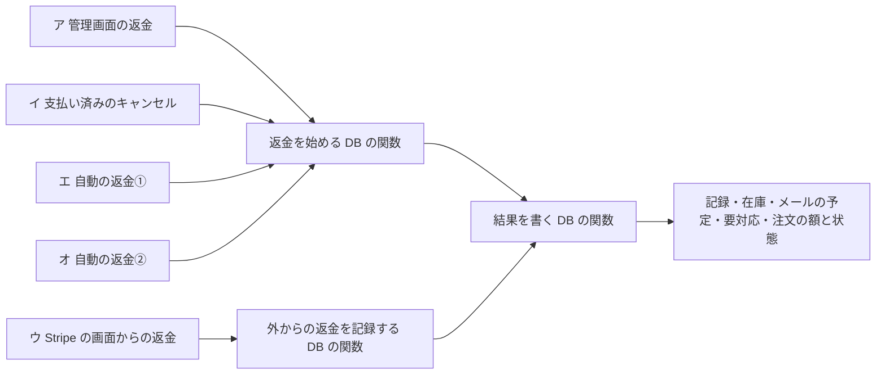
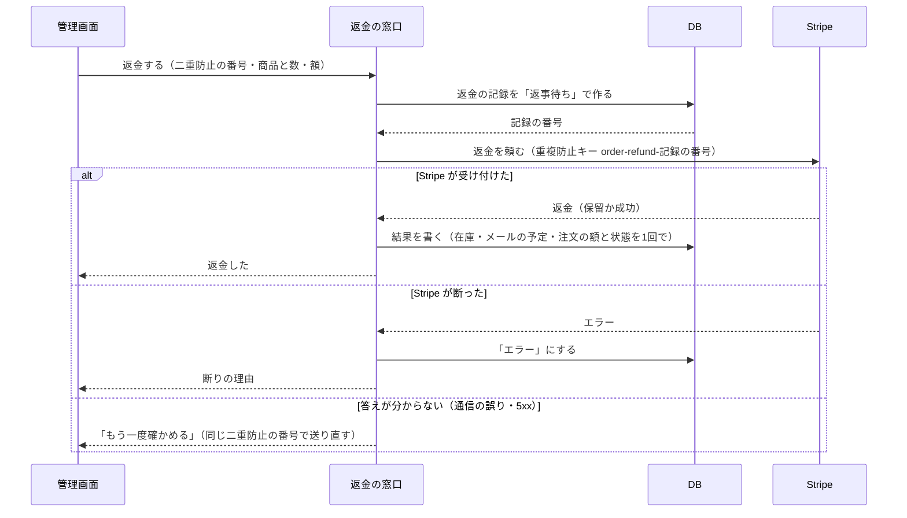
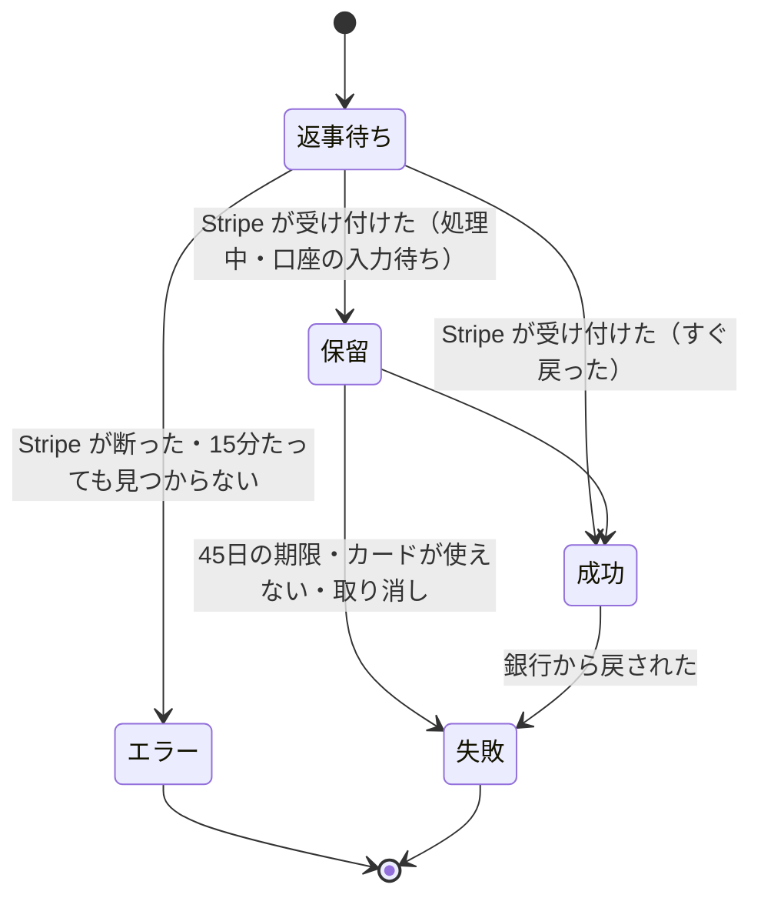

# 返金とキャンセル（グループ E-2）設計書

> 日付: 2026-10-11（設計の承認: 2026-10-10〜11。設計 1〜8 を節ごとに承認）
> 分類: architectural（新しい表、返金の作り直し、Stripe の知らせの取り込みの作り直し、在庫と E-1 の数え方の変更、注文のメールの種類の追加、管理画面とお客様の画面の変更を含むため）
> 要望: 返金を Shopify と同じく「1件ずつの記録」にし、商品と数・送料・在庫に戻すか・お客様に知らせるかを選べるようにする。支払い済みで1つも発送していない注文をキャンセルできるようにする。レビュー台帳の R-03・R-06・R-16 を直す
> 方針: **Shopify と同じ形に近づける。Shopify の仕組みが見つからない所は、業界の定番（ベストプラクティス・デファクトスタンダード）に従う**（ユーザーの指示）。各節に Shopify・業界との突き合わせと出典を付ける
> 全体の決定: [グループ E 全体の設計の決定](2026-10-10-group-e-overview-design.md) の 4章（E-2）。この設計書は、その決定を E-2 の作りに落としたもの
> 関連: [E-1 部分発送の設計書](2026-10-10-partial-fulfillment-design.md)（商品ごとの数・発送・在庫の画面）、[グループ A 設計書](2026-09-26-order-payment-reconciliation-design.md)（注文の状態・支払いの照合・要対応）、[グループ D 設計書](2026-10-09-order-email-outbox-design.md)（注文のメール）

---

## 概要

今の返金は、管理画面の「返金」ボタンで確認の後に残りのお金を全部返すだけで、返金の記録の表が無い。商品を選べず、在庫は戻らず、お客様へのメールも無い。支払い済みの注文をキャンセルする道も無い。Stripe の画面で返した返金は、注文の返金済みの額だけが合わせられる。

この設計は、次の5つを入れる。

- 返金を Shopify の Refund と同じく「1件ずつの記録」にし、お金の動きを5つの状態（返事待ち・エラー・保留・成功・失敗）で追う
- 返金の画面と、支払い済みの注文のキャンセル
- Stripe の知らせを合図に Stripe を読み直す取り込みと、毎時・毎晩の見回り。グループ A から渡された自動の返金①②
- 返金を E-1 の商品ごとの数と在庫に組み込む（発送前の返金は未発送から引き、在庫に戻す）
- 返金のお知らせ・支払い済みのキャンセルのお知らせ・店への知らせ、画面（支払いの列・履歴・お客様の画面・要対応・ショップの設定）

| 項目 | 決定 | 根拠 |
|---|---|---|
| 返金の記録 | 返金の表と返金の商品の表を足す。1件の返金が Stripe の返金1件にあたる | Shopify の Refund・RefundLineItem |
| お金の動きの状態 | 返事待ち・エラー・保留・成功・失敗 | Shopify の OrderTransactionStatus |
| 返金を作る道 | 管理画面・支払い済みのキャンセル・Stripe の画面・自動①・自動②の5つ。どれも同じ DB の関数で、記録・在庫・メールの予定・要対応・注文の額と状態を1回の処理で書く | Shopify は返金を1か所で記録する |
| 順番 | 記録を先に作り、次に Stripe に頼む。Stripe の重複防止キーは記録の番号から作る（R-03） | Shopify と Stripe の重複防止キー |
| 取り込み | Stripe の知らせは合図にだけ使い、その支払いの返金の一覧を読み直して合わせる。何度もやり直さない（R-06） | Stripe の Webhook の勧め |
| 全額 | お客様から受け取った額の全部（普通は注文の合計と同じ）。返した合計が全額に届くとキャンセル（今の決まり） | 今の決まりを変えない |
| 在庫 | 発送前の在庫の品の返金は、Stripe が受け付けた時に確保を外して戻す。戻さないも選べる（R-16） | Shopify の restockType CANCEL・NO_RESTOCK |
| 支払い済みのキャンセル | 1つも発送していない注文だけ。全部の商品と送料を返金し、メールはキャンセルのお知らせ1通 | Shopify の Cancel order |
| Stripe の画面の返金 | 自動で記録し、未発送の全額なら在庫に戻し、返金のお知らせを送る（ユーザーの決定） | Stripe の勧め（Shopify は手で記録） |
| 自動の返金 | ①取り消した注文への入金を自動で全額返金（既定オン）②支払額が違う注文を自動で全額返金して取消（既定オフ）。店長だけが変える | グループ A の決定。②は Shopify Flow の型と同じ形 |
| ショップの設定 | 管理画面の左のメニューに足し、トグルで切り替える（ユーザーの決定） | Shopify の Settings |
| 前からの返金 | 写しとして記録し、在庫とメールは動かさない。当てた時刻を「切り替えの時刻」として残す | Shopify の LEGACY_RESTOCK |

---

## 実装で決めたこと（2026-10-11）

承認済みの本文は書き替えない。実装の途中とレビューで、設計書の文より新しい決め事で動いている所を、次の表に残す。各章の本文を読む時は、この表を先に読む。

| 節 | 設計書の文 | 実装で決めたこと | 書いた文書 |
|---|---|---|---|
| 6-4 | 自動の返金①②は、Stripe が受け付けたら要対応を記録して閉じ、店へ知らせる（閉じてから知らせる） | 店への知らせを送れた後に、要対応を閉じる。閉じた要対応は毎時の見回りにも次の照合にも拾われないので、先に閉じて知らせを送れないと、店は返金を知る手段を失うため。送れなければ送信権を戻して開いたまま残し、毎時の見回り・次の照合が送り直す。送信権を先に取られた照合は、返金だけ行い、知らせも要対応を閉じることもしない | [注文の管理のシーケンス](../../04_DetailDesign/sequence/order-administration.md)・[要対応の状態](../../04_DetailDesign/states/payment-exception.md)・[要求](../../02_Requirements/requirements.md) |
| 8-1・8-2 | 取消の後の入金の返金のお知らせは「…全額返金します。」、支払い済みのキャンセルのお知らせは「お支払いいただいた ¥X（全額）を返金します。」だけ | 言い方は「いたします」にそろえる。支払い済みのキャンセルのお知らせは、前に返金がある時（返金額が受け取った額より少ない時）は「お支払いいただいた金額のうち、残りの ¥{n} を返金いたします。」、全額の時は「お支払いいただいた ¥{n}（全額）を返金いたします。」。管理画面の支払い済みのキャンセルの画面も、前に返金がある時は「返金する額: ￥X（残りの全額）」 | [注文のメールの手順書](../../06_Operations/order-email-operations.md)・[要求](../../02_Requirements/requirements.md)・[管理画面の画面設計](../../04_DetailDesign/pages/16_admin.md) |
| 8-1・8-2 | 送らない返金に、エラー・失敗を挙げる（予定を書いた後、送る前に失敗・エラーになった場合の扱いは書いていない） | 予定を書いた後、送る前に返金が失敗・エラーになった行は、worker が取りやめ（`superseded`）にして送らない。DB の `skip_order_email`（移行 C）は、返金に結び付く行にはその返金が失敗・エラーの時だけ `superseded` を受ける | [注文のメールの手順書](../../06_Operations/order-email-operations.md) |
| 8-2 | 再送: 今のキャンセルのお知らせと同じく、注文がキャンセルの間はできる（最後に成功したキャンセルの返金で文を作る） | 最後に送った、または送るのをあきらめた（`sent` か `dead`）取消の行のうち、返金が失敗・エラーでない行から、書き分けと返金の番号を写す | [注文のメールの手順書](../../06_Operations/order-email-operations.md)・[API の主要契約](../../03_BasicDesign/api/api-spec.md)・[管理画面の画面設計](../../04_DetailDesign/pages/16_admin.md)・[要求](../../02_Requirements/requirements.md) |
| 8-3 | コンビニ払い: M月D日（Stripe が決める期限）までに入れる | お客様に出す日付は、日本時間で期限の1分後の日付の前日（その日のうちに入れれば必ず間に合う最後の日。期限を実際より遅く伝えない）。管理画面の履歴の「口座の入力の期限」は、日本時間の日時 | [要求](../../02_Requirements/requirements.md)・[お客様のアカウントの画面設計](../../04_DetailDesign/pages/15_account.md)・[注文のメールの手順書](../../06_Operations/order-email-operations.md)・[API の主要契約](../../03_BasicDesign/api/api-spec.md) |

---

## 1. 目的と範囲

### 1-1 要望

- 返金を Shopify と同じ形にする。返金する商品と数、送料、在庫に戻すか、お客様に知らせるかを選べる（2026-10-10）
- 支払い済みで、まだ発送していない注文をキャンセルできるようにする（2026-10-10）
- レビュー台帳の指摘を直す
  - R-03: 返金の重複防止キーが、返金の操作ごとになっていない
  - R-06: 注文に結び付かない返金の知らせが、失敗を繰り返す
  - R-16: 未発送の全額返金で取消になっても、確保した在庫を台帳へ戻さない

### 1-2 ユーザーが決めたこと（2026-10-10〜11）

| 決めたこと | 中身 |
|---|---|
| 自動の返金 | グループ A から渡された①②を両方 E-2 に入れる。①は既定オン、②は既定オフ。どちらも店長だけが変える |
| 送料の返金 | 1つも発送していない注文で全部の商品を返す時だけ、送料も全額返す。一部の商品だけ返して残りを送る時は、送料は自動では返さない（店が選べば返せる） |
| ショップの設定 | 管理画面の左のメニューに「ショップの設定」を足し、トグルで切り替える。E-2 は①②を置く |
| 送料の設定 | 全部無料／合計いくら以上で無料／全部もらう、と送料の額・しきい値を選べる設定は、E-2 の後に別の作業で作る。特定商取引法の表記（送料無料）と決済（一律500円）の食い違いもそこで直す |
| Stripe の画面からの返金 | Shopify の「手で記録する」形と比べたうえで、自動で取り込む形にする |
| 全額の返金と未発送の品 | 全額の返金でキャンセルになる時は、どの道でも未発送の商品を全部その返金に入れて在庫に戻す。管理画面では、選んでいなければ断る |
| 返品の返金（E-3） | 店が品を受け取った時に返金する。受け取りの画面は1点ずつのチェック（18章） |

### 1-3 成功の基準

- 返金ごとに記録が残り、管理画面の履歴に額・商品・在庫に戻した数・どこからか・状態の移り変わりが出る
- 返金の画面で、発送前と発送済みの商品を分けて数を選べ、在庫に戻すか・知らせるかを選べる
- 支払い済みで未発送の注文をキャンセルでき、全額が返り、在庫が戻り、キャンセルのお知らせが1通届く
- Stripe の画面で返した返金も記録され、未発送の全額なら在庫が戻り、返金のお知らせが届く
- 発送前に返金した商品は発送できず、未発送・まだ作っていない数・引き当て済みから外れる
- 同じ返金の操作を何度送っても、Stripe の返金は1件だけ作られる。同じ額の別の返金は別の返金になる（R-03）
- 注文に結び付かない返金・支払いの番号の無い返金・未入金の注文の返金の知らせが、失敗を繰り返さない（R-06）
- 発送前の全額返金で取り消した注文の在庫が戻る（R-16）
- 返金が失敗した時に、要対応と店へのメールで気づける

### 1-4 範囲の外

| 物 | どこで |
|---|---|
| 返品の記録・受け取り・返品の返金 | E-3（受け取りの画面の決定は18章に残す） |
| 配送の状況（配達中・配達済み） | E-4 |
| 送料の設定と、特定商取引法の表記の送料の文 | E-2 の後の別の作業 |
| ストアクレジット・「あとで返金する」・返金先の選択 | 作らない（Shopify と違う所。5-6） |
| 状態の移り変わりを DB で守る SQL（`supabase/pending/harden_order_state_transitions.sql`）の適用 | 開店前の項目に残す（11-4） |
| 定期処理3本の本番への登録 | 開店前の設定（16章） |

---

## 2. 実装前の状態（2026-10-11）

| 所 | 今の作り |
|---|---|
| 返金の画面 | 無い。`window.confirm` の後に「残り全部を返金」を送るだけ（`src/app/admin/page.tsx` の `handleRefundOrder`）。一部返金は窓口だけが受ける |
| 返金の記録 | 無い。`orders.refunded_amount`（成功した返金の累計）と、会計の `stripe_refunds` だけ |
| 注文を返金に合わせる所 | `syncOrderRefunds`（`src/lib/stripe/order-refund-sync.ts`）→ `apply_order_refund_projection`。在庫・メールの予定・要対応のどれにも触れない |
| 重複防止キー | `admin-refund:{注文ID}:{金額 or full}`（R-03） |
| 返金の窓口の守り | CSRF も回数の制限も無い。役割は JWT の `app_metadata.role` で見る |
| 返金の知らせ | 注文が無い返金は直済み。支払いの番号の無い返金・未入金の注文の返金は、やり直しの後に止まる（R-06 の残り） |
| 在庫 | 返金で台帳を動かす処理が無い。確保中の数 `private.order_line_reservations` は `purchase` と `cancel` しか数えない（R-16） |
| 支払い済みのキャンセル | 無い。取消の窓口は支払い済みの注文に 409 を返す（FREQ-404） |
| メール | 返金のお知らせは無い。キャンセルのお知らせは未入金の注文用で「お支払いは発生していません。」と書く。自動の行は1注文1種類1行 |
| 履歴 | 状態が変わった行だけ。一部返金は出ない |
| 定期処理 | 毎分・毎時・毎晩の3本は本番に未登録 |
| 本番のデータ（2026-10-11 読み取り） | 返金がある注文 0件・`stripe_refunds` 0件・確保が残るキャンセルの注文 0件・要対応 0件 |

---

## 3. 全体の形（設計1）

### 3-1 返金を作る道

| 道 | 中身 | 記録の `source` |
|---|---|---|
| ア 管理画面の返金 | 商品と数・送料を選んで返金する | `admin` |
| イ 支払い済みの注文のキャンセル | 1つも発送していない注文の残りの商品全部と送料の全額を返金する | `order_cancel` |
| ウ Stripe の画面からの返金 | Stripe の知らせから取り込む | `stripe_dashboard` |
| エ 自動の返金① | 取り消した注文への入金を全額返す | `auto_cancelled_order_payment` |
| オ 自動の返金② | 支払額が違う注文を全額返して取り消す | `auto_amount_mismatch` |
| （写し） | 切り替えの時刻より前に Stripe で作られた返金 | `legacy` |

### 3-2 記録を先に作り、次に Stripe に頼む

- 二重防止の番号（`request_key`）は、画面を開いた時に作る。同じ番号の送り直しは、DB が前の記録を返す。中身が違えば断る
- Stripe への重複防止キーは `order-refund-{記録の番号}`。同じ記録の確かめ直しだけが同じキーを使い、別の返金は別のキーになる（R-03）
- Stripe に付ける印（metadata）は `order_id`・`refund_id`・`actor_id` だけ。個人情報は入れない
- 返事待ちの返金がある注文には、新しい返金を作れない（確かめ直しだけ）。毎時の見回りが片付ける
- Stripe の返事を書く前に落ちても、知らせか見回りが印（`refund_id`）で見つけて合わせる

### 3-3 知らせは合図、見回りは取りこぼしを拾う

- Stripe の返金の知らせ（`refund.created`・`refund.updated`・`refund.failed`・`charge.refunded`）は合図にだけ使い、その支払いの返金の一覧を読み直して1件ずつ合わせる（6章）
- 毎時: 15分より前から返事待ちの返金を Stripe で探す
- 毎晩: 前の48時間に Stripe で作られた返金と、こちらの保留の返金を、全部合わせる
- 3本の定期処理は本番に未登録。登録は開店前の設定（16章）

### 3-4 突き合わせ

| 所 | Shopify・業界 | この設計 | 出典 |
|---|---|---|---|
| 記録とお金の動き | 返金は記録で、お金が戻ったかは別の「取引」の状態で見る | 返金の記録に状態を直に持つ。この店の返金は必ず Stripe の返金1件と1対1なので、取引の表を分けない（違い） | [Refund](https://shopify.dev/docs/api/admin-graphql/latest/objects/Refund)・[取引の状態](https://shopify.dev/docs/api/admin-graphql/latest/enums/OrderTransactionStatus) |
| 二重防止 | 返金を作る時に重複防止キーが要る。Stripe も同じキーなら前の答えを返す（24時間以上保持） | 返金の操作ごとの番号 | [Shopify の重複防止](https://shopify.dev/docs/api/usage/implementing-idempotency)・[Stripe](https://docs.stripe.com/api/idempotent_requests) |
| 取り込み | 知らせは順番どおりに届かず、重なる。足りない物は読み直す | 合図にして読み直す | [Webhooks](https://docs.stripe.com/webhooks)・[返金](https://docs.stripe.com/refunds) |
| 答えが分からない時 | 24時間を過ぎたら頼み直さず、読み直して突き合わせる | 同じキーで確かめ、15分たっても見つからなければエラー | [低い層の誤り](https://docs.stripe.com/error-low-level) |

---

## 4. 返金の記録と数え方（設計2）

### 4-1 返金の表 `public.order_refunds`

| 列 | 中身 |
|---|---|
| `id` | uuid。Stripe の重複防止キーと印に使う |
| `order_id` | 注文 |
| `source` | 3-1 の6つ |
| `request_key` | 二重防止の番号（uuid、一意）。ア・イだけ。ほかは空 |
| `stripe_refund_id` | Stripe の返金の番号（一意）。返事が来るまで空 |
| `status` | `awaiting_response`（返事待ち）・`error`（エラー）・`pending`（保留）・`succeeded`（成功）・`failed`（失敗） |
| `stripe_status` | Stripe の状態（`pending`・`requires_action`・`succeeded`・`failed`・`canceled`） |
| `stripe_pending_reason` | `processing`・`insufficient_funds`・`charge_pending` |
| `stripe_failure_reason` | Stripe の失敗の理由。エラーの時はこちらの理由（`stripe_rejected`・`not_found_in_stripe`） |
| `customer_action_expires_at` | コンビニ払いの口座の入力の期限 |
| `payment_method_type` | Stripe の支払いの種類（`card`・`konbini`・`paypay`・`link` など）。返金の時に Stripe の支払いから読む |
| `amount` | 返金額（円、1以上） |
| `shipping_amount` | そのうちの送料（0以上） |
| `adjustment_amount` | 計算との差（手で額を直した分。正も負もある） |
| `note` | 店だけが見るメモ（500字まで。返金の理由もここ） |
| `stripe_reason` | Stripe に伝える理由（`requested_by_customer`・`duplicate`・`fraudulent`、空も可） |
| `cancel_reason` | イ・オの時だけ。取消の理由（今の4つの値） |
| `notify_customer` | お客様に知らせるか |
| `actor_id` | 実行した人。ウ・エ・オ・写しは空 |
| `reference_number`・`reference_type` | カードの照会番号（ARN など）。届いたら書く |
| `created_at`・`accepted_at`・`succeeded_at`・`failed_at`・`errored_at` | 時刻（状態の移り変わりを履歴に出す） |
| `stock_applied_at` | 在庫を動かした時刻（1回だけにする印） |
| `email_enqueued_at` | メールの予定を書いた時刻（1回だけにする印） |
| `failure_applied_at` | 失敗の後始末（確保し直しと要対応）をした時刻 |

- 記録は消さない。中身も直さない。進むのは状態とその細目・時刻・印だけ（トリガーで止める。Shopify も始めた返金は取り消せない）
- 返事待ち・保留・成功の返金だけを数える。エラーと失敗は数えない（お金が動いていないため）

| Stripe の状態 | 記録の状態 |
|---|---|
| `pending`・`requires_action` | 保留 |
| `succeeded` | 成功 |
| `failed`・`canceled` | 失敗 |

### 4-2 返金の商品の表 `public.order_refund_lines`

| 列 | 中身 |
|---|---|
| `refund_id`・`order_item_id` | 返金と注文の商品 |
| `quantity` | 返金する数（1以上） |
| `before_shipment` | 発送前の品か、発送後の品か |
| `restock_type` | `cancel`（発送前の取消で在庫に戻す）・`no_restock`（戻さない）。発送後の品は `no_restock` だけ（在庫に戻すのは E-3 の返品の受け取りだけ） |
| `amount` | この商品の分の返金額（割引を割り振った額。DB が計算する。4-5） |
| `released_quantity` | 確保を外した数（Stripe が受け付けた時に書く） |
| `restocked_quantity` | 在庫に戻した数（`cancel` の時は確保を外した数と同じ） |
| `rereserved_quantity`・`rereserve_shortage` | 失敗の時に確保し直した数と、足りなかった数 |

- 同じ返金の中で、同じ商品の発送前・発送後は1行ずつ
- 表は E-1 と同じ作法: RLS で anon・authenticated を全部断り、service_role は読むだけ。書くのは SECURITY DEFINER の DB の関数だけ

### 4-3 全額と、返せる額

- **受け取った額** `orders.paid_amount`（新しい列。店内だけ）: 入金を記録する時（`mark_order_paid`）と、取り消した注文への入金を見つけた時に書く。普通は注文の合計と同じ。支払額が違う注文では、実際に受け取った額
- **全額** = 受け取った額
- **返せる額** = 受け取った額 − 返事待ち・保留・成功の返金の合計
- **返せる送料** = 注文の送料 − 返事待ち・保留・成功の返金の送料の合計
- `orders.refunded_amount` の意味は変えない（成功した返金の合計。売上・KPI・法定の写しが読む）

### 4-4 商品ごとの数（E-1 の数え方に返金を入れる）

| 記号 | 中身 |
|---|---|
| q | 注文の数 |
| s | 発送した数（取り消していない発送） |
| c | 仕上がった数（受注生産は取り消していない仕上がり。在庫の品は q） |
| rb | 発送前に返金した数（返事待ち・保留・成功の返金の、発送前の行） |
| ra | 発送後に返金した数（同じく、発送後の行） |

| 数 | 式 |
|---|---|
| 未発送 | q − s − rb |
| まだ作っていない（受注生産） | max(q − rb − c, 0) |
| 発送準備中 | max(min(c, q − rb) − s, 0) |
| 発送後に返せる数 | s − ra |
| 注文から外れた仕上がり品 | max(c − (q − rb), 0) |

- まだ作っていない数の式なので、受注生産の品の返金は、まだ作っていない分から先に減る（作らずに済む）
- 守る関係: s + rb ≤ q、ra ≤ s、s ≤ c（受注生産）

### 4-5 商品ごとの返金額（割引の割り振り）

- 商品の小計 L = 単価 × q。注文の割引 D を、商品の小計の割合で割る。商品の登録順に小計を足していった和 Cᵢ について R(C) = 四捨五入(D × C ÷ ΣL) とし、Dᵢ = R(Cᵢ) − R(Cᵢ₋₁)（累積で丸める）。どの Dᵢ も0以上で、合計は必ず D になる（割引が数円で商品が多い注文でも、最後の商品の割り振りが負にならない。商品が2つまでの注文は「最初は四捨五入、最後は残り」と同じ値）
- disc(n) = 四捨五入(Dᵢ × n ÷ qᵢ) とする。前に返した数を b（返事待ち・保留・成功）、今回の数を k とすると、今回の額 = 単価 × k − (disc(b + k) − disc(b))
- 全部の数を返すと disc(q) = Dᵢ になるので、最後の返金で合計とぴったり合う
- 計算 = 商品の額の合計 + 送料。計算との差 = 返金額 − 計算
- 同じ式を TS（画面の見込み）と SQL（正）の両方に置き、同じ試験の値で確かめる

### 4-6 DB が止めること

| 止めること | 誤りの言葉 |
|---|---|
| 返事待ち・保留・成功の合計が受け取った額を超える | `REFUND_EXCEEDS_REFUNDABLE` |
| 送料の合計が注文の送料を超える | `REFUND_SHIPPING_EXCEEDS` |
| 発送前の返金が未発送の数を超える | `REFUND_QUANTITY_EXCEEDS_UNSHIPPED` |
| 発送後の返金が発送後に返せる数を超える | `REFUND_QUANTITY_EXCEEDS_SHIPPED` |
| 注文に無い商品 | `REFUND_LINE_NOT_IN_ORDER` |
| 全額になるのに、未発送の商品が全部入っていない（ア） | `REFUND_MUST_INCLUDE_UNSHIPPED` |
| 1つも発送していない注文で残りの商品を全部返すのに、送料の残りか返金額（返せる額の全部）が足りない | `REFUND_MUST_BE_FULL` |
| 返事待ちの返金がある注文に、別の返金を作る | `AWAITING_REFUND_EXISTS` |
| 同じ二重防止の番号で中身が違う | `REFUND_REQUEST_MISMATCH` |
| 返金できない注文（支払い手続き中・未入金・失敗・放棄、または受け取った額が無い） | `ORDER_NOT_REFUNDABLE` |

### 4-7 注文の状態

| 起きたこと | 注文の状態 |
|---|---|
| 成功した返金の合計が全額に届いた | キャンセル（今と同じ）。イ・オの返金なら、その取消の理由・メモ・知らせるかを注文の取消の列に写す |
| 全額のキャンセルの後に、成功した返金が全額を下回った | 未発送が残れば支払い済み、無ければ発送済み |
| 返金を Stripe が受け付け、未発送が0になり、発送した商品がある（全額ではない） | 発送済み。発送日・配送業者・伝票番号は、最後の発送のものを写す |
| 上の返金が失敗し、未発送が戻った | 支払い済み。発送日・配送業者・伝票番号を空にする |
| 1つも発送していない注文で、全部の商品を発送前に返金する | 送料も全額返すので、成功した時にキャンセル |

- 注文の改訂の理由（`app.order_change_reason`）は `refund_projection`（キャンセルとその戻し）・`refund_completed_order`（発送済みへ）・`refund_failed_reopened`（支払い済みへ）

### 4-8 突き合わせ

| 所 | Shopify | この設計 | 出典 |
|---|---|---|---|
| 返金の記録の中身 | メモ・作った人・時刻・返金した商品・返金した送料・計算との差・取引・返品 | 同じ項目に、お金の状態と Stripe の細目を足す | [Refund](https://shopify.dev/docs/api/admin-graphql/latest/objects/Refund) |
| 返金した商品の行 | 数・在庫の戻し方・戻したか・額 | 同じ。発送前／後・割り振った額・確保し直した数を足す | [RefundLineItem](https://shopify.dev/docs/api/admin-graphql/latest/objects/RefundLineItem) |
| 在庫の戻し方 | 発送前の取消（CANCEL）・返品（RETURN）・戻さない（NO_RESTOCK） | CANCEL と NO_RESTOCK を作る。返品は E-3 | [restockType](https://shopify.dev/docs/api/admin-graphql/latest/enums/RefundLineItemRestockType) |
| 発送前の返金 | 注文から外れ、発送できなくなる | 同じ（未発送の数から引く） | [返金とキャンセル](https://help.shopify.com/en/manual/orders/refund-cancel-order) |
| 返金のしすぎ | 既定で許さない | DB が止める | [RefundInput](https://shopify.dev/docs/api/admin-graphql/latest/input-objects/RefundInput) |
| 全部の商品を発送前に返金 | 支払いは「一部返金」、発送は「出荷不要」 | 送料も全額返してキャンセルにする（違い。送る物が無いのにキャンセルでもない注文を残さないため） | [注文の状態](https://help.shopify.com/en/manual/fulfillment/managing-orders/order-status) |
| 受注生産のどの数から引くか | 該当なし（Shopify に生産の考えは無い） | まだ作っていない分から先に引く | — |

---

## 5. 返金の画面と、支払い済みの注文のキャンセル（設計3）

### 5-1 返金の画面（Shopify の返金の画面と同じ流れ）

- 開く所: 注文の一覧の「返金」。返せる額がある注文に出す（取り消した注文に入金が届いた時も出る）。今の「確認の後に残り全部を返す」作りはやめる
- 商品: 「発送前の商品」と「発送済みの商品」に分けて並べ、商品ごとに返金する数を入れる（0は返金しない）
- 在庫に戻す: 1つのチェック。発送前の在庫の品を選んだ時だけ出し、最初から入っている
  - 受注生産の品は在庫を確保していないので戻らない、と書く。仕上がった品を売り物にする時は、商品の在庫の画面で「入荷」する、と書く
  - 発送済みの品には出さず、「品物が戻る時は、先に返品を作ってください」と書く（E-3）
- 送料: 額を入れる（上限は返せる送料）。1つも発送していない注文で全部の商品を選んだ時は、送料の全額と返金額（返せる額の全部）が自動で入り、減らせない（送る物が無いのにキャンセルにならない注文を残さないため）
- すべて選ぶ: 残りの商品全部と送料の全額を入れる
- 返金額: 商品・割引の分・送料から出して内訳を見せる。手で直せる（上限は返せる額）
- 理由: 店だけのメモ（お客様には見えない）と、Stripe に伝える理由（「お客様の希望」（最初）・「重複した支払い」・「不正の疑い」）。「不正の疑い」では、Stripe がそのカードとメールを拒否の一覧に入れる、と注意を出す
- お客様に返金のメールを送る: 最初から入っている
- 支払い方法ごとの案内: コンビニ払いは「お客様に返金先の口座を入れてもらう（Stripe からメール。45日以内）」を画面の上に出す。カード・Link は「5〜10営業日ほど」、PayPay は「すぐ」
- ボタン: 「¥X を返金する」。注意書き「返金は取り消せません」
- 二重防止: 画面を開いた時に番号を作る。断られた時は、直して新しい番号で送り直せる。答えが分からない時は入力を止め、「もう一度確かめる」（同じ番号）と「閉じる」だけを出す（E-1 の発送の画面と同じ作り）
- 返事待ちの返金がある注文で開いた時: 「確かめ中の返金があります（¥X）」と「もう一度確かめる」だけを出す
- 全額なのに未発送の商品が選ばれていない時: 「全額を返金する時は、まだ発送していない商品もすべて選んでください。」
- スマホの幅では画面いっぱいに開く。返事は `role=status`・`aria-live=polite` で知らせる（今の作り）

### 5-2 返金の窓口

| 窓口 | 中身 |
|---|---|
| `GET /api/admin/orders/[id]/refund` | 返金の材料: 注文（受け取った額・成功の返金・手続き中の返金・返せる額・送料・返せる送料・支払い方法・1つも発送していないか）、商品（名前・色とサイズ・在庫か受注生産か・単価・注文の数・未発送・発送後に返せる数・返金した数・在庫に戻せる数・割り振った割引）、返事待ちの返金 |
| `POST /api/admin/orders/[id]/refund` | 返金する。中身: `requestKey`・`lines`（`orderItemId`・`quantity`・`beforeShipment`）・`restock`・`shippingAmount`・`amount`・`note`・`stripeReason`・`notifyCustomer` |

- 権限: 新しい権限 `admin.orders.refund`（店長の役割だけに付ける。11-3）。CSRF と回数の制限（E-1 の発送の窓口と同じ作り。送信元ごと・管理者ごと）
- 答え: 受け付けた（200、記録の番号と状態）／DB の断り（409、4-6 の言葉を画面の言葉に）／Stripe の断り（422、エラーにした）／答えが分からない（502、`status: 'unknown'`）
- コンビニ払いの返金では、注文の連絡先のメールを Stripe の `instructions_email` に渡す。監査とログには入れない
- 監査の記録: 注文・返金の記録の番号・額・実行した人。お客様の情報は入れない

### 5-3 支払い済みの注文のキャンセル（Shopify の「注文のキャンセル」）

- 出す条件: 支払い済みで、1つも発送していない注文。一部を発送した後はできない
- 画面（今の取消の画面を広げる）
  - 返金する額（全額 ¥X と内訳）、お金が戻る時期、コンビニ払いなら口座の入力の案内
  - 理由: 在庫切れ／お客様の依頼／不正の疑い／その他（その他はメモが必須）
  - 店のメモ
  - 在庫に戻す（発送前の在庫の品がある時だけ。最初から入っている）
  - お客様に知らせる（最初から入っている）
  - ボタン「注文をキャンセルして ¥X を返金する」と、「取り消せません」の注意
  - 答えが分からない時の扱いは、返金の画面と同じ
- 中でやること: 残りの商品全部と送料の全額を、`source = 'order_cancel'` の返金1件で返す。前に一部を返金していれば、その残りを返す。理由が「不正の疑い」の時は、Stripe にも `fraudulent` と伝える
- メールはキャンセルのお知らせ1通。返金のお知らせは別に送らない（8章）
- 注文が「キャンセル」になるのは、返金が成功した時（今の決まり）。コンビニ払いで口座の入力を待つ間は、進み具合に「キャンセルの手続き中」と出す

### 5-4 支払い済みのキャンセルの窓口

- 今の取消の窓口 `POST /api/admin/orders/[id]/status`（`status: 'cancelled'`）で、注文が支払い済みの時だけ新しい処理に回す。中身に `requestKey`・`restock` を足す
- 支払い済みの時は、権限 `admin.orders.refund` も要る（お金を返す操作なので、返金と同じく店長だけ）。未入金の注文の取消は今のまま（サポートの人もできる）
- 答えは返金の窓口と同じ形

### 5-5 誤りの言葉と画面の言葉

| DB・窓口の言葉 | 画面の言葉 |
|---|---|
| `REFUND_EXCEEDS_REFUNDABLE` | 返せる額を超えています。 |
| `REFUND_SHIPPING_EXCEEDS` | 返せる送料を超えています。 |
| `REFUND_QUANTITY_EXCEEDS_UNSHIPPED`・`REFUND_QUANTITY_EXCEEDS_SHIPPED` | 返金できる数を超えています。画面を開き直してください。 |
| `REFUND_MUST_INCLUDE_UNSHIPPED` | 全額を返金する時は、まだ発送していない商品もすべて選んでください。 |
| `REFUND_MUST_BE_FULL` | まだ発送していない注文の商品を全部返す時は、送料と返金額も全部返してください。 |
| `AWAITING_REFUND_EXISTS` | 確かめ中の返金があります。先に確かめてください。 |
| `REFUND_REQUEST_MISMATCH` | 画面を開き直してから、もう一度返金してください。 |
| `ORDER_NOT_REFUNDABLE` | この注文は返金できません。 |
| Stripe の断り | Stripe が返金を受け付けませんでした（理由）。 |
| 答えが分からない | 返金の結果を確かめられませんでした。「もう一度確かめる」を押してください。 |

### 5-6 突き合わせ

| 所 | Shopify | この設計 | 出典 |
|---|---|---|---|
| 返金の画面の流れ | 商品ごとに数を入れる（0は返金しない）→ 額を直せる → 知らせのチェック → 返金 | 同じ | [返金の手順](https://help.shopify.com/en/manual/fulfillment/managing-orders/refunding-orders) |
| 在庫に戻す | 既定オン。戻ってこない発送済みの品は外す | 既定オン。発送前の品だけに出す | 同上 |
| 送料 | 請求した送料が上限で、額を入れる | 同じ。全部の商品を発送前に返す時は全額（違い） | 同上 |
| 返金の理由 | 店のメモ。お客様には見えない | 同じ。Stripe に伝える理由は別に持つ | 同上・[Stripe の返金の理由](https://docs.stripe.com/api/refunds/create) |
| 取り消し | 返金は取り消せない | 同じ（画面に書く） | 同上 |
| キャンセルの条件と既定 | 一部を発送した後は不可。既定は「返金する・在庫に戻す・知らせる」 | 同じ | [注文のキャンセル](https://help.shopify.com/en/manual/fulfillment/managing-orders/canceling-orders) |
| キャンセルの理由 | 6つ（お客様・決済の拒否・不正・在庫・その他・店の誤り） | 今の4つ（違い。店の誤りと決済の拒否は「その他」で足りる） | [OrderCancelReason](https://shopify.dev/docs/api/admin-graphql/latest/enums/OrderCancelReason) |
| キャンセル時の返金先 | 元の支払い方法・ストアクレジット・あとで | 元の支払い方法だけ（違い。返金を忘れたキャンセルを残さない。ストアクレジットは無い） | 注文のキャンセル |
| キャンセルの権限 | 返金の権限が無いと断られる | 店長だけ | [orderCancel](https://shopify.dev/docs/api/admin-graphql/latest/mutations/orderCancel) |

---

## 6. Stripe の返金の取り込み・見回り・自動の返金（設計4）

### 6-1 知らせの取り込み

受ける知らせは今の登録のまま（`refund.created`・`refund.updated`・`refund.failed`・`charge.refunded`）。古い種類（`charge.refund.updated`）は使わない。

1. 知らせから支払いの番号を出す。無ければ監査に残して終える（やり直さない。R-06）
2. 支払いの番号で注文を探す。無ければ今のとおり（監査に残す。失敗・取消の返金なら要対応）
3. 注文が支払い手続き中・未入金・失敗・放棄なら、監査に残して終える（やり直さない。R-06）。入金が決まった後に、照合と毎晩の照合が合わせる
4. その支払いの返金の一覧を Stripe から全部読み直し（ページを全部たどる）、1件ずつ合わせる
   - 印 `refund_id` がこの注文の記録に当たる返金: その記録の状態を進める（印がこの注文の記録に当たらない返金は、印が無い返金と同じに扱い、監査に残す）
   - 印が無い返金で、切り替えの時刻より前に作られた物: 写し（`legacy`）として記録する。在庫とメールは動かさない
   - 印が無い返金で、切り替えの時刻より後に作られた物: 「Stripe の画面からの返金」（`stripe_dashboard`）として記録する。商品の行は無い（額だけ）。ただし、その返金で全額になる時は、未発送の商品を全部「発送前の取消」の行に入れて在庫に戻す（7-4）。お客様に返金のお知らせを送る
5. 記録・在庫・メールの予定・注文の額と状態を1回の処理で書く。書いた後に Stripe を読み直し、変わっていたらやり直す（最大3回）。そろわなければ、知らせの処理を失敗にして、今の待ち行列のやり直しに任せる（最大9回、その後は退避と店への知らせ。グループ B）
6. 会計の `stripe_refunds` への写しは今のまま続ける

- 取り消した注文（未入金からの取消）への返金も記録し、注文の返金済みの額に入れる（今は入れていない）
- 同じ Stripe の返金は、Stripe の返金の番号の一意で1行にしかならない

### 6-2 見回り

| 見回り | 中身 |
|---|---|
| 毎時（今の未入金の見回りの窓口に足す） | 15分より前から返事待ちの返金を、支払いの返金の一覧から印で探す。あれば合わせる。無ければ「エラー」（`not_found_in_stripe`）にして要対応に「返金の失敗」を作る。時間の予算（45秒・50件）の中で回す |
| 毎晩（今の照合の窓口に足す） | 前の48時間に Stripe で作られた返金の一覧（作った日時で絞る）から支払いを集め、こちらの保留の返金の支払いと合わせて、全部を 6-1 の手順で合わせる |

### 6-3 返金が失敗した時

保留か成功の返金が失敗になった時（1回だけ、`failure_applied_at` で守る）:

1. 確保を外していた発送前の行（戻す・戻さないの両方）は、確保し直す（7-3）。足りなければある分だけ確保し、注文に「要確認」（`review_reason = 'stock_not_reserved'`）を付ける
2. 要対応に「返金の失敗」（新しい理由 `refund_failed`。`payment_ref` は Stripe の返金の番号、`detail` は失敗の理由）を作り、店へメールする（8-4）
3. 注文の状態を 4-7 のとおり戻す
4. お客様へは自動のメールを送らない（店が連絡する）

### 6-4 自動の返金

設定は「ショップの設定」に置く（9-6）。どちらも、切り替えの時刻より後に見つかった物だけに効く。

| 自動の返金 | 動き |
|---|---|
| ① 取り消した注文への入金（既定オン） | 照合が「取り消した注文への入金」を見つけた時、設定がオンなら、受け取った額を注文に書き、全額の返金を `source = 'auto_cancelled_order_payment'` で作る（商品の行は無い。Stripe に伝える理由は付けない）。Stripe が受け付けたら、お客様に返金のお知らせ（①の文）を送り、要対応を「システムが自動で返金した」と記録して閉じ、店へ「自動で全額を返金しました」と知らせる。断られた・失敗した時は、自動ではやり直さず、要対応を開いたまま店へ知らせる |
| ② 支払額の違い（既定オフ） | 照合が「支払額の違い」を見つけた時、設定がオンで1つも発送していなければ、支払い済みの注文のキャンセルを `source = 'auto_amount_mismatch'` で行う（理由は「その他」、メモ「支払額の違いの自動の取消」、在庫に戻す、知らせる）。Stripe が受け付けたら、要対応を「システムが自動で解決した」と記録して閉じ、店へ知らせる |

- ②は Shopify Flow の決まった型「危険な注文を取り消して在庫に戻す」と同じ形（入れた店だけが動く。取消・返金・在庫の戻し・知らせ。取り消した注文は後で人が確かめる）
- 照合は、今の要対応の作り（同じ支払いと理由で1行）を使う。自動の返金の記録と要対応は、注文と支払いで結び付く

### 6-5 突き合わせ

| 所 | Shopify・業界 | この設計 | 出典 |
|---|---|---|---|
| 支払いの会社の画面で返した返金 | 自動では記録しない。店が返金の画面で手で記録する。記録するまで「支払い済み」のまま | 自動で取り込んで記録する（違い。ユーザーの決定。記録し忘れによるずれを防ぐ） | [返金の手順](https://help.shopify.com/en/manual/fulfillment/managing-orders/refunding-orders)・[Stripe の返金](https://docs.stripe.com/refunds) |
| 受ける知らせ | 少なくとも返金の作成を受けるよう勧めている。`charge.refund.updated` は古い | 4つを受ける | [返金](https://docs.stripe.com/refunds)・[知らせの種類](https://docs.stripe.com/api/events/types) |
| 返金を探す | 返金は検索の機能で探せない。支払いで絞った一覧と、返金に付けた印で探す | 同じ | [検索](https://docs.stripe.com/search)・[返金の一覧](https://docs.stripe.com/api/refunds/list) |
| 残高不足で保留の返金 | お客様への知らせは、お金が実際に動くまで送らない | 成功するまで返金のお知らせを送らない（在庫は受け付けた時に戻す） | [返金の不具合](https://help.shopify.com/en/manual/payments/shopify-payments/refunds-troubleshooting) |
| カードの照会番号 | 注文の履歴に出す | 届いたら記録に残して履歴に出す | 同上・[Stripe の返金](https://docs.stripe.com/refunds) |
| 返金の失敗 | 失敗した返金は Stripe の残高に戻り、店が別の方法で返す。Shopify は注文の履歴と一覧の注意で知らせる | 要対応と店へのメール（違い。1人で回す店なので、画面を開かなくても気づけるように） | [返金](https://docs.stripe.com/refunds) |
| ② | Flow に「危険な注文を取り消して在庫に戻す」決まった型がある | 同じ形 | [Flow で注文を守る](https://help.shopify.com/en/manual/fulfillment/managing-orders/protecting-orders/shopify-flow)・[取消の動き](https://help.shopify.com/en/manual/shopify-flow/reference/actions/cancel-order) |
| ① | 同じ機能は無い。業界の公式の資料も見つからなかった | 既定オンで自動で返す（取り消した注文のお金は受け取る理由が無い。民法703条の「不当利得」の考え。グループ A で承認済み） | — |
| コンビニの返金 | 口座の入力待ちから、45日で失敗になる | 保留として扱い、期限を記録して画面とメールに出す | [コンビニ決済](https://docs.stripe.com/payments/konbini/accept-a-payment?payment-ui=direct-api) |

---

## 7. 在庫と、E-1 の発送・仕上がりとの関係（設計5）

### 7-1 在庫を動かす時

在庫を動かすのは、Stripe が返金を受け付けた時（保留か成功に初めてなった時）の1回だけ（`stock_applied_at` で守る）。返事待ちの間は確保を外す前なので、引き当て済みに入ったまま。

| 返金の行 | 在庫の台帳 |
|---|---|
| 発送前・在庫の品・`cancel` | `reason = 'refund'` で +n（確保を外して、すぐ出せる数に足す） |
| 発送前・在庫の品・`no_restock` | `reason = 'refund'` で +n と、`reason = 'adjustment'` で −n を同時に書く（手元の数が減った理由を履歴に残す。失敗の時も同じやり方で確保し直せる） |
| 発送後の品 | 動かさない（品が戻る時は E-3 の返品で戻す。返品は別の理由で書き、確保の数に入れない） |
| 受注生産の品 | 動かさない（確保していない） |

- n は「確保を外せる数」= min(返金する数, max(確保中の数 − 発送した数, 0))。確保の記録が無い古い商品（R-41）からは在庫が湧かない
- 台帳の行に、どの返金かを残す（`stock_movements.refund_id`。新しい列）
- 確保中の数 `private.order_line_reservations` は、`purchase`・`cancel`・`refund` を数える
- 鍵の順番は今と同じ（注文 → 色・サイズを番号の昇順）

### 7-2 引き当て済みと受注生産の数

- 引き当て済み = 在庫の品の max(確保中の数 − 発送した数, 0) の合計（式は E-1 のまま）。返金で確保を外すので、キャンセルの注文の分が残らなくなる
- 受注生産 = まだ作っていない数（返金を引いた数）の合計。未入金・支払い済みの注文だけ（E-1 のまま）

### 7-3 返金が失敗した時の確保し直し

- 確保を外した発送前の行（戻す・戻さないの両方）ごとに、外した数を `reason = 'purchase'`（どの返金かを残す）で確保し直す。すぐ出せる数から引く
- 足りなければ、ある分だけ確保し、足りない数を行に残して、注文に「要確認」を付ける（6-3）
- 受注生産の品は、失敗した返金を数えなくなるので、まだ作っていない数が戻るだけ

### 7-4 全額の返金で注文がキャンセルになる時

キャンセルの注文は発送できない。確保が残ると「引き当て済み」に残り続ける（R-16 と E-1 の宿題）ので、全額の返金では、どの道でも未発送の商品を全部その返金の発送前の行に入れて、確保を外す。

| 道 | 扱い |
|---|---|
| ア 管理画面 | 選んでいなければ断る（`REFUND_MUST_INCLUDE_UNSHIPPED`）。黙って足すより、店が何が起きるか分かる |
| イ・オ キャンセル | 残りの商品を全部入れる（在庫に戻すかは画面の選択） |
| ウ Stripe の画面 | その返金で全額になる時は、未発送の商品を全部 `cancel` で入れる（一部を発送した注文も同じ） |
| エ 自動① | 注文は取り消し済みで確保は戻し済みなので、行は入れない |

### 7-5 E-1 の操作に足す決まり

| 操作 | 足す決まり |
|---|---|
| 発送する | 返金した商品と、返金の返事待ちの商品は送れない。`admin_create_fulfillment` は未発送・発送準備中を `private.order_line_fulfillment` から読むので、数え方の変更だけで効く（本文は変えない。DB 結合の試験で確かめる） |
| 発送を取り消す | 取り消した後の発送した数が、発送後に返金した数を下回る商品があれば断る（`FULFILLMENT_REFUNDED`。画面「返金した商品の発送は取り消せません。」）。発送済みから支払い済みに戻す判定は、返金を入れた未発送の数で行う |
| 仕上がりを記録する | まだ作っていない数（返金を引いた数）まで |
| 仕上がりを取り消す | 今と同じ（発送した数を下回らない） |

### 7-6 E-1 の部品の変更

- `private.order_line_fulfillment` と `public.list_order_line_fulfillment` に、`refunded_before_shipment`・`refunded_after_shipment` の列を足し、4-4 の式にする（返す列が変わるので消してから作り直す。TS の `listOrderLineFulfillment` も合わせる）
- 守りのトリガー `private.check_order_line_fulfillment_bounds` を、s + rb ≤ q・ra ≤ s・s ≤ c にする。返金の商品の行を足す時にも確かめる
- `deriveOrderProgress` に「キャンセルの手続き中」を足す（支払い済みで、未発送が0、発送も0、保留の返金がある時）

### 7-7 突き合わせ

| 所 | Shopify | この設計 | 出典 |
|---|---|---|---|
| 発送前の品を在庫に戻す | 取り消した数を販売できる数に足し、出荷できる数を減らす（CANCEL） | 同じ。確保している数までに限る | [Shopify の返金の API](https://shopify.dev/docs/api/admin-rest/latest/resources/refund)・[在庫の戻し方の種類](https://shopify.dev/docs/api/admin-graphql/latest/enums/RefundLineItemRestockType) |
| 発送前の品を戻さない | 管理画面は、商品を注文から外し、販売できる数には足さない。API には同じ動きが無く、店が手で在庫を直している、という開発者の報告がある | 同じ動き。台帳に2行で残す | [返金の手順](https://help.shopify.com/en/manual/fulfillment/managing-orders/refunding-orders)・[開発者の掲示板（2025年7月）](https://community.shopify.dev/t/refunding-an-unfulfilled-item-without-restocking/19953) |
| 引き当て済み | 注文に取ってあり、まだ出荷していない数 | 同じ。返金で外した分は入らない | [在庫の状態](https://help.shopify.com/en/manual/products/inventory/managing-inventory-quantities/inventory-states) |
| 発送済みの品の返金 | 品が戻らないなら在庫に戻さない。戻る時は返品で戻す | 同じ（返品は E-3） | [返金の手順](https://help.shopify.com/en/manual/fulfillment/managing-orders/refunding-orders) |
| 全額の返金と未発送の品 | 支払いと出荷を別々に持つ。額だけの返金では出荷できる数は変わらない | 全額でキャンセルになるので、未発送の品を外して在庫に戻す（違い） | [注文の状態](https://help.shopify.com/en/manual/fulfillment/managing-orders/order-status)・[Shopify の返金の API](https://shopify.dev/docs/api/admin-rest/latest/resources/refund) |
| 発送の取消 | 取り消した品はもう一度出荷できるようになる。返金した品との関係は公式の記載が見つからない | 発送後に返金した数を下回る取消は断る | [発送の取消の API](https://shopify.dev/docs/api/admin-graphql/latest/mutations/fulfillmentCancel) |
| 受注生産 | 生産の考えは無い。「在庫が無くても売る」設定で在庫の数を0以下にして売る | 在庫を減らしていないので戻さない。まだ作っていない数から引く（違い） | [在庫切れでも売る](https://help.shopify.com/manual/products/inventory/getting-started-with-inventory/selling-when-out-of-stock) |
| 返金の失敗と在庫 | 公式の記載が見つからない | 確保し直す。足りなければある分だけ確保し、要確認の印 | — |

---

## 8. メールと店への知らせ（設計6）

### 8-1 返金のお知らせ（Shopify の「返金の通知」）

- 送る時: Stripe が受け付けた時（保留か成功）に1回だけ。`stripe_pending_reason = 'insufficient_funds'` の保留は、成功するまで待つ（`email_enqueued_at` で守る）
- 返金1件ごとに1通
- 送る返金: ア（「お客様に返金のメールを送る」が入っている時）・ウ・エ
- 送らない返金: イ・オ（キャンセルのお知らせに書く）・写し・エラー・失敗
- 件名: 「【Le Fil des Heures】ご返金のお知らせ（注文番号）」。決まった文と注文番号だけ
- 本文
  - 返金額と、そのうちの送料
  - 返金した商品と数（額だけの返金なら商品の行は出さない）
  - 発送前の商品を返金した時は「返金した商品はお送りしません。」。まだ送る商品があれば「ほかの商品はこれまでどおりお送りします。」を足す
  - エの時は「このご注文はお支払いの前に取り消し済みのため、お支払いいただいた金額を全額返金します。」
  - お金が戻る時期（8-3）
  - 問い合わせの案内
- 再送は作らない

### 8-2 キャンセルのお知らせ（支払い済みの注文）

- 送る時: キャンセルの返金を Stripe が受け付けた時。残高不足の保留なら成功まで待つ
- 送る道: イ（「お客様に知らせる」が入っている時）・オ
- 件名: 今と同じ「【Le Fil des Heures】ご注文取消のお知らせ（注文番号）」
- 理由の文

| 取消の理由 | 本文の文 |
|---|---|
| 在庫切れ | 商品をご用意できなくなったため、ご注文を取り消しました。 |
| お客様の依頼 | ご依頼により、ご注文を取り消しました。 |
| 不正の疑い・その他（オを含む） | ご注文を取り消しました。（理由は書かない） |

- 続き: 「お支払いいただいた ¥X（全額）を返金します。」と、戻る時期（8-3）、注文の内容
- 今の「お支払いは発生していません。」の文は、未入金の注文のキャンセルだけに残す
- 返金ごとに1通。「取り消す → 返金が失敗して戻る → もう一度取り消す」の時も2通目が届く（今は1注文1通で2通目が捨てられる）
- 再送: 今のキャンセルのお知らせと同じく、注文がキャンセルの間はできる（最後に成功したキャンセルの返金で文を作る）

### 8-3 お金が戻る時期の文

| 支払い方法 | 本文に書く文 |
|---|---|
| カード・Link | カード会社によって、5〜10営業日ほどで戻る |
| PayPay | PayPay 残高にすぐ戻る |
| コンビニ払い | Stripe から返金先の口座を入れるお願いのメールが届く。M月D日（Stripe が決める期限）までに入れる。過ぎると返金できない |
| 分からない | 戻る時期は、お支払いの方法によって異なる |

- 支払い方法は、返金の記録の `payment_method_type`（Stripe の支払いから読んだ値）を使う。今の一覧の `payment_method_types[0]` は使わない

### 8-4 店への知らせ（今の「【要対応】」のメール）

要対応が1件できるごとに、店へ1通送る（今の作り）。

| 要対応の理由 | E-2 の後の「次にやること」の文 |
|---|---|
| 返金の失敗（新しい理由） | 失敗の理由（口座の入力の期限切れ・カードが使えない・Stripe に届かなかった、など）・確保し直せなかった商品と数・キャンセルのメールを送っていた注文なら「お客様への連絡が要ります」・「お客様に連絡し、別の方法で返金するか、管理画面からもう一度返金してください。」 |
| 取り消した注文への入金 | ①がオンで返金できた: 「自動で全額を返金しました。対応は要りません。」（要対応は自動で閉じる）。①がオンで返金できなかった: 「自動の返金ができませんでした。管理画面の注文から返金してください。」。①がオフ: 「管理画面の注文から返金してください。」 |
| 支払額の違い | ②がオンで取り消せた: 「自動で全額を返金し、注文を取り消しました。」。②がオフ: 「管理画面で差額を返金するか、注文をキャンセルしてください。解決済みにするまで発送できません。」 |
| ほかの今ある理由 | 「Stripe ダッシュボードで返金してください」の文を「管理画面から返金してください」に改める |

### 8-5 Stripe 側のメール

- Stripe 自身の返金のメールは、こちらのメールと二重になるので、開店前に Stripe の設定で切る（16章）
- コンビニ払いの口座の入力のお願いは Stripe が送るメールなので、切らない

### 8-6 メールの表の変更

- 種類に `refund` を足す。書き分け: `refund` は `standard`・`after_cancel`（エ）、`canceled` に `paid` を足す
- 列 `refund_id` を足す。`refund` の行と `canceled`・`paid` の行は `refund_id` が必須
- 自動の行の一意: 返金の行と、返金に結び付くキャンセルの行は返金ごと。ほかは今のまま（1注文1種類1行。発送は発送ごと）
- 予定を書くのは、結果を書く DB の関数（受け付けた時と、残高不足の保留が成功した時）
- 変える関数: `private.enqueue_order_email`（`_refund_id`）、`public.claim_order_email`（返す列に `refund_id`）、`public.request_order_email_resend`、`public.list_order_email_history`、`public.skip_order_email`

### 8-7 突き合わせ

| 所 | Shopify・業界 | この設計 | 出典 |
|---|---|---|---|
| 返金のお知らせ | 返金する時のチェック（既定オン）で送るか選ぶ。返金した商品・数・額を本文に載せられる | 同じ | [お客様への通知](https://help.shopify.com/en/manual/fulfillment/setup/notifications/customer-notifications)・[メールに入れられる値](https://help.shopify.com/en/manual/fulfillment/setup/notifications/email-variables) |
| 残高不足で保留の返金 | お金が動くまで「返金の保留」と出し、お客様にはまだ届かない | 成功するまで知らせない | [返金の不具合](https://help.shopify.com/en/manual/payments/shopify-payments/refunds-troubleshooting) |
| キャンセルのお知らせ | キャンセルの時のチェック（既定オン）で送る。取消の理由を本文に載せられる | 同じ。理由は在庫切れとお客様の依頼の時だけ書く（不正の疑いを相手に知らせないため） | 同上 |
| 戻る時期の案内 | Stripe: カードは5〜10営業日、PayPay はすぐ、コンビニは口座の入力が要る（45日の期限） | 支払い方法ごとに書き分ける（違い。日本の支払い方法に合わせる） | [Stripe の返金](https://docs.stripe.com/refunds)・[PayPay](https://docs.stripe.com/payments/paypay)・[コンビニ決済](https://docs.stripe.com/payments/konbini/accept-a-payment?payment-ui=direct-api) |
| 決済会社のメール | Stripe は設定がオンなら返金のメールを送る | 切って、こちらのメールだけにする | [Stripe の返金](https://docs.stripe.com/refunds) |
| 店への知らせ | 注文の履歴と一覧の注意で知らせる | 加えて店へメールする（違い。1人で回す店のため） | — |

---

## 9. 画面（設計7）

### 9-1 管理画面の注文の一覧

| 列 | 中身 |
|---|---|
| 支払い（新しい列） | 未入金（支払い手続き中・未決済）・支払い済み・一部返金・返金済み・支払いの失敗・支払いなし（放棄・未入金のまま取消）の1つ。小さな印「返金の手続き中」（返事待ち・保留の返金がある）・「返金の失敗」（開いている返金の失敗の要対応がある） |
| 進み具合（今の「決済状況」の列の名前を改める） | 今の言葉＋「一部発送済み」「要確認」。新しく「キャンセルの手続き中」 |

支払いの言葉は、上の行から順に当てはめて、最初に当たった1つを出す。

| 支払いの言葉 | 決め方 |
|---|---|
| 未入金 | 状態が支払い手続き中・未決済 |
| 支払いの失敗 | 状態が失敗 |
| 支払いなし | 状態が放棄、または受け取った額が無いキャンセル |
| 支払い済み | 受け取った額があり、成功した返金が0 |
| 一部返金 | 成功した返金が0より多く、全額より少ない |
| 返金済み | 成功した返金が全額 |

- CSV も同じにし、「支払い」と「返金額」の列を足す
- 操作のボタン: 「返金」は返せる額がある注文（取り消した注文に入金が届いた時も出る）。「キャンセル」は支払い済みで1つも発送していない注文（未入金の注文の取消は今のまま）
- 一覧の窓口は、返金のボタンの判定のために Stripe を読まない（受け取った額と返金の記録で決める。今の「行ごとに Stripe の支払いを読む」作りをやめる）

### 9-2 注文の履歴（管理画面）

Shopify の注文の履歴（タイムライン）と同じく、時刻の順に並べる。

| 行 | 中身 |
|---|---|
| 返金 | 額（うち送料）、商品と数、在庫に戻した数、どこから（実行した人／Stripe の画面／自動①・②／前からの写し）、状態の移り変わり（返事待ち → 保留 → 成功・失敗と理由）、カードの照会番号（届いたら）、店のメモ、Stripe に伝えた理由 |
| キャンセル（支払い済み） | 理由、メモ、実行した人 |
| 確保し直し | 返金の失敗で確保し直した商品と数、足りなかった数 |
| メール | 返金のお知らせ・キャンセルのお知らせ（今のメールの履歴に足す） |

- 新しい DB の関数 `public.list_order_refunds(uuid)` で、返金と商品の行を読む

### 9-3 お客様の注文の画面

- 支払金額の欄に「ご返金」の行を、返金ごとに出す: 日付・額・状態（手続き中・完了）。コンビニ払いの手続き中は「返金先の口座の入力をお願いしています（M月D日まで）」。2件以上なら「ご返金の合計」
- 商品の欄: 返金した商品に「返金済み N点」の印
- 状態: キャンセルの注文は今のとおり「キャンセル」。返金を待つ間は「キャンセルの手続き中」
- 出さない物: エラーと失敗の返金（店が連絡するため）
- お客様の注文の窓口 `/api/orders/[id]` の答えに、返金（日付・額・状態・期限）と商品ごとの返金した数を足す

### 9-4 要対応の一覧

- 新しい理由「返金の失敗」: 注文・額・失敗の理由・確保し直せなかった商品と数
- 操作: 「もう一度返金する」（返金の画面が開く）・「確認して解決」（メモ必須。たとえば銀行振込で別に返した時）
- 確保し直せなかった注文には、今の「要確認」の印が付く（確認済みにするまで出る）

### 9-5 在庫の画面

在庫の履歴に返金で動いた行が出る（どの注文・どの返金かも出す）。

| 履歴の行 | 意味 |
|---|---|
| 返金 ＋N | 返金で在庫に戻した |
| 棚卸調整 −N（返金で在庫に戻さない） | 戻さないを選んだ品を減らした |
| 販売 −N（返金の失敗で確保し直し） | 失敗で確保し直した |

- `public.list_item_stock_history` の返す列に `refund_id` を足す（消してから作り直す）

### 9-6 ショップの設定（新しい画面）

- 管理画面の左のメニューに `SETTINGS`（今のメニューの英語の名前 `KPI`・`ORDER` などに合わせる。画面の題は「ショップの設定」）を足す。新しい権限 `admin.settings.manage` を持つ店長の役割にだけ出す。サポートの人のメニューには出さない
- 「自動の返金」の欄に、トグルを2つ置く

| トグル | 既定 | 説明の文 |
|---|---|---|
| 取り消した注文に届いた入金を、自動で全額返金する | オン | 主にコンビニ払いで、期限切れで取り消した後に払われた時。お客様に返金のお知らせが届く |
| 支払額が注文と違う注文を、自動で全額返金して取り消す | オフ | オンにすると、差が小さくても注文は取り消される。オンにする時は確かめの画面を出す |

- 各トグルの下に「最後に変えた人と時刻」を出し、監査の記録にも残す
- 窓口: `GET`・`PUT /api/admin/settings/shop`（権限 `admin.settings.manage`・CSRF・回数の制限）
- 表 `public.shop_settings`（1行だけ）: `auto_refund_cancelled_order_payment`（既定 true）・`auto_cancel_amount_mismatch`（既定 false）・`updated_by`・`updated_at`。DB の関数 `public.get_shop_settings()`・`public.admin_update_shop_settings(boolean, boolean, uuid)`
- 送料の設定は、E-2 の後の別の作業でこの画面に足す

### 9-7 突き合わせ

| 所 | Shopify | この設計 | 出典 |
|---|---|---|---|
| 一覧の支払いの印 | 「支払い」の列がある（未払い・支払い済み・一部返金・返金済み・取り消し など）。発送の状態とは別の列 | 同じく分ける。言葉はこの店の決済に合わせた6つ | [注文の状態](https://help.shopify.com/en/manual/fulfillment/managing-orders/order-status) |
| 返金の保留 | 一部の場面で「返金の保留」と出す | 「返金の手続き中」の小さな印 | [返金の不具合](https://help.shopify.com/en/manual/payments/shopify-payments/refunds-troubleshooting) |
| 注文の履歴 | 返金・在庫の戻し・カードの照会番号・メールがタイムラインに残る | 同じ | [注文のキャンセル](https://help.shopify.com/en/manual/fulfillment/managing-orders/canceling-orders)・[返金の不具合](https://help.shopify.com/en/manual/payments/shopify-payments/refunds-troubleshooting) |
| お客様の画面の返金 | 公式の記載は見つからない | 返金ごとの額と状態、返金済みの印 | — |
| 設定の画面 | 設定は、スタッフの権限で見られる人を決める | 店長だけが見て変える。変えた人と時刻を残す | [設定の権限](https://help.shopify.com/en/manual/your-account/staff-accounts/staff-permissions/settings-permissions) |

---

## 10. 前からのデータ（設計8）

| 物 | 扱い |
|---|---|
| DB にある前からの返金 | 移行の中で、会計の `stripe_refunds` の行ごとに写し（`source = 'legacy'`・状態は 4-1 の表で写す・商品の行なし）を作る。何度流しても同じ結果。在庫とメールは動かさない（本番は2026-10-11 に0件） |
| 受け取った額 | 支払いの番号がある注文のうち、支払い済み・発送済みと、返金済みの額があるキャンセルの注文に、`paid_amount = total_amount` を書く（支払額の違いの要対応は0件なので、合計と同じ） |
| 切り替えの時刻 | 移行を当てた時刻を `private.refund_ledger_state`（1行だけ）に残す。それより前に Stripe で作られた返金は、後で取り込んでも写しとして扱う（返金の知らせの受け口が未登録だったので、Stripe のテストの記録にだけある返金でお客様にメールが飛ぶのを防ぐ） |
| 確保が残ったキャンセルの注文 | 本番は0件。当てる直前に数え、0でなければ止めてユーザーに相談する |
| 自動の返金① | 切り替えの時刻より後に見つかった物だけに効く |

普段の開発は本番の DB で動いているので、当てるまでに増えることがありうる。どの物も当てる直前に数え直す（17章）。

| 所 | Shopify | この設計 | 出典 |
|---|---|---|---|
| 前からの返金 | 返品と取消を区別しない古い返金は LEGACY_RESTOCK として残し、新しい返金では使わない | 写しとして残し、在庫とメールは動かさない。Stripe 側にだけある返金にも、切り替えの時刻で同じ考えを広げる | [在庫の戻し方の種類](https://shopify.dev/docs/api/admin-graphql/latest/enums/RefundLineItemRestockType) |

---

## 11. DB の変更のまとめ

### 11-1 移行の分け方

| 移行 | 中身 |
|---|---|
| A（返金の記録と数え方） | 返金の2つの表と守り・トリガー、`orders.paid_amount`、`stock_movements.refund_id`、`public.shop_settings`、`private.refund_ledger_state`、権限の行、`private.order_line_reservations`・`private.order_line_fulfillment`・`public.list_order_line_fulfillment`・守りのトリガーの変更、割引の割り振り、`mark_order_paid`・`list_item_stock_history` の変更、前からの写しと受け取った額 |
| B（返金を始める） | 返金を始める・材料・読み出し・返事待ちの一覧・ショップの設定の DB の関数、`admin_cancel_fulfillment` の変更 |
| C（返金の結果とメール） | 注文のメールの表の種類・書き分け・列・CHECK・索引、メールの DB の関数の変更、要対応の理由 `refund_failed`、結果を書く・外からの返金・エラーにする関数、`apply_order_refund_projection` を消す |

実装計画（`docs/superpowers/plans/2026-10-11-refund-and-cancel.md` の P1）で、結果を書く関数がメールの予定と要対応を書くことから、2本を3本に分けた（2026-10-11）。

### 11-2 関数

| 関数 | 新規・変更・削除 | 中身 |
|---|---|---|
| `public.begin_order_refund(...)` | 新規 | 返事待ちの記録と商品の行を作る（4-5 の額の計算・4-6 の確かめ・7-4 の決まり・二重防止の番号）。ア・イ・エ・オが使う |
| `public.record_order_refund_result(uuid, ...)` | 新規 | Stripe の返金の値で状態を進める。受け付けた時の在庫とメールの予定（1回）、失敗の後始末（1回）、注文の額と状態（4-7）を1回の処理で書く |
| `public.record_external_order_refund(uuid, ...)` | 新規 | 印の無い返金を `stripe_dashboard` か `legacy` で記録し、結果を書く。Stripe の返金の番号で何度呼んでも1行 |
| `public.mark_order_refund_error(uuid, text)` | 新規 | 返事待ちをエラーにする（Stripe の断り・15分の見回り）。未発送が戻れば発送済みから支払い済みに戻す |
| `public.record_cancelled_order_paid_amount(uuid, text, integer)` | 新規 | 照合が取り消した注文への入金を見つけた時に、受け取った額を書く（4-3。①のオン・オフに依らない。空の時だけ） |
| `public.list_order_refunds(uuid)` | 新規 | 返金と商品の行（履歴・お客様の画面） |
| `public.load_order_refund_materials(uuid)` | 新規 | 返金の画面の材料（4-3・4-4 の数と割り振った割引） |
| `public.list_awaiting_order_refunds(timestamptz, integer)` | 新規 | 見回りが確かめる返事待ちの返金 |
| `public.get_shop_settings()`・`public.admin_update_shop_settings(boolean, boolean, uuid)` | 新規 | ショップの設定 |
| `public.resolve_payment_exception_by_system(uuid, text)` | 新規 | 自動の返金①②の後に、要対応を「システムが自動で返金した／解決した」と記録して閉じる（解決した人は空） |
| `private.order_line_reservations(uuid)` | 変更 | `refund` も数える |
| `private.order_line_fulfillment(uuid)`・`public.list_order_line_fulfillment(uuid[])` | 変更（消して作り直す） | 返金の2つの列と 4-4 の式 |
| `private.check_order_line_fulfillment_bounds()` | 変更 | s + rb ≤ q・ra ≤ s・s ≤ c |
| `public.admin_cancel_fulfillment(uuid, uuid, uuid)` | 変更 | `FULFILLMENT_REFUNDED` の確かめ |
| `public.mark_order_paid(...)` | 変更 | 受け取った額を書く |
| `public.list_item_stock_history(bigint, integer)` | 変更（消して作り直す） | `refund_id` を返す |
| `private.enqueue_order_email`・`public.claim_order_email`・`public.request_order_email_resend`・`public.list_order_email_history`・`public.skip_order_email` | 変更 | 返金の番号と新しい種類・書き分け |
| `public.apply_order_refund_projection` | 削除 | 上の関数に置き換える |

- 新しい関数は全部 SECURITY DEFINER、`search_path` は空。PUBLIC・anon・authenticated から実行の権限を外し、service_role だけに付ける
- 返す列を変える関数は、消してから作り直し、権限を付け直す
- 鍵の順番: 注文の `FOR UPDATE` → 色・サイズを番号の昇順（今と同じ）。発送・仕上がり・返金は注文の鍵で1つずつ進む

### 11-3 権限

- `public.permissions` に `admin.orders.refund`（注文の返金と支払い済みのキャンセル）と `admin.settings.manage`（ショップの設定）を足し、店長（`admin`）の役割に付ける（本番の役割の表に合わせる。何度流しても同じ）
- TS の `PermissionCode` と `legacyPermissionMap` の店長の組にも足す
- 返金の窓口は、今の JWT の役割の確かめをやめ、権限で確かめる

### 11-4 保留の SQL の直し

- `supabase/pending/harden_order_state_transitions.sql` の状態の移り方の表に、「支払い済み → 発送済み（`refund_completed_order`）」と「発送済み → 支払い済み（`refund_failed_reopened`）」を足し、全額の判定を受け取った額に直す。E-2 では当てない（開店前の項目に残す）
- `tests/unit/migrations/order-state-transition-hardening.test.ts` も合わせる

### 11-5 店内の列

- `orders.paid_amount` は店内だけの列。お客様の JWT には付けず、`tests/integration/db/order_internal_columns.integration.test.ts` の店内の列に足す

---

## 12. アプリの変更のまとめ

| 所 | 変更 |
|---|---|
| `src/app/api/admin/orders/[id]/refund/route.ts` | 作り直す（GET と POST。5-2） |
| `src/app/api/admin/orders/[id]/status/route.ts` | 支払い済みの時に支払い済みのキャンセルへ回す（5-4） |
| `src/app/api/admin/settings/shop/route.ts` | 新規（9-6） |
| `src/lib/orders/refund/`（新しい置き場） | 返金の始め方・Stripe への頼み方・結果の書き方・額の計算（4-5 の TS）・誤りの言葉 |
| `src/lib/stripe/order-refund-sync.ts` | 返金1件ずつの取り込みに作り直す（6-1）。`webhook-processor.ts` の `handleRefundChanged`、`refund-failure-exception.ts`、`checkout-payment-reconciler.ts` の返金の同期と自動の返金①②も合わせる |
| `src/app/api/cron/expire-pending-orders/route.ts`・`src/app/api/cron/stripe-reconcile/route.ts`・`src/lib/stripe/reconcile-orders.ts` | 見回り（6-2） |
| `src/lib/orders/email/*` | 種類・書き分け・文面（8章） |
| `src/lib/orders/order-lifecycle-emails.ts` | 店への知らせの文（8-4） |
| `src/lib/orders/order-progress.ts` | 「キャンセルの手続き中」 |
| `src/lib/orders/fulfillment/fulfillment-store.ts` | 返金の2つの列 |
| `src/lib/orders/email/order-history.ts`・`src/components/OrderHistoryDialog.tsx` | 返金・キャンセル・確保し直しの行 |
| `src/components/OrderSection.tsx`・`src/app/admin/page.tsx`・`src/app/api/admin/orders/route.ts` | 支払いの列・進み具合の列の名前・ボタン・CSV・Stripe を読まない判定 |
| 新しい返金の画面・`src/components/OrderCancelDialog.tsx` | 5-1・5-3 |
| `src/components/AttentionInbox.tsx` | 返金の失敗 |
| 管理画面の左のメニュー・ショップの設定の画面 | 9-6 |
| `src/app/admin/item/ItemStockSection.tsx` | 返金の行の言葉 |
| `src/app/api/orders/[id]/route.ts`・`src/app/account/orders/[id]/page.tsx` | お客様の画面の返金 |
| `src/lib/auth/admin-rbac.ts` | 新しい権限 |

---

## 13. 試験

- **計算の部品（Jest）**
  - 割引の割り振り（複数回の返金・最後の返金で合計とぴったり・割引なし・1円の端数）。TS と SQL で同じ試験の値
  - 商品ごとの数の式（在庫の品・受注生産・仕上がりの前後・返金の後）
  - 支払いの言葉・進み具合（キャンセルの手続き中）
  - メールの文（書き分け・支払い方法ごとの時期・「返金した商品はお送りしません」・①の文・理由の文）
  - 履歴の組み立て（返金・状態の移り変わり・照会番号・キャンセル・確保し直し）
  - 知らせの取り込み（状態の対応・印の照らし合わせ・切り替えの時刻・注文が無い返金・支払いの番号の無い返金・未入金の注文・3回のやり直し）
  - 自動の返金①②（設定のオン・オフ・切り替えの時刻・失敗）
- **窓口（Jest）**
  - 権限（`admin.orders.refund`・`admin.settings.manage`・サポートの人は断られる）・CSRF・回数の制限・入力の確かめ
  - 同じ二重防止の番号の送り直し・答えが分からない時・Stripe の断り・DB の言葉から画面の言葉
  - Stripe に渡す重複防止キーと印、コンビニ払いの `instructions_email`
  - 監査に個人情報を入れないこと
- **DB 結合（手元の Supabase。`DATABASE_URL` と、PostgREST を通す試験には `LOCAL_SUPABASE_URL`・`LOCAL_SUPABASE_SERVICE_ROLE_KEY`）**
  - 返金の始め方: 4-6 の全部の断り・二重防止・返事待ちがある時
  - 結果の書き方: 受け付けた時の在庫（戻す・戻さないの台帳の行・確保している数まで・古い商品）とメールの予定（1回・残高不足は成功まで）、失敗の確保し直しと不足と要対応、注文の状態の移り変わり（4-7 の全部）
  - 全額の時に未発送を入れる決まり（ア・イ・ウ・エ）
  - 外からの返金: Stripe の画面・写し・同じ返金を2回
  - E-1 との組み合わせ: 返金した商品は送れない・発送の取消の断り・まだ作っていない数・発送準備中・引き当て済みと受注生産の数・守りのトリガー
  - メールの行: 返金ごとに1行・キャンセルの取消し直しで2通目・再送の条件
  - 同じ注文に返金と発送を同時に（鍵で1つずつ進む）
  - 前からの写し・受け取った額・切り替えの時刻・権限の行
  - 権限（service_role だけが関数を実行でき、表を読める）
  - PostgREST と supabase-js を通す試験（E-1 と同じ形）
- **E2E**: 14章の表。本番と同じ作り方の画面、手元の Supabase、390・768・1280 の3つの幅
  - 管理画面の画面の流れは、窓口の答えを試験の中で決める形（E-1 と同じ）
  - Stripe の画面からの返金と自動の返金①は、Stripe のテストモードで本当に支払い・返金し、署名した知らせを手元の窓口に送って、記録・在庫・メール（Mailpit）を確かめる（FR-CHECKOUT-049 と同じやり方）
  - 支払い済みのキャンセルのお知らせは、手元の DB に記録を作り、メールの処理を呼んで Mailpit で確かめる（FR-ADMIN-071 と同じやり方）
  - Stripe のテストモードはコンビニ払いが切ってあるので、コンビニ払いと PayPay の返金・失敗は単体と DB 結合で確かめる。②の自動の取消も、支払額の違いを Stripe のテストで作れないので、DB 結合で確かめる（E2E は設定の画面と要対応の出し方）

---

## 14. 要求と E2E

| 要求 | 中身 | 主な受け付け基準 | E2E |
|---|---|---|---|
| FREQ-447 | 返金を1件ずつ記録し、お金の動きを5つの状態で追う | 履歴に返金ごとの行（額・状態）が出る／受け取った額を超える返金は断られる／失敗とエラーの返金は数えない | `e2e/FR-ADMIN-077-order-history-refunds.spec.ts` |
| FREQ-448 | 返金の画面 | 発送前と発送済みに分かれて出る／在庫に戻すは発送前の在庫の品を選んだ時だけ出て最初から入っている／1つも発送していない注文で全部を選ぶと送料の全額が入り減らせない／ボタンに額が出る／答えが分からない時は「もう一度確かめる」だけが出る／全額なのに未発送が選ばれていないと断りの文が出る | `e2e/FR-ADMIN-074-refund-dialog.spec.ts` |
| FREQ-449 | 支払い済みの注文のキャンセル | 支払い済みで未発送の注文にキャンセルが出る／一部発送の後は出ない／全額と戻る時期が出る／コンビニ払いの待ちでは「キャンセルの手続き中」 | `e2e/FR-ADMIN-075-paid-order-cancel.spec.ts` |
| FREQ-450 | Stripe の画面からの返金の取り込み | Stripe で直接返した返金が「Stripe の画面からの返金」として記録される／全額なら（一部を発送した注文でも）未発送の商品が全部その返金の発送前の行に入って在庫が戻り、注文がキャンセルになる／お客様に返金のお知らせが届く／切り替えより前の返金は写しになりメールが届かない | `e2e/FR-ADMIN-080-stripe-dashboard-refund.spec.ts`（Stripe のテストモード・手元の DB・Mailpit） |
| FREQ-451 | 自動の返金① | 設定がオンで取り消した注文に入金が届くと全額が返金される／お客様に①の文の返金のお知らせが届く／店に「自動で全額を返金しました」が届く／①がオフの時や①が始める前に断られた時も、受け取った額が書かれ、管理画面の「返金」の「すべて選ぶ」で全額を返せる（在庫は動かない） | `e2e/FR-CHECKOUT-051-auto-refund-cancelled-order.spec.ts`（同上） |
| FREQ-452 | 自動の返金② | 既定はオフ／オンにする時に確かめが出る／自動で解決した要対応は、解決の記録が「システムが自動で解決した」で解決した人が空になる（解決した要対応を出す画面は無い。自動の取消そのものは DB 結合と単体で確かめる） | `e2e/FR-ADMIN-079-shop-settings.spec.ts` |
| FREQ-453 | 返金と在庫 | 発送前の在庫の品を「在庫に戻す」で返金すると、すぐ出せる数が増え引き当て済みが減る／「戻さない」では、すぐ出せる数は変わらず、引き当て済みと手元の数が減り、履歴に2行出る／返金の行の言葉が出る | `e2e/FR-ADMIN-080-stripe-dashboard-refund.spec.ts`・`e2e/FR-ADMIN-081-inventory-history-refund.spec.ts` |
| FREQ-454 | 返金と発送・仕上がり | 返金した商品は発送の画面に出ない／発送後に返金した商品の発送は取り消せない／残りを全部返金した注文は配送中（発送済み）になる／まだ作っていない数が返金した分だけ減る | `e2e/FR-ADMIN-082-fulfillment-after-refund.spec.ts` |
| FREQ-455 | 返金のお知らせ | 返金ごとに1通届く／額・送料・商品と数・戻る時期が書いてある／発送前の返金では「返金した商品はお送りしません」／チェックを外すと届かない | `e2e/FR-ADMIN-080-stripe-dashboard-refund.spec.ts`・`e2e/FR-CHECKOUT-051-auto-refund-cancelled-order.spec.ts` |
| FREQ-456 | 支払い済みのキャンセルのお知らせ | キャンセルのお知らせが1通届き、返金のお知らせは届かない／在庫切れとお客様の依頼の時だけ理由の文が入る／「お支払いは発生していません」が入らない／取消し直しの時に2通目も届く | `e2e/FR-ADMIN-083-paid-cancel-email.spec.ts`（手元の DB と Mailpit） |
| FREQ-457 | 店への知らせ | 返金が失敗すると要対応に「返金の失敗」が出る／要対応の画面から「もう一度返金する」「確認して解決」ができる／店へのメールに「Stripe ダッシュボードで返金」の案内が無い | `e2e/FR-ADMIN-078-refund-failure-attention.spec.ts`・`e2e/FR-CHECKOUT-051-auto-refund-cancelled-order.spec.ts` |
| FREQ-458 | 一覧の支払いの列 | 「支払い」列に6つのどれかが出る／「進み具合」列の名前／返金の手続き中・返金の失敗の印／返金とキャンセルのボタンの出る条件／CSV に支払いと返金額 | `e2e/FR-ADMIN-076-order-list-payment-column.spec.ts` |
| FREQ-459 | 注文の履歴の返金 | 返金の行に額・商品・在庫に戻した数・どこから・状態の移り変わり・照会番号が出る／キャンセルの行に理由とメモが出る | `e2e/FR-ADMIN-077-order-history-refunds.spec.ts` |
| FREQ-460 | お客様の注文の画面の返金 | 返金ごとの日付・額・状態（手続き中・完了）が出る／返金した商品に「返金済み N点」が出る／コンビニ払いの待ちに期限の文が出る／失敗した返金は出ない | `e2e/FR-ACCOUNT-033-order-refunds.spec.ts` |
| FREQ-461 | ショップの設定 | 店長のメニューに `SETTINGS`（画面の題「ショップの設定」）が出て、サポートの人には出ない／①オン・②オフが最初の値／変えると最後に変えた人と時刻が出る | `e2e/FR-ADMIN-079-shop-settings.spec.ts` |

- FREQ-404（入金済みの注文は返金なしでキャンセルできない）には、「支払い済みのキャンセルは FREQ-449 に、返金の同期は FREQ-447・450 に引き継いだ」と注記する
- 合わせて直す今の E2E: 返金の流れ（FR-ADMIN-051-order-refund-safety）、一覧の列の名前（FR-ADMIN-070 など）、お客様の注文の画面。計画の中で、列の名前と返金の窓口を見ている E2E を検索して一覧にする
- 書き換えが要る今の試験: `order-refund-route.test.ts`・`AdminOrderRefundFlow.test.tsx`・`OrderSection.actions.test.tsx`・`stripe-route.test.ts`（返金の失敗）・`order-email-types.test.ts`・`order-payment-types.test.ts`・`order-state-transition-hardening.test.ts`

---

## 15. 文書の直し

| 文書 | 直す所 |
|---|---|
| `docs/02_Requirements/requirements.md` | FREQ-447〜461 の行を足す。FREQ-404 に引き継ぎの注記 |
| `docs/03_BasicDesign/data/er.md` | 返金の2つの表・ショップの設定・切り替えの時刻・`orders.paid_amount`・`stock_movements.refund_id` |
| `docs/03_BasicDesign/api/api-spec.md`・`route-inventory.md` | 返金の窓口・支払い済みのキャンセル・ショップの設定・お客様の注文の窓口の答え |
| `docs/04_DetailDesign/states/order-payment.md` | 返金の5つの状態・受け取った額と全額・4-7 の移り変わり |
| `docs/04_DetailDesign/sequence/order-administration.md` | 返金・支払い済みのキャンセル・取り込み・見回り |
| `docs/04_DetailDesign/pages/16_admin.md` | 一覧の列・返金の画面・キャンセルの画面・履歴・要対応・ショップの設定・在庫の履歴 |
| `docs/04_DetailDesign/pages/15_account.md` | お客様の画面の返金 |
| `docs/06_Operations/order-email-operations.md`・`docs/06_Operations/secrets.md` | 返金のメール・Stripe の返金のメールを切る・受ける知らせ |
| `docs/06_Operations/webhook-queue-operations.md` | 開店のときの順番の表に、16章のうちまだ無い物（Stripe の返金のメールを切る・コンビニ払いを使うか・ショップの設定・状態の移り変わりを守る SQL）を足す |
| `docs/04_DetailDesign/states/payment-exception.md`・`docs/04_DetailDesign/sequence/stripe-webhooks.md`・`docs/04_DetailDesign/sequence/checkout-payment.md` | 消す関数（`apply_order_refund_projection`）とやめる流れ（返金の投影・支払いの番号の無い返金の失敗・照合の返金額の比べ）を、新しい作りに直す。要対応の理由に `refund_failed`、システムの自動の解決 |
| `docs/04_DetailDesign/pages/13_checkout.md` | 照合の見回りの表に、返事待ちの返金の見回りを足す |
| `docs/05_Quality/reviews/code/2026-09-25-working-diff-security-review.md` | R-03・R-06・R-16 を修正済みに。グループ B で直った R-33 も直す |
| `docs/superpowers/specs/2026-10-10-group-e-overview-design.md` | E-3 の決定（18章）と開店前の設定（16章）を書き足す |

---

## 16. 開店前の設定に足す物

| 設定 | 中身 |
|---|---|
| 定期処理3本の本番への登録 | 毎分（メールなどの処理）・毎時（見回り）・毎晩（照合）。登録するまで、見回りと照合は動かない |
| Stripe の知らせの受け口 | 本番の受け口に、返金の4つの知らせを入れる |
| Stripe の返金のメール | 本番で「顧客に返金のメールを送信する」を切る |
| コンビニ払い | 本番で使うかを決める（使うなら、口座の入力のお願いのメールは切らない） |
| ショップの設定 | ①オン・②オフになっているかを確かめる |
| 状態の移り変わりを守る SQL | 11-4 の直しを入れた版を当てるかを決める |

---

## 17. 本番への出し方

1. 全部の確かめ（計算の部品・窓口・DB 結合・E2E の全件）の後に、ユーザーに push の許可を得る（3000番を止めてから。pre-push の E2E が流れる）
2. push の後に、本番の DB で次の数を1つずつ数え（1回に1つの SELECT）、ユーザーに見せる
   - 返金済みの額がある注文の数
   - `stripe_refunds` の行の数
   - 確保が残るキャンセルの注文の数（0でなければ止めて相談する）
   - 開いている要対応（取り消した注文への入金・支払額の違い）の数
3. ユーザーの許可を得てから、移行 A・B・C を続けて MCP で当てる（その間に開発の画面で操作しない）
4. 当てた後に、関数・表・索引・権限の指紋を手元と比べる。前からの写しの数・受け取った額を書いた注文の数・切り替えの時刻の行・権限の行を確かめる
5. 版の名前に改名し、移行のファイル名を読む単体の試験と文書のリンクを直す
6. 注意: 普段の開発は本番の DB を使う。当てた後に開発で返金を試すと、本番に返金のメールの予定が溜まる（グループ D の注意と同じ）。公開前の確かめで件数を見る

---

## 18. E-3 への申し送り（返品の受け取りの画面。ユーザーの決定 2026-10-11）

全体の決定の 5章（E-3）を、次のとおり強める。E-3 の仕様書はこの形から書く。

| 所 | 決定 |
|---|---|
| 返金の時期 | 返品の返金は、店が品を受け取った時だけ。受付中の返品の商品は、受け取るまで返金の画面で選べない（Shopify は止めないが、ご依頼に合わせて強くする） |
| 受け取りの画面 | 返品番号ごと。商品を1点ずつ1行にする（同じ商品が2点なら2行） |
| 状態 | チェックを入れた行は「在庫に戻す／戻さない」が必須（最初の値は置かない） |
| 進み具合 | 「3点中2点を確認」と出す |
| 確定のボタン | 1つだけ。全部チェックしたら「すべて受け取って ¥X を返金する」、一部だけなら「届いた2点を受け取って ¥X を返金する」 |
| 一部だけ届いた時 | 押す前に「まだ届いていない商品が N 点ある。届いた分だけ記録し、残りは受付中のまま残る」と出す。返品は「一部受け取り」。次に開くと、受け取り済みの行は固定され、残りの行だけチェックできる |
| 届かない残り | 「残りは届かないものとして返品を終える」で閉じる。残りは返金しない |
| 返金 | 「今返金する」が最初から選ばれ、「あとで」も選べる。受け取りと返金を1回の操作で行う（Shopify の「処理して返金する」） |
| 返品が複数ある注文 | 返品番号ごとに別の画面と記録 |

| 所 | Shopify・業界 | 出典 |
|---|---|---|
| 受け取りの処理 | 返品の商品を選び、数を入れる。「今／あとで」を選び、「処理して返金する」で受け取りと返金を行う。一部ずつ処理でき、全部を処理して在庫に戻すと自動で閉じる | [返品の処理](https://help.shopify.com/en/manual/fulfillment/managing-orders/returns/processing-returns) |
| 返品の作成 | 品が戻る時は、返金の前に返品を作るよう勧める | [返品の作成](https://help.shopify.com/en/manual/fulfillment/managing-orders/returns/creating-returns) |
| 一部受け取り | NetSuite の返品の状態は「受け取り待ち → 一部受け取り → 返金待ち → 完了」 | [状態の一覧](https://docs.jitterbit.com/integration-studio/design/connectors/netsuite/netsuite-how-tos/search-by-status-in-netsuite/) |
| 届かなかった品 | 「未着」にして返金に入れない | [ReturnZap](https://help.returnzap.com/article/56-processing-returns-through-returnzap) |
| 状態の記録 | 状態を1点ずつ記録してから在庫に戻すか決める | [Loop の状態と処分](https://docs.loopreturns.com/integration-guides/grading-and-disposition) |

---

## 19. 決め事の記録

| 日付 | 決めたこと | 理由 |
|---|---|---|
| 2026-10-10 | 自動の返金①②を両方 E-2 に入れる。①既定オン・②既定オフ・店長だけが変える（ユーザーの決定） | グループ A の決定（2026-09-27）を果たす |
| 2026-10-10 | 返金の記録に状態を直に持ち、取引の表を分けない | 返金は Stripe の返金1件と1対1 |
| 2026-10-10 | 記録を先に作り、次に Stripe に頼む。重複防止キーは記録の番号から | R-03。落ちても印で見つけて合わせられる |
| 2026-10-10 | 送料は、1つも発送していない注文で全部の商品を返す時だけ全額返す（ユーザーの決定） | 送る物が無いのにキャンセルでもない注文を残さない |
| 2026-10-10 | 「ショップの設定」を管理画面の左のメニューに足す。送料の設定は E-2 の後の別の作業（ユーザーの決定） | 店の設定を1か所にまとめる。送料は返金と別の仕組み |
| 2026-10-10 | キャンセルの理由は今の4つ。返金先は元の支払い方法だけ | この店に要らない選択を作らない。返金を忘れたキャンセルを残さない |
| 2026-10-11 | Stripe の画面の返金も自動で取り込む（ユーザーの決定。Shopify の手で記録する形と比べた） | 記録し忘れによる注文とお金のずれを防ぐ |
| 2026-10-11 | 残高不足で保留の返金は、成功するまで返金のお知らせを送らない。カードの照会番号を履歴に出す。②は Shopify Flow の型と同じ形 | Shopify に寄せた |
| 2026-10-11 | 在庫を動かすのは Stripe が受け付けた時の1回。戻さない時は台帳に2行 | 返金にならなかった時に在庫を動かさない。手元の数が減った理由を残す |
| 2026-10-11 | 全額の返金でキャンセルになる時は、未発送の商品を全部その返金に入れる。管理画面では選んでいなければ断る | キャンセルの注文の確保が「引き当て済み」に残り続けるのを防ぐ（R-16） |
| 2026-10-11 | 受注生産の仕上がり品は、返金しても自動で在庫に足さない | 確保していない品を在庫に湧かせない。売る時は在庫の画面で入荷 |
| 2026-10-11 | 全額 = 受け取った額（`orders.paid_amount` を足す） | 支払額が違う注文でも「全部返す」と「全額でキャンセル」を正しく決めるため |
| 2026-10-11 | 1つも発送していない注文で残りの商品を全部返す時は、送料と返金額も全部返す（減らせない） | 減らすと、送る物が無いのに全額に届かずキャンセルにならない注文が残る（設計 2 の送料の決定と同じ理由） |
| 2026-10-11 | 返金のお知らせは返金ごとに1通、再送なし。キャンセルのお知らせは返金ごとに1通 | Shopify と同じ。取消し直しの2通目が捨てられる今の不具合を直す |
| 2026-10-11 | 戻る時期を支払い方法ごとに書き分ける。支払い方法は返金の時に Stripe の支払いから読む | 一覧の `payment_method_types[0]` は実際の方法と違いうる |
| 2026-10-11 | 一覧の「決済状況」の列を「進み具合」に改め、「支払い」の列を足す | Shopify と同じく支払いと発送を分ける。名前が中身と合う |
| 2026-10-11 | 返金・支払い済みのキャンセル・ショップの設定は、新しい権限で店長だけ | お金を返す操作と店の設定。今の JWT の役割の確かめから、DB の権限の確かめに寄せる |
| 2026-10-11 | 切り替えの時刻より前に Stripe で作られた返金は写しとして扱い、①も切り替えの後だけに効く | 古いテストの返金でメールや在庫が動くのを防ぐ |
| 2026-10-11 | 状態の移り変わりを守る SQL は E-2 で当てず、表だけ直して開店前の項目に残す | E-2 の範囲を広げすぎない |
| 2026-10-11 | E2E の管理画面の流れは窓口の答えを試験で決める形、取り込みと①は Stripe のテストモードで本当に返金する形 | 手元には管理者の権限の行が無い。購入の手続きの E2E と同じやり方で本物を通す |
| 2026-10-11 | 返品の返金は受け取った時だけ。受け取りの画面は1点ずつのチェック（ユーザーの決定。18章） | 確認漏れを防ぐ |
