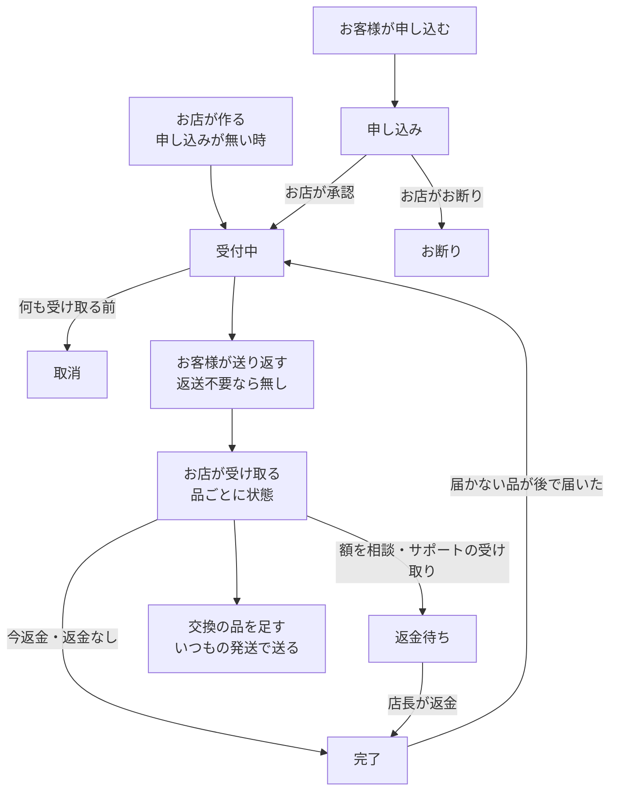
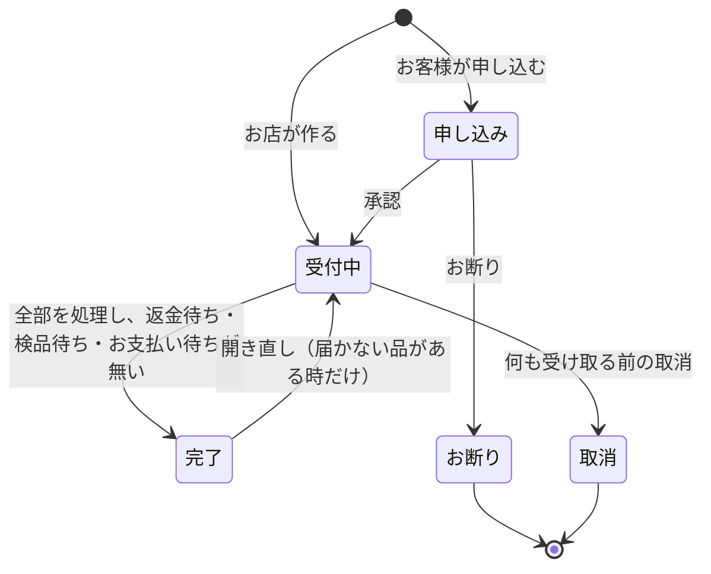

# 返品と交換（グループ E-3）設計書

> 日付: 2026-10-12（設計の承認: 2026-10-12。設計 1〜8 を節ごとに承認。Shopify と違う所は1つずつ話し合って決めた）
> 分類: architectural（新しい表、受け取りと返金のつなぎ、交換の品の注文の行、在庫の台帳の理由、お客様の申し込みの画面、写真の置き場、ショップの設定、メールの種類、権限を足すため）
> 要望: 返品を Shopify と同じ形で扱う。同じ商品の交換、お客様からの申し込み（写真・ご希望）、承認とお断り、品ごとの受け取り、返金のつなぎを作る
> 方針: **Shopify と同じ形に近づける。Shopify の仕組みが見つからない所は、業界の定番に従う**（ユーザーの指示）。各節に Shopify・業界との突き合わせと出典を付ける
> 全体の決定: [グループ E 全体の設計の決定](2026-10-10-group-e-overview-design.md) の5章（E-3）。この設計書は、その決定を話し合いで直した版（1-5 に変えた所）
> 関連: [E-2 返金とキャンセルの設計書](2026-10-11-refund-and-cancel-design.md)（返金の記録・18章の申し送り）、[E-1 部分発送の設計書](2026-10-10-partial-fulfillment-design.md)（発送の行・仕上がり・在庫の画面）、[グループ D 設計書](2026-10-09-order-email-outbox-design.md)（注文のメール）

---

## 概要

今は返品の記録が無い。発送した品の返金は E-2 の返金の画面でできるが、品が戻ったかは記録されず、在庫も手で直す。交換の品を送っても注文に残らない。お客様が返品を申し込む画面も無い。

この設計は、次のものを入れる。

- 返品を Shopify の Return と同じく「1件ずつの記録」にする。返品の行は、どの発送の行から返すかを持つ
- お客様の申し込み（アカウントの注文の画面から。写真とご希望つき）と、お店の承認・お断り。申し込みが無い時は、お店が返品を作る
- 品ごとの受け取り（在庫に戻す／戻さない／届かない／お返し）と、返金のつなぎ（今返金・額を相談してから返金・返金待ち）
- 同じ商品の交換（交換の品を同じ注文の行として足し、いつもの発送で送る。在庫が無ければ作って送る）
- 返品の手数料と交換の手数料・送料（設定で使える。このブランドは使わない）
- ショップの設定の「返品」の欄、商品の「返品不可」の印、管理画面とお客様の画面、メール

| 項目 | 決定 | 根拠 |
|---|---|---|
| 返品の記録 | 返品・返品の行・受け取りの記録・写真の表を足す。状態は申し込み・受付中・完了・取消・お断りの5つ | Shopify の Return・ReturnLineItem・ReturnStatus |
| 返品の行が指す物 | 発送の行（どの発送のどの品か）。返金は今までどおり注文の商品ごと | Shopify の ReturnLineItem.fulfillmentLineItem と RefundLineItem.lineItem |
| 入口 | お客様の申し込み（ログインしたお客様。ゲストは E-5 の後）と、申し込みが無い時にお店が作る返品 | Shopify のセルフサービスの返品と、管理画面の返品の作成 |
| 承認 | 毎回お店が行う（自動の承認は作らない） | Shopify の標準も毎回お店 |
| 交換 | 同じ商品の色・サイズ違いか同じ品だけ。返品の行ごとに「返金か交換か」を決め、交換の品の行と1対1で結ぶ。差額は出ない | Shopify は交換の品を注文の行にする（ExchangeLineItem）。差額の仕組みは作らない（ユーザーの決定） |
| 交換の品の確保 | 品を受け取った時に、受け取った数だけ交換の品の行を足して確保する | Shopify も処理するまで確保しない |
| 返金の時期 | 受け取った品だけ返金できる（返送不要の時は、承認の後すぐ受け取りを記録できる） | E-2 の18章の決定（Shopify は止めない） |
| サポートの受け取り | お客様の申し込みから始まり品が送り返されてきた返品は、計算どおりの額を自動で返金。それ以外は返金待ち | ユーザーの決定（Shopify は返金の権限が要る） |
| 返品の状態の見せ方 | 返品の申し込み・返品中・返金待ち・返品済みの4つ（注文の進み具合と別に出す） | Shopify の注文の返品の状態（3つ目は検品済み） |
| 期限 | 日数・数え始め（品ごと／最後の品）・届いた日がわからない時の目安を設定する。このブランドは7日・品ごと・3日 | Shopify の返品のルール |
| 設定 | ショップの設定に「返品」の欄（申し込み・期限・理由ごとの設定・返送・手数料・受け取り）。商品に「返品不可」の印 | Shopify の返品のルールと、AfterShip・Loop の理由ごとの設定 |
| 作る順番 | 段1（お店が作る返品・受け取り・交換）→ 段2（お客様の申し込み）。仕様書は1つ、計画と本番への適用は段ごと | 大きさを分けて確かめるため |

---

## 1. 目的と範囲

### 1-1 要望

- 返品を Shopify と同じ形で扱う（全体の決定の5章、2026-10-10）
- 返品の返金は、お店が品を受け取った時だけにする。受け取りの画面は品を1点ずつ確かめる（E-2 の18章、2026-10-11）
- お店の約束（特定商取引法の表記・利用規約）の「交換・修理・再制作」と「サイズ交換（未使用・在庫あり）」を記録に残して守る（2026-10-12）
- お客様が自分で返品・交換を申し込めるようにし、注意書きを設定で書けるようにする（2026-10-12）

### 1-2 ユーザーが決めたこと（2026-10-12）

| 決めたこと | 中身 |
|---|---|
| 交換 | 同じ商品の交換だけ作る（B）。修理・再制作は受注生産の流れ（仕上がりを記録してから送る） |
| 権限 | 返品を作る・受け取るのは店長とサポート（B）。返金の画面（額を選ぶ・直す）は店長だけ |
| お知らせ | 返品の受付・受け取り・交換の品の発送の3つの場面で送る（A） |
| 交換の品の持ち方 | 同じ注文に交換の品の行を足す（案1）。値段は0、元の品1点の支払額を持つ |
| 申し込み | Shopify と同じお客様の申し込みを作る（ウ）。注意書きをショップの設定で書ける |
| 期限 | Shopify と同じ形（日数7・品ごとの届いた日・目安3日・延長なし） |
| キャンセルの申し込み | 作る（イ）。設定で「返品と取消／返品だけ／取消だけ」を選ぶ。このブランドは返品だけ |
| 返品の行 | どの発送の行から返すかを持つ（Shopify と同じ） |
| 要検品 | ショップの設定で切り替える。最初は使わない |
| 手数料 | 返品の手数料・返送料と、交換の手数料・送料を設定で使える。このブランドは使わない。返金から引けない分は手で受け取りを記録する（B） |
| 写真 | 理由ごとに「なし／任意／必須」と案内の文。このブランドは破損・不良と誤った品が必須 |
| 返品と交換 | 返品の行ごとに返金か交換か（Shopify は別々に並べて差額を出す） |
| 承認 | 毎回お店が行う（A） |
| 返金できる時 | 受け取った時だけのまま、「返送不要」を足す（違い1 A） |
| 交換の品の結び方 | 1対1で結ぶ（違い2 A） |
| 支払い待ちの交換の品 | 「支払いを待たずに送る」を足す（違い3 A） |
| 作って送る交換 | 残す。在庫が足りなければ自動で作って送る（違い4 A） |
| 発送の取消 | 返品が指す発送は取り消せない（設計4 違い1 A） |
| 返品の状態 | Shopify と同じく4つ。3つ目の名前は「返金待ち」（設計4 違い2 B） |
| 返金待ちの道 | 店長の「今／あとで」は残し、「あとで」は「額を相談してから返金する」と名付ける。サポートの受け取りは自動で返金する |
| サポートの自動の返金の守り | 自動で返金するのは、申し込みから始まり品が実際に送り返されてきた返品だけ（A） |
| 返送不要 | 出すかどうかをショップの設定で切り替える。最初は出さない |
| 開き直し | 「届かない」で閉じた品がある時だけ（設計4 違い3 A） |
| 理由ごとの設定 | 「出す」「ご希望」「在庫の無い交換」の3つの列を足す（5C の1 A） |
| 返品不可 | 商品に「返品不可」の印を付けられる。印の品でも破損・不良と注文と違う品だけは申し込める（5C の2 C） |
| お返し | 条件に合わない品は、返金も交換もせずにお返しする（5C の3 A） |

### 1-3 成功の基準

- お客様がアカウントの注文の画面から、期限内の発送済みの品を、理由・写真・ご希望つきで申し込める。受けない理由・期限切れ・返品不可の品は選べない
- お店が申し込みを承認・お断りでき、お客様に受付のお知らせかお断りのメッセージが届く
- 申し込みが無い時は、お店が返品を作れる（返送不要も、設定で出している時は選べる）
- 届いた品を1点ずつ受け取り、在庫に戻すか・戻さないか・お返しするかを記録できる。在庫に戻した品は在庫の台帳に「返品の受け取り」で残る
- 受け取った返金の品は、その場で返金するか、額を相談してから返金できる。サポートが受け取った申し込みの返品は、計算どおりの額で自動で返金される
- 交換の品が同じ注文に足され、在庫から確保される（無ければ作って送る）。いつもの発送の画面から送れ、発送のお知らせに交換の一文が入る
- 返品の状態（返品の申し込み・返品中・返金待ち・返品済み）が、管理画面とお客様の画面に出る
- 交換の品の行は、売上・品の数・人気の商品・法定の写しに数えられない
- 同じ操作を何度送っても、記録・返金・在庫は1回分だけ動く

### 1-4 範囲の外

| 物 | どこで |
|---|---|
| 別の商品への交換・差額の請求・Stripe の支払いのリンク | 作らない（要るブランドが出た時） |
| 自動の承認 | 作らない（ユーザーの決定） |
| 返品の集計の画面（数・理由） | 作らない（記録は残るので後で作れる） |
| 手で受け取った手数料を帳簿へ入れる道 | 作らない（手数料を使うブランドが出た時） |
| ログインしないお客様の申し込み | E-5（注文の状況のページ）の後 |
| 届いた日（配達済み）の記録 | E-4。それまで期限は発送の日＋目安から数える |
| 送り状の作成 | 作らない（Shopify の送り状は米国だけ） |
| 土日祝の延長 | 作らない（祝日の暦を持ち続ける必要があるため） |

### 1-5 全体の決定（5章）から変えた所

| 全体の決定（2026-10-10） | この設計 | 理由 |
|---|---|---|
| 状態は受付中・完了・取消の3つ | 申し込み・受付中・完了・取消・お断りの5つ | お客様の申し込みを作ることにした（ウ） |
| お客様からの申し込みは作らない | 作る | ユーザーの決定（ウ） |
| 返品を作ってもメールは送らない（Shopify も無い） | 返品の受付のお知らせを送る | Shopify に「返品の作成」のお知らせがあった（前の決定の誤り） |
| 交換は作らない | 同じ商品の交換を作る | お店の約束（交換・修理・再制作）を記録に残すため |
| 返品の手数料と返送料の差し引きは作らない（日本で使えないため） | 設定で使える（最初は使わない） | 日本で使えないのは送り状の作成で、手数料そのものは使える（前の理由の誤り） |
| 返品の行は注文の商品を指す | 発送の行を指す | 品ごとの届いた日から期限を数えるため（Shopify と同じ） |
| 受け取りは在庫に戻す／戻さないの2つ | 戻す・戻さない・届かない・お返し、要検品の設定の時は検品待ち | 話し合いで足した |

---

## 2. 実装前の状態（2026-10-12）

| 所 | 今の作り |
|---|---|
| 発送 | E-1 の `public.order_fulfillments`（発送）と `public.order_fulfillment_lines`（発送の行。発送と注文の商品の組で1行）。配送業者はヤマト・佐川・日本郵便 |
| 受注生産 | `order_items.fulfillment_type` が `stock`（在庫の品）か `backorder`（受注生産）。仕上がりは `public.order_item_completions`。届くまでの目安は `items.made_to_order_lead_days` |
| 返金 | E-2 の `public.order_refunds`・`public.order_refund_lines`。発送後の返金は在庫を動かさない（`restock_type` は `no_restock`）。返金の画面は発送前／発送済みに分けて数を選ぶ |
| 在庫の台帳 | `public.stock_movements`。理由は `purchase`・`restock`・`adjustment`・`cancel`・`refund`。確保の数え方 `private.order_line_reservations` は `purchase`・`cancel`・`refund` を数える |
| 注文の進み具合 | `deriveOrderProgress`（`src/lib/orders/order-progress.ts`）が商品ごとの数から言葉を出す。未発送があれば DB の状態は `paid`、無くなれば `shipped` |
| ショップの設定 | `public.shop_settings`（1行。自動の返金①②のトグルと、最後に変えた人・時刻）。画面は `src/components/ShopSettingsSection.tsx`。店長だけ |
| 権限 | 店長（全部の画面）とサポート（ORDER の画面だけ）。返金は `admin.orders.refund`、設定は `admin.settings.manage` |
| メール | `private.order_email_outbox` の種類は `paid`・`awaiting_payment`・`payment_expired`・`canceled`・`shipped`・`refund`。件名は決まった文と注文番号だけ |
| 管理画面の注文の一覧 | `src/components/OrderSection.tsx`。列は注文ID・顧客名・注文日・購入商品・商品数・合計金額・支払い・進み具合・操作（右に貼り付き）。操作は一覧から開く画面（発送・仕上がり・返金・キャンセル・履歴） |
| お客様の注文の画面 | `src/app/account/orders/[id]/page.tsx`。進み具合の段・発送ごとの配送情報・発送準備中と受注生産中の商品・ご注文商品・支払金額・ご返金 |
| 集計 | KPI（`src/app/api/admin/kpi/route.ts`）は注文の商品の数を全部足す。人気の商品は DB の関数 `get_popular_items`。法定の写しは `src/lib/legal-archive/export-query.ts`。管理会計は Stripe の入出金と棚卸から作る |
| お店の約束（/legal・/terms） | お客様のご都合の返品・交換・キャンセルは受けない。初期不良・誤送は到着から7日以内の連絡で返品・交換・修理（再制作）。サイズ交換は未使用で在庫がある時だけ。返送料はお客様、初期不良・誤送はお店。素材の風合いは不良ではない。連絡はお問い合わせフォームから |

---

## 3. 全体の形

### 3-1 流れ

- 申し込みはそのまま返品の記録になり、状態だけが進む。お店が別に作り直すことはない
- お店の手が要るのは、承認かお断りと、届いた品の受け取りだけ。ほかは自動で進む
- 一部だけ届いた時は受付中のまま。全部の品が処理され、返金待ちが無くなると自動で完了

### 3-2 返品の状態

記録の状態は5つ。画面に出す返品の状態は、次の4つ（Shopify の注文の返品の状態に合わせる）。

| 画面の返品の状態 | 記録 | 受付中の中の小さな印 |
|---|---|---|
| 返品の申し込み | 申し込み | — |
| 返品中 | 受付中のうち、下の返金待ちでない物 | 受け取り待ち（何も届いていない）・一部受け取り・検品待ち・お支払い待ち |
| 返金待ち | 受付中で、全部の品が処理され（受け取り・届かない・お返し）、検品待ちが無く、返金の品のうち返金していない物がある | — |
| 返品済み | 完了 | — |

- お断り・取消の返品しかない注文には、返品の状態を出さない（Shopify も返品の無い注文には出さない）
- 注文に返品が2つ以上ある時は、いちばん手前の状態（申し込み → 返品中 → 返金待ち → 返品済み）を出す。絞り込みは、どれか1つでも当たれば出す

### 3-3 突き合わせ

| 所 | この設計 | Shopify・業界 | 出典 |
|---|---|---|---|
| 状態 | 申し込み・受付中・完了・取消・お断り | REQUESTED・OPEN・CLOSED・CANCELED・DECLINED | [ReturnStatus](https://shopify.dev/docs/api/admin-graphql/latest/enums/ReturnStatus) |
| 注文の返品の状態 | 返品の申し込み・返品中・返金待ち・返品済み | 返品の申し込み・返品中・検品済み・返品済み | [注文の状態](https://help.shopify.com/en/manual/fulfillment/managing-orders/order-status) |
| 承認 | 毎回お店 | 標準は毎回お店。返品アプリ（AfterShip・Loop）は条件で自動にできる | [申し込みの管理](https://help.shopify.com/en/manual/fulfillment/managing-orders/returns/self-serve-returns/management)・[AfterShip](https://support.aftership.com/en/returns/articles/15389178-how-to-auto-approve-return-requests)・[Loop](https://help.loopreturns.com/article/47-managing-returns) |
| 取消 | 何も受け取る前だけ | 検品や返金などを始める前だけ | [returnCancel](https://shopify.dev/docs/api/admin-graphql/latest/mutations/returnCancel) |
| 開き直し | 届かない品がある時 | 閉じた返品を開き直す（条件の説明なし） | [returnReopen](https://shopify.dev/docs/api/admin-graphql/latest/mutations/returnReopen)・[returnClose](https://shopify.dev/docs/api/admin-graphql/latest/mutations/returnClose) |

---

## 4. 記録（設計 1）

表は E-1・E-2 と同じ作法にする。RLS で anon・authenticated を全部断り、service_role は読むだけ。書くのは SECURITY DEFINER の DB の関数だけ。記録は消さず、中身も直さない（進むのは状態・時刻・印だけ。トリガーで守る）。

### 4-1 返品 `public.order_returns`

| 列 | 中身 |
|---|---|
| `id` | uuid |
| `order_id` | 注文 |
| `number` | 注文の中の順番（1, 2, …）。画面は「注文番号-R1」。お断り・取消の返品も番号を使う。注文と組で一意 |
| `source` | `customer_request`（お客様の申し込み）・`shop`（お店が作った） |
| `status` | `requested`（申し込み）・`open`（受付中）・`closed`（完了）・`cancelled`（取消）・`declined`（お断り） |
| `request_key` | 二重防止の番号（一意） |
| `requested_at`・`requested_by` | 申し込んだ時刻とお客様（お客様の申し込みだけ） |
| `approved_at`・`approved_by` | 承認（お店が作った時は作った時刻と人） |
| `declined_at`・`declined_by`・`decline_reason`・`decline_message` | お断り。理由は `window_passed`（期間切れ）・`final_sale`（返品不可）・`other`（お店の中だけ）。メッセージは1000字まで（お客様に届く） |
| `return_method` | `customer_ships`（お客様が送る）・`shop_label`（お店の送り状で送り、定額を差し引く）・`not_required`（返送不要） |
| `return_shipping_payer` | `shop`・`customer`（理由の設定から入り、承認・作成の画面で直せる） |
| `return_carrier`・`return_tracking_number` | 返送の配送業者（ヤマト・佐川・日本郵便・その他）と伝票番号。どちらも任意 |
| `return_shipping_fee`・`restocking_fee_percent`・`exchange_fee`・`exchange_shipping_fee` | 手数料（設定から入り、返品ごとに直せる。0以上） |
| `fee_due_amount` | 返金から引けずに、お客様からいただく額（受け取りの時に決まる） |
| `fee_received_at`・`fee_received_by`・`fee_received_note` | 手数料の受け取りの記録（店長だけ） |
| `exchange_released_at`・`exchange_released_by` | 「支払いを待たずに送る」（店長だけ） |
| `notify_customer` | 受付のお知らせを送るか（作る・承認の画面のチェック） |
| `shop_note` | 店だけのメモ（500字まで） |
| `created_at`・`created_by` | 作った時刻と人（お客様の申し込みは空） |
| `closed_at`・`cancelled_at`・`cancelled_by`・`reopened_at`・`reopened_by` | 完了・取消・開き直し |

### 4-2 返品の行 `public.order_return_lines`

| 列 | 中身 |
|---|---|
| `id` | uuid |
| `return_id` | 返品 |
| `fulfillment_id`・`order_item_id` | どの発送の行か（`order_fulfillment_lines` の組を指す） |
| `quantity` | 返す数（1以上） |
| `reason` | `defective`（破損・不良）・`wrong_item`（注文と違う品）・`size_too_small`・`size_too_large`・`color`・`style`・`not_as_described`・`unwanted`・`other`・`unknown`（不明。お店が作る時だけ） |
| `reason_note` | 理由のメモ（お店。255字まで。「その他」は必須） |
| `customer_note` | お客様の詳しい内容（300字まで。「その他」と「破損・不良」は必須） |
| `requested_resolution`・`requested_exchange_variant_id` | お客様のご希望（返金／交換と色・サイズ） |
| `resolution` | 承認・作成で決まる解決の方法。`refund`・`exchange` |
| `exchange_variant_id` | 交換で送る色・サイズ（同じ商品の色・サイズだけ。DB が確かめる） |
| `exchange_method` | `stock`（在庫から）・`make`（作って送る）。承認の時の最初の値は、在庫があれば在庫から |

同じ商品で「1点は返金、1点は交換」にしたい時は、行を2つに分ける。

### 4-3 受け取りの記録

1回の受け取りの操作が1つの記録。商品ごとの数は、扱いごとの行で持つ（足していく台帳。直さない）。

`public.order_return_receipts`（操作ごと）

| 列 | 中身 |
|---|---|
| `id`・`return_id`・`request_key` | 二重防止の番号は一意 |
| `kind` | `receive`（受け取り）・`inspect`（検品待ちを決める）・`close_missing`（残りを届かないとして終える）・`reopen`（開き直し） |
| `refund_choice` | `now`（今返金する）・`consult`（額を相談してから返金する）・`none`（返金の品が無い） |
| `refund_id` | この操作で始めた返金（E-2 の `order_refunds`） |
| `notify_customer` | お客様に知らせるか |
| `sent_back_message`・`sent_back_carrier`・`sent_back_tracking_number` | お返しのメッセージ（1000字まで。お返しがある時は必須）と、送り返しの配送業者・伝票番号（任意） |
| `actor_id`・`actor_role`・`created_at` | した人・役割・時刻 |

`public.order_return_receipt_lines`（返品の行と扱いごとの数）

| 扱い `disposition` | 中身 | 在庫 |
|---|---|---|
| `restocked` | 受け取って在庫に戻した | すぐ出せる数 +n（台帳の理由 `return`） |
| `not_restocked` | 受け取って戻さなかった | 動かない |
| `pending_inspection` | 受け取って検品待ち（要検品の設定がオンの時だけ） | 動かない |
| `inspected_restocked`・`inspected_not_restocked` | 検品待ちを決めた（`inspect` の操作。同じ数の検品待ちを打ち消す） | 戻す時は +n |
| `sent_back` | 条件に合わないのでお返しした | 動かない |
| `missing` | 届かないとして終えた | 動かない |
| `missing_reopened` | 開き直しで、届かないを打ち消した（数は負として数える） | 動かない |

### 4-4 交換の品の行（`order_items` に足す列）

| 列 | 中身 |
|---|---|
| `line_kind` | `order`（ふつう。今の行は全部これ）・`exchange`（交換の品） |
| `exchange_return_line_id` | どの返品の行の交換か（交換の品だけ） |
| `exchange_paid_amount` | 元の品の支払額（割引を割り振った額）の、この行の数の分の合計。後で交換の品を返金する時の額のもとになる |

- 値段（単価・小計）は0。`fulfillment_type` は、在庫からなら `stock`、作って送るなら `backorder`
- 受け取った時に、受け取った数だけ足す（承認の時ではない）。一部だけ届いた時は、届いた分だけ
- 交換の品の行は、ふつうの行と同じく発送・仕上がりの記録・発送前の返金・返品ができる
- 交換の品の行の返金の額は、`exchange_paid_amount` を数で割り振る（E-2 の割引の割り振りと同じく、累積で丸める）

### 4-5 写真 `public.order_return_photos` と置き場

| 列 | 中身 |
|---|---|
| `id`・`return_line_id` | どの返品の行の写真か |
| `storage_path` | 非公開の置き場（Supabase Storage の非公開の入れ物 `return-photos`）の場所 |
| `content_type`・`size_bytes` | `image/jpeg` か `image/png`。確かめた後の大きさ |
| `created_at`・`purged_at` | 置いた時刻と、消した時刻 |

- 1つの返品の行に5枚まで。選べる写真は1枚 10MB まで（縮める前）
- お客様の画面で、長い辺を 2000px に縮め、JPEG に作り直してから送る（この時に撮った場所などの情報も消える）
- 置き場へは、サーバーが出す1回だけ使える送り先（署名つきの URL）で直接送る。アプリのサーバーを通さない（ホスティングの受け付けの大きさの上限 4.5MB を避けるため）
- 申し込みを送った時に、サーバーが置き場の写真を読み、種類（ファイルの先頭の印）・大きさ・中の撮影の情報を確かめる。情報が残っていれば消して置き直す。合わない写真は断る
- 申し込みに使われなかった写真は1日で消す。返品が完了・取消・お断りになってから90日で消す（決まった時刻に動く処理）
- お店が見る時は、短い時間だけ使えるリンクで見る

### 4-6 キャンセルの申し込み `public.order_cancel_requests`・`public.order_cancel_request_lines`

| 列 | 中身 |
|---|---|
| `id`・`order_id`・`request_key`・`requested_at`・`requested_by` | 申し込み |
| `status` | `requested`（申し込み）・`resolved`（返金かキャンセルで解決）・`declined`（お断り）・`closed`（解決済みにする。注文を変えずメールも送らない） |
| `customer_note` | お客様のメモ（300字まで） |
| `decline_reason`・`decline_message` | お断り（返品と同じ） |
| `resolved_refund_id`・`resolved_by_cancel_at` | 解決に使った返金、または未払いの注文の取消 |
| 行 | `order_item_id`・`quantity`（未発送の数まで） |

### 4-7 返品不可（`items` に足す列）

`return_ineligible boolean NOT NULL DEFAULT false`。印の付いた品は、お客様の申し込みでは理由を破損・不良と注文と違う品の2つに絞る。お店が作る返品では止めず、「返品不可の品です」と出す。

### 4-8 数え方（2段）

注文の商品ごとの記号（E-2 の 4-4 に足す）:

| 記号 | 中身 |
|---|---|
| s | 発送した数（E-1） |
| ra | 発送後に返金した数（E-2。返品の返金も入る） |
| rq | 申し込み中の返品の数 |
| op | 受付中の返品で、まだ処理していない数（届いていない・検品待ちでない） |
| rw | 受け取った返金の品で、まだ返金していない数（返金待ち） |
| ex | 交換にした数（受け取った交換の品） |
| sb | お返しした数 |

| 数 | 式 |
|---|---|
| 返品できる数（注文の商品ごと） | s − ra − rq − op − rw − ex − sb |
| 返品できる数（発送の行ごと） | その発送の行の数 − その行を指す、申し込み・受付中・完了の返品の行の数 ＋ 届かなかった数 |
| ふつうの返金の画面で選べる発送済みの数 | s − ra − rq − op − rw − ex（お返しした品はお店の判断で返金できる） |

- 両方の段の数を、DB の関数がもう一度確かめる（画面の数を信じない）
- 届かなかった品と、取消・お断りの返品の品は、まだお客様の手元にあるので、また返品できる
- 交換にした元の品は、元の行ではもう返金も返品もできない。交換の品が届いた後は、交換の品の行で返品・返金できる
- お返しした品は、同じ品でもう一度申し込めない（相談はお問い合わせから）

### 4-9 受付の期限

- 発送の行ごとに期限を出す。数え始めは、設定が「品ごとの届いた日」ならその発送の届いた日、「最後の品の届いた日」なら注文の最後の発送の届いた日
- 届いた日がわからない時（E-4 までは全部）は、発送した日（日本時間の日付）に目安の日数を足した日を届いた日とみなす
- 期限は、届いた日の「日数」後の日の終わり（日本時間の 23:59:59）まで。例: 10月10日に発送・目安3日・7日なら、10月20日まで
- 「無制限」の設定の時は期限なし
- お客様は期限を過ぎた品を選べない。お店が作る返品は止めず、「期限を過ぎています」と出す
- 交換の品も、その発送から別に数える

### 4-10 DB が止めること

| 止めること | 誤りの言葉 |
|---|---|
| 返品できる数（どちらかの段）を超える | `RETURN_QUANTITY_EXCEEDS` |
| お客様の申し込みで、期限を過ぎた品・受けない理由・返品不可の品の受けない理由・受けないご希望 | `RETURN_NOT_ELIGIBLE` |
| 写真の数・必須の写真が無い・合わない写真 | `RETURN_PHOTO_INVALID` |
| 交換の色・サイズが同じ商品でない、または使えない | `RETURN_EXCHANGE_VARIANT_INVALID` |
| 返送先が空のまま承認・作成する | `RETURN_ADDRESS_REQUIRED` |
| 状態に合わない操作（申し込みでない返品の承認、受け取った後の取消、届かない品の無い開き直し など） | `RETURN_STATE_CONFLICT` |
| 受け取りの数が残りの数を超える | `RETURN_RECEIPT_EXCEEDS` |
| 在庫の無い交換を「受けない」理由で在庫から送ろうとする（受け取りの時に店長の選択が要る） | `RETURN_EXCHANGE_OUT_OF_STOCK` |
| 権限の無い操作（サポートの返金・手数料の記録・支払いを待たずに送る） | `RETURN_FORBIDDEN` |
| 返品が指す発送を取り消す | `FULFILLMENT_HAS_RETURN`（画面「返品のある発送は取り消せません」） |
| 同じ二重防止の番号で中身が違う | `RETURN_REQUEST_MISMATCH` |
| 返金を始められない（E-2 の決まり。確かめ中の返金がある など） | E-2 の誤りの言葉をそのまま返す |

### 4-11 突き合わせ

| 所 | この設計 | Shopify | 出典 |
|---|---|---|---|
| 返品の行が指す物 | 発送の行 | 発送の行（fulfillmentLineItem） | [ReturnLineItem](https://shopify.dev/docs/api/admin-graphql/latest/objects/ReturnLineItem) |
| 返金の行が指す物 | 注文の商品 | 注文の商品（lineItem） | [RefundLineItem](https://shopify.dev/docs/api/admin-graphql/latest/objects/RefundLineItem) |
| 理由 | 10種類＋お店のメモ255字＋お客様の文300字 | 10種類・returnReasonNote 255字・customerNote 300字 | [ReturnReason](https://shopify.dev/docs/api/admin-graphql/latest/enums/ReturnReason) |
| 受け取った品の扱い | 戻した・戻さない・届かない・検品待ち・お返し | 戻した・戻さない・届かない・要処理 | [扱いの種類](https://shopify.dev/docs/api/admin-graphql/latest/enums/ReverseFulfillmentOrderDispositionType) |
| 交換の品 | 注文の行として足す | 注文の行になる | [ExchangeLineItem](https://shopify.dev/docs/api/admin-graphql/latest/objects/ExchangeLineItem) |
| お断りの理由 | 期間切れ・返品不可・その他 | 期間切れ・最終販売・その他 | [ReturnDeclineReason](https://shopify.dev/docs/api/admin-graphql/latest/enums/ReturnDeclineReason) |
| 期限 | 日数・数え始め・目安 | 14・30・90日・無制限・好きな日数、品ごと／最後の品、届いた日がわからない時は発送＋目安 | [返品のルール](https://help.shopify.com/en/manual/fulfillment/managing-orders/returns/return-rules) |
| 返品不可 | 商品の印。破損・不良と注文と違う品だけは申し込める | 最終販売（商品かコレクション）。申し込みそのものができない | 同上 |

---

## 5. 申し込み・承認・お店が作る返品（設計 2）

### 5-1 お客様の申し込み（アカウントの注文の画面から）

| 所 | 中身 |
|---|---|
| 出す時 | 申し込みの受付がオン、申し込みの種類に返品が入っている、期限内の発送済みの品がある時に「返品・交換を申し込む」。期限が全部過ぎていたら「返品・交換の受付は M月D日 で終わりました」 |
| 1. 品を選ぶ | いちばん上に注意書き。品は発送ごとにまとめ、「返品・交換の受付：M月D日まで」。品ごとに数・理由・詳しい内容・写真（理由の設定のとおり）・ご希望（理由の設定のとおり返金／交換。交換は同じ商品の色・サイズ） |
| 選べない品 | 期限を過ぎた品（「受付の期限を過ぎました」）、申し込み中・返品中の品（「お申し込み済み」）、お返しした品。まだ発送していない品は出さない |
| 交換の色・サイズ | 同じ商品の使える色・サイズ。在庫が無い物は、理由の設定が「作って送る」なら「お作りしてお送りします（目安 N 日）」、「受けない」なら選べない |
| 2. 確かめる | 品・理由・ご希望・写真を並べ、返送料の負担（理由の設定から）と手数料（設定がある時）を出して「申し込む」 |
| 3. 受け付けました | 「お申し込みを受け付けました。内容を確かめて、メールでご連絡します」。お客様とお店にメール（9章の1・10） |
| 理由（お客様に出す9つ） | サイズが小さい・サイズが大きい・色がイメージと違った・デザインが好みでない・説明と違った・破損・不良・注文と違う品が届いた・不要になった・その他。理由の設定で「出さない」にした物は出さない |
| 取り下げ | 作らない（Shopify も無い）。お問い合わせでお店に伝え、お店がお断りで閉じる |

### 5-2 承認・お断り（管理画面）

| 所 | 中身 |
|---|---|
| 見つけ方 | 一覧の「返品」の列と絞り込み、一覧の上の「返品の申し込み N件」、お店へのメール |
| 承認 | お客様の申し込み（品・理由・内容・写真を拡大して見られる・ご希望）を見て、解決の方法（返金／交換の色・サイズと送り方）・返送の方法と返送料の負担・手数料・メモを決め、「承認する」。受付中になり、受付のお知らせ（9章の2）が届く |
| お断り | 理由（期間切れ・返品不可・その他。お店の中だけ）とお客様へのメッセージ（必須）を書き、「お断りする」。お客様にメッセージ入りのメール（9章の3）。品はまた申し込める |
| 品と数を変えたい時 | 承認では変えない。違う時は、お断りして申し込み直してもらうか、お店が作り直す |
| 返送不要 | 設定で出している時だけ選べる。選んで承認すると、すぐ受け取りの画面が開く |
| 承認は毎回 | 自動の承認は作らない |

### 5-3 お店が作る返品（申し込みが無い時の入口）

使う場面: E-5 までのゲストの注文、問い合わせ・メール・電話で連絡が来た時、お店が先に送り間違いに気づいた時。

| 所 | 中身 |
|---|---|
| 開き方 | 一覧の「返品」のボタン → 注文ごとの返品の画面 →「返品を作る」 |
| 品の並べ方 | 発送ごとにまとめ、返品できる数と期限を出す。期限を過ぎた品・返品不可の品も作れる（警告を出す） |
| 品ごと | 数・理由（「不明」も選べる）・理由のメモ・解決の方法（返金／交換。交換は色・サイズと在庫の数、送り方） |
| 返品ごと | 返送の方法と返送料の負担（理由の設定から入る）・返送の配送業者と伝票番号（任意）・手数料（設定から入る）・メモ・「お客様に返品の受付のお知らせを送る」（最初は入っている） |
| 状態 | すぐ受付中。返送不要なら、すぐ受け取りの画面が開く |

### 5-4 キャンセルの申し込み（申し込みの種類に取消が入っている時だけ。このブランドは使わない）

| 所 | 中身 |
|---|---|
| お客様 | まだ発送していない品と数・メモを入れて申し込む。注文はまだ変わらない |
| 承認 | 「品を外す」で E-2 の画面が申し込みの品の入った状態で開く（一部なら返金の画面の発送前の商品、全部なら支払い済みのキャンセル、未払いなら今の取消）。受け付けると申し込みが解決する（お客様には E-2 のお知らせが届く） |
| お断り | 理由とメッセージ。メッセージ入りのメール |
| 解決済みにする | 注文を変えず、メールも送らずに閉じる |

### 5-5 突き合わせ

| 所 | この設計 | Shopify・業界 | 出典 |
|---|---|---|---|
| 申し込む場所 | アカウントの注文の画面 | 注文の状況のページの「品を返品する」「品をキャンセルする」「キャンセルまたは返品」 | [設定の仕方](https://help.shopify.com/en/manual/fulfillment/managing-orders/returns/self-serve-returns/setup) |
| 入れる物 | 品・数・理由・詳しい内容・写真・ご希望 | 品・理由（商品の種類で変わる）・お店へのメモ。交換は申し込めない | 同上 |
| 写真 | 理由ごとに なし／任意／必須と案内の文 | Shopify の標準には無い。AfterShip は理由ごとに任意／必須と案内の文 | [AfterShip](https://returns-helpcenter.aftership.com/en/article/enable-images-upload-and-comments-for-return-items-3zpgj1/) |
| 承認・お断り | 解決の方法・返送・手数料を決めて承認。お断りは理由（店内）＋メッセージ | 手数料・交換の品・返送の方法を決めて承認。お断りは理由（店内）＋メッセージ | [申し込みの管理](https://help.shopify.com/en/manual/fulfillment/managing-orders/returns/self-serve-returns/management) |
| お店が作る | 品・数・理由・解決の方法・返送・手数料・お知らせ | 数・理由・手数料・交換の品・返送の方法 | [返品の作成](https://help.shopify.com/en/manual/fulfillment/managing-orders/returns/creating-returns) |
| キャンセルの申し込み | 種類の設定と、E-2 の画面で品を外して解決 | 同じ | [設定の仕方](https://help.shopify.com/en/manual/fulfillment/managing-orders/returns/self-serve-returns/setup) |

| Shopify と違う所 | 理由 |
|---|---|
| 申し込みの画面のいちばん上に注意書き | ユーザーの依頼（ほかのブランドも設定で使える） |
| お客様が写真とご希望（交換の色・サイズ）を付けられる | 業界の定番（AfterShip・Loop） |
| 期限を過ぎた品はお客様は選べず、お店は警告つきで作れる | お客様には期限を守ってもらい、例外はお店が決める |

---

## 6. 受け取り・返金・交換の品（設計 3）

### 6-1 受け取りの画面

| 所 | 中身 |
|---|---|
| 開く所 | 受付中の返品の「受け取る」。店長とサポート |
| 並び | 返品の品を1点ずつ1行（2点なら2行）。品・色・サイズ・解決（返金／交換）・理由 |
| 1行ごと | 届いた品にチェックを入れ、状態を必ず選ぶ（最初の値は無い）: 在庫に戻す／戻さない／条件に合わないのでお返しする。要検品がオンの時は検品待ちも出る |
| 進み具合 | 「3点中2点を確認」 |
| 返金の欄（店長） | ◉ 計算どおり ¥X を返金する ／ ○ 額を相談してから返金する（着た跡や付属品の不足などで、お客様と相談して額を決める時。受け取りだけを記録し、返金待ちになる） |
| 返金の欄（サポート） | 自動で返金する返品（6-3）では「受け取ると、計算どおり ¥X を自動で返金します（額は変えられません）」と出す。○ 額を相談してから返金する（店長が額を決めます）も選べる。それ以外の返品では「返金は店長が行います（返金待ちになります）」 |
| お返しを選んだ時 | お客様へのメッセージ（必須）と、送り返しの配送業者・伝票番号（任意）を書く。押す前に「お客様にメッセージが届きます。取り消せません」と確かめを出す |
| 確定のボタン | 1つだけ。中身で言葉が変わる。例:「すべて受け取って ¥X を返金する」「2点を受け取り、交換の品を発送待ちにする」「受け取りだけ記録する（返金は額を決めてから）」「受け取りだけ記録する（額は店長が決める）」 |
| 一部だけ届いた時 | 押す前に「まだ届いていない商品が N 点あります。届いた分だけ記録し、残りは受付中のまま残ります」と出す。次に開くと、受け取り済みの行は固定され、残りの行だけ選べる |
| 届かない残り | 「残りは届かないものとして返品を終える」。残りは返金も交換もしない |
| お客様への知らせ | 「お客様に知らせる」のチェック（最初は入っている）。お返しを含む時は、お返しのメッセージを伝えるために必ず送る |
| 検品待ちを決める | 受付中の返品の「検品を終える」で、検品待ちの品を戻す／戻さないに決める（返金は受け取りの時に決めた選び方のまま） |

### 6-2 品の状態と在庫の台帳

| 起きたこと | すぐ出せる数 | 台帳 |
|---|---|---|
| 在庫に戻す（検品待ちから戻すも同じ） | +n | 新しい理由 `return`（返品の受け取り）。どの返品かを `stock_movements.return_id`（新しい列）に残す |
| 戻さない・お返し・届かない | 動かない | 返品の記録にだけ残す |
| 交換の品（在庫から） | −n | 新しい理由 `exchange`（交換の品の確保）。確保の数え方 `private.order_line_reservations` に `exchange` を足す |
| 交換の品（作って送る） | 動かない | 今の受注生産と同じ |

- 受注生産で売った品が返ってきた時も、戻すを選べばその色・サイズのすぐ出せる数に足す（物があるため）
- 鍵の順番は今と同じ（注文 → 色・サイズを番号の昇順）

### 6-3 返金のつなぎ

| 所 | 中身 |
|---|---|
| 返す額 | 受け取った返金の品の支払額（E-2 の割引の割り振り）から、返送料（定額を差し引く設定の時だけ。返品ごとに最初の受け取りで1回）と、返品の手数料（受け取った返金の品の額の %）を引く。マイナスにはしない |
| 送料 | 最初は0。店長は額を入れれば返せる（上限は返せる送料） |
| 額を直す | 店長だけ。上限は返せる額（E-2 と同じ） |
| 今返金する | 受け取りと返金を1回の操作で行う。返金は E-2 の返金を始める DB の関数で作り、新しい道 `return`（返品）と、どの返品かを `order_refunds.return_id`（新しい列）に残す。返金の行の在庫の戻し方は新しい値 `return`（在庫は受け取りで動かすので、返金では動かさない） |
| 額を相談してから返金する | 受け取りだけ記録する。全部の品が処理されていれば返品は返金待ちになり、一部だけなら返品中（一部受け取り）のまま。どちらの時も、返品の画面の「額を決めて返金する」（店長だけ）から、額を決めて返金する |
| サポートの自動の返金 | お客様の申し込みから始まり、品が実際に送り返されてきた返品（返送不要でない）だけ、サポートの受け取りで計算どおりの額を自動で返金する。額は DB が計算し、画面の値は使わない。お店が作った返品・返送不要の返品・サポートが「額を相談」を選んだ時は返金待ちになり、店長にメール（9章の11） |
| 返金を始められない時 | 確かめ中の返金があるなど E-2 の決まりで始められない時は、受け取りも記録せずに断り、E-2 と同じ言葉を出す。サポートは「額を相談してから返金する」を選べば受け取りを記録できる |
| 失敗した時 | E-2 と同じく、要対応の「返金の失敗」から「もう一度返金する」。返品とのつながりは保つ。返品の状態は戻さない |
| ふつうの返金の画面 | 申し込み中・返品中・返金待ちの品と、交換にした品は、発送済みの商品として選べない（4-8） |
| 全額に届いた時 | E-2 の決まりのまま（成功した返金の合計が受け取った額に届くと、注文はキャンセル）。16章の確認を参照 |

### 6-4 手数料（設定で使う時だけ。このブランドは使わない）

| 手数料 | 付き方 |
|---|---|
| 返送料（定額を差し引く） | 返品ごとに最初の受け取りで1回 |
| 返品の手数料（%） | 受け取った返金の品の額に対して |
| 交換の手数料・交換の送料 | 返品ごとに、交換の品がある最初の受け取りで1回 |

- 返金から引く。引けない分（交換だけ、または返金の額が足りない）は `fee_due_amount` に入り、交換の品は「お支払い待ち」になって送れない
- 店長が受け取りを記録するか、「支払いを待たずに送る」を押すか、額を0に直すと送れる。受け取りを記録するか額を0にするまで、返品は完了にならない
- 手で受け取った手数料は、帳簿に自動では入らない（設定の手数料の欄に一文を出す。10章）

### 6-5 交換の品

| 所 | 中身 |
|---|---|
| 足す時 | 受け取った時に、受け取った数だけ、同じ注文に交換の品の行を足す（4-4） |
| 在庫から | 在庫を確保する。足りない時: 理由の設定が「作って送る」なら自動で作って送るに変え、画面にそう出す（店長は返金に変えることもできる）。「受けない」なら自動では変えず、店長が作って送るか返金に変えるかを選ぶ。サポートはその品を受け取れない（画面に「在庫が足りません。この品は店長が受け取ります」と出し、チェックできなくする） |
| 作って送る | 受注生産の行として足す。今の受注生産と同じく仕上がりを記録してから送る。修理も同じ形（直した品を仕上がりとして記録して送る） |
| 送る | いつもの発送の画面（7章） |
| 送る前に返金に変えたい | ふつうの返金の画面で、交換の品（発送前）を返金する。額は元の支払額から。店長だけ |

### 6-6 お返し（条件に合わない品）

| 所 | 中身 |
|---|---|
| 使う場面 | サイズ交換で使った跡がある、不良の申し込みが素材の風合いだった、お客様が壊した跡がある など |
| 扱い | 返金も交換もしない。在庫も動かさない |
| 知らせ | お客様へのメッセージ（必須）入りのメール（9章の4・5・6のどれか）。注文の画面にも、その品の結果として出す |
| できる人 | 店長とサポート（お金が出ていかない操作のため） |

### 6-7 完了

全部の品が受け取り済み（戻す・戻さない・お返し）か届かないになり、検品待ち・返金待ち・お支払い待ちが無くなったら、自動で完了にする。

### 6-8 突き合わせ

| 所 | この設計 | Shopify・業界 | 出典 |
|---|---|---|---|
| 受け取り | 1点ずつ・一部ずつ | 品を選んで数を入れる。一部ずつ処理できる | [返品の処理](https://help.shopify.com/en/manual/fulfillment/managing-orders/returns/processing-returns) |
| 在庫に戻すか | 品ごとに必ず選ぶ | 処理の時に品ごとに戻す場所を選ぶ | 同上 |
| 返金の時期 | 今／額を相談してから | 今／あとで | 同上 |
| 手数料 | 返品の手数料は受け取った品の額で、返送料は最初の受け取りで | 同じ | 同上 |
| 返金の在庫の扱い | 返品（返金では動かさない） | RETURN | [在庫の戻し方](https://shopify.dev/docs/api/admin-graphql/latest/enums/RefundLineItemRestockType) |
| 交換の品の確保 | 受け取った時 | 処理するまで確保しない | [返品の作成](https://help.shopify.com/en/manual/fulfillment/managing-orders/returns/creating-returns) |
| 支払い待ちの交換の品 | お支払い待ち。支払いを待たずに送れる | 保留。支払いの前に出すこともできる | [返品の処理](https://help.shopify.com/en/manual/fulfillment/managing-orders/returns/processing-returns) |
| 在庫切れの交換 | 作って送る（理由の設定で受けないなら店長が選ぶ） | 説明なし。Loop は要確認に回す | [Loop](https://help.loopreturns.com/article/47-managing-returns) |
| お返し | 返金も交換もせずにお返し | Shopify は説明なし。MRPeasy・Oracle に「断って送り返す」 | [MRPeasy](https://www.mrpeasy.com/documentation/procurement/inspection/rma)・[Oracle](https://docs.oracle.com/en/cloud/saas/supply-chain-and-manufacturing/24a/faiom/don-t-refund-lines-that-you-return-to-your-customer.html) |
| 完了 | 全部を処理し、返金待ちなどが無い時 | 全部を処理して在庫に戻した時 | [返品の処理](https://help.shopify.com/en/manual/fulfillment/managing-orders/returns/processing-returns) |

| Shopify と違う所 | 理由 |
|---|---|
| 受け取った品だけ返金できる（返送不要は承認の後すぐ受け取れる） | E-2 の18章の決定（Shopify は受付中でも返金できる） |
| 交換の品は元の品1点と1対1 | 差額が出ないので、行ごとに決める方がわかりやすい |
| 「支払いを待たずに送る」は店長だけ | お金のことなので |
| 作って送る交換 | Shopify に生産の考えが無い。お店の約束（修理・再制作）に合わせる |
| サポートの受け取りで自動の返金 | ユーザーの決定（申し込みから始まり品が戻った返品だけ） |

---

## 7. 交換の品の発送・注文の状態・取消・開き直し・守り（設計 4）

### 7-1 交換の品の発送

| 所 | 中身 |
|---|---|
| 送る所 | いつもの発送の画面。交換の品の行は未発送の品として並び、「交換の品」の印が付く |
| 送れない時 | お支払い待ち（支払いを待たずに送るを押していない）、作って送る品で仕上がりを記録していない |
| メール | いつもの発送のお知らせに交換の一文（9章の7） |
| できる人 | 今の発送と同じ（店長とサポート） |
| また返品する時 | 交換の品が届いた後、ふつうの返品と同じ。期限は交換の品の発送から数える |

### 7-2 注文の状態

| 所 | 中身 |
|---|---|
| 進み具合 | 今の決まりのまま。交換の品を足すと未発送ができるので「発送準備中（一部発送済み）」、作って送るなら「受注生産中」。送ると「配送中」 |
| 返品の状態 | 進み具合と別に出す（3-2） |
| 注文の DB の状態 | 今の決まりのまま。交換の品を足して未発送ができると `paid` に戻り、注文の発送日・配送業者・伝票番号の写しは空になる（E-2 の戻しと同じ。改訂の理由は新しい `return_exchange_added`）。送り終えると `shipped`。発送ごとの記録は残るので、前の発送の伝票番号は消えない |

### 7-3 返品の取消

| 所 | 中身 |
|---|---|
| できる時 | 受付中で、まだ何も受け取っていない時だけ |
| 起きること | 取消。品はまた返品できる |
| メール | 送らない |
| できる人 | 店長とサポート |
| 申し込み | 取消ではなくお断りで閉じる |

### 7-4 開き直し

| 所 | 中身 |
|---|---|
| できる時 | 完了した返品に、届かないで閉じた品がある時だけ |
| 起きること | 受付中に戻り、届かないの品をまた受け取れる。受け取り済みの品は変わらない（受け取りは取り消せない。間違えた時は在庫の画面で直す） |
| 閉じた後にその品を返金していた時 | 受け取っても返金しない（二重に返金しない） |
| できる人・メール | 店長とサポート。メールは送らない |

### 7-5 発送の取消の守り

| 取り消そうとする発送 | 扱い |
|---|---|
| 申し込み・受付中・完了の返品が指している | 断る（`FULFILLMENT_HAS_RETURN`） |
| お断り・取消の返品しか指していない | 今と同じく取り消せる |
| 交換の品の発送 | 今と同じ（E-1・E-2 の決まり） |

### 7-6 突き合わせ

| 所 | この設計 | Shopify | 出典 |
|---|---|---|---|
| 交換の品の発送 | いつもの発送の画面 | 「未発送」の欄から、いつもの注文と同じに送る | [返品の処理](https://help.shopify.com/en/manual/fulfillment/managing-orders/returns/processing-returns) |
| 状態の出し方 | 進み具合と返品の状態を別々に | 注文・支払い・発送・返品の4つを別々に | [注文の状態](https://help.shopify.com/en/manual/fulfillment/managing-orders/order-status) |
| 取消 | 何も受け取る前だけ。メールなし | 作業を始める前だけ。知らせの指定は廃止で既定は送らない | [returnCancel](https://shopify.dev/docs/api/admin-graphql/latest/mutations/returnCancel) |
| 開き直し | 届かない品がある時 | 閉じた返品を開き直す。品を処理せずに閉じることもできる | [returnReopen](https://shopify.dev/docs/api/admin-graphql/latest/mutations/returnReopen)・[returnClose](https://shopify.dev/docs/api/admin-graphql/latest/mutations/returnClose) |
| 発送の取消 | 返品が指す発送は断る | 返品との関係の説明なし | [fulfillmentCancel](https://shopify.dev/docs/api/admin-graphql/latest/mutations/fulfillmentCancel) |

| Shopify と違う所 | 理由 |
|---|---|
| 「検品済み」の代わりに「返金待ち」 | 中身は同じ（確かめ終わり返金だけが残る）。このお店は検品を使わない設定が既定なので名前を変える |
| 開き直しは届かない品がある時だけ | 受け取りは取り消せないので、全部受け取り済みの返品は開いてもすることが無い |
| 発送の取消を断る | Shopify に説明が無い。返品が指す発送が消えると、期限と数え方が崩れる |

---

## 8. 画面（設計 5）

### 8-1 管理画面（5A）

| 所 | 中身 |
|---|---|
| 一覧の列「返品」 | 進み具合と操作の間。返品の状態の印と、返品中の小さな印。返品の無い注文は「—」 |
| 絞り込み | 返品: すべて・返品の申し込み・返品中・返金待ち・返品済み（DB の状態の絞り込みとは別。窓口で絞る） |
| 一覧の上の一行 | 「返品の申し込み N件・返金待ち N件」。押すとその絞り込み |
| 操作のボタン | 「返品」を1つ足す。次にすることがある時は名前が変わる（申し込みを確かめる → 額を決めて返金する（店長だけ）→ 受け取る の順に先のもの）。返品も返品できる品も無い注文には出さない |
| CSV | 「返品」の列を足す。「商品数」は交換の品の行を外し、「購入商品」は「（交換の品）」と付ける |
| 返品の画面（注文ごと） | 返品ごとに番号・状態・品・理由・解決・写真の数・返金の額と、状態に合ったボタン（申し込み: 確かめる、受付中: 受け取る・何も受け取る前なら取消・検品待ちがあれば検品を終える・お支払い待ちなら受け取りの記録と支払いを待たずに送る（店長）・受け取って返金していない品があれば額を決めて返金する（店長）、返金待ち: 額を決めて返金する（店長）、完了: 届かない品があれば開き直す）。下に「返品を作る」 |
| 履歴 | 返品の申し込み・承認・お断り・作成・受け取り（品と状態）・お返し・届かないで終えた・検品・取消・開き直し・返品の返金と自動の返金・交換の品を足した・手数料の受け取り・支払いを待たずに送った・メール。日時とした人つき |
| 在庫の履歴 | 理由に「返品の受け取り」「交換の品の確保」。どの注文のどの返品か |

できる人:

| 操作 | 店長 | サポート |
|---|---|---|
| 返品の列・絞り込みを見る、返品を作る、承認・お断り、受け取る（お返しを含む）、取消、開き直し、検品を終える | ○ | ○ |
| 額を決めて返金する、手数料の受け取りの記録、支払いを待たずに送る、受け取りの額を直す | ○ | × |

### 8-2 お客様の画面（5B）

注文の画面（アカウント）に足す物:

| 所 | 中身 |
|---|---|
| 「返品・交換を申し込む」 | 5-1 の時に出す |
| 「キャンセルを申し込む」 | 申し込みの種類に取消が入っていて、未発送の品がある時 |
| 「返品・交換」の欄 | 返品ごとに番号・状態・品と数・ご希望・返金の額。受付済みの間は「返送のしかた」（返送先と返送料の負担。返送不要なら「品物のご返送は不要です」）。お返しの品は結果とメッセージ |
| ご注文商品 | 交換の品の行に「交換の品」の印、値段は「—」 |
| 配送情報 | 交換の品の発送も「配送情報（N回目）」に出し、「交換の品」と書く |
| ご返金 | 返品の返金も今の欄に出る |

お客様に出す状態の言葉:

| 返品の状態 | 言葉 | 添える文 |
|---|---|---|
| 申し込み | お申し込み中 | 内容を確かめて、メールでご連絡します |
| 返品中（何も届いていない） | 返品の受付済み | 返送のしかた |
| 返品中（一部が届いた） | 一部をお受け取りしました | 残りの品の返送のしかた |
| 返品中（お支払い待ち） | お支払いをお待ちしています | ご案内のメールをご覧ください |
| 返金待ち | ご返金の準備中 | — |
| 完了 | 返品済み | 交換なら「交換の品をお送りします／お送りしました」 |
| お断り | お受けできませんでした | お店からのメッセージ |
| 取消 | 出さない | 品はまた申し込める。事情はお店から連絡する |

### 8-3 ショップの設定の「返品」の欄（5C）

店長だけが変えられる。まとまりごとに「最後に変えた人」を出す。

| まとまり | 設定 | 最初の値（このブランド） |
|---|---|---|
| 申し込み | お客様からの申し込みを受け付ける | オン |
| | 申し込みの種類（返品と取消／返品だけ／取消だけ） | 返品だけ |
| | 申し込みの画面の注意書き（文。2000字まで） | 空（開店前に店長が書く） |
| 受付の期限 | 日数（1〜365、または無制限） | 7 |
| | 数え始め（品ごとの届いた日／最後の品の届いた日） | 品ごとの届いた日 |
| | 届いた日がわからない時の目安（0〜14日） | 3 |
| 理由ごとの設定 | 出す／ご希望／在庫の無い交換／写真と案内の文／返送料の負担 | 下の表 |
| 返送 | 返送先（名前・郵便番号・住所・電話） | 空（開店前に店長が入れる。空の間は承認・作成を止める） |
| | お客様負担の時の送り方（ご自身で送る／お店の送り状で送り定額を差し引く） | ご自身で送る |
| | 「返送不要」を選べるようにする | オフ |
| 手数料 | 返品の手数料（%）、返送料の定額 | オフ |
| | 交換の手数料・交換の送料 | オフ。「手で受け取った手数料は、帳簿に自動では入りません」と出す |
| 受け取り | 要検品（受け取りに検品待ちを足す） | オフ |

理由ごとの設定（このブランドの値。表記から作った）:

| 理由 | 出す | ご希望 | 在庫の無い交換 | 写真 | 返送料 |
|---|---|---|---|---|---|
| 破損・不良 | 出す | 返金と交換 | 作って送る | 必須 | お店 |
| 注文と違う品が届いた | 出す | 返金と交換 | 作って送る | 必須 | お店 |
| サイズが小さい | 出す | 交換だけ | 受けない | 任意 | お客様 |
| サイズが大きい | 出す | 交換だけ | 受けない | 任意 | お客様 |
| その他 | 出す | 返金と交換 | 受けない | 任意 | お客様 |
| 色がイメージと違った・デザインが好みでない・説明と違った・不要になった | 出さない | — | — | 任意 | お客様 |

- 写真の案内の文の最初の値: 破損・不良と注文と違う品は「傷や不具合の場所がわかる写真をお送りください」、サイズは「タグの付いた状態がわかる写真をお送りください」、ほかは空。店長が直せる
- ご希望の値は「返金と交換／交換だけ／返金だけ」、在庫の無い交換は「作って送る／受けない」、写真は「なし／任意／必須」
- 不明（unknown）はお客様には出さない（お店が作る時だけ）

### 8-4 商品の編集と商品のページ

| 所 | 中身 |
|---|---|
| 商品の編集の画面 | 「返品不可（お客様のご都合による返品・交換を受けない）」のチェック（店長だけ） |
| 商品のページ | 印の付いた品に「この商品は、初期不良・誤送を除き、返品・交換をお受けしていません」 |

### 8-5 突き合わせ

| 所 | この設計 | Shopify・業界 | 出典 |
|---|---|---|---|
| 一覧の返品の状態 | 「返品」の列 | 「返品の状態」の列 | [注文の絞り込み](https://help.shopify.com/en/manual/fulfillment/managing-orders/viewing-orders/filtering-orders) |
| 絞り込み | 返品の申し込み・返品中・返金待ち・返品済み | 画面は返品の申し込み・返品中・返品済みの3つ（仕組みの中では検品済みなども持つ） | 同上・[注文の検索の値](https://shopify.dev/docs/api/admin-graphql/latest/queries/orders) |
| 申し込みに気づく | メール・絞り込み・一覧の上の一行 | メールと「お客様の依頼」の絞り込み | [申し込みの管理](https://help.shopify.com/en/manual/fulfillment/managing-orders/returns/self-serve-returns/management) |
| 返品を扱う場所 | 一覧から開く注文ごとの返品の画面 | 注文のページの返品の欄 | [返品の作成](https://help.shopify.com/en/manual/fulfillment/managing-orders/returns/creating-returns) |
| 理由を出すか・ご希望 | 理由ごとに設定 | Shopify は理由が商品の種類で決まる。Loop は結果を理由などで変えられる | [設定の仕方](https://help.shopify.com/en/manual/fulfillment/managing-orders/returns/self-serve-returns/setup)・[Loop の返品のルール](https://help.loopreturns.com/article/48-return-policy) |
| 返品不可 | 商品の印 | 最終販売（商品かコレクション） | [返品のルール](https://help.shopify.com/en/manual/fulfillment/managing-orders/returns/return-rules) |

| Shopify と違う所 | 理由 |
|---|---|
| 注文のページではなく、一覧から開く返品の画面 | この管理画面には注文ごとのページが無く、発送・返金・キャンセルも一覧から開く画面で行っているため |
| 一覧の上の「返品の申し込み N件・返金待ち N件」 | 一人で回すお店で見落とさないため。今の要対応・要確認の出し方に合わせる |
| ボタンの名前が次にすることに変わる | 操作の列を増やさず、することがわかるように |
| 注文の画面に返品ごとの状態と返送のしかた | Shopify の説明には、お客様の画面の見え方が書かれていない。メールを見落としても確かめられるように |

---

## 9. メール（設計 6）

今の注文のメールの仕組み（`private.order_email_outbox` に送る予定を書き、送る係が送る）に、新しい種類を足す。件名は決まった文と注文番号だけ。お店あてのメールも同じ予定の表に入れ、宛先は今の店への知らせと同じアドレスにする。

### 9-1 お客様へ

| # | 送る時 | 件名 | 中身 | 段 |
|---|---|---|---|---|
| 1 | お客様が申し込んだ | 【Le Fil des Heures】返品のお申し込みを受け付けました（注文番号） | 申し込んだ品・理由・ご希望。「内容を確かめて、ご連絡します」 | 2 |
| 2 | 承認した／お店が作った（チェックが入っている時） | 【Le Fil des Heures】返品の受付のお知らせ（注文番号） | 返送する品・交換で届く品・返送のしかた（返送先、返送料の負担を理由で書き分け、返送不要ならその旨）・手数料（ある時） | 1 |
| 3 | お断りした | 【Le Fil des Heures】返品のお申し込みについて（注文番号） | お店からのメッセージ（理由はお店の中だけ） | 2 |
| 4 | 受け取って、今返金した | 【Le Fil des Heures】ご返金のお知らせ（注文番号）※今のメール | 今の返金の文に「返品をお受け取りしました」と受け取りの中身（交換の品・お返しの品とメッセージがあればそれも）を足す。Stripe が受け付けた時に送る（E-2 と同じ） | 1 |
| 5 | 受け取ったが今は返金しない（交換だけ・額を相談・お返しを含む） | 【Le Fil des Heures】返品をお受け取りしました（注文番号） | 受け取った品。交換の品をお送りします（作って送るなら目安）。相談の時は「ご返金の額は改めてご連絡します」。お支払い待ちの時はその案内。お返しの品とメッセージ | 1 |
| 6 | 受け取った品を全部お返しする | 【Le Fil des Heures】品物をお返しします（注文番号） | お店からのメッセージ・送り返しの伝票番号（ある時） | 1 |
| 7 | 交換の品を発送した | 【Le Fil des Heures】商品を発送いたしました（注文番号）※今のメール | 「ご返品いただいた品の、交換の品をお送りしました」を足す | 1 |
| 8・9 | キャンセルの申し込みを受け付けた・お断りした | 1・3と同じ形（「キャンセルのお申し込み…」） | 取消の申し込みを受ける設定の時だけ | 2 |

- 額を決めて後で返金した時は、今の返金のお知らせ（4の形、「ご返品いただいた品のご返金です」）
- 受け取りの時は、中身で4・5・6のどれか1通だけ送る（今返金があれば4、無ければ5、お返しだけなら6）
- 「お客様に知らせる」を外した時は、2・4・5を送らない。お断りとお返しのメッセージは必ず送る
- 送らない出来事: 取消・開き直し・届かないで終えた・検品を終えた
- 写真はメールに付けない
- お断りとお返しのメッセージは、お店が書いた文をそのまま入れる（メールは文字だけ）

### 9-2 お店へ

| # | 送る時 | 件名 | 中身 | 段 |
|---|---|---|---|---|
| 10 | お客様が返品を申し込んだ | 【要対応】返品の申し込みが届きました（注文番号） | 品・理由・ご希望・写真の枚数と、管理画面で確かめる案内 | 2 |
| 11 | サポートの受け取りで返金待ちになった | 【要対応】返金待ちの返品があります（注文番号） | 受け取った品と計算どおりの額。「額を決めて返金する」の案内（店長が自分で額を相談にした時は送らない） | 1 |
| — | 返金が失敗した | 今の【要対応】のメール（E-2）のまま | 返品の返金も同じ | — |

### 9-3 突き合わせ

| 所 | この設計 | Shopify | 出典 |
|---|---|---|---|
| 申し込みの受付・承認・お断り・作成 | 1・2・3（承認と作成は1つの型） | 返品の申し込みの受付・承認・お断り・返品の作成の4つの型 | [メールの型の一覧](https://help.shopify.com/en/manual/products/bundles/bundles-grouped-view-email-template-updates)・[申し込みの管理](https://help.shopify.com/en/manual/fulfillment/managing-orders/returns/self-serve-returns/management) |
| 返金 | 今の返金のお知らせに受け取りの文 | 返金のお知らせ | [お客様へのメール](https://help.shopify.com/en/manual/fulfillment/setup/notifications/customer-notifications) |
| 返金の無い受け取り・お返し | 送る | 無い | — |
| お店への知らせ | 申し込みが届きました・返金待ち | 新しい返品の申し込み | [お店の人へのメール](https://help.shopify.com/en/manual/fulfillment/setup/notifications/staff-notifications) |

---

## 10. 売上・帳簿・権限・守り（設計 7）

### 10-1 交換の品の行を数えない所

| 所 | 直し |
|---|---|
| KPI の品の数（`src/app/api/admin/kpi/route.ts`） | 交換の品の行を外す |
| 人気の商品（DB の関数 `get_popular_items`） | 外す（交換した品が2回売れたことにならないように） |
| 注文の一覧と CSV の商品数 | 外す。購入商品には「（交換の品）」 |
| 法定の写し（`src/lib/legal-archive/export-query.ts`） | 外す（お金が動かないため） |
| 受注生産の数（KPI・一覧） | 作って送る交換の品の行は数える（作る必要があるため） |
| 管理会計・決算書 | 変えない（Stripe の入出金と棚卸から作る。在庫の動きは台帳に残る） |
| 返金から引いた手数料 | 変えない（返金が小さくなるだけ） |
| 手で受け取った手数料 | 帳簿に入れない（使うブランドが出た時に作る） |

売上が減るのは返金の時（E-2 の「売上＝受け取った額−返金」のまま）。Shopify の報告は承認の日に売上から引く、という利用者の報告がある（[コミュニティ](https://community.shopify.com/t/returns-reporting-flaw-any-thoughts/322369)）が、承認しても品が戻らない・お断りすることがあるので、お金の動きに合わせる。

### 10-2 権限

| 権限 | 中身 | 店長 | サポート |
|---|---|---|---|
| `admin.orders.return`（新しい） | 返品を見る・作る・承認とお断り・受け取り（お返しを含む）・取消・開き直し・検品 | ○ | ○ |
| `admin.orders.refund`（E-2） | 額を決めて返金する・受け取りの額を直す・手数料の受け取りの記録・支払いを待たずに送る | ○ | × |
| `admin.settings.manage`（E-2） | 「返品」の欄 | ○ | × |
| 商品の編集（今の権限） | 返品不可のチェック | ○ | × |

本番の DB の役割の表にも行を足す（E-2 と同じやり方）。

### 10-3 守り

| 所 | 守り |
|---|---|
| 管理画面の窓口 | 権限・CSRF・回数の制限・二重防止の番号（E-1・E-2 と同じ）。二段階の確かめを済ませた人だけ |
| お客様の窓口 | ログインしている注文の持ち主だけ。CSRF・回数の制限（申し込みは1時間に10回、写真の送り先の発行は1時間に30回。お客様ごと・送信元ごと）・二重防止の番号。期限・返品できる数・理由の設定・返品不可は DB の関数がもう一度確かめる |
| DB | 新しい表は RLS で anon・authenticated を断る。書くのは SECURITY DEFINER の関数だけ |
| 写真 | 非公開の置き場。送り先は1回だけ使え、場所が決まっている。サーバーで種類・大きさ・撮影の情報を確かめる。お店は短い時間のリンクで見る。90日で消す |
| 文 | メールは文字だけ。画面では書かれたとおりの字として出す |
| サポートの自動の返金 | 申し込みから始まり品が実際に送り返されてきた返品だけ。額は DB が計算する |
| 監査 | 返品の操作は全部、した人と時刻を残す。監査の記録にお客様の個人情報を入れない |

---

## 11. DB の変更のまとめ

### 11-1 移行の分け方（段ごと）

| 段 | 移行 | 中身 |
|---|---|---|
| 1 | 記録 | `order_returns`・`order_return_lines`・`order_return_receipts`・`order_return_receipt_lines`、`order_items` の3列、`order_refunds.return_id`・source と restock_type の新しい値、`stock_movements.return_id`・理由 `return`・`exchange`、確保の数え方、返品の設定の表（段1で使う所）、権限 `admin.orders.return` |
| 1 | 動き | 作る・受け取る・検品・届かないで終える・開き直し・取消・額を決めて返金する・手数料の記録・支払いを待たずに送る、交換の品の行を足す、数え方（2段）、発送の取消の守り、返金のつなぎ、メールの種類、一覧と CSV と KPI と人気の商品と法定の写しの交換の品の除外 |
| 2 | 申し込み | `order_return_photos`・`order_cancel_requests`・`order_cancel_request_lines`、`items.return_ineligible`、返品の設定の残り、申し込み・承認・お断り・キャンセルの申し込みの関数、写真の置き場と消す処理、メールの種類 |

### 11-2 設定の表

| 表 | 中身 |
|---|---|
| `public.shop_return_settings`（1行） | 申し込みの受付・種類・注意書き・期限（日数・無制限・数え始め・目安）・返送先・お客様負担の時の送り方・返送不要を出すか・手数料（返品の %・返送料の定額・交換の手数料と送料、それぞれ使うか）・要検品。まとまりごとに最後に変えた人と時刻 |
| `public.shop_return_reason_settings`（理由ごとに1行） | 出す・ご希望・在庫の無い交換・写真・案内の文・返送料の負担。最後に変えた人と時刻 |

書くのは設定の DB の関数だけ（`admin.settings.manage`）。最初の値は8-3のとおり移行で入れる。

### 11-3 E-1・E-2 の部品の変更

| 部品 | 変更 |
|---|---|
| 商品ごとの数（`private.order_line_fulfillment` と窓口の関数） | rq・op・rw・ex・sb と返品できる数を足す。交換の品の行も今の数え方で数える |
| 発送する（`admin_create_fulfillment`） | 交換の品のお支払い待ちを送れない |
| 発送を取り消す | `FULFILLMENT_HAS_RETURN` を足す |
| 返金の画面の数 | 発送済みの商品の数を4-8の式にする |
| 返金の額 | 交換の品の行は `exchange_paid_amount` から割り振る |
| 注文の状態 | 交換の品を足した時の `paid` への戻し（改訂の理由 `return_exchange_added`） |
| メールを取りやめる `skip_order_email` | 新しい種類の取りやめの決まりを足す |

---

## 12. アプリの変更のまとめ

| 所 | 変更 |
|---|---|
| 管理画面の窓口 | 返品の一覧と中身、作る・承認・お断り・受け取り・検品・届かないで終える・開き直し・取消・額を決めて返金する・手数料の記録・支払いを待たずに送る・写真のリンク。注文の一覧の返品の列と絞り込みと一行の数 |
| お客様の窓口 | 申し込める品と期限と理由の一覧、写真の送り先の発行、返品の申し込み、キャンセルの申し込み、注文の画面の返品の欄 |
| 設定の窓口 | 返品の欄の読み書き（今のショップの設定の窓口を広げる） |
| 決まった時刻の処理 | 使われなかった写真（1日）と、終わった返品の写真（90日）を消す |
| 画面 | 一覧の列・返品の画面・受け取りの画面・承認の画面・作る画面・履歴・在庫の履歴・ショップの設定の欄・商品の編集の画面・商品のページ・お客様の注文の画面・申し込みの画面 |
| 計算の部品 | 返品できる数・期限・返金の額（手数料）・返品の状態の出し方（TS と SQL の両方に置き、同じ試験の値で確かめる。E-2 と同じ） |
| メール | 9章の種類の件名と本文 |
| 集計 | 10-1 の除外 |

---

## 13. 作る順番・試験・本番への出し方（設計 8）

### 13-1 作る順番

| 段 | 中身 | この段だけでできること |
|---|---|---|
| 段1：お店が作る返品 | 記録・お店が作る返品（返送不要を含む）・受け取り（状態・お返し・届かない・開き直し・取消・要検品）・返金のつなぎ（今・相談・返金待ち）・交換の品（在庫から・作って送る・お支払い待ち・支払いを待たずに送る・手数料の記録）・在庫の台帳・発送の取消の守り・管理画面・ショップの設定の一部（返送先・送り方・理由と返送料・手数料・要検品・返送不要）・メール 2・4・5・6・7・11・集計の除外・権限 | お問い合わせやメールで受けた返品・交換を、管理画面で最後まで扱える |
| 段2：お客様の申し込み | 申し込みの画面（写真・ご希望）・承認とお断り・注文の画面の欄・キャンセルの申し込み・設定の残り（受付・種類・期限・注意書き・理由ごとの出す／ご希望／在庫の無い交換／写真）・返品不可・サポートの自動の返金・メール 1・3・8・9・10・写真の置き場と消す処理 | お客様が自分で申し込める |

段1の間は、サポートが受け取る返品は全部お店が作った物なので、いつも返金待ちになる。段ごとに「計画 → 作る → push → 本番に当てる」を回す。

### 13-2 試験

| 種類 | 確かめること |
|---|---|
| 単体 | 返品できる数（2段）、返金の額（割り振り・返送料・返品の手数料）、期限（品ごと・最後の品・目安・日本時間の日の終わり・無制限）、返品の状態と印、メールの件名と本文、画面の部品 |
| DB 結合（手元の Supabase） | 関数ごとの記録・在庫の台帳・メールの予定、数の上限、同時に押した時、権限と表の守り、発送の取消の守り、E-2 の返金との組み合わせ（全額・失敗・確かめ中）、交換の品の行の返金の額 |
| E2E（本番ビルド・手元の Supabase・390／768／1280） | 段1: 作る → 受け取って今返金（カードは Stripe のテストの場で実際に返金）、相談 → 返金待ち → 額を決めて返金、交換（在庫から・作って送る）→ 発送 → メール、お返し、届かない → 開き直し、取消、サポートの受け取り → 返金待ち。段2: 申し込み（写真つき）→ 承認 → 受け取り → 自動の返金、お断り、期限切れ・返品不可・受けない理由が選べない、注文の画面の状態 |
| 写真 | 撮影の情報の入った写真を送り、置き場の写真から消えていること。種類・大きさの違う物は断られること |

### 13-3 本番への出し方（段ごと。E-2 と同じ）

1. push する（3000番のアプリを止めてから）
2. 本番の DB の数を、読むだけの問い合わせで1つずつ確かめる（1回ずつユーザーの許可を得る）
3. 移行を MCP で当てる（ユーザーの許可を得る）
4. 関数・制約などの指紋を、手元と本番で比べる

本番のアプリはまだ公開していないので、当てた後に壊れる画面は無い。

### 13-4 今あるデータ

| 所 | 扱い |
|---|---|
| 今ある注文 | 返品は無い。期限は E-4 まで、発送の日＋目安から数える |
| 設定 | 8-3 の最初の値を移行で入れる |
| 今ある注文の商品の行 | `line_kind` は全部 `order` |

---

## 14. 要求と E2E

- 要求の表（[docs/02_Requirements/requirements.md](../../02_Requirements/requirements.md)。E-2 と同じ所）に FREQ-462 から足す
- E2E は、管理画面が FR-ADMIN-084 から、お客様の画面が FR-ACCOUNT-034 から、商品のページの返品不可の一文が FR-ITEM-DETAIL-066
- 数と割り当ては、段ごとの計画で決める

---

## 15. 開店前の設定に足す物

| 設定 | 段 |
|---|---|
| 表記（/legal）の「お問い合わせフォームよりご連絡」を、注文の画面からの申し込みに合わせて直す（文はお店が決める） | 2 |
| 返送先を入れる（空の間は承認・作成が止まる） | 1 |
| 申し込みの画面の注意書きを書く | 2 |
| 写真を消す処理の時刻の登録（アプリを公開する時） | 2 |
| 本番の役割の表に `admin.orders.return` の行があるかを確かめる | 1 |

---

## 16. 仕様書を書く中で決めたこと（ご確認ください）

話し合いで決めていない細部を、次のように決めた。違えば直す。

| # | 所 | 決めたこと | 理由 |
|---|---|---|---|
| 1 | 土日祝の延長 | 作らない。5C の図に描いた「土日祝を数えない」の切り替えは誤りだったので外す | 前の決定（延長なし。祝日の暦を持ち続ける必要がある）のとおり |
| 2 | 期限の終わり | 届いた日の「日数」後の日の、日本時間の 23:59:59 まで | 表記の「到着後7日以内」を、日の途中で切らないため |
| 3 | 返品の返金で全額に届いた時 | E-2 の決まりのまま、注文はキャンセルになる | E-2 の決まりを変えないため。Shopify は返金済み・返品済みのまま（キャンセルにしない）なので、Shopify に合わせるなら E-2 の決まりの直しが要る |
| 4 | 文の長さ | 理由のメモ255字・お客様の詳しい内容300字（Shopify と同じ）、お断りとお返しのメッセージ1000字、店のメモ500字（E-2 と同じ）、注意書き2000字 | Shopify と E-2 に合わせる |
| 5 | 返送の配送業者 | ヤマト・佐川・日本郵便に「その他」を足す | お客様が選ぶ業者のため |
| 6 | 写真の送り方 | 画面で縮めて作り直し、置き場へ直接送る。使われなかった写真は1日で消す | ホスティング（Vercel）の受け付けの大きさの上限が 4.5MB のため（[Vercel の制限](https://vercel.com/docs/functions/limitations)・[Supabase の署名つきの送り先](https://supabase.com/docs/reference/javascript/storage-from-createsigneduploadurl)） |
| 7 | 交換の品を足した時の注文の状態 | `paid` に戻り、注文の発送日・配送業者・伝票番号の写しは空になる（E-2 の戻しと同じ） | 今の決まり（未発送があれば支払い済み）のまま |
| 8 | 返品番号 | お断り・取消の返品も番号を使う | 番号が飛ばない順にするため |
| 9 | 交換の品の行の返金の額 | 元の支払額を数で割り振り、累積で丸める | E-2 の割引の割り振りと同じ |
| 10 | お客様の取り下げ | 作らない。お問い合わせで伝え、お店がお断りで閉じる | Shopify も無い |
| 11 | 回数の制限 | 申し込みは1時間に10回、写真の送り先は1時間に30回 | 申し込みは何度も送る物ではないため |
| 12 | 返金を始められない時の受け取り | 受け取りも記録せずに断る（サポートは額を相談にすれば記録できる） | 受け取りと返金を1回の操作で行う決まり（E-2 の18章）のため |
| 13 | 受注生産で売った品が戻った時 | 戻すを選べば、その色・サイズのすぐ出せる数に足す | 物があり、売り物にできるため |

---

## 17. 決め事の記録

| 日付 | 決めたこと | 理由 |
|---|---|---|
| 2026-10-12 | 交換は同じ商品だけ作る（B） | お店の約束（交換・修理・再制作）を記録に残し、差額の仕組みを作らない |
| 2026-10-12 | 返品を作る・受け取るのは店長とサポート、返金は店長（B） | Shopify の Return と Refund の権限の分け方 |
| 2026-10-12 | お知らせは受付・受け取り・交換の発送の3つの場面（A） | Shopify・業界と同じ |
| 2026-10-12 | 交換の品は同じ注文の行として足す（案1） | Shopify と同じ。E-1・E-2 の仕組みを使い回せる |
| 2026-10-12 | 差分1: お客様の申し込みを作る（ウ）。注意書きを設定で書ける | ユーザーの依頼 |
| 2026-10-12 | 期限は Shopify と同じ形（7日・品ごと・目安3日・延長なし）。キャンセルの申し込みも作る（イ） | Shopify と同じ。ほかのブランドも設定で使える |
| 2026-10-12 | 差分2: 返品の行は発送の行を指す | 品ごとの届いた日の期限・発送の取消の守り・E-4 と合う |
| 2026-10-12 | 差分3: 要検品は設定で切り替え、最初は使わない | ユーザーの依頼 |
| 2026-10-12 | 差分4: 手数料は設定で使える（イ）。交換の手数料・送料も。引けない分は手で受け取りを記録（B）。写真は理由ごとに なし／任意／必須 | ユーザーの依頼と業界の定番 |
| 2026-10-12 | 差分5: 行ごとに返金か交換か | 差額が出ないので、行ごとの方がわかりやすい |
| 2026-10-12 | 設計1（記録）・設計2（申し込み・承認）。承認は毎回お店（A） | Shopify の標準と同じ |
| 2026-10-12 | 設計3: 返送不要を足す（A）、1対1（A）、支払いを待たずに送る（A）、作って送る（A） | 違い1〜4 の話し合い |
| 2026-10-12 | 設計4: 返品が指す発送は取り消せない（A）、状態は4つで3つ目は返金待ち（B）、開き直しは届かない品がある時（A）。店長の「あとで」は「額を相談してから返金する」、サポートの受け取りは自動で返金（申し込みから始まり品が戻った返品だけ、A）。返送不要は設定で切り替え、最初は出さない | 違いの話し合い |
| 2026-10-12 | 設計5A・5B・5C: 理由ごとの3つの列（A）、返品不可（C）、お返し（A） | 特定商取引法の表記と照らして見つかった所 |
| 2026-10-12 | 設計6（メール）・設計7（売上・帳簿・権限・守り）・設計8（作る順番・試験・出し方） | 節ごとの承認 |
