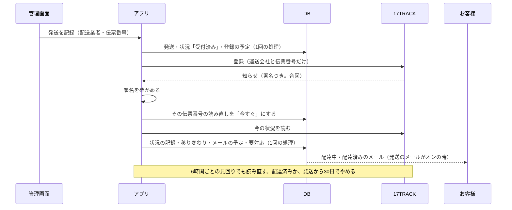

# 配送の状況（グループ E-4）設計書

> 日付: 2026-10-21（全体の決定は 2026-10-10 に承認済み。2026-10-21 にユーザーが「最初は追跡しない（案B）。ショップの設定で 17TRACK の追跡（案A）に切り替えられる」と決めた）
> 分類: architectural（外のサービスとのつなぎ、知らせの受け口、新しい表、発送の記録の直し、メールの種類、要対応、ショップの設定、返品の期限の数え方を変えるため）
> 要望: 伝票番号を後から直せるようにし、配達済みを記録できるようにする。ショップの設定で追跡を入れたお店では、配達中・配達済みなどの配送の状況をお客様と管理画面に出し、メールで知らせる
> 方針: **Shopify と同じ形に近づける。Shopify の仕組みが見つからない所は、業界の定番に従う**（ユーザーの指示）。各節に Shopify・業界との突き合わせと出典を付ける
> 全体の決定: [グループ E 全体の設計の決定](2026-10-10-group-e-overview-design.md) の6章（E-4）。この設計書は、その決定を細かくした版（1-5 に変えた所）
> 関連: [E-1 部分発送の設計書](2026-10-10-partial-fulfillment-design.md)（発送の記録・進み具合）、[E-3 返品の設計書](2026-10-12-returns-design.md)（4-9 受付の期限）、[グループ D 設計書](2026-10-09-order-email-outbox-design.md)（注文のメール）

---

## 概要

今は、発送したら「配送中」のまま止まる。配達済みは出ず、伝票番号を打ち間違えても直せない（取り消して送り直すしかない）。返品の期限は、届いた日が分からないので「発送の日＋目安3日」から数えている。

この設計は、2つの動き方を持つ（3-0）。

**いつも（最初の動き。案B）**

- 管理画面で伝票番号・配送業者を直せる。直したら、オンなら発送の更新のメールを送る
- 管理画面で届いた日を選んで「配達済み」にできる。オンなら配達済みのメールを送る
- 全部の発送が配達済みになると、注文の進み具合が「配達済み」まで進む
- 返品の期限を、届いた日（配達済みの日）が分かる発送はその日から数える

**ショップの設定で「配送の追跡」をオンにした時（案A）**

- 発送を記録したら、運送会社と伝票番号だけを 17TRACK（運送会社をまとめて追うサービス）に登録する
- 17TRACK からの知らせ（Webhook）を合図に、今の状況を 17TRACK から読み直して記録する。数時間ごとの見回りで取りこぼしを拾う
- 発送ごとの配送の状況（Shopify と同じ8種類）と、その移り変わりを時刻つきで残す
- 配達中・配達済みのメールを自動で送る
- 管理画面: 配送の問題の印と要対応の一覧
- お客様の画面: 発送ごとの状況・移り変わり

| 項目 | 決定 | 根拠 |
|---|---|---|
| 最初の動き | 追跡しない（案B）。ショップの設定の「配送の追跡」は最初オフ | ユーザーの決定（2026-10-21）。アプリを足さない Shopify・BASE と同じく、日本の3社は追跡のリンクだけ |
| 追跡の出どころ（オンの時） | 17TRACK。運送会社と伝票番号だけを渡す | ユーザーの決定（2026-10-21）。Shopify の自動の状況は日本の3社に対応していないので、日本の Shopify のお店は追跡のアプリを足す |
| 受け取り方（オンの時） | 知らせは合図だけ。17TRACK から今の状況を読み直す。署名を確かめる。6時間ごとの見回り | 全体の決定（ユーザーの決定、2026-10-10） |
| 状況 | 受付済み・輸送中・配達中・不在で持ち帰り・受け取り待ち・配達済み・遅れ・問題あり（オフの時は受付済みと、手で付ける配達済みだけ） | Shopify の FulfillmentDisplayStatus のうち配送の8つ |
| 移り変わり | 状況が変わるたびに、状況と時刻だけを残す（場所や運送会社の文は残さない） | Shopify の FulfillmentEvent（場所の欄は持たない） |
| メール | 発送の更新・配達済み（いつも）、配達中（オンの時だけ）。その発送の「お客様に発送のメールを送る」がオンの時だけ。同じ伝票番号では各1通 | Shopify の Out for delivery・Delivered・Shipping update |
| 伝票番号の直し | 配送業者と伝票番号を直せる（いつも）。直すと状況は受付済みに戻り、オンなら 17TRACK に登録し直す。メールのオン・オフも直せる | Shopify の fulfillmentTrackingInfoUpdate（notifyCustomer は「この更新とこの先の更新」） |
| 手で配達済み | できる（いつも。届いた日を選ぶ）。オフの時の配達済みの記録の道、オンの時は追跡が取れない時の逃げ道 | Shopify には無い（地元の配達だけ）。Shopify のアプリ（Mark Delivered など）の定番 |
| 配達済みの後 | 終わり。その伝票番号の追跡は止める | 返品の期限を動かさないため |
| 切り替え | ショップの設定の「配送の追跡（17TRACK）」。店長だけ。鍵が入っていないとオンにできない。オンにしたら、30日以内の配達済みでない発送も登録する | 追跡のアプリを入れた時に、最近の注文を取り込むのが業界の定番 |
| 要対応（オンの時） | 問題あり・不在で持ち帰り・伝票番号で荷物が見つからない・追跡の登録ができない・30日たっても配達済みにならない | 全体の決定（要対応の一覧に配送の問題） |
| 返品の期限 | 届いた日が分かる発送は届いた日から。分からない発送は今までどおり発送の日＋目安 | E-3 の 4-9 の決まり（数え始めは届いた日） |

---

## 1. 目的と範囲

### 1-1 要望

- 配達中・配達済み・発送の更新をお客様に見せ、メールで知らせる（全体の決定の6章、2026-10-10）
- 伝票番号・配送業者を後から直せるようにする（E-1 で「後から直すのは E-4」と決めた）
- 返品の期限を、品ごとの届いた日から数える（E-3 の 4-9。E-4 までは発送の日＋目安）
- 最初は追跡しない形で動かし、ショップの設定で追跡を入れられるようにする（2026-10-21。ほかのブランドも設定で使えるように）

### 1-2 ユーザーが決めたこと

| 日付 | 決めたこと | 中身 |
|---|---|---|
| 2026-10-10 | 受け取り方 | 知らせを受け、合図にだけ使い、今の状況を読み直す。署名を確かめる。数時間ごとの見回り（配達済みか30日でやめる） |
| 2026-10-10 | 状況とメール | 8種類。メールは配達中・配達済み（不具合の連絡は到着から7日以内、の案内を1行）・発送の更新。その発送で発送のメールを選んでいた時だけ。同じ種類は1通。配達済みの後の配達中は送らない |
| 2026-10-10 | 画面 | 管理画面: 伝票番号を直す・手で配達済み・問題あり／不在で持ち帰りの印・要対応の一覧。お客様: 発送ごとの状況・最後に変わった時刻・移り変わり・伝票番号と追跡のリンク |
| 2026-10-21 | 追跡のサービス | 17TRACK（4社を比べて決めた。下の表） |
| 2026-10-21 | 動き方 | 最初は案B（追跡しない。伝票番号の直し・発送の更新のメール・手で配達済み）。ショップの設定で案A（17TRACK の追跡）に切り替えられる（Shopify・ZOZOTOWN・BASE を比べて決めた。下の表） |

日本のお店の配送状況の扱い（2026-10-21）:

| | 配送状況の出し方 | 伝票番号の直し | 配達済みの知らせ |
|---|---|---|---|
| Shopify | 自動で状況が変わるのは FedEx・UPS・USPS・DHL など海外の運送会社だけ。日本の3社は追跡のリンクだけ | できる | 海外の運送会社だけ。日本のお店は追跡のアプリ（17TRACK・AfterShip など）を足す |
| ZOZOTOWN | 注文の状態は「発送準備中 → 発送処理中 → 発送済み」。発送後は注文履歴に配送状況の目盛りと詳細 | — | 見つからない |
| BASE | 発送の時に配送業者と伝票番号（任意）を入れ、発送完了のメール。配達済みを追う仕組みは見つからない | できない（お店がお客様に直接連絡） | なし |
| この設計 | 最初は追跡のリンクだけ（アプリを足さない Shopify と同じ）。設定でオンにすると 17TRACK で追う（アプリを足した Shopify と同じ） | できる | 手で配達済みにした時（いつも）・追跡で配達済みになった時（オンの時） |

出典: [Shopify のお客様へのお知らせ](https://help.shopify.com/en/manual/fulfillment/setup/notifications/customer-notifications)・[Shopify の注文の追跡](https://help.shopify.com/en/manual/fulfillment/setup/order-status-page/order-tracking)・[Shopify コミュニティ（日本の番号では配達完了のメールが送れない）](https://community.shopify.com/t/topic/28479)・[ZOZOTOWN 配送状況ステータスの見方](https://zozo.jp/_help/default.html?id=5ece39d49ed84e001ea6e389)・[ZOZOTOWN 配送状況の確認](https://zozo.jp/_help/default.html?id=5ece39d39ed84e001ea6e341)・[BASE 発送のしかた](https://help.thebase.in/hc/ja/articles/32530362249369)・[BASE 伝票番号は訂正できない](https://help.thebase.in/hc/ja/articles/206339942)

運送会社の仕組みを直接使う道も調べた（2026-10-21）。ヤマトは「宅急便追跡サービス（クラウド）」（契約・値段は相談。「配送連携API」はお店がお客様へ送る荷物には使えない）、佐川は「スマートAPI」（契約とお客様コード、初期・月額無料）、日本郵便は追跡の公式の仕組みが見つからない。2社と別々に契約して作っても日本郵便が追えないので採らない。佐川は 2026-09-30 の不正アクセスで追跡の API を含む9つのサービスが止まっている（17TRACK も佐川は追えない）。出典: [ヤマト 配送連携API](https://business.kuronekoyamato.co.jp/service/lineup/delivery_api_linkage/index.html)・[ヤマト 宅急便追跡サービス（クラウド）](https://business.kuronekoyamato.co.jp/service/lineup/tracking_service/index.html)・[佐川 スマートAPI](https://www.sagawa-exp.co.jp/service/smart-api/)・[佐川の不正アクセス 第4報](https://scan.netsecurity.ne.jp/article/2026/10/19/56499.html)

追跡のサービスを比べた表（2026-10-21）:

| | 17TRACK（採る） | AfterShip | Ship24 | TrackingMore |
|---|---|---|---|---|
| ヤマト・佐川・日本郵便 | 3社とも運送会社の一覧にある（ヤマト 100062・佐川 100040・日本郵便 10021） | ヤマト・日本郵便はある。佐川は店の佐川の鍵が要る案内 | 3社とも頁がある | 佐川・日本郵便はある。ヤマトは見つからない |
| 知らせの署名 | ある（`sign` の見出し。本文と鍵の SHA-256） | ある（HMAC-SHA256） | ない（合言葉をそのまま送る） | 登録のメールアドレスを鍵にする |
| 仕組みで使える一番安い形 | 新しい口座は1回だけ200件無料。その後は年払い（5,000件 $119。ほかの会社の頁の数字） | 月 $59 から | 月 $59 から（1,000件） | 頁から読めない |
| 止まる時 | 配達済みのまま15日、または運送会社の動きが30日無い時に自分で止まる | — | — | — |

出典: [17TRACK の説明書](https://api.17track.net/en/doc)・[17TRACK の運送会社の一覧](https://res.17track.net/asset/carrier/info/apicarrier.all.json)・[17TRACK の値段（Track123）](https://www.track123.com/blog/track123-vs-17track)・[AfterShip の値段](https://www.aftership.com/pricing/tracking)・[AfterShip の佐川](https://support.aftership.com/en/tracking/articles/15441472-how-to-connect-your-sagawa-account)・[Ship24 の値段](https://www.ship24.com/pricing)・[Ship24 の知らせ](https://docs.ship24.com/webhooks/authentication)・[TrackingMore の値段](https://www.trackingmore.com/pricing.html)・[TrackingMore の知らせ](https://www.trackingmore.com/webhook.html)

### 1-3 成功の基準

いつも（追跡がオフでもオンでも）:

- 伝票番号・配送業者を直せる。直すとオンなら発送の更新のメールが届く
- 管理画面で届いた日を選んで配達済みにでき、オンなら配達済みのメールが届く
- 全部の発送が配達済みになると、お客様の画面と管理画面の進み具合が「配達済み」になる
- 届いた日が分かる発送は、返品の期限を届いた日から数える
- 追跡がオフの間は、17TRACK に何も送らず、お客様の画面は今までどおり追跡のリンクだけ（手で配達済みにした発送だけ「配達済み」とお届け日が出る）
- 同じ操作が何度来ても、記録・メールは1回分だけ動く

ショップの設定で追跡をオンにした時:

- 発送を記録すると 17TRACK に登録され、状況が「受付済み」から始まる。オンにした時点で、30日以内の配達済みでない発送も登録される
- 17TRACK の知らせか見回りで、状況が輸送中・配達中・配達済みなどに進み、移り変わりが時刻つきで残る
- 知らせの中身が偽物（署名が合わない）なら断る。署名が合っても、記録するのは 17TRACK から読み直した値だけ
- 発送のメールをオンにした発送では、配達中と配達済みのメールが1通ずつ届く。配達済みの後に配達中は届かない
- 伝票番号を直すと、状況が受付済みに戻り、新しい番号で追跡が始まる
- 問題あり・不在で持ち帰り・荷物が見つからない・登録ができない・30日たっても配達済みにならない発送が、要対応の一覧と注文の一覧の印に出る
- お客様の注文の画面に、発送ごとの状況・最後に変わった時刻・移り変わりが出る
- 同じ知らせが何度来ても、移り変わり・メール・要対応は1回分だけ動く
- オフに戻すと、17TRACK とのやり取りが止まり、配送の要対応は閉じ、お客様の画面は追跡のリンクだけに戻る（配達済みの記録は残る）

### 1-4 範囲の外

| 物 | どこで |
|---|---|
| ログインしないお客様の注文の状況のページ | E-5 |
| お届けの予定日（Shopify の estimatedDeliveryAt） | 作らない（日本の3社の予定日を 17TRACK が安定して返すか分からないため） |
| 運送会社の出来事の文と場所（「○○営業所に到着」など） | 残さない・出さない。詳しくは運送会社のページ（追跡のリンク）で見る |
| 返品の荷物の追跡（お客様が送り返す荷物） | 作らない（返品の伝票番号は任意の記録のまま） |
| 配送業者を増やす（日本通運・EMS・DHL など） | 作らない。足す時は配送業者の一覧と 17TRACK の番号の対応に1行足す |
| 海外への発送（住所・送料・関税） | 範囲の外（全体の決定） |
| SMS の知らせ | 作らない |

### 1-5 全体の決定（6章）から変えた所

| 全体の決定（2026-10-10） | この設計 | 理由 |
|---|---|---|
| 追跡のサービスから配達中・配達済みなどを受け取る（いつも） | 最初は追跡しない。ショップの設定でオンにした時だけ追跡する。伝票番号の直し・手で配達済み・配達済みと発送の更新のメールはいつも使える | ユーザーの決定（2026-10-21）。アプリを足さない Shopify・BASE は日本の3社を追跡しない。お金と外のサービスへの頼りを、使うお店だけが持つように |
| サービスは AfterShip・17TRACK など | 17TRACK | ユーザーの決定（2026-10-21） |
| 発送の更新のメールも「その発送で発送のメールを選んでいた時だけ」 | 直す画面に「お客様に発送の更新のメールを送る」を出し、その選択が発送のメールの選択になる（この先の配達中・配達済みにも効く） | Shopify の notifyCustomer が「この更新とこの先の更新」を決める形のため |
| 同じ種類は1通だけ | 同じ伝票番号では1通だけ。伝票番号を直したら、新しい番号の配達中・配達済みはもう一度送れる | 打ち間違えた番号で別の荷物の配達済みが届いた時に、正しい配達済みを送れなくなるため |
| 数時間ごとの見回り | 6時間ごと | 17TRACK が運送会社を見に行くのが6〜12時間ごとのため |

---

## 2. 実装前の状態（2026-10-21）

| 所 | 今の作り |
|---|---|
| 発送 | `public.order_fulfillments`（配送業者 `shipping_carrier`・伝票番号 `tracking_number`・発送のメール `notify_customer`・発送した時刻 `shipped_at`・取消 `cancelled_at`）と `public.order_fulfillment_lines`。配送業者は `yamato`・`sagawa`・`japanpost` の3つ。伝票番号は英数字とハイフンの1〜64字 |
| 発送の守り | 発送の行は消せない。発送の UPDATE は取消の1回だけ通す（トリガーのコメントに「E-4 の伝票番号の直し」の予告がある）。伝票番号を直す UPDATE は断られ、DB 結合の試験がそれを確かめている |
| 追跡のリンク | `src/lib/orders/shipping-carriers.ts` が配送業者ごとに作る。DB には持たない |
| 注文の進み具合 | `deriveOrderProgress`（`src/lib/orders/order-progress.ts`）。「配達済み」の言葉と段の作りはあるが、どこからも選ばれない（E-4 まで） |
| 注文の古い発送の列 | `orders.shipped_at`・`shipping_carrier`・`tracking_number` は「注文を送り終えた発送」の写し |
| メール | `private.order_email_outbox` の種類は16（`paid` 〜 `cancel_request_shop`）。配達中・配達済み・発送の更新は無い。今ある「delivered」は**メールが届いたか**の状態で、荷物の話ではない |
| 定期処理 | 毎分（`/api/cron/process-stripe-webhooks`。メールの送り出しもここ）・毎時（`/api/cron/expire-pending-orders`）・毎晩（`/api/cron/stripe-reconcile`）。pg_cron から pg_net で呼ぶ（本番への登録は開店前） |
| 知らせの受け口 | Stripe（`/api/webhook/stripe`、本文をそのまま読んで署名を確かめ、合図にして読み直す）、Resend の配信（`/api/webhook/resend-delivery`、64KiB の上限・署名の確かめ） |
| 要対応 | `/api/admin/order-attention` と `AttentionInbox`。支払いの例外と確かめ待ちの注文の2つ |
| 返品の期限 | `private.fulfillment_line_returnable` が「発送の日（日本時間）＋目安の日数（設定、最初は3）」を届いた日とみなす |
| お客様の注文の画面 | `src/app/account/orders/[id]/page.tsx`。発送ごとの「配送情報（n回目）」に発送日・配送業者・伝票番号・追跡のリンク・品 |
| ショップの設定 | `public.shop_settings`（1行。自動の返金①②のトグルと、トグルごとの最後に変えた人・時刻）。画面は SETTINGS の `ShopSettingsSection`（店長だけ）。窓口 `GET/PUT /api/admin/settings/shop`（`admin.settings.manage`）。返品の設定は別の表 |
| プライバシーポリシー | `src/app/privacy/page.tsx` の「5. 個人情報の取扱いの委託」に配送事業者・Stripe・サーバーの運用。追跡のサービスは無い |
| 試験の場 | E2E は手元の Supabase と Mailpit。Stripe はテストの場。外のサービスの作り物の受け口はまだ無い |

---

## 3. 全体の形

### 3-0 2つの動き方

| 所 | 追跡オフ（最初。案B） | 追跡オン（案A） |
|---|---|---|
| 17TRACK | 何も送らない。知らせの受け口は 200 で無視する | 登録・読み直し・見回り（5章） |
| 配送の状況 | 受付済みのまま。手で配達済みにした時だけ配達済み | 8つ（3-2） |
| 移り変わり | 受付済みの1行目・伝票番号の直し・手で配達済み | ＋17TRACK から読んだ状況 |
| メール | 発送の更新・配達済み（手で） | ＋配達中・配達済み（追跡） |
| 管理画面 | 伝票番号を直す・配達済みにする・履歴の記録 | ＋状況・移り変わり・配送の問題の印・要対応の「配送」の組 |
| お客様の画面 | 追跡のリンク。手で配達済みにした発送は「配達済み」とお届け日 | ＋発送ごとの状況・最後に変わった時刻・移り変わり（7-1） |
| 返品の期限 | 届いた日（手で）か、発送の日＋目安 | 届いた日（手か追跡）か、発送の日＋目安 |
| プライバシーポリシー | 追跡のサービスの一文は出さない | 一文を出す（15） |

切り替えの決まり:

| 場面 | どうなるか |
|---|---|
| オンにする | 店長だけ。鍵（`TRACKING_17TRACK_API_KEY`）が無ければ断る。オンにした時、取り消していない・配達済みでない・発送（直した版は直した時刻）から30日以内で配送業者と伝票番号がある発送に、登録の予定（4-4）を作る（同じ処理で。前にオフにして止めた発送も、期限内なら追跡に戻す） |
| オンの間の発送・直し | 登録の予定を作る（4-6） |
| オフにする | 止めていない登録の予定を全部止める（`disabled`）。配送の要対応（4-5）を全部自動で閉じる。17TRACK の止める呼び方は送らない（件数はもう使っているため。17TRACK は30日で自分で止まる）。記録した状況と移り変わりは消さない |
| オフの間のお客様の画面 | 配達済み（手か追跡）の発送だけ状況を出す。ほかは追跡のリンクだけ（止まった状況が「輸送中」のまま見えるのを防ぐ） |
| 鍵がオンの間に消えた | 登録と読み直しをせず予定を残す。運用の見張りが1日1回知らせる（5-5） |

Shopify・業界との突き合わせ:

| 所 | Shopify・業界 | この設計 |
|---|---|---|
| 追跡しない形 | アプリを足さない Shopify は日本の3社を追跡のリンクだけで出す。BASE も同じ | 最初の動き（案B） |
| 追跡する形 | 日本の Shopify のお店は追跡のアプリ（17TRACK・AfterShip など）を入れる | 設定でオン（案A） |
| 入れた時の取り込み | AfterShip などは、つないだ時に最近の注文を取り込む | オンにした時に30日以内の発送を登録する |

### 3-1 流れ（追跡オンの時）



追跡オフの時は、上の 17TRACK とのやり取りが無く、管理画面の「伝票番号を直す」「配達済みにする」だけが状況を変える。

### 3-2 配送の状況（8種類）

| 状況 | DB の値 | Shopify | 17TRACK の状況（主・細かい状況） |
|---|---|---|---|
| 受付済み | `confirmed` | CONFIRMED（ほかの情報が無い時の最初の値） | InfoReceived。NotFound の間も受付済みのまま |
| 輸送中 | `in_transit` | IN_TRANSIT・CARRIER_PICKED_UP | InTransit（全部の細かい状況） |
| 配達中 | `out_for_delivery` | OUT_FOR_DELIVERY | OutForDelivery |
| 不在で持ち帰り | `attempted_delivery` | ATTEMPTED_DELIVERY | DeliveryFailure_NoBody・DeliveryFailure_Other |
| 受け取り待ち | `ready_for_pickup` | READY_FOR_PICKUP | AvailableForPickup |
| 配達済み | `delivered` | DELIVERED | Delivered |
| 遅れ | `delayed` | DELAYED | Exception_Delayed・Expired（長く運ばれていて届いていない） |
| 問題あり | `failure` | FAILURE | Exception のそのほか（Returning・Returned・Lost・Damage・Rejected・NoBody・Security・Destroyed・Cancel・Other）・DeliveryFailure_Security・DeliveryFailure_Rejected・DeliveryFailure_InvalidAddress |

- 対応は1つのファイルの表に置く（後で 17TRACK の状況が増えても1か所で直せる）。表に無い値は「問題あり」にせず、今の状況のまま残し、運用の知らせに残す
- 配達済みになったら、その伝票番号の状況は動かさない（3-3）
- 伝票番号を直すと受付済みに戻る

### 3-3 移り変わりの決まり

| 場面 | どうなるか |
|---|---|
| 読み直した状況が今と同じ | 何も残さない |
| 違う | 移り変わりを1行足し、今の状況と「最後に変わった時刻」を変える。時刻は 17TRACK の最新の出来事の時刻（無ければ読んだ時刻） |
| 配達済みになった | 届いた時刻を残す。追跡を止める（見回りもやめ、その後の知らせは読むだけで記録しない） |
| 出来事の時刻が、同じ版で 17TRACK から残した最後の出来事の時刻より前 | 記録しない（古い読み直しが新しい記録を戻さないため）。比べるのは同じ版の `tracking` の行だけ。発送の記録・伝票番号の直しの時刻とは比べない（直した番号の荷物は、直す前から動いていることがあるため） |
| 取り消した発送 | 記録しない。追跡を止める |
| 手で配達済みにした | 選んだ日の日本時間の正午を届いた時刻にする（日付だけを選ぶので、時刻は日の途中に置く）。ただし発送した時刻より前なら発送した時刻、今より後なら今にする。移り変わりに「手で」と残す |
| 17TRACK の届いた時刻が発送した時刻より前 | 発送した時刻を届いた時刻にする（発送を後から記録した時や、時刻の書き方の違いで起きるため。DB の決まりで書き込みが止まり続けるのを防ぐ） |

「最後に変わった時刻」（`delivery_status_at`）は、今の状況を決めた出来事の時刻。伝票番号を直した時は直した時刻になり、その後 17TRACK から直す前の時刻の出来事が来たら、その時刻になる（戻ることがある）。

Shopify・業界との突き合わせ:

| 所 | Shopify | 業界（17TRACK・AfterShip） | この設計 |
|---|---|---|---|
| 状況の種類 | FulfillmentDisplayStatus（18種類。送り状の作成・店頭受け取りの値を含む） | 17TRACK は主の状況9・細かい状況30 | 配送の8つ（送り状と店頭受け取りは作らないので外す） |
| 移り変わり | FulfillmentEvent（状況・起きた時刻・作った時刻・文・場所） | 出来事の一覧（文・場所つき） | 状況と時刻だけ（場所はお客様の地域が分かるので残さない） |
| 届いた時刻 | Fulfillment.deliveredAt | Delivered の出来事の時刻 | 発送の `delivered_at` |
| 配達済みの後 | 出来事は足せる | 17TRACK は配達済みのまま15日で止まる | 止める（返品の期限が動かないように） |

出典: [Shopify FulfillmentDisplayStatus](https://shopify.dev/docs/api/admin-graphql/latest/enums/FulfillmentDisplayStatus)・[Shopify FulfillmentEventStatus](https://shopify.dev/docs/api/admin-graphql/latest/enums/FulfillmentEventStatus)・[Shopify FulfillmentEvent](https://shopify.dev/docs/api/admin-graphql/latest/objects/FulfillmentEvent)・[Shopify Fulfillment](https://shopify.dev/docs/api/admin-graphql/latest/objects/Fulfillment)・[17TRACK の説明書](https://api.17track.net/en/doc)

---

## 4. 記録（設計 1）

### 4-0 ショップの設定に足す列（`public.shop_settings`）

| 列 | 中身 |
|---|---|
| `delivery_tracking_enabled` | 配送の追跡（17TRACK）。最初は `false` |
| `delivery_tracking_updated_at`・`delivery_tracking_updated_by` | 最後に変えた時刻・人（今のトグルと同じ形） |

- 変えるのは 4-6 の「追跡を切り替える」関数だけ

### 4-1 発送に足す列（`public.order_fulfillments`）

| 列 | 中身 |
|---|---|
| `delivery_status` | 3-2 の8つ。最初は `confirmed` |
| `delivery_status_at` | 最後に変わった時刻。最初は発送した時刻 |
| `delivered_at` | 届いた時刻。届くまで空 |
| `tracking_version` | 伝票番号の版。最初は1。直すたびに1足す |

- 今の配送業者・伝票番号・発送のメールの列は、直した時に書き換える（Shopify も同じ発送の追跡の情報を書き換える）。前の値は 4-3 に残る
- 直接の UPDATE は今までどおり断る。上の列と配送業者・伝票番号・発送のメールは、4-6 の関数の中からだけ変えられる（取り消した発送は変えられない）

### 4-2 移り変わり `public.order_fulfillment_events`

| 列 | 中身 |
|---|---|
| `id` | 番号 |
| `fulfillment_id` | どの発送か |
| `tracking_version` | どの伝票番号の時か |
| `status` | 3-2 の8つ |
| `happened_at` | 起きた時刻（17TRACK の出来事の時刻、手の時は選んだ日） |
| `recorded_at` | 残した時刻 |
| `source` | `shipment`（発送の記録）・`tracking`（17TRACK）・`manual`（手で配達済み）・`tracking_edit`（伝票番号を直した） |
| `provider_sub_status` | 17TRACK の細かい状況（問題の中身を管理画面に出すため。お客様には出さない） |
| `created_by` | 手の時の管理者 |

- 発送を記録した時に「受付済み」の1行目を残す。移行の時に、今ある発送にも1行目を作る
- 同じ（発送・版・状況・起きた時刻）は1行だけ（何度読み直しても増えない）

### 4-3 伝票番号の直し `public.order_fulfillment_tracking_changes`

| 列 | 中身 |
|---|---|
| `id` | 番号（発送の更新のメールが指す） |
| `fulfillment_id` | どの発送か |
| `from_carrier`・`from_tracking_number` | 前の値 |
| `to_carrier`・`to_tracking_number` | 新しい値 |
| `tracking_version` | 新しい版 |
| `notify_customer` | 直した時の発送のメールの選択 |
| `request_key` | 重複防止キー（同じキーで中身が違えば断る） |
| `changed_by`・`changed_at` | 直した人・時刻 |

### 4-4 追跡の登録 `private.fulfillment_tracking_registrations`

17TRACK とのやり取りの予定と結果。発送の版ごとに1行。

| 列 | 中身 |
|---|---|
| `fulfillment_id`・`tracking_version` | どの発送のどの版か（組で1行） |
| `carrier`・`tracking_number` | 17TRACK に渡す値 |
| `state` | `pending`（登録待ち）・`registered`（追跡中）・`stopped`（止めた）・`failed`（登録できない。1日1回だけ試し直す） |
| `failure_kind` | `failed` の理由: `invalid_number`（番号が正しくない。試し直さない）・`repeated_error`（一時の失敗が5回続いた） |
| `expires_at` | 追跡をやめる時刻。版1は発送した時刻から30日、直した版は直した時刻から30日 |
| `ever_registered` | 一度でも登録できたか（期限の時の要対応に使う） |
| `stop_reason` | `delivered`・`expired`（30日）・`replaced`（伝票番号を直した）・`cancelled`（発送の取消）・`provider_stopped`（17TRACK が止めた）・`disabled`（設定をオフにした） |
| `next_run_at` | 次に登録か読み直しをする時刻（知らせが来たら今にする） |
| `attempts`・`last_error_code` | 失敗の数と最後の理由 |
| `lease_token`・`lease_expires_at` | 取り合いを防ぐ借りの印（メールの予定と同じ形） |
| `provider_status`・`provider_sub_status`・`last_read_at` | 最後に読んだ 17TRACK の値と時刻 |
| `registered_at`・`stopped_at` | 時刻 |

- 追跡がオンの間だけ、発送の記録・伝票番号の直しと同じ処理で `pending` の行を作る（直した時は前の版の行を `stopped`・`replaced` にする）。オフの間は作らない
- オンにした時は、3-0 の条件の発送に `pending` の行を作る（その版の行が無い物は新しく作り、設定をオフにして止めた `disabled` の行は同じ行を `pending` に戻す。ほかの理由で止まった行は戻さない）
- 発送の取消と同じ処理で、その発送の行を `stopped`・`cancelled` にする
- オンの間に鍵が消えても行は作る。鍵が戻ったら、`expires_at` 前の行を登録する
- 17TRACK に渡す番号と、知らせの番号を照らす時は、英字を大文字にそろえて（配送業者、番号）の組で照らす。同じ組の発送がいくつあってもよい（知らせは同じ組の追跡中の行を全部「今すぐ」にする）

### 4-5 配送の要対応 `public.order_fulfillment_attention`

追跡がオンの時だけ開く。オフにすると、開いている行を全部 `auto` で閉じる。

| 列 | 中身 |
|---|---|
| `fulfillment_id` | どの発送か |
| `kind` | 下の5つ |
| `opened_at` | 開いた時刻 |
| `resolved_at`・`resolved_by`・`resolution` | 閉じた時刻・人・`auto`（状況が変わって自動で）か `manual`（「対応済み」を押した） |

| 種類 | 開く時 | 自動で閉じる時 |
|---|---|---|
| `delivery_failure`（問題あり） | 状況が問題ありになった | 問題あり以外になった |
| `attempted_delivery`（不在で持ち帰り） | 状況が不在で持ち帰りになった | ほかの状況になった |
| `tracking_not_found`（伝票番号で荷物が見つからない） | 17TRACK が「番号が正しくない」と返した時、または登録から72時間たっても情報が無い時 | 情報が出た |
| `tracking_registration_failed`（追跡の登録ができない） | 一時の失敗で登録が5回続けて失敗した時 | 登録できた（`failed` の行も1日1回試し直す） |
| `tracking_stalled`（配達済みにならない） | 一度でも登録できた行で、30日（`expires_at`）たっても配達済みでない時、または 17TRACK が配達済みの前に追跡を止めた時 | 配達済みになった |

- 口座ぜんたいの失敗（件数切れ・1日の上限・鍵が正しくない・口座が止まった）は、発送ごとの要対応を開かない。行は `pending` のまま、失敗の数も数えず、運用の知らせ（`SHOP_ALERT_EMAIL`）を1日1回送る。件数を買い足すか鍵を直せば、残った行がそのまま登録される
- 一度も登録できないまま30日たった行は、`stopped`・`expired` にするだけで、要対応は開かない（登録の失敗の要対応か、運用の知らせが先に出ているため）

- 1つの発送の1つの種類で、開いている行は1つだけ
- 伝票番号を直した時と配達済みになった時と発送を取り消した時は、その発送の開いている行を全部自動で閉じる
- 「対応済み」を押して閉じた後に、同じ種類の条件がもう一度起きたら（例: 一度ほかの状況に移ってから、また不在で持ち帰りになった）新しい行を開く

### 4-6 DB の関数（service_role だけが呼べる）

| 関数の役目 | 中身 |
|---|---|
| 発送の記録（今の関数を直す） | 4-1 の最初の値・4-2 の1行目を書く。追跡がオンなら 4-4 の `pending` も同じ処理で書く |
| 発送の取消（今の関数を直す） | 4-4 を止め、4-5 を閉じる |
| 伝票番号を直す | 注文 → 発送の順に鍵をかける。取り消した発送・同じ値は断る。4-1 を書き換え（版を1足し、状況を受付済み、届いた時刻を空に）、4-2・4-3 を書き、前の版の 4-4 を止め、追跡がオンなら新しい版の 4-4 を書き、4-5 を閉じ、発送のメールがオンなら発送の更新のメールを予定に入れる。注文を送り終えた発送なら、注文の古い発送の列の写しも直す。重複防止キーで二重を防ぐ |
| 手で配達済みにする | 注文 → 発送の順に鍵。取り消した発送・配達済みの発送・発送の日より前か今日より後の日は断る。4-1・4-2 を書き、4-4 を止め、4-5 を閉じ、メールの選択に従って配達済みのメールを予定に入れる。重複防止キー |
| 追跡を切り替える | `shop_settings` の行に鍵をかけて 4-0 を書く。オンにする時は 3-0 の条件の発送に 4-4 を作る。オフにする時は 4-4 を `disabled` で止め、4-5 を閉じる。鍵があるかはアプリが確かめてから呼ぶ |
| 要対応を閉じる | 開いている行を `manual` で閉じる |
| 予定を借りる | 追跡がオンの時だけ、時刻の来た `pending`・`registered` の行を、借りの印つきで数件ずつ渡す（SKIP LOCKED）。オフなら何も渡さない |
| 登録の結果を書く | 成功・失敗（回数と理由）・件数切れを書く。4-5 を開く・閉じる |
| 読み直しの結果を書く | 借りの印と版が合う時だけ。3-3 の決まりで 4-1・4-2・4-4・4-5 とメールの予定を同じ処理で書く |
| 知らせの合図 | （配送業者、伝票番号）の組の一覧を受け、英字を大文字にそろえて照らし、合う `registered` の行を全部 `next_run_at` を今にする（知らない組は無視） |

### 4-7 DB が止めること

- 直接の書き込み（新しい表は全部、関数だけが書ける。アプリは読むだけ。お客様の画面からは読めない）
- 配送の状況の値・要対応の種類・出どころの値は CHECK で決まった物だけ
- 配達済みの発送の状況を変える読み直し（伝票番号を直した時だけ戻る）
- 取り消した発送への記録・直し・配達済み
- 届いた時刻が発送した時刻より前

Shopify・業界との突き合わせ:

| 所 | Shopify | この設計 | 違う理由 |
|---|---|---|---|
| 追跡の情報の直し | 同じ発送の trackingInfo を書き換える | 同じ（前の値は直しの記録に残す） | — |
| 状況の持ち方 | 発送の displayStatus と出来事の一覧 | 発送の今の状況と移り変わりの表 | — |
| 追跡の登録 | Shopify の中（見えない） | 予定の表（17TRACK とのやり取りを確かめ直せるように） | 外のサービスを使うため |
| 配送の要対応 | 無い（アプリが出す） | 要対応の表 | 全体の決定（要対応の一覧に配送の問題） |

---

## 5. 17TRACK とのやり取り（設計 2。追跡オンの時だけ）

この章は、ショップの設定で追跡をオンにした時だけ動く。オフの間は、登録・読み直し・見回りを一切しない。

### 5-1 登録

- 毎分の処理と、発送の記録・伝票番号の直しの直後（`after()`）に、`pending` の行を借りて 17TRACK に登録する（1回に40件まで）
- 渡すのは伝票番号と 17TRACK の運送会社の番号（ヤマト 100062・佐川 100040・日本郵便 10021）だけ。名前・住所・注文番号は渡さない
- 「もう登録してある」は成功として扱う
- 前に自分で止めた（配送業者、番号）の組をもう一度追う時（直した番号を元に戻した時など）は、登録ではなく「追跡のやり直し」（retrack）を呼ぶ。17TRACK の決まりでやり直しは1つの番号に1回だけなので、2回目は `failed`（`repeated_error`）にして要対応 `tracking_registration_failed` を開く（この時は1日1回の試し直しもしない。管理画面の「配達済みにする」で終える）
- 17TRACK の答えは3つに分ける

| 分け方 | 例（付録の番号） | どうするか |
|---|---|---|
| その番号だけの失敗 | 番号の形が正しくない・この配送業者で登録できない・配送業者の番号が正しくない | `failed`（`invalid_number`）。要対応 `tracking_not_found` を開く。試し直さない（直すと新しい版になる） |
| 一時の失敗 | 500・503・429・時間切れ・17TRACK の中の失敗・運送会社の窓口の失敗 | すぐ・5分・15分・1時間・6時間の5回試す。5回とも失敗したら `failed`（`repeated_error`）にして要対応 `tracking_registration_failed` を開き、その後は1日1回試し直す |
| 口座ぜんたいの失敗 | 件数切れ・1日の上限・鍵が正しくない・口座が止まった・401 | 4-5 の決まり（`pending` のまま、数えない、運用の知らせを1日1回） |

- `expires_at` を過ぎた `pending`・`failed` は登録せずに `stopped`・`expired` にする

### 5-2 知らせの受け口 `POST /api/webhook/17track`

| 順番 | 中身 |
|---|---|
| 1 | 鍵が入っていなければ 503 |
| 2 | 本文をそのまま読む。1MiB を超えたら 413 |
| 3 | 見出し `sign` と、本文 ＋ `/` ＋ 鍵 の SHA-256 を、時間で差の出ない比べ方で比べる。合わなければ 401。401 の数を数え、続く時は運用の知らせを1日1回送る（本文・鍵・署名はログに出さない） |
| 4 | JSON として読み、`TRACKING_UPDATED`・`TRACKING_STOPPED` の配送業者と伝票番号だけを取り出す（ほかの中身は使わない。1回の知らせは1件だが、配列でも受ける）。読めなければ 400 |
| 5 | 追跡がオフなら、何もせず 200 を返す。オンなら 4-6 の「知らせの合図」を呼ぶ。DB の失敗は 500（17TRACK が10分・30分・60分後に送り直す） |
| 6 | 200 を返し、`after()` で読み直しを動かす |

- ログインもなりすましの確かめ（CSRF）も通さない（署名が代わり。Stripe の受け口と同じ）
- 知らない伝票番号・止めた行の番号は 200 で無視する
- 鍵が漏れても、偽の知らせで起きるのは読み直しだけ（記録は 17TRACK から読んだ値で決まる）

### 5-3 読み直し

- 時刻の来た `registered` の行を借り、17TRACK から**ためてある結果**（`gettrackinfo`）を読む（その場で運送会社に問い合わせ直す呼び方 `getRealTimeTrackInfo` は1回ごとに1〜10件分を使うので使わない）。1回に40件まで。17TRACK の決まりで1秒に3回まで
- `gettrackinfo` が件数を使うかは説明書に書かれていない。開店前のお試しで確かめる（15）。使うなら見回りの間隔を延ばす（間隔は1か所の決まった値にしておく）
- 最新の状況・細かい状況・最新の出来事の時刻・届いた時刻を 3-2 の表で8つに直し、4-6 の「読み直しの結果を書く」に渡す
- 次の読み直しは6時間後。17TRACK がまだ情報を持っていない（NotFound）時も6時間後
- 読めなかった時は 5分・15分・1時間 で試し、その後は6時間ごとに戻す。続けて失敗する時は運用の知らせを送る（1日1回まで）

### 5-4 見回りと止める時

| 時 | どうするか |
|---|---|
| 配達済みになった | 止める（`delivered`）。17TRACK の止める呼び方は送らない（17TRACK は配達済みのまま15日で自分で止まる） |
| 30日（`expires_at`） | 一度でも登録できた行が配達済みでなければ、要対応 `tracking_stalled` を開いて止める（`expired`） |
| 17TRACK が止めた（`TRACKING_STOPPED`） | もう一度読み直し、配達済みでなければ要対応 `tracking_stalled` を開いて止める（`provider_stopped`） |
| 伝票番号を直した・発送を取り消した | 止める（`replaced`・`cancelled`）。同じ（配送業者、番号）の組で止めていない行がほかに無い時だけ、17TRACK の止める呼び方も送る（ほかの発送の追跡を止めないため。失敗しても記録は進める） |

### 5-5 鍵・つなぎ先・運用

| 物 | 決まり |
|---|---|
| 鍵 | 環境の値 `TRACKING_17TRACK_API_KEY`（サーバーだけで読む）。呼ぶ時の見出し `17token` に入れ、知らせの署名の確かめにも同じ鍵を使う（説明書では、どちらも security key。開店前に本物の知らせで確かめる） |
| つなぎ先 | 環境の値 `TRACKING_17TRACK_BASE_URL`（無ければ 17TRACK の本番の住所）。E2E は手元の作り物を指す |
| 鍵が無い時 | 追跡をオンにできない（設定の窓口が断る）。オンの間に鍵が消えた時は、登録・読み直しをせず予定を残す。発送の画面・お客様の画面（追跡のリンク）・手で配達済みは使える。発送ごとの要対応は開かず、運用の見張りが「追跡の鍵が無い」を1日1回知らせる（追跡がオンの時だけ） |
| 運用の記録 | 今の見張り（ジョブの心拍）に `delivery_tracking` を足す |
| E2E の守り | E2E の見張り（`scripts/e2e/environment.ts`）が、つなぎ先が 17TRACK の本番の住所なら止める |

Shopify・業界との突き合わせ:

| 所 | Shopify・業界 | この設計 |
|---|---|---|
| 状況の出どころ | Shopify は対応する運送会社（FedEx・UPS・USPS など）だけ自動。それ以外は追跡の番号のリンクだけ。日本の店は追跡のアプリ（AfterShip・17TRACK など）を使う | 17TRACK |
| 知らせの扱い | Stripe・AfterShip・17TRACK とも署名を確かめる。17TRACK は送り直しがあるので受け側で並べて処理を勧めている | 署名を確かめ、合図だけ受けて予定の表で処理する |
| 渡す情報 | 17TRACK は伝票番号と運送会社で追える | 伝票番号と運送会社だけ |

出典: [Shopify のお客様へのお知らせ](https://help.shopify.com/en/manual/fulfillment/setup/notifications/customer-notifications)・[Shopify の注文の追跡](https://help.shopify.com/en/manual/fulfillment/setup/order-status-page/order-tracking)・[Shopify の 17TRACK のアプリ](https://apps.shopify.com/17track)・[17TRACK の説明書](https://api.17track.net/en/doc)

---

## 6. 管理画面（設計 3）

### 6-1 注文の履歴の発送

今の「発送」の項目（注文の履歴の画面）に、次を足す。

| 出す物 | 追跡オフ | 追跡オン |
|---|---|---|
| 配達済みなら届いた日と「追跡」か「手で」 | 出す | 出す |
| 伝票番号の直しの記録（前の値 → 新しい値・直した人・メールを送ったか） | 出す | 出す |
| 今の配送の状況と最後に変わった時刻 | 出さない | 出す |
| 移り変わり（状況・時刻。問題ありなどは 17TRACK の細かい状況も小さく） | 記録があれば出す（前にオンだった時の記録） | 出す |
| 追跡の登録の状態（登録待ち・追跡中・止めた・登録できない） | 出さない | 出す |
| ボタン「伝票番号を直す」「配達済みにする」 | 出す | 出す |

- 取り消した発送にはボタンを出さない。配達済みの発送には「配達済みにする」を出さない

### 6-2 伝票番号を直す

- 配送業者（今の3つ）・伝票番号（発送の記録と同じ確かめ）・「お客様に発送の更新のメールを送る」（最初は今の発送のメールの選択のまま）
- 説明の一文（追跡オン）: 「直すと配送の状況は受付済みに戻り、新しい伝票番号で追跡します。チェックを外すと、この先の配達中・配達済みのメールも送りません」
- 説明の一文（追跡オフ）: 「チェックを外すと、この先の配達済みのメールも送りません」
- 配達済みの発送も直せる（打ち間違えた番号で別の荷物が配達済みになった時のため）。その時は「配達済みの記録が消え、返品の期限は新しい届いた日から数え直します」と出す
- 重複防止キーは画面を開いた時に作る

### 6-3 配達済みにする

- 届いた日（最初は今日。発送の日から今日まで）・「お客様に配達済みのメールを送る」（発送のメールがオンの時だけ出し、最初はオン）
- 説明の一文（追跡オフ）: 「お客様に届いたことが分かった時に使います。返品の期限は、この日から数えます」
- 説明の一文（追跡オン）: 「追跡で配達済みにならない時に使います。この後、この伝票番号の追跡は止まります」

### 6-4 注文の一覧の印

- 進み具合の列: 全部の発送が配達済みになったら「配達済み」（7-2。いつも）
- 開いている配送の要対応がある注文に印（追跡オンの時だけ。オフにすると要対応が閉じるので消える）: 問題あり・不在で持ち帰り・追跡できない（`tracking_not_found`・`tracking_registration_failed`・`tracking_stalled` をまとめた名前）。いくつもある時は、この順で1つ出す
- 絞り込みは今までどおり DB の状態（「発送済み（配送中・配達済み）」のまま）

### 6-5 要対応の一覧

- `AttentionInbox` に「配送」の組を足す（支払いの例外・確かめ待ちの注文の下）。開いている行が無ければ組ごと出さない（追跡オフの間は出ない）
- 1行: 注文番号・何回目の発送か・種類の名前・開いた時刻・今の状況
- 操作: 「履歴を開く」（6-1）・「対応済みにする」
- 窓口 `/api/admin/order-attention` の返す物に配送の組を足す（読むのは `admin.orders.read`、閉じるのは `admin.orders.manage`）

### 6-6 権限と窓口

| 操作 | 権限 | 窓口 |
|---|---|---|
| 伝票番号を直す | `admin.orders.manage`（発送と同じ。店長とサポート） | `POST /api/admin/orders/[id]/fulfillments/[fulfillmentId]/tracking` |
| 配達済みにする | 同じ | `POST /api/admin/orders/[id]/fulfillments/[fulfillmentId]/delivered` |
| 要対応を閉じる | 同じ | `POST /api/admin/order-attention/deliveries/[attentionId]/resolve` |
| 追跡を切り替える | `admin.settings.manage`（店長だけ） | 今の `PUT /api/admin/settings/shop` に、任意の項目として足す（返品の設定と同じ形） |

- どれも権限・なりすましの確かめ（CSRF）・回数の制限（送信元ごと・管理者ごと）を通す（全体の決まり）。監査の記録に伝票番号は入れてよい（お客様の個人情報ではない）、名前や住所は入れない

### 6-7 ショップの設定の「配送の追跡」の欄

- SETTINGS の画面（`ShopSettingsSection`）の「自動の返金」と「返品」の間に、「配送の追跡」の欄を足す
- トグル「配送の追跡（17TRACK）を使う」（最初はオフ）
- 説明の文:
  - 「オンにすると、発送した荷物の配送状況（配達中・配達済みなど）を 17TRACK から受け取り、お客様の注文の画面に出し、配達中・配達済みのメールを送ります。17TRACK には配送業者と伝票番号だけを渡します」
  - 「17TRACK の利用料がかかります（最初の200件は無料。その後は年払い）。佐川急便の荷物は、佐川急便の追跡が止まっている間は追えません」
  - 「オフの間も、伝票番号の直しと、手で配達済みにすることはできます」
- 鍵の状態: 「鍵：設定済み／未設定」だけを出す（鍵の値は出さない）。未設定ならトグルを押せず「17TRACK の鍵を設定してください」と出す
- オンにする時の確かめ: 「30日以内に発送した配達済みでない発送（N件）も 17TRACK に登録します。1件ごとに 17TRACK の件数を使います」
- オフにする時の確かめ: 「追跡を止め、配送の要対応を閉じます。記録した配送状況は残ります」
- 最後に変えた人・時刻を出す（今のトグルと同じ）

Shopify・業界との突き合わせ:

| 所 | Shopify・業界 | この設計 | 違う理由 |
|---|---|---|---|
| 伝票番号の直し | 発送の「…」→「発送を編集」で配送業者と番号を直す。お客様に知らせるかのチェック | 同じ | — |
| 手で配達済み | Shopify には無い（地元の配達だけ）。Mark Delivered・ParcelPanel などのアプリが足す | 作る（届いた日を選ぶ） | 返品の期限を届いた日から数えるため、日付を選べる方がよい |
| 配送の問題の一覧 | Shopify には無い。AfterShip などは例外の一覧を出す | 要対応の「配送」の組 | 全体の決定 |

出典: [Shopify の発送の直し（コミュニティ）](https://community.shopify.com/t/how-to-manually-mark-delivery-status-as-delivered/409423)・[Mark Delivered](https://apps.shopify.com/mark-delivered)・[Shopify fulfillmentTrackingInfoUpdate](https://shopify.dev/docs/api/admin-graphql/latest/mutations/fulfillmentTrackingInfoUpdate)

---

## 7. お客様の画面（設計 4）

### 7-1 発送ごとの配送の状況

今の「配送情報（n回目）」に、次を足す。

| 出す物 | 出す条件 |
|---|---|
| 「配達済み」と「お届け日 ○月○日」 | 配達済みの発送（手でも追跡でも。オフでもオンでも） |
| 今の状況（8つの言葉）と最後に変わった時刻（日本時間） | 追跡オンで、その版が追跡中か止めた発送 |
| 移り変わり（新しい順。状況と時刻だけ。問題の細かい中身は出さない） | 同じ |
| 問題あり・遅れの時の一文「配送に遅れや問題が出ています。詳しくは配送業者のページをご確認ください」 | 同じ |
| 伝票番号と追跡のリンク | いつも（今までどおり。直した時は新しい番号だけ） |

- 上の条件に合わない時（追跡オフ・登録待ち・登録できない・鍵が無い間）は、今までどおり追跡のリンクだけを出す（ずっと「受付済み」や止まった「輸送中」に見えるのを防ぐ）

### 7-2 注文の進み具合

- `deriveOrderProgress` に、発送ごとの配達済みを渡す
- 発送準備中・受注生産中の品が無く、取り消していない発送が1つ以上あり、その全部が配達済みなら「配達済み」。それ以外は今までどおり（配送中など）
- 一部の発送だけが配達済みの時は「配送中」のまま。新しい印は足さない（発送ごとの状況は 7-1 で見える）
- 窓口 `GET /api/orders/[id]` の発送に、届いた時刻（いつも）と、7-1 の条件に合う時だけ状況・最後に変わった時刻・移り変わりを足す（条件はサーバーで決め、合わない時は返さない。お客様に出す名前の値だけ。管理者の名前や細かい状況は出さない）
- 追跡オフのお店では、全部の発送を手で配達済みにしない限り「配送中」のまま（アプリを足さない Shopify の「On its way」のままと同じ）

Shopify・業界との突き合わせ:

| 所 | Shopify | この設計 |
|---|---|---|
| 注文の状況のページ | Confirmed・On its way・Out for delivery・Delivered の段。対応しない運送会社は追跡の番号のリンクだけ | オフ: リンクだけ（手で配達済みなら配達済み）。オン: 8つの状況と移り変わり。追跡できない間はリンクだけ |
| 発送ごと | 発送ごとに状況を出す | 同じ |

出典: [Shopify の注文の追跡](https://help.shopify.com/en/manual/fulfillment/setup/order-status-page/order-tracking)

---

## 8. メール（設計 5）

### 8-1 足す種類（16 → 19）

| 種類 | いつ | 中身 |
|---|---|---|
| `out_for_delivery`（配達中のお知らせ） | 追跡オンで、状況が配達中になった時 | 注文番号・その発送の商品と数・配送業者・伝票番号・追跡のリンク |
| `delivered`（配達済みのお知らせ） | 配達済みになった時（手で付けた時はいつも、追跡で付いた時はオンの時） | 注文番号・その発送の商品と数・お届け日・「商品に不具合がございましたら、到着から N 日以内にご注文の画面またはお問い合わせからご連絡ください」（N は返品の設定の受付の日数。無制限の時はこの一文を出さない）・注文の画面へのリンク |
| `shipping_update`（発送の更新） | 伝票番号・配送業者を直した時 | 注文番号・その発送の商品と数・新しい配送業者・新しい伝票番号・追跡のリンク・「先にお知らせした伝票番号は使えません」 |

- 件名は今のメールと同じ形（決まった文と注文番号だけ）
- 商品の値段は入れない（発送のメールと同じ）

### 8-2 送る条件

| 決まり | 中身 |
|---|---|
| 発送のメールの選択 | その発送の `notify_customer` がオンの時だけ予定に入れる（伝票番号を直した時の選択で変わる） |
| 1通だけ | 配達中・配達済みは（発送・版・種類）で1通。発送の更新は直しの記録1つで1通 |
| 配達済みの後の配達中 | 送らない。予定に入った後でも、送る時に配達済みなら送らずに終える |
| 古い版 | 送る時に版が変わっていたら（伝票番号を直した後）、前の版の配達中・配達済みは送らずに終える |
| 取り消した発送 | 送らずに終える |
| 送り直し | 注文の履歴からの送り直しは、3つとも作らない（返金のメールと同じ） |

### 8-3 突き合わせ

| 所 | Shopify | この設計 |
|---|---|---|
| 配達中・配達済み | 運送会社から配達中・配達済みの出来事を受けた時に送る（日本の3社は対象外）。お店がまとめて止められる | 追跡オンの時は同じ（発送ごとの選択で止める）。オフの時は手で配達済みにした時の配達済みだけ |
| 発送の更新 | 送り終えた注文の伝票番号を直した時に自動で送る。直す時にチェックを外せる | 同じ（追跡オフでも送る） |
| 知らせの選択 | notifyCustomer は「この更新とこの先の更新」に効く | 同じ（直した時の選択がこの先の配達中・配達済みにも効く） |
| 不具合の連絡の案内 | 無い | 1行足す（全体の決定。お店の約束の「到着から7日以内」に合わせる） |

出典: [Shopify のお客様へのお知らせ](https://help.shopify.com/en/manual/fulfillment/setup/notifications/customer-notifications)・[Shopify fulfillmentTrackingInfoUpdate](https://shopify.dev/docs/api/admin-graphql/latest/mutations/fulfillmentTrackingInfoUpdate)

---

## 9. 返品の期限（E-3 とのつなぎ）

- `private.fulfillment_line_returnable` の届いた日を「`delivered_at` があればその日本時間の日付、無ければ発送の日（日本時間）＋目安の日数」にする。ほかの決まり（品ごと／最後の品・日数・日本時間の日の終わり・無制限）は E-3 の 4-9 のまま
- 伝票番号を直して届いた時刻が消えたら、目安に戻る。もうある返品と申し込みはそのまま（期限は作る時と申し込む時に確かめる決まりのため）
- 返品の設定の画面の「届いた日がわからない時の目安」の説明文を「配達済みの記録が無い発送は、発送の日に目安の日数を足した日を届いた日とみなします」に直す
- 今の DB 結合の試験（発送の日＋3＋7 など）は残し、届いた日がある時の試験を足す

---

## 10. 守り

| 所 | 守り |
|---|---|
| 表 | 新しい表は全部、関数だけが書ける。service_role は読むだけ。お客様の画面から直接は読めない（全体の決まり） |
| 知らせの受け口 | 署名・本文の上限・中身は伝票番号だけを使う・読み直した値だけで決める |
| 外へ渡す物 | 追跡オンの時だけ、伝票番号と運送会社の番号だけ。ログに鍵・署名・本文を出さない |
| 設定の窓口 | 店長だけ。鍵の値は返さず、設定済みかだけを返す |
| 管理画面の窓口 | 権限・なりすましの確かめ・回数の制限・重複防止キー |
| お客様の窓口 | 今までどおり自分の注文だけ。管理者の名前・17TRACK の細かい状況・追跡の登録の状態は出さない |
| 鍵の順番 | 注文 → 発送（全体の決まり） |
| 取り合い | 予定の行は借りの印で1人だけが処理する。読み直しの結果は借りの印と版が合う時だけ書く |

---

## 11. DB の変更のまとめ

| 変更 | 中身 |
|---|---|
| ショップの設定 | 4-0 の3つの列（最初はオフ） |
| 発送 | 4-1 の4つの列。UPDATE の守りを「関数の中だけで配送業者・伝票番号・発送のメール・4-1 の列を変えられる」に直す |
| 新しい表 | 4-2 移り変わり・4-3 伝票番号の直し・4-4 追跡の登録・4-5 配送の要対応 |
| 関数 | 4-6（発送の記録と発送の取消は今の関数を直す） |
| メール | 種類の CHECK に3つ足す。予定に入れる時の「1通だけ」の形（4-6）。送る時の材料（発送・版・届いた時刻・受付の日数） |
| 返品の期限 | `private.fulfillment_line_returnable` を直す |
| 運用 | ジョブの心拍の種類に `delivery_tracking` を足す |
| 今あるデータ | 取り消していない発送の全部に、受付済みの1行目を作る。登録の予定は作らない（追跡は最初オフ。オンにした時に 3-0 の決まりで作る） |

移行は、計画で分け方を決める（記録と関数／メール／返品の期限 など）。すでに当てた移行は直さず、新しい移行で関数を置き換える。

---

## 12. アプリの変更のまとめ

| 所 | 変更 |
|---|---|
| 17TRACK とのやり取り | 1つの所（`src/lib/orders/tracking/` のような所）に閉じ込める: 登録・やり直し・ためた結果を読む・止める・署名の確かめ・答えの分け方（5-1）・状況の対応の表。答えの見本（付録の形）は1つのフォルダにまとめ、単体の試験と E2E の作り物で同じ見本を使う。`fetch` を差し替えられる形にして単体で試す。付録の形は説明書から写した物で、本物では確かめていないと計画に書く |
| 知らせの受け口 | `src/app/api/webhook/17track/route.ts` |
| 定期処理 | 毎分の処理（`/api/cron/process-stripe-webhooks`）に、登録と読み直しの処理を足す。置き場はメールの送り出しの後・運用の確かめの前。時間は「8秒か残りの短い方」で、残りが3秒より少なければ飛ばす（今の Stripe とメールの時間の決まりと、その試験は変えない）。飛ばした時も心拍は残す。発送の記録・伝票番号の直し・知らせの受け口の `after()` でも同じ処理を動かす（急ぎの道）。新しい定期処理の登録は要らない |
| 管理画面 | `OrderHistoryDialog`（6-1）、伝票番号を直す画面と配達済みにする画面、`OrderSection` の印、`AttentionInbox` の配送の組、窓口3つ、`ShopSettingsSection` の「配送の追跡」の欄と設定の窓口（6-7） |
| お客様の画面 | `src/app/account/orders/[id]/page.tsx`（7-1）、`GET /api/orders/[id]`、`deriveOrderProgress`（7-2） |
| メール | 種類の一覧・件名と本文・送る時の止める条件 |
| 返品の設定の画面 | 説明文（9） |
| プライバシーポリシー | 15 の文案を、追跡がオンの時だけ「5. 個人情報の取扱いの委託」の一覧に出す（ショップの設定を読む） |
| 環境の値 | `.env.example` に `TRACKING_17TRACK_API_KEY`・`TRACKING_17TRACK_BASE_URL` の名前を足す |
| E2E の場 | 手元の 17TRACK の作り物（登録・ためた結果・止めるを答え、試験から状況を決められる）。試験は作り物の鍵で署名した知らせをアプリに送る |
| 文書 | 要求の表・api-spec・route-inventory・er・15_account・16_admin・17_privacy・order-payment の状態・運用の文書 |

---

## 13. 試験・本番への出し方

### 13-1 試験

| 種類 | 確かめること |
|---|---|
| 単体 | 状況の対応の表（全部の細かい状況）、署名の確かめ（合う・合わない・見出しが無い・本文を1字変えた）、17TRACK の答えの読み方（件数切れ・番号が正しくない・もう登録済み）、再び試す間隔、進み具合（全部配達済み・一部・取消を含む）、メールの件名と本文と止める条件、お客様に状況を出す条件（オフ・オン・登録待ち・配達済み）、設定の欄（鍵が無い時は押せない・確かめの文）、画面の部品 |
| DB 結合（手元の Supabase） | 追跡オフで発送しても登録の予定ができない、オンにした時の取り込み（30日・配達済み・取消・直した版の数え始め）、オフにした時の止め方と要対応の閉じ方、発送の記録で1行目と（オンの時）登録の予定ができる、伝票番号の直し（版・受付済みに戻る・前の行を止める・要対応を閉じる・メール・直した版の30日）、手で配達済み（日付の範囲・発送の日の午後に発送して同じ日を選んだ時・今日の午前に今日を選んだ時）、読み直しの3-3 の決まり（同じ・古い・配達済みの後・取り消した発送・版の違い・直す前の時刻の出来事・届いた時刻が発送より前）、失敗の3つの分け方と `failed` の1日1回、口座ぜんたいの失敗で要対応が開かない、同じ（配送業者、番号）の発送が2つある時の知らせと止める呼び方、要対応の開く・閉じる・開き直し、メールの1通だけ、返品の期限（届いた日がある時・直して消えた時）、権限と表の守り、同時に押した時 |
| E2E（本番ビルド・手元の Supabase・作り物の 17TRACK・390／768／1280） | 追跡オフ（最初）: 伝票番号を直す（発送の更新のメール）、手で配達済み（配達済みのメール・進み具合・お届け日・期限）、お客様の画面はリンクだけ、知らせの受け口は無視。設定でオン: 発送 → 知らせ → 輸送中 → 配達中（メール）→ 配達済み（メール・進み具合・期限）、署名の合わない知らせは断られる、伝票番号を直す（受付済みに戻る）、問題あり → 要対応 → 対応済み、お客様の画面の移り変わり。オフに戻す: 要対応が消え、お客様の画面がリンクだけに戻る。鍵が無い時はオンにできない |

### 13-2 本番への出し方（E-2・E-3 と同じ）

1. push する（3000番のアプリを止めてから）
2. 本番の DB の今の形を、読むだけの問い合わせで確かめる（ユーザーの許可を得る）
3. 移行を MCP で当てる（ユーザーの許可を得る）。当てる前に `\u` と16進4字の書き方を探す
4. 関数・制約などの指紋を、手元と本番で比べる

本番のアプリはまだ公開していないので、当てた後に壊れる画面は無い。追跡は最初オフなので、17TRACK の鍵が無くても動く（使う時だけ 15 の手順）。

---

## 14. 要求と E2E

- 要求の表（[docs/02_Requirements/requirements.md](../../02_Requirements/requirements.md)）に FREQ-488 から足す
- E2E は、管理画面が FR-ADMIN-100 から、お客様の画面が FR-ACCOUNT-041 から
- 数と割り当ては計画で決める

---

## 15. 開店前の設定に足す物

追跡は最初オフなので、開店前に要る物は無い。下は、ショップの設定で追跡をオンにする前に要る物。

| 設定 | する人 |
|---|---|
| 17TRACK の口座を作り、鍵を出す。本番の環境の値 `TRACKING_17TRACK_API_KEY` に入れる | ユーザー |
| 17TRACK の画面で、知らせの受け口 `https://<本番の住所>/api/webhook/17track` を登録する | ユーザー |
| 無料の200件で、ヤマト・佐川・日本郵便の本物の伝票番号を1つずつ登録し、状況が出るかを確かめる | ユーザー（手順は Claude が用意する） |
| 「ためた結果を読む」呼び方が件数を使わないかを、お試しの画面で確かめる（使うなら見回りの間隔を延ばす） | ユーザー |
| 本物の知らせが1回届き、断られない（401 にならない）ことを確かめる（署名の鍵の確かめ） | ユーザー（Claude が記録を読んで確かめる） |
| 一度止めた番号の「追跡のやり直し」が通るかを、お試しの番号で1回確かめる | ユーザー |
| 200件が尽きる前に、年払いの件数を買う（値段は 17TRACK の画面で確かめる） | ユーザー |
| プライバシーポリシーの文（下）を確かめる。17TRACK の運営会社の名前と国を入れるか決める | ユーザー |
| 佐川急便の追跡が戻っているかを確かめる（2026-09-30 から止まっている） | ユーザー |

プライバシーポリシーの文案（追跡がオンの時だけ、「5. 個人情報の取扱いの委託」の一覧に出す）:

> 配送状況の確認業務（配送追跡サービス 17TRACK。配送事業者名と伝票番号のみを提供し、お名前・ご住所・ご連絡先は提供しません）

「7. 個人情報の国外移転」は今の文（外国のクラウドを使う場合がある）がそのまま当てはまる。

---

## 16. 仕様書を書く中で決めたこと（ご確認ください）

話し合いで決めていない細部を、次のように決めた。違えば直す。

| # | 所 | 決めたこと | 理由 |
|---|---|---|---|
| 1 | 見回りの間隔 | 6時間 | 17TRACK が運送会社を見に行くのが6〜12時間ごと。読むだけなら件数を使わない見込み |
| 2 | 移り変わりの中身 | 状況と時刻だけ。運送会社の文と場所は残さない | お客様の地域が分かる情報を持たないため。詳しくは追跡のリンクで見られる |
| 3 | 配達済みの後 | 追跡を止め、状況を動かさない | 返品の期限を動かさないため |
| 4 | 手で配達済みの日 | 日付を選ぶ（発送の日〜今日）。時刻は日本時間の正午 | 届いた日を後から知った時に、期限を正しく数えるため |
| 5 | 伝票番号を直した時のメールの選択 | 直す画面のチェックが、その発送の発送のメールの選択になる | Shopify の notifyCustomer と同じ |
| 6 | 直した後のメール | 新しい番号の配達中・配達済みは、もう一度送れる | 打ち間違えた番号の配達済みが先に届いた時のため |
| 7 | 一部だけ配達済み | 進み具合は「配送中」のまま。新しい印は足さない | 発送ごとの状況が見えるため。印を増やさない |
| 8 | お客様に状況を出す条件 | 配達済みはいつも。ほかの状況は、追跡オンで追跡中か止めた発送だけ | 追跡オフ・鍵が無い間などに、ずっと「受付済み」や止まった「輸送中」に見えるのを防ぐ |
| 9 | 荷物が見つからない | 「番号が正しくない」はすぐ、情報が無いのは登録から72時間で要対応 | 伝票番号の打ち間違いを早く見つけるため |
| 10 | 配達済みのメールの日数 | 返品の設定の受付の日数を使う（このブランドは7日）。無制限なら一文を出さない | お店の約束と返品の設定が同じ数のため |
| 11 | 送り直し | 3つのメールとも注文の履歴から送り直せない | 返金のメールと同じ。状況の知らせは古くなるため |
| 12 | 鍵が無い時の知らせ | 発送ごとの要対応は開かず、運用の知らせを1日1回 | 要対応の一覧が埋まるのを防ぐため |
| 13 | 再び試す間隔 | 登録は すぐ・5分・15分・1時間・6時間 の5回、その後は1日1回。読み直しは 5分・15分・1時間の後は6時間ごと | メールの予定と同じ考え（短い間隔から延ばす） |
| 14 | 知らせの本文の上限 | 1MiB | 17TRACK の知らせは1件の追跡の中身を全部付けて送るため（Resend の受け口の64KiB より大きくする） |
| 15 | 17TRACK の失敗の分け方 | その番号だけ・一時・口座ぜんたい の3つ（5-1）。口座ぜんたいは発送ごとの要対応を開かない | 件数切れや鍵の誤りで要対応の一覧が埋まるのを防ぎ、件数を買い足せばそのまま登録が進むように |
| 16 | 30日の数え始め | 版1は発送した時刻、直した版は直した時刻 | 30日を過ぎてから番号を直しても追えるように |
| 17 | 古い出来事の比べ方 | 同じ版の 17TRACK の出来事どうしだけで比べる | 直した番号の荷物は、直す前から動いているため |
| 18 | 届いた時刻の下限 | 発送した時刻より前にしない（手でも 17TRACK でも） | DB の決まりで書き込みが止まり続けるのを防ぐ |
| 19 | 同じ伝票番号の発送 | （配送業者、番号）の組で照らし、英字の大小は区別しない。止める呼び方は、同じ組の追跡中の発送がほかに無い時だけ | 1つの荷物の番号を2つの発送に入れた時に、片方の追跡を止めないため |
| 20 | 毎分の処理の時間 | メールの送り出しの後に「8秒か残りの短い方」。残りが3秒より少なければ飛ばす | 今の Stripe とメールの時間の決まりを変えないため |
| 21 | 設定の置き場 | 今の `shop_settings` に列を足す（返品の設定のような別の表は作らない） | トグル1つと最後に変えた人・時刻だけなので、自動の返金のトグルと同じ形にする |
| 22 | オンにした時の取り込み | 30日以内の配達済みでない発送も登録する（確かめの画面に件数を出す） | 追跡のアプリを入れた時に最近の注文を取り込むのが業界の定番。件数を使うので先に数を見せる |
| 23 | オフにした時 | 17TRACK の止める呼び方は送らず、こちらの予定だけ止める。記録は消さない。配送の要対応は閉じる | 件数はもう使っていて、17TRACK は30日で自分で止まるため。オフのお店に配送の問題が残り続けないように |
| 24 | 鍵が無い時のオン | 設定の窓口が断る（画面ではトグルを押せない） | オンなのに何も動かない状態を作らないため |
| 25 | プライバシーポリシーの一文 | 追跡がオンの時だけ出す | 17TRACK に渡していない時に、渡すと書かないため |
| 26 | 追跡オフの時の配達済み | 手で配達済みにした時だけ。配達済みのメールもその時に送る | オフでも返品の期限を届いた日から数えられ、お客様にも届いたことを知らせられるように |

---

## 17. 決め事の記録

| 日付 | 決めたこと | 理由 |
|---|---|---|
| 2026-10-10 | E-4 の受け取り方・状況・メール・画面（全体の決定の6章） | 節ごとの承認 |
| 2026-10-21 | 追跡のサービスは 17TRACK | 4社を比べて、小さな店で一番安く、3社が一覧にあり、署名があるため（ユーザーの決定） |
| 2026-10-21 | 最初は追跡しない（案B）。ショップの設定で 17TRACK の追跡（案A）に切り替えられる | Shopify・ZOZOTOWN・BASE と、運送会社の仕組みを直接使う道を比べて（ユーザーの決定） |

---

## 付録 17TRACK のやり取りの形（2026-10-21 に説明書から写した。本物では未確認）

出典: [17TRACK の説明書](https://api.17track.net/en/doc)（v2.4。v2.2 とは形が違う）・[運送会社の一覧](https://res.17track.net/asset/carrier/info/apicarrier.all.json)

### 呼び方

| 物 | 中身 |
|---|---|
| 住所 | `https://api.17track.net/track/v2.4` |
| 見出し | `17token: <鍵>`・`Content-Type: application/json`。全部 POST |
| 回数 | 1秒に3回まで（超えると 429）。1回に40件まで |
| `/register` | `[{ "number": "...", "carrier": 100062 }]` |
| `/gettrackinfo` | `[{ "number": "...", "carrier": 100062 }]`（ためた結果。件数を使うかは書かれていない） |
| `/stoptrack` | `[{ "number": "...", "carrier": 100062 }]` |
| `/retrack` | `[{ "number": "...", "carrier": 100062 }]`（止めた番号だけ。1つの番号に1回だけ） |
| `/getquota` | `[]`。`quota_total`・`quota_used`・`quota_remain`・`today_used`・`max_track_daily` |
| 使わない | `/getRealTimeTrackInfo`（1回ごとに1〜10件分）・`/deletetrack`（消すと登録し直しで件数を使う）・`/changecarrier` |

答えの形（どの呼び方も同じ）:

```json
{
  "code": 0,
  "data": {
    "accepted": [{ "number": "...", "carrier": 100062 }],
    "rejected": [{ "number": "...", "carrier": 0, "error": { "code": -18019902, "message": "..." } }]
  }
}
```

`gettrackinfo` の `accepted[]` は `track_info` を持つ:

| 所 | 中身 |
|---|---|
| `track_info.latest_status` | `status`（主の状況）・`sub_status`（細かい状況）・`sub_status_descr` |
| `track_info.latest_event` | `time_iso`・`time_utc`・`description`・`location` など（使うのは時刻だけ） |
| `track_info.milestone[]` | `key_stage`・`time_iso`・`time_utc`（届いた時刻を取るのに使える） |
| `track_info.tracking.providers[].events[]` | 出来事の一覧（使わない） |

### 知らせ

- 本文: `{ "event": "TRACKING_UPDATED" | "TRACKING_STOPPED", "data": { "number", "carrier", "param", "tag", "track_info"（UPDATED だけ） } }`。1回に1件
- 署名: 見出し `sign` ＝ SHA-256（本文そのまま ＋ `/` ＋ 鍵）の16進
- 200 以外は失敗とされ、10分・30分・60分後に送り直される

### 失敗の番号と 5-1 の分け方

| 番号・HTTP | 意味 | 分け方 |
|---|---|---|
| -18019901 | もう登録してある | 成功 |
| -18010011・-18010012・-18010013・-18010015 | 値・形が正しくない | その番号だけ |
| -18019903・-18019910・-18019911 | 配送業者が分からない・番号が正しくない・この配送業者で今は登録できない | その番号だけ |
| -18019904 | 止めた番号だけやり直せる（まだ追跡中） | 成功（追跡中として扱う） |
| -18019905 | やり直しは1つの番号に1回だけ | `failed`（`repeated_error`）にして要対応 `tracking_registration_failed`（5-1） |
| -18019907 | 1日の上限 | 口座ぜんたい |
| -18019908 | 件数切れ | 口座ぜんたい |
| 401・-18010001・-18010002・-18010004・-18010005 | 許されていない IP・鍵が正しくない・口座が止まった・許されていない | 口座ぜんたい |
| 429・500・503・-18010003・-18019815・-18019816・-18019817 | 回数の超え・17TRACK や運送会社の窓口の失敗・時間切れ | 一時 |
| -18019902 | 登録していない（読み直し・止める時） | 登録の予定に戻す（`pending`） |
| -18019906 | 追跡中の番号だけ止められる | 止めたものとして進める |
| -18019909 | まだ追跡の情報が無い | 受付済みのまま（72時間で要対応） |

運送会社の番号: ヤマト 100062・佐川 100040・日本郵便 10021。
