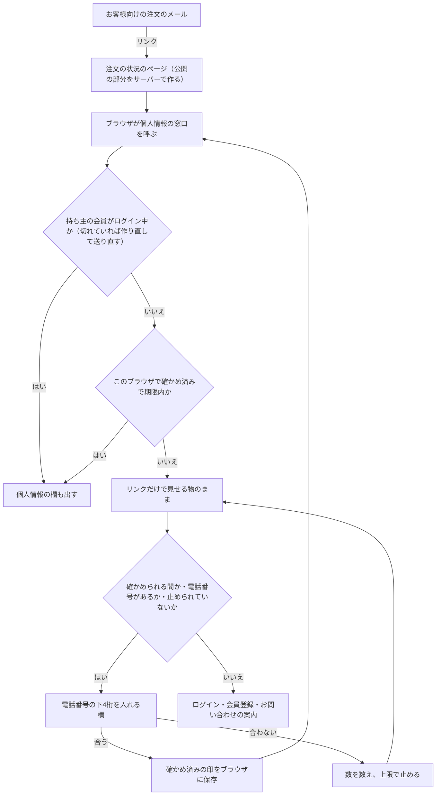
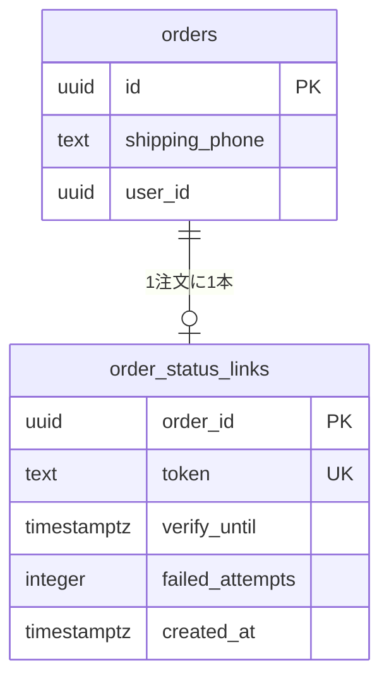

# 注文の状況のページ（グループ E-5）設計書

> 分類: feature。グループ E の最後の作業（全体の決定は [グループ E 全体の設計](2026-10-10-group-e-overview-design.md) の 7 章）
>
> 前提: E-1 部分発送・E-2 返金とキャンセル・E-3 返品と交換・E-4 配送の状況は本番に適用済み（E-4 は 2026-10-22）
>
> 決めた人: 1〜5 章の「ユーザーの決定」は 2026-10-22 にユーザーが Shopify の説明を見ながら決めた。「私の案」と書いた所は設計者（Claude）の判断で、承認の時に見直せる

---

## 概要

ログインしないで買ったお客様も、メールのリンクから注文の状況を見られるページを作る。会員にも同じリンクを送り、持ち主がログインしていれば全部を見せる。リンクを開いただけでは個人情報と支払いに関わる物を見せず、注文の時の電話番号の下4桁で本人と確かめた時だけ見せる。

| 項目 | 決めた形 | Shopify との違い |
| --- | --- | --- |
| 入口 | お客様向けの注文のメール全部に、注文ごとの推測できないリンク | Shopify は注文確認・発送・発送の更新のメールに入れる |
| リンクだけで見せる物 | 進み具合と配送の状況・品物と数・金額・運送会社の名前・配送の移り変わりと時刻・返金の額と状況・返品とキャンセルの申し込みの状況 | Shopify は品物・合計・割引・状況 |
| 本人の確かめ | 注文の時の電話番号の下4桁 | Shopify は注文番号＋メール（または電話番号）、ログインはメールの6桁のコード |
| 確かめた後に見せる物 | 伝票番号と追跡ページへのリンク・お届け先・ご連絡先のメール・お支払い方法 | Shopify は名前・住所・支払い方法・配送の方法・伝票番号 |
| 確かめられる間 | リンクの入ったメールを最後に送ってから3週間。その後はログインした持ち主だけ | Shopify は同じブラウザで3週間（別のブラウザ5つまでは2週間）、その後はログインか本人の確かめ |
| メールの直し | お客様へのメールに電話番号を書かない | Shopify には無い（こちらは下4桁を確かめに使うため） |
| 返品・キャンセル | ゲストはこのページで申し込めない。会員登録（同じメール）か、注文番号入りのお問い合わせを案内 | Shopify は新しいお客様アカウントのログイン（メールのコード）で申し込める |

---

## 1. 目的と範囲

### 1-1 なぜ作るか

- ログインしないで買ったお客様には、今は注文の様子を見る入口が無い。届くのはメールだけで、配達済みのメールにある会員用の頁（`/account/orders/…`）のリンクも開けない
- E-1〜E-4 で部分発送・返金・返品・配送の状況を作ったが、それを見られるのは会員だけ
- Shopify は全部のお客様に「注文の状況のページ」を出している（全体の決定 7 章で「作る」と決めた）

### 1-2 やること

1. 注文の状況のページ（ログインの要らない公開の頁）
2. 電話番号の下4桁での本人の確かめと、確かめた事をそのブラウザで覚える仕組み
3. お客様向けの注文のメールへのリンクの追加と、電話番号の削除
4. ゲストの返品・キャンセルの案内（会員登録の道とお問い合わせの道）と、お問い合わせフォームへの値の受け渡し

### 1-3 やらないこと（非目標）

- このページからの返品・キャンセルの申し込み（ゲストは 6 章の2つの道を使う。会員は今までどおり会員の注文の頁から）
- パスワードの要らないログイン（Shopify の6桁のコードのログイン）への切り替え
- SMS での案内（このサイトはメールだけ）
- 管理画面から「お客様の見るページを開く」ボタン（Shopify にはある。必要になったら後で足す）
- 既に送ったメールへのリンクの後付け（受信済みのメールは変えられない。E-5 の後に送るメールから入る）

### 1-4 してはいけない事（反目標）

- リンクを開いただけの人に、名前・住所・電話・メールアドレス・支払い方法・伝票番号を見せる
- 電話番号の下4桁を何度でも試せる（4桁は1万通りしかない）
- リンクの値（トークン）をログ・監査・エラー・外部へのリファラーに出す
- 検索エンジンにページを載せる

---

## 2. Shopify と業界の定番との突き合わせ

| 論点 | Shopify | このサイト（E-5） | 理由 |
| --- | --- | --- | --- |
| 入口のメール | 注文確認・発送・発送の更新（テンプレートを直した店は手で足す） | お客様向けの16種類全部 | 返金・返品・キャンセルの状況もこのページで見せるので、その知らせからも開けるようにする（私の案） |
| リンクだけで見せる物 | 品物・合計・割引・状況（人に渡したリンクも同じ） | 1-2 の表の左の列 | ユーザーの決定 |
| 本人の確かめ | 期限後に注文番号＋メールまたは電話番号。ログインはメールの6桁のコード | 電話番号の下4桁（期限内だけ） | 注文番号とメールは注文のメールに書いてあり、転送で漏れる。下4桁はメールから消す（ユーザーの決定、案C1） |
| 確かめられる間 | 同じブラウザ3週間・別のブラウザ5つまで2週間 | リンク入りのメールを最後に送ってから3週間 | 期間はユーザーの決定。数え始めは私の案（お取り寄せで発送が遅れても、発送のメールで確かめ直せる） |
| 期限の後 | 「ログインして全部を見る」。本人の確かめでも見られる | リンクだけで見せる物はそのまま。個人情報はログインした持ち主だけ | ユーザーの決定 |
| 返品の申し込み | ページから申し込める。ただし新しいお客様アカウントの機能でログインが要る | このページでは申し込めない。会員登録かお問い合わせへ案内 | ユーザーの決定（A と C の組み合わせ） |
| 配送の状況 | 受付済み・配送中・配達中・配達済み・不在。対応の運送会社は地図つき | E-4 のお客様向けの出し方（追跡中か一度登録できた時だけ状況、ほかは配達済みだけ） | E-4 の決定をそのまま使う |

出典:

- [About order status pages（Shopify ヘルプ）](https://help.shopify.com/en/manual/orders/status-tracking/order-status-overview) — リンクだけの時の範囲、3週間・2週間、期限後の表示、人に渡したリンク
- [Order status page – first time accessed（Shopify ヘルプ）](https://help.shopify.com/en/manual/orders/status-tracking/first-time-accessed) — 期限後に注文番号とメールまたは電話番号で確かめる
- [Setting up order status updates（Shopify ヘルプ）](https://help.shopify.com/manual/orders/status-tracking/order-status-email) — リンクを入れるメールの種類
- [New customer accounts（Shopify ヘルプ）](https://help.shopify.com/en/manual/customers/customer-accounts/customer-login) — メールの6桁のコードでのログイン
- [Self-serve returns（Shopify ヘルプ）](https://help.shopify.com/en/manual/fulfillment/managing-orders/returns/self-serve-returns)・[Setting up self-serve returns](https://help.shopify.com/en/manual/orders/return-requests) — ページからの申し込み、新しいお客様アカウントが要る
- [Order details screens and PII（NCC Group）](https://nccgroup.com/au/research-blog/order-details-screens-and-pii) — 注文の頁のリンクから個人情報が漏れる危険

業界の定番（電話番号の下4桁や郵便番号など、メールに書いていない物で確かめる形）は、ユーザーとの話で「よく使われる形」として挙げたが、出典は確かめていない。

---

## 3. 全体の流れ

ページは2段で作る（私の案。作り手の目のレビューの指摘で決めた。11 の l）。

1. **公開の部分**: サーバーが毎回作る。リンクだけで見せる物だけを読み、個人情報は読まない
2. **個人情報の部分**: 画面を開いた後に、ブラウザがページ専用の窓口へ取りに行く。窓口は、持ち主の会員のログインか、このブラウザの確かめ済みの印がある時だけ返す

ログインの印（`sb-access-token`）はふつう1時間で切れ、作り直し（refresh）はブラウザ側の部品（`useLogin`・401 の時に作り直して送り直す仕組み）だけができる。サーバーで画面を作る途中は Cookie を書けないので、1枚のページにすると、メールのリンクを翌日に開いた持ち主の会員に個人情報を出せない。2段にすれば、ほかの会員の窓口と同じ作り直しの仕組みで呼べる。



---

## 4. リンク

### 4-1 形（私の案）

| 項目 | 決めた形 | 理由 |
| --- | --- | --- |
| 住所 | `/order-status/{トークン}`（例: `https://<サイト>/order-status/Xy3…`） | トークンは推測できない値なので、注文番号（`ORD-` ＋ UUID の先頭8文字）を住所に出さない |
| トークン | 32バイトの暗号学的な乱数を base64url にした43文字 | 既存のゲストの買い物の印と同じ強さ（`src/features/cart/services/guest-shopping-token.ts`） |
| 保存 | 新しい表 `private.order_status_links` に注文ごとに1行。トークンはそのまま保存する | メールを作るたびに同じリンクを書くため、元の値が要る（ハッシュだけでは書けない）。トークンで見えるのはリンクだけの範囲で、個人情報は別の確かめが要る。DB を読める人はもともと全部の注文を読めるので、そのまま保存しても新しい危険は増えない |
| 作る時 | お客様向けのメールの本文を初めて作る時に、無ければ作る（同じ取引で1回だけ） | 注文を作る関数（決済の流れ）を変えずに済む。前からの注文にも、次のメールから自然に付く。一括の補いは要らない |
| 変え方 | 作り直さない（1注文に1本） | Shopify と同じく、注文のリンクは注文が続く間ずっと同じ |

表 `private.order_status_links` の列（私の案）:

| 列 | 型 | 意味 |
| --- | --- | --- |
| `order_id` | uuid PK、`public.orders(id)` への FK | 注文 |
| `token` | text NOT NULL UNIQUE、43文字の base64url に限る CHECK | リンクの値 |
| `verify_until` | timestamptz NULL | 電話番号の下4桁で確かめられる最後の時刻。NULL はまだリンク入りのメールが届いていない |
| `failed_attempts` | integer NOT NULL DEFAULT 0 | 今の確かめられる間の、下4桁の失敗の数（6-3） |
| `created_at` | timestamptz NOT NULL DEFAULT now() | |

守りは今までの表と同じ（RLS RESTRICTIVE で anon・authenticated を拒む、service_role は SELECT だけ、書くのは SECURITY DEFINER ＋ `SET search_path = ''` の関数だけ、関数の EXECUTE は service_role だけ）。

### 4-2 確かめられる間（ユーザーの決定＋数え始めは私の案）

- リンクの入ったお客様向けのメールの送信が成功した時（`complete_order_email` で `sent` になった時）に、`verify_until = 送った時刻 + 21日` にする（前の値より後の時だけ進め、戻さない）
- 店向けのメール・送れなかったメール・取りやめたメールでは進めない
- 期限が進んだ時は `failed_attempts` を0に戻す（新しいメールが届いた本人が確かめ直せるように）
- E-5 を当てる前に保存された本文（リンクの無い本文）の送り直しでも進むが、リンクの値は同じなので害は無い（私の案。本文の中身で分けない）

### 4-3 ページの守り

| 守り | 決めた形 |
| --- | --- |
| 検索エンジン | `robots: { index: false, follow: false }` |
| キャッシュ | 公開の部分は毎回サーバーで作る（`await connection()` の後に読む）。個人情報の窓口と確かめの窓口の応答は `Cache-Control: no-store` |
| リファラー | 今の proxy が全部に `Referrer-Policy: no-referrer` を付けている。追跡ページへのリンクにも `rel="noreferrer"` |
| ログ | トークンをログ・監査・エラーの文に入れない。誤りのログは記号だけ（今の窓口と同じ形） |
| 合わないトークン | 「このページは見つかりません」（404）。形の合わないトークンは DB を読まずに 404。時間で区別できないよう、見つからない時も同じ文 |
| 取り消した注文 | 見せる（取り消しの状況もお客様の知りたい事）。ただし支払いの途中で消えた注文（`payment_in_progress`・`abandoned`）は 404（会員の注文の頁と同じ） |

---

## 5. 見せる物

### 5-1 範囲（ユーザーの決定）

| 物 | リンクだけ | 確かめた後・持ち主の会員 |
| --- | --- | --- |
| 注文番号・注文日 | 見せる | 見せる |
| 進み具合（`deriveOrderProgress` の表示と段） | 見せる | 見せる |
| 品物（名前・色・サイズ・数・金額・交換の品の印・発送や返金の数） | 見せる | 見せる |
| 金額（小計・送料・割引・合計） | 見せる | 見せる |
| 発送ごとの運送会社の名前・発送日・その発送の品 | 見せる | 見せる |
| 配送の状況と移り変わり（E-4 の出し方） | 見せる | 見せる |
| 配達済みの日 | 見せる | 見せる |
| 返金の額と状況（手続き中・済み） | 見せる | 見せる |
| 返品・キャンセルの申し込みの状況（状態の名前・品物と数・解決の方法・返金額・お断りの文） | 見せる | 見せる |
| 伝票番号と運送会社の追跡ページへのリンク | 見せない | 見せる |
| 返品で送り返した品の伝票番号 | 見せない | 見せる |
| お届け先（名前・郵便番号・住所・電話） | 見せない | 見せる |
| ご連絡先のメールアドレス | 見せない | 見せる |
| お支払い方法 | 見せない | 見せる |
| 返品の送り先（お店の住所） | 見せない | 見せる（私の案。返品の手続き中の時だけ、会員の頁と同じ条件） |

E-4 の配送の出し方（追跡がオン・鍵あり・今の版の登録が追跡中か一度登録できたうえで止めた時だけ状況を出す。取り消した発送は出さない。管理者の名前・細かい状況・登録の状態・古い版は出さない）と、返金の出し方（失敗・エラーは出さない）、返品の出し方（店のメモ・理由の記号・操作した人を出さない）は、会員の注文の頁と同じにする。

### 5-2 会員の注文の頁との関係（私の案）

- 見せる物を組み立てる処理（発送・配送・返金・進み具合・品物）を、今の `src/app/api/orders/[id]/route.ts` の中から共通の部品へ出し、会員の窓口とこのページの両方が使う（今は窓口の中の export しない関数）
- 個人情報と支払い方法（と伝票番号・返品で送り返した品の伝票番号・返品の送り先）は、公開の部分とは別の窓口 `GET /api/order-status/{トークン}/private` だけが返す。公開の部分を作るサーバーの処理はこれらを最初から読まない・組み立てない（画面で隠すのではない）
- 個人情報の窓口は、持ち主の会員のログイン（既存の `authenticateRequest`）か、確かめ済みの印（6-4）がある時だけ 200 で返す。どちらも無い時は 401 と「確かめられるか（期限内・電話番号あり・止められていない）」だけを返し、画面はそれを見て下4桁の欄か案内を出す
- 画面は、ほかの会員の窓口と同じ呼び方（401 の時にログインの印を作り直して送り直す `clientFetch`）でこの窓口を呼ぶ
- 返品・キャンセルの読み出しは今の SQL が「持ち主の会員の番号」を必須にしているので、注文の番号で読む SECURITY DEFINER の関数を足す（service_role だけ）。返す項目は今のお客様向けの関数と同じ所から作る
- 画面は今の会員の頁の部品（品物の行 `OrderItemRow`・返品の欄 `OrderReturnsSection` の表示の部分）を使い回す。返品の欄は申し込みのボタンとフォームを出さない形を足す
- 持ち主の会員がログインしてこのページを開いた時は全部を見せる。会員の注文の頁へのリンクも置く（返品・キャンセルの申し込みはそちらでできる）

### 5-3 画面（見本はブレインストーミングの見本 `order-status-access.html`）

```text
ご注文の状況
注文番号 ORD-XXXXXXXX ／ ご注文日
進み具合（段）
発送ごと: 運送会社・配送の状況・移り変わり・品物
まだ発送していない商品
返金
返品・キャンセルの申し込み
金額
［確かめる前］お届け先・お支払い方法・伝票番号を見るには、ご注文の時の電話番号の下4桁を入れてください ［____］［確かめる］
［確かめた後］お届け先・ご連絡先のメール・お支払い方法・伝票番号
返品・キャンセルをご希望の方へ（6 章）
```

3つの画面幅（390・768・1280）で横にはみ出さない。言葉は計画で一字ずつ決める。

---

## 6. 本人の確かめ

### 6-1 電話番号の下4桁（ユーザーの決定）

- 比べる値は、注文の `shipping_phone` から数字だけを取り出した最後の4桁（`+81` やハイフン・空白・括弧は無視する）。入力も数字だけを取り出して4桁ちょうどの時だけ比べる
- 比べは時間で差が出ない方法（`timingSafeEqual` 相当）
- 電話番号が無い・数字が4桁未満の注文は確かめられない。欄の代わりに「ログインするか、お問い合わせください」を出す（私の案）

### 6-2 確かめられない時（ユーザーの決定）

- `verify_until` が NULL・過去の時は欄を出さない。持ち主の会員のログイン（会員の時）か、会員登録・お問い合わせを案内する
- 期限の後もリンクだけで見せる物は見せる

### 6-3 試せる回数（私の案）

| 枠 | 上限 | 数え方 |
| --- | --- | --- |
| 注文ごとの短い枠 | 15分に5回 | 既存の回数の制限（`enforceRateLimit`、subject は DB で確かめた注文の番号） |
| 送信元ごと | 10分に30回 | 既存の回数の制限（IP） |
| 注文ごとの合計 | 確かめられる間に20回の失敗まで | `private.order_status_links.failed_attempts`。20回に達したら、次にリンク入りのメールが届くまで欄を止める |

理由: 4桁は1万通り。短い枠だけだと3週間で全部を試せてしまう（15分に5回×3週間≒1万回）。合計20回なら当てられる確率は0.2%。止まったお客様は、ログイン・会員登録・お問い合わせで進める。

### 6-4 確かめた事を覚える（私の案）

| 項目 | 決めた形 |
| --- | --- |
| 印 | 署名つきの Cookie（HMAC-SHA256、既存の2要素目の保留の印と同じ作り。`purpose='order_status'`・注文の番号・トークンの短いハッシュ・期限） |
| 鍵 | 新しい環境の値 `ORDER_STATUS_SESSION_SECRET`、無ければ `JWT_SECRET`（既存の印と同じ決まり） |
| 期限 | 確かめてから24時間か `verify_until` の早い方 |
| 属性 | `httpOnly`・`secure`（本番）・`sameSite=strict`・`path=/api/order-status/{トークン}` |
| 書く所 | Route Handler `POST /api/order-status/{トークン}/verify`（Next.js 16 では描画中に Cookie を書けないため）。CSRF の確かめは既存の窓口と同じ形 |
| 読む所 | 個人情報の窓口だけ（ページの公開の部分は印を見ない） |
| 期限の後 | 印があっても `verify_until` を過ぎたら返さない（窓口を呼ぶたびに DB の値と比べる） |

`sameSite=strict` のままでよい理由: メールのリンクから開いた最初のページの表示には印が送られないが、印を使うのはページ自身が後から呼ぶ同じサイトの窓口なので、そこには送られる。印の住所を窓口だけに絞るので、ページの表示の要求には最初から載らない。

---

## 7. 返品・キャンセルの案内（ユーザーの決定）

持ち主の会員がログインしていない時、ページの下に次の2つを出す。

1. 会員になって申し込む: 「ご注文の時と同じメールアドレスで会員登録し、メールの確認を済ませると、このご注文が会員の注文履歴に入り、そこから返品・キャンセルを申し込めます」。登録の入口（`/login` の登録）へのリンク。注文が会員につくのは既存の仕組み（`src/lib/orders/link-guest-orders.ts`。メールの確認を済ませた会員で、持ち主のいない注文だけ）
2. お問い合わせから申し込む: お問い合わせフォームを「ご注文について」と注文番号を入れた状態で開くリンク（`/contact?type=order&order=ORD-XXXXXXXX`）。お店は E-3 の「お店が作る返品」で受ける

お問い合わせフォームは、URL の `type`（`product`・`order`・`other` だけ受ける）と `order`（`ORD-` ＋ 英数字8文字の形だけ受ける）で欄を埋めるようにする。合わない値は無視する。URL の値は欄を埋めるだけで、注文とのつながりは今までどおり送る時のメールで決まる（私の案）。

---

## 8. メールの直し

### 8-1 リンクの追加（私の案）

- お客様向けの16種類（`paid`・`awaiting_payment`・`payment_expired`・`canceled`・`shipped`・`refund`・`return_accepted`・`return_received`・`return_sent_back`・`return_requested`・`return_declined`・`cancel_request_received`・`cancel_request_declined`・`out_for_delivery`・`delivered`・`shipping_update`）の本文の、お問い合わせの一文の前に「ご注文の状況はこちら: {リンク}」を1行入れる
- 店向けの3種類（`return_refund_pending_shop`・`return_request_shop`・`cancel_request_shop`）には入れない
- 配達済みのメールの今の「ご注文の確認はこちら: …/account/orders/…」は、このリンクに置き換える
- リンクは `getSiteUrl()` を元に作る。サイトの住所の設定が壊れていてリンクを作れない時は、E-4 の配達済みのメールと同じく材料不足として扱い、メールの処理全体を止めない

### 8-2 電話番号の削除（ユーザーの決定）

- `paid`・`awaiting_payment` のお届け先の行から、お客様の電話番号を消す。名前・郵便番号・住所は残す
- 返品の受付のメールにあるお店の返送先の電話番号は、お客様の電話ではないので残す
- 既に保存された本文（送り直し待ち）は変えない。E-5 を当てる時に送り直し待ちの本文がある数を数え、計画で扱いを決める

---

## 9. データと関数（私の案。名前は計画で決める）



| 関数 | 呼ぶ所 | すること |
| --- | --- | --- |
| リンクを用意する | メールの材料を読む時 | 無ければトークンを作って入れ、トークンを返す |
| メールの送信成功（`complete_order_email` を直す） | メールの worker | お客様向けの種類なら `verify_until` を進め、`failed_attempts` を0に戻す |
| トークンで読む | ページ | トークンから注文の番号・期限・失敗の数・持ち主の会員の番号を返す。見つからない・隠す状態なら何も返さない |
| 下4桁の失敗を数える | 確かめの窓口 | `failed_attempts` を1つ進めて今の数を返す。20以上なら止める |
| 返品・キャンセルを注文の番号で読む | ページ | 今のお客様向けの読み出しと同じ中身を、持ち主の会員の番号なしで返す |

移行は今の版の後に1本〜2本（計画で決める）。前の移行は直さない。

---

## 10. 決まり事の一覧（ユーザーの決定）

| # | 決定 | 日付 |
| --- | --- | --- |
| 1 | リンクを開いただけでは個人情報と支払いに関わる物を見せず、もう一手間で本人と確かめてから見せる | 2026-10-22 |
| 2 | 期限が切れたら、個人情報と支払い方法はログインした持ち主の会員だけ | 2026-10-22 |
| 3 | 一手間はメールに書いていない物（案C）。電話番号の下4桁にし、お客様へのメールから電話番号を消す（案C1） | 2026-10-22 |
| 4 | リンクだけで見せる物: 進み具合と配送の状況・品物と数・金額・運送会社の名前・配送の移り変わりと時刻・返金の額と状況・返品とキャンセルの申し込みの状況。伝票番号と追跡ページへのリンクは確かめた後だけ | 2026-10-22 |
| 5 | 期限の後も、リンクだけで見せる物はリンクで見られる | 2026-10-22 |
| 6 | ゲストの返品・キャンセルは、会員登録して注文履歴から申し込む道と、会員登録せずにお問い合わせフォームから送る道の2つを用意する | 2026-10-22 |
| 7 | 会員にも同じリンクを送り、持ち主がログインしていればそのページで全部を見せる | 2026-10-22 |

## 11. 私が決めた事（承認の時に見直せる）

| # | 決めた事 | 理由 | 誤りだった時 |
| --- | --- | --- | --- |
| a | 確かめられる間は3週間（Shopify と同じ長さ） | ユーザーとの話で示し、反対が無かった | 数字1つ |
| b | 3週間はリンク入りのお客様向けメールを最後に送った時から数える | お取り寄せで遅れた発送でも確かめ直せる | 数え始めの1か所 |
| c | リンクはお客様向けの16種類全部に入れる | 返金・返品・キャンセルの状況もこのページで見せるため | メールの文面 |
| d | トークンは DB にそのまま保存し、メールの本文を初めて作る時に作る | メールに同じリンクを書くため。注文を作る関数を変えない | 表と関数 |
| e | 下4桁の試せる回数（15分に5回・10分に30回・合計20回） | 4桁は1万通りのため | 数字 |
| f | 確かめた事は24時間か期限の早い方まで、そのページの住所だけの Cookie で覚える | 共用の端末で長く残さない | 数字と属性 |
| g | 電話番号の無い注文は確かめられない（ログインかお問い合わせ） | 確かめる物が無いため | 案内の文 |
| h | 取り消した注文も見せる。支払いの途中で消えた注文は見せない | 会員の注文の頁と同じ | 条件1つ |
| i | 返品の送り先（お店の住所）は確かめた後だけ | 返品の手続きを進める人に要る情報のため | 項目1つ |
| j | お問い合わせフォームは URL の値で種別と注文番号を埋める | 「注文番号を入れた状態で開く」を実現するため | フォームの読み込み |
| k | 新しい要求は FREQ-498 から、E2E は新しいカテゴリ `FR-ORDER-001` から | 既存のカテゴリに合う物が無いため（会員の頁は `FR-ACCOUNT`） | 番号 |
| l | ページは2段（公開の部分はサーバー、個人情報はブラウザから専用の窓口）。確かめ済みの印は窓口の住所だけの `sameSite=strict` | ログインの印の作り直しはブラウザ側だけができるので、1枚にすると持ち主の会員に個人情報を出せない場面がある（作り手の目のレビューの指摘） | 画面の作りと窓口1本 |

---

## 12. 試験の考え方

- 単体: トークンの形・下4桁の取り出し（`+81`・ハイフン・空白・4桁未満）・Cookie の署名と期限・見せる物の組み立て（リンクだけの時に個人情報のキーが無いこと）・メールのリンクと電話番号の削除・お問い合わせの URL の値
- DB 結合: リンクの用意（1注文に1本・同時に呼んでも1本）・送信成功で期限が進む（お客様向けだけ・戻さない）・失敗の数と止まり方・注文の番号で読む返品の関数・守り（RLS・権限）
- E2E（本番ビルド・手元の Supabase・3つの画面幅）: リンクだけの範囲・下4桁で確かめた後の範囲・間違いと上限・期限の後・持ち主の会員のログイン・別の会員のログイン・返品とキャンセルの案内とお問い合わせの欄の埋まり方・メールのリンクと電話番号の無いこと・404
- 回数の制限の枠と失敗の合計は、時間を待たずに確かめられる形にする（計画で決める）

## 13. 開店前の確かめ（ユーザーの作業）

- 本番の環境に `ORDER_STATUS_SESSION_SECRET` を入れる（無ければ `JWT_SECRET` を使うので、入れなくても動く）
- 本番の住所（`NEXT_PUBLIC_SITE_URL`）が正しく、メールのリンクが本番のページを開くこと
- 実際にゲストで買い、注文確認のメールのリンクから、下4桁の確かめまで通ること
