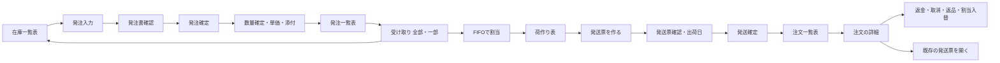
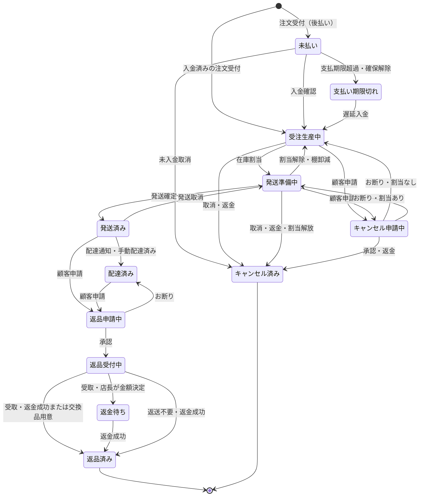
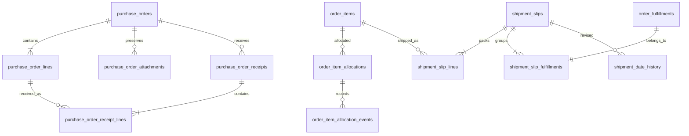

# 注文・在庫・発注・荷作り（グループ G）設計書

## 概要

管理画面に「権限設定」を先に作り、「注文一覧表」「在庫一覧表」「発注一覧表」「荷作り表」と「注文の詳細」「発注書」「受け取り」「発送票」を作る。品物の数量を状態ごとに分けて見せ、受け取った在庫を古い注文から割り当て、同じお客様・同じ送り先の品物をまとめて発送できるようにする。手動の「仕上がり」は在庫からの割り当てへ置き換える。

実際に運送会社へ渡した「出荷日」を発送ごとに残し、後の会計が使えるようにする。会計の波まではKPI・会計の注文日基準を維持し、Gは出荷日の記録までとする。仕訳・受注高・決算・原価計算の変更は後続で扱う。

本書は設計案。2026-10-23 のオーナー回答とcontrollerのレビュー裁定を反映し、実現方法は「設計案」と区別する。本番はテストデータだけのため旧データ移行は作らない。G-1の本番適用前に削除・リセットの対象と件数を示して明示確認を得て、清掃とG-1 migrationを一緒に適用する。開店前なのでG-1で旧発送を停止し、G-3で新しい発送を提供する。今回の成果物は本書と指定調査3点の未変更コピーだけで、実装・試験実行・稼働データ確認・オンライン再確認は行っていない。

### 決定と比較の一覧

出典は1章。Shopify の説明は指定された2026-10-22の調査とオーナー指定の説明・URLを使う。「独自」は調査で同じ仕様を確認できなかったことを表す。

| 番号 | G で作るもの・決定 | Shopify / 業界との比較 | 出典 |
| --- | --- | --- | --- |
| D01 / Q1 | 行の商品額とその行の商品返金だけを表示。行に属さない調整は詳細へ。割引は既存関数を再利用 | Shopify CSV の返金額は注文単位。G は商品分を品物へ分ける | オーナー回答7、提案7章 Q1、S1 |
| D02 / Q2 | 手動仕上がりを廃止。在庫の自動割り当てと、注文詳細の「割り当てを入れ替える」。全部・一部の受け取り画面 | 在庫と確保を分ける点は同じ。古い受注生産への FIFO と優先入替は独自 | 提案7章 Q2、S3・S4 |
| D03 / Q3 | 発注先・メモあり、納期なし。発注数量は空欄から入力 | Shopify は仕入先・品目・数量・原価等を持つ。納期なし・空欄開始は店の決定 | 提案7章 Q3、S4 |
| D04 / Q4 | 仮の発注数量→数量確定。増減・単価・見積/請求書添付・残数打切りと理由。原本は消さない | Shopify の発注書は Draft / Ordered、受取は移動側。G の数量確定は独自 | 提案7章 Q4、S4、会計方針10章 |
| D05 / Q5 | 荷物1つを「発送票」と呼ぶ。「発送」→「発送票確認」→「発送確定」 | Shopify の発送単位を参考にするが、この名称と票は独自 | 提案7章 Q5、S6 |
| D06 / Q6 | 会員は同じ会員ID、ゲスト同士は同じメール、さらに同一配送先だけ同梱 | 独自の判断（Shopify 本体に同梱して1回で発送する機能は無く、アプリで行う。公式の根拠なし） | オーナー裁定、提案7章 Q6。公式出典なし |
| D07 / Q7 | 出荷日は今日が初期値。入金日以降・今日以前。返品期限の起点は発送確定時刻のまま | Shopify の売上レポートは注文日。G は後続会計への入力を用意 | 提案7章 Q7、builder-check、S8、会計方針10章 |
| D08 / Q8 | 返金・取消・返品・割当入替は注文詳細。発送は荷作り表、発送票の直しは票 | Shopify も注文詳細から返金等を行う | 提案7章 Q8、S2・S6 |
| D09 / 注文一覧表 | 品物×状態数量で1行。注文ID・注文日・顧客名・メールは全行を埋める | Shopify CSV は明細ごとだが、追加行の共通欄の多くは空。G は埋める | 提案1章、判断表 J-01、S1 |
| D10 / 在庫一覧表 | 商品×色×サイズ。注文数・在庫・発注済み・発注必要数 | On hand / Committed / Incoming と在庫履歴を参考。必要数の式は独自 | 提案3章、S3・S5 |
| D11 / 発注一覧表 | 発注数量は数量確定で決めた数、未納＝発注数量−納品済み。残りは後日受取、打切り時だけ発注数量を納品済みまで下げる | Shopify は発注書と移動を分ける。G は一画面から複数回受取 | オーナー回答3、提案3章、S4 |
| D12 / 荷作り表 | 「発送準備中」の行だけ。部分発送・別の日の注文の同梱が可能 | 独自の判断（Shopify 本体に同梱して1回で発送する機能は無く、アプリで行う。公式の根拠なし） | オーナー裁定、提案4章。公式出典なし |
| D13 / 未払い | 注文済み、入金未確認 | Shopify Pending に近い | 提案2章、S2 |
| D14 / 支払い期限切れ | 期限超過、確保解除。遅延入金後は受注生産中へ | Shopify の Due / Expired と完全には同じでない | 提案2章、S2 |
| D15 / 受注生産中 | 支払い済み、未割当 | Shopify Unfulfilled の一部を店の生産に合わせて分ける | 提案2章、S2・S3 |
| D16 / 発送準備中 | 支払い済み、割当済み。荷作り表へ | Shopify の確保と発送状態の考え方を参考 | 提案2章、S2・S3 |
| D17 / 発送済み | 発送確定した数量 | Shopify Fulfilled。お客様向けは従来の「配送中」 | 提案2章、S2 |
| D18 / 配達済み | 追跡通知または店の配達済み操作 | Shopify Delivered / 手動配達済みに近い | 提案2章、S7 |
| D19 / キャンセル申請中 | 顧客の申請を審査待ち | Shopify の返品・キャンセル申請を参考。独立した品物状態はG独自 | 提案2章、S2 |
| D20 / キャンセル済み | 取消が成立した数量。金銭の処理状況は詳細へ | Shopify Canceled / Refunded は別系統。G は品物の処理を一本化 | 提案2章、S2 |
| D21 / 返品申請中 | 顧客の返品申請を審査待ち | Shopify Return requested に近い | 提案2章、S2 |
| D22 / 返品受付中 | 承認後、受取・検品・処理の途中 | Shopify Return in progress に近い | 提案2章、S2 |
| D23 / 返金待ち | E-3 の店長による金額決定待ちだけ | 決済会社の Pending と区別する店の表示 | 提案2章、S2、調査 `現状調査:313` |
| D24 / 返品済み | 返金・交換等で元の返品数量の処理が完了 | Shopify Returned に近い。交換品は別行 | 提案2章、S1・S2 |
| D25 / J-01 | 旧CSVを廃止し、注文一覧表と同じ12列のCSVへ置換 | Shopify の明細出力を参考。G の状態別数量を保持 | 判断表5章 J-01、提案5章、S1 |
| D26 / J-02 | 旧手動「仕上がり」履歴の表示・取消不可表示は不要 | 比較の対象外。本番はテストデータだけのため旧履歴の実装も不要 | オーナー回答1 |
| D27 / J-09 | 管理の「進み具合」「支払い」の重複列を品物ステータスへ統合 | Shopify は別々の状態軸。G は店の作業に合わせた12状態 | 提案7章 J-09、判断表5章 J-09・G、S2 |
| D28 / G-1〜G-4 | G・Hとも開店前。Gは一覧だけでなく発注書・受取・荷作り・同梱を含む | 比較の対象外。開店前の実装範囲の決定 | 判断表5章 G-1〜G-4 |
| D29 / 権限設定 | G-0で既存の店長・サポーターごとの権限切替画面を作る。新役割なし。権限管理は店長だけに固定 | Shopifyは権限を役割へ、役割をユーザーへ割当。ユーザー/役割管理自体は付与可能な権限ではない | オーナー回答8、レビュー裁定、S9 |

## 1. 根拠と設計の境界

### 1-1 読み方と資料

| 資料 | 本書での扱い |
| --- | --- |
| [G の提案](2026-10-23-group-g-proposal.md) | 7章 Q1〜Q8 が正。4表の列、2章の12状態と遷移を維持する |
| 2026-10-23 オーナー回答・builder-check | 本書改訂の確定事項。旧移行・旧UI維持・U1〜U3を含め、従前案と異なる箇所はこちらを優先 |
| [G の現状調査](2026-10-23-group-g-research/facts.md) | コードとSQLの静的事実。HEAD `12f968e5` 時点。以下の `現状調査:行` はこの永続コピーの行番号 |
| [判断表](../../05_Quality/reviews/code/2026-10-22-decision-sheet.md) 5章 | G-1〜G-4・J-01・J-02・J-09・G。古い本文の推奨より優先 |
| [売上の計上の方針](../../01_Planning/revenue-recognition-policy.md) 10章 | 出荷日と修正履歴をGが渡す。会計への反映は後続 |
| [Shopify G/H 調査](2026-10-23-group-g-research/decision-shopify-gh.md)、[注文調査](2026-10-23-group-g-research/decision-shopify-orders.md) | 比較の根拠。調査の「第三者」「出典なし」は本書でも公式事実に置き換えない |
| [E-5 設計](2026-10-22-order-status-page-design.md)、[文書ルール](../../../.claude/skills/documentation-guide/SKILL.md) | 概要・番号付き決定・表・Mermaidの構成。お客様向けの言葉・公開範囲を維持 |

| 出典 | 既存調査内の出所とURL | 裏付ける範囲 |
| --- | --- | --- |
| S1 | 注文調査 話題1: [CSV](https://help.shopify.com/en/manual/orders/manage-orders/exporting-orders)、[LineItem](https://shopify.dev/docs/api/admin-graphql/latest/objects/LineItem)、[返品・交換API](https://shopify.dev/docs/apps/build/orders-fulfillment/returns-apps/build-return-management) | 明細出力、元数量と現在数量、交換。Gの金額分割は独自 |
| S2 | 注文調査 話題8・9: [注文状態](https://help.shopify.com/en/manual/fulfillment/managing-orders/order-status)、[注文検索](https://help.shopify.com/en/manual/fulfillment/managing-orders/viewing-orders/searching-orders)、[返金](https://help.shopify.com/en/manual/fulfillment/managing-orders/refunding-orders) | 注文・支払い・発送・返品の軸と詳細からの操作 |
| S3 | G/H調査1章: [在庫状態](https://help.shopify.com/en/manual/products/inventory/managing-inventory-quantities/inventory-states)、[在庫管理API](https://shopify.dev/docs/apps/build/orders-fulfillment/inventory-management-apps) | On hand / Available / Committed / Incoming |
| S4 | G/H調査1章: [発注書作成](https://help.shopify.com/en/manual/products/inventory/purchase-orders/creating-purchase-orders)、[発注状態](https://shopify.dev/docs/api/admin-graphql/latest/enums/InventoryPurchaseOrderStatus)、[受取と移動の更新](https://changelog.shopify.com/posts/purchase-orders-now-create-transfers-to-move-inventory)、[移動](https://help.shopify.com/en/manual/products/inventory/transfers) | 発注先・品目・原価、Draft / Ordered、移動と複数回受取 |
| S5 | 注文調査 話題4: [在庫調整履歴](https://help.shopify.com/en/manual/products/inventory/adjusting-inventory/adjustment-history) | 日時・作業・実行者・状態別数量の変化。Gの台帳理由と表示名は独自 |
| S6 | 注文調査 話題2・9: [部分発送等](https://help.shopify.com/en/manual/fulfillment/fulfilling-orders/single-fulfillment)、[注文取消](https://help.shopify.com/en/manual/fulfillment/managing-orders/canceling-orders) | 注文内での品物・数量の発送と取消。複数注文同梱の公式根拠ではない |
| S7 | G/H調査6章: [追跡情報](https://shopify.dev/api/admin-graphql/latest/objects/FulfillmentTrackingInfo)、[注文追跡](https://help.shopify.com/en/manual/fulfillment/setup/order-status-page/order-tracking)、[17TRACK v2.4 API](https://api.17track.net/track/v2.4) | 追跡情報・手動配達済み・追跡登録。調査本文と同じv2.4のURLを記載。今回オンライン再確認なし |
| S8 | 注文調査 話題7: [売上レポート](https://help.shopify.com/en/manual/reports-and-analytics/shopify-reports/report-types/default-reports/sales-report) | Shopifyの管理上の売上日。日本の帳簿の出荷基準の根拠は承認済み会計方針 |
| S9 | オーナー指定: [役割の権限](https://help.shopify.com/en/manual/your-account/users/roles/permissions) | 権限→役割→ユーザーの割当。ユーザー/役割管理自体は付与可能な権限ではない。今回オンライン再確認なし |

### 1-2 現行から変える要点

| 現行の事実 | G の方針 | 調査と原典 |
| --- | --- | --- |
| `order_status` は7値。品物の12状態はない | 注文enumは維持し、品物数量を投影する | `現状調査:23`、`src/lib/orders/order-payment-types.ts:6` |
| 一覧は注文1行、詳細はdialog。CSVは表示取得分のpaidのみ | 独立した詳細頁と品物行の一覧・CSVにする | `現状調査:47`、`:51`、`src/app/admin/page.tsx:1013` |
| 一覧DTOに単価・明細額・会員ID・建物等がない | 管理専用の読取契約を追加。お客様向けDTOを流用しない | `現状調査:50`、`src/app/api/admin/orders/route.ts:379` |
| stockは注文時に減算、backorderはcompletionで準備数を算出 | 空き在庫と割当を分け、発送時に手元在庫が減る投影に統一 | `現状調査:68`、`:78`、`:96`、`supabase/migrations/20261023082740_item_variant_retire.sql:470` |
| 入荷後のFIFO、発注・受取専用表はない | 割当台帳、発注書、受取を追加 | `現状調査:100`、`:101`、`src/app/api/admin/items/[id]/variants/route.ts:246` |
| 発送は1注文単位、運送会社・番号が必須 | 発送票が注文別発送を束ね、番号は後入力にも対応 | `現状調査:59`、`:80`、`supabase/migrations/20261021221140_delivery_tracking_admin.sql:264` |
| 同番号の通知反映はあるが登録1回の保証はない | 発送票に追跡登録の単位を追加 | `現状調査:86`、`supabase/migrations/20261021221410_delivery_tracking_sync.sql:304` |
| 会計は注文日・Stripe日付を使う | Gは実出荷日・数量・訂正の識別子を保存するまで | `現状調査:161`、`:176`、`src/lib/sales/order-sales.ts:44` |

### 1-3 採用する構成（設計案）

| 案 | 評価 |
| --- | --- |
| 既存の注文enumを12状態へ変更する | 決済・返金・会計と衝突し、同じ明細内の異なる数量も表せないため採らない |
| 既存原本を保ち、割当・発注・発送票の記録から数量別状態を作る | 採用案。E-1〜E-5の識別子と履歴を保ち、段階的に切り替えられる |
| 注文・発送を全て新しい表へ移す | 原本と追跡・返品・メールの関連を移し替える範囲が大きいため採らない |

新規の画面名・表名・関数名・権限コードは本書の設計案。DB保証は実装後のDB試験で確認する。今回、法令適合・本番適用・実メール・外部追跡の成功を認定しない。

## 2. 画面と操作の全体

| 画面 | URL案 | 主な役割 |
| --- | --- | --- |
| 権限設定 | `/admin/settings/permissions` | 分野別に権限を並べ、店長・サポーターごとの許可を切替 |
| 注文一覧表 | `/admin/orders` | 検索・CSV・詳細を開く |
| 注文の詳細 | `/admin/orders/[id]` | 状態、金額、各申請、履歴、返金等の操作 |
| 在庫一覧表 | `/admin/inventory` | 全商品の色×サイズを横断して確認、発注開始 |
| 発注一覧表 | `/admin/purchase-orders` | 発注書品物行、数量確定・受取への入口 |
| 発注書 | `/admin/purchase-orders/[id]` | 発注先・メモ・数量の版・単価・添付・受取履歴・打切り |
| 荷作り表 | `/admin/packing` | 準備中の行と発送票の下書き・確定済み票への入口 |
| 発送票 | `/admin/shipment-slips/[id]` | 荷物と同梱注文、出荷日、伝票訂正・取消・配達済み |

管理ナビに4表と権限設定への入口を置く。現在のORDERタブから新一覧へ誘導する。390 / 768 / 1280pxで同じ項目を使い、表は見出しを保ったスクロール領域に収める。頁全体を横にはみ出させない。行はリンクとしてキーボードでも詳細を開け、選択欄・入力欄の操作では行遷移しない。

## 3. 注文一覧表と注文の詳細

### 3-1 注文一覧表（確定列）

1行は `order_item_id × status × 数量のまとまり`。商品名・色・サイズは独立列で、合計12列。注文共通欄は全行を埋め、交換品には商品名に「交換品」の印を添える。

| 列 | 中身 |
| --- | --- |
| 注文ID | 現在の表示用注文番号。内部UUIDも行の識別に使う |
| 注文日 | 注文原本の日時、日本時間表示 |
| 顧客名 | 注文の配送先名 |
| メールアドレス | 注文のメール。現在の会員プロフィールへ置換しない |
| 商品名 | 注文明細の購入時スナップショット |
| 色 | 同上 |
| サイズ | 同上 |
| 数量 | この状態に属する数 |
| 単価 | `item_price`。交換品は0円 |
| 合計金額 | この状態数量に割り振った品物額。3-3の扱いで総和を一致 |
| 返金額 | この数量に対応する成功返金額。処理中の額は詳細で別表示 |
| ステータス | 6章の12状態 |

日付・注文番号・顧客・メール・商品・色・サイズ・状態・要対応で絞る。状態は管理用の投影を検索し、DBの注文enumと混同しない。`payment_in_progress / abandoned` は新一覧・CSVから常に除外する。通常の決済失敗でまだ入金されていない数量は「未払い」とし、詳細の支払い・要対応で失敗理由を示す。「支払い期限切れ」は期限切れの根拠がある時に限る。

ページは20表示行を基本案とし、`注文日 DESC → order_id → order_item_id → 状態の定義順` で安定させる。総行数と注文数を分けて表示する。部分的に別頁へ分かれても注文共通欄があるため判別できる。

### 3-2 CSVと詳細（確定事項＋設計案）

| 項目 | 方針 |
| --- | --- |
| CSVの置換 | J-01により旧11列・paidのみのCSVを廃止。新一覧の12列を同じ順で出力 |
| 出力対象 | 表示中の頁だけでなく、現在の絞り込みに合う全行。状態別の数量・返金済み数量を行で表す |
| 出力の一貫性 | サーバー側で同一スナップショットを読み、CSVを生成。読み取り権限を毎回確認し、ブラウザの取得済み行だけから作らない |
| CSVの形式 | UTF-8 BOM、引用符・改行を正しく処理。顧客入力が表計算ソフトの式として評価される先頭文字を無害化 |
| 詳細の構成 | 注文情報・配送先、支払いと返金、状態別の品物、発送票と注文別発送、返品・取消申請、要対応、変更履歴 |
| 詳細の操作 | 返金、未入金取消、支払い済み取消、返品作成・審査・受取、取消申請の審査、割当入替。既存の入力・不可条件・権限を引き継ぐ |
| 確認dialog（J-12） | 返金・取消は波1の挙動を維持。タイトルに注文番号（例「返金（注文 ORD-XXXXXXXX）」）を表示し、モバイルでも×で閉じられる |
| 発送の操作 | 新規発送は荷作り表。詳細から該当発送票へリンク。伝票訂正・発送取消・手動配達済みは発送票で行う |
| 履歴 | 現在の集約履歴を再利用し、品物・数量・変更前後の状態・人・時刻・理由・発注受取/発送票等への参照を追加。自動は実行主体を区別 |
| 更新後 | 詳細・関連する4表・履歴・要対応を読み直す。失敗時は古い値を成功表示に変えない |

現行の要対応・メール再送・申請への入口を失わせない。既存履歴の集約範囲と責務は `現状調査:52`・`:53`（原典 `src/app/api/admin/orders/[id]/history/route.ts:208`）に従う。

### 3-3 行金額の分割（範囲は確定）

| 対象 | 計算・保存の方針 |
| --- | --- |
| 商品の額 | `line_total` から既存の `private.order_line_discounts(order_id)` の行別割引を引く。Gで新しい割引配賦は作らない。Hで置換する可能性は残す |
| 状態で分かれる数量 | 明細内に安定した数量区間を設け、累積配分の差で円を割る。3点100円なら33・33・34円など、分け直しても総額を保つ |
| 送料等 | 商品分に含めず注文詳細で照合。行合計の和＝商品の正味額で、注文総額とは分ける |
| 返金額 | `order_refund_lines.amount` の成功分のうち、その行の商品返金だけを対応数量へ配分。数量を伴わない商品返金は数量・状態を変えず、処理中・失敗は成功額に含めない |
| 行に属さない返金調整 | 送料返金・調整額などは注文詳細にだけ表示し、品物行へ配らない |
| 交換 | 元の返品行と別の `line_kind=exchange` 行。0円を維持し、元の商品額や返金を交換品へ移さない |

行別割引の原典は `supabase/migrations/20261013001143_order_return_receipts.sql:23-58`。分割行の和は元の行の商品額・商品返金額に一致させる。送料・調整額を含む注文返金総額とは、詳細の内訳で照合する（`supabase/migrations/20261011222930_order_refund_records.sql:39`）。

## 4. 在庫一覧表・発注・受け取り

### 4-1 在庫一覧表（確定列・式）

| 列 | 決まり |
| --- | --- |
| 商品名 | 商品名 |
| 色 | バリアントの色 |
| サイズ | バリアントのサイズ |
| 注文数 | 支払い済みで未発送の「受注生産中＋発送準備中」の数量 |
| 在庫 | 手元の数（on hand）。発送準備中への割当と未払い注文の仮確保も含む。未納は含めず、発送確定で減る |
| 発注済み | このバリアントの数量確定済みの「未納」の合計。仮数量は数えない |
| 発注必要数 | `max(0, 注文数 − 在庫 − 発注済み)` |

例は注文数5・在庫2・発注済み1なら必要数2。未払い・取消/返品の申請中など、上の2状態以外の数量は注文数へ加えない。確保済みの保留数量は在庫の内訳として確認できる。停止したバリアントも在庫・未納・未完了注文があれば履歴とともに表示し、通常の販売候補へ戻さない。

未払い注文の仮確保を含めたまま計算するため必要数が小さく出る場合があるが、開店時はコンビニ払いがオフなので影響は小さい。

### 4-2 発注入力から数量確定まで

| 順 | 画面・操作 | 入力・更新 |
| --- | --- | --- |
| 1 | 在庫一覧表の「発注」 | 商品・色・サイズ・発注必要数を見ながら、複数行の数量を入力。数量は空欄から開始 |
| 2 | 「発注書確認」 | 正の整数を入れた行だけを確認。発注先を必須、メモを任意とする案。納期欄は作らない |
| 3 | 「発注確定」 | 発注番号を一度だけ採番。例 `PO-20261023-0001`。仮数量を保存し、数量確定待ちとして表示 |
| 4 | 「数量確定」 | 見積・請求書に合わせて各行の数量を増減。単価は任意、未入力と0円を区別。PDF・画像の原本と取引日・金額・取引先を添付 |
| 5 | 確定後 | 確定数量の未納分を発注済みに計上し、受け取りを可能にする。後の数量訂正は前の版を消さず、理由付きの新しい版として確定 |

設計案として、数量確定前の受取は止める。先に届いた時も数量確定を経て受け取る。過納は先に数量を増やして確定し、納品済みを下回る数量訂正は断る。単価や添付が未到着でも数量を確定できるが、「単価未登録」「証憑未添付」を詳細で示す。

発注先は名称のスナップショットで持つ案とし、新しい仕入先マスターや会計の取引先マスターの変更はGに含めない。発注確定はシステム内の記録で、仕入先への自動送信・決済は行わない。

### 4-3 発注一覧表と「残りを打ち切る」

| 列 | 決まり |
| --- | --- |
| 発注書番号 | 発注書へのリンク |
| 商品名 | 発注時の名称 |
| 色 | 発注時の色 |
| サイズ | 発注時のサイズ |
| 発注数量 | 数量確定で決めた数。確定前の仮数量は発注書詳細で示す |
| 納品済み | 検品後に受け取った良品数の累計 |
| 未納 | `発注数量 − 納品済み`。0以上 |

未納は後日届いた時に通常どおり受け取る。「打ち切り」列は作らない。「残りを打ち切る」を使った時だけ、その行の発注数量を納品済みまで下げる。例えば確定10・納品6なら発注数量6・納品済み6・未納0とし、変更前の10と減らした4・人・時刻・理由を発注履歴に残す。数量確定前は発注数量・未納を「数量未確定」と示す。

| 操作 | 条件・結果 |
| --- | --- |
| 残りを打ち切る | 未納が正の行の残り全部を対象とし、理由必須。発注数量を納品済みへ訂正し、差分・人・時刻を履歴へ追記。入庫は起こさず、発注必要数が再び増えうる |
| 誤った打切り | 発注管理権限のある担当者が理由付きで数量を再確定。元の打切り履歴は消さない |
| 発注全体の取消 | 受取なしなら全行の未納を打切る。受取ありは受け取った記録を残して残数だけ終了 |

発注書の表示段階は `draft → ordered → quantity_confirmed → partially_received → received / closed` の案。`draft` は入力途中、`received` は全て納品、`closed` は残数打切りを含む完了。数量の版と受取・打切りから導出し、Shopifyの発注書の状態名とは同一視しない。

### 4-4 受け取りの画面

発注書を開いて「全部受け取る」または「一部を受け取る」を選ぶ。商品・色・サイズ・発注数量・納品済み・未納・今回受け取った数を見せる。「全部」は現在の未納を初期値にし、一部は各行の良品数を入力する。受取日とメモを残し、検品不良分は良品在庫に入れず、未納のまま待つか打ち切る。

1回の確定は一つのDB取引で、受取ヘッダー/明細の追記、納品累計・未納更新、在庫入庫、FIFO、状態変更履歴まで完了する。1行でも不正なら全体を取り消す。同じ `request_key`・同じ内容の再送は同じ受取結果を返し、違う内容は409。確認中に他の人が受け取った場合は版と未納を再検証する。

既存の単なる入荷APIはFIFOにつながっていないため、この取引境界を新設する（`現状調査:100`、原典 `supabase/migrations/20260919065355_add_stock_movements.sql:26`）。受取の取消・数量訂正も追記と相殺で行い、既に発送して戻せない在庫を無理に減らさない。

## 5. 荷作り表・発送票・出荷日

### 5-1 荷作り表（確定列）

| 列 | 中身 |
| --- | --- |
| 注文ID | 注文の詳細へのリンク |
| 注文日 | 注文原本の日時 |
| 顧客名 | 配送先名 |
| メールアドレス | 注文のメール |
| 商品名 | 注文明細の名称、交換品の印 |
| 色 | 注文明細の色 |
| サイズ | 注文明細のサイズ |
| 数量 | 発送準備中の数量 |
| 単価 | 注文時の単価 |

ステータスが「発送準備中」の行だけを表示する。交換手数料待ち・支払額要確認・住所不足などは既存の発送禁止条件を維持し、選べない理由を添える。状態を新しく増やして保留を表現しない。

### 5-2 発送の流れと同梱条件

| 順 | 操作 | 契約 |
| --- | --- | --- |
| 1 | 「発送」 | 新しい発送票の下書きを用意。最初の品物行を選ぶ |
| 2 | 品物を追加・除外 | 1注文の一部の数量でもよい。2行目からは同梱可能な候補だけ表示。別の日の注文も候補 |
| 3 | 「発送票確認」 | 品物・数量・各注文番号・送り先を確認。運送会社・伝票番号は票に1回入力。出荷日は日本時間の今日を初期値 |
| 4 | 「発送確定」 | 同梱条件・現在の準備数・権限・禁止条件・日付をDBでも再検証し、票全体を一括確定 |

| お客様 | 同梱できる条件 |
| --- | --- |
| 会員同士 | `orders.user_id` が両方非NULLで同じ。メールが違っても可。別IDは同じメールでも不可 |
| ゲスト同士 | 両方 `user_id IS NULL` で注文メールが同じ。前後空白を除き既存のメール正規化に合わせる。別名化などの推測はしない |
| 会員とゲスト | Q6の確定条件により同梱不可。メール・送り先が同じでも混在させない |
| 上記全て | 配送先の氏名・郵便番号・都道府県・市区町村・住所・建物・電話が全て一致すること。名前だけではまとめない |

配送先の比較は注文の配送スナップショットを使い、会員の現在の住所では比べない。欠損を一致扱いにせず、前後空白以外の住所の表記差は自動吸収しない案。確定後は票の送り先を固定する。別IDをメールで連鎖して同じグループにしない。

下書きは在庫を取り置かず、有効期限内でも確定時の再検証が必要。同じ明細の数量を複数票が選んでも、先に確定した分を超えて後続が発送できない。空票・0・負数・数量超過・条件の異なる行は拒否する。

### 5-3 発送確定と後の操作

| 操作 | 一括で起きること |
| --- | --- |
| 発送確定 | 票内の注文ごとに `order_fulfillments` を1件、その品物数量を `order_fulfillment_lines` に作る。共通の運送会社・伝票番号を関連付け、割当数量を消費し、手元在庫を減らす |
| 注文状態 | 既存の部分発送はpaid・全発送はshippedという契約を維持。Gの12状態を注文enumへ書き込まない |
| 通知 | 同一取引で注文ごとの `shipped` outbox を1件ずつ作る。送信失敗で発送を戻さず、既存workerで再試行 |
| 伝票番号なし | 運送会社・番号は両方未入力でも確定可。片方だけは止める案。メールに空の番号や追跡リンクを出さず、後で揃えた時は `shipping_update` |
| 伝票番号の訂正 | G-3で `admin.shipping.manage` を必須とする票単位の操作として提供。票の版を増やし、全注文の発送と既存の追跡変更履歴へ反映。注文ごとに更新メール1通。旧版の追跡通知を現行へ適用しない |
| 手で配達済み | G-3で `admin.shipping.manage` を必須とする票単位の操作として提供。票内の全注文の有効な全発送に、実行者・日付付きの手動配達イベント。既存の返品期限の判定へ接続 |
| 発送の取消 | 票全体を取消、対象数量を準備中へ戻し、手元在庫を戻す。いずれかの注文に返品・発送後返金等の禁止条件があれば全体を拒否 |

一つの票で1注文だけ確定した状態は作らない。再送は `request_key` と内容の指紋で判定し、重複する在庫操作・発送・メールを作らない。現行の返品・発送取消の守りは `現状調査:63`・`:64`（原典 `supabase/migrations/20261021221140_delivery_tracking_admin.sql:285`・`:482`）を引き継ぐ。

追跡オン時は発送票・版に対して登録を1回だけ行う。票内の各fulfillmentは同じ登録へ参加し、通知を各注文へ反映する。訂正・取消時も参加注文ごとに外部登録を繰り返さない。J-14により開店時は追跡オフのまま、手動配達済みを使う。GだけでE-4の外部確認を完了した扱いにしない。

### 5-4 実際の出荷日

| 項目 | 保存と検証 |
| --- | --- |
| `orders.paid_at` | `timestamptz` をG-1で追加。既存の `public.mark_order_paid` で初めてpaidにする同じ取引内に `paid_at = COALESCE(paid_at, now())` を設定。再送・再処理・後日の交換手数料の入金では変更せず、初回入金日時を保持 |
| `shipment_date` | JSTの暦日を `date` で保存。初期値は今日。全対象注文について `shipment_date >= (paid_at AT TIME ZONE 'Asia/Tokyo')::date`、かつ `shipment_date <= (now() AT TIME ZONE 'Asia/Tokyo')::date`。未払い・paid_at欠落は発送不可。初回・訂正の両方でDB検証 |
| `confirmed_at` | 発送確定の操作時刻。出荷日を過去にしても操作時刻を改変しない |
| 既存 `shipped_at` | 発送確定時刻。お客様の返品期限の起点はこの時刻のまま、過去の出荷日や日付訂正では動かさない |
| 初回の入力 | 実行者・時刻・出荷日を記録。初期値から変更して確定した場合も変更経緯を残す |
| 確定後の訂正 | 出荷日訂正権限のある担当者が理由必須で訂正。変更前後の日付・人・時刻・理由・版を追記し、票と注文別発送に一貫して反映 |
| 過去・締めた年 | 原記録と訂正イベントの両方を渡す。締め済みの帳簿をGから再計算・上書きしない。会計方針10章の後続処理へ接続 |
| 部分発送 | 注文全体の `orders.shipped_at` ではなく、各発送・数量の `shipment_date` を後続会計が使用 |

入金経路の原典は `supabase/migrations/20261011222930_order_refund_records.sql:574,685`。G-1適用前に旧注文を清掃するためpaid_atの過去データ補完は作らない。交換品を後日送る場合も元注文の初回paid_atを下限とし、手数料の入金日へ置換しない。

日付訂正だけでは再発送メールを送らない案。配達日より後の日への訂正など、実配送の時系列と矛盾する入力は理由だけで押し通さず、関連する配送記録の確認を促す。会計入力として `slip_id / fulfillment_id / order_item_id / quantity / shipment_date / revision_id / cancelled_at` を読み出せるようにする。

Gでは出荷日を記録するだけで、KPI・会計の注文日基準の変更は会計の波で行う。

## 6. 品物ごとのステータス

### 6-1 数量を分ける原則

`orders`・`order_items` の原本と決済状態は維持する。新しい関数 `list_admin_order_item_states` が、入金・割当・発送・配送・取消申請・返品・返金から、数量の重ならない表示行を作る。管理用とお客様向けの表示辞書は分ける。

明細の元数量は、表示される12状態の数量の和に一致させる。交換品は別明細として数える。返品は発送済み数量の内側、取消は未発送数量の内側として扱い、申請中や返品済みを発送済みと二重に足さない。状態と別に、返金処理中・交換手数料待ち・要確認などの操作不可理由を持つ。

### 6-2 導出する記録と移動する主体

| ステータス | 導出する材料 | 移動の主体・条件 |
| --- | --- | --- |
| 未払い | `orders.status=pending`、または期限切れ以外のfailedで未入金の残数量 | 決済受付。通常の失敗理由は詳細へ。未入金の仮確保は発送準備中には数えない |
| 支払い期限切れ | `failed` と払込期限切れの根拠、未入金残数量 | 決済照合・期限処理。仮確保を解除。通常のカード失敗と分ける |
| 受注生産中 | 入金済み・未発送・取消/申請等で覆われず、有効割当のない数 | 入金後、割当解除、返金失敗後の不足。`fulfillment_type=backorder` だけでは判定しない |
| 発送準備中 | 上と同条件で有効割当のある数 | FIFOまたは承認された入替。発送禁止の補助情報も判定 |
| 発送済み | 取消されていない発送明細数から配達・返品関係の数を除く | 発送票の確定。お客様向けは「配送中」 |
| 配達済み | 発送ごとの有効な配達イベントに属し、返品関係を除く数。確定遷移により返品申請のお断りで戻った数量も含む | 追跡通知・管理操作、または返品却下の記録。実配達日時と復帰の根拠は区別 |
| キャンセル申請中 | `order_cancel_requests.status=requested` と申請明細数量 | 顧客申請。対象数量だけを元状態から分け、発送を止める |
| キャンセル済み | 未入金取消、または成立した発送前取消/返金に対応する数 | 店の取消・申請承認。返金受付時の数量控除と失敗時の復元はE-2と合わせる |
| 返品申請中 | `order_returns.status=requested` と対象発送・明細の数 | 顧客申請。元の発送数量から分ける |
| 返品受付中 | 承認済みの未処理・部分受取・検品待ち・返金処理中の数 | 店の承認・返品作成・受取。店作成はここから開始 |
| 返金待ち | 受取処理の `refund_waiting`、店長への金額相談数量 | E-3の受取判断。決済会社の `pending / awaiting_response` では作らない |
| 返品済み | 返品数量の処理が終了し、返金成功・交換品作成・返金不要等で覆われた数 | E-3の処理完了。交換元だけを閉じ、交換品は独立して進める |

現行材料は `現状調査:107`〜`:118`・`:303`〜`:314`。原典は `supabase/migrations/20261012235910_order_return_records.sql:618`・`:996`、`src/lib/orders/returns/return-types.ts:73`。未着終了・お返し・返金不要はE-3の完了判定を継承し、返品済みの内訳として理由を残す。

### 6-3 状態遷移図（提案2章の確定遷移）

| 例外・補足 | 扱い |
| --- | --- |
| 即時の在庫割当 | 入金時はcheckoutの仮確保を同じ注文の有効割当へ変え、発送準備中へ。未確保分だけFIFOに参加し、中間状態をユーザーに操作させない |
| 取消申請中の在庫 | 審査中は元の割当を保留し、発送不可。お断りなら現存割当へ戻り、未割当の数量はFIFOに再参加。承認の数量解除後もFIFO |
| 発送前返金 | `awaiting_response / pending / succeeded` の対象数量を発送可能数から除く既存契約を継承。取消済みの金銭内訳には処理中を表示。`error / failed` で解除される場合は割当実態から状態を再導出し、復元履歴を追記 |
| 発送後返金 | 注文が全額返金でcancelledになっても、品物を一律に発送前のキャンセル済みへ変えない。返品記録がなければ発送/配達状態と返金額で表す |
| 返品の返金処理中 | 金額決定済みなら「返品受付中」の内訳。店長相談だけ「返金待ち」。失敗を返金完了と見せない |
| 交換 | 受取処理が新しい交換明細を一度だけ作成。7-2の通常FIFOへ参加し、自動では順番を飛ばさない。割当ありなら準備中、なしなら受注生産中。交換手数料の支払い待ちは自動割当と発送の対象外 |
| variantがNULLの明細 | 照合経路では新規注文でも生じうる。FIFO対象にせず「要確認」へ。入金済み・未割当なら受注生産中のままとし、名称・色・サイズから推測して割当を作らない（`supabase/migrations/20261023082740_item_variant_retire.sql:316,461`） |
| 非表示の決済 | `payment_in_progress / abandoned` は4表の注文行に出さないが、必要な仮確保・監査履歴は消さない |
| 返品申請のお断り | 確定図どおり管理状態を「配達済み」へ戻し、導出根拠を返品却下の記録にする。まだ実配達されていない場合も、架空の配達イベントや `delivered_at` を作らない。詳細では「返品申請のお断りによる復帰」と実際の配送状況を併記し、客向けの配送表示はE-4の実記録から作る |

状態履歴は変更の原因と同じDB取引で追記し、変化した数量だけの `from_status / to_status` を持つ。導入前の品物状態の履歴は作らない。

## 7. 在庫とFIFO割り当て

### 7-1 数の保存方法（設計案）

現行の `stock_quantity` と `stock_movements.delta` は「空き在庫」の意味を保つ。`purchase` は仕入発注ではなく注文への確保である（`現状調査:94`〜`:98`、原典 `supabase/migrations/20261012235910_order_return_records.sql:218`）。新たな割当台帳を正として、Gの「在庫」を次のように作る。

| 数・操作 | 契約 |
| --- | --- |
| 空き在庫 F | `item_variants.stock_quantity`。割当・仮確保に取り分けた数量は含めない |
| 入金済み割当 A | 有効な `order_item_allocations.kind=paid` の残数量の和。発送消費・解放済みを除き、申請中等で保留している割当は含む |
| 未入金の仮確保 H | 有効な `kind=payment_hold` の残数量の和。payment_in_progress・pending等の確保を含み、期限切れ等で解放した分を除く |
| 手元の在庫 | `on_hand = F + A + H`。AとHは排他的で、同じ数量を両方へ入れない。旧reserved推計やcompletionは足さない。backorder由来でも有効割当はAに含む |
| 入金への切替 | 同じ注文の仮確保をHからAへ移す。Fもon_handも不変、stock_movementsは追加しない |
| 割当 | 空き在庫を減らし、同数の割当を作る。手元の総数は変わらない |
| 発送 | 割当を消費済みにする。空き在庫を再び減算しない。未発送割当が減るので、手元の在庫が発送数だけ減る |
| 発送前取消 | 割当を解除し空き在庫へ戻す。手元の在庫は変わらず、その空きを次の注文へ割り当てる |
| 発送取消 | 発送の消費を反転する記録と入庫/再割当の対を作り、元の準備数を復元。手元の在庫を1回だけ戻す |
| 入庫・返品戻し | 空き在庫を増やし、FIFOへ。返品の在庫戻しは既存の返品受取で1回だけ行う |
| 棚卸減 | 空きから減らし、足りない分は未発送割当を新しい注文から外して減らす。発送済みを解放して穴埋めしない。影響数量と理由を確認して記録 |

既存の `private.order_line_fulfillment` の「stockなら全数準備済み、backorderならcompletion合計」は実割当を参照する計算へ置き換え、在庫・お客様向けの準備数量を揃える。

| 台帳に残す操作 | `stock_movements.reason` と数量 | 商品の在庫履歴での表示 |
| --- | --- | --- |
| checkout仮確保・通常品のFIFO/再確保 | 既存 `purchase`、負数。受注生産由来も同じ | 「注文への確保」。注文・明細・割当イベントと、空き在庫の増減/残高を表示 |
| 交換品のFIFO確保 | 既存 `exchange`、負数 | 「交換品への確保」。元の返品と交換明細を関連付ける |
| 取消・期限切れの解放 / 返金の解放 | 既存 `cancel / refund`、正数 | 「取消による解放」「返金による解放」。既存返金の再確保・在庫に戻さない調整の区別を維持 |
| 割当入替・棚卸に伴う解放等 | 新設 `allocation_release`、正数。reasonのCHECKへ追加 | 「割当の解放」。原因・理由・人・数量を表示し、入替は解放と相手へのpurchase/exchangeを対応付ける |
| 入荷・返品戻し・棚卸 | 既存 `restock / return / adjustment` | 入荷・返品の受け取り・棚卸調整。FIFO確保とは別の台帳行 |
| 発送 / 発送取消 | 発送は台帳追加なし。取消は `restock` 正数と `purchase / exchange` 負数の対＋割当復元 | 発送は割当消費履歴、取消は「発送取消の戻し」と「再確保」を原因IDで関連付け、手元在庫だけ1回戻す |

同じ原因の台帳と割当イベントは一意に対応し、商品在庫履歴でも自動割当・解放を省略しない。H→Aは割当イベントだけを表示し、架空の0数量台帳は作らない。S5は履歴の比較根拠であり、上の理由コードと日本語はGの設計。

### 7-2 FIFOアルゴリズム

| 順 | 処理 |
| --- | --- |
| 1 | 対象variantを確定し、7-3のロックを取る。入庫・解放と同じ取引内で空き数を再計算 |
| 2 | variantが非NULLで、入金済み・未発送・未取消・申請対象でなく、まだ割当がない数量を抽出。支払額要確認・交換手数料待ちは除外し、NULL variantは要確認へ |
| 3 | `orders.created_at ASC → orders.id ASC → order_items.id ASC` で並べる。同時刻でも順序を固定。交換行も元注文日を基準に同じ列へ並び、交換という理由で先取りしない |
| 4 | 古い行から `min(未割当数量, 空き数)` を割り当てる。一部だけでも可。原本明細や `fulfillment_type` を分割・上書きしない |
| 5 | 割当、空き在庫の移動、状態履歴を一度だけ記録。残りの空きは手元在庫として残す |

実行時は、入金時の未確保分、発注受取、通常の入荷、返品の在庫戻し、棚卸増、取消/返金による解放、期限切れの仮確保解除、割当入替後の余りに加え、注文の「要確認」解消、未割当行の取消申請のお断りを対象とする。保留を解いた数量も元の注文日で並べる。遅延入金は支払い期限切れ→受注生産中としてから、空きがあれば同じFIFOに参加する。

入金時の割当は案Aで確定。checkoutの仮確保は入金した同じ注文の割当へ変え、空きへ戻したり古い待ち注文へ渡したりしない。古い待ち注文は次の入荷をFIFOで先に受け取る。店が優先を変える時は注文詳細の「割り当てを入れ替える」を使う。仮確保のまま発送せず、既存のpaidの割当も自動FIFOでは外さない。

交換は既存の「在庫から」の受取経路でもFIFOより先に即時確保しない。元注文が古ければ通常の日時順で先になるが、特別な優先枠は設けない。順番を越えて確保する時は権限のある担当者が理由付きの割当入替を行う。手数料待ちは入替先にもできず、入金確認・免除・既存の「支払いを待たずに送る」の承認で発送保留が解けてから、元注文日でFIFOに参加する。これらの手数料操作はorders.paid_atを変えない。

### 7-3 同時実行・失敗・入替

在庫に影響する全経路は、同じキーの取引単位の共通在庫advisory lockを最初に取る。全体で次の一つのロック順を使い、不要な行だけを省く。現行の `place_order_from_checkout_draft` は `checkout_drafts FOR UPDATE → items FOR KEY SHARE → item_variants FOR UPDATE` の順（`supabase/migrations/20261023082740_item_variant_retire.sql:218,298,319`）。G-1ではその先頭へ共通在庫lockを加え、draftをロックしてから共通lockを待つ順は残さない。

| 対象 | 契約 |
| --- | --- |
| 全体のロック順 | 共通在庫advisory lock → 注文作成時だけ `checkout_drafts FOR UPDATE` → `items FOR KEY SHARE` をid昇順 → `item_variants FOR UPDATE` をid昇順 → `orders` をid昇順 → `order_items` をid昇順 → 割当行をid昇順。後ろの行をロックしてから前へ戻らない |
| 返品・返金・申請・発注書・発送票 | 割当行の後は `order_returns → order_return_lines → order_return_receipts → order_return_receipt_lines → order_refunds → order_refund_lines → order_cancel_requests → order_cancel_request_lines → 発注書 → 発送票` の固定順、同一表内はid昇順で取得する。不要な表だけを省く。関連行を先にロックしてから在庫lockや前段の行を待たない。更新で取る行ロックも同じ順に含め、全ての書込み経路で守る |
| 既存RPC | 注文作成・入金・期限切れ・要確認解消・取消申請審査・返金開始/結果/失敗・返品受取・交換・棚卸をG-1で同じ順へ揃える。入金経路等からdraftへ書き戻す処理も見直し、注文作成以外で後からdraftをロックしない |
| 旧配送RPCの停止 | G-1で `admin_create_fulfillment / admin_cancel_fulfillment / admin_update_fulfillment_tracking / admin_mark_fulfillment_delivered` の4関数は処理を行わず、直ちに `RAISE EXCEPTION 'LEGACY_FULFILLMENT_DISABLED'` で拒否する定義へ置換。追加2関数の原典は `supabase/migrations/20261021221140_delivery_tracking_admin.sql:545,702`。旧発送/発送取消dialogと伝票訂正/手動配達済みの管理UI入口も撤去する。G-1適用からG-3提供まではこれらの管理操作を利用できない。G-3の新しい票単位関数は上の全体順を守り、伝票訂正・手動配達済みは `admin.shipping.manage` を必須として票内の全注文へ一括反映する。旧4関数は再開せず、票単位の処理や新権限を迂回する経路を残さない |
| FIFOの厳密さ | `SKIP LOCKED` で古い注文を飛ばさない。ロック後に状態・残数・版を再確認 |
| 再送 | 受付操作ごとの `request_key + fingerprint` を記録。同内容なら前の結果、異なるなら409。通信切断後も同じキーで結果確認 |
| 返金失敗 | E-2の取り直しも同じlock下。既に他の古い注文へ渡った分を二重確保せず、不足は受注生産中＋要確認として記録 |
| 外部I/O | メール・追跡・ファイルの転送・返金プロバイダー呼出しをDBロック中に行わない。確定後のoutbox等で処理 |
| 割当入替 | 注文詳細で同じvariantの割当元・未割当の割当先・数量・理由を選ぶ。支払い済み、未発送、申請/返金対象外を再検証 |
| 入替の実行 | 元を解放してすぐFIFOに渡すのではなく、同一取引で相手へ直接移す。余りだけFIFO。総在庫・割当総数は不変、両注文へ履歴 |
| 入替後 | 自動FIFOは既存割当を奪い返さない。割当を失った元の行は元の注文日で待ち、次の入庫から順番を再開 |

## 8. データモデルと窓口

### 8-1 新しい表（全て設計案）

原本・イベント表は追記のみ。現在値を持つ表も、変更時に必ず履歴を残す。FKは原本を連鎖削除しない `RESTRICT` を基本にする。G-1以降の注文・在庫の新しい関数・制約は11章の清掃とG-1の同時適用により旧行が残らない前提で作り、旧行用の例外・補完は設けない。

| 表 | 主な列・役割 | 主な制約 |
| --- | --- | --- |
| `purchase_orders` | UUID、発注番号、発注先名、メモ、発注日時、段階、版、実行者 | 発注番号UNIQUE。納期列なし。発注確定後は物理削除不可 |
| `purchase_order_lines` | 発注書ID、variant ID、商品/色/サイズの写し、仮数量・確定発注数量・単価 | 発注書内variant UNIQUE、数量は非負整数。確定発注数量は納品済み以上、打切りも数量訂正として版に保存 |
| `purchase_order_revisions` | ヘッダー/明細の変更前後、仮/確定数量、単価、理由、人、時刻 | 版UNIQUE。数量確定・再確定・発注先訂正を追記 |
| `purchase_order_short_closures` | 明細ID、数量訂正版ID、減らした未納数、理由、人、時刻 | 残り全部の打切り履歴。発注数量を納品済みへ下げる訂正と同時追記 |
| `purchase_order_receipts` | 発注書ID、受取日、メモ、実行者、時刻、再送キー・指紋 | キーUNIQUE、同じ受取を再加算しない |
| `purchase_order_receipt_lines` | 受取ID、発注明細ID、良品数、相殺元ID、在庫移動ID | 受取ID×明細ID UNIQUE。未納超過・二重相殺不可 |
| `purchase_order_attachments` | 発注書ID、原本の内部参照、原ファイル名、MIME、バイト数、SHA-256、登録者・時刻 | 原本の識別子・ハッシュ不変、同じ保存キーへ上書き不可 |
| `purchase_order_attachment_revisions` | 添付ID、取引日・金額・通貨・取引先、訂正前後、理由、差替元添付ID、人・時刻 | 訂正は追記。旧原本・旧検索情報を保持 |
| `order_item_allocations` | 注文明細ID、variant ID、数量、種別 `payment_hold / paid`、残数量、原因ID | 消費/解放と合わせて未発送数量を超えない。購入時区分に依存しない |
| `order_item_allocation_events` | 割当/解除/消費/戻し/入替、数量、原因ID、相手割当ID、人・時刻 | 追記。対応する在庫移動と原因ごとの一意性 |
| `order_item_state_events` | 明細ID、数量区間、from/to、原因種別/ID、actor、時刻、版 | 表示の現在値の正は投影。イベント重複防止 |
| `role_permission_events` | id、role、permission_code、action（grant/revoke）、actor_id、created_at、request_key | G-0で追加する追記専用表。権限変更と同じ取引で1差分1行、request_key×role×permission_code UNIQUE。再送で重複しない。実行者IDは削除時も書き換えない |
| `shipment_slips` | UUID、票番号、段階、顧客識別方法・ID、送り先写し、運送会社・番号、出荷日、版、確定/取消人・時刻 | 票番号UNIQUE、確定キーUNIQUE。顧客・住所の条件を確定時検証 |
| `shipment_slip_lines` | 票ID、order_item ID、数量、参照割当 | 同じ票で明細重複不可。確定後の数量変更は取消して新票 |
| `shipment_slip_fulfillments` | 票ID、order ID、fulfillment ID | 票×注文UNIQUE、fulfillment ID UNIQUE |
| `shipment_date_history` | 票/発送ID、旧日付、新日付、理由、actor、変更時刻、版 | 初回・訂正を追記。後続会計が訂正を識別できる |
| `private.shipment_tracking_registrations` | 票ID、追跡版、登録状態、lease、再送情報 | 票×版UNIQUE。注文別登録の親、外部登録の作業単位 |
| `private.group_g_operations` | 操作種別、再送キー、指紋、結果ID | 種別×キーUNIQUE、取引結果と同時保存 |

受取の取消は相殺イベント、発注の変更は版、割当はイベント、発送は取消印で残す。物理削除で帳尻を合わせない。

`purchase_order_attachments / purchase_order_attachment_revisions / purchase_order_revisions / purchase_order_short_closures / purchase_order_receipts / purchase_order_receipt_lines / order_item_allocation_events / order_item_state_events / shipment_date_history / role_permission_events` には、stock_movementsと同じBEFORE UPDATE・BEFORE DELETEの行トリガーとBEFORE TRUNCATEの文トリガーを付け、全て拒否する。今後追加する履歴表も同じ契約とする。RLSはservice_roleや所有者を拘束しないため、RLS・REVOKEだけで追記専用を保証しない（原典 `supabase/migrations/20260919065355_add_stock_movements.sql:45-69`）。通常のSQL操作でトリガーが拒否することをDB試験に含め、所有者によるトリガー無効化等まで防げるとは扱わない。

### 8-2 既存表と計算の変更

| 対象 | 変更 |
| --- | --- |
| `orders / order_items` | 原本・enum・金額・購入時区分・交換関連を維持。orders.paid_atを追加し、初回入金で一度だけ設定。品物の新状態の保存列は足さない |
| `item_variants / stock_movements` | 空き在庫の意味と追記制約を維持。受取・割当イベントを参照できる関連を追加。旧 `reserved` 推計を新台帳の現在量へ切替 |
| `order_item_completions` | 新規記録・取消の書込権限と手動画面を廃止。旧履歴表示・移行は作らない（J-02不要） |
| `order_fulfillments` | 発送ごとの `shipment_date` を追加。UUID・number・tracking_version・shipped_at・配送イベントの契約を維持 |
| E-4の追跡登録 | 新票の親登録を参照。Webhookの反映先は票の有効な全発送。旧登録の移行は作らない |
| E-2/E-3の返金・返品 | 金銭の状態・数量の覆い・既存の発送禁止条件を維持。確保/在庫更新と交換品準備を新割当へ接続 |
| 履歴・メールoutbox | 既存種類を維持し、新しい原因ID・票との関連を加える |
| `private.order_line_discounts` | 行別割引の既存計算を再利用し、新しい割引配賦表は追加しない |
| `permissions / role_permissions` | G-0でGの新権限も登録し、9-2の初期値を一度設定。切替は専用関数で更新し、差分をrole_permission_eventsへ同じ取引で保存。admin.permissions.manageは店長だけに固定 |

### 8-3 モジュール・読取・更新の境界

| モジュール案 | 責務 |
| --- | --- |
| `src/lib/inventory/` | 割当の型・在庫投影・store。書込みの正はDB関数 |
| `src/lib/purchase-orders/` | 発注・数量版・受取・添付の業務処理 |
| `src/lib/orders/item-state/` | 管理品物状態・数量・金額の投影。客向け辞書と分離 |
| `src/lib/orders/shipment-slips/` | 同梱判定・発送票・出荷日。既存fulfillment/mail/trackingへ接続 |
| 管理の頁とRoute Handler | 表示・認可・入力検証。複数注文の在庫処理をTSのループで個別確定しない |

| 窓口案 | 中で使う関数案・境界 |
| --- | --- |
| `GET /api/admin/permissions`、`PUT /api/admin/role-permissions` | 権限と役割別の許可を取得・更新。非公開の `private.admin_set_role_permissions` をservice_role専用入口から呼ぶ |
| `GET /api/admin/order-items`、`GET /api/admin/orders/[id]`、CSV | `list_admin_order_item_states` と金額投影。詳細は原本・申請・集約履歴も読む |
| `GET /api/admin/inventory` | 全variantの4数量を同一スナップショットで取得。GETでvariantを作らない |
| `POST /api/admin/orders/[id]/allocations/swap` | `admin_swap_order_allocations`。両注文・在庫・履歴を一括 |
| `/api/admin/purchase-orders` と配下のconfirm / quantities / receipts / short-closures | 発注確定、数量確定、受取、打切りごとに1関数・1取引 |
| `/api/admin/purchase-orders/[id]/attachments` | 原本保存の検証と不変メタデータの確定、認可された取得 |
| `/api/admin/shipment-slips` と配下のconfirm / tracking / cancel / delivered / shipment-date | 票単位の関数。全注文の処理・在庫・outboxを一括 |

## 9. 権限・RLS・監査

### 9-1 アクセスの守り

新表はRLSを有効化し、`anon / authenticated` の直接読書きを拒否する。`service_role` にも表の書込権限を付けず、必要なSELECTと書込み関数のEXECUTEだけを与える。新しい書込み関数は `SECURITY DEFINER`、`SET search_path = ''`、完全修飾名を必須にし、`PUBLIC / anon / authenticated` のEXECUTEをREVOKEする。関数所有者は既存関数と同じ `postgres` を維持し、専用の役割は作らない（既存例 `supabase/migrations/20261022084844_order_status_links.sql:426-432`）。

非公開schemaの本体とservice_role専用のRPC入口を分ける。ビューは権限を限定し、通常ユーザーへの公開経路を作らない。全ての更新窓口で、既存の「認可→CSRF→回数制限→検証→RPC→監査」を維持する。service_roleの鍵をブラウザへ渡さない。

DB ACL・active session・`aal2` を確認し、UIの非表示やTSのrole一覧だけで許可しない（`現状調査:193`、原典 `src/lib/auth/admin-rbac.ts:174`・`:206`）。

### 9-2 権限設定（G-0）とコード

`/admin/settings/permissions` に既存とGの権限を分野別に並べ、店長が役割ごとの許可を切り替えて保存する。`admin.permissions.manage` だけは店長専用の固定権限で、切替欄を出さず「店長のみ・変更不可」と表示する。Shopify S9の「ユーザー/役割管理自体は付与可能な権限ではない」を参照した裁定である。役割は店長 `admin`・サポーター `supporter` のまま増やさず、ユーザーへの役割割当の変更はGに含めない。

| 画面・操作 | コード | 店長の初期値 | サポーターの初期値 |
| --- | --- | --- | --- |
| 利用者の閲覧 | 既存 `admin.users.read` | 可 | 可 |
| 利用者の管理 | 既存 `admin.users.manage` | 可 | 不可 |
| 商品の閲覧 | 既存 `admin.items.read` | 可 | 不可 |
| 商品の管理 | 既存 `admin.items.manage` | 可 | 不可 |
| お知らせの閲覧 | 既存 `admin.news.read` | 可 | 不可 |
| お知らせの管理 | 既存 `admin.news.manage` | 可 | 不可 |
| LOOKの閲覧 | 既存 `admin.looks.read` | 可 | 不可 |
| LOOKの管理 | 既存 `admin.looks.manage` | 可 | 不可 |
| 取扱店の閲覧 | 既存 `admin.stockists.read` | 可 | 不可 |
| 取扱店の管理 | 既存 `admin.stockists.manage` | 可 | 不可 |
| 注文一覧・詳細・CSV・履歴・要対応の閲覧 | 既存 `admin.orders.read` | 可 | 可 |
| 未入金取消・取消申請審査・要確認解消・メール再送 | 既存 `admin.orders.manage` | 可 | 可。返金を伴わない範囲 |
| 問い合わせの閲覧 | 既存 `admin.contact.read` | 可 | 可 |
| 問い合わせの管理 | 既存 `admin.contact.manage` | 可 | 可 |
| 会計の閲覧 | 既存 `admin.finance.read` | 可 | 不可 |
| 会計の管理 | 既存 `admin.finance.manage` | 可 | 不可 |
| 監査の閲覧 | 既存 `admin.audit.read` | 可 | 不可 |
| 返金・返金再試行・金額決定 | 既存 `admin.orders.refund` | 可 | 不可 |
| ショップ設定 | 既存 `admin.settings.manage` | 可 | 不可 |
| 返品作成・審査・受取・検品・取消・開き直し・金額相談 | 既存 `admin.orders.return` | 可 | 可。返金額の決定・実行を除く |
| 在庫一覧 | 新 `admin.stock.read` | 可 | 不可 |
| 入荷・棚卸・割当強制解除 | 新 `admin.stock.manage` | 可 | 不可 |
| 割り当てを入れ替える | 新 `admin.orders.allocate` | 可 | 不可 |
| 発注一覧・発注書・取引添付の閲覧/取得 | 新 `admin.purchase_orders.read` | 可 | 不可 |
| 発注入力/確認/確定・数量/単価訂正・添付追加・打切り/再確定 | 新 `admin.purchase_orders.manage` | 可 | 不可 |
| 全部/一部受取・受取取消/訂正 | 新 `admin.receiving.manage` | 可 | 不可 |
| 荷作り・発送票閲覧 | 新 `admin.shipping.read` | 可 | 可 |
| 票の下書き/品物選択・発送・伝票訂正・手動配達済み・発送取消 | 新 `admin.shipping.manage` | 可 | 可 |
| 確定後の出荷日訂正 | 新 `admin.shipping.correct_date` | 可 | 不可 |
| 権限設定の閲覧・保存 | 新 `admin.permissions.manage` | 常に可、解除不可 | 常に不可、付与不可 |

上表が全コードの初期値。既存コードの原典は `src/lib/auth/admin-rbac.ts:6-78`。店長は既存・新規の全権限、サポーターは既存6コードと新 `admin.shipping.read / admin.shipping.manage` の計8コードだけを初期付与する。今日のサポーターは `admin.orders.manage` で発送・伝票訂正・手動配達済み等を行えるため、その能力を新コードへ対応させる（`現状調査:187`）。G全体で廃止する手動仕上がりとG-1〜G-3の発送停止期間を除き、現在の能力を維持する。店長は新画面でサポーターの発送権限をオフにできる。在庫・発注・割当入替・出荷日訂正等は初期付与しない。一般利用者には管理権限を付与しない。

必要な権限の組は、在庫更新＝stock.manage＋stock.read、割当入替＝orders.allocate＋orders.read、発注更新＝purchase_orders.manage＋purchase_orders.read、受取＝receiving.manage＋purchase_orders.read、発送閲覧＝shipping.read＋orders.read、発送操作＝shipping.manage＋shipping.read＋orders.manage＋orders.read、出荷日訂正＝shipping.correct_date＋shipping.read＋orders.readとする。各コードには `admin.` を付ける。支払い済み取消・返金を伴う承認・返品の返金額決定/実行は既存どおりorders.refundも必要。

G-0で表の全コードを登録して初期値を設定するため、サポーターの発送2コードもこの時に付与する。後続migrationで追加する新権限は店長にだけ `ON CONFLICT DO NOTHING` で初期付与し、既存コードの権限行を再投入して店長が画面で設定した値を戻さない。固定のadmin.permissions.manageだけは店長の付与・他役割の非付与を常に強制する。

保存は `SECURITY DEFINER` の専用関数 `private.admin_set_role_permissions` で `public.role_permissions` を一括更新する。DBで実行者が店長であること、有効なACLと `admin.permissions.manage`、対象の既存2役割、登録済みコードを検証する。店長からadmin.permissions.manageを外す要求、サポーターを含む店長以外へ同コードを与える要求は全体拒否する。画面を介さない関数呼出しでも同じである。

権限行の直接INSERT/UPDATE/DELETEは許可せず、grant/revokeの差分ごとに `role_permission_events` へ対象役割・コード・実行者・時刻・request_keyを同じ取引で追記する。追記に失敗すれば権限変更も全て取り消す。イベント表のUPDATE/DELETE/TRUNCATEは8-1のトリガーで拒否する。再送と同時編集の版を検証し、保存後の認可は更新済みACLで判定する。

新権限は画面・API・DBで同じ条件にする。既存の `admin.items.manage` 経由の管理在庫窓口は、在庫一覧表を作るG-2で `admin.stock.manage` と `admin.stock.read` を必須とする新権限へ切り替え、在庫読取も同時に `admin.stock.read` へ揃える。G-1までは既存の在庫権限判定を維持する。G-2以降は商品管理権限だけで在庫を操作する迂回を残さない。必要な閲覧権限が欠ける組合せは設定画面で示し、更新権限だけでは操作できない。

### 9-3 履歴と監査

| 記録 | 必須の内容 |
| --- | --- |
| 業務履歴 | 原記録ID、原因ID、対象明細・数量、変更前後、理由、人/自動処理、操作時刻。出荷日訂正は変更前後の日付 |
| 操作監査 | `admin.permissions.update`、`admin.purchase_orders.confirm / quantity.confirm / receive / short_close / attachment.attach`、`admin.orders.allocation.swap`、`admin.shipment_slips.confirm / tracking.update / cancel / delivered / date.correct` 等 |
| 機密の扱い | 対象ID・件数・結果コードを中心にし、住所・電話・メール本文・添付内容・署名URL・保存キー・トークンを監査やエラーへ出さない |
| 原本の保持 | `logAudit`だけに依存しない。業務の追記表は原操作と同じ取引で保存し、監査送信の失敗で履歴を失わない |
| 権限変更の履歴 | role_permission_eventsのgrant/revokeを権限変更と同時保存。差分・actor・request_keyを保持し、UPDATE/DELETE/TRUNCATE拒否。失敗した変更はイベントも権限行も残さない |

既存の `order_revisions` のactor/reason設定と、発送・配送・返品の追記履歴を接続する（`現状調査:199`、原典 `migrations/081_online_order_legal_archive.sql:173`）。

## 10. 見積・請求書の原本保持

電子取引に合わせられる保存・訂正・検索の仕組みをGに含める。適合認定や税務判断は行わず、承認済み会計方針10章と保存規程に接続する。

| 項目 | 設計案 |
| --- | --- |
| 保存先 | 発注添付専用の非公開 `purchase-order-documents`。既存の返品写真の加工・短期削除や会計証憑の連鎖削除を流用しない |
| 受け付ける原本 | PDF・JPEG・PNG。上限20 MiB/ファイルの案。拡張子だけでなく実データ・MIME・サイズを検査し、原本を画像変換・再圧縮しない |
| 不変性 | ランダムな新しいキーへ `upsert: false`、読戻しSHA-256照合、原ファイル名・サイズ・登録者・時刻を保存。削除・上書きAPIは作らない。添付原本・履歴のDB表は8-1のトリガーでUPDATE/DELETE/TRUNCATEを拒否し、RLSとDB権限も制限。StorageオブジェクトはRLSで業務役割のUPDATE/DELETEを拒否 |
| 訂正 | 検索情報の訂正は理由付きの版を追加。差替ファイルも新しい添付とし、旧添付との関係を残す。誤添付でも原本を消さず、無効の理由を追記 |
| 検索 | 取引日・金額・取引先を必須の検索情報にする。日付/金額の範囲と組合せ検索、発注番号からの検索、訂正前情報からの追跡も可能 |
| 表示・出力 | 認可された発注書から原本を表示・ダウンロードし、印刷できる。必要な検索結果と原本をまとめて提示できる形を用意 |
| 権限 | 正規の業務役割は読取と新規追加だけ。添付・履歴のDB表はservice_role/ownerからの通常のUPDATE/DELETE/TRUNCATEもトリガーで拒否する試験を行う。RLSだけでは両者を拘束できない。Storageの最高権限まで含む削除不能性はGの受入条件にしない |
| 保存期間 | 会計方針10章の7年を下限の方針とし、Gでは自動削除しない。起算点・延長・運用規程は同方針の税理士確認に従う |
| 二段階の保存 | 保存予約ID→アップロード→読戻し検証→添付のDB確定。再送は同じ予約から再開。ファイル保存後のDB失敗を理由に原本を消さず、未関連原本として照合・再関連付け |
| 不完全な保存 | 検証前ファイルを添付済みと見せない。期限超過の予約は要確認へ送り、機械的な原本削除で後片付けしない |

単価×数量から計算する発注見込額と、原本に記載された取引金額（税・送料等を含みうる）は別に記録する。見積と請求書も別添付として残す。日付・金額・取引先の複合検索用索引を設ける。

既知の限界として、Gが保証するのはアプリ・DBレベルの不変性まで。StorageレベルのWORM（Object Lock等）は後の法令対応で扱う。現行S3 adapterにもObject Lock指定はない（`現状調査:150`〜`:157`、原典 `src/lib/legal-archive/s3-storage.ts:20`）。保持年数や通常APIの削除拒否だけで、保存先の最高権限による変更・削除まで防げるとは扱わない。

## 11. 切り替え

本番はテストデータだけ。Gでは旧注文・在庫・仕上がりからのデータ移行を作らない。清掃はG-3等へ先送りせず、G-1の本番適用前に確認し、G-1 migrationと同時に適用する。

| 順 | 作業 |
| --- | --- |
| 1 | G-1の本番適用前に、テスト注文・在庫台帳・仕上がり・発送・返金/返品・追跡・outbox等の関連行を列挙し、表ごとの削除件数、variantのリセット件数と在庫数量、対象をオーナーへ提示 |
| 2 | その具体的な対象・件数への明示確認を得る。段階の本番適用だけでは削除の承認とみなさない。適用直前に再照合し、件数・対象が変わった時は再確認 |
| 3 | 確認後、他の書込みを止めた適用枠で清掃→G-1 migrationを同じDB取引で実行。削除・在庫リセットと新関数/制約の導入を一緒に完了し、失敗時は全体を戻す。途中で旧経路を再開しない |
| 4 | ローカル開発用seed・fixtureはG-1から新しい割当・状態へ更新し、後段の発注・発送票を各段階で追加。合成データで検証し、本番へ試験データを入れ直さない |

この手順後は旧行が残らないため、G-1以降の新関数・制約は旧行なしを前提にできる。G-1で手動「仕上がり」の画面・記録/取消API・RPCを廃止し、旧 `admin_create_fulfillment / admin_cancel_fulfillment / admin_update_fulfillment_tracking / admin_mark_fulfillment_delivered` の4関数を `LEGACY_FULFILLMENT_DISABLED` で拒否する。旧発送/発送取消dialogと伝票訂正/手動配達済みの入口も撤去する。G-1〜G-3提供前はこれらの管理操作を利用できず、G-3の新しい荷作り・発送票で再開する。伝票訂正・手動配達済みはadmin.shipping.manageを必須とし、票内の全注文へ一括反映する。旧4関数は再開しない。開店前なのでこの停止を許容する。J-02の旧履歴表示と取消不可表示は不要。

## 12. メールとお客様向け画面

| 対象 | 方針 |
| --- | --- |
| 同梱の発送メール | 発送票1枚でも、含まれる注文それぞれに1通。その注文の品物・数と残りだけを載せ、別注文の情報を混ぜない |
| 訂正・配達メール | 既存の `shipping_update / out_for_delivery / delivered` を注文単位で使う。票・版・種類・注文IDで重複を防ぐ |
| 番号未入力 | 空の追跡リンクを作らない。後入力で更新メール。E-5の注文状況リンク・電話番号非掲載の契約を維持 |
| 発注・数量確定・受取・割当・出荷日訂正 | 新しい顧客メールは追加しない。仕入先への自動メールも追加しない |
| お客様の状態名 | 現行の受注生産中・発送準備中・配送中・配達済み等を維持。管理の12状態をそのまま公開しない |
| 公開範囲 | E-5の本人確認前後、伝票番号・住所等の制限を維持。同梱しても他の注文や顧客情報を返さない |

既存メールはfulfillmentに結び付く（`現状調査:80`、原典 `src/lib/orders/email/order-email-compose.ts:1702`）。新しい票はその単位を束ねるもので、メールの正を票全体の商品一覧に変えない。

## 13. 要求と受入条件の案

要求は `FREQ-519` から、E2Eは `FR-ADMIN-109` から割り当てる。調査時点の最大はFREQ-518 / FR-ADMIN-108（`現状調査:262`・`:263`）。本書では番号案を示すだけで要求表・既存テストを更新しない。

### 13-1 要求ごとの受入条件

| 要求 | 受入条件の案 | 主段階 | E2E案（作成段階） |
| --- | --- | --- | --- |
| FREQ-519 | G-0の分野別設定で既存2役割の許可を切替。全コードの初期値は9-2。権限管理は店長専用・切替不可で、DBでも他役割への付与/店長からの解除を拒否。権限変更と追記監査が一括成功 | G-0 | 109（G-0） |
| FREQ-520 | 12状態の数量が排他的で元明細数量に一致。非表示2状態を除外し、注文enum・客向けの言葉を維持。NULL variantはFIFO対象外・要確認 | G-1 | 110（G-4）。G-1はDB結合主体 |
| FREQ-521 | F＋A＋Hで手元在庫を作り、H→Aと割当では手元不変。発送で1回減算、取消で1回復元。台帳理由・商品在庫履歴を照合 | G-1 | 111（G-2）・116（G-3）。G-1はDB結合主体 |
| FREQ-522 | 入庫・未確保分の入金・解放・返品戻し・棚卸増・要確認解消・取消申請却下でFIFO。入金時はcheckout確保を維持。交換も通常順、手数料待ちは除外。7-3の全体ロック順を全経路で守る | G-1 | 111（G-2）。G-1はDB結合主体 |
| FREQ-523 | 詳細から同variantの割当を理由付きで交換。両注文の履歴、数量保存、自動FIFOが入替を奪い返さない | G-4（基盤G-1） | 112（G-4） |
| FREQ-524 | G-1本番適用前に清掃の対象/件数を示して明示確認を得て、清掃とG-1 migrationを同時適用。旧行なしを前提に新制約/関数を導入。新seed・手動仕上がり停止・旧配送4RPCの明確な拒否/旧操作入口撤去・G-3まで発送/取消/伝票訂正/手動配達済みの停止を確認 | G-1 | 手順・seed・DB結合、旧入口停止の確認（G-1） |
| FREQ-525 | 在庫一覧の7列と `max(0, 注文数 − 在庫 − 発注済み)` が一致。在庫には未払い仮確保を含み、停止variantの在庫・履行を保持 | G-2 | 113（G-2） |
| FREQ-526 | 発注は数量空欄→発注書確認→発注確定。発注先・メモあり、納期なし。二重送信でも同じ番号1件 | G-2 | 113（G-2） |
| FREQ-527 | 仮→数量確定で増減でき、単価の未登録/0円を区別。納品済み未満は不可。版と理由を保持し未納を更新 | G-2 | 114（G-2） |
| FREQ-528 | 残り全部の打切り時は発注数量を納品済みに下げ、差分・理由・人・時刻を履歴保存。未納＝発注数量−納品済みを保ち、打切り列なし | G-2 | 114（G-2） |
| FREQ-529 | 発注一覧7列から全部/一部を複数回受取。未納は後日通常受取でき、良品入庫・納品累計・未納・FIFO・履歴が全て同時成功か全て不変 | G-2 | 115（G-2） |
| FREQ-530 | 添付の削除/上書きAPIなし。添付・履歴表のUPDATE/DELETE/TRUNCATEをservice_role/ownerでもトリガー拒否。訂正追加・検索・表示/取得・片側失敗から再開。Storage WORMは後続 | G-2 | 119（G-2）。DB操作の拒否はDB結合 |
| FREQ-531 | 荷作り表9列は発送準備中だけ。部分数量を票へ選べ、保留理由・二重選択・在庫変動を検証 | G-3 | 116（G-3） |
| FREQ-532 | 同じ会員IDまたはゲスト同士の同じメール、かつ全配送先一致だけ同梱。別ID・別住所・欠損・会員/ゲスト混在をサーバーでも拒否 | G-3 | 116（G-3） |
| FREQ-533 | 発送は荷作り表から開始し、詳細は既存票を開く。全注文の発送・割当消費・在庫・outboxを一括確定。再送で増えずメールは注文ごと1通 | G-3 | 116・120（G-3） |
| FREQ-534 | 伝票後入力・訂正・手動配達済み・票全体取消が全注文に反映。伝票訂正・手動配達済みはadmin.shipping.manage必須の票単位操作だけを許可。旧4RPCは停止を維持。追跡オンの登録は票/版に1回、オフでも操作可能 | G-3 | 117（G-3） |
| FREQ-535 | G-1で初回入金時だけorders.paid_atを設定し、再送/交換手数料でも不変。出荷日は全対象注文のpaid_atのJST日以降・今日以前。初回/訂正を検証。返品期限はshipped_at起点、KPI/会計の日付基準は維持 | G-3（paid_atはG-1） | 118（G-3）。paid_atの不変性はG-1のDB結合 |
| FREQ-536 | 注文一覧12列、共通欄は全行、状態別に分割。検索・20行ページング・行から詳細が使える | G-4 | 121（G-4） |
| FREQ-537 | 行の商品額・その行の商品返金だけを分割し総和一致。既存行別割引を再利用し、送料/行に属さない調整は詳細へ。端数・0円交換を確認 | G-4 | 121（G-4） |
| FREQ-538 | J-01の旧CSVを新12列へ置換。フィルタ全件を同一時点で出力し、式の無害化・改行・BOMを確認 | G-4 | 121（G-4） |
| FREQ-539 | 詳細へ返金・取消・返品・入替を集約。履歴・要対応・申請・票リンクを維持。J-12の注文番号付き返金/取消タイトル・モバイル×閉じを保持 | G-4 | 122（G-4） |
| FREQ-540 | 設定した権限を画面/API/DBで強制。G-0はサポーターの既存能力を発送2コードへ対応。後続の新権限は店長だけ・ON CONFLICT DO NOTHING。権限管理固定・追記監査・直接更新拒否を確認 | 全段階 | 109（G-0）・123（G-0作成、G-1〜G-4で各窓口分を追加） |
| FREQ-541 | E-1〜E-5の発送/追跡/返品/メールの契約と客向け公開範囲を保持。同梱した別注文の情報を漏らさない。G-1〜G-3の発送停止/試験除外は13-3に記録 | 全段階 | 120（G-3）・122（G-4） |

### 13-2 検証の層と試験名

| 層 | 確認すること |
| --- | --- |
| 単体 | 数量区間の重複防止・12状態の優先順・返金失敗/返品/交換、金額の累積丸め、在庫/未納/打切りの式、顧客・住所一致、JST日付、CSV、権限と不可理由、番号なしメールの材料 |
| DB結合 | ローカルSupabaseの実DBで制約・RLS・grants・definer・追記拒否、権限管理固定/切替/同時監査、再送・同キー異入力、全行rollback、新seed、paid_atの一度だけの設定、出荷日の上下限/訂正、原本の保持・検索、outboxの一意性。G-1の主な検証層とし、旧発送RPCの拒否・NULL variant除外・交換手数料待ち除外・台帳理由・F/A/Hを確認 |
| DB並行性 | 別接続で注文作成対入金/FIFO（共通lockがdraftより先）、同variantの二重受取、受取対入金、要確認解消/取消申請却下対FIFO、取消解放対入金、返金失敗対FIFO、入替対発送、同じ準備数の二重発送、権限同時編集を競合させる。lock待ちを制御し、全体のロック順・数量保存・FIFO順・重複なしを確認 |
| E2E | production buildを起動し、ローカルSupabaseと合成データで画面からDBまで通す。全対象を390 / 768 / 1280pxで確認し、キーボード・横スクロール・入力保持・不可理由も確認 |
| メール/追跡の境界 | ローカルのメール捕捉で注文ごとのoutboxと受信数を照合。追跡は偽のproviderで親登録1回・旧版通知の拒否を確認し、実17TRACK登録の成功とは区別 |

並行試験は単に同じPromiseを2本呼ぶだけにせず、別DB接続・開始順とロック待ちを制御する。入庫2→古い注文2点・新しい注文2点なら古い注文だけ2点準備中、など最終数量と順序を検証する。必要な試験は実装の前にREDを示し、GREENの件数と未確認の境界を報告する。

| E2Eファイル案 | 作成する段階 | 対象 |
| --- | --- | --- |
| `e2e/FR-ADMIN-109-permission-settings.spec.ts` | G-0 | 分野別設定・全コードの初期値・発送権限の切替・権限管理固定/他役割への付与拒否・同時監査・新役割なし |
| `e2e/FR-ADMIN-110-item-statuses.spec.ts` | G-4 | 新一覧の12状態・数量の分割・管理と客の言葉。G-1ではDB結合で先に検証 |
| `e2e/FR-ADMIN-111-inventory-fifo.spec.ts` | G-2 | 在庫画面から入金時の確保維持・次入荷のFIFO・要確認解消・取消申請却下・解放/返品戻し・棚卸。G-1ではDB結合で先に検証 |
| `e2e/FR-ADMIN-112-allocation-swap.spec.ts` | G-4 | 詳細からの入替・履歴・禁止条件 |
| `e2e/FR-ADMIN-113-purchase-order-create.spec.ts` | G-2 | 在庫一覧・空欄から発注・確認・番号 |
| `e2e/FR-ADMIN-114-purchase-order-quantities.spec.ts` | G-2 | 数量確定・単価・打切り時の発注数量訂正/履歴・未納の式・版 |
| `e2e/FR-ADMIN-115-purchase-order-receipts.spec.ts` | G-2 | 全部/一部/後日の未納受取・二重送信・連動 |
| `e2e/FR-ADMIN-116-packing-shipment-slips.spec.ts` | G-3 | 荷作り起点・会員/ゲスト混在拒否・同梱可否・部分/一括発送 |
| `e2e/FR-ADMIN-117-shipment-slip-actions.spec.ts` | G-3 | 伝票後入力/訂正・取消・配達済み |
| `e2e/FR-ADMIN-118-shipment-dates.spec.ts` | G-3 | paid_atのJST日下限・今日上限・JST境界・訂正・交換手数料後も下限不変・返品期限のshipped_at起点維持 |
| `e2e/FR-ADMIN-119-purchase-order-attachments.spec.ts` | G-2 | 原本保持・訂正追加・検索・再開。DBのUPDATE/DELETE/TRUNCATE拒否はDB結合で併せて検証（Storage WORMは対象外） |
| `e2e/FR-ADMIN-120-combined-shipment-emails.spec.ts` | G-3 | 注文別メール・残数・別注文の非混入 |
| `e2e/FR-ADMIN-121-order-item-list-export.spec.ts` | G-4 | 12列・共通欄・金額・全件CSV |
| `e2e/FR-ADMIN-122-order-detail-actions.spec.ts` | G-4 | 操作移設・詳細は既存票を開く・J-12の返金/取消タイトルに注文番号・モバイル×閉じ・要対応・履歴・E-5回帰 |
| `e2e/FR-ADMIN-123-group-g-permissions.spec.ts` | G-0作成、G-1〜G-4で追加 | 店長/サポーターの初期値と設定変更の反映・一般利用者/権限なしの画面/API拒否。G-1は旧配送操作入口の停止、G-2は在庫権限切替、G-3は発送票権限、G-4は新一覧/詳細の各窓口を追加。DB拒否は各段階のDB結合と照合 |

現行の単体・DB・E2Eの置換対象は `現状調査:209`〜`:253`。FR-ADMIN-069の手動仕上がり成功期待を廃止し、手動入口の停止と新モデルの受取・割当の試験へ置き換える。部分発送・返金復元・交換・配送訂正・返品期限・E-5公開範囲の回帰を残す。試験ファイルの存在・単体の成功・E2E登録だけを、実DB/Storage/メール/本番の証明にしない。

### 13-3 既存E2Eの削除・書換と停止期間

次表は実装時の変更予定。今回E2Eは変更・実行しない。ファイル全体でなく該当ケースを分け、停止した契約の成功期待を残さない。発送・発送取消・伝票訂正・手動配達済みが必要なE2EはG-1適用からG-3提供前まで明示的に無効化し、理由・再開段階を記録する。

| 既存E2E | G-1で削除・書換する部分 | 停止期間と後段の書換 |
| --- | --- | --- |
| FR-ADMIN-068-partial-fulfillment | 手動仕上がりを前提とする数量・文言・fixtureの期待を削除。旧発送成功のケースを無効化 | G-1〜G-3前は発送E2E停止。G-3で部分/全発送・超過/再送/競合をFR-ADMIN-116へ置換 |
| FR-ADMIN-069-made-to-order-completion | 手動記録・取消・発送画面内の仕上がりの成功期待を削除し、旧入口の停止確認へ書換 | 旧機能の成功試験は再開しない。新しい受取/FIFOはG-1のDB結合、G-2の111・115で検証 |
| FR-ADMIN-088-return-exchange | make交換の手動仕上がり部分を削除。stock交換の即時先取り期待を通常FIFOへ書換。手数料待ちは自動割当しないfixture/期待へ変更 | 発送を伴う部分はG-1〜G-3前停止。G-3で発送票と交換メールへ、G-4で返品の入口を詳細へ移設 |
| FR-ADMIN-050-order-shipping / 066-ship-email-opt-out / 071-fulfillment-shipping-email / 072-fulfillment-cancel / 082-fulfillment-after-refund | 旧発送/取消dialog・RPCの成功期待を無効化。返金の数量保証はG-1のDB結合へ残す | G-1〜G-3前停止。G-3で116・117・120へ契約を移し、廃止dialogのケースを削除 |
| FR-ADMIN-100-fulfillment-tracking-edit / 101-fulfillment-delivered | 発送fixtureは新モデルへ更新。旧履歴dialog/APIからの伝票訂正・手動配達済みの成功期待を無効化し、旧2RPCがLEGACY_FULFILLMENT_DISABLEDで拒否されることはDB結合、旧操作入口の停止は123へ追加 | G-1〜G-3前はこれらの操作E2E停止。G-3で117・118・120へ移設し、admin.shipping.manageの必須化・票内全注文への一括反映・配達/返品期限の回帰を確認。旧RPCの成功期待は再開しない |
| FR-ADMIN-070-order-progress-labels / 073-inventory-states | 手動completion依存を削除し、新しい割当seed・F/A/H・台帳理由へ書換。客向けの言葉は維持 | 070の発送依存ケースだけG-3まで停止。073はG-1の既存商品在庫表示、G-2の111・113へ接続。管理一覧の状態はG-4の110へ |
| FR-ADMIN-093-return-guards-history / FR-ORDER-008-delivery-refund-visibility | 旧発送RPCで材料を作る部分は新モデルの合成fixtureへ書換。返金/返品/公開範囲の回帰は維持 | 実際の発送操作を通すケースだけG-3まで停止し、G-3で票へ接続、G-4で管理操作の入口を詳細へ |
| FR-ADMIN-060-order-attention-inbox / 091-order-list-returns / 097-cancel-requests | G-1で新しい割当seedへ更新。旧一覧/CSVの撤去はG-4 | G-4で要対応・返品/取消の入口・12列CSVを121・122へ移設 |
| FR-ORDER-001-public-view / 010-keep-display-on-return / FR-CHECKOUT-050-split-shipment-notice | G-1でcompletion依存のfixtureを新割当へ変更。客向け公開範囲・文言の期待は維持 | 発送操作を必要とするケースだけG-3まで停止。G-3/G-4で新しい票/管理入口との回帰を追加 |

各段階のpre-push結果には実行・成功・失敗・無効化の件数と理由を示す。G-1/G-2で発送/取消/伝票訂正/手動配達済みのE2Eが対象外であることを操作成功とは数えず、未作成の後段E2Eも合格扱いにしない。G-1は単体・DB結合/並行試験と旧入口停止の確認を主とし、後段の画面完成を待たず基盤を検証する。

## 14. 実装段階と依存

G全体は「大」。旧データ移行は不要だが、権限設定・在庫の意味・複数注文の一括処理を含む。相対規模の参考は `現状調査:330`〜`:338`。段階名は本書の分割であり、判断表のG-1〜G-4の議題IDとは区別する。

| 段階 | 出荷する範囲 | 依存・適用条件 | 主な検証 |
| --- | --- | --- | --- |
| G-0 | 分野別の権限設定画面、役割別切替、専用関数、role_permission_events、権限管理の店長固定 | 既存ACLを使用。新役割なし。9-2の全コードを登録し、サポーターの現行発送能力を発送2コードへ対応。固定権限は切替不可 | FREQ-519・540、FR-ADMIN-109・123。権限差分とイベントの一括性・UPDATE/DELETE/TRUNCATE拒否 |
| G-1 | データモデル・割当/状態/履歴、FIFO、初回paid_at、入金/解放/返品戻し/交換等の接続、手動仕上がり停止、旧発送/取消/伝票訂正/手動配達済みの4RPC停止・旧操作入口撤去 | G-0。本番適用前に11章の件数提示と明示確認を済ませ、清掃とG-1 migrationを同時適用。旧行なしを前提にする。G-3まで管理画面の発送/取消/伝票訂正/手動配達済みは利用不可 | FREQ-520〜524・535の基盤・540〜541。主に単体・DB結合/並行試験で全体ロック順・F/A/H・FIFO/保留/NULL・paid_at・旧4RPC拒否。123追加（旧配送操作入口の停止）。E2Eは13-3の削除/書換/停止を反映 |
| G-2 | 全商品在庫一覧、既存管理在庫窓口をadmin.items.manageからadmin.stock.manage＋admin.stock.readへ切替、発注入力/確認/確定、数量確定・打切り、受取、原本添付/検索 | G-1の在庫・割当に接続。在庫読取もadmin.stock.readへ統一。DBと原本の片側失敗を回復。旧配送4操作の停止を継続 | FREQ-525〜530・540、FR-ADMIN-111・113〜115・119、123追加。在庫権限切替・数量式・後日受取・一括性・添付/履歴トリガー |
| G-3 | 荷作り表、発送票、同梱、注文別メール、追跡親、出荷日と訂正履歴。管理画面の発送/取消/伝票訂正/手動配達済みを新しい票単位の流れで再開 | G-1の割当/paid_atとG-2の入庫を使用。発送は荷作り表から開始。伝票訂正・手動配達済みはadmin.shipping.manage必須で票内全注文へ一括反映し、旧4RPCは再開しない | FREQ-531〜535・540〜541、FR-ADMIN-116〜118・120、123追加。停止E2Eを新契約へ書換・再開。一括rollback・二重発送・同梱拒否・メール・日付/返品期限・票単位/権限の迂回拒否 |
| G-4 | 注文一覧12列・詳細、返金/取消/返品/入替の移設、全件CSV、残る旧一覧/dialog入口の整理 | G-2・G-3。旧CSVを撤去し、管理の進み具合/支払い重複を解消。J-12を維持。旧配送4操作の入口はG-1で撤去済み | FREQ-523・536〜541、FR-ADMIN-110・112・121・122、123追加。行別金額・操作移設・J-12・全体回帰 |

開店前なので、段階途中に旧UIを使い続ける条件は設けず、G-1からG-3提供前まで管理画面の発送/取消/伝票訂正/手動配達済みを停止する。各段階は必要な単体・DB結合・その段階で利用可能な画面のE2Eを検証し、pushして本番へ適用する。後段の画面が必要な受入試験は13章の作成段階で行う。テストデータの削除・リセットはG-1の本番適用前に具体的な件数を示して明示確認を得て、清掃とG-1を同時適用する。J-19の注文状態の守りはG-1の決済/返金/割当経路と照合する。以上は実装時の手順であり、今回の文書改訂では実行しない。

## 15. 未決（ユーザーに確かめること）

なし。U1（行金額の範囲）・U2（会員/ゲスト同梱）・U3（権限設定）は2026-10-23の回答で解消。今回のレビュー裁定も反映済み。CSVは3-2の形式案で進める。本番清掃前の対象/件数の明示確認は11章の実施条件であり、設計の未決事項ではない。

## 改訂の記録

| 日付 | 変更 |
| --- | --- |
| 2026-10-23 | オーナー回答を反映。旧データ移行・J-02・途中の旧UI維持を削除し、別途確認付きの切り替えと新seed、G-0権限設定を追加。発注数量/未納/打切り、入金時の確保維持、在庫式、既存行別割引、混在同梱不可、添付の不変性とWORM後送を確定 |
| 2026-10-23 | builder-checkを反映。FIFO契機、出荷日の上下限/返品期限起点、詳細→既存票の動線、J-12、KPI/会計の注文日基準を明記。G-0〜G-4の依存とFREQ-519〜541・FR-ADMIN-109〜123の案を更新し、未決を解消 |
| 2026-10-23 | 第2改訂の必須裁定を反映。S9を根拠に権限管理を店長専用・切替不可とし、DBで他役割への付与/店長からの解除を拒否。サポーターの発送2コードを初期付与し全コードの初期値を掲載。role_permission_eventsを同時取引で追記し変更/削除/全消去を拒否 |
| 2026-10-23 | 共通在庫lock→注文作成時だけdraft→items→variants→orders→order_items→割当の全体順を確定。G-1で旧発送RPCを明確なエラーにし旧dialog入口を撤去、G-3まで発送停止。G-1適用前の件数提示/明示確認と清掃/migration同時適用、旧行なしの前提、初回paid_atと出荷日のJST下限/今日上限を明記 |
| 2026-10-23 | 決定済みの補足を反映。段階別E2E作成時期と既存E2Eの削除/書換/停止表、G-1のDB結合主体、NULL variantの要確認、添付/履歴の拒否トリガー、F/A/Hの式、台帳理由/在庫履歴、交換の通常FIFOと手数料待ち除外、後続権限の店長のみの追加と設定保持、postgres所有を明記 |
| 2026-10-23 | D06・D12は公式根拠のない独自判断、D26・D28は比較の対象外へ修正。S5を補い17TRACKを調査本文のv2.4 URLへ統一。指定調査3点を未変更で2026-10-23-group-g-researchへコピーし、本書の一時資料参照を永続コピーへ変更。未決なしを維持 |
| 2026-10-23 | 第3改訂の裁定を反映。G-1の停止対象へ旧伝票訂正/手動配達済みRPCを加え、旧配送4RPCをLEGACY_FULFILLMENT_DISABLEDで拒否、G-3でadmin.shipping.manage必須の票内全注文への操作へ統一。123のG-1追加と段階別内容、13-3の停止/移設を整合。既存在庫窓口の新権限切替はG-2、返品/返金/キャンセル申請行のロックは割当行の後の固定順と明記 |
