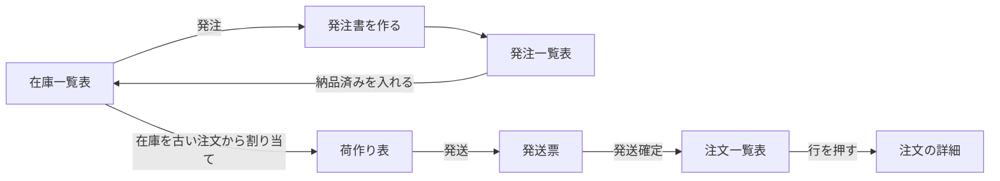
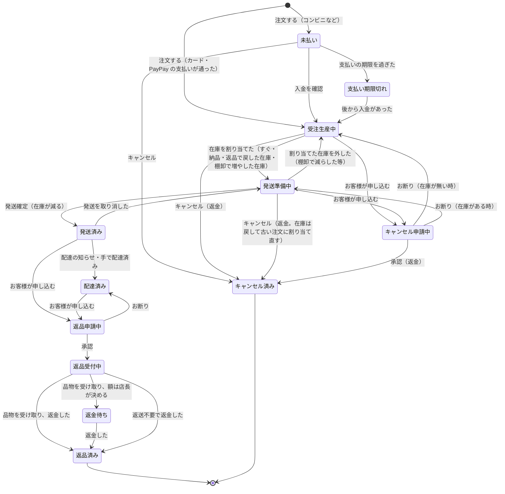

# グループ G の提案（注文・在庫・発注・荷作り）

> 状態: 提案（ユーザーと1件ずつ決める前の下書き。決まったら設計書にする）
> 元: ユーザーの要望（2026-10-23）、判断表の G-1〜G-4・J-01・J-09（[判断表](../../05_Quality/reviews/code/2026-10-22-decision-sheet.md)）、売上の方針（[売上の計上の方針](../../01_Planning/revenue-recognition-policy.md)）
> 関わる今の作り: グループ E-1（部分発送・仕上がり）、E-2（返金・キャンセル）、E-3（返品・交換）、E-4（運送会社・伝票番号・追跡）、E-5（注文の状況のページ）

---

## 概要

管理画面に4つの表と、注文の詳細の画面を作る。注文は品物ごとにステータスを持ち、支払い・在庫の割り当て・発送・配達・キャンセル・返品で移る。

| 表・画面 | 1行 | 主な操作 |
| --- | --- | --- |
| 注文一覧表 | 注文の品物1つ（同じ品物でもステータスが違う数は行を分ける） | 行を押すと注文の詳細。絞り込み・CSV |
| 注文の詳細 | 1つの注文 | 品物ごとのステータス、支払い・返金・発送・返品、いつ何をしてステータスが変わったかの履歴。返金・キャンセルなどの操作 |
| 在庫一覧表 | 商品×色×サイズ | 「発注」で発注書を作る |
| 発注一覧表 | 発注書の品物1つ | 届いた数（納品済み）を入れる |
| 荷作り表 | ステータスが「発送準備中」の品物1つ | 「発送」で発送票を作り、同じお客様の行をまとめて発送確定 |

---

## 1. 注文一覧表

### 1-1 列

ユーザーの指定の12列。共通の欄（注文ID・注文日・顧客名・メールアドレス）は全部の行で埋める。

| 列 | 中身 |
| --- | --- |
| 注文ID | 例 ORD-1A2B3C4D |
| 注文日 | 注文した日時 |
| 顧客名 | お届け先の名前 |
| メールアドレス | 注文のメールアドレス |
| 商品名・色・サイズ | 品物 |
| 数量 | この行の数 |
| 単価 | 1つの値段 |
| 合計金額 | 決めること（3章 Q1） |
| 返金額 | 決めること（3章 Q1） |
| ステータス | 2章 |

### 1-2 行の分け方

同じ品物を2つ買い、1つは在庫があって1つは無い時は、ステータスごとに2行にする。

| 注文ID | 商品名 | 色 | サイズ | 数量 | ステータス |
| --- | --- | --- | --- | --- | --- |
| ORD-1A2B3C4D | リネンシャツ | 白 | M | 1 | 発送準備中 |
| ORD-1A2B3C4D | リネンシャツ | 白 | M | 1 | 受注生産中 |

Shopify も、1つの注文の品物を発送の単位（Fulfillment order）に分けて扱う。

### 1-3 注文の詳細

行を押すと開く。今は注文一覧の上の小さな画面（履歴・発送・返金・キャンセル・返品）に分かれている中身を、1つの頁にまとめる（Shopify の注文の詳細の頁と同じ形）。

- 注文の情報、お客様とお届け先、支払いと返金
- 品物ごとのステータス
- 発送（発送票・運送会社・伝票番号・配送の状況）
- 返品・キャンセルの申し込み
- 履歴: いつ・誰が・何をして・どのステータスからどのステータスへ変わったか（今の履歴の画面の中身をそのまま使う）
- 操作: 返金・キャンセル・返品を作る・伝票番号の直しなど（今の小さな画面の操作をここへ移す）

---

## 2. ステータスと状態遷移

### 2-1 ステータスの一覧（品物ごと）

| ステータス | 意味 |
| --- | --- |
| 未払い | 注文は受けたが、まだ支払われていない（コンビニ払いなど） |
| 支払い期限切れ | 未払いのまま期限を過ぎた。在庫の割り当ては外す。後から入金があれば受注生産中へ |
| 受注生産中 | 支払い済みで、在庫がまだ割り当たっていない |
| 発送準備中 | 支払い済みで、在庫を割り当てた。荷作り表に出る |
| 発送済み | 発送確定した。在庫は減っている |
| 配達済み | 配達された（追跡の知らせか、お店が手で配達済みにした） |
| キャンセル申請中 | お客様がキャンセルを申し込み、お店の承認を待っている |
| キャンセル済み | 取り消した（返金した物を含む） |
| 返品申請中 | お客様が返品を申し込み、お店の承認を待っている |
| 返品受付中 | 承認して、品物が届くのを待っている |
| 返金待ち | 品物を受け取り、返金の額を決めるのを待っている（店長が額を決める時だけ。E-3） |
| 返品済み | 返品が終わった（返金した、または交換の品を用意した） |

表に出さない状態: 決済の画面を開いた途中（支払い手続き中）と、30分で失効した決済（放棄）。今と同じく一覧に出さない。

### 2-2 状態遷移図

- 交換は、返品済みになった品物とは別に、交換の品の新しい行を作る（在庫があれば発送準備中、無ければ受注生産中）。E-3 の交換と同じ。
- お店が作る返品（申し込みの無い返品）は、返品受付中から始まる。

### 2-3 今の作りとの関係

- DB の注文の状態（支払い済み・発送済み・取消など）は、決済と会計が使うので変えない。品物ごとのステータスは、支払い・在庫の割り当て・発送・配達・返品・キャンセルの記録から作って見せる（E-1 の進み具合と同じ作り方）。
- 今の「進み具合」（注文ごとの言葉）は、品物ごとのステータスに置き換える。J-09 の「進み具合と支払いの言葉の重なり」はこれで無くなる（支払いの状態は「未払い・支払い期限切れ」として品物のステータスに入り、注文の詳細に支払いの欄を置く）。
- お客様向けの言葉（アカウントの注文の画面・注文の状況のページ）は今のまま（受注生産中・発送準備中・配送中・配達済みなど）。管理画面の「発送済み」はお客様向けでは「配送中」。

---

## 3. 在庫一覧表と発注

### 3-1 列と数の決まり

| 列 | 決まり |
| --- | --- |
| 商品名・色・サイズ | 色×サイズの組み合わせ1つが1行 |
| 注文数 | まだ発送していない注文の数（受注生産中＋発送準備中） |
| 在庫 | 手元にある数（発送準備中に割り当てた分も含む）。発送確定で減る |
| 発注済み | 発注一覧表の「未納」の合計（届いていない数） |
| 発注必要数 | 注文数 − 在庫 − 発注済み（0より小さい時は0） |

例（リネンシャツ 白 M）:

| 注文数 | 在庫 | 発注済み | 発注必要数 | 読み方 |
| --- | --- | --- | --- | --- |
| 5 | 2 | 1 | 2 | 5着の注文のうち2着は手元の在庫で送れる。1着は届く予定。あと2着を発注する |

### 3-2 在庫の割り当て

- 在庫が増えた時（発注の納品・返品で在庫に戻した・棚卸で増やした）は、その色・サイズの「受注生産中」の品物に、古い注文から順に割り当てて「発送準備中」にする（G-3 の決めと同じ結果）。
- 支払いを受けた時に在庫があれば、すぐ割り当てる（今と同じ）。
- 割り当てた品物をキャンセルした時は、在庫を外して、次に古い注文に割り当て直す。

### 3-3 発注書の作り方（ユーザーの指定の流れ）

1. 在庫一覧表の「発注」を押す。
2. 商品名・色・サイズが横に並んだ一覧に、数量の入力欄が出る。何行でも入れられる。
3. 「発注書確認」で、入れた商品名・色・サイズ・数量の組み合わせを確かめる。
4. 「発注確定」で発注書ができる（発注書番号が付く）。

決めること: 発注書に発注先・納期・メモを持つか、入力欄の最初の値を「発注必要数」にするか（Q3）。

### 3-4 発注一覧表と納品

| 列 | 決まり |
| --- | --- |
| 発注書番号 | 例 PO-20261023-01 |
| 商品名・色・サイズ | 発注書の品物 |
| 発注数量 | 発注した数 |
| 納品済み | 検品して受け取った数（何回にも分けて足せる） |
| 未納 | 発注数量 − 納品済み（自動） |

納品済みを入れた時に、同時に次の4つが動く。

- 在庫一覧表の「在庫」が、その数だけ増える。
- 在庫一覧表の「発注済み」が、発注一覧表の「未納」と同じになる。
- 「発注必要数」を計算し直す。
- 3-2 の割り当てで、古い注文から「発送準備中」になる。

決めること: 検品で不良があって届かない数を、待ち続けるか打ち切れるか（Q4）。

---

## 4. 荷作り表と発送票

### 4-1 荷作り表

ステータスが「発送準備中」の行だけを出す。列は注文ID・注文日・顧客名・メールアドレス・商品名・色・サイズ・数量・単価。

### 4-2 発送票（名前の提案）

1つの荷物に入れる品物と送り先の記録を「発送票」と呼ぶ。理由:

- 運送会社の伝票（送り状）と取り違えない。伝票番号は発送票に書き込む。
- お客様に同梱する「納品書」とも別の物。
- 1つの発送票が1つの荷物（1つの伝票番号）。

### 4-3 発送の流れ

1. 荷作り表の「発送」を押すと、新しい発送票ができる。
2. 荷作り表から行を選んで発送票に足す。1つ目を選ぶと、2つ目からは同じお客様（4-4）の行だけが出る。1つの注文の一部の行だけを選んでもよい（部分発送）。
3. 「発送票確認」で、入れた行の一覧と送り先を確かめる。運送会社と伝票番号もここで入れる（後からでも入れられる。E-4）。
4. 「発送確定」で、入れた品物が「発送済み」になり、在庫が減る。

「発送確定」を押した時に起きること（これまでの決めとの整合）:

| 起きること | 元の決め |
| --- | --- |
| 発送票に入った注文ごとに発送の記録を作り、同じ運送会社・伝票番号を付ける | G-4（まとめて発送）、E-1（発送の記録） |
| 発送のメールを注文ごとに1通送る | G-4、E-1 |
| 追跡がオンなら、伝票番号を1回だけ 17TRACK に登録し、配送の状況を全部の注文に反映する | G-4、E-4（最初はオフ） |
| 帳簿の売上は、この発送の日に立つ | 売上の方針（出荷基準） |

発送票の後の操作（E-4 の決めをそのまま使う）:

- 伝票番号の直し: 発送票で直すと、入っている全部の注文に反映し、発送の更新のメールを注文ごとに送る。
- 手で配達済み: 発送票ごとに押すと、入っている品物が全部「配達済み」になる。
- 発送の取消: 発送票ごとに取り消すと、品物は「発送準備中」に戻り、在庫も戻る。

### 4-4 同じお客様の決め方

名前だけでは決めない（同姓同名、家族へのお届けがあるため）。1つの荷物にできるのは送り先が同じ時だけなので、次の両方が同じ行を「同じお客様」とする。

| 条件 | 中身 |
| --- | --- |
| お客様が同じ | 会員なら会員の番号（ID）が同じ。ゲストならメールアドレスが同じ。会員とゲストが混ざる時はメールアドレスで比べる |
| 送り先が同じ | お届け先の名前・郵便番号・住所・電話番号が全部同じ |

---

## 5. これまでの決めとの整合と変わる所

| これまでの決め | この提案で |
| --- | --- |
| E-1 の注文ごとの「進み具合」 | 品物ごとのステータスに置き換える |
| E-1 の受注生産の「仕上がり」を手で記録する | 在庫からの自動の割り当てに置き換える（決めること Q2） |
| E-1 の発送の画面（注文ごとに送る数を入れる） | 荷作り表と発送票に置き換える |
| E-1 の部分発送 | 発送票に一部の行だけ入れられるので、そのまま使える |
| E-4 の運送会社・伝票番号・追跡・直し・手で配達済み | 発送票の単位で扱う（4-3） |
| G-3 受け取りで古い注文から仕上がりにする | 納品で在庫に足し、古い注文から割り当てる（同じ結果） |
| G-4 まとめて発送 | 発送票がその形 |
| J-01 注文の CSV | 注文一覧表の列で書き出す |
| J-09 進み具合と支払いの言葉 | ステータスに一本化 |
| E-2 キャンセル・返金 | キャンセル済み。在庫は戻して割り当て直す |
| E-3 返品・交換 | 返品申請中・返品受付中・返金待ち・返品済み。交換の品は新しい行 |
| E-5 注文の状況のページ | お客様向けの言葉は今のまま |

---

## 6. 決めること

| # | 決めること |
| --- | --- |
| Q1 | 注文一覧表の「合計金額」「返金額」は、行（品物）ごとの額か、注文の額か |
| Q2 | 受注生産の「仕上がり」を手で記録する今の作りを、在庫からの自動の割り当てだけにするか（発注を通さずに作った時は、棚卸で在庫を増やせば割り当たる） |
| Q3 | 発注書に発注先・納期・メモを持つか。数量の入力欄の最初の値を空にするか、発注必要数にするか |
| Q4 | 検品で不良があり届かない数を、未納のまま待つか、「残りを打ち切る」でやめられるようにするか |
| Q5 | 発送票の名前は「発送票」でよいか |
| Q6 | 同じお客様の決め方（4-4）でよいか |
| Q7 | 発送確定の日（帳簿の売上の日）を、押した日にするか、実際に運送会社に渡した日を選べるようにするか |
| Q8 | 注文の詳細の画面に、今の小さな画面の操作（返金・キャンセル・返品・伝票番号の直し）を移すか |

---

## 7. 決まったこと

| # | 日付 | 決定 |
| --- | --- | --- |
| Q1 | 2026-10-23 | 注文一覧表の「合計金額」「返金額」は品物ごと（その行の品物の合計と、その品物の返金額。足し算すると合う） |
| Q2 | 2026-10-23 | 受注生産の「仕上がり」を手で記録する作りをやめ、在庫からの自動の割り当てだけにする。先に送りたい注文は注文の詳細の「割り当てを入れ替える」で直す。発注先から届いた品を検品し、発注書ごとに全部か一部の数を「受け取った数」として入れる画面（受け取りの画面）を作る。入れると発注一覧表の納品済み・未納が変わり、在庫一覧表の在庫・発注済みが変わり、自動で古い注文に割り当たる |
| Q3 | 2026-10-23 | 発注書は品物と数量のほかに「発注先」と「メモ」を持つ（納期は持たない）。発注書の数量の入力欄は空のまま始め、毎回入れる（同じ行の発注必要数を見ながら入れる） |
| Q4 | 2026-10-23 | 発注書に「数量確定」の段を入れる。発注確定の数は仮で、発注先の見積もり・請求書が来たら品物ごとに数を直して確定する（減らす・増やす）。在庫一覧表の「発注済み」は確定の後は確定した数で数える。「残りを打ち切る」（数と理由を記録）も用意する。数量確定の時に品物ごとの単価を記録でき、見積もり・請求書のファイル（PDF・画像）を発注書に添付して保存できる。添付は電子帳簿保存法の電子取引に合わせられる形にする（取引の日・金額・取引先を記録し、消せない。細部は G の設計で決める） |
| Q5 | 2026-10-23 | 1つの荷物の記録の名前は「発送票」。ボタンは「発送」「発送票確認」「発送確定」 |
| Q6 | 2026-10-23 | 同じお客様は、会員は会員番号、ゲストはメールアドレスが同じこと（メールや送り先は途中で変わりうるので、会員は番号だけで決める）。さらに送り先が同じ行だけを1枚の発送票にまとめられる（送り先が違えば別の発送票） |
| Q7 | 2026-10-23 | 「発送票確認」に出荷日の欄を置く。最初は今日、過去の日に直せる（今日より先は選べない）。直した人と時刻を残す。この日が帳簿の売上の日 |
| Q8 | 2026-10-23 | 返金・キャンセル・返品・割り当ての入れ替えなどの操作は注文の詳細の頁に移す（Shopify と同じ）。注文一覧表は見るためと詳細を開くため。発送は荷作り表から、発送票の直し（伝票番号・取消・手で配達済み）は発送票から。注文の詳細からその注文の発送票を開ける |
| J-09 | 2026-10-23 | 進み具合と支払いの言葉の重なりは、品物ごとのステータス（2章）に一本化して解く |
