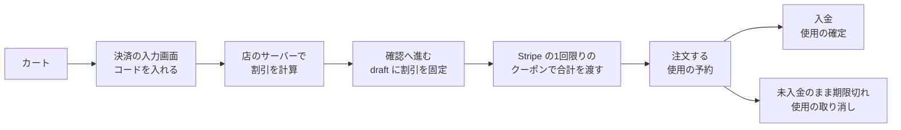
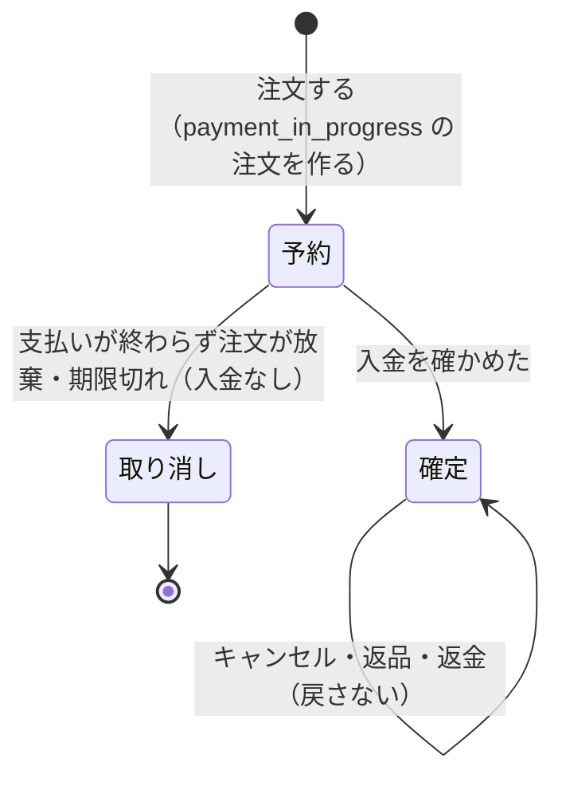

# グループ H 割引（プロモーションコード・自動割引）の設計

> 対象: Le Fil des Heures の通販（Next.js 16・Supabase Postgres 17・Stripe の Checkout Session〔ui_mode custom〕）
> 決めた人: オーナー（2026-10-28 の話し合い）。「私の判断」と書いた所は設計者の判断で、オーナーが読んで覆せる
> 下調べ: [今の作りの調べ](../../../.superpowers/sdd/2026-10-28-group-h-promotions/recon-report.md)（2026-10-28）、[Shopify の調べ](../../../.superpowers/sdd/2026-10-28-group-h-promotions/shopify-research.md)（2026-10-28）
> 関係: [作業と指摘の台帳](../../05_Quality/reviews/code/2026-09-25-working-diff-security-review.md)（H・W-03・R-12）、[判断の表](../../05_Quality/reviews/code/2026-10-22-decision-sheet.md)（H-1）、[G の設計](2026-10-23-group-g-design.md)

---

## 概要

常連のお客様や知人に、内輪の優待として割引を渡すための仕組みを作る。店の前に「セール」を出す物ではない。今の「Stripe に登録したコードを1つだけ付ける」作りをやめ、店のサーバーが割引を決めて行ごとに記録する作りに替える。形は Shopify の割引に合わせ、Shopify に無い物（リピート割引の「前に買った服」、割り当てた人だけのコード、前もって知らせるかの切り替え）は業界の定番の作り方で足す。

| 項目 | 決めたこと |
| --- | --- |
| 割引の種類 | 注文全体の％引き・円引き、商品の割引（対象外の服を選べる）、リピート割引（A 前に買った服／B 同じ注文の2着目から／両方で通算2着目から）、セット割引 |
| 効き方 | 割引ごとに「コード」か「自動」を選ぶ（Shopify と同じ） |
| 誰が使えるか | コードごとに「割り当てた会員だけ」か「コードを知っていれば誰でも」。最初は会員だけ、ログインしていない人へ広げるのは切り替え |
| 条件 | 最低の購入額か点数、全体の回数、1人1回、初回の注文だけ、期間 |
| 重ね方 | 割引ごとに「商品の割引と重ねる」「注文の割引と重ねる」を選ぶ。重ねられない時は一番お得な組み合わせを自動で選ぶ |
| 計算の順 | 商品の割引 → 注文の割引。送料の割引は作らない（送料は無料に固定） |
| 回数 | 回数の制限があるコードは、キャンセル・返品でも使った回数を戻さない。払った後で上限を超えていたと分かった注文は、割引を認めて要対応の欄に出す |
| 一部の返品 | 同じ行で1着ごとに割引が違う時は、安い方の着を戻したとみなして返金する |
| 見せ方 | 自動の割引は、最初はカートと決済の画面で初めて分かる。割引ごとに「前もって知らせる」に切り替えられる |
| 管理画面 | 割引の一覧と詳細。詳細に割り当ての表（10人に割り当てれば10行。コード・割り当てた人・状態・使った日・注文） |
| 決済とのつなぎ | 店のサーバーが割引の合計を決め、その決済だけに使える Stripe の1回限りのクーポンで Stripe に渡す（私の判断） |
| 記録 | 注文の行ごとに、どの割引でいくら引いたかと、1着ごとの支払額を残す。返金・返品・G-4 の金額の分割は、残した額を使う |

---

## 1. 目的と背景

### 1.1 何のための物か

オーナーが思い描く使い方（2026-10-28）は、「常連の方や知人に向けてプロモーションコードを渡して安く買ってもらう」こと。ブランドは「セールをしない」方針（[判断の表](../../05_Quality/reviews/code/2026-10-22-decision-sheet.md) 67行）なので、店の前に値下げを出すのではなく、知っている人への内輪の優待として使う。

- 常連さんには、同じ1つのコードを何人かに配る。
- 知人には、1人ずつ別々のコードを渡す。
- セット割引と自動のリピート割引は、コードが無くても効く物として作れる。ただし、最初はカートと決済の画面で初めて分かる形にして、店の前の「セール」に見えないようにする。

### 1.2 なぜ今か

開店前に作ると決めた（H-1、2026-10-22。台帳の 1章）。G（在庫・注文・発注の管理画面）は 2026-10-27 に本番へ当てた。会計（売上の計上）は H の割引の記録を使うので、H を先に作る（開店までの順番 2026-10-23）。

### 1.3 今の作りと、変える理由

今は Stripe の管理画面で作ったプロモーションコードを、決済の入力画面で1つ受け付け、Checkout Session の `discounts` に付けている（[調べ](../../../.superpowers/sdd/2026-10-28-group-h-promotions/recon-report.md) 1節）。注文には割引の合計（`orders.discount_amount`）しか残らず、行ごとの割引は読む時に金額の比で配っている（同 3節）。この作りでは次の物が作れない。

| 欲しい物 | 今の作りで作れない理由 |
| --- | --- |
| 1人1回・割り当てた人だけ・初回だけ | Stripe のプロモーションコードは、Customer を作らない今の決済では誰でも初回とみなし、1人あたりの回数も持たない（台帳 754行） |
| 特定の服だけの割引・リピート割引・セット割引 | 注文全体の額を金額の比で配るだけで、特定の服に効いた額を残せない |
| 割引の重ね方・一番お得な組み合わせ | コードは1つだけ。重ねる決まりが無い |
| 割り当ての表（誰がいつ使ったか） | 自前の使用の台帳が無い |

---

## 2. 目標・作らない物・失敗とみなす物

### 2.1 目標

- オーナーが管理画面だけで、割引を作る・止める・割り当てる・使われた状況を見ることができる。
- お客様は、決済の入力画面でコードを入れると、どの割引でいくら安くなったかが分かる。自動の割引は、条件に合えばコード無しで効く。
- 注文の行ごとに、どの割引でいくら引いたかが残り、返金・返品・G-4 の注文の画面・会計が同じ額を使う。

### 2.2 作らない物

| 作らない物 | 理由 |
| --- | --- |
| 送料の割引 | 送料は無料に固定（K-1） |
| 商品の頁の取り消し線の値段 | Shopify も標準では出さない（[Shopify の調べ](../../../.superpowers/sdd/2026-10-28-group-h-promotions/shopify-research.md) 11節）。前もって知らせる切り替えは、値段は変えず短い案内文を出すだけにする |
| 割引のレポート（割引別の売上の集計） | 開店前は割り当ての表と注文の画面で足りる。会計の段で考える |
| ギフトカード・ポイント | 頼まれていない |
| 1つの割引に複数の効果（10%引き＋何か） | Shopify も標準に無い（同 1節） |

### 2.3 失敗とみなす物（技術的に動いても困る物）

- 決済の合計が0円になる、または Stripe が受け付けない額（日本円で50円未満）になる。
- 画面の割引の額と、Stripe に請求した額と、注文に残った額が食い違う。
- 割り当てていない会員や、ログインしていない人が、会員だけのコードで安くなる。
- 1人1回のコードを、同時に2回押すなどして2回使える。
- 割り当てのコードを入れた他人に、誰に割り当てたかや、コードが存在することが分かる。
- 自動の割引が、商品の頁やバナーで「セール」のように目立つ（オーナーが前もって知らせる切り替えを入れた時だけ、短い案内を出す）。

---

## 3. 決めたこと（オーナーの決定、2026-10-28）

| 番号 | 決めたこと |
| --- | --- |
| D1 | 内輪の優待として使う。常連さんには同じコードを何人かに、知人には1人1つの別々のコードを渡す |
| D2 | 割引の形は4つ: 注文全体の％引き、注文全体の円引き、特定の商品以外に使える割引、同じ服の2着目以降の割引（リピート割引） |
| D3 | リピート割引は2つのスイッチ。A: 前に買った服を別の日にもう一度買う時。B: 1回の注文で同じ服を2着以上入れた時の2着目から。Aだけ・Bだけ・両方を選べる |
| D4 | 両方の時は、その人の通算で同じ服の2着目以降が全部安い（1回目に2着なら2着目、2回目に買った1着は通算3着目なので安い） |
| D5 | セット割引を作る。プロモーションコードを入れなくても、セットで買うと自動で安くなる |
| D6 | リピート割引の A の「前に買った人」は、会員としてログインして買った人だけ |
| D7 | どの割引も、コード無しで条件に合えば誰でも自動で安くなる設定を作れる（会員でも会員でなくても） |
| D8 | 自動の割引（セット・リピート）は、最初はカートと決済の画面で初めて分かる。前もって知らせることも割引ごとの設定で切り替えられる |
| D9 | 割引を重ねて使えるか、重ねて使えないかを割引ごとに選べる。Shopify を参考にする |
| D10 | ログインしていない人にコードを使わせるかどうかをコードごとに選べる。最初はログインした人だけ |
| D11 | 1つの割引に持たせる条件は「4.3 条件」の表のとおり（オーナーの確認「これで良い」） |
| D12 | 管理画面では、コード・使用済みかどうかの状態・誰に割り当てたかの一覧・使った日が分かる。同じコードを10人に割り当てたら10行の表 |
| D13 | 割り当ては、割り当てた会員だけが使える（B）。コードごとに「特定の人に割り当てる」か「コードを知っていれば使える」かを選べる |
| D14 | 回数の制限がある物は、キャンセルや返品になってもコードは戻らない |
| D15 | 同じ行の中で1着ごとに割引の額が違う時（例: 2着のうち2着目だけ安い）、返品・キャンセルで戻した着は「安い方（多く割り引いた方）の着」とみなして返金する（2026-10-29） |
| D16 | お金を受け取った後で回数の上限・1人1回を超えていたと分かった時（「注文する」を通らない入金、期限切れの後の遅れた入金）は、割引を認めて確定し、管理画面の要対応の欄に出して店長が知れるようにする（2026-10-29） |

---

## 4. 割引の中身

### 4.1 割引の種類

| 種類 | 中身 | 割引の分類（5章） | Shopify | 出典 |
| --- | --- | --- | --- | --- |
| 注文の％引き | 注文の商品の合計から何％ | 注文の割引 | Amount off order（割合） | [Discount types](https://help.shopify.com/en/manual/discounts/discount-types)、[Percentage and fixed amount](https://help.shopify.com/en/manual/discounts/discount-types/percentage-fixed-amount) |
| 注文の円引き | 注文の商品の合計から何円 | 注文の割引 | Amount off order（固定額） | 同上 |
| 商品の割引 | 対象の服に何％か、1着あたり何円。対象は「全部」か「選んだ服を外す」 | 商品の割引 | Amount off products。Shopify は対象を「選ぶ」形で、外す形は無い | 同上（[Shopify の調べ](../../../.superpowers/sdd/2026-10-28-group-h-promotions/shopify-research.md) 1節） |
| リピート割引 | 対象の服の「n 着目」から何％か1着あたり何円（7章） | 商品の割引 | B は Buy X Get Y に近い。A は標準に無く、Shopify は「その商品を買った顧客」のセグメントで作る | [Buy X Get Y](https://help.shopify.com/en/manual/discounts/discount-types/buy-x-get-y)、[Shopify segments](https://help.shopify.com/en/manual/customers/customer-segmentation/reference-guide/shopify-segments) |
| セット割引 | 決めた服の組がそろうと、1組あたり何％か何円（8章） | 商品の割引 | Shopify Bundles（専用のバンドル商品と価格）か Buy X Get Y | [Shopify Bundles](https://help.shopify.com/en/manual/products/bundles/shopify-bundles) |

- 「選んだ服を外す」形は、オーナーの言葉（「特定の商品以外に使用可能」）に合わせた。Shopify との違いとして残す。
- 商品の割引の対象の指定は服（商品）の単位で、色・サイズは区別しない（私の判断。オーナーの「同じアイテム」「色違いも同じ服」に合わせた）。
- 交換の品の行（返品の交換でお店が足した0円の行）には、どの割引も効かない（今の作りと同じ。FREQ-472）。

### 4.2 効き方: コードか自動か

| 項目 | 決めたこと | Shopify | 出典 |
| --- | --- | --- | --- |
| 選び方 | 割引ごとに「コード」か「自動」 | 同じ（4種類とも選べる） | [Automatic discounts](https://help.shopify.com/en/manual/discounts/discount-methods/automatic-discounts) |
| 自動の割引の数 | 同時に有効にできるのは25まで（私の判断） | 25 | 同上 |
| 1つの注文に入れられるコード | 5つまで（私の判断） | 商品・注文の割引のコードは5つ | [Combining discounts](https://help.shopify.com/en/manual/discounts/discount-combinations) |
| 1つの割引に付けるコード | 1つ（共有のコード）か、使い捨てのコードの束（4.5） | 1つの割引の下に複数のコードを持てる（API で1回250件） | [discountRedeemCodeBulkAdd](https://shopify.dev/docs/api/admin-graphql/latest/mutations/discountRedeemCodeBulkAdd) |

### 4.3 条件（D11 で確認済み）

| 条件 | 中身 | Shopify | 出典 |
| --- | --- | --- | --- |
| 値 | ％（1〜99。100％は作れない）か円（1円以上） | 同じ（100％も作れる） | [Percentage and fixed amount](https://help.shopify.com/en/manual/discounts/discount-types/percentage-fixed-amount) |
| 対象 | 全部／選んだ服を外す。リピート・セットは服を選ぶ | 対象を選ぶ形 | 同上 |
| 最低条件 | 無し／何円以上／何点以上。数えるのは対象の服だけ、商品の割引を引いた後の額（注文の割引の判定） | 同じ（商品の割引の後の額で判定） | 同上 |
| 使える人 | 6.1 の表。初回の注文だけ、は 6.3 | 全員・特定の顧客・セグメント。初回だけの専用設定は無い | [Discounts FAQ](https://help.shopify.com/en/manual/discounts/discounts-faq) |
| 回数 | 全体で何回まで／1人1回まで | 同じ | [Usage limits](https://help.shopify.com/en/manual/discounts/discount-codes/usage-limits) |
| 期間 | 始まりと終わりの日時（日本時間）。終わりは空でもよい | 同じ（店の時間帯） | [Buy X Get Y](https://help.shopify.com/en/manual/discounts/discount-types/buy-x-get-y) |
| 重ねる | 商品の割引と／注文の割引と（5章） | 同じ（送料のクラスもある） | [Combining discounts](https://help.shopify.com/en/manual/discounts/discount-combinations) |
| 前もって知らせる | 自動の割引だけ。最初は知らせない（9.2） | 無し（オーナーの要望） | — |
| 使い捨てのコードをまとめて作る | 4.5 | 同じ | 上の API |

- 0円になる設定は作らせない。100％は選べない。円引きの割引には「何円以上」の最低条件を必ず付け、その額は割引の額より大きくなければ保存できない（台帳 754行の決定を引き継ぐ）。それでも重なって安くなりすぎる時は、5.4 の下限で止める。

### 4.4 コードを使える人（D10・D13）

| 選び方 | 使える人 | 「ログインしていない人も使える」 | 管理画面の割り当ての表 |
| --- | --- | --- | --- |
| 割り当てた人だけ | 割り当てた会員だけ。ほかの人が入れると「このコードは使えません」 | 選べない（割り当ては会員なので、会員だけ） | 割り当てた人ごとに1行。最初は「未使用」 |
| コードを知っていれば誰でも | コードを入れた人 | 選べる。最初は「使えない」（会員だけ） | 使った人が出るたびに1行ずつ増える |

- 割り当ての相手は会員の一覧から選ぶ（メールか名前で探す）。
- 割り当ては後から足せる。使用済みの行は外せない。未使用の行は外せる（私の推測。D13 の話し合いの playback で示し、異論が無かった）。
- 割り当てていない会員がコードを入れた時、コードが無い時、期間外の時は、どれも同じ文「このコードは使えません」を出す。コードが存在するかどうかや、誰に割り当てたかが分からないようにする（私の判断。期限切れ・回数の上限は今は別の文を出しているが、割り当てのコードでは区別しない。誰でも使えるコードでは今の文を残す）。
- 自動の割引にはこの選び方は無い。リピート割引の A だけは、条件が「ログインした会員の前の注文」なので会員にしか効かない（D6）。

### 4.5 使い捨てのコードの束（知人向け）

| 項目 | 決めたこと | Shopify |
| --- | --- | --- |
| 作り方 | 1つの割引に、割り当てた人の数だけ使い捨てのコードを作る。1人に1つ、1回使ったら終わり | 1つの割引の下にコードの束（API で1回250件） |
| 1回に作る数 | 100まで（私の判断） | 250（API） |
| 形 | 先頭の文字（管理者が決める。例 FRIEND）＋ハイフン＋4〜8文字の英数字。読み違えやすい 0・O・1・I・L は使わない（私の判断） | 公式の説明は見つからない（[Shopify の調べ](../../../.superpowers/sdd/2026-10-28-group-h-promotions/shopify-research.md) 8節） |
| 割り当て | 作る時に会員を選ぶと、1人に1つずつ結び付く。結び付けたコードは「割り当てた人だけ」 | — |

- 先頭の文字だけのコード（FRIEND）は、それ自体は使えない（Shopify で報告のある落とし穴を避ける。同 8節）。

### 4.6 コードの文字

- 英数字とハイフンの1〜64文字。大文字・小文字を区別しない（保存は大文字）。今の入力の形（`promotion-code.service.ts`）をそのまま使う。
- 割引の名前（管理画面とお客様に見せる名前）は、コードとは別に持つ。お客様には「割引名」を見せ、コードは入れた人にだけ見せる（9章）。

---

## 5. 重ね方と計算

### 5.1 割引の分類

| 分類 | 入る割引 | 効く所 |
| --- | --- | --- |
| 商品の割引 | 商品の割引・リピート割引・セット割引 | 対象の行（1着ずつ） |
| 注文の割引 | 注文の％引き・円引き | 商品の割引を引いた後の、対象の服の合計 |

Shopify の3分類（商品・注文・送料）から送料を除いた形（[Combining discounts](https://help.shopify.com/en/manual/discounts/discount-combinations)）。

### 5.2 重ねる決まり（D9）

- 割引ごとに「商品の割引と重ねる」「注文の割引と重ねる」の2つのチェックを持つ。最初はどちらも外す（重ねない。Shopify も「割引は自動では重ならない」）。
- 2つの割引が重なるのは、両方が相手の分類に「重ねる」を付けている時だけ。
- 同じ1着に効く商品の割引は1つだけ。2つ当てはまる時は、その1着で額の大きい方（Shopify も上位の契約以外は同じ行に2つ重ねない）。
- セット割引は1着ずつの割引として扱う。ほかの商品の割引に取られた1着は、セットの組を作る数に入れない（Shopify の Buy X Get Y で「ほかの割引で値引き済みの品は買う数に数えない」のと同じ。[Shopify の調べ](../../../.superpowers/sdd/2026-10-28-group-h-promotions/shopify-research.md) 7節）。そのため組がくずれればセット割引は外れる。どの着をどの割引に取らせるかは、5.3 の「一番お得」で全体の割引が最大になる割り振りを選ぶ（私の判断 C17）。
- 注文の割引どうしが重なる時は、どれも「商品の割引を引いた後の合計」を元に計算して足す（Shopify の例: 100ドルに10％と20％で70ドル引き。[Shopify の調べ](../../../.superpowers/sdd/2026-10-28-group-h-promotions/shopify-research.md) 7節）。円引きと％引きが重なる時も同じ元で計算する（私の判断。順で額が変わらないようにする）。
- 計算の順: 商品の割引 → 注文の割引。

### 5.3 一番お得な組み合わせの選び方

- その注文で当てはまる割引（入れたコードと、条件に合う自動の割引）から、重ねる決まりに合う組み合わせを全部考え、割引の合計が一番大きい組み合わせを選ぶ（Shopify:「そのカートで最もお得な割引が常に適用される」）。
- 合計が同じ時は、使うコードが少ない方、次に割引の数が少ない方を選ぶ（私の判断。コードの回数を無駄に使わない）。
- 入れたコードが選ばれなかった時は、入力欄の下に「このコードは今の割引と一緒には使えません。よりお得な割引を適用しています。」と出す。そのコードは使った回数に数えない（Shopify の文「Discount couldn't be used with your existing discounts」に合わせた私の文）。
- 数え上げは、コード5つと自動25までなので、重ねる決まりで枝を切れば十分に速い（実装の工夫は作り手に任せる）。

### 5.4 下限（0円と Stripe の最低額）

- 割引を引いた後の合計は、日本円で50円以上（Stripe の日本円の最低の請求額。私の判断。作り手が Stripe の文書で確かめる）。
- 組み合わせの合計がこれを下回る時は、最後に足す注文の割引の額を削って、合計を50円にする。注文の割引が無い時は、商品の割引の額を削る（削る順は作り手に任せる）。0円の注文は今と同じく作らない（FREQ-389）。

### 5.5 円の端数と行への配り方

- 金額はすべて整数の円。
- ％の商品の割引は、1着ずつ `floor(単価 × ％ / 100)`。1着あたりの円引きは、単価を超えない。
- 注文の割引は、対象の行の「商品の割引を引いた後の額」の比で行へ配る。端数は今の `private.order_line_discounts` と同じ累積の丸め（`(2×D×S+T)/(2×T)`。[調べ](../../../.superpowers/sdd/2026-10-28-group-h-promotions/recon-report.md) 3.1）で配り、行の合計が割引の額と必ず一致する。
- セット割引の1組の額は、組の服へ単価の比で配る（Shopify Bundles と同じ。[Shopify Bundles](https://help.shopify.com/en/manual/products/bundles/shopify-bundles)）。
- 配った結果を、注文の行ごと・割引ごとに残す（12章）。あわせて、行の1着ごとの支払額（その行の数量ぶんの額の並び）も残す。同じ行でも1着ごとに額が違うことがある（リピート割引の B・セット割引）ため、返品・キャンセルで「安い方の着」を決める元にする（D15）。

---

## 6. 使える人と回数

### 6.1 誰を「1人」とみなすか

| お客様 | 1人の数え方 | Shopify |
| --- | --- | --- |
| ログインした会員 | 会員の ID | メールか電話番号で数える（アカウント単位ではない）。[Usage limits](https://help.shopify.com/en/manual/discounts/discount-codes/usage-limits) |
| ログインしていない人（コードで許した時だけ） | 注文の時のメールアドレス（前後の空白を除き小文字にそろえた物）。私の判断 | 同上 |

- 会員が同じメールでゲストとして買った注文が、あとで会員に結び付いた（`link_guest_orders`）時は、その会員の使用として数える（私の判断）。

### 6.2 使った回数の数え方（D14）

- 「注文する」で注文を作る時に、同じ取引の中で使用を「予約」する。全体の回数と1人1回は、予約と確定の数で判定する。同時に2回押しても、2回目は断る（DB の鍵と一意の制約で守る）。
- 入金を確かめた時に「確定」にする。
- 入金が無いまま注文が放棄・期限切れになった時（コンビニ払いの期限切れなど）は「取り消し」にして、回数を戻す。お客様はお金を払っていないので、使ったことにしない（私の判断。D14 は払った後のキャンセル・返品の話）。
- 払った後のキャンセル・返品・返金では戻さない（D14。Shopify も戻さないのが通説〔公式の記述は無い〕。[Shopify の調べ](../../../.superpowers/sdd/2026-10-28-group-h-promotions/shopify-research.md) 5節）。
- 割り当てのコードの表の「状態」は、予約・確定で「使用済み」、取り消しで「未使用」に戻る。
- 予約が無いまま入金が来た時（「注文する」を通らない入金で、Webhook の予備の処理が注文を作る時）や、取り消した後に遅れて入金が来た時は、上限・1人1回を超えていても割引を認めて「確定」にする。超えた時は、管理画面の要対応の欄（G-4 の `/admin/orders#attention`）に「割引の上限を超えた注文」として出す（D16）。注文は止めず、発送も止めない。

### 6.3 初回の注文だけ

- 会員: その会員に、入金済み以降の注文（放棄・入金前の取消を除く）が1件も無い時だけ。
- ログインしていない人: そのメールの注文が1件も無い時だけ（会員の注文も含めて探す）。
- Shopify には専用の設定が無く、セグメント（`number_of_orders = 0` など）で作る（[Shopify segments](https://help.shopify.com/en/manual/customers/customer-segmentation/reference-guide/shopify-segments)）。こちらは注文の記録を直接見る。

---

## 7. リピート割引

### 7.1 数え方（D3・D4・D6）

「同じ服」は商品（`item_id`）が同じこと。色・サイズは問わない。数えるのは通常の行だけで、交換の品の行は数えない。

| スイッチ | 今回の注文で安くなる着 | 前の注文の数え方 |
| --- | --- | --- |
| A だけ | 前の注文でその服を1着以上買っていれば、今回のその服の全部 | ログインした会員の前の注文だけ（D6） |
| B だけ | 今回の注文のその服の2着目から | 数えない |
| 両方 | その人の通算で2着目以降（前の注文の着数＋今回の何着目） | ログインした会員の前の注文。ログインしていない人は B だけになる |

- 例（両方）: 1回目の注文で2着 → 2着目が安い。2回目の注文で1着（通算3着目）→ 安い（D4）。
- 「何着目から」は、オーナーの話では2着目。設定で n 着目からを選べるようにはしない（私の判断。頼まれていない）。
- 前の注文で「買った」と数えるのは、入金済み以降の注文の着数から、返金が成功した着数（キャンセル・返品）を引いた物（私の判断。話し合いの playback で「返品・キャンセルで戻した分は数えない」と示した）。入金前の注文（`payment_in_progress`・放棄・入金待ち）は数えない。
- 1つの注文の中で、同じ服の何着目が安くなるかは、その服の行を値段の安い順に並べた時の後ろの着から（Buy X Get Y で「安い方が値引きされる」のと同じ。[Buy X Get Y](https://help.shopify.com/en/manual/discounts/discount-types/buy-x-get-y)。私の判断で、同じ服は色・サイズで値段が変わらない今の商品では差が出ない）。

### 7.2 Shopify との比べ

| 項目 | Shopify | この店 |
| --- | --- | --- |
| 同じ注文の2着目から | Buy X Get Y（買う1・もらう1、同じ商品を両方に入れる） | B のスイッチ |
| 前に買った服 | 標準に無い。セグメント `products_purchased` で「その商品を買った顧客」を作る | A のスイッチ。注文の記録を直接見る |
| 通算の2着目以降 | 標準に無い | 両方のスイッチ |

---

## 8. セット割引（D5）

| 項目 | 決めたこと |
| --- | --- |
| 組 | 2〜10種類の服を選ぶ。各1着（私の判断。オーナーの例「ジャケットとパンツ」） |
| 組の数 | 注文の中で組がいくつそろうか。各服の着数の一番少ない数（例: ジャケット2・パンツ1 なら1組） |
| 値 | 1組あたり何％（組の服の単価の合計に対して）か何円 |
| 配り方 | 1組の割引を、組の服へ単価の比で配る（5.5） |
| 効き方 | 自動を基本にし、コードでも作れる（D7） |

- Shopify Bundles は専用の「バンドル商品」と価格を作る形（[Shopify Bundles](https://help.shopify.com/en/manual/products/bundles/shopify-bundles)）。この店は商品を増やさず、割引として作る（今の商品の頁・在庫の割当を変えないため。私の判断）。
- 組の服は色・サイズを問わない。

---

## 9. お客様の見え方

### 9.1 決済の入力画面・最終確認・メール・注文の画面

| 場所 | 出す物 |
| --- | --- |
| カート | 自動の割引が当てはまれば「割引（割引名） −¥」の行と、割引後の合計。前もって知らせない割引でもカートでは出す（D8「カートと決済の画面で初めて分かる」） |
| 決済の入力画面 | コードの入力欄（今の「プロモーションコード」の欄）。入れたコードの一覧と「削除」。割引ごとの行（割引名・コード・額）。5.3 の文 |
| 最終確認 | 割引ごとの行と合計（コードは変えられない。今と同じ） |
| 注文の確認メール | 割引ごとの行（割引名と額）。0円の割引の行は出さない（FREQ-396 を広げる） |
| 会員の注文の画面・注文状況の頁 | 「割引」の行を、割引ごとの内訳にする（今の「クーポン値引き」1行の言い方を「割引」にそろえる。私の判断） |
| 管理の注文の詳細（G-4） | 「割引」の内訳（割引名・コード・額）と、行ごとの割引 |

- 今の文（「このコードは使えません」「このコードは有効期限が切れています」「このコードは利用回数の上限に達しています」「このコードは ¥… 以上のご注文で使えます」）は、誰でも使えるコードでは残す。割り当てのコードと会員だけのコードでは、条件に合わない時はどれも「このコードは使えません」（4.4）。ログインしていない人が会員だけのコードを入れた時は「このコードはログインしてお使いください。」と出し、ログインへの道を示す（私の判断）。

### 9.2 前もって知らせる（D8）

- 自動の割引ごとの切り替え。最初は「知らせない」。
- 知らせる時は、対象の服の商品の頁に短い案内文を1行出す（例「2着目から15%引き（カートで適用）」「このパンツとセットで3,000円引き」）。値段そのものや取り消し線は変えない（Shopify も標準では出さない。[Discounts FAQ](https://help.shopify.com/en/manual/discounts/discounts-faq)）。案内文は割引の設定で管理者が書く（私の判断）。
- 会員だけに効く割引（A を含む物）は、ログインしていない人には案内を出さない。

---

## 10. 管理画面

### 10.1 タブと権限

| 項目 | 決めたこと |
| --- | --- |
| タブ | 「DISCOUNT」を CONTACT の後に足す（波4 で CONTACT が PACKING の後に入った） |
| 権限 | `admin.discounts.read`（一覧・詳細・割り当ての表を見る）と `admin.discounts.manage`（作る・変える・止める・割り当てる）を G-0 の目録に足す。店長は両方。サポーターは最初は無し（G-2 の在庫・発注と同じ。私の判断）。店長が権限の画面で付け外しできる |
| 監査 | 作る・変える・止める・割り当てる・コードを作るを監査に残す。コードの文字そのものと会員のメールは監査に入れない（ID と件数だけ） |

### 10.2 割引の一覧

- 列: 割引名・種類・効き方（コード／自動）・状態（予定／有効／期限切れ／止めた）・期間・使った回数（確定＋予約）／上限。
- 絞り込み: 状態・種類・効き方。名前とコードで探す。

### 10.3 割引の詳細

- 上に設定の要約と「止める」「再開する」「複製」。
- 割り当ての表（D12）: 列は コード・割り当てた人・状態（未使用／使用済み）・使った日・注文（注文の詳細へのリンク）。
  - 「割り当てた人だけ」のコードは、割り当てた人ごとに1行。10人なら10行（使い捨ての束も1人1行）。
  - 「誰でも」のコードは、使った人ごとに1行（ログインしていない人はメールの一部を伏せて出す。私の判断）。
  - 予約の間（入金待ち）は「使用済み（入金待ち）」と出す（私の判断）。
- 「割り当てを足す」（会員を選ぶ。使い捨ての束では、選んだ人数だけコードを作る）と、未使用の行の「外す」。

### 10.4 作る・変える

- 4.3 の条件の欄を、種類に合わせて出し分ける（例: リピート割引では A・B のスイッチと対象の服、セット割引では組の服）。
- 使われた後も変えられるのは、名前・期間・回数の上限・止める／再開・割り当ての追加・前もって知らせる・案内文（私の判断）。値・対象・種類・重ね方・使える人の選び方は、使われた後は変えられない（変えたい時は複製して新しく作る）。注文に残った額は変わらない。
- Shopify も止める・再開する・名前を変えても使った回数は消えない（[Managing discount codes](https://help.shopify.com/en/manual/discounts/managing-discount-codes)）。

---

## 11. 決済とのつなぎ

### 11.1 Stripe へ渡す形（私の判断）

- 店のサーバーが割引を計算し、その注文の割引の合計を、その Checkout Session だけで使える Stripe のクーポン（`amount_off` に合計の円、`duration: once`、`max_redemptions: 1`、メタデータに draft の ID）にして、Session の `discounts` に付ける。
- こうすると、今の受付の照合（`draft.total_amount + draft.discount_amount = Stripe.amount_total + Stripe.amount_discount`）と、完了・Webhook の読み取り（Session の値引の額）をそのまま使える（[調べ](../../../.superpowers/sdd/2026-10-28-group-h-promotions/recon-report.md) 2節）。
- 行ごとの値段を下げて渡す形は採らない（1着ずつの端数で行を分ける必要があり、今の明細の照合を崩すため）。
- Stripe のプロモーションコード（Stripe の管理画面で作るコード）は使わなくなる。決済の入力欄で受け付けるのは店のコードだけ。

### 11.2 流れ

| 段 | すること |
| --- | --- |
| コードを入れる | 店のサーバーがカートと買い手（会員か、ゲストのメール）で割引を計算し、見込みを返す。回数は使わない（今と同じ） |
| 確認へ進む | もう一度計算し、選ばれた割引の組み合わせと行ごとの額を draft に固定する。合計を Stripe のクーポンにして Session を作る |
| 注文する | 受付の DB の関数が、draft の割引を注文の行ごとの記録に写し、同じ取引で使用を予約する（6.2）。この時、注文の記録で決まる条件（初回の注文だけ、リピート割引の A と通算の着数）も、会員ごと（ゲストは正規化したメールごと）の DB の鍵の下で確かめ直す（私の判断 C18。2つのタブで同時に進めても、初回だけの割引が2回効かないようにする）。予約できない・条件に合わなくなった（回数の上限・1人1回・期間の終わり・割引が止められた・初回でなくなった・前に買った着数が変わった）時は注文を作らず、決済の入力画面へ戻して理由を出す |
| 入金 | 照合で入金を確かめた時に、予約を確定にする |
| 未入金の期限切れ・放棄 | 予約を取り消す |

- 確認へ進んだ後に割引が止められた・期間が終わった時は、「注文する」で断り、入力画面からやり直してもらう（私の判断。今の価格の変更 `price_changed` と同じ扱い）。
- ログインしていない人のメールは、配送先を入れた後に分かる。メールに結び付く条件（1人1回・初回だけ）の割引は、メールを入れるまで「見込み」として出す（私の判断）。

---

## 12. データ

| 表（案） | 中身 |
| --- | --- |
| `discounts` | 割引名・種類・効き方・値（％か円）・対象の決め方・最低条件・使える人の選び方・ログインしていない人を許すか・初回だけ・全体の上限・1人1回・期間・重ねる2つ・前もって知らせる・案内文・リピートの A／B・状態・作った人と日時 |
| `discount_items` | 対象の服（外す服・リピートの対象・セットの組の服） |
| `discount_codes` | コード（大文字）・割引・使い捨てかどうか・割り当てた会員（使い捨てと割り当ての時）・作った日時。コードは全体で一意 |
| `discount_assignments` | 「割り当てた人だけ」の共有コードの、割り当てた会員（1人1行） |
| `discount_redemptions` | 使用の記録: 割引・コード・注文・会員か正規化したメール・状態（予約／確定／取り消し）・日時。1人1回と全体の回数は、ここを数える。一意の制約で二重の予約を防ぐ |
| `order_line_discount_allocations` | 注文の行ごと・割引ごとの額（12章の要） |
| `order_line_unit_amounts`（案） | 注文の行の1着ごとの支払額（数量ぶん）。返品・キャンセルで安い方から戻すために使う（D15） |
| `checkout_drafts` に足す欄 | 選ばれた割引の組み合わせと行ごとの額（確認へ進んだ時に固定） |

- `private.order_line_discounts(order_id)` は、`order_line_discount_allocations` がある注文ではその合計を返し、無い注文（H より前の注文）では今の配り方のまま（私の判断）。返金・返品・G-4 の金額の分割は、この関数を通すので変えずに済む。
- RLS・権限は G と同じ形（表は直接触らせず、private の本体と public の入口、service_role だけ）。

---

## 13. 返金・返品・会計

- H の割引が付いた注文では、返金・返品・発送前のキャンセルで戻す着は、その行の「1着ごとの支払額」の安い方から順に取る（D15）。例: 20,000円のジャケット2着で2着目だけ3,000円引き（支払い37,000円）の1着を返品したら、17,000円を返す。残った1着は20,000円で買った扱い。
  - そのため、H の割引が付いた注文では `refund-allocation.ts` の「行の割引を数量で均等に割る」計算を使わず、1着ごとの支払額の並びから戻す額を決める。H より前の注文（1着ごとの記録が無い注文）は今の計算のまま（私の判断）。
  - 返金の記録（`order_refund_lines.amount`）には今と同じく実際に返した額を残す。G-4 の注文の画面の金額の分割（状態ごとの額）は、H の注文では1着ごとの支払額を元にし、返金・返品で戻った着には安い方の着を当てる（細かい当て方は作り手に任せるが、行ごとの合計は行の支払額と必ず一致させる）。
  - Shopify は割引を明細へ比例配分して返金する（[Shopify の調べ](../../../.superpowers/sdd/2026-10-28-group-h-promotions/shopify-research.md) 12節）。「安い方から返す」はオーナーの決定で、Shopify と違う。
- セット割引の組の片方だけを返品した時も、その服の着の支払額で返す（組がくずれても、残った服の割引を取り直さない。私の判断）。
- リピート割引で安く買った服を返品しても、ほかの服の割引は取り直さない（私の判断）。
- 返品の後で、そのお客様のリピート割引の「前に買った着数」は、返金が成功した着の分だけ減る（7.1）。
- 会計（次の段）は、注文の行ごとの割引の記録を使える。H では会計の仕訳は変えない。

---

## 14. 守り

| 守り | 中身 |
| --- | --- |
| 金額 | 割引は店のサーバーで計算し、画面の額を信じない。draft・Stripe・注文の額の照合を残す |
| 回数 | 予約は注文を作る取引の中で、割引ごとの DB の鍵と一意の制約で数える |
| コードの総当たり | コードの確かめの窓口は今の回数の制限（IP 10回/10秒・60回/600秒、セッション10回/60秒）を使う。会員だけのコードは会員ごとにも数える（私の判断） |
| 存在を隠す | 割り当てのコード・会員だけのコードでは、条件に合わない理由を区別しない（4.4） |
| 管理の窓口 | G と同じ: 認可（`admin.discounts.*`）→ CSRF → 回数の制限 → 入力の検証 → DB の関数 → 監査。IP は `getClientIp` だけで読む（波4） |
| 画面の fetch | `/api/auth/*` と回数の制限の応答は no-store なので、画面の処理は本文を必ず読み切る（波3・波4 の注意） |

---

## 15. 他の作業との関係

- 別のセッション（開店前のセキュリティの穴の直し）が `src/app/api/checkout/create-session` の画像の URL を触る予定がある。H が `src/app/api/checkout/**`・`src/lib/checkout/**`・`src/features/checkout/**` を触る前に知らせる約束がある（2026-10-28）。
- 管理画面のタブは CONTACT の後に足す。`AuthzSuccess` に `permissions` が入った（波4）。
- E2E は手元の Supabase で、回数の制限の袋は `x-real-ip` で分ける（波4）。
- 既存の E2E `FR-CHECKOUT-039`・`042`・`031`・`032` は、Stripe のプロモーションコードを前提にしている所を新しい窓口に合わせて直す（題と画面の文の契約は残す）。

---

## 16. 私の判断の一覧（オーナーが覆せる）

| 番号 | 判断 | 節 |
| --- | --- | --- |
| C1 | Stripe へは、その決済だけの1回限りのクーポンで合計を渡す。Stripe の管理画面のコードは使わなくなる | 11.1 |
| C2 | 割引を引いた後の合計の下限は50円（Stripe の日本円の最低額） | 5.4 |
| C3 | 入金が無いまま放棄・期限切れの注文では、使った回数を戻す | 6.2 |
| C4 | ログインしていない人の1人は、正規化したメールで数える | 6.1 |
| C5 | リピート割引の「買った」は、入金済み以降の着数から返金が成功した着数を引く | 7.1 |
| C6 | 同時に有効な自動の割引は25、1注文のコードは5つまで | 4.2 |
| C7 | 使い捨てのコードは1回に100まで、形は「先頭の文字-4〜8文字」 | 4.5 |
| C8 | 合計が同じ組み合わせは、コードの少ない方 | 5.3 |
| C9 | 注文の割引が重なる時は、どれも商品の割引の後の合計を元に計算する | 5.2 |
| C10 | セット割引は各服1着の組、1組あたり％か円、割引として作る（専用の商品は作らない） | 8 |
| C11 | 権限は `admin.discounts.read`・`manage`。サポーターは最初は無し | 10.1 |
| C12 | 使われた後に変えられるのは名前・期間・上限・止める・割り当ての追加・知らせる・案内文だけ | 10.4 |
| C13 | 割り当て・会員だけのコードでは、使えない理由を区別しない | 4.4・9.1 |
| C14 | 前もって知らせる時は、値段を変えず商品の頁に案内文を1行 | 9.2 |
| C15 | お客様の画面の「クーポン値引き」を「割引」にそろえ、割引ごとの内訳を出す | 9.1 |
| C16 | 確認へ進んだ後に割引が使えなくなったら、「注文する」で断ってやり直してもらう | 11.2 |
| C17 | セット割引は1着ずつの割引として扱い、ほかの割引に取られた着は組の数に入れない。全体で一番お得な割り振りを選ぶ | 5.2 |
| C18 | 「注文する」で、初回だけ・リピート割引の着数も会員（ゲストはメール）ごとの鍵の下で確かめ直す | 11.2 |
| C19 | H より前の注文の返金・返品は今の均等の計算のまま | 13 |

---

## 17. 作り手に任せること

- 組み合わせの数え上げの実装の工夫（5.3）。
- 50円の下限を割るときに削る順（5.4。注文の割引から削ることだけ決めた）。
- 表と関数の細かい名前・列・索引、private と public の分け方（G の作り方に合わせる）。
- 管理画面の部品の並び（G-4 の一覧と詳細に合わせる）。
- 会員を探す欄の作り（今の利用者の画面の検索を使えるか）。

---

## 18. 未確認事項

| 事項 | 確かめ方 |
| --- | --- |
| Stripe の日本円の最低の請求額が50円であること | Stripe の文書（Minimum and maximum charge amounts） |
| Stripe で、Checkout Session ごとに1回限りのクーポンを作って付けることに、件数などの制限が無いか | Stripe の文書とテストモード |
| Shopify の 25・5 などの数字 | [Shopify の調べ](../../../.superpowers/sdd/2026-10-28-group-h-promotions/shopify-research.md) の注意どおり、原典の頁で最終確認 |
| 本番の Stripe に有効なプロモーションコードが残っていないか | 開店前に Stripe の管理画面で確かめる（あれば使えなくなることをオーナーに知らせる） |
