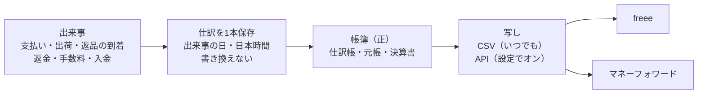
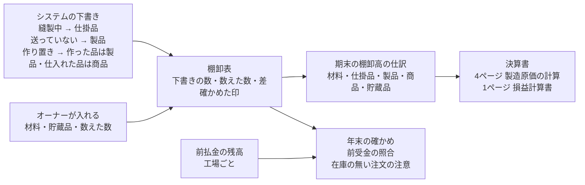
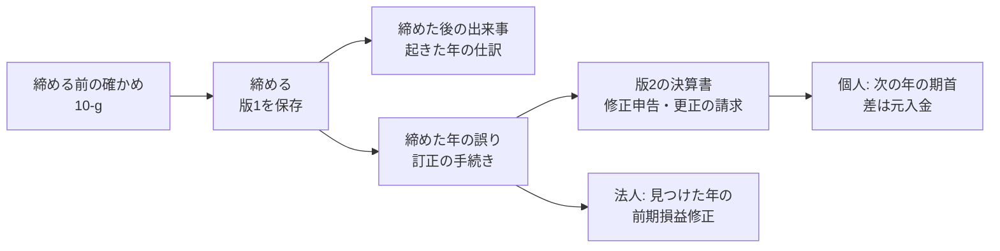
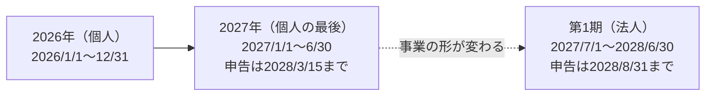
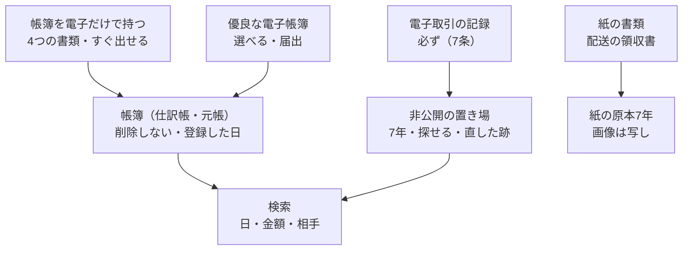
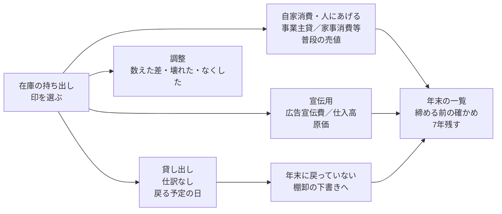
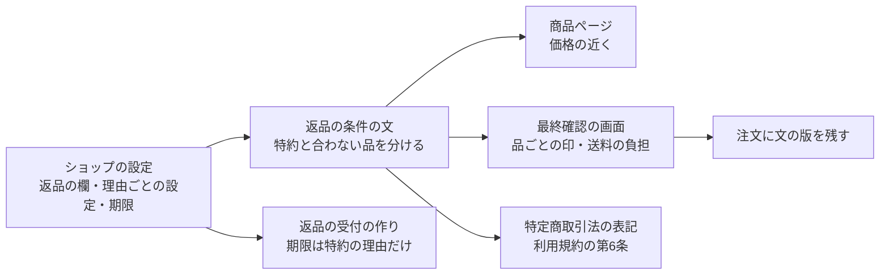
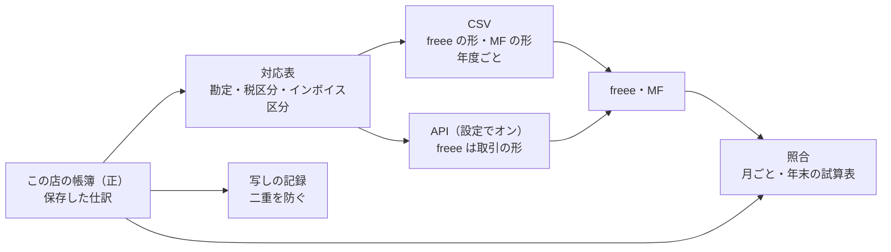

# 会計の作り直しの設計（売上の計上の方針 10章）

> 対象: Le Fil des Heures の通販の管理画面の会計（ACCOUNTING）・KPI と、freee・マネーフォワードへの写し
> 状態: 2026-11-04 オーナー承認。次は作る手順の計画
> 決めた人: オーナー（2026-11-02〜03 の話し合い）。「私の判断」と書いた所は設計者の判断で、オーナーが読んで覆せる
> 元の方針: [売上の計上の方針](../../01_Planning/revenue-recognition-policy.md)（2026-10-23 承認）の10章「システムに入れる直し」
> 関係: [作業と指摘の台帳](../../05_Quality/reviews/code/2026-09-25-working-diff-security-review.md)（S-2）、[G の設計](2026-10-23-group-g-design.md)（発送票・出荷日）、[H の設計](2026-10-28-group-h-promotions-design.md)（1着ごとの支払額）
> 注意: 法令の確かめは AI によるもので、税理士の確認の代わりにならない。方針の9章の一覧を開店前に税理士へ持っていき、答えで変わった所だけ直す
> 2026-11-04 に標準・公式の文書との見比べ（自己レビュー56件）とオーナー決定 A10〜A13 を入れた。保留の点は16章に残した（標準との見比べ。2026-11-04 AI の判断）
> 2026-11-04 に書き入れ後のレビュー13件を直した。法人の期首、品ごとの返品の印、返金の取り消し、根拠と前の説明をそろえた（標準との見比べ。2026-11-04 AI の判断）
> 2026-11-10 に、交換の印の設計（同日オーナー承認）とオーナー決定（売上値引・返品は実際に返す額だけ、店がやめた発送前の取り消しは品を送れるように戻す）に合わせて 2-c・5-b・5-h を直した（会計の計画3の直し pass A）

---

## 概要

帳簿の売上を「出荷した日」に立て、先に受け取った代金を「前受金」で持つ形に、会計の仕組みを作り直す。仕訳は注文の状態から毎回作り直すのをやめ、お金と品物が動く出来事が起きた時に1本ずつ保存し、後から書き換えない。この店の帳簿を正（元の記録）にして、freee・マネーフォワードには写しを送る。

### 全体の決定（オーナー）

| # | 決めたこと |
| --- | --- |
| A1 | この店の帳簿を正とする。freee・マネーフォワードには写しを送る |
| A2 | 写しは CSV と API の両方で出せるようにする。API の連携は設定でオンにするオプション |
| A3 | freee とマネーフォワードの両方に対応する（オーナーは今「MF確定申告」を使っている） |
| A4 | 帳簿と決算書を、そのまま申告に使えるようにすることも視野に入れる |
| A5 | 10章の項目は、できるだけ全部対応する。1つずつ現状と変更方針を話して決める |
| A6 | 設計の全部を開店前に作る。法人だけの決まり（10-e・10-c2・11-f・12-e2・13-g）、API の写し（15-g）、設定のオプション（5-a2・6-d2）、返品の条件の表示（14章）も含む。作る順は計画で決める（2026-11-04、作る人の確かめの後） |
| A7 | 1着の原価は、季節ごと・品ごとに材料の額と加工代を分けて持つ（9-b。2026-11-04） |
| A8 | 今の本番の DB に手で入れた経費・領収書は本物の開店前の経費なので、新しい形に移す（2-j。2026-11-04） |
| A9 | 返品の「その他」は、特約とは別の相談の窓口として受付で選べるようにし、理由を必ず書いてもらう（14-g。A13 に合わせた）（A13。2026-11-04 オーナー決定） |
| A10 | 紙で受け取る書類は、配送の領収書だけ。ほかの取引は紙が無く、PDF だけ（電子取引）（A10。2026-11-04 オーナー決定） |
| A11 | 開業日は2025年（開業の届けに書いた日）。開業日は事業を実際に始めた日という事実で1つに決まり、選び直せない。2025年分の開店前の経費は2025年分として申告済みで、2026年の経費は2026年分のふつうの経費にし、開業費は使わない。EC サイトの公開（2027年予定）は同じ事業の売り場が増えるだけで、新しい開業ではない。管理画面の設定の名前は「開業日」にする。個人の棚卸資産の評価の方法の届け出の期限（2025年分の確定申告の期限 2026-03-16）は過ぎたので、2025年・2026年分は最終仕入原価法（所得税法施行令102条1項）のまま進める。変えるかどうかは 2027-03-15 の前に税理士と決める（A11。2026-11-04 オーナー決定） |
| A12 | 受注高の数え方は業界の定番に合わせる（8章の 8-a・8-g）（A12。2026-11-04 オーナー決定） |
| A13 | 返品の「その他」の文は、特約を言い切り、特約とは別に相談の窓口を書く形にする。受付で「その他」を選べて理由を必ず書く所は A9 のまま（14-g）（A13。2026-11-04 オーナー決定） |

### 項目と決まり具合

| # | 項目 | 今の状態 | 決まり具合 |
| --- | --- | --- | --- |
| 1 | 仕訳の作り方（出来事ごと・保存して書き換えない） | 注文の日に売上を立て、画面を開くたびに作り直す | 決定（[1章](#1-仕訳の作り方項目1)） |
| 2 | 前受金と出荷の日の売上（一部の出荷は送った分だけ） | 前受金を使っていない | 決定（[2章](#2-前受金と出荷の日の売上項目2)） |
| 3 | 集計の仕方と期首の残高（仕訳が属する期間で数える） | 注文を作った年で絞っている | 決定（[3章](#3-集計の仕方と期首の残高項目3)）（標準との見比べ。2026-11-04 AI の判断） |
| 4 | Stripe の仕訳（二重・抜けを防ぐ、日本時間、手数料の消費税の区分、カード会社からの支払いの取り消し） | 日付が世界標準時、支払いの取り消しの記録が無い | 決定（[4章](#4-stripe-の仕訳項目4)） |
| 5 | 返品・返金の2段（届いた日・返金した日、検品の差、返金の失敗） | 返金が成功した日の1段だけ | 決定（[5章](#5-返品返金の2段項目5)） |
| 6 | 発送の日（実際の出荷日・直した跡） | G-3 でほぼ済み | 決定（[6章](#6-発送の日項目6)） |
| 7 | 勘定の名前（クレジット売掛金・Stripe 未収金・未払金） | 古い名前のまま | 決定（[7章](#7-勘定の名前項目7)） |
| 8 | 受注高（管理画面の数字の名前と数え方） | 名前と数え方が違う | 決定（[8章](#8-受注高項目8)） |
| 9 | 在庫と原価（年末の棚卸・前受金の照合） | 製品・仕掛品を数える所が無い | 決定（[9章](#9-在庫と原価項目9)） |
| 10 | 締め（締めた年の固定・誤りの直しの記録） | 帳簿と決算書を毎回作り直している | 決定（[10章](#10-締め項目10)） |
| 11 | 会計の期間（1月始まりでない年度） | 1月〜12月で固定 | 決定（[11章](#11-会計の期間項目11)） |
| 12 | 帳簿の保存（電子帳簿保存法） | 一部だけ | 決定（[12章](#12-帳簿の保存項目12)） |
| 13 | 自家消費・宣伝用の印と年末の一覧 | 無い | 決定（[13章](#13-自家消費宣伝用の印項目13)） |
| 14 | 返品の条件の表示 | 4か所の文と受付の作りがズレている | 決定（[14章](#14-返品の条件の表示項目14)） |
| 15 | freee・マネーフォワードへの写し（CSV・API） | 無い | 決定（[15章](#15-freeeマネーフォワードへの写し項目15)） |

---

## 0. 目的・目標・制約

### 0-1 目的

- 税法の売上の日（引渡しの日。この店は出荷した日）と帳簿を合わせる。今は注文の日に売上を立て、発送すると注文が売上から消える（台帳の S-2）。
- 帳簿と決算書を、申告に使える信頼できる記録にする。締めた年が後から動かず、直した跡が残る。
- オーナーが使う会計ソフト（今は MF確定申告）へ、同じ仕訳を写せるようにする。

### 0-2 目標にしないこと

- 会計ソフトそのものを作り直すこと。仕訳帳・元帳・決算書・青色申告の書類など、今の会計の画面の作りは使い続ける。
- 申告書の提出（e-Tax への送信）。
- 税理士の確認の代わり。

### 0-3 失敗とみなすこと

- 同じ出来事の売上が二重に入る、または抜ける。
- 締めた年の数字が、後の操作で黙って変わる。
- freee・マネーフォワードに送った写しと、この店の帳簿が食い違う。

### 0-4 前提と制約

- 個人事業（青色申告）で始め、後で法人にする。受注生産が中心で、代金は注文の時に全額受け取る。送料は価格に含み、無料に固定（K-1）。
- 開店前で、本番の注文は試しだけ（G-1 で片付け、2026-11-01 の H の本番適用の記録で 0件）。切り替えた日から新しい形で始める。
- 発送票・実際の出荷日（G-3）と、1着ごとの支払額・割引の割り振り（H）はできている。

---

## 1. 仕訳の作り方（項目1）

決めた日: 2026-11-03（オーナー）

### 1-1 今の作り

- 会計の窓口（`src/app/api/admin/kpi/cost-profit/route.ts`）が、その年に作られた注文を取り、状態が「支払い済み」の注文だけを、注文の日の売上にする（`src/lib/sales/order-sales.ts`）。発送して状態が「発送済み」に変わると、その注文は売上から消える（台帳の S-2）。
- Stripe の記録がある注文は、別の作り方で支払いの時に「クレジット売掛金／売上高」を立てる（`src/lib/finance/stripe-journal.ts`）。日付は日時の先頭10文字（世界標準時の日付）。
- 仕訳は保存せず、画面（`src/components/CostProfitSection.tsx`）を開くたびに全部作り直す。

### 1-2 決めたこと

| # | 決めたこと |
| --- | --- |
| 1-a | 仕訳は注文の状態から作らず、出来事ごとに作る。全部の出来事・きっかけ・仕訳の日・重ならない印は、この下の一覧を正とする（標準との見比べ。2026-11-04 AI の判断） |
| 1-b | 仕訳は、出来事が起きた時に保存する。保存した仕訳は後から書き換えず、消さない。仕訳の見出しと行は、DB の1つの関数だけで、1つのトランザクションの中で入れる。終わりに確かめる制約（遅らせて確かめるトリガー）で、仕訳1本ごとに「借方の合計＝貸方の合計」「額は正の整数」「1行は借方か貸方の片方だけ」を守り、合わなければ入れない（標準との見比べ。2026-11-04 AI の判断） |
| 1-c | 誤りは、「取り消しの仕訳」と「正しい仕訳」を足して直す。直した理由を残す |
| 1-d | 出来事ごとに、他と重ならない印（何の出来事の、どの記録か）を付ける。同じ出来事の仕訳は1本しか作らない。印は出来事の種類と下の一覧の番号の組にし、DB の一意の制約にする。もうあれば何もしない。画面の確かめだけにしない。元の仕訳の番号を持つ取り消しは、元1本につき1回だけ（一意の制約）。直しのたびに新しい履歴の行を作り、2回目の直しは直前の正しい仕訳を取り消す。検品の差・返金の失敗もそれぞれの履歴で分ける。支払いの仕訳が無い注文の出荷の仕訳は、支払いが入るまで待っている一覧に止める。知らせの届く順番に頼らない。届いた日の直しも1-a22の新しい履歴で分け、検品の差や入れ直しを元の受け取りの番号だけで二重と見なさない（標準との見比べ。2026-11-04 AI の判断） |
| 1-e | 仕訳の日は、出来事の日（日本時間） |

出来事の一覧。日はすべて日本時間。1つの出来事で借方・貸方の行が増えても、仕訳の見出しは1本にする（標準との見比べ。2026-11-04 AI の判断）

| # | 出来事・きっかけ | 仕訳の日 | 重ならない印に使う番号 | 決める章 |
| --- | --- | --- | --- | --- |
| 1-a01 | 支払いの確定 | 支払いの残高の取引の日（日本時間） | payment_intent の番号 | 2-a・4-a（標準との見比べ。2026-11-04 AI の判断） |
| 1-a02 | 出荷の確定 | order_fulfillments.shipment_date | 発送票の番号＋出荷 | 2-b・6-a（標準との見比べ。2026-11-04 AI の判断） |
| 1-a03 | 発送の取り消し・出荷日の直し | 取り消す日は元の日、入れ直す日は正しい日（締めた年は10章） | shipment_date_history など直しの履歴の行の番号＋入れ直し。取り消しは元の仕訳の番号 | 2-f・6-b（標準との見比べ。2026-11-04 AI の判断） |
| 1-a04 | 出荷前の返金 | 返金の残高の取引の日 | 返金の残高の取引の番号 | 2-d・5-f（標準との見比べ。2026-11-04 AI の判断） |
| 1-a05 | 返品の品の到着 | 店に届いた日 | 返品の受け取りの行の番号 | 5-a・5-b（標準との見比べ。2026-11-04 AI の判断） |
| 1-a06 | 相談で返金の額が決まった・検品で額が変わった | 決まった日・検品を終えた日 | 相談・検品の直しの履歴の行の番号 | 5-b2・5-c（標準との見比べ。2026-11-04 AI の判断） |
| 1-a07 | 返品の返金・返送不要の値引き | 返金の残高の取引の日（振込なら振込の日） | 残高の取引の番号、振込なら銀行の取引の番号 | 5-d・5-e（標準との見比べ。2026-11-04 AI の判断） |
| 1-a08 | 返金の失敗・店は返すつもりのまま返せなかった取り消し | 戻りの残高の取引の日。引かれる前なら失敗・取り消しが決まった日 | 返金の番号＋失敗または返すつもりの取り消しの種類＋状態の履歴の行の番号。残高が戻った時は failure_balance_transaction など戻りの取引の番号も結び付ける | 5-h（標準との見比べ。2026-11-04 AI の判断） |
| 1-a08b | 店が返金そのものをやめた取り消し（返す借りが無い） | 引かれる前は仕訳なし。引かれた後は戻りの取引の日に元の返金を取り消すだけ。届いた日の未払金は消さず、返さないと決めたら 5-i で消す。受注高は取り消しの日に足し戻す（8-d） | 返金の番号＋店が返金をやめた取り消し＋状態の履歴の行の番号。仕訳を取り消す印は元の返金の仕訳の番号（1回だけ） | 5-h（標準との見比べ。2026-11-04 AI の判断） |
| 1-a09 | 返品を断って送り返す決定 | 決めた日 | 元の仕訳の番号（取り消しは1回） | 5-i（標準との見比べ。2026-11-04 AI の判断） |
| 1-a10 | Stripe の手数料 | 残高の取引の日 | 残高の取引の番号＋手数料（stripe:fee:<記録の番号>） | 4-c（標準との見比べ。2026-11-04 AI の判断） |
| 1-a11 | JCT tax adjustment | 調整の残高の取引の日 | 調整の残高の取引の番号＋税額調整 | 4-c4（標準との見比べ。2026-11-04 AI の判断） |
| 1-a12 | Stripe からの入金・銀行への着金 | それぞれの残高の取引の日・銀行の着金の日 | 入金の番号＋入金開始、銀行の取引の番号＋着金 | 4-b・7-i（標準との見比べ。2026-11-04 AI の判断） |
| 1-a13 | 入金の失敗・取り消し | 戻りの残高の取引の日 | payout_failure・payout_cancel の残高の取引の番号 | 4-g（標準との見比べ。2026-11-04 AI の判断） |
| 1-a14 | 残高のマイナスを銀行から引き落とされた | 銀行から引かれた日 | 銀行の取引の番号＋残高の補充 | 4-h（標準との見比べ。2026-11-04 AI の判断） |
| 1-a15 | カード会社からの支払いの取り消し・判断の確定・取り下げ | 残高から引かれた日・判断の確定日・戻った日 | dispute の番号＋出来事の種類＋状態の履歴の行または残高の取引の番号。戻り（取り下げ）は 1-a16 と同じ1つの印 | 4-d・4-e・4-e2（標準との見比べ。2026-11-04 AI の判断） |
| 1-a16 | 確定した後に遅れて取り下げられた | 残高に戻った日 | dispute の番号＋reversal＋戻りの残高の取引の番号（確定の前の取り下げと同じ1つの印）。どちらの扱いにするかは、dispute が決着した後に、戻りの残高の取引の時刻と負けた時刻（Stripe 側の時刻）の前後で決める。同じ戻りの取引に仕訳を2本入れないため | 4-e2（標準との見比べ。2026-11-04 AI の判断。2026-11-04 計画2の確かめで直した） |
| 1-a17 | 交換の出荷・戻り | 売上の仕訳は作らない。原価・在庫は9章 | 交換の出荷・受け取りの行の番号＋原価の動き（作る時） | 2-i・9-g（標準との見比べ。2026-11-04 AI の判断） |
| 1-a18 | 自家消費・贈与・宣伝用・約束付きの投稿・個人的な値引き・弁償金 | 持ち出した日・値引きの差を決めた日・弁償金を受け取った日 | 持ち出しの記録の番号。値引きは注文番号＋差の確定の履歴、弁償金は入金の記録の番号 | 13-b〜13-i（標準との見比べ。2026-11-04 AI の判断） |
| 1-a19 | 手で入れる取引・切り替え前の取引の移しかえ | 元の取引の日 | 手入力の行の番号。移しかえは元の取引の番号＋移しかえ | 2-j・12-c（標準との見比べ。2026-11-04 AI の判断） |
| 1-a20 | 決算の仕訳（棚卸・評価損・減価償却・家事の分の按分など） | 期間の末日 | 期間の番号＋仕訳の種類＋確定した記録の番号。直しは元の仕訳の番号で取り消し、新しい確定の記録で入れる | 9章・11-f・15-a（標準との見比べ。2026-11-04 AI の判断） |
| 1-a21 | 締めた年の訂正・後の年の期首の訂正 | 個人は対象の年の日付、法人は見つけた年（10章の例外を含む） | 訂正の記録の番号＋対象の期間＋直しの種類。取り消しは元の仕訳の番号 | 10-c〜10-e（標準との見比べ。2026-11-04 AI の判断） |
| 1-a22 | 返品の届いた日の直し | 取り消しは古い日、正しい仕訳は直した日（締めた年は10章） | 届いた日の直しの履歴の行の番号＋入れ直し。取り消しは元の仕訳の番号 | 5-a・12-c（標準との見比べ。2026-11-04 AI の判断） |

### 1-3 理由

- 税法の売上の日に合わせるため（方針1章）。注文の状態は1つしか持てず、一部の出荷・出荷前の返金・返品の到着・返金を表せない。
- 締めた年の帳簿を動かさないため（方針7-2。誤りは国税通則法19条の修正申告・23条の更正の請求で直す）。作り直す形では、注文の状態が後から変わるだけで申告した年の仕訳が変わる。
- 電子帳簿保存法の「優良な電子帳簿」は、訂正・削除の履歴が残るシステムか、訂正・削除ができないシステムであることを求める（国税庁の要件のチェック表、税研・東京税理士会の解説）。2026年分は65万円の青色申告特別控除の道の1つ。2027年分からは、e-Tax の申告に加えて優良な電子帳簿にすると75万円（12-g）（標準との見比べ。2026-11-04 AI の判断）
- freee・マネーフォワードへ送った写しと食い違わないため（A1）。
- 日を勝手に動かさない。3つの税の通達は、選んだ日を「継続して」使うことを求める（6-4）。最高裁平成5年11月25日判決は、収益を「収入すべき権利が確定したとき」の年に計上するとし、為替取組日基準を「収益計上時期を人為的に操作する余地を生じさせる点において」認めなかった（判決の全文で確かめた）。

### 1-4 Shopify・定番との比較

| | 今 | 決めた形 | Shopify | 会計につなぐ定番の道具（A2X） |
| --- | --- | --- | --- | --- |
| 売上の日 | 注文の日 | 出荷した日 | 注文の日（売上のレポート） | 取引が起きた期間 |
| 何から作るか | 注文の状態 | 出来事 | 注文と、返品などの調整を別々に | 入金ごとに、売上・返金・割引・手数料を分けた仕訳 |
| 返品・返金の日 | 返金した日 | 届いた日と返金した日の2段（5番で詳しく決める） | 処理した日（売上のレポート。16章） | 返金の出来事の日（標準との見比べ。2026-11-04 AI の判断） |

Shopify は会計ソフトではなく、売上を注文の日で数える。帳簿の仕訳は、会計につなぐ道具が出来事から作るのが定番。出荷した日を売上にするのは、日本の税法に合わせたこの店の決まり（方針1章）。

---

## 2. 前受金と出荷の日の売上（項目2）

決めた日: 2026-11-03（オーナー）

### 2-1 今の作り

- 「前受金」の勘定（2150）は勘定の一覧（`src/lib/finance/accounts.ts`）にあるが、ネットの注文には使っていない。手で入れる仕訳にだけ出てくる。
- ネットの注文は、支払いの日に売上を全部立てている。

### 2-2 決めたこと

| # | 決めたこと |
| --- | --- |
| 2-a | 支払いを受けた日: 借方「Stripe 残高」（勘定は 1160「Stripe 未収金」。7章）、貸方「前受金」（注文の支払額）。前受金の行には注文番号を必ず持たせる。出荷・返金のたびに、注文ごとの前受金がマイナスでなく、全部の品を送るか返金したら0になることを確かめる。合わなければ処理を止め、理由を一覧に出す（標準との見比べ。2026-11-04 AI の判断） |
| 2-b | 出荷した日: 借方「前受金」、貸方「売上高」。額は、その発送で送った品の額だけ |
| 2-c | 出荷の時の売上の額 ＝ 送った品1着ごとの支払額（割引を引いた後）－ その品に当てた出荷前の返金。注文の支払額＝1着ごとの支払額の合計を DB でも確かめる。送料・税の欄が0でない注文や、合計が合わない注文は、支払いの仕訳を作らず一覧に止める。送料を取る時は、送料の売上を立てる日（最後の発送の日など）を先に決めてから、この制限を外す。品を決めない出荷前の返金は、その時にまだ送っていない品へ支払額の比で割り振り、端数は2-hの番号の若い順にする。5-g で出荷済みの分と分けた後の未出荷の額にも同じ決まりを使う。割り振りは返金の時に保存し、後から変えない（標準との見比べ。2026-11-04 AI の判断）。発送前の取り消しで手元に残る品の値段が変わった時（交換の印の設計5章の直し）は、まだ送っていない品は送った時の今の値段（直しを含む）から当てた返金を引いた額で売上を立てる（2026-11-10 オーナー決定）。もう送った品の直しは、取り消しの返金の仕訳で前受金から売上へ寄せる。どちらも、直しのうち前受金から出た分だけを扱う（出荷済みの品へ返した分は売上値引・返品で合う）（2026-11-10 私の判断。同日オーナー承認。会計の計画3の未確認事項 #19） |
| 2-d | 出荷前の返金は、売上を通さず「前受金／Stripe 残高」（返金した日）。返金した日は5-dの残高の取引の日を使い、保留の間は前受金を減らさない（標準との見比べ。2026-11-04 AI の判断） |
| 2-e | 年末に出荷していない分は、前受金のまま翌年へ繰り越す。課税事業者になる年の初めに、前の年から繰り越した前受金の一覧（注文・額・出荷の見込み）を出す。免税の間に受け取った分も、課税事業者になってから出荷した時は課税売上になる。課税か免税かの判定に使う売上は帳簿の売上高で、受注高を使わない（標準との見比べ。2026-11-04 AI の判断） |
| 2-f | 発送の取り消し・出荷日の訂正は、前の売上の仕訳をそのまま残し、「取り消しの仕訳」と「正しい日の仕訳」を足す。締めた年をまたぐ時の扱いは10番で決める |
| 2-g | 仕訳の単位は、発送票1枚に仕訳1本。中の行は品ごとに分ける |
| 2-h | 同じ品を2着以上買って、1着ごとの支払額に端数の差がある時は、番号（`unit_index`）の若い順に送ったことにする。この決め方は変えず、システムの概要の書類（12番）に書く |
| 2-i | 交換で送る品は、売上を変えない（方針3-3）。送る品と戻る品の原価の差は9番で決める。交換で戻る品の原価の扱いは、9-g と一緒に税理士に確かめる。それまでは送る品を普段の出荷と同じ原価で払い出す（作る人の確かめで AI が決めた。オーナーが読んで確かめる） |
| 2-j | 切り替える前の注文は無い。切り替えた日から新しい形で始める。切り替える前に手で入れた取引（2026-11-04 の本番: 経費18件・領収書8件・直しの履歴25件。固定資産と締めの記録は0件）は本物なので、新しい形の仕訳に移す（A8）。移した仕訳の日は元の取引の日。登録した日は、元の登録の日時が残っていればそれにし、移した印と移した日を足す（無ければ移した日）。通し番号は移す時に取引の日の順で振る。元の直しの履歴は、移した仕訳から見られるよう残す（作る人の確かめで AI が決めた。オーナーが読んで確かめる）。仕訳帳の画面と出力は、通し番号順でなく仕訳の日（取引の発生順）で並べる。開業は2025年。経費18件は、元の取引の日の年分のまま移す（2025年の日付は申告済みの2025年分、2026年の日付は2026年分のふつうの経費）。開業費（1810）は使わない（A11。2026-11-04 オーナー決定）。棚卸資産・固定資産へ分ける物があるかは16-sr1 で税理士に確かめ、分ける物は移した後に 1-c の取り消しと正しい仕訳で直す。移す前に税理士の確認を待たない（2026-11-04 AI の判断。A11 の決定に合わせた）。2025年の日付の取引があれば2025年の期間と期首の残高も作る（標準との見比べ。2026-11-04 AI の判断）。領収書8件は種類を確かめ、配送の領収書なら紙の原本を残し、PDF なら電子取引として電子のまま残す（12-i）（A10。2026-11-04 オーナー決定） |

### 2-3 使う記録

| 決めること | 使う記録 | できた時 |
| --- | --- | --- |
| 出荷した日 | 発送ごとの実際の出荷日（`order_fulfillments.shipment_date`）。発送票の日と食い違えば止める（6-a） | G-3（標準との見比べ。2026-11-04 AI の判断） |
| 記録した日時（入力の遅れが分かるように） | 発送票を確定した日時（`shipment_slips.confirmed_at`） | G-3 |
| 送った品と数 | 発送票の明細（`shipment_slip_lines`） | G-3 |
| 1着ごとの支払額 | `order_line_unit_amounts.paid_amount` | H |
| 出荷前の返金 | 返金の明細の印（`order_refund_lines.before_shipment`）と額 | 前から |

### 2-4 例

シャツ 20,000円・パンツ 12,000円の注文に 2,000円のクーポンを使い、金額の比でシャツに 1,250円、パンツに 750円を割り振った。支払いは 30,000円。

| 日 | 出来事 | 仕訳 | 前受金の残り | 売上の累計 |
| --- | --- | --- | --- | --- |
| 1/5 | 支払い | Stripe 残高／前受金 30,000 | 30,000 | 0 |
| 1/20 | シャツを出荷 | 前受金／売上高 18,750 | 11,250 | 18,750 |
| 2/1 | パンツにお詫びの返金（出荷前） | 前受金／Stripe 残高 1,000 | 10,250 | 18,750 |
| 2/10 | パンツを出荷 | 前受金／売上高 10,250 | 0 | 29,000 |

### 2-5 根拠

| 決めたこと | 根拠 |
| --- | --- |
| 支払いの時は前受金 | 消費税法基本通達9-1-27・タックスアンサー No.6165（前受けしても売上は引き渡した時）。所得税基本通達36-8（売上は引渡しの日）。所得税法施行規則57条1項（資産・負債の一切の取引を記録する） |
| 出荷するたびに送った分だけ売上 | 所得税基本通達36-8(1)・36-8の2・法人税基本通達2-1-2・消費税法基本通達9-1-2（引渡しの日の例に「出荷した日」）。最高裁平成5年11月25日判決（合理的な基準を選んで続けていれば正しい）。法人は法人税法22条の2第1項・第2項と法人税基本通達2-1-2で日を決め、第4項で通常得られる対価の額とし、第5項で返品の見込みを先に引かない（標準との見比べ。2026-11-04 AI の判断） |
| 取り消しの仕訳と正しい仕訳を足す | 電子帳簿保存法の「優良な電子帳簿」の訂正・削除の要件（1-3）。通常の入力の期間は最長2か月で、それを過ぎた入力は事実が分かることが要る（国税庁の要件のチェック表） |
| 発送票1枚に1本・行は品ごと | 仕訳帳は取引の発生順に年月日・内容・勘定科目・金額を書く（個人は所得税法施行規則59条1項、総勘定元帳は2項。法人は法人税法施行規則55条）。課税事業者になったら相手・年月日・内容・税率ごとの額も書く（消費税法58条、No.6625）（標準との見比べ。2026-11-04 AI の判断） |
| 端数は若い番号から | 法令に決まりは無い。合理的な方法を選んで続けることが条件（最高裁平成5年11月25日判決、所得税基本通達36-8 の「継続して」） |
| 交換は売上を変えない | 代金が動かないので、売上も消費税の対価の返還等（消費税法38条）も起きない（方針3-3） |

### 2-6 Shopify・定番との比較

| | 今 | 決めた形 | Shopify | 会計の定番（収益認識の基準） |
| --- | --- | --- | --- | --- |
| 支払いの時 | 売上 | 前受金 | 売上（注文の日で数える） | 契約負債（前受金） |
| 一部だけ送った時 | 区別しない | 送った品の分だけ売上 | 発送しても売上は変わらない | 渡した分だけ売上。国内の販売で出荷から支配が移るまでが通常の数日なら、出荷した時に売上を立てられる（企業会計基準適用指針第30号98項）（標準との見比べ。2026-11-04 AI の判断） |
| 年末の未出荷分 | 売上に入っている | 前受金で翌年へ | 売上に入っている | 負債で翌年へ |

出荷した日の売上は日本の税法に合わせる。管理画面では支払いの日の受注高と受注残を別に出し、出荷後の返品は受注高から引かない（8章）（A12。2026-11-04 オーナー決定）

---

## 3. 集計の仕方と期首の残高（項目3）

決めた日: 2026-11-03（オーナー）

### 3-1 今の作り

- 会計の窓口（`src/app/api/admin/kpi/cost-profit/route.ts`）は、注文をその年に作られたもの（`orders.created_at`）で絞る。年末に支払い、年明けに出荷した注文は、出荷した年の帳簿に出てこない。
- Stripe の記録（入出金・返金・入金）は、Stripe で記録された日時（`stripe_created_at`）でその年に絞る。
- 期間は「年」（1月1日〜12月31日）で固定。
- 年越しの処理（`src/lib/finance/year-end.ts` の157行目あたり）は、翌年の元入金 ＝ 当年の元入金 ＋ 当期純利益 ＋ 事業主借 － 事業主貸 で出し、事業主貸・事業主借を 0 にしている。

### 3-2 決めたこと

| # | 決めたこと |
| --- | --- |
| 3-a | 帳簿・決算書は、保存した仕訳が属する期間（11-a）で数える。期間の中は仕訳の日（出来事の日・日本時間）で並べ、注文を作った日では絞らない（標準との見比べ。2026-11-04 AI の判断） |
| 3-b | 期間は「初日〜末日」で持つ。個人は1月1日〜12月31日、法人は11章の事業年度。会計の期間（締めの単位）と消費税の課税期間（集計の単位）は分けて持つ（11-e2）（標準との見比べ。2026-11-04 AI の判断） |
| 3-c | 期首の残高は、前の期間と事業の形が同じ時だけ引き継ぐ。個人は、最後に締めた版（訂正していれば最新の版）の期末から取る。法人は、株主総会で確定した版1の期末から取り、税の計算と申告のためだけの版2は期首に使わない（10-c・10-e・1-a21）。資産・負債を引き継ぎ、損益と純資産は3-eで繰り越す。個人から法人に変わる時は引き継がない。法人の第1期は全部の勘定と期首の在庫を0にし、資本金の払込みも第1期の中の仕訳にする。事業の形が違う期間の間で期首を写す道は DB でも止める（標準との見比べ。2026-11-04 AI の判断） |
| 3-d | 同じ事業の形の前の期間を締めていない時は、資産・負債は期首より前の仕訳を全部足す。収入と経費は前の期間ごとに0にし、各期間の控除前の所得と事業主貸・事業主借を3-eの式で元入金へ入れる。2つ以上締めていない期間が続く時も、期間ごとに順に行う。法人も損益を0にし3-eの繰越利益剰余金へ入れる。数字はまだ動くと画面に出す。申告の期限（11-h）を過ぎた期間は、締めていなくても前の日付の仕訳を自動で入れず、10-aと同じ「締めた年の出来事」の一覧に止め、オーナーが確かめてから入れる（標準との見比べ。2026-11-04 AI の判断） |
| 3-e | 個人の期首では、事業主貸・事業主借は 0。元入金は「前の期間の元入金 ＋ 青色申告特別控除の前の所得 ＋ 事業主借 － 事業主貸」。今の年越しの処理の式を使い続ける。法人は、収入と経費を0にし、前の期間の繰越利益剰余金＋当期純利益を次の期首の繰越利益剰余金にする。個人の元入金・事業主貸・事業主借は法人へ引き継がない（標準との見比べ。2026-11-04 AI の判断） |
| 3-f | 確かめ1: 期首の元入金 ＝ 期首の資産の総額 － 期首の負債の総額 になっていることを、システムで確かめる（期首の事業主貸・事業主借は 0） |
| 3-g | 確かめ2: 決算書を作る時に、損益計算書と貸借対照表の「青色申告特別控除前の所得金額」が一致することを確かめる。合わない時は、事業主貸・事業主借の入れ漏れを疑う |
| 3-g2 | 締めた年の訂正の後と期首を作る時に、個人は最新の版、法人は株主総会で確定した版1の残高と、同じ事業の形の会計の仕訳から3-d・3-eで計算した残高が一致することを確かめる。法人の税のためだけの版2とその計算用の直しは、会計の期首の計算と照合へ入れない（10-c・10-e）。合わなければ期首を確定しない（標準との見比べ。2026-11-04 AI の判断） |
| 3-g3 | 実装の確かめに「個人の最後の期間に在庫がある状態で法人の第1期を作ると、期首の全部の勘定と在庫が0」を入れる（標準との見比べ。2026-11-04 AI の判断） |
| 3-h | 受注高（4-aの支払いの日の数字）と受注残は帳簿と分け、出荷後の返品は別の行にする。名前と数え方は8章（A12）にそろえる（A12。2026-11-04 オーナー決定） |

### 3-3 例

12月28日に支払い、1月10日に出荷した注文（30,000円）。

| 期間 | 今の作り | 決めた形 |
| --- | --- | --- |
| 前の年 | 売上 30,000（注文の年） | 前受金 30,000 が期末の負債に残る |
| 次の年 | 出てこない | 期首に前受金 30,000 を引き継ぎ、1/10 に「前受金／売上高 30,000」 |

### 3-4 根拠

| 決めたこと | 根拠 |
| --- | --- |
| 仕訳が属する期間で数え、期間の中は仕訳の日で並べる | 所得税法36条1項（その年において収入すべき金額）。売上の日は引き渡した日（所得税基本通達36-8）。個人の消費税の課税期間は1月1日〜12月31日（消費税法19条1項1号、タックスアンサー No.6601）。年の途中で開業しても1月1日に始まる。同じ日付でも個人・法人の期間は仕訳に持つ期間の番号で分ける（11-a）（標準との見比べ。2026-11-04 AI の判断） |
| 期間を初日〜末日で持つ | 法人の課税期間は事業年度（消費税法19条1項2号、法人税法13条）。届け出で課税期間を3か月・1か月に短くできる（消費税法19条1項3号〜4号の2、タックスアンサー No.6137、国税庁の届出書の手引き）（標準との見比べ。2026-11-04 AI の判断） |
| 期首の元入金・事業主貸・事業主借 | 国税庁「青色申告決算書（一般用）の書き方」: 元入金は期首と期末に同じ額を書き、期首の元入金は「期首の資産の総額」から「期首の負債の総額」を引いて出す。事業主貸・事業主借の欄は本年中の合計額。この式は期首の事業主貸・事業主借が 0 の時に成り立つ。期首の欄が斜線で書けないことは、税理士ドットコムの税理士の回答と弥生・ソリマチの解説で確かめた（国税庁の原文は 16章） |
| 控除前の所得の一致 | 国税庁の同じ書き方: 損益計算書と貸借対照表の青色申告特別控除前の所得金額は必ず一致する。合わない時は事業主貸・事業主借の計上漏れを点検する |
| 受注高を別に数える | 法令で決まった帳簿の記載事項に受注高は無い。店の中の管理の数字なので数え方は自由。売上高と取り違えない名前にする（方針5章）。帳簿の売上高との照らし合わせの表は、税理士に確かめる一覧にある（方針9章 #12） |

### 3-5 Shopify・定番との比較

| | 今 | 決めた形 | Shopify | 会計ソフトの定番（freee・マネーフォワード・弥生） |
| --- | --- | --- | --- | --- |
| 何の日で期間に入れるか | 注文を作った日 | 仕訳が属する期間。中は仕訳の日で並べる | 注文の日（売上のレポート） | 仕訳の日（標準との見比べ。2026-11-04 AI の判断） |
| 期間 | 1月〜12月で固定 | 初日〜末日 | レポートで好きな期間 | 事業年度（初日〜末日） |
| 期首の残高 | 年越しの処理の結果 | 同じ事業の形の前の期末から、個人は最新の締めた版、法人は株主総会で確定した版1を引き継ぐ。法人の税のためだけの版2は使わない。未締めは3-d・3-eで損益を繰り越す。法人の第1期は0 | 帳簿を持たない | 繰越処理で前の期末から引き継ぎ、個人は元入金にまとめる（標準との見比べ。2026-11-04 AI の判断） |

---

## 4. Stripe の仕訳（項目4）

決めた日: 2026-11-03（オーナー）

言葉: お客様（またはカードの持ち主）がカード会社に支払いへの異議を申し出て、カード会社が店の売上を強制的に取り戻すことを、この文書と画面では「カード会社からの支払いの取り消し」と呼ぶ（Stripe の用語ではチャージバック・不審請求の申し立て）。結果は「取り消しが取り下げられた（お金が戻った）」「取り消しが確定した（お金は戻らない）」、結果を待つ間は「カード会社の判断待ち」と呼ぶ。

### 4-1 今の作り

- 売上の道が2つある。Stripe の支払いの記録が同じ年にあればそこから（`src/lib/finance/stripe-journal.ts`）、無ければ注文の状態から（`src/app/api/admin/kpi/cost-profit/route.ts` の `mapOrderIncome`）作る。毎回作り直すので今は二重にならないが、保存する形（1番）では記録が後から届いた時に二重になる。
- 日付は日時の先頭10文字（世界標準時の日付）。
- 手数料の仕訳に消費税の区分が無く、相手の欄が空。
- カード会社からの支払いの取り消しは、Stripe の知らせを受けておらず、仕訳も無い。

### 4-2 決めたこと

| # | 決めたこと |
| --- | --- |
| 4-a | 支払いの仕訳「Stripe 残高／前受金」は、支払いの番号（Stripe の `payment_intent`）1つに1本。きっかけは支払いの確定の知らせ。注文の状態から作る道はやめる。額は手数料を引く前の総額。仕訳の日は、Stripe の支払いの残高の取引が作られた時刻を日本時間に直した日。知らせを処理した時刻の orders.paid_at は集計の日に使わない。8-c もこの仕訳の日を使う（標準との見比べ。2026-11-04 AI の判断） |
| 4-b | 日付は日本時間に直してから切る。Stripe からの入金の仕訳も同じ。照合に使う Stripe のレポートは時間帯に Asia/Tokyo を指定する。適格請求書との月の照合だけは4-cのUTCで集め直す（標準との見比べ。2026-11-04 AI の判断） |
| 4-c | 手数料は Stripe の残高の取引1件に1本（印は stripe:fee:<記録の番号>）。手数料の本体と加わる消費税を fee_details から分けて持ち、免税の間は税込みで1本にまとめてよい。分け方は16章で本物の取引を確かめる。税区分の既定は課税10%。日本時間の月ごとの合計を出し、適格請求書は UTC の月で取引を集め直した合計と並べる。差は2段で照らし合わせる。日本時間の月の合計と UTC の月の合計の差＝月初0〜9時の分。UTC の月の合計と請求書の差＝請求書全体の四捨五入の端数（翌月の JCT tax adjustment で残高が動く分。4-c4）。残り＝説明のつかない差。説明のつく日と端数の差だけで正しい仕訳を取り消さない。説明のつかない差だけを調べ、元の記録の誤りを確かめてから「取り消し＋正しい仕訳」で直す。税額は選んだ方法（消費税法施行令46条1項・2項・3項）で出し、年をまたぐ請求書は課税期間ごとの内訳も残す。請求書は電子のまま保存する（標準との見比べ。2026-11-04 AI の判断） |
| 4-c2 | 手数料の仕訳の相手は「ストライプジャパン株式会社」とし、内容（決済の手数料・取り消しの手数料・為替の手数料）を書き分ける |
| 4-c3 | 手数料が課税か非課税かは契約の形で決まる。税区分はStripeの適格請求書と照らし、月と端数の差は4-cのとおり説明する。契約の形は税理士に確かめる（方針9章 #11）（標準との見比べ。2026-11-04 AI の判断） |
| 4-c4 | JCT tax adjustment は、請求書を出した月（対象の月の翌月）の残高を動かす別の出来事。残高の取引の日（日本時間）に、支払手数料（免税・税込み）または仮払消費税（課税・税抜き）／Stripe 未収金を1本保存し、足される時は逆にする。印はその調整の残高の取引の番号。4-cの端数差の説明と結び付け、元の手数料と二重に入れない（標準との見比べ。2026-11-04 AI の判断） |
| 4-d | 未出荷の注文の支払いの取り消し: 引かれた日に「前受金／Stripe 残高」。取り消しの手数料は「支払手数料／Stripe 残高」（課税）で、取り下げられても戻らない。取り下げられて代金が戻ったら、戻った日に代金だけ逆の仕訳 |
| 4-e | 出荷済みの注文の支払いの取り消し: 引かれた日に「仮払金（カード会社の判断待ち）／Stripe 残高」と原因（不正利用・届かない・品が違う など）を記録する。確定した日に、原因に合う科目へ振り替える。取り下げられたら「Stripe 残高／仮払金」。判断待ちのまま年を越す分は、中身の分かる名前で残してよい。振り替える先の科目と消費税の区分は、課税事業者になる前に税理士と決める（方針4-3・9章 #11）。振り替える先の科目は設定に持つ。決まるまでは、確定した分を「仮払金（確定・科目の決定待ち）」に分けて置き、その年を締める（10章）前に設定が無ければ締めを止めて「税理士と科目を決めて設定する」と出す（作る人の確かめで AI が決めた。オーナーが読んで確かめる） |
| 4-e2 | 一部だけ出荷した注文の取り消しは、実際に引かれた額を、出荷した品とまだの品の支払額の比で分ける（5-g。端数は2-h）。まだの分は4-d、出荷した分は4-e。印は支払いの番号でなく dispute の番号ごとにし、一部の額・同じ支払いの2つ以上の取り消しを別に残す。返品の返金待ちなら、確定した日に未払金（返品の返金）／仮払金で、お客様にカード会社から戻った額の範囲だけ未払金を消す。返金済みの額と重なる取り消しは二重に費用にせず分けて調べ、返金済みの分を超える額だけを4-eの原因の科目へ振り替える。確定した後に遅れて取り下げられた時は、戻った日に Stripe 未収金／確定の時に振り替えた科目で戻す。年をまたぐ時は雑収入などの科目を税理士と決める（16章）（標準との見比べ。2026-11-04 AI の判断） |
| 4-e3 | カード会社の判断待ちの注文は、返金（5-d）と出荷（2-b）の画面と DB の処理を止め、理由を出す。保留の返金がこの取り消しで失敗した時も、5-hで残高の戻りを確かめ、同じ返金を二重に行わない（標準との見比べ。2026-11-04 AI の判断） |
| 4-f | 取り消しの原因と Stripe の申し立ての資料は、電子取引の記録として保存する |
| 4-g | Stripe の入金の失敗・取り消しは、戻りの残高の取引の日に Stripe 未収金／Stripe 入金途上で戻す。店頭の分が混ざれば7-iの元の振り分けに戻す。印は payout_failure・payout_cancel の残高の取引の番号。出し直しの入金の番号（retried_payout_id）も元の入金とつなぐ（標準との見比べ。2026-11-04 AI の判断） |
| 4-h | Stripe の残高のマイナスを銀行から引かれた時は、銀行から引かれた日に Stripe 未収金／普通預金を作る。銀行の取引の番号で二重を止め、Stripe 側の同じ補充の記録と結び付けて1回だけ入れる（標準との見比べ。2026-11-04 AI の判断） |

### 4-3 例

| 場面 | 今 | 決めた形 |
| --- | --- | --- |
| 1月1日 朝8時（日本時間）の支払い | 世界標準時では12月31日で、前の年の売上 | 1月1日に「Stripe 残高／前受金」 |
| Stripe の記録が1日遅れて届いた | 作り直すので今は問題なし | 支払いの番号が同じなので1本のまま |
| 出荷前の注文の支払いの取り消し 30,000円・手数料 1,500円 | 記録されない | 「前受金／Stripe 残高 30,000」「支払手数料／Stripe 残高 1,500」 |
| 出荷済みの注文に不正利用の取り消し 30,000円。2か月後に確定 | 記録されない | 引かれた日に「仮払金／Stripe 残高 30,000」、確定した日に仮払金を振り替える |

### 4-4 根拠

| 決めたこと | 根拠 |
| --- | --- |
| 支払い1つに1本・前受金 | 所得税法施行規則57条1項（資産・負債・資本に影響する一切の取引を「正規の簿記の原則に従い、整然と、かつ、明りように記録」）。タックスアンサー No.6165（受取の時期に関係なく、引渡しの時が売上の時期。消費税法基本通達9-1-27・11-3-1） |
| 総額 | 消費税法28条1項（課税標準は「対価として収受し、又は収受すべき一切の金銭」） |
| 日本時間 | 明治19年勅令第51号 第3項（「東経百三十五度ノ子午線ノ時ヲ以テ本邦一般ノ標準時ト定ム」。e-Gov で現行の法令）。消費税法19条1項1号（個人の課税期間は1月1日〜12月31日） |
| 手数料の日・区分・税額 | 消費税法30条1項1号（課税仕入れを行った日の課税期間）、消費税法基本通達11-3-1（役務の提供を受けた日）。施行令46条1項（請求書の税額を足す）・2項（取引ごとの税額を帳簿に書いて足す）・3項（割り戻す）。Stripe の説明（Visa・Mastercard は 2026-04-01 から課税、取り消しの手数料・為替の手数料も課税。請求書全体で四捨五入） |
| 請求書の保存・相手の名前 | 消費税法30条7項（帳簿と請求書を保存しないと控除できない）、30条8項1号（帳簿に相手方の名前・年月日・内容・対価の額）。免税事業者は控除しない（30条1項） |
| 契約の形で課税・非課税が分かれる | 国税庁 質疑応答「クレジット手数料」（カード会社が債権を買い取る形の差額は非課税。消費税法施行令10条3項8号） |
| 未出荷の取り消し | 引き渡していないので売上は無い（タックスアンサー No.6165）。Stripe の説明（取り消しの手数料は日本の事業者には返されない） |
| 出荷済みの取り消しは判断待ちの間は仮払金 | Stripe の説明（引かれた代金は申し立ての全期間保持され、店の言い分が通れば戻る）。所得税法51条2項（損失は「その損失の生じた日の属する年分」の必要経費）・所得税法施行令141条（返戻・値引きに類する行為、無効な行為による成果の喪失、取消し）。裁判例（無効な行為による損は実際に失った時）。仮払金は結果待ちなら中身の分かる名前で残せる（会計の解説） |
| 消費税の区分は税理士と | 消費税法基本通達14-1-11（取消し・無効なら「なかったものとする」。前の期間の売上なら分かった日に消費税法38条を使ってもよい）。消費税法39条・施行令59条（貸倒れは政令の事実で売掛金などが回収できない時だけ、書類の保存が条件）。国の直接の答えは無い（公認会計士・税理士の解説も同じ） |
| 資料の保存 | 電子帳簿保存法7条（電子取引の記録の保存）、消費税法39条2項 |

### 4-5 Shopify・定番との比較

| | 今 | 決めた形 | Shopify | 会計につなぐ定番の道具（A2X） |
| --- | --- | --- | --- | --- |
| 二重を防ぐ印 | 作り直すので無い | 支払いの番号・Stripe の記録の番号 | 注文ごとの記録 | 入金ごとにまとめた仕訳 |
| 手数料 | 区分なし | 1件ごと・消費税の区分と相手つき | 入金の明細に出る | 手数料を別の行に分ける |
| 支払いの取り消し | 無い | 原因つきで仕訳。判断待ちは仮払金 | 入金の明細に出る | 別の行に分ける |

---

## 5. 返品・返金の2段（項目5）

決めた日: 2026-11-03（オーナー）

言葉: 「届いた日」は、お客様が送り返した品が店に届いた日。店が発送してお客様が受け取った日ではない。

### 5-1 今の作り

- 仕訳は、Stripe の返金が成功した日の1本だけ（「売上値引・返品／クレジット売掛金」。`src/lib/finance/stripe-journal.ts`）。
- 返品の受け取りの記録（`order_return_receipts`）は記録した日時（`created_at`）しか持たない。「届いた日」の欄が無く、「検品を終えた日」も分けていない。
- 返金の失敗は仕訳にならない。消費税用の返金した日の一覧は無い。
- 配達の追跡（E-4）は店からお客様への発送だけを見ている。返品の追跡番号（`order_returns.return_tracking_number`）は記録するが、追跡には登録していない。

### 5-2 決めたこと

| # | 決めたこと |
| --- | --- |
| 5-a | 受け取りの記録に「届いた日」の欄を足す。既定は記録した日で、前の日も選べる。直したら跡が残る |
| 5-a2 | 設定に「返品の届いた日に、運送会社の配達日を使う」を足す。既定はオフ |
| 5-a3 | オンの時は、返品の追跡番号で配達済みになった日を「届いた日」に最初から入れておく。記録する人が確かめ、違えば直せる（直した跡は残る）。届いた日だけを自動で決めて仕訳にはしない |
| 5-a4 | 追跡番号が無い返品や、配達日が取れない時は、人が入れる |
| 5-a5 | 設定を切り替えた日と人を記録する。年の途中で切り替えないよう画面で注意を出す。このオプションは、返品の追跡番号を追跡のサービスに登録できるようになった後（E-4 の追跡をオンにした後）に使える |
| 5-b | 届いた日に「売上値引・返品／未払金」。額は、その返品で実際に返す額（[交換の印の設計](2026-11-08-exchange-unit-binding-design.md)の出来事の記録の額で、同じ注文の割引を取り直した後の額。手数料を引いた後）に、規約で決まった返品の手数料を足した額。手元に残る品の値段の直しは記録だけにし、仕訳にしない（発送前の取り消しの直しは 2-c）（2026-11-10 オーナー決定。方針 3-1 の『売上値引・返品にするのは返金する額だけ』に合わせ、前の『返品した品の支払額の全額』を改めた）。規約で決まった返品の手数料は、値引きから引かず、別の売上（返品の求めに応じる役務の対価）として「未払金／返品の手数料の売上」で同じ日に立て、返す額から差し引く。勘定の名前は7番で決める。今の返品の作り（E-3）にある返送料の定額・交換の手数料・交換の送料は、仕訳の決まりがまだ無いので、設定でオフに固定する（DB でも止める）。使う時は先に仕訳を決めて設計に足す（作る人の確かめで AI が決めた。オーナーが読んで確かめる） |
| 5-b2 | 返金の額を相談で決める返品は、届いた日に規約どおりの見込みの額で立て、額が決まった日に差の仕訳を足す |
| 5-c | 「検品を終えた日」を別に持つ。検品で額が変わったら、その日に差の仕訳を足す |
| 5-d | 返金の残高の取引（Stripe の残高から実際に引かれた取引）の時刻を日本時間に直した日に、未払金／Stripe 残高を作る。成功した時刻は別に持つ。残高不足で保留の間は仕訳を作らず、残高の取引ができた時に作る。5-e・5-fの返金、8-dの出荷前の取り消し、5-jの返金した年月日も同じ日を使う。振込なら振込の日を使う（標準との見比べ。2026-11-04 AI の判断） |
| 5-e | 品が戻らない、出荷後の返金・値引き（返送不要・お詫び）は、返金した日に「売上値引・返品／Stripe 残高」の1本。値引きを決めた時にすぐ返金する作りとし、決めた日と返金の日がずれる作りにはしない。同じ1本で立てる物（2026-11-10 オーナー承認。計画3の未確認事項 #18）: ①前の注文の返品で差し引いた分を、後の注文の返品・取り消しの後に前の注文へ返す返金（交換の印の設計の例10。品は前の注文の受け取りの届いた日に返品として数え済みなので、新しい届いた日の仕訳を作らない。前の注文の年が締まっていても返金した日の年に入る。手数料がある時は同じ仕訳に 4020／4050 を足し、手数料は返金の額の外に置く）、②交換の品を送れず返金に変えた返金と、発送前の取り消しのうち行き先の元の品が出荷済みの分（届いた日の事実が無い）。①はカード会社の判断待ちでも止めない（4-e3 の外。同日オーナー承認） |
| 5-f | 出荷前の返金は「前受金／Stripe 残高」（2-d のまま） |
| 5-g | 一部だけ出荷した注文の返金: 品を指定する返金はその品に当てる。品を指定しない値引きは、出荷した品とまだの品の額の比で分ける（方針3-3） |
| 5-h | 返金の失敗と取り消し（canceled）を分ける。失敗と、店は返すつもりのまま返せなかった取り消しは、返す借りが残るので同じ扱いにする。返金の仕訳の後なら、failure_balance_transaction など実際に残高へ戻った取引の日に Stripe 残高／未払金で戻す。引かれる前なら、返品の未払金があればそのまま残し、まだ未払金が無ければ、出荷前は前受金／未払金、出荷後は売上値引・返品／未払金で返す借りを1回だけ立てる。振込などで返した日に未払金／普通預金。店が返金そのものをやめた取り消し（返す借りが無い）は仕訳を作らず、残高が引かれた後なら戻りの取引の日に元の返金の仕訳を取り消すだけにし、新しい未払金を立てない。この取り消しでは、出荷後の返品で届いた日に立てた未払金は消さない。別の方法で返すなら残し、返さないと決めたら 5-i の打ち消しの仕訳で消す。出荷前の返金で受注高から引いた分（8-d）は、取り消しの日に足し戻す。発送前の取り消しの返金を店がやめた時は、その品をまた送れるようにし、前受金は送るまで残す。やめた日に売上の仕訳は作らない（2026-11-10 オーナー決定）。取り消しは画面で「店が返金をやめた」「店は返すつもりのまま返せなかった」のどちらかを選び、理由を残す。成功・失敗・取り消しの時刻、戻りの取引の番号も別に残す（1-a08・1-a08b）（標準との見比べ。2026-11-04 AI の判断） |
| 5-i | 返品をお断りして品を送り返した時は、届いた日の仕訳を、決めた日の取り消しの仕訳で打ち消す |
| 5-j | 消費税用の返金の一覧を出す。項目は消費税法施行令58条の2のとおり: 返金した年月日（振込で返したら振込の日）・元の売上の品の内容・税率ごとの返金した額。返金を受けた人の名前は小売業なので省けるが、注文番号で分かるようにする。7年保存。Stripe の返金日は5-dにそろえる。各行に元の売上の日（出荷した日）と、その日・返金した日の課税期間が課税か免税かを11章・12章の期間の設定から持たせる。元の売上が免税の期間なら「38条の控除の対象外（14-1-6）」とし合計から外す。課税事業者でなくなった後・事業をやめた後の返金も「対象外（14-1-7）」にして外す（標準との見比べ。2026-11-04 AI の判断） |
| 5-k | インボイスの登録をしたら、事業者（課税事業者）のお客様への税込1万円以上の返金には「適格返還請求書」を渡す。一般のお客様には要らない。作るのは登録する時（6番の方針、12番の保存と一緒に決める） |

### 5-3 例

シャツ 18,750円（割引後）の返品。返品の手数料 1,000円を引いて返す。

| 日 | 出来事 | 仕訳 |
| --- | --- | --- |
| 12/28 | 品が店に届いた | 売上値引・返品／未払金 18,750。未払金／返品の手数料の売上 1,000 |
| 1/5 | 返金した | 未払金／Stripe 残高 17,750 |

所得税はこの年（12/28）、消費税は元の売上と返金の両方が課税の期間なら翌年（1/5）の分になる。年の境で免税から課税へ変わった時は、免税の年の売上の返金を38条で控除しない（14-1-6）。課税から免税へ変わった時も控除しない（14-1-7）。今の作りでは両方とも翌年になる（標準との見比べ。2026-11-04 AI の判断）

### 5-4 根拠

| 決めたこと | 根拠 |
| --- | --- |
| 届いた日（人が入れる・配達日を使う） | 所得税基本通達51-18（本文は「発送をした旨の通知を受けた日」。ただし書きで「継続して同一の経理を行うときは、その商品を受け取った日の属する年分の総売上高から控除して差し支えない」）。配達日も店が受け取った日なので同じ日の取り方。「継続して」が条件なので切り替えを記録する |
| 届いた日に売上値引・返品と未払金 | 所得税法施行令141条1号（販売した商品の返戻・値引きで収入が減ったこと）。所得税法施行規則57条1項（負債を含む一切の取引を記録） |
| 額は実際に返す額 | 消費税法38条1項（控除の元は返還をした税込価額） |
| 見込みの額・検品の差 | 消費税法基本通達10-1-20（確定していない時は「同日の現況によりその金額を適正に見積もる」。差額は「その確定した日の属する課税期間」で加減）。国税庁 質疑応答「確定していない対価の処理」。法人税基本通達2-1-1の10（注1）も同じ形。所得税は所得税基本通達36・37共-1（年末までに販売代金の額が確定していない時は「同日の現況によりその金額を適正に見積もる」。差額は「その確定した日の属する年分」に入れる） |
| 返品の手数料を別の売上にする | 消費税法基本通達5-5-2（「解約手数料、取消手数料又は払戻手数料等を対価とする役務の提供…は、資産の譲渡等に該当」。規約で決まった額を取るなら役務の対価）。所得の額と、一般課税で納める消費税の額は分けない時と同じ。簡易課税を選んだ時は、品の売上と手数料で割合が違うので分けておく |
| 返金した日・返金の失敗 | 消費税法38条1項（「対価の返還等をした日の属する課税期間」）。返せていない間は借りが残る（施行規則57条1項）。消費税法基本通達14-1-6・14-1-7に当たる返金は38条の控除から外す。残高が動いた日と成功の時刻は別に持つ（5-d）（標準との見比べ。2026-11-04 AI の判断） |
| 一部出荷の当て方 | 法令に決まりは無い。合理的な方法を選んで続ける（最高裁平成5年11月25日判決）。合理的に区分する考え方は消費税法基本通達14-1-5 にもある |
| 返金の一覧 | 消費税法38条2項（返還等の明細を記録した帳簿を保存しないと控除できない）。消費税法施行令58条の2（記載事項・7年保存。小売業などは相手の名前を省ける） |
| 適格返還請求書 | 消費税法57条の4第3項。税込1万円未満は不要（消費税法施行令70条の9第3項2号） |
| 返金負債・返品資産を使わない理由 | 個人の所得税と法人税法22条の2第5項は返品の見込みで売上を減らさない。この店の法人は中小企業の会計に関する指針で作る（10-e）。新しく始めるこの店は廃止された返品調整引当金を使えない。したがって見込みを先に引かず、5-bの届いた日に減らす（標準との見比べ。2026-11-04 AI の判断） |

### 5-5 Shopify・定番との比較

| | 今 | 決めた形 | Shopify | 会計の定番 |
| --- | --- | --- | --- | --- |
| 返品の日 | 返金した日 | 届いた日と返金した日の2段 | 返品を処理した日（返金の日とずれることがある） | 収益認識の基準では売った時に返品の見込みを返金負債・返品資産にする。税は見込みでは減らさず、返品の時に減らす（標準との見比べ。2026-11-04 AI の判断） |
| 返金の失敗 | 記録なし | 未払金を残す | 返金の状態として出る | 負債を残す |
| 消費税の日 | 区別なし | 返金した日の一覧 | 無い（日本の税法の決まり） | 返還等をした日（消費税法38条） |

---

## 6. 発送の日（項目6）

決めた日: 2026-11-03（オーナー）

言葉: 「出荷した日」は、店が品を運送会社に渡した日（日本時間）。「お客様に届いた日」は、店が送った品がお客様に届いた日。5章の「届いた日」（お客様が送り返した品が店に届いた日）とは別の日。

### 6-1 今の作り（G-3 で作った物）

- 発送票（`shipment_slips`）を確定する時に「出荷した日」（`shipment_date`）を入れる。画面の既定は今日（日本時間）で、変えられる。確定した発送票は出荷した日が必須。一部だけの発送は発送票ごとに日がある（`order_fulfillments.shipment_date`）。
- 今日より後・支払いの日より前・お客様に届いた日より後の日は入れられない（`private.admin_correct_shipment_date`）。
- 直す時は理由（1〜200字）が要る。前の日・新しい日・直した人・操作の番号を `shipment_date_history` に残す。この記録は書き換え・消去を DB で止めている。
- 発送票を確定した日時（`confirmed_at`）も残る。
- 返品の期限は、お客様に届いた日（`delivered_at`）から数える。無い時は登録した日時（`shipped_at`）＋余裕の日数から数える（`private.fulfillment_line_returnable`）。売上の日とは混ぜていない。
- 会計は、まだ出荷した日を読んでいない（今は支払いの日。2番の実装で直す）。
- 本番の DB の発送の記録は 0件（2026-11-03、件数だけ確かめた）。G-3 より前の形の記録の扱いは作らない。

### 6-2 決めたこと

| # | 決めたこと |
| --- | --- |
| 6-a | 売上の日は、確定した発送票の「出荷した日」。一部だけの発送は発送票ごとの日（2-b・2-g）。仕訳の日の元は発送票の中の発送ごとの order_fulfillments.shipment_date にする。shipment_slips.shipment_date と食い違えば、仕訳を作らず止めて一覧に出す（標準との見比べ。2026-11-04 AI の判断） |
| 6-b | 出荷した日を直したら、古い日の仕訳を取り消し、新しい日の仕訳を足す（1-c・2-f）。締めていない年なら、取り消しの仕訳は古い日、正しい仕訳は新しい日の日付で入れる。仕訳から発送票の直した跡（理由・人・前後の日）をたどれるようにする |
| 6-b2 | 古い日か新しい日が締めた年にかかる直しは、発送票の画面で止める。10番で決める手順（直しの記録・その年の申告の直し）を通して入れる |
| 6-c | 帳簿の一覧に「出荷した日」と「登録した日」（発送票を確定した日）を並べて見せる |
| 6-d | 締めの前に、12月25日〜1月10日の発送票の一覧（運送会社・追跡番号・出荷した日）を出す。オーナーが運送会社の受付の記録と照らし、確かめた印を残す。法律の決まりではない。年をまたぐ誤りは修正申告になるので、前もって防ぐ店の決まり |
| 6-d2 | 運送会社の受付の日と自動で照らすのは、設定のオプション（既定はオフ）。E-4 の追跡をオンにした後に使える |
| 6-e | 返品の期限の数え方は今のまま変えない。売上の日と混ぜない。届いた日が無い時の数え方で、期限が特定商取引法15条の3（引渡しを受けた日から8日）より短くならないかは、14番で返品の条件の表示と一緒に確かめる（14-e で決めた） |
| 6-f | 直した跡と登録の遅れが分かる作りは、「優良な電子帳簿」の条件（電子帳簿保存法施行規則5条5項1号イ）にも合う。優良な電子帳簿は必ず要る物ではない（必ず要るのは同規則2条2項の条件）。届出書（加算税の5%の軽減。翌年3月15日まで）を出すかどうかと、検索の機能（取引の日・金額・相手）は12番で決める |

### 6-3 例

12月31日に運送会社に渡し、1月2日に発送票を確定した。

| 日 | 出来事 | 仕訳・画面 |
| --- | --- | --- |
| 1/2 | 発送票を確定（出荷した日 12/31） | 前受金／売上高 18,750（日付は 12/31）。帳簿の一覧に「登録した日 1/2」を並べる |
| 1/8 | 本当は 1/3 に渡していたと分かった（前の年はまだ締めていない） | 売上高／前受金 18,750（12/31 の取り消し）と、前受金／売上高 18,750（1/3）。直した理由と人は発送票の跡に残る |
| 締めた後 | 同じ誤りが分かった | 発送票の画面では直せない。10番の手順で、前の年の申告の直しとして入れる |

年末の照合（6-d）で、12/31 の発送票は運送会社の受付の記録と照らす一覧に出る。

### 6-4 根拠

| 決めたこと | 根拠（原文） |
| --- | --- |
| 売上の日＝出荷した日・続けて使う | 所得税基本通達36-8(1)「その引渡しがあった日」、36-8の2「出荷した日…のうち、その者が継続して収入金額に計上することとしている日」。法人税基本通達2-1-2「法人が継続してその収益計上を行うこととしている日」。消費税法基本通達9-1-1・9-1-2「事業者が継続して棚卸資産の譲渡を行ったこととしている日」。日を勝手に動かさない根拠は、この「継続して」 |
| 直した跡・取り消しと正しい仕訳 | 電子帳簿保存法施行規則5条5項1号イ(1)「訂正又は削除を行った場合には、これらの事実及び内容を確認することができること」 |
| 登録した日を並べる | 同 イ(2)「入力をその業務の処理に係る通常の期間を経過した後に行った場合には、その事実を確認することができること」 |
| 締めた年にかかる直し | 国税通則法19条（修正申告）・23条（更正の請求、法定申告期限から5年以内）。方針7-2 |
| 優良な電子帳簿は選べる物 | 電子帳簿保存法8条4項（過少申告加算税の5%の軽減）。同規則2条2項（一般の電子帳簿の条件。システムの概要の書類・画面と紙に出せること・見せられること）。同規則5条1項（前もって届出書）・5条5項1号ハ（検索の機能）。国税庁の手続の案内 A1-15（提出は翌年3月15日まで。65万円の青色申告特別控除と一緒に受ける届出書） |
| 返品の期限はお客様に届いた日から | 特定商取引法15条の3「商品の引渡し…を受けた日から起算して八日」。返品の特約を広告に表示していれば特約による |
| 年末の照合 | 法律の決まりは無い（店の決まり） |
| 最高裁平成5年11月25日判決 | 収益は「その収入すべき権利が確定したときの属する年度の益金に計上すべき」とした。「合理的なものとみられる収益計上の基準の中から…選択し、継続して」計上していれば認める。為替取組日基準は「その収益計上時期を人為的に操作する余地を生じさせる点において」認めなかった（裁判所の全文の PDF で確かめた） |

### 6-5 Shopify・定番との比較

| | 今 | 決めた形 | Shopify | 会計の定番 |
| --- | --- | --- | --- | --- |
| 発送の日を後から直す | 直せる・跡が残る（G-3） | 同じ。仕訳は取り消しと正しい日の仕訳 | 普通の画面では直せない（公式の説明は見つからず、利用者の掲示板の話だけ）。直したい店は別の欄やアプリで持つ | 元の記録は残し、直しの記録を足す |
| 売上の日 | 支払いの日 | 出荷した日 | 注文の日 | 引き渡した日（出荷基準など） |
| 年末の前後の照合 | 無い | 一覧と確かめた印 | 無い | 期末の前後の出荷を確かめる（年をまたぐ誤りを防ぐ） |

---

## 7. 勘定の名前（項目7）

決めた日: 2026-11-03（オーナー）

言葉: 「店頭の売上」は、ポップアップなどでその場で品を渡し、同時にカードで払ってもらう売上。「ネットの注文」は、出荷の前に払ってもらう通販の注文。

方針の10章は「クレジット売掛金」（1130）の名前を「Stripe 残高（未収入金）」に変える案だった。オーナーの指摘で、1130 は残し、ネットの注文の分に別の勘定を作る形にした。

### 7-1 今の作り

- Stripe の支払いから入金の振替までの残高を、全部 1130「クレジット売掛金」（区分「売上債権」）で持つ。支払いの時に「クレジット売掛金／売上高」（`src/lib/finance/stripe-journal.ts`）。
- 管理画面の概要は、売上債権の区分の残高を「未入金…を確認」の注意に出す（`src/lib/finance/overview.ts`）。Stripe の残高は入金までいつも残るので、問題が無くても注意が出続ける。
- 入出金方法「Stripe」は、勘定を番号でなく名前「クレジット売掛金」で探す（`src/lib/finance/payment-methods.ts`）。単体テスト（`tests/unit/lib/finance/journal.test.ts`）と E2E（FR-ADMIN-044・FR-ADMIN-050）もこの名前を見ている。
- 2130「未払金」は、相手先ごとの残高と概要で「払う物」として数える（`src/lib/finance/counterparty-balances.ts`・`overview.ts`）。
- 2150「前受金」はあるが、ネットの注文には使っていない。返品の手数料の勘定は無い。
- 仕訳を保存していない（毎回作り直す。1番で直す）ので、名前の変わる過去の仕訳は無い。
- 店頭の売上の記録は、今のコードに無い（ブランドの方針に「ポップアップは戦略的に」とある）。支払いはすべてその場で確定する（Stripe の後から確定する設定は使っていない）。

### 7-2 決めたこと

| # | 決めたこと |
| --- | --- |
| 7-a | 1130「クレジット売掛金」は、名前・区分（売上債権）とも残す。使うのは店頭の売上（売上と同時にカードで払われた時）。補助で決済会社を分ける |
| 7-b | 新しい勘定 1160「Stripe 未収金」（その他の流動資産）を作る。ネットの注文の支払いから、Stripe の入金の振替まで。2〜5章の「Stripe 残高」はこの勘定。名前の「未収金」は今ある 1430「未収金」と書き方を揃えた |
| 7-c | 2150「前受金」を支払いの時に使う（2章） |
| 7-d | 2130「未払金」に補助「返品の返金」を足し、仕入れなどの未払いと分ける。相手先ごとの残高と概要の「払う物」でも分けて見せる |
| 7-e | 返品の手数料の売上の勘定を新しく作る（番号は例えば 4050、区分は売上（収入）金額）。簡易課税の業種の区分は税理士に確かめる。この設計では4050を使い、青色申告決算書2ページの月別の売上（収入）金額に入れる。雑収入の行に分けるべきかを、簡易課税の業種と一緒に税理士に確かめる（16章）（標準との見比べ。2026-11-04 AI の判断） |
| 7-f | 1470「仮払金」に補助「カード会社の判断待ち」を足す（4-e） |
| 7-g | 1150「Stripe 入金途上」・4020「売上値引・返品」は変えない |
| 7-h | 1130 の名前を残すので、名前で勘定を探す所（入出金方法「Stripe」）は壊れない。ネットの注文の仕訳は 1160 を番号で使う |
| 7-i | 店頭の売上で Stripe を使い、Stripe の1つの残高が 1130 と 1160 に分かれる時: 入金の仕訳は1本のまま、貸方を元の支払いで分ける（「Stripe 入金途上／Stripe 未収金（ネットの分）・クレジット売掛金（店頭の分）」）。入金の中身の取引を1件ずつ、注文の番号があれば 1160、店頭の売上に結び付けば 1130 に振り分けて足す。手数料・返金も元の支払いと同じ勘定から引く。作るのは中身と入金の額が一致した時（今と同じ） |
| 7-i2 | 支払いに結び付かない Stripe の単独の手数料・調整は 1160 に寄せる（私の判断）。1130 を売上の貸しだけにして、概要の「未入金（売上債権）」の注意を正しく働かせるため |
| 7-i3 | 即時入金は使わない。Stripe が中身の取引を特定できず、振り分けられないため。自動の入金だけを使う |
| 7-i4 | 振り分けの仕組みは、店頭で Stripe を使い始める時に作る。今は全部 1160 に入る形だけ。Stripe の店頭用の端末を日本で使えるか・手数料は、使うと決めた時に確かめる |
| 7-i5 | 画面で「1130 の Stripe の分＋1160」と Stripe の残高を照らせるようにする。月末に、Stripe の残高の報告の「期首の残高＋支払い・返金・手数料・税額調整などの動き−入金＝期末の残高」と、1160＋1130のStripeの分を照らす。入金途上1150は別に銀行の着金まで追い、二重に足さない。レポートの時間帯はAsia/Tokyoにする（標準との見比べ。2026-11-04 AI の判断） |
| 7-j | freee・マネーフォワードへ写す時の勘定の対応は15番で決める（15-b で決めた） |
| 7-k | 法人の期間に使う「寄附金」を足す（番号は作る時に決める）。13-g2の時価で使い、損金の上限と申告書での調整が要る印を持つ。freee・MFの対応表にも足す（標準との見比べ。2026-11-04 AI の判断） |

### 7-3 例

| 出来事 | 今の仕訳 | 決めた形の仕訳 |
| --- | --- | --- |
| ネットの注文の支払い 18,750 | クレジット売掛金／売上高 18,750 | Stripe 未収金／前受金 18,750 |
| その注文の出荷 | 無い | 前受金／売上高 18,750 |
| Stripe の手数料 675 | 支払手数料／クレジット売掛金 675 | 支払手数料／Stripe 未収金 675 |
| Stripe からの入金 | Stripe 入金途上／クレジット売掛金 | Stripe 入金途上／Stripe 未収金 |
| 返品の品が届いた | 無い | 売上値引・返品／未払金（返品の返金）18,750。未払金（返品の返金）／返品の手数料の売上 1,000 |
| 返金した | 売上値引・返品／クレジット売掛金 | 未払金（返品の返金）／Stripe 未収金 17,750 |
| 店頭の売上 12,000（その場でカード払い、手数料 432 は例） | 無い | クレジット売掛金／売上高 12,000。支払手数料／クレジット売掛金 432 |
| ネットと店頭がまとまった入金 29,643 | 無い | Stripe 入金途上 29,643 ／ Stripe 未収金 18,075・クレジット売掛金 11,568（7-i） |

### 7-4 根拠

| 決めたこと | 根拠（原文） |
| --- | --- |
| クレジット売掛金は売上が先にある時の勘定 | 日本商工会議所「2019年度 簿記検定試験の出題区分の改定の趣旨」: カードの売上の後に店とカード会社の間で起きる取引を「売掛債権の譲渡とみることができる」とし、クレジット売掛金をこの項目に入れている |
| ネットの注文の支払いの時は売上の貸しでない | 企業会計基準第29号 ¶12: 顧客との契約から生じた債権は、顧客に移転した財・サービスと交換に受け取る対価への無条件の権利。¶78: 移転の前に対価を受け取ったら契約負債。企業会計基準委員会の Web セミナーの資料で確かめた。個人事業には参考の扱い |
| どちらに入れても違反ではない | 財務諸表等規則15条3号: 売掛金は「顧客との契約から生じた債権その他の通常の取引に基づいて発生した営業上の未収金」。後ろ半分が広いので、分けるのは分かりやすさのため |
| 中身の違うお金を分けて持つ | 所得税法施行規則57条1項: 取引を「正規の簿記の原則に従い、整然と、かつ、明りように記録し」 |
| 入金を元の支払いで分けられる（7-i） | Stripe の取引の一覧の API の `payout` の指定「For automatic Stripe payouts only」。入金照合レポートは入金ごとの中身の取引と支払いの方法の種類（`payment_method_type`）を出す。即時入金は Stripe も中身を特定できない。店は取引ごとに `payout_id`・`order_id` を保存し（`src/lib/stripe/accounting-types.ts`）、中身と額が一致した入金だけ仕訳にしている（`src/lib/finance/stripe-journal.ts`） |
| 別の Stripe アカウントにしない（7-i） | Stripe の説明: 別のアカウントは相互に独立して運営される事業向け。ポップアップは同じ事業 |

### 7-5 Shopify・定番との比較

| | 今 | 決めた形 | Shopify | 会計の定番 |
| --- | --- | --- | --- | --- |
| ネットの注文の支払い | クレジット売掛金／売上高 | Stripe 未収金／前受金 | 帳簿の勘定を持たない。会計につなぐ道具（A2X）が入金ごとに仕訳を作る | 品を渡す前の代金は前受金（契約負債） |
| 店頭のカードの売上 | 記録が無い | クレジット売掛金／売上高 | 店頭（POS）と通販の代金は、同じ入金にまとまる | クレジット売掛金／売上（日商簿記3級） |
| Stripe の残高の勘定 | 1つ | ネットは 1160、店頭は 1130 | 無い | freee は Stripe を「口座」1つとして持つ |
| 店頭と通販がまとまった入金 | 無い | 1本の仕訳で貸方を元の支払いで分ける | Shopify の決済は店頭と通販を1つの入金にまとめる | A2X は1つの入金の仕訳の中で店頭と通販を分けて見せる |

---

## 8. 受注高（項目8）

決めた日: 2026-11-03（オーナー）

言葉: 「受注高」は、支払いを受けた注文から出荷前の取り消しだけを引いた額。「受注残」は、受けたがまだ出荷していない前受金の残り。出荷後の返品は受注高から引かず、別の行にする。帳簿の売上高とは分け、受注高を申告には使わない（A12。2026-11-04 オーナー決定）

### 8-1 今の作り

- KPI の「売上」は、状態が「支払い済み」の注文だけを数える（`src/app/api/admin/kpi/route.ts` の `applyOrderToAccumulator`）。出荷して状態が「発送済み」に変わると、その注文は外れる（台帳の S-2）。
- 客単価・LTV・リピート率・セット購入率も、同じ「支払い済みだけ」の注文で数える。売れて出荷するほど、どの数字も小さく出る。
- 返金した額は、元の注文の月から引く（`src/lib/sales/order-sales.ts` の `refunded_amount`）。返金すると、前の月の数字が後から変わる。取り消した注文は丸ごと消える。
- 月は注文の記録を作った日時（`created_at`、日本時間）で分ける。注文の記録は支払いの前（状態「支払いの途中」）に作られるので、本当の支払いの日とずれることがある。支払いを受けた日時は `orders.paid_at`（G-1）にある。
- 月の記録（`src/lib/kpi/monthly-metrics.ts`）の名前は「売上額」。目標は鍵 `sales` で持つ。
- 返品率は、返品の記録が無かった時の作りのまま、取り消した率で代わりに出している（8番の範囲の外）。

### 8-2 決めたこと

| # | 決めたこと |
| --- | --- |
| 8-a | KPI の「売上」と月の記録の「売上額」を「受注高」に改める。受けた注文からは出荷前の取り消しだけを引く。出荷後の返品は別の「返品」の行にし、受注高からは引かない。受注残（出荷前の前受金の残り）も出す。目標の鍵 sales はそのまま（A12。2026-11-04 オーナー決定） |
| 8-b | 数える注文は、支払いを受けた注文（支払い済み・発送済み・あとで取り消した注文）。支払いの途中・失敗・放棄は入れない |
| 8-c | 足す日は、4-aの前受金の仕訳の日（Stripe の支払いの残高の取引の時刻を日本時間に直した日）。知らせを処理した時刻の orders.paid_at を使わない。Shopify の注文の日と同じになるのは、外部の決済で支払いの確認を受けて注文を作る時に限る（標準との見比べ。2026-11-04 AI の判断） |
| 8-d | 受注高から引くのは出荷前の取り消しだけで、5-dの返金の残高の取引の日（振込なら振込の日）に引く。出荷後の返品・値引きは5-b・5-c・5-eの帳簿の日で別の行に出す。カード会社からの支払いの取り消しは、実際の一部の額も dispute の番号ごとに分け、確定した日に未出荷の分だけ受注高から引く。2つ以上あっても同じ額を二重に引かない。出荷済みの分は原因に合う帳簿の科目の行に出し、受注高から引かない。確定の前に取り下げられた分は引かず、確定した後に遅れて戻った分は戻った日に未出荷の受注高を戻す。判断待ちで先に前受金が減った分と、未払金との相殺は8-g2で別に説明する（A12。2026-11-04 オーナー決定） |
| 8-e | 交換の品は数えない（今のまま） |
| 8-f | 客単価・LTV・リピート率・セット購入率も、8-b の注文で数える |
| 8-g | 受注高・受注残と帳簿を照らし合わせる表を2段で置く。「期首の受注残＋受注高−売上高（返品の前）＝期末の受注残」と「売上高（返品の前）−返品＝帳簿の売上高」。売上高（返品の前）は、4010の貸方から取り消しの借方を引いたうち、ネットの注文の出荷の分。返品は、その注文に当たる4020の借方から取り消しの貸方を引いた額（返品・出荷後の値引き）。帳簿の売上高はこの範囲の4010−4020で、4050は入れない。受注残は2150のネットの注文ごとの残高の合計とし、9-eで注文の未出荷分と照らす。返品の前の売上と、返品を引いた後の売上を同じ欄で呼ばない（A12。2026-11-04 オーナー決定） |
| 8-g2 | 標準の2つの式と並べて、例外による差を勘定と出来事で1行ずつ出す。カード会社の判断待ちは、4-dで2150を先に減らしたうち未確定の額の増減（増えた分は期末の受注残から減る。取り下げで戻れば逆）。未出荷の返金が失敗して2130へ振り替えた分は、2150の減少と2130「返品の返金」の増加、銀行で返した時の取り消しへの反映を追う。確定した出荷済みの取り消しは4-eの振替先の勘定ごとに示す。これらを符号付きで加えた後の説明のつかない差は0でなければならない。返品の手数料の売上は当期4050の貸方−取り消しの借方で、届いた日の月に別の行に出す。交換は代金も売上も動かないので±交換の行を作らない。店頭・持ち出し・投稿との交換など、式のネットの注文以外の4010も別の行に出し、全体の帳簿へつなぐ（標準との見比べ。2026-11-04 AI の判断） |
| 8-h | 受注高は割引後の支払額（税込み）から出荷前の取り消しだけを引く。内訳は「割引の前の商品の額（orders.subtotal_amount）」「割引（orders.discount_amount）」「出荷前の取り消し」「受注高」。この内訳の合計を受注高に合わせる。出荷後の「返品」と「返品の手数料の売上（4050。届いた日）」は受注高に足し引きせず、別の行に出す。「受注残」は期首・期末の未出荷の前受金として出す。送料は無料・税の別欄は0をDBで守る（2-c）。送料を取る時は、その売上の日と照合の行を先に設計する。税抜きにする時は8-jで税込みとの差を出す（A12。2026-11-04 オーナー決定） |
| 8-h2 | 返金に品の明細が無い時も、出荷した分かまだの分かを5-gで分ける。まだの分だけを出荷前の取り消しに入れ、出荷後の分は返品・値引きの行に入れる。送料は0なので、送料の返金の行へ自動で寄せない（A12。2026-11-04 オーナー決定） |
| 8-i | 画面に「帳簿の売上高ではない」と書く。申告には使わない |
| 8-j | 消費税を納める事業者になり税抜きの帳簿の付け方を選んだ時は、照らし合わせる表に消費税の行を足す（税理士に確かめる） |

### 8-3 例

1/20 に支払い、2/3 に出荷、3/10 に返品の品が届き、3/12 に返金（返品の手数料 1,000 を引いて 17,750）。

今の KPI「売上」の数え方と、出荷や返金で前の数字が動く作りは8-1を見る（標準との見比べ。2026-11-04 AI の判断）

| 月 | 受注高 | 期首の受注残 | 売上高（返品の前） | 期末の受注残 | 返品 | 帳簿の売上高 | 返品の手数料（別の売上） |
| --- | --- | --- | --- | --- | --- | --- | --- |
| 1月 | 18,750 | 0 | 0 | 18,750 | 0 | 0 | 0（A12。2026-11-04 オーナー決定） |
| 2月 | 0 | 18,750 | 18,750 | 0 | 0 | 18,750 | 0（A12。2026-11-04 オーナー決定） |
| 3月 | 0 | 0 | 0 | 0 | 18,750 | −18,750 | 1,000（A12。2026-11-04 オーナー決定） |

3月の受注高は0。返品18,750と、返品の手数料の売上1,000は別に出す。受注残の式は各月で合い、3月の帳簿の売上高は0−18,750＝−18,750。手数料を足した帳簿の収入は−17,750になる（A12。2026-11-04 オーナー決定）

### 8-4 根拠

| 決めたこと | 根拠（原文） |
| --- | --- |
| 受注高は帳簿の取引でない | 所得税法施行規則57条1項: 帳簿に書くのは「資産、負債及び資本に影響を及ぼす一切の取引」。注文を受けただけではどれも動かない。帳簿に入るのは支払い（前受金）と出荷（売上） |
| 目的ごとに形の違う数字を作ってよい | 中小企業の会計に関する基本要領 総論9⑤（単一性の原則）: 目的ごとに異なる形の数字を作ってよいが、信頼できる会計の記録から作り、事実の表示をゆがめない。金融庁の報告書（2012年2月）の本文で確かめた |
| 受注と販売を分ける | 開示府令 第二号様式の記載上の注意「生産、受注及び販売の実績」（金融庁の2011年の新旧対照表で確かめた。今の番号は確かめていない） |
| 帳簿の売上は注文の日でない | 中小企業の会計に関する基本要領 各論1(1): 収益は販売をして現金・売掛金などを得た時に計上する |
| 出荷前の取り消しと出荷後の返品を分ける | 受注高と受注残を分ける開示の例（EDINET S100VOUL）に合わせる店の決まり（A12）。出荷前の取り消しだけを受注高から引き、出荷後の返品は帳簿の売上から引く。消費税は5-jの返金の日と対象外の区分で数える（A12。2026-11-04 オーナー決定） |
| 出荷前の取り消しは返金の日に引く（8-d） | 消費税法38条1項の考え方にそろえる。前の月の数字を後から変えない（標準との見比べ。2026-11-04 AI の判断） |
| 支払いを受けた日に足す | Shopify ヘルプ（放棄されたチェックアウト）: 外部の決済では、支払いの確認を受けた時に注文を作る。終わっていないチェックアウトは注文でない |

### 8-5 Shopify・定番との比較

| | 今 | 決めた形 | Shopify | 会計の定番 |
| --- | --- | --- | --- | --- |
| 名前 | 売上 | 受注高 | 売上のレポート（Gross sales・Net sales など） | 受注高と売上高を分ける（開示の様式） |
| 足す日 | 注文の記録を作った日 | 4-aの支払いの残高の取引の日 | 注文の日（外部の決済で支払いの確認を受けて作る場合） | 帳簿の売上は引き渡した日（標準との見比べ。2026-11-04 AI の判断） |
| 引く日 | 元の注文の月 | 出荷前の取り消しの残高の取引の日。出荷後の返品は別の行 | 返品を処理した日（返金の日とは別） | 帳簿は返品の品が届いた日（5番）（A12。2026-11-04 オーナー決定） |
| 出荷した注文 | 外れる | 入る | 入る | ― |
| 帳簿との照らし合わせ | 無い | 受注残・受注高・返品の前の売上と、返品を引いた後の売上の2段 | 無い（会計の道具が入金ごとに仕訳） | 受注残の増減と出荷、返品を分けて説明する（A12。2026-11-04 オーナー決定） |

---

## 9. 在庫と原価（項目9）

決めた日: 2026-11-03（オーナー。確かめで見つけた直し1〜4を入れた形。2回目の確かめの直し1〜5と、原文で確かめた5つの点も入れた）

言葉: 「棚卸資産」は、年末に数えて翌年へ送る品（材料・仕掛品・製品・商品・貯蔵品）。「貯蔵品」は、箱・袋などの包装材料で、まだ使っていない物。「前渡金」は工場に前払いした加工代で、棚卸資産ではない。システムの勘定は今ある 1410「前払金」を使う（方針の 2-3）。

### 9-1 今の作り

- 年末に入れられる数字は「期末商品（製品）棚卸高」と「期末材料棚卸高」の2つの額だけ（`src/lib/finance/year-end.ts` の `YearEndAdjustment`）。仕訳は 1310 商品と 1330 材料だけを動かす（三分法）。
- 勘定には 1320 製品・1340 仕掛品があるが、年末にその額を入れる道が無い。製品・仕掛品の期首・期末の棚卸高の勘定も無い（期首・期末は商品と材料だけ）。
- 数える手順も一覧（棚卸表）も無い。オーナーが別に計算した額を入れるしかない。
- 勘定に 1350 貯蔵品はあるが、年末にその額を入れる道が無い。作り置きの品に、工場に作らせた品か、出来上がった品を仕入れた品かの印も無い。
- 数えるための記録は揃っている:
  - 注文の品ごとの縫製中・出来上がって送っていない数（`private.order_line_fulfillment` の `in_production`・`ready_unshipped`、グループ G）。
  - 作り置きの在庫の数（`item_variants.stock_quantity` と `stock_movements`）。
  - 1着の原価（`item_cost_history` の季節ごとの原価と、原価計算の表）。
  - 1着ごとの支払額（グループ H）。送っていない注文の前受金の残りを計算できる。

### 9-2 決めたこと

| # | 決めたこと |
| --- | --- |
| 9-a | 年末に数える棚卸資産は、材料・仕掛品・製品・商品・貯蔵品の5つの区分。製品・仕掛品の期首・期末の棚卸高の勘定を足す（番号は作る時に決める）。服に縫い付けるタグ・洗濯表示は材料に入れる。箱・袋・ショッパーなどの包装材料で使っていない物は 1350 貯蔵品（9-a2）。前渡金は棚卸資産ではないので区分に入れず、同じ一覧に「前払金の残高の確認」として載せる（9-d）（直し2） |
| 9-a2 | 包装材料は、開店した年は12月31日に使っていない物を数えて貯蔵品にする（比べる「普段の年」がまだ無いため）。次の年からは、毎年おおむね同じ量を買って使い続けていて、年末の残りが普段の年より特に増えていなければ、数えずに買った年の経費にしてよい。どちらにしたかを設定に残し、毎年同じやり方を続ける。開店した年を数える形にしたのは AI の判断なので、税理士に確かめる |
| 9-b | 棚卸の下書きはシステムが作る。縫製中の数 → 仕掛品、出来上がって送っていない数 → 製品。作り置きの在庫の数は、工場に作らせた品 → 製品、出来上がった品を仕入れた品 → 商品。品ごとに「作った品か仕入れた品か」の印を持たせる。それぞれに1着の原価を掛ける。材料と貯蔵品はオーナーが入れる（直し1）。1着の原価は、季節ごと・品ごとに「材料の額」と「加工代」を分けて持つ欄を足し、工場の見積りからオーナーが入れる（A7）。仕掛品は材料の額、製品は材料の額と加工代に 9-c の費用を足した額。型紙の代を1着の原価にどう入れるか（作る数で割るか）は税理士に確かめる（16章）。工場に預けてまだ縫製に入っていない生地は「材料（工場に預け）」とし、縫製中の仕掛品の材料と分け、同じ物を二重に数えない。12月31日に運送中の生地・品は未着品の行にする（所得税基本通達47-8の2）。1着の原価の記録には「見積り・確定」と元の見積書・請求書の番号を持たせる。代価が未確定の間だけ見積りを使い、請求書で額が決まれば確定の額に替える。年末は見積りのままの行を出し、請求書が来ていれば置き換えるよう促す。免税の間は工場・仕入先・輸入時の消費税も含む税込みで入れると画面に書き、税抜きの額と消費税の額も分けて持つ。課税への切り替えの期首の在庫の調整（消費税法36条）にも使う（標準との見比べ。2026-11-04 AI の判断） |
| 9-b2 | 売れたがまだ出荷していない品は、出荷するまで製品として数える。売上を出荷した日に立てる（2章）ので、原価も出荷した年に動かす |
| 9-b3 | 下書きの数を、数えた数にしない。下書きの横に、オーナーが実際に数えた数を入れる欄を置く。違えば実際に数えた数を正しいとし、差を一覧に残す。オーナーが確かめた印を付けて、一覧（棚卸表）を保存する。棚卸表は7年残す。置き場所（店・工場・運送中）と、評価を下げる理由（季節の売れ残り・傷み・型崩れ）、個人は12月31日・法人は期末の売れる値段の欄を持つ。値下げの記録・売れ残りの実績も証拠として残す。値段が下がっただけでは個人の評価損にできないと画面に出す（所得税基本通達47-24）。数えた物と証拠の保存は12-e2の期間（法人の欠損金の年は10年）にそろえる（標準との見比べ。2026-11-04 AI の判断） |
| 9-c | 原価に入れる費用。作った品（製品・仕掛品、作り置き）は材料費・労務費・経費で、工場の加工代は経費に入る。仕掛品は年末までに使った材料と作業の済んだ加工代。仕入れた品は、買った代金に仕入れの送料・荷役費・運送保険料・手数料・関税をいつも足し、3%でも外さない。3%の設定で外せるのは所得税基本通達47-15(1)〜(3)だけ（買入事務・検収・製造後の検査・整理・選別・手入れ、工場などから店への送料・荷造費、特別の時期に売るための長い保管）。基準は仕入れた品は購入の代価、作った品は製造原価。年ごと・同じ種類の品ごとに判定する。設定の画面もこの3種類だけを選べるようにする。工場から店への送料は原価に入れるのを既定にする。外すのは、その3種類の費用の合計が基準の額のおおむね3%以内の時だけ（直し3）（標準との見比べ。2026-11-04 AI の判断） |
| 9-c2 | 評価の方法は、期間の事業の形（個人・法人）ごと・棚卸資産の区分ごとに設定する。届け出が無い時の税の既定は、個人も法人も最終仕入原価法（所得税法施行令102条1項、法人税法施行令31条1項）。法人の会計では、中小企業の会計に関する指針28項のとおり、期間の損益に大きな差し支えが無い時にこの方法を使う（標準との見比べ。2026-11-04 AI の判断） |
| 9-c3 | item_cost_history は季節・品に加えて、作った回・仕入れた回ごとに、出来上がった日・受け取った日と単価を持つ。最終仕入原価法は、同じ種類の品のうち個人は12月31日まで、法人は期末までで、一番遅い日に取得した回の1単位の取得価額を選ぶ。同じ季節の追加の回も分ける（所得税法施行令99条1項1号ホ）（標準との見比べ。2026-11-04 AI の判断） |
| 9-c4 | 個別法は、届け出・承認の記録がある時だけ選べる。1着ずつ分けて管理し、1着ごとに原価を計算することが条件で、大量に仕入れる規格の品には使えない。個人の最初の届け出の期限は、開業日の属する年の確定申告の期限（所得税法施行令100条2項1号）。後から変える時は変えたい年の3月15日までに承認を申請する（101条）。今の方法から3年たたないうちは、特別な理由が無ければ原則として承認されない。個人は原価法を使い、評価を下げるのは施行令104条の評価損で扱う（9-c7）。法人の期限・低価法は9-c8に分ける（直し5）。開業は2025年で最初の期限（2026-03-16）は過ぎたので、2025年・2026年分は最終仕入原価法。2027年分から変えるには、使い始めて3年たたないので特別な理由が要る（所得税基本通達47-14）。変えるかどうかは 2027-03-15 の前に税理士と決める（A11。2026-11-04 オーナー決定）（標準との見比べ。2026-11-04 AI の判断） |
| 9-c5 | 受注生産の品（注文を受けてから作る製品・仕掛品と、その品にだけ使う材料）は、個別法を届け出る案を税理士に出す。注文と工場の記録で1着ずつ分けて管理し、1着ごとの原価（材料＋済んだ加工代）を出すので、9-c4 の条件に合う見込み。同じ区分の中で、個別法の品だけを分けてよい。個別法なら、仕掛品の額は 9-c の「年末までに使った材料と、作業の済んだ加工代」をそのまま使える。作り置きの品・材料・貯蔵品は最終仕入原価法のまま。届け出をしなければ全部が最終仕入原価法になり、その時に仕掛品をどう計算するかは条文にも通達にも答えが無い（原価を計算せず売値の何%とする形は売価還元法という別の方法になる）。最初の届け出の期限（2026-03-16）は過ぎたので、2025年・2026年分は受注生産の品も最終仕入原価法で数える。個別法にするなら、変更の承認の申請（所得税法施行令101条）を使いたい年の3月15日までに出す。2027年分は使い始めて3年たたないので特別な理由が要り（所得税基本通達47-14）、通らなければ3年たった後の年分からになる。申請するかどうかは 2027-03-15 の前にオーナーが税理士と決める。承認の記録が入るまで、システムは最終仕入原価法で数える（9-c4）（A11。2026-11-04 オーナー決定） |
| 9-c6 | オーナー自身の手間（デザイン・型紙・検品など）は、原価にも経費にも入れない。事業主が自分に払う給与は必要経費にならないため。家族に払う給与は、青色事業専従者給与の届け出をした範囲だけ経費（作る仕事なら原価の労務費）になる |
| 9-c7 | 原価法でも、個人は著しい陳腐化・災害の大きな傷み・これらに準ずる特別の事実があれば、所得税法施行令104条に従い12月31日の価額を取得価額に替えられる。季節の売れ残りでも、今後ふつうの値段で売れないことが実績などで明らかな時だけ（所得税基本通達47-22〜47-24）。法人は中小企業の会計に関する指針27項による期末の簿価の切り下げを会計で行い、税で認める評価損（法人税法施行令68条1項1号）との差を別に出す。理由・額・証拠を棚卸表に残し、税理士に確かめる（16章）（標準との見比べ。2026-11-04 AI の判断） |
| 9-c8 | 法人の評価の方法の届け出は第1期の申告の期限まで（法人税法施行令29条2項1号）。変える承認の申請は、新しい方法を使う事業年度が始まる日の前日まで（30条2項）。法人は青色の条件なしで低価法を選べる（28条1項）。法人の第1期を足す画面に「届け出が無いと最終仕入原価法になる。個人で出した届け出は引き継がれない」と、2つの期限を出す（標準との見比べ。2026-11-04 AI の判断） |
| 9-d | 前払金は、工場ごとの残高を年末の一覧に出して確かめる。12月31日に作業が済んでいない前払いは前払金のまま（経費にしない）。作業が済んでいれば、払っていなくても仕掛品・製品の原価に入れ、払っていない分は未払金にする。作業が済んだのに加工代の額がまだ決まっていない時は、見積りの額で入れ、額が決まった年に差を直す（直し4） |
| 9-d2 | 12月31日に工場の作業が途中まで進んでいる時。工場との契約は、仕事を仕上げて引き渡す約束（請負）で、代金は引き渡しと同時に払うのが民法の決まり。だから、契約に「出来た分だけ払う」「途中で分けて引き渡す」の定めが無ければ、途中の分の加工代はまだ債務が確定していない。前払いは前払金のまま。縫製中の品の仕掛品の額は、使った材料だけにする（加工代は入れない）。出来た分だけ払う定めのある契約を結ぶ時は、税理士に確かめてから作る |
| 9-e | 年末に、前受金の残高と、送っていない・取り消していない注文の前受金の残りの合計を照らす。差があれば一覧に出す。出荷・返金ごとにも2-aの注文別の確かめを行う。8-gの期末の受注残と、2150のネット注文の前受金の合計と、注文ごとの未出荷の残りの合計を照らす。カード会社の判断待ち・返金の失敗の振替は8-g2の内訳へつなぎ、説明のつかない差を残さない（A12。2026-11-04 オーナー決定） |
| 9-f | 作り始めた注文なのに、材料・仕掛品・製品・前払金のどこにも無い注文を、注意として出す。まだ作り始めていない注文もあるので、一対一には合わない |
| 9-g | 返品で戻った品を在庫に戻す時の原価の扱いは、税理士に確かめてから決める（方針9章 #2） |
| 9-h | 期首の在庫は、前の期間と事業の形が同じ時だけ引き継ぐ。個人は最新の版の期末の棚卸表から取り、法人は株主総会で確定した版1の期末の棚卸表から取る。法人の税のためだけの版2は期首に使わない（3-c・10-c・10-e）。個人から法人に変わる時、法人の第1期の期首の在庫は0。法人へ移す分は11-dの取引として第1期の中の日付で入れ、個人の期末から自動で写さない。DB でも事業の形が違う期間の間で写す道を止める（標準との見比べ。2026-11-04 AI の判断） |
| 9-i | 決算書は、作った品の原価を計算する形なので、4ページの「製造原価の計算」を使う。材料の期首・期末の棚卸高と材料の仕入高、工場の加工代など作るための経費、仕掛品の期首・期末の棚卸高はこの表に書く。表で出た「製品製造原価」は、1ページの損益計算書の「仕入金額（製品製造原価）」に移す。商品と製品の期首・期末の棚卸高は、1ページの「期首商品（製品）棚卸高」「期末商品（製品）棚卸高」に合わせて書く。事務の経費（事務所の光熱費など）は製造原価に入れず1ページに書く。貯蔵品は貸借対照表の棚卸資産に入れる。勘定ごとにどの欄へ出すかの表を作る時に持たせる |

### 9-3 例

12/10 に支払い 30,000、12/15 に生地 8,000、工場の加工代 7,000。出荷は 1/15。

| 年末の様子 | 今年の期末に数える物 | 今年の原価 | 翌年 |
| --- | --- | --- | --- |
| 12/28 に工場の縫製が済み、送っていない | 製品 15,000（材料 8,000＋加工代 7,000） | 0 | 期首の製品 15,000 が原価に。1/15 の売上 30,000 と同じ年 |
| 加工代を 12/20 に前払いし、工場の作業は1月から | 材料 8,000。前払金 7,000 は一覧で確かめる（棚卸資産ではない） | 0 | 作業が済んだ時に、前払金から加工代の原価へ振り替える |
| 加工代を 12/20 に前払いし、12/31 に縫製が半分まで（契約に出来た分を払う定めは無い） | 仕掛品 8,000（材料だけ）。前払金 7,000 は一覧で確かめる | 0 | 引き渡しを受けた時に、前払金から加工代の原価へ振り替える（9-d2） |

どちらも年末の照らし合わせ（9-e）は、前受金の残高 30,000 ＝ 送っていない注文の前受金の残り 30,000。

### 9-4 根拠

所得税法施行規則60条・63条は青色申告の人への決まり。青色で申告する前提で書いた。

| 決めたこと | 根拠（原文） |
| --- | --- |
| 年末に数えて記録する（9-b3） | 所得税法施行規則60条1項: 「毎年十二月三十一日…において棚卸資産の棚卸しその他決算のために必要な事項の整理を行い、その事績を明瞭に記録しなければならない」 |
| 区分ごとに選ぶ（9-a・9-c2） | 所得税法施行令100条1項: 「商品又は製品…、半製品、仕掛品…、主要原材料及び補助原材料その他の棚卸資産の区分ごとに選定しなければならない」。前渡金は区分に無い |
| 貯蔵品（9-a） | 所得税法施行令3条6号: 棚卸資産に「消耗品で貯蔵中のもの」。国税庁「青色申告の決算の手引き（一般用）」（令和7年分）1ページ: 棚卸しをする資産に、まだ使っていない包装材料などの消耗品が入る。決算書の書き方（令和6年分）: 貸借対照表の棚卸資産に「消耗品費から除外した未使用の消耗品も含めて」書く |
| 包装材料を買った年の経費に（9-a2） | 所得税基本通達37-30の3: 包装材料・見本品など「各年ごとにおおむね一定数量を取得し、かつ、経常的に消費するものに限る」ものは、続けることを条件に買った年の経費にしてよい。決算の手引き1ページ: 普段の年より特に増えていない消耗品は棚卸しを「省略しても差し支えありません」。開店した年は比べる年が無いので数える（AI の判断） |
| 作った品と仕入れた品を分ける（9-b） | 所得税法施行令103条1項: 1号は購入した物（買った代金と付随の費用）、2号は製造した物（原材料費・労務費・経費）で、取得価額の決め方が違う。100条1項の区分は「商品又は製品」で1つなので、評価の方法は同じでよい。決算書は「期首商品（製品）棚卸高」の1行 |
| 棚卸表を7年残す（9-b3） | 所得税法施行規則63条1項2号: 「棚卸表、貸借対照表及び損益計算書並びに計算、整理又は決算に関して作成されたその他の書類」 |
| 作った品の原価（9-c） | 所得税法施行令103条1項2号イ: 「当該資産の製造等のために要した原材料費、労務費及び経費の額」 |
| 仕入れた品の原価（9-c） | 所得税法施行令103条1項1号イ: 「購入の代価（引取運賃、荷役費、運送保険料、購入手数料、関税…）」 |
| 工場から店への送料・3%（9-c） | 所得税基本通達47-15: 取得価額に入る費用に、(2) 販売所などへ移すための運賃・荷造費などがある。ただし合計が「購入の代価又は製造原価のおおむね3%以内」なら入れないことができる。外せる費用は同通達(1)〜(3)だけで、仕入れの引取運賃・荷役費・保険・手数料・関税は施行令103条1項1号イの購入の代価として必ず入れる。同通達の注1に従い年ごと・同じ種類ごとに判定する。法人も法人税基本通達5-1-1・5-1-3による（標準との見比べ。2026-11-04 AI の判断） |
| 既定は最終仕入原価法（9-c2） | 所得税法施行令102条1項: 方法を選ばなかった時は「最終仕入原価法により算出した取得価額による原価法」 |
| 一番近い回の単価（9-c3） | 所得税法施行令99条1項1号ホ: 最終仕入原価法は、種類等の同じものについて「その年十二月三十一日から最も近い日において取得したもの」の1単位の取得価額による |
| 個別法の制限（9-c4） | 所得税法施行令99条2項: 「通常一の取引によつて大量に取得され、かつ、規格に応じて価格が定められているもの」は選べない。所得税基本通達47-1(1): 製品・仕掛品は「具体的に個品管理が行われ、かつ、個別原価計算が実施されている場合」に個別法ができる |
| 届け出の期限・変える時（9-c4） | 所得税法施行令100条2項1号: 新たに業務を始めた人は、始めた日の属する年分の確定申告の期限まで。101条2項: 変える時は、変えたい年の「三月十五日までに」申請。所得税基本通達47-14: 今の方法にしてから3年たたない申請は、特別な理由が無ければ承認されない。法人は施行令29条2項1号で第1期の申告の期限まで、30条2項で変えたい事業年度の開始の日の前日まで（標準との見比べ。2026-11-04 AI の判断） |
| 受注生産の品だけ個別法（9-c5） | 所得税基本通達47-13（注）: 同じ区分のうちに個別法を選べるものがあれば、分けて個別法を選べる。47-1(2): その製品にだけ使う原材料も個別法ができる。47-4: 原価を計算せず仕掛品を製品の売値の何%とする形は売価還元法。届け出が無ければ最終仕入原価法（施行令102条1項） |
| オーナー自身の手間（9-c6） | 所得税法45条1項1号: 家事上の経費は必要経費にならない。56条: 生計を一にする家族に払う対価も必要経費にならない。57条: 青色事業専従者給与の届け出をした家族の給与だけが例外。事業主本人を除く決まりは無いので、本人への給与は経費にならない。大阪地裁 平成30年4月19日判決（二次資料で確かめた）: 本人の会社への支払いを、本人の労務の対価として経費と認めなかった |
| 原価法と評価損・法人の切り下げ（9-c7・9-c8） | 個人は原価法を選び、評価損は所得税法施行令104条と所得税基本通達47-22〜47-24による。法人の会計は中小企業の会計に関する指針27項・28項、税の評価損は法人税法施行令68条1項1号。法人の低価法には青色の条件が無い（28条1項）（標準との見比べ。2026-11-04 AI の判断） |
| 額の決まらない加工代は見積り（9-d） | 所得税基本通達47-17: 年末までに代価が確定していない時は、適正に見積もった額で取得価額にする。確定した額との差は、確定した年に直す |
| 途中の作業の加工代（9-d2） | 民法632条: 請負は「仕事を完成すること」を約す契約。633条: 「報酬は、仕事の目的物の引渡しと同時に、支払わなければならない」。634条: 途中の分の報酬は、仕上げられなくなった時か契約を解いた時に限る。所得税基本通達37-2: 12月31日までに債務の成立・給付の原因となる事実の発生・額の合理的な算定が揃わなければ確定しない |
| 決算書の欄（9-i） | 決算書の書き方（令和6年分）: 原価計算を行っている時は、原材料・半製品・仕掛品の棚卸高と原材料の仕入高を4ページ「製造原価の計算」に書く。「その他の製造経費」は製造部分の経費だけで、事務所の光熱費などは1ページ。「製品製造原価」は1ページの③欄へ移す。令和7年分の PDF は文字を取り出せず、令和6年分で確かめた |
| 前払金を経費にしない（9-d） | 所得税法37条1項: 必要経費から「償却費以外の費用でその年において債務の確定しないもの」を除く。所得税基本通達37-2: 12月31日までに、債務の成立・給付をすべき原因となる事実の発生・金額の合理的な算定の3つが揃えば確定 |
| 売れたが送っていない品を製品に（9-b2） | 所得税法37条1項: 必要経費は「総収入金額に係る売上原価」。売上を出荷した日に立てるので、その品の原価も同じ年 |
| 前受金の照合（9-e） | 条文で決まった手順ではない。所得税法施行規則60条1項の「決算のために必要な事項の整理」の1つとして、帳簿の誤りを見つける確かめ |
| 期首を前の年の期末から取る（9-h） | 同じ事業の形の中だけで前の期末を引き継ぐ。個人と法人は別の納税者なので、法人の第1期に個人の期末を写さない。移す物は11-6の売買・現物出資・契約の移転の取引になる（標準との見比べ。2026-11-04 AI の判断） |

### 9-5 Shopify・定番との比較

| | 今 | 決めた形 | Shopify | 会計の定番 |
| --- | --- | --- | --- | --- |
| 年末の在庫の額 | 2つの額を手で入れる | 5つの区分。下書きはシステム、数えた数はオーナー | 月末の在庫の金額のレポート（在庫の数 × 1点の原価） | 実地棚卸と棚卸表 |
| 売れたがまだ送っていない品 | 区別が無い | 出荷まで製品 | 注文に引き当てた在庫はレポートから外れる | 引き渡すまでは在庫 |
| 作りかけの品・材料 | 材料だけ | 材料・仕掛品 | 無い | 材料・仕掛品・製品 |
| 使っていない包装材料 | 入れる道が無い | 開店した年は数えて貯蔵品。次の年から同じ量なら買った年の経費 | 無い | 貯蔵品。毎年同じ量なら買った年の経費 |
| 作った品と仕入れた品 | 区別が無い | 品ごとの印で製品と商品に分ける | 区別が無い（品ごとの原価だけ） | 製品と商品を分ける |
| 受注生産の品の単価 | 手で入れた額 | 個別法を届け出る案（税理士と決める） | 品ごとに店が入れる原価が1つ | 受注生産は個別原価計算 |
| オーナーの手間 | 扱いの決まりが無い | 原価に入れない | 無い | 個人の事業主の手間は原価に入れない |
| 単価 | 手で入れた額 | 既定は最終仕入原価法（一番近い回の単価） | 品ごとに店が入れる原価が1つ | 評価の方法を選ぶ |
| 前払いした加工代 | 年末の確かめが無い | 前払金の残高を一覧で確かめる | 無い | 前払金（前渡金）として資産 |
| 前受金との照らし合わせ | 無い | 年末に照らす | 無い | 期末に前受金の明細と照らす |

---

## 10. 締め（項目10）

決めた日: 2026-11-03（オーナー。確かめで見つけた直し1〜3を入れた形。同じ日に確かめ直し、直し1〜5（2回目）を足した。さらに直しA〜D と法人の誤りの受け方を決めた）

言葉: 「版1」は締めた時に保存した、申告に使う形の帳簿と決算書。「版2」以降は、締めた年の誤りを訂正の手続きで直した後の形。「訂正の手続き」は、締めた年の誤りを、跡を残して直す決まった手順。

### 10-1 今の作り

- 締めの時に保存するのは、年末の残高と締めた日時だけ（`src/app/api/admin/kpi/cost-profit/route.ts` の `closing.finalize`、表 `admin_finance_year_closings`）。仕訳と決算書は、画面を開くたびに作り直す。
- 締めた後に注文の状態が変わると、申告した年の決算書が黙って変わる。画面の説明「以後は取引の変更が決算書へ反映されません」（`src/components/CostProfitSection.tsx`）と動きが合っていない。
- 「決算を解除して修正する」（`closing.reopen`）は、保存した残高を消して締めていない状態に戻すだけ。誰が・いつ・なぜ解除したかは残らない。
- 1番（取り消しの仕訳と正しい仕訳を足す直し方）と、6番の 6-b2（締めた年にかかる出荷の日の直しは発送票の画面で止める）が、この章の手順を待っている。

### 10-2 決めたこと

| # | 決めたこと |
| --- | --- |
| 10-a | 締めたら、その年の仕訳・総勘定元帳・決算書・棚卸表（9章）を版1として保存する。以後、その年の日付の仕訳は、普通の画面からは足せない・変えられない（DB でも止める）。締めた年の日付になる出来事が締めた後に届いた時（遅れて届いた Stripe の記録、前の日に直した届いた日、適格請求書との説明のつかない差を調べて確かめた手数料の誤りの直し、前の日付で入れた持ち出しなど）は、断って消さない。出来事を「締めた年の出来事」として残して画面に出し、10章の訂正の手続き（個人は締めた年の訂正、法人は見つけた年の前期損益修正）で入れる。6-b2 の発送票の扱いを全部の出来事に広げる（作る人の確かめで AI が決めた。オーナーが読んで確かめる）。申告の期限を過ぎた未締めの期間も3-dの一覧に止める。個人の訂正の手続きが後の締めた年に新しい版を順に作る時（10-e）だけは、固定の例外とする。前の版そのものは変えない（標準との見比べ。2026-11-04 AI の判断） |
| 10-b | 締めた後の出来事（返品・返金・取り消し・カード会社からの支払いの取り消しなど）は、起きた日の年の仕訳にする（1〜6章の決まりのまま）。ただし事業をやめた後に出た返品・返金などの費用・損失は、やめた年（その年の所得で引ききれない分は前の年）の必要経費に入れ、その事実が生じた日の翌日から2か月以内に更正の請求をする。画面ではやめた年の帳簿に足す形で見せ、期限を出す（11-b とつなぐ。2回目の直し2）。やめた後の費用の出来事の日はそのまま持ち、仕訳の期間はやめた年を指す。期間の末日より後の日付を許すのは、11-aの通常の期間の確かめの例外として「廃業後の費用」の印のある仕訳だけ。申告した後ならやめた年の版2を作り、引ききれず前の年へ回す時はその年の版も作る（標準との見比べ。2026-11-04 AI の判断） |
| 10-c | 締めた年の誤りは、訂正の手続きで入れる。取り消しの仕訳と正しい仕訳を締めた年の日付で足し、そこから版2の決算書を作る。版1は消さない。版2も版1と同じく、貸借対照表・損益計算書を PDF で出し、修正申告に付けられる形にする（2回目の直し4）。法人は、株主総会で確定した前の年の決算（版1）を直さない。直しの仕訳は見つけた年の日付で入れ（10-e）、版2は前の年の税の計算と申告に付ける書類のためだけに作る（直しC） |
| 10-c2 | 訂正の記録の項目は、誤りの内容、理由・原因、生じた年、影響する勘定科目と金額、直す申告の種類（修正申告か更正の請求か）、した人。国税庁が挙げる「過年度事項の修正の内容を記載した書類」の項目にそろえる（直し1）。法人はこの記録を、法人税の申告書に付ける書類（法人税法74条3項・同施行規則35条2号ロ）として出せる形にする。個人は、版2の貸借対照表・損益計算書を青色の修正申告書に付ける（所得税法143条・149条。2回目の直し4）。法人は「損金経理が条件の項目か（減価償却・評価損・引当金など）」と誤りの種類、税の扱い（前の年を直す・見つけた年以後・税は直さない）を持つ（標準との見比べ。2026-11-04 AI の判断） |
| 10-c3 | 訂正の仕訳には、出来事の日（締めた年の日付）とは別に、実際に入れた日（登録した日）を必ず持たせ、並べて見せる（直し2。6-c と同じ形） |
| 10-d | 訂正で税が増えるか減るかと、その差の額を画面に出す。通常は増えるなら修正申告、減るなら更正の請求。期限は10-d2 の表の形で出し、期限を過ぎた後は税を減らす直しを請求できないと書く（直し3・2回目の直し1）。修正申告には、調査の通知の前に自分で出せば過少申告加算税がかからないこと、通知の後でも調査で直されると分かる前なら5%になることを出す（2回目の直し3）。延滞税は画面で計算せず、10-d3 の説明と国税庁の延滞税の計算の画面へのつなぎを出す。申告そのものはオーナーか税理士が行う。法人の損金経理が条件の項目は、この額の増減だけで更正の請求を案内しない。減価償却の入れ忘れは「見つけた年の前期損益修正損を償却費として扱う。限度額は税理士が別表で計算する」と出す。評価損・引当金などはそれぞれの要件を税理士に確かめ、見つけた年以後で受けるか、税は直さないかを記録する（標準との見比べ。2026-11-04 AI の判断） |
| 10-e | 個人: 次の年の期首は、直した後の版の期末から取る。差は元入金で受け、次の年の損益に出さない。法人: 前の年の誤りは、重要かどうかに関わらず、見つけた年の損益計算書の特別利益・特別損失に前期損益修正益・前期損益修正損として出す。計算書類は中小企業の会計に関する指針に従って作り、企業会計基準第24号の修正再表示は使わない（2026-11-03 オーナー決定）。期首は版1の期末のまま。誤りの訂正の注記は出さず、指針によって作った旨を注記する（指針83項・84項）。税は誤りの種類に応じ、前の年を修正申告か更正の請求で直すか、見つけた年以後で受けるか、税は直さないかを分け（10-d）、見つけた年の申告書では同じ額を二重に数えないよう調整する（税理士が行う）。どちらの形でも、売上の日の入れ違いのように2つの年にかかる誤りは、影響する年を全部出す。個人で、訂正した年の後に締めた年があれば、期首を替えた版を年ごとに順に作る（版2・版3など）。損益も変わる年は10-dの修正申告・更正の請求の対象に年ごとに出す。期首だけが変わる年は貸借対照表だけの新しい版にし、どの訂正から続いた版かを残す。資産・負債と元入金は3-d・3-eで再計算し、3-g2で残高を確かめる（標準との見比べ。2026-11-04 AI の判断） |
| 10-f | 個人は申告する前だけ解除でき、「申告した」の印の後は訂正の手続きだけにする。法人は「株主総会で計算書類を承認した」の印と日付を持ち、その後は申告の前でも解除できず、見つけた年の前期損益修正の手続きだけにする（会社法438条2項、法人税法74条1項）。承認の前で申告の期限が近い時は総会の日付と期限を並べる。11-hの期限を過ぎ、どちらの印もまだ無い時は、解除に「まだ申告していない」の確かめと理由を求める（2回目の直し5）。個人の画面は年分ごとの表（12-g）で、2026年分は65万円・55万円、2027年分以後は75万円・65万円の控除が、期限の後はどちらも10万円になると出す（直しD）。解除した人・日時・理由と、解除する前の版は残す（標準との見比べ。2026-11-04 AI の判断） |
| 10-g | 締める前の確かめの一覧を出す。棚卸表の確定（9章）、12月25日〜1月10日の発送票の照合（6-d）、前受金の照合（9-e）、カード会社の判断待ちの一覧（4-e）。試算表の借方の合計＝貸方の合計、3-f・3-g・3-g2の一致、普通預金の期末（個人は12月31日）の残高と銀行の明細、1160＋1130のStripeの分とStripeの期末の残高の報告も確かめる。1150の入金途上の差は銀行の着金までの内訳で説明する。仮払金・仮受金・未払金の残りの中身、減価償却、家事の分の按分を入れたかも出す。工場ごとに年末の預けた材料・作りかけの残りを書面（メール・PDF）でもらい、棚卸表と照らす。照合した相手の残高・差・確かめた印と書面を版1に含め、12-e2の期間（通常7年、法人の欠損金の年は10年）残す（標準との見比べ。2026-11-04 AI の判断） |
| 10-h | 画面の説明を実際の動きに合わせて書き直す |
| 10-i | 訂正の手続きは、帳簿を残す期間（個人7年。法人7年、欠損金が出た事業年度は10年）の間使える。帳簿と訂正の記録も同じ期間残す。期間ごとに12-e2の決まりから残す期間と起算日・保存の終わりの日を持つ。5年を過ぎた後の理由による更正の請求、税務署の更正（不正は7年、法人の欠損金の更正は10年）にも備える（国税通則法23条1項・70条2項・5項）（2回目の直し1）（標準との見比べ。2026-11-04 AI の判断） |
| 10-j | freee・マネーフォワードへ締めた年の直しを写す時（15-f）は、写す前に「相手のソフトでその年を締めていたら、先に締めを外す」と出す。freee は本締めした期間の日付の取引を登録できないため。はじかれた時は写しの記録を失敗にして止め、どの年の締めが原因かを画面に出す。法人は直しの仕訳が見つけた年の日付なので、この案内は出さない（直しA）。freee は今の会計年度の期首日より前の日付の仕訳を取り込めないので、前の年の日付を写す時は「年度締めを前の年まで戻してから写す」と出す。マネーフォワードは、写す年度に切り替えてから取り込むと出す（15-d と同じ制限）（11番の2回目の直し6）。マネーフォワードは「帳簿管理」の「仕訳入力の期間制限」の制限日付より前の仕訳を取り込めない（次年度繰越で期末日に付けることもある）ので、締めを外す案内はマネーフォワードにも出す |
| 10-k | 15-hで照合が合った月に仮締めの印を付ける（開店前に作る。A6）。その月の日付の仕訳を足す時は、確かめの画面と理由を求め、人・日時・変更前後を残す。年の締めを解除する手続きとは分ける。変更した月は照合の印を外して15-hをやり直す。自動の出来事も勝手に入れず、月の仮締めの確認待ちに止める（標準との見比べ。2026-11-04 AI の判断） |

#### 10-d2 画面に出す期限

| 場合 | 期限 | 根拠 |
| --- | --- | --- |
| 税を減らす直し（更正の請求） | 申告の期限から5年 | 国税通則法23条1項 |
| 法人の欠損金の額を直す更正の請求 | 申告の期限から10年 | 国税通則法23条1項のかっこ書き。税務署の欠損金の更正も70条2項で10年（標準との見比べ。2026-11-04 AI の判断） |
| 判決・和解などで、申告の元になった事実が後から変わった | それが確定した日の翌日から2か月（5年を過ぎていても） | 国税通則法23条2項 |
| 事業をやめた後に出た費用・損失（10-b） | その事実が生じた日の翌日から2か月 | 所得税法152条 |
| 税を増やす直し（修正申告） | 税務署の更正があるまで。税務署の更正は申告の期限から5年 | 国税通則法19条1項・70条1項。法人の欠損金の額を変える更正は70条2項で10年（標準との見比べ。2026-11-04 AI の判断） |
| 偽りその他不正の行為があった | 税務署の更正は7年 | 国税通則法70条5項 |

#### 10-d3 延滞税の説明（画面の文の元）

- 修正申告で納める税があれば、元の納める期限の翌日から納めた日までの日数で延滞税がかかる（国税通則法60条1項2号・2項）
- 割合は、修正申告を出した日（修正申告の納期限）とその翌日から2か月までは低い方、その後は高い方。毎年変わる（租税特別措置法94条。2026年は2.8%と9.1%）。出した日に納めれば低い方のまま
- 期限内に申告していた時だけ、元の申告の期限から1年を過ぎた日の翌日から修正申告を出した日までは数えない（国税通則法61条1項1号。偽りの時を除く）。期限の後に申告していた時は2号で、期限後申告を出した日の翌日から1年を基に数え方が変わるため、画面は「税務署か税理士に聞く」と出す（標準との見比べ。2026-11-04 AI の判断）
- 額は国税庁の延滞税の計算の画面で出す（割合が毎年変わるため、店の画面では計算しない）。この画面が扱うのは、個人の所得税と消費税の直近3年分（2026年11月時点は令和5〜7年分）、期限内に申告した後の修正申告、一度に納める場合だけ。法人・それより古い年・期限後申告の後の修正申告・重加算税がかかる時は、リンクを出さず「税務署か税理士に聞く」と出す（直しB）

### 10-3 例

2026年の売上 30,000 の記録漏れを、2026年分を申告した後の2027年5月に見つけた。

| 時 | 出来事 | 2026年の帳簿 | 2027年の帳簿 |
| --- | --- | --- | --- |
| 2027/2 | 2026年を締め、申告し、「申告した」の印を付ける | 版1を保存 | 期首は版1の期末 |
| 2027/1/20 | 2026年に出荷した品の返品が届く | 変えない | 返品の仕訳（起きた年） |
| 2027/5 | 2026年の売上の漏れ 30,000 が分かる | 訂正の仕訳（出来事の日 2026年12月、登録した日 2027年5月、10-c2 の項目）→ 版2 | 期首を版2の期末に替える。差 30,000 は元入金で受け、2027年の損益に出さない |
| その後 | 税が増えるので修正申告。調査の通知の前に自分で出すので過少申告加算税はかからない。2027年3月15日から1年の内なので延滞税は3月16日から数える（額は国税庁の計算の画面）。版2の貸借対照表・損益計算書の PDF を付ける | 版1（申告した形）と版2（直した形）の両方が残る | ― |
| 2028年に見つけ、2027年も締めていた場合 | 2026年から2027年へ順に、期首を替えた版を作る（10-e） | 2026年の版2を作る | 2027年の期首だけが変われば貸借対照表だけの版2。損益も変われば申告の直しを年ごとに案内する（標準との見比べ。2026-11-04 AI の判断） |

### 10-4 根拠

| 決めたこと | 根拠（原文） |
| --- | --- |
| 税が増える誤りは修正申告（10-d） | 国税通則法19条1項: 「先の納税申告書の提出により納付すべきものとしてこれに記載した税額に不足額があるとき」は、「更正があるまでは」修正する申告書を出せる |
| 税が減る誤りは更正の請求、期限は5年（10-d・10-d2） | 国税通則法23条1項: 「法定申告期限から五年…以内に限り」更正の請求ができる。かっこ書きで、法人税の純損失等の金額（欠損金）にかかる請求は「十年」。法人の損金経理が条件の項目は、税が減るだけで前の年の更正の請求に進めず10-dで分ける（法人税法31条1項、国税庁の資料問5・問6）（標準との見比べ。2026-11-04 AI の判断） |
| 後からの理由の更正の請求（10-d2） | 国税通則法23条2項: 判決などで事実が異なると確定した時などは、「その確定した日の翌日から起算して二月以内」に請求できる（1項の期間を過ぎた後でも） |
| 事業をやめた後の費用・損失（10-b） | 所得税法63条: 事業をやめた後に生じた、その事業の費用・損失は、やめた日の属する年分（その年の所得で引ききれない分は前の年分）の必要経費に入れる。152条: その事実が生じた日の翌日から2か月以内に更正の請求ができる |
| 加算税の扱いを出す（10-d） | 国税通則法65条6項: 修正申告が、調査の通知の前で、更正を予知してされたものでなければ、過少申告加算税はかからない。65条1項: 通知の後で予知の前なら「百分の五」 |
| 延滞税の説明（10-d3） | 国税通則法60条1項2号（修正申告で納める税がある時）・2項（法定納期限の翌日から納めるまで、年14.6%。納期限とその翌日から2か月までは7.3%）、61条1項1号（期限内に申告していた時だけ、期限から1年を過ぎた後の期間を数えない）・2号（期限後申告の時はその申告を出した日の翌日から1年が基になる。画面では税理士へ案内）。租税特別措置法94条と国税庁 No.9205: 2026年は年2.8%と9.1%。修正申告の納期限は出した日（標準との見比べ。2026-11-04 AI の判断） |
| 保存の期間は訂正も使えるようにする（10-i） | 国税通則法70条1項: 更正は法定申告期限から「五年」を過ぎるとできない。5項: 偽りその他不正の行為で税を免れた時は「七年」。保存は所得税法施行規則63条で7年。法人の欠損金の更正は国税通則法70条2項で10年。保存も法人税法施行規則26条の3で10年なので、訂正の記録と手続きも10年にそろえる（標準との見比べ。2026-11-04 AI の判断） |
| 個人は期首の純資産で受け、次の年の損益に出さない（10-e。第24号を使う法人と同じ考え方。この店の法人は使わない） | 国税庁「法人が『会計上の変更及び誤謬の訂正に関する会計基準』を適用した場合の税務処理について」問8: 過去の誤りは原則として修正再表示で直し、「過年度の累積的影響額を当期首の資産、負債及び純資産の額に反映」する。問7: 前の期の売上の漏れは、当期首の利益剰余金を増やす修正再表示をし、「税務上も修正申告を行って、過年度の課税所得計算を是正」する |
| 個人の差は元入金に入る（10-e） | 国税庁「青色申告決算書（一般用）の書き方」: 期首の元入金＝期首の資産の総額−期首の負債の総額（3-4） |
| 訂正の記録の項目（10-c2） | 同じ国税庁の資料（平成23年6月30日時点）問9: 「会計方針の変更や過去の誤謬の内容、理由・原因、生じた事業年度、遡及処理の前後で影響を受ける勘定科目・金額など」を書いた書類を申告書に付ける（法人の場合）。今の条文（2026-10-01 時点の e-Gov）: 法人税法74条3項が付ける書類を財務省令に任せ、法人税法施行規則35条2号ロが「過年度事項…の修正の内容」を挙げる |
| 個人の修正申告に版2を付ける（10-c・10-c2） | 所得税法143条: 青色申告の承認を受けた人は「確定申告書及び当該申告書に係る修正申告書を青色の申告書により提出することができる」。149条: 青色申告書には「貸借対照表、損益計算書」などを添付しなければならない |
| 足す形の直し・元の仕訳を残す（10-c） | 電子帳簿保存法取扱通達8-8・8-9（17章の出典。1-c・1-d） |
| 直した跡と遅れて入れた事実（10-c3・10-f） | 電子帳簿保存法施行規則5条5項1号イ: (1) 訂正・削除をした時は「これらの事実及び内容を確認することができること」、(2) 通常の期間を過ぎて入れた時は「その事実を確認することができること」。優良な電子帳簿を選ぶかは12番で決めるが、選ばなくてもこの形にする |
| 解除の境目（10-f） | 申告した後に数字を変えるには、国税通則法19条か23条の手続きが要る。申告する前に帳簿を直すことを禁じる条文は無い。法人は会社法438条2項の株主総会の承認が境目で、法人税法74条1項の確定した決算に基づく申告と食い違わないようにする（標準との見比べ。2026-11-04 AI の判断） |
| 期限の後の解除に確かめと理由を求める（10-f） | 法律に決まった止め方は無い。店の決まりとして次を根拠にする: 所得税法150条1項3号（帳簿の記録の全体に「真実性を疑うに足りる相当の理由」があれば青色申告の承認を取り消せる）、電子帳簿保存法施行規則5条5項1号イ(1)（直した事実と内容を確かめられること）。申告した形の帳簿が黙って変わると、この2つに触れるおそれがある |
| 法人は見つけた年の損益で受ける（10-e） | 企業会計基準第24号（2020年改正の後の形）21項・22項: 過去の誤りは修正再表示し、影響を最も古い期間の期首の純資産に入れ、内容を注記する。35項: 重要かは額と質の両方で見る。65項: 重要でないため修正再表示しない時は、性質により営業損益か営業外損益で受ける。会社計算規則88条2項・3項: 特別利益・特別損失の内訳に前期損益修正益・損を挙げ、4項で重要でないものは分けなくてよい。102条の5: 誤謬の訂正の注記（重要でないものを除く）。中小企業の会計に関する指針（2025年9月19日修正）83項: 小さな会社の注記の表で、誤謬の訂正の注記は第24号で処理する時だけ要る。同じ指針の損益計算書の例に前期損益修正益がある。税は国税庁の資料の問7で、前の年の修正申告が要る。同じ資料の問1: 第24号の前は、前期損益修正損などで経理して修正の事実を明らかにするのが一般的だった |
| 法人の前の年の決算を直さない（10-c・直しC） | 国税庁の資料の問2: 遡って直しても「所定の手続を経て確定した前期の決算に影響を及ぼすものではありません」。法人税法74条1項: 申告は「確定した決算に基づき」行う |
| 法人の税を減らす直しと修正の経理（10-e） | 法人税法129条1項: 事実を仮装して経理したことで所得が多すぎた時、税務署長は、後の年に「修正の経理」をしてその年の確定申告書を出すまで更正をしないことができる。見つけた年の前期損益修正損がこの修正の経理になる |
| 期限の後の解除の画面の注意（10-f・直しD） | 租税特別措置法25条の2 6項: 55万円の控除は「確定申告書をその提出期限までに提出した場合に限り」使える。4項2号: 65万円の e-Tax の条件も「確定申告書の提出期限までに」送ること。期限の後は1項の10万円。この65万円・55万円は2026年分の説明。2027年分以後は改正後の25条の2による75万円・65万円の表（12-g）へ切り替える（標準との見比べ。2026-11-04 AI の判断） |
| 延滞税の画面のつなぎ（10-d3・直しB） | 国税庁「延滞税の計算方法」: 計算の画面は所得税と個人事業者の消費税の令和7年分・6年分・5年分に対応し、修正申告は期限内に確定申告した後のものだけ、重加算税がかかる時と更正・決定は対応しない、一度に納める場合だけ |
| 写す前の締めの案内（10-j・直しA） | freee ヘルプ 204577874: 本締めした期間の日付の取引は、全員が登録・編集・削除できない |
| 締めた後の出来事は起きた年（10-b） | 所得税法施行令141条1号・所得税基本通達51-18・消費税法38条（方針7-2） |
| 締める前の確かめ（10-g） | 条文で決まった手順ではない。所得税法施行規則60条1項の「決算のために必要な事項の整理」の1つとして行う店の決まり |

### 10-5 Shopify・定番との比較

| | 今 | 決めた形 | Shopify | freee | 会計の基準（企業会計基準第24号） |
| --- | --- | --- | --- | --- | --- |
| 締めた期間 | 毎回作り直し、動く | 版1を保存し、動かない | 帳簿が無い。売上のレポートは処理した日に数えるので、過去の月は動かない | 本締めした期間の日付の取引は、全員が登録・編集・削除できない。仮締めは管理者などだけが直せる。年度締めは会計期間を進め、繰越の仕訳を作る（ヘルプ 204577874・217937303） | 締めた財務諸表はそのまま |
| 解除 | いつでも、記録なし | 個人は申告の前、法人は株主総会の承認の前だけ。記録を残す。期限の後は確かめと理由を求める | ― | 解除する日を選べば、その日以後の本締めが外れて編集できる。ヘルプには理由を残す決まりは書かれていない | ―（標準との見比べ。2026-11-04 AI の判断） |
| 過去の誤り | 解除して作り直す。跡が残らない | 訂正の手続き・申告の直し。個人は版2と当期首の純資産（元入金）、法人は見つけた年の前期損益修正 | ― | 解除して直す | 修正再表示。影響は最も古い期間の期首の純資産、内容を注記（21項・22項） |
| 重要でない過去の誤り | ― | 個人は元入金のまま。法人は重要な誤りと同じく前期損益修正 | ― | ― | 修正再表示せず、営業損益か営業外損益で受ける（65項）。小さな会社の指針の例は前期損益修正益 |

---

## 11. 会計の期間（項目11）

決めた日: 2026-11-03（オーナー。確かめで見つけた直し1〜3と、2回目の確かめで見つけた直し1〜7を入れた形。期間の中の月ごとの区切り（11-e2）もオーナー承認）

言葉: 「期間」は、帳簿・決算書・締めを切る単位。始まりの日・終わりの日・事業の形（個人か法人か）・名前を持つ。KPI の暦の月・暦年とは別。

### 11-1 今の作り

- 会計の期間は `src/lib/finance/fiscal-year.ts` が1月1日〜12月31日で固定している。
- 「1月1日」「12月31日」を直接書いた所が src に18か所ある（`journal.ts` の締めの日、`year-end.ts` の年末の仕訳、`cost-profit/route.ts` の集計の範囲、`cumulative.ts`・`cumulative-balance-trend.ts` の累計 など）。
- 締め（`admin_finance_year_closings`）と事業の形（`admin_finance_years.business_type`）は、年の数字1つに1行。1年の途中で個人から法人に変わる年を表せない。
- 減価償却は「その年に使った月数 ÷ 12」で、暦年の月を数える（`src/lib/finance/depreciation.ts`）。法人の決まり（期間の月数で割る）になっていない。

### 11-2 決めたこと

| # | 決めたこと |
| --- | --- |
| 11-a | 会計の期間を「期間」として持つ。期間ごとに始まりの日・終わりの日・事業の形（個人か法人か）・名前（例:「2026年（個人）」「第1期」）を持つ。仕訳・締め・期首の残高・仕訳の番号は期間ごとに持ち、仕訳はどの期間の物かを持つ。日付だけで期間を決めない（個人と法人の期間が重なる時に分けるため）（作る人の確かめで AI が決めた。オーナーが読んで確かめる） |
| 11-b | 個人の期間は1月1日〜12月31日。事業をやめた年は、帳簿の期間を1月1日〜やめた日までにする。ただし、所得税は「その年分」として翌年3月15日までに申告し、消費税の課税期間も1月1日〜12月31日のまま。画面ではこの2つを分けて見せる（直し3） |
| 11-c | 法人の期間は定款の事業年度。第1期は会社が成立した日から最初の決算日まで（短くてよい）。成立した日は設立の登記をした日（会社法49条・法人税基本通達1-2-1）。登記を申請した日がその日になる（2回目の直し4） |
| 11-c2 | 1年を超える期間は登録できないようにする。決算月を変える時、会社法の計算書類は1年6か月まで作れるが、税の事業年度は1年ごとに切れる。その時は税理士に確かめる（直し2）。決算月を変えた時は、税務署へ遅滞なく届け出る（法人税法15条）と画面に出す（2回目の直し5） |
| 11-d | 同じ事業の形の中では、期間は重ならず、すき間なく続ける。個人から法人に変わる時の資産・未出荷の注文の移し方は、この章では決めない（方針8-3・8-4・9章 #9）。原文で分かった決まりは 11-6。3案のどれにするかと移す値段は、法人にする前に税理士と決める。個人の残高を法人の第1期の期首へ写さない。売買・現物出資・契約の移転のうち決めた形で、在庫・備品・前受金を第1期の中の日付の仕訳として入れる（3-c・9-h）（標準との見比べ。2026-11-04 AI の判断） |
| 11-e | 集計・締め（10章）・期首・年末の棚卸（9章）・減価償却の月数・消費税の課税期間・画面の年の選び方を、すべて期間で切る。直接書いた「1月1日」「12月31日」をなくす |
| 11-e2 | 期間の中を月ごとに分けて見せる表（月ごとの推移、15-h の月ごとの照らし合わせ）は、暦の月で区切り、期間の始まりの日と終わりの日で切る。例: 期首が 7/15 なら、7/15〜7/31、8/1〜8/31…と続け、最後は終わりの日の月の1日〜終わりの日。最初と最後の月が1か月に満たない時は、その月に「一部の月」の印を出す。月ごとの額を足すと期間の合計に合う。消費税の課税期間を1か月・3か月に短くした時と中間申告の期間は、開始の日から1か月ずつ区切る条文の形なので、この表と分けて持つ（11-i） |
| 11-f | 法人の減価償却は条文の形にする（直し1）: ①期間が1年に満たない時は、償却率に「期間の月数 ÷ 12」を掛ける。②期の途中で使い始めた資産は、償却限度額を期間の月数で割り、使い始めた日から期の終わりまでの月数を掛ける（12で割らない）。どちらも、1か月に満たない端数は1か月に切り上げる。償却の方法は期間の事業の形ごとに持つ。法人の既定は定率法（建物・建物附属設備・構築物は定額法）とし、定額法を選ぶ届け出の期限（第1期の申告の期限）を画面に出す。法人は任意の償却で、損金経理した額と償却限度額を分けて持ち、限度を超える分には別表で調整する印を付ける。個人は毎年の償却を省かない。個人から法人へ売った備品は法人で新しく取った資産とし、中古の耐用年数を見積もり直して償却する（標準との見比べ。2026-11-04 AI の判断） |
| 11-f2 | 個人が事業をやめた年の減価償却は、その年の償却費 ÷ 12 × 月数。月数は1月から次の月までを数え、その月を1か月に数える: 店主が自分で使い続ける資産は、事業に使わなくなった日の月まで（所得税法施行令132条1項2号・2項）。法人へ売る資産は、売った日の月まで（所得税基本通達49-54・国税庁の確定申告書等作成コーナー）。法人へ売る資産のその年の償却費は、事業の必要経費に入れる形にする（私の判断。49-54 は「差し支えない」なので、譲渡所得の取得費に含めることもできる）（2回目の直し3） |
| 11-g | KPI（受注高など。8章）は今のまま暦の月・暦年で見る。会計の期間とは分ける |
| 11-h | 期間ごとに申告の期限を税ごとに画面に出す。所得税（個人）は翌年3月15日、消費税（個人の課税事業者）は翌年3月31日、法人税・消費税（法人）は期間の終わりの翌日から2か月。期限が土曜・日曜・祝日・12月29日〜31日に当たる時は、その次の日にする（例: 令和7年分の所得税は 2026/3/16）。法人が期限を延ばした時（法人税は申請で1か月、消費税はそのうえで届出を出して1か月）は、延ばした後の期限を期間ごとに持ち、延ばした分に利子税がかかると出す（2回目の直し1・2）。法人の地方税（法人住民税・法人事業税・特別法人事業税）も、事業年度の終わりの翌日から2か月の期限を出す（地方税法53条（道府県民税）・321条の8（市町村民税。法人税の申告書の提出期限までに申告）・72条の25（事業税。特別法人事業税も事業税と一緒に申告）。延長は別の手続き）。法人税（法人税法71条）と消費税（消費税法42条）の中間申告は、前の期の税の額と課税期間で要るかと期限だけを出し、税額は計算しない。法人税は6か月を過ぎた日から2か月以内が基本。第1期は前の期が無いため不要、第2期以後は判定する（標準との見比べ。2026-11-04 AI の判断） |
| 11-i | 消費税の課税期間を3か月・1か月に短くする届出は、今は作らない。課税事業者になって届出を選ぶ時に足す。短くすると、2年間はやめる届出を出せない（消費税法19条5項） |
| 11-j | 期間の作りは、1〜10章の作り直しと一緒に入れる。法人の期間を画面で足す所も開店前に作る（A6。前は法人にする時に作る形だった） |
| 11-k | 設定に「開業日」を持ち、開業の届けに書いた開業日（2025年）を入れる。開業日は事業を実際に始めた日という事実で1つに決まり、後から別の年にしない。EC サイトの公開などの売り場の追加では変えない。2026年の経費は2026年分のふつうの経費で、開業費は使わない（A11。2026-11-04 オーナー決定） |
| 11-k2 | 開業の届け・青色申告の承認の申請・個人の棚卸資産の評価の方法の届け出などの期限は、11-kの日付とその年に適用される法令から出す。青色申告は所得税法144条の3月15日・1月16日以後の開始なら2か月以内などの条件も判定する。期限を過ぎた届け出は、その結果（棚卸資産なら最終仕入原価法になる。所得税法施行令102条1項）と、次に出せる申請（変更の承認の申請は変えたい年の3月15日まで。101条2項）を出す。2025年の開業なので、棚卸資産の評価の方法の届け出は期限を過ぎたと出す（標準との見比べ。2026-11-04 AI の判断） |

### 11-3 例

2027年7月1日に法人にして、決算月を6月にした場合。

| 期間 | 事業の形 | 始まり | 終わり | 申告の期限 | 減価償却の月数 |
| --- | --- | --- | --- | --- | --- |
| 2026年 | 個人 | 2026/1/1 | 2026/12/31 | 2027/3/15 | 12か月 |
| 2027年（個人の最後） | 個人 | 2027/1/1 | 2027/6/30 | 2028/3/15（2027年分） | 6か月（6月中に法人へ売るか、自分で使い始めた資産。11-f2） |
| 第1期 | 法人 | 2027/7/1 | 2028/6/30 | 2028/8/31 | 12か月 |

決算月を12月にすると、法人の第1期は 2027/7/1〜2027/12/31 の6か月。定額法を届け出た資産なら、定額法の償却率に 6 ÷ 12 を掛ける（11-f ①）。第1期の 2027/9/10 に使い始めた資産は、①の率（6 ÷ 12 を掛けた率）で出した償却限度額 ÷ 6 × 4（9月は端数なので1か月に数え、9〜12月）（11-f ①②。法人税法施行令59条1項1号が割るのは「前条の規定による当該事業年度の償却限度額」なので、①の後の額を割る）（2回目の直し7）。（標準との見比べ。2026-11-04 AI の判断）

| 法人の方法 | 6か月の第1期の例 |
| --- | --- |
| 定率法 | 備品などの既定。耐用年数に応じた定率法の償却率に6÷12を掛け、その期首の未償却残高から限度額を出す。期の途中の使用開始は、その限度額÷6×使った月数にする（11-f）。償却保証額・改定取得価額が関わる時は定率法の式で計算し、定額法へ勝手に替えない（標準との見比べ。2026-11-04 AI の判断） |

### 11-4 根拠

| 決めたこと | 根拠（原文） |
| --- | --- |
| 法人の期間は定款の事業年度、1年を超えない（11-c・11-c2） | 法人税法13条1項: 事業年度は「法人の財産及び損益の計算の単位となる期間」で定款等に定めるもの。ただし書: 1年を超える時は「その開始の日以後一年ごとに区分した各期間」 |
| 成立した日は設立の登記をした日（11-c） | 会社法49条: 株式会社は「本店の所在地において設立の登記をすることによって成立する」。法人税基本通達1-2-1: 設立の日は「設立の登記をした日」 |
| 決算月を変えた時の届出（11-c2） | 法人税法15条: 定款等の会計期間を変えた時は「遅滞なく」、変える前と後の会計期間を届け出る |
| 第1期は成立の日から、会社法の書類は1年6か月まで（11-c・11-c2） | 会社計算規則59条2項: 前の事業年度が無い時は「成立の日」から。期間は「一年（事業年度の末日を変更する場合における変更後の最初の事業年度については、一年六箇月）を超えることができない」 |
| 法人の申告の期限（11-h） | 法人税法74条1項: 「各事業年度終了の日の翌日から二月以内」 |
| 法人の申告の期限の延長（11-h） | 法人税法75条の2 1項: 定款等の定めなどで、2か月以内に定時総会が招集されない常況にある時、申請で「一月間」延ばせる。消費税法45条の2 1項: 75条の2 を受ける法人が届出を出すと「課税期間の末日の翌日から三月以内」。4項: 延びた分に利子税 |
| 個人の消費税の申告の期限（11-h） | 租税特別措置法86条の4 1項: 免税でない個人事業者の申告の期限は「その年の翌年三月三十一日」 |
| 期限が休みの日に当たる時（11-h） | 国税通則法10条2項: 期限が日曜・祝日などに当たる時は、その翌日を期限とみなす。国税通則法施行令2条2項: 「土曜日又は十二月二十九日、同月三十日若しくは同月三十一日」も同じ。国税庁の延滞税の計算方法のページ: 令和7年分の所得税の期限は 2026/3/16 |
| 個人の申告の期限（11-b・11-h） | 所得税法120条1項: 「その年の翌年二月十六日から三月十五日までの期間」 |
| 消費税の課税期間（11-b・11-e・11-i） | 消費税法19条1項: 個人は「一月一日から十二月三十一日までの期間」、法人は「事業年度」。3号以下で3か月・1か月に短くする届出。45条1項: 申告は「当該課税期間の末日の翌日から二月以内」 |
| 短い期間の償却率（11-f ①） | 減価償却資産の耐用年数等に関する省令5条2項: 法人の事業年度が1年に満たない時は、償却率に「当該事業年度の月数を乗じてこれを十二で除したもの」。5条5項: 月数は暦で数え、端数は1か月 |
| 期の途中で使い始めた資産（11-f ②） | 法人税法施行令59条1項1号: 償却限度額を「当該事業年度の月数で除し」、使い始めた日から期の終わりまでの月数を掛ける。2項: 端数は1か月 |
| 個人と法人の償却の方法・損金経理（11-f） | 個人の法定の方法は所得税法施行令125条で定額法。法人は法人税法施行令53条で備品などの法定の方法が定率法、51条2項で別の方法の届け出は第1期の申告の期限まで。法人税法31条1項で、償却費として損金経理した額のうち限度額までを損金にする（標準との見比べ。2026-11-04 AI の判断） |
| 個人が事業をやめた年の減価償却（11-f2） | 所得税法施行令132条1項2号: 事業に使っていた資産を年の途中で事業に使わなくなった時は、その年の1月1日からその日までの月数 ÷ 12。2項: 端数は1か月。所得税基本通達49-54: 年の途中で売った資産の「当該譲渡の時における償却費の額」を、譲渡所得の取得費に含めず、その年の事業所得の必要経費に入れても「差し支えない」。国税庁の確定申告書等作成コーナー「本年中の償却期間とは」: 月の途中で取得・譲渡した時は、その月を1か月に数える。タックスアンサー No.2106: 年の途中で取得・取壊しをした時は「12で除し」業務に使った月数を掛ける |
| 課税期間を短くした後（11-i） | 消費税法19条5項: 短くする届出の効力が生じた日から2年を過ぎる日の属する期間の初日より前は、やめる届出を出せない |
| 期間の中の月ごとの区切り（11-e2） | 法令の決まりではない（店の管理の表）。帳簿を切る単位は期間（法人税法13条1項）。税の側の1か月の区切りは開始の日から数える: 消費税法19条1項4号の2（法人が1か月に短くした課税期間は「その事業年度をその開始の日以後一月ごとに区分した各期間」）、42条1項（1か月ごとの中間申告の期間も課税期間の「開始の日以後一月ごとに区分した各期間」）。このため表の月と税の期間は分ける |
| KPI は暦のまま（11-g） | 法令の決まりではない。店の中の管理の数字（8章） |

### 11-5 Shopify・定番との比較

| | 今 | 決めた形 | Shopify | freee |
| --- | --- | --- | --- | --- |
| 期間の決め方 | 暦年で固定 | 始まり・終わりの日・事業の形を期間ごとに持つ | 自前の分析に会計の年度の設定は見当たらない（コミュニティに要望がある） | 「事業所の詳細設定」で会計期間を入れる |
| 法人の第1期 | 表せない | 成立の日（設立の登記をした日）〜最初の決算日 | ― | 新しい法人の最初の年は、設立日（登記を申請した日）から最初の決算日まで |
| 1年に満たない期間 | 暦年の月数 ÷ 12 | 条文の形で月数を割り振る | ― | ヘルプ（2026-09-18 更新）: 会計期間が1年に満たない時（設立の年など）、月次推移の集計の区切りが正しく出ない（期首が月の途中だと、その日から1か月ずつ区切る）。期首日を月の1日にするなどで避ける |
| 期間の中の月ごとの区切り | 暦の月（期間は暦年で固定） | 暦の月で区切り、期間の始まりと終わりの日で切る（11-e2） | ― | 期首の日から1か月ずつ区切る（上の行）。期首が月の途中だと暦の月とずれる |
| 前の年度の日付の仕訳を入れる | ― | 写す前に案内する（10-j） | ― | 今の会計年度の期首日より前の日付は取り込めない。年度締めを戻してから取り込む |

### 11-6 個人から法人に変わる時に原文で分かった決まり（11-d）

ここに書くのは条文の決まりだけで、どの形にするかは決めていない。国税庁の通達・質疑応答に、未出荷の注文（前受金）を法人に移す時の扱いを書いたものは見つからなかった（2026-11-03）。

| 移す物 | 原文で分かった決まり | 根拠 | 税理士と決めること |
| --- | --- | --- | --- |
| 未出荷の注文（方針8-3 の (b)） | 売買契約を法人に移すには、お客様の承諾が要る。代金を返す債務だけを法人に移す時も、お客様の承諾か通知が要る | 民法539条の2（契約上の地位の移転は「その契約の相手方がその譲渡を承諾したとき」）、472条2項・3項（免責的債務引受） | 3案のどれにするか |
| 売上の持ち主 | 出荷した時の売り手の売上。法人の売上は引き渡した日の事業年度 | 法人税法22条の2 1項、方針8-1、消費税法基本通達9-6-1 ただし書 | ― |
| 在庫・材料・作りかけの品 | 個人の売上になる。通常の販売価額のおおむね70%に満たない値段だと、差の分が個人の売上に足される | 所得税法40条1項2号、所得税基本通達39-1・40-2・40-3（方針8-4） | 移す値段・法人の側の受け入れの値段 |
| 機械・備品など（固定資産） | 法人へ時価の2分の1に満たない値段で売るか、ただであげると、時価で売ったとみなされる | 所得税法59条1項、所得税法施行令169条 | 移す値段 |
| 資産を出資する時（現物出資） | 消費税では資産の譲渡等に当たる（個人が課税事業者の年だけ消費税が出る） | 消費税法施行令2条1項2号 | 出資にするか売るか |
| 個人の届出 | 事業をやめた届出は、やめた年分の所得税の確定申告の期限までに出す。課税事業者なら、消費税の事業をやめた届出を速やかに出す | 所得税法229条、消費税法57条1項3号 | ― |

---

## 12. 帳簿の保存（項目12）

決めた日: 2026-11-03（オーナー。確かめで見つけた直し1〜3を入れた形）。2026-11-04 に2回目の確かめで見つけた直し1〜10を入れた（オーナー承認）

言葉: 「電子取引の記録」は、電子でやり取りした取引の情報（Stripe の月の請求書・明細・入金の明細、送った注文確認・領収のメール、工場・仕入先からの PDF の請求書など）。「優良な電子帳簿」は、電子帳簿保存法施行規則5条5項の要件を満たす帳簿で、届出をすると加算税の軽減と控除の上乗せがある。

### 12-1 今の作り

- 手で入れた取引は、DB のトリガーで書き換え・削除の前後と、した人・日時が残る（`admin_finance_entry_revisions`）。削除そのものはできる。
- 注文から作る仕訳は保存していない（1章で保存する形に変える）。
- 検索は、取引の日・金額の範囲・相手、2つ以上の組み合わせで探せる（`src/lib/finance/entry-filter.ts`）。対象は手で入れた取引だけ。
- 注文の記録は DB で削除を止め、毎日非公開の置き場へ保存し、毎月戻せるかを確かめる仕組みがある（`docs/06_Operations/legal-archive.md`）。ただし動かす GitHub Actions は 2026-08-31 に「法令対応はシステム完成後」の決定で削除し、止まっている。
- システムの概要の書類・操作説明書・事務の手順の書類・事務処理の規程は無い。
- Stripe の月の請求書・明細、送ったメールを電子のまま保存する置き場は決まっていない。
- 今のシステムは、証憑の画像（JPEG・PNG・WebP・HEIC）を「電子取引データ」として受け付けている（`src/app/api/admin/kpi/cost-profit/receipt/route.ts`）（標準との見比べ。2026-11-04 AI の判断）

### 12-2 決めたこと

| # | 決めたこと |
| --- | --- |
| 12-a | 帳簿（仕訳帳・総勘定元帳）は電子だけで持つ。すぐ画面と紙に出せ、税務署の求めに、写し用とは別のデータ（12-a4）で出せるようにする。紙は、画面から PDF を作り、店主の事務所（納税地）に置くプリンタで印刷する。プリンタと、パソコン・プリンタの操作説明書を備える（2回目の直し1）（標準との見比べ。2026-11-04 AI の判断） |
| 12-a2 | 施行規則2条2項1号の4つの書類のうち、「開発に際して作成した書類」は今ある `docs/03_BasicDesign`・`docs/04_DetailDesign`（設計書・仕様書）を当てる。新しく作るのは、システムの概要（流れの図・変更の記録）、操作説明書、事務の手順（入力・訂正・保存の手順）の3つ。`docs/06_Operations/` に置く。電子だけで持ち始めた日（保存に代える日）を記録する（直し1）。事務の手順には、入力・訂正・追加の手順と日程（例: 月末に締めて翌月10日までに入れる。普段の処理の期間は最長2か月）と担当（店主）、保存の手順と担当を書く。遅れて入れたかどうかは、この期間で決める（2回目の直し10）。優良な電子帳簿の変更・取りやめの届出が要るかを、12-a3のとおり変更の前に確かめる。事務処理の規程には、管理者もトリガー・表・保存の置き場を削除・書き換えしてはならないこと、DB の移し替えなど必要な時の手順・承認と作業の記録を残すことを書く（標準との見比べ。2026-11-04 AI の判断） |
| 12-a3 | システムを変える時（作り直し・DB の移しかえ・別のサービスへ移る時）は、システムの概要の変更の記録に残し、前のシステムで作った記録も同じ要件（検索・直した跡・登録した日）のまま、保存の期間の終わりまで見られるようにする。優良な電子帳簿の届出を出した帳簿は、紙に印刷して代えることができない。電子で持つのをやめる時は、やめる日の記録を紙に出して残す（2回目の直し9）。届出を出した後に、仕訳・検索・訂正の跡・帳簿のつながりの作りを大きく変える時（DB の移し替え・別のサービスへの移行・freeeやMFを正に変える時など）は、前もって変更の届出を出す。単なる同じソフトの版上げとは分ける。加算税の軽減をやめる時は、取りやめの届出を出す（一問一答【帳簿】問50〜問52）（標準との見比べ。2026-11-04 AI の判断） |
| 12-a4 | 税務署に出すデータは15章の写し専用CSVと分ける。仕訳の全部の行を元の字のまま出し、摘要の引用符・改行などを別の字に置き換えない。仕訳番号・取引日・登録した日時・登録した人・遅れて入れた印・元の仕訳番号（取り消し）・税区分・インボイス区分を入れる。補助の帳簿、勘定・税区分の表、訂正の跡の表も出す。期間と項目を選べ、税務署の職員が求める通常出力できる形に応じられるようにする（標準との見比べ。2026-11-04 AI の判断） |
| 12-b | 優良な電子帳簿の要件を満たす作りにする: 直した跡（1章・10章）、遅れて入れた事実（6-c・10-c3 の登録した日。登録した日と通し番号は自動で付け、アプリからは直せない。管理者の操作は規程で止め、記録を残す）、帳簿どうしのつながり（総勘定元帳と補助の帳簿の行に仕訳の番号を出す。これが法律の求める最低限で、仕訳から注文・発送票・返金をたどれるのは上乗せ）、検索（取引年月日・取引金額・取引先、日付と金額は範囲で、2つ以上の組み合わせ）。対象は仕訳帳・総勘定元帳と、店が作る補助の帳簿（固定資産台帳・売上帳・売掛帳・買掛帳・経費帳など。加算税の軽減の届出の対象になる）。固定資産台帳は資産名で探せる（2回目の直し3・4・5）。仕訳帳の画面と出力は、通し番号順ではなく仕訳の日（取引の発生順）で並べる（所得税法施行規則59条）（標準との見比べ。2026-11-04 AI の判断） |
| 12-b2 | 検索を、注文から作る仕訳も含めた全部の仕訳に広げる |
| 12-c | 手で入れた取引も削除をやめ、取り消しの仕訳で直す（1章と同じ形）。取り消しの仕訳には、元の仕訳の番号を必ず付ける（2回目の直し5）。仕訳・訂正の記録は、DB で削除と書き換えを止める。注文・発送票・返金の記録は、取引の中身（金額・日付・相手・品）の削除と書き換えを止め、状態の変化（出荷・返品・返金など）は新しい記録を足して残す（2回目の直し6）。法律（跡が残れば訂正・削除してよい）より厳しい形。発送票の出荷日と返品の届いた日の直しは、決まった直しの関数だけができ、前と後の値・理由・人・日時を書き換えられない履歴の表に残す（今の G-3 の `shipment_date_history` の形）。それ以外の中身の書き換えは DB で止める。注文の状態のような状態の欄はその場で変えてよいが、変わるたびに履歴の行を足す（履歴の表が無ければ足す）（作る人の確かめで AI が決めた。オーナーが読んで確かめる）。仕訳と電子取引の記録は、前の行のハッシュと当該行の中身をつなぐハッシュを持つ。日ごとの最後の値を、店のDBの外の保存期間中に消せない置き場に日付付きで書き出す。締め・書き出しの時に照らし、管理者が元の記録を変えても分かる形にする。管理者が操作できること自体は規程と作業の記録で守る（12-a2）。お客様の事実と違う情報の訂正は12-hの新しい記録で行う（標準との見比べ。2026-11-04 AI の判断） |
| 12-d | 電子取引の記録を、電子のまま非公開の置き場に保存する。取引の日・金額・相手で探せるようにする（売上高5000万円以下なら検索は免除されるが、作りが軽いので入れる）。置き場はアプリから直せない作りにし、管理者の操作は規程と記録で守る。真実性の守り方は2つに分ける: 店のシステムが送り、送った時にそのまま置き場に残すもの（注文確認・領収のメール）は、直せない作りで守る（施行規則4条1項3号）。工場・仕入先からの PDF、Stripe から落とした請求書・明細のように、店のシステムの外で受け取ったものは、訂正と削除の防止の事務処理の規程を定めて守る（4号。規程を主の守り方にする）（2回目の直し2）。店が送ったメールにも4号の事務処理の規程を併せて当て、3号の作りだけに頼らない。管理者がトリガー・表・置き場を変える操作も12-a2の規程で禁止し、必要な移し替えは承認・作業の記録を残す。12-cのハッシュと外の値でも確かめる（標準との見比べ。2026-11-04 AI の判断） |
| 12-e | 棚卸表（9章）・締めた年の版（10章）・決算書など自分で作った書類も、同じ置き場に電子で残す。日付で範囲を指定して探せる機能を付ける（直し2） |
| 12-e2 | 保存は7年。数え始め（起算日）は、帳簿は閉じた年の翌年3月15日の翌日、書類は作った・受け取った年の翌年3月15日の翌日（直し3）。法律の期間が5年の書類（注文書・領収書などで現金・預金の出し入れ以外のもの。前々年の所得が300万円以下ならその種類の書類は全部）も、長い方の7年にそろえる。法人になったら、起算日は事業年度が終わった日の翌日から2か月を過ぎた日（申告の期限を延ばしたら、その月数を足す）。欠損金が出た事業年度の帳簿書類は10年（2回目の直し8）。期間ごとにこの決まりから保存の起算日・年数・終わりの日を持ち、訂正の記録と訂正の手続き（10-i）も同じ期間にする（標準との見比べ。2026-11-04 AI の判断） |
| 12-f | 止めている毎日の保存と、戻せるかの確かめを、開店の前に動かし直す（2026-08-31 の「システム完成後」の時期に当たる）。毎日の保存（バックアップ）は法律の要件ではないが、7年の間に記録をなくさないために動かす。青色申告の承認の取消しの理由になるのは、電子取引の記録などを決まりどおり残していない時（12-d）（2回目の直し7） |
| 12-g | 優良な電子帳簿の届出を出すか、いつから出すかは税理士と決める。出すなら、その年（課税期間）の1月1日から要件を満たしている必要があり、届出はその年分の申告の期限までに出す。2027年分からの控除: 紙の申告は最高10万円、e-Tax の申告で65万円、e-Tax に加えて仕訳帳・総勘定元帳を優良な電子帳簿にして届出を出すと75万円（12-4）。控除額は年分ごとの表で持ち、2026年分の65万円・55万円・10万円と、2027年分以後の75万円・65万円・10万円を分ける。10-fの画面も同じ表を使う。届出後の大きな変更と取りやめは12-a3の手続きを行う（標準との見比べ。2026-11-04 AI の判断） |
| 12-h | 退会や削除を求められた時（退会の機能を作る時に入れる。今は無い）: ログインと宣伝のための情報は消す。注文・帳簿・電子取引の記録は保存の期間（12-e2。通常7年、法人の欠損金の年は10年）の終わりまで残し、その間は会計と税のためだけに使う。期間が過ぎたら消すか、誰のものか分からない形にすると約束し、どうしたかを本人に知らせる。保存の期間をプライバシーポリシーに書く（2026-11-04 オーナー承認）。お客様から情報が事実と違うと求められた時は、利用目的に要る範囲で調べ、元の行は残して訂正の記録を新しく足す。画面と以後の書類には訂正した値を出し、訂正したことを本人に知らせる（個人情報保護法34条）（標準との見比べ。2026-11-04 AI の判断） |
| 12-i | 紙で受け取った書類。紙は配送の領収書だけで、ほかはPDFなどの電子取引（A10）（A10。2026-11-04 オーナー決定）。紙の原本は12-e2の起算日から7年残し、画像は見るための写しにする。スキャナ保存はしない。証憑ごとに「電子で受け取った（PDF など）」「紙あり（画像は写し）」の種類を持ち、画像を保存しただけで紙を捨てない。2-jで移す領収書8件も、この種類と紙の原本が残っているかを確かめる。将来スキャナ保存にする時は、電子帳簿保存法施行規則2条6項の要件を先に作る（標準との見比べ。2026-11-04 AI の判断） |

紙の書類は12-iのとおり、原本を残す道と見るための画像を分ける（標準との見比べ。2026-11-04 AI の判断）

### 12-3 例

2027年分で75万円の控除を受ける場合。

| 時 | すること | 根拠 |
| --- | --- | --- |
| 2027/1/1 まで | 優良な電子帳簿の要件を満たす作りが動いている | 電子帳簿保存法取扱通達8-7（代える日は原則として課税期間の初日）、租税特別措置法施行規則9条の6第3項（その年の帳簿を最初の記録段階から一貫して） |
| 2027年中 | 記録・訂正の跡・登録した日が残り、日・金額・相手で探せる | 電子帳簿保存法施行規則5条4項1号（2027-01-01 からの番号。2026年中は5条5項1号） |
| 2028/3/15 まで | 届出を出し、e-Tax で申告する | 取扱通達8-5（法定申告期限までの届出）、租税特別措置法25条の2第5項・7項（令和8年法律第12号の改正の後。附則33条で令和9年分以後）、同法施行規則9条の6第5項・11項 |
| 2028/3/16 | 2027年分の帳簿の保存の起算日 | 所得税法施行規則63条4項 |
| 2035/3/15 まで | 2027年分の帳簿を残す | 所得税法施行規則63条1項 |

### 12-4 根拠

| 決めたこと | 根拠（原文） |
| --- | --- |
| 電子取引の記録を電子のまま保存（12-d） | 電子帳簿保存法7条: 所得税・法人税の保存義務者は「電子取引を行った場合には…電磁的記録を保存しなければならない」。施行規則4条1項: 紙なら保存する場所・期間で、改ざんを防ぐ措置のどれかを行い、見られる状態とシステムの概要の書類（2条2項1号イ）を備える。売上高「五千万円以下」でデータを出す求めに応じられれば検索は要らない。「訂正又は削除を行うことができない」システムでもよい。一問一答【電子取引関係】問37: この方法は、そのシステムで電子取引の記録を「保存するだけでなく授受も行う必要」があり、授受ができない時はタイムスタンプか事務処理の規程で守る。規程の中身は取扱通達7-7（訂正削除の原則禁止・直す時の手続き・責任者） |
| 帳簿を電子だけで持つ（12-a） | 電子帳簿保存法4条1項: 「最初の記録段階から一貫して電子計算機を使用して作成する場合」は電子の保存で代えられる。施行規則2条1項: 正規の簿記で整然と明瞭に記録した帳簿に限る |
| 4つの書類・すぐ出せる・データで出せる（12-a・12-a2） | 施行規則2条2項: 1号 イ「システムの概要を記載した書類」、ロ「開発に際して作成した書類」、ハ「操作説明書」、ニ「事務手続を明らかにした書類」。2号 保存する場所に「ディスプレイ及びプリンタ並びにこれらの操作説明書を備え付け」、ディスプレイと書面に「速やかに出力することができる」。3号 「提示又は提出の要求に応じることができる」。保存先がクラウドでも、保存する場所のパソコンから画面と書面に出せればよい（取扱通達4-7（注）、一問一答【電子取引関係】問28） |
| 書類の中身の例と始めた日（12-a2） | 電子帳簿保存法取扱通達4-1の解説: 概要は「システム基本設計書、システム概要書、フロー図、システム変更履歴書など」、開発の書類は「システム仕様書、システム設計書…」、操作説明書は「操作マニュアル、運用マニュアルなど」。保存を「開始した日（保存等に代える日）」と「取りやめた日」を明確にしておく |
| 優良な電子帳簿の要件（12-b・12-b2） | 施行規則5条5項1号: イ(1) 訂正・削除の「事実及び内容を確認することができること」、イ(2) 遅れて入れた「事実を確認することができること」、ロ 関連する帳簿との「関連性を確認することができる」、ハ 検索（(1) 取引年月日・取引金額・取引先、(2) 日付・金額は範囲、(3) 二以上を組み合わせて）。対象の帳簿（施行規則5条1項の特例国税関係帳簿）は仕訳帳・総勘定元帳と「その他必要な帳簿」で、取扱通達8-2 は売掛帳・固定資産台帳・売上帳・仕入帳・経費帳などを挙げる。取扱通達8-9(2): 反対仕訳で直すのは「当初の記録事項を特定するための情報が付加されたもの」に限る。8-11: 入力日か一連番号が自動で付き直せないシステムで、遅れて入れた事実が分かる。8-12: 帳簿の間のつながりは一連番号など、集計して移す時はどれを集計したかの情報。8-14: 仕訳帳は取引年月日・取引金額、総勘定元帳は記載年月日・取引金額、固定資産台帳は資産名で探せればよい。2027-01-01 から施行規則5条5項は5条4項に移る（令和7年財務省令第28号）。この設計の「5条5項」は2026年中の番号 |
| 自分で作った書類の検索（12-e） | 電子帳簿保存法4条2項。施行規則2条3項: 2条2項を当てはめ、「取引年月日その他の日付を検索の条件として設定すること及びその範囲を指定して条件を設定することができる」検索の機能 |
| 保存の期間と起算日（12-e2） | 所得税法施行規則63条1項: 帳簿と棚卸表・決算書などは「起算日から七年間」。4項: 起算日は帳簿は「閉鎖の日の属する年の翌年三月十五日の翌日」、書類は「作成又は受領の日の属する年の翌年三月十五日の翌日」。1項の括弧: 3号の書類のうち「現金預金取引等関係書類に該当する書類以外のもの」は五年間。2項: 前々年分の不動産所得と事業所得の合計が300万円以下なら3号の書類は5年。法人: 法人税法施行規則59条1項（7年）・2項（起算日は事業年度終了の日の翌日から2か月を経過した日。申告の期限の延長があればその月数に2を足す）、26条の3（欠損金が生じた事業年度の帳簿書類は10年）。消費税: 消費税法施行令50条1項（仕入れの帳簿と請求書等は課税期間の末日の翌日から2か月を経過した日から7年。電子で受け取った請求書等は消費税法施行規則15条の5 の方法）、71条2項（課税事業者の帳簿は同じく7年）、70条の13（交付した適格請求書の写しも7年）。個人の消費税の起算日（3月1日）は所得税（3月16日）より早いので、所得税の起算日で7年残せば足りる |
| 紙の書類を原本で残す（12-i） | 所得税法施行規則63条1項・4項で、紙の書類の保存の期間と起算日を決める。スキャナ保存は電子帳簿保存法4条3項で選べるが、要件は同施行規則2条6項。この店は紙の原本を残し、画像は見るための写しにする（標準との見比べ。2026-11-04 AI の判断） |
| 動かし直す理由（12-f） | 一問一答【電子取引関係】問26: バックアップデータの保存は要件ではないが、保存期間中に見られる状態を保つため保存が望まれる。電子帳簿保存法8条3項2号: 所得税法150条1項1号（青色申告の承認の取消し）の「帳簿書類」に、4条1項・2項・3項前段、5条、7条に従った保存を読み込む |
| システムを変える時（12-a3） | 取扱通達4-36: システムを変えても、前のシステムの記録は要件に従って保存する。（注）過少申告加算税の軽減を受ける帳簿は、書面に出力して保存する扱いができない。4-35: 途中で電子の保存をやめたら、その日の記録を書面に出して保存する。一問一答【帳簿】令和8年7月版問50〜問52で、届出の中身が大きく変わる時の事前の変更の届出と、軽減の取りやめの届出を確かめる（標準との見比べ。2026-11-04 AI の判断） |
| 事務の手順の中身（12-a2） | 取扱通達4-6(4): 入出力処理（訂正・削除・追加を含む）の手順・日程・担当部署と、保存の手順・担当部署を明らかにした書類。4-18: 普段の業務処理の期間は最長2か月 |
| 退会や削除の求め（12-h） | 個人情報保護法35条5項（利用する必要がなくなった時などの利用停止等の請求）・6項（ただし書: 困難な時は本人の権利利益を守るための代わりの措置）・7項（行った・行わないと決めた時は本人に知らせる）。個人情報保護委員会のガイドライン（通則編）3-4-1: 法令で保存期間が決まっている時は、消去の努力義務（22条）の外。3-8-5-1: 代わりの措置の例に「他の法令の規定により保存が義務付けられている保有個人データを遅滞なく消去する代わりに、当該法令の規定による保存期間の終了後に消去することを約束する場合」。事実と違う情報の訂正の求めは同法34条に基づき調べ、訂正の記録を足して以後の表示・書類へ反映し、本人に知らせる（標準との見比べ。2026-11-04 AI の判断） |
| 届出の効果・期限・始まり（12-g） | 電子帳簿保存法8条4項: 過少申告加算税から「百分の五の割合を乗じて計算した金額を控除」。取扱通達8-5: 届出が「法定申告期限まで」に出ていれば前もって出したものとして扱う。8-7: 代える日は原則として「課税期間の初日」。控除: 租税特別措置法25条の2（令和8年法律第12号で改正。2026-03-31 公布。附則33条で「令和九年分以後の所得税について適用」）。4項で65万円、7項で4項は e-Tax で申告した時だけ、5項で仕訳帳・総勘定元帳（同法施行規則9条の6第2項）を優良な電子帳簿にした時か、国税庁長官の基準に合うシステムで電子取引の記録をやり取り・保存した時（デジタルシームレス保存）に75万円。どちらも届出が要る（施行規則9条の6第5項・8項）。1項の10万円は、前々年の事業所得の総収入が1000万円を超える人には使えない（2項） |

### 12-5 Shopify・定番との比較

| | 今 | 決めた形 | Shopify | マネーフォワード・弥生 |
| --- | --- | --- | --- | --- |
| 帳簿 | 手で入れた分だけ保存。注文の分は毎回作る | 全部保存し、電子だけで持つ | 帳簿を持たない | 優良な電子帳簿の要件に合わせた作りを案内している |
| 直した跡 | 手で入れた分だけ。削除はできる | 削除しない。取り消しの仕訳で直す | ― | 訂正・削除の履歴を残す |
| 検索 | 手で入れた分だけ | 全部の仕訳と、自分で作った書類 | 注文の検索はある | 日・金額・相手で検索 |
| システムの書類 | 無い | 4つ（開発の書類は今の設計書） | ― | 市販のソフトを使う人は、概要と開発の書類が要らない（施行規則2条2項1号の括弧書き） |
| 電子取引の記録 | 置き場が無い | 非公開の置き場で7年 | 日本の法律の保存の決まりは店の側にある | 証憑の保存の機能 |

---

## 13. 自家消費・宣伝用の印（項目13）

決めた日: 2026-11-03（オーナー。確かめで見つけた直し1〜4を入れた形）。2026-11-04 に2回目の確かめで見つけた直し1〜9を入れた（オーナー承認。下では「2回目の直しN」と書く）。同じ日に3回目の確かめで見つけた直し10〜14を入れた（オーナー承認。「3回目の直しN」と書く）。4回目の直し15〜17も入れた（オーナー承認。「4回目の直しN」と書く）。5回目の直し18〜20も入れた（オーナー承認。「5回目の直しN」と書く）

言葉:

- 「自家消費」は、店主本人と、生計を一にする親族（同じ家計の家族）が店の品を使うこと。
- 「人にあげる」は、それ以外の人（別の家計の家族・友人など）へ、宣伝のためでなく品を贈ること。
- 「宣伝用」は、撮影・紹介のために渡し、戻ってこない品。
- 「貸し出し」は、撮影・プレスに貸し、戻ってくる品。

### 13-1 今の作り

- 在庫を減らす・増やす理由（`stock_movements.reason`）は `purchase`・`restock`・`adjustment`・`cancel`・`refund`・`return`・`exchange`・`allocation_release` の8つ（`supabase/migrations/20261023211425_group_g1_allocation.sql`）。売るためでない持ち出しは `adjustment` に紛れ、売上に入れる品かどうかが分からない。
- 0円の注文は作れない（FREQ-389・FREQ-548。割引の率は99%まで、割引の後は50円以上）。方針の「0円の注文に印」は、そのままでは当てられない。
- 勘定に 4030「家事消費等」（個人だけ）と 6060「広告宣伝費」はある。持ち出しから仕訳を作る道は無い。
- 年末の一覧は無い。

### 13-2 決めたこと

| # | 決めたこと |
| --- | --- |
| 13-a | 在庫の持ち出しの理由に6つ足す: 自家消費・人にあげる・宣伝用・貸し出し・貸し出しの戻り・役員への贈与（法人の期間だけ選べる。13-g と合わせた（作る人の確かめで AI が決めた。オーナーが読んで確かめる））。値の名前は作る時に決める。印は在庫の持ち出し（`stock_movements`）に付け、0円の注文は作らない |
| 13-b | 個人の期間だけ: 自家消費・人にあげる品（目的が私的な時。取引先へのお礼は 13-c3）は、出した日に仕訳を1本保存する（1章）。借方 事業主貸／貸方 4030 家事消費等。額の既定は、出した時の普段の売値（一時のセールの値段ではない。値下げで定価そのものを変えた後は、その値段）（2回目の直し5）。直せるのは「原価以上、かつ売値の70%以上」の時だけで、直した時は理由を残す。下限は所得税（70%）と消費税（50%）の厳しい方。原価は、品が在庫から減るので年末の棚卸（9章）で売上原価に入る（別の仕訳は作らない）（直し2・直し4）。法人の贈与は13-g2の形を使う（標準との見比べ。2026-11-04 AI の判断） |
| 13-c | 宣伝用は、出した日に原価で広告宣伝費の仕訳を1本保存する。借方 6060 広告宣伝費／貸方は、仕入れた品も作った品も 5020 仕入高（決算書の③「仕入金額（製品製造原価）」から引く。他勘定振替高は作らない。3回目の直し11）。贈与として売値で収入に入れ、同じ額を宣伝の経費にしても利益は同じなので、簡単な原価の形を既定にする（直し3）。原価の形にするのは、多くの人への宣伝か、見本として普通の量を渡す時だけ。高い品や、お礼の意味が強い時は 13-c3 の形にする（3回目の直し12） |
| 13-c2 | 投稿などの約束（品を渡す代わりに紹介してもらう約束）があった時は、印に記録し、品と投稿の交換（負担付き贈与）として扱うのを既定にする。出した日に、借方 6060 広告宣伝費／貸方 4010 売上高 を投稿の価値（負担の価額）で1本保存する。額は相手の料金表や見積りの額を既定にし、無い時は、品と投稿を釣り合うものとして渡したとみて品の売値を目安にし、理由を残す（4回目の直し17）。消費税は課税事業者になったら課税の売上。相手に「広告」「PR」などの表示を頼んだかも記録する（ステマ規制。16章の決着の表）。年末の一覧で目立たせる（直し3、3回目の直し13）。法人の期間か店が給与を払っている間に、個人と投稿の約束をした時は、源泉徴収が要るかと所得税法204条のどの号かを印ごとに判定する欄を持つ。原稿・モデル・出演などのどれに当たるかは税理士に確かめる（16章）。要る時は現物で渡す品の価値を報酬額にして源泉の額を出し、相手から受け取るか店が別に負担して払うかを決め、必要なら報酬額も計算し直す。納める期限（基本は翌月10日）と支払調書の要否を13-fの一覧に出す。課税事業者の間は、受けた投稿の役務も課税仕入れとして、広告宣伝費の行に15-cのインボイス区分を付ける。人を雇わない個人の間は204条2項2号の対象を除く扱いも判定する（標準との見比べ。2026-11-04 AI の判断） |
| 13-c3 | 取引先へのお礼の品（仕事でお世話になった人への贈り物で、宣伝のためでないもの）は、「人にあげる」の印で目的を「取引先へのお礼」にする。個人は贈与なので、出した日に 借方 6080 接待交際費／貸方 4030 家事消費等 を売値で1本保存する。額は 13-b と同じく、原価以上かつ売値の70%以上まで直せる（直した時は理由を残す）。原価は年末の棚卸で売上原価に入る。消費税は対象外（お金を受け取らない）（2回目の直し7、3回目の直し10）。法人の期間は13-g2の交際費等／売上高を時価で使い、4030は使わない（標準との見比べ。2026-11-04 AI の判断） |
| 13-d | 貸し出しは仕訳を作らない。貸した日・相手・戻る予定の日を記録し、戻ったら「貸し出しの戻り」で在庫に戻す。年末に戻っていない品は、店の在庫のまま「貸し出し中」として棚卸の下書き（9-b）に入れる |
| 13-d2 | 貸した品が戻らない・壊れて戻った時は、宣伝用に切り替えず、13-h の「調整」（なくした・壊れた）にする。相手から弁償金を受け取った時は、所得税では事業の収入なので 4040 雑収入に入れる（決算書の「雑収入」の欄）。消費税の区分は、品を相手に渡してそのまま、または少し直せば使える時は売上、なくなった・使えない時は対象外に分ける（直し4、2回目の直し1・2） |
| 13-e | 印ごとに書く欄: 相手、目的（宣伝なら媒体・人。人にあげるなら私的か取引先へのお礼か）、投稿などの約束の有無、自家消費なら使う人（本人か、生計を一にする親族か） |
| 13-f | 年末の一覧を出す。中身は、日・品・数・印・原価・売値・入れた額・相手・目的・約束の有無・貸し出し中かどうか。締める前の確かめ（10-g）に入れ、7年残す（12-e）。投稿の約束の源泉徴収の要否・納める期限・支払調書の要否（13-c2）、役員の現物の賞与の社会保険の届出が要る印も出す。法人の欠損金の年は12-e2の10年残す（標準との見比べ。2026-11-04 AI の判断） |
| 13-g | 消費税の区分を印ごとに持たせる。個人: 自家消費はみなしの売上（額は税抜きにする。売値が税込みなら 100/110 を掛ける）、人にあげる品（取引先へのお礼も）と宣伝用は対象外（お金を受け取らないので資産の譲渡等でない。2回目の直し3）、貸し出しは取引でない。法人: 4030 家事消費等は使わない。役員への贈与はみなしの売上、それ以外の人への贈与は対象外。役員への贈与は「役員への贈与」の印を使い、借方 6190 役員報酬（損金にならない印を付ける）／貸方 4010 売上高 を時価で1本保存する。決まった額・時期の給与の外なので賞与として源泉徴収する（額は算出率の表で出し、翌月10日までに納める）。表は国税庁が年ごとに出す源泉徴収税額表を、支払う日の年ごとに分けてデータで持ち、国税庁の Excel から入れる。その年の表が無い時は計算を止める。令和9年分以後の表の額は所得税・防衛特別所得税・復興特別所得税を合わせた額。納期限が休日なら次の日。給与を受ける人が常時10人未満で納期の特例の承認を受けた時は、1〜6月分を7月10日、7〜12月分を翌年1月20日に納める（所得税法216条。5回目の直し19）。役員に値引きで売る時は、所得税基本通達36-23 の3つの条件を満たせば給与にしない（法人税基本通達9-2-10）。満たさない時は時価との差額を役員報酬にする（9-2-9(2)）。消費税は、役員に売った額が時価のおおむね50%未満なら時価で売ったとみなす（消費税法28条1項ただし書・消費税法基本通達10-1-2）。棚卸資産で、仕入れの額以上かつ普段の売値のおおむね50%以上なら当たらない。役員と従業員の全員に同じ率（または勤続年数などの決まった基準の率）で値引きした時も当たらない。この決まりは役員だけで、従業員には無い。給与の線（70%）と消費税の線（50%）は別々に判定する（5回目の直し18）。取引先への贈り物は交際費等（16章の決着の表）。今は免税なので、納める額には効かない（直し1、4回目の直し15）。法人で役員以外へ贈る時と私的な値引きは13-g2を使う。社会保険に入っている役員への現物の賞与は、時価を賞与の額として賞与支払届と保険料の計算に入れる（会計の外。給与の作りを決める時に社会保険労務士に確かめる）（標準との見比べ。2026-11-04 AI の判断） |
| 13-g2 | 法人の贈与・値引き。私的な目的で人にあげる品は、役員か役員に頼まれた贈与なら13-gの役員への贈与へ寄せ、それ以外は寄附金／4010 売上高を時価で1本保存する。取引先へのお礼は6080 接待交際費／4010 売上高を時価で保存する。私的な値引きは、受け取った額の普段の売上に加え、時価との差額を寄附金または交際費等／売上高にする。法人に個人の70%の目安は使わない。寄附金には損金の上限がある印を付ける（法人税法22条2項・37条7項・8項）。役員への差額は13-gの役員報酬を使う。どの形にするかの判定は16章で税理士に確かめる（標準との見比べ。2026-11-04 AI の判断） |
| 13-h | 棚卸の差・壊れた品・なくした品・捨てた品は今の「調整」に残し、印と分ける（9-b3 の数えた差）。消費税の対象外 |
| 13-i | 相手との関係で特別に安くする割引コードに「個人的な値引き」の印を付けられるようにする（割引の画面。グループ H）。個人の期間は、印の付いたコードで売値の70%未満で売った注文を、年末の一覧（13-f）に出す。差額（売値の70% − 受け取った額）を、事業主貸／4030 家事消費等の仕訳1本で足す。店全体のセール・型崩れや流行遅れの値下げ・宣伝のための値引きは対象外。消費税は受け取った額のまま（個人には、法人から役員への時のような決まりが無い）。同じ家計の家族には注文で売らず、自家消費の印（13-b）で出す。印を付けるのは、特定の人だけに渡すコード（家族・友人・知人・取引先の人・この先の従業員）。誰でも使えるコード（店全体のセール・宣伝のコード・型崩れや流行遅れの値下げ）と、お金を作るための在庫の安売り（所得税基本通達40-2(注)の「金融上の換金処分」）には付けない。従業員向けのコードは、原価以上・売値の70%以上・全員同じ率で作る（2回目の直し8、3回目の直し14、4回目の直し16、5回目の直し20）。法人の期間は、時価との差と相手・目的で13-g・13-g2に分け、70%の式と事業主貸・4030を使わない（標準との見比べ。2026-11-04 AI の判断） |

### 13-3 例

売値 20,000 円（税込み）・原価 8,000 円のシャツ。個人で、免税事業者の間。

| 日 | 出来事 | 印 | 仕訳 | 消費税の区分（課税事業者になった時） |
| --- | --- | --- | --- | --- |
| 3/1 | 店主が自分で着る | 自家消費 | 事業主貸／家事消費等 20,000 | みなしの売上。税抜きの 18,182 |
| 4/10 | 別に暮らす友人の誕生日に贈る | 人にあげる | 事業主貸／家事消費等 20,000 | 対象外 |
| 5/20 | 紹介してくれる人に渡す（戻らない。投稿の約束なし） | 宣伝用 | 広告宣伝費／仕入高 8,000 | 対象外 |
| 6/1〜6/15 | 雑誌の撮影に貸し、戻る | 貸し出し・戻り | 仕訳なし。在庫のまま | 取引でない |
| 7/1 | 工場の担当の人へお礼に贈る | 人にあげる（取引先へのお礼） | 接待交際費／家事消費等 20,000 | 対象外 |
| 8/1 | 友人に、「個人的な値引き」の印の付いた割引コードで 10,000 円で売る | 13-i の注文 | 普段の売上 10,000 に加え、事業主貸／家事消費等 4,000（20,000 × 70% − 10,000） | 受け取った 10,000 円が売上 |

5/20 を贈与として扱うと、売上 20,000 と広告宣伝費 20,000 になる。この場合も、原価 8,000 が売上原価に残るので、利益への影響は −8,000 で 13-c の形と同じ。4/10 は事業の経費にならないので、利益は +12,000。7/1 は家事消費等 20,000 と接待交際費 20,000 が同じ額で、原価 8,000 が売上原価に残るので、利益は −8,000。

### 13-4 根拠

| 決めたこと | 根拠（原文） |
| --- | --- |
| 自家消費を売値で売上（13-b） | 所得税法39条: 「たな卸資産…を家事のために消費した場合…その消費した時におけるこれらの資産の価額に相当する金額は…総収入金額に算入する」 |
| 人にあげる品を売値で売上（13-b） | 所得税法40条1項1号: 贈与は「当該贈与又は遺贈の時におけるそのたな卸資産の価額」を総収入金額に入れる |
| 普段の売値（13-b） | 所得税基本通達39-1: 販売用の資産は「当該消費等の時におけるその者の通常他に販売する価額」（その時の値段。2回目の直し5） |
| 直せる下限（13-b） | 所得税基本通達39-2: 取得価額以上で帳簿に書き、売値に比べ「著しく低額（おおむね70%未満）」でない限り認める。消費税法基本通達10-1-18: 課税仕入れの金額以上、かつ通常他に販売する価額の「おおむね50%」以上なら認める。39-2 は「その備え付ける帳簿に所定の記載を行い」が条件で、出した日の仕訳がこれに当たる（2回目の直し5） |
| 自家消費は消費税のみなしの売上・額は税抜き（13-g） | 消費税法4条5項1号: 個人事業者が棚卸資産を家事のために消費した時は、事業として対価を得て行われた資産の譲渡とみなす。28条3項1号: その時の資産の価額を対価の額とみなす。28条1項: 対価の額は消費税の額を含まない |
| 家事消費の範囲（13-e・13-g） | 消費税法基本通達5-3-1: 個人事業者「又は当該個人事業者と生計を一にする親族の用」に消費・使用した場合 |
| 人にあげる品は消費税の対象外（13-g） | 消費税法2条1項8号: 資産の譲渡等は「事業として対価を得て行われる資産の譲渡」など。お金を受け取らない贈り物は入らない。4条5項: みなしの譲渡は、個人の家事消費（1号）と法人から役員への贈与（2号）だけ（2回目の直し3） |
| 宣伝用は消費税の対象外（13-g） | 消費税法2条1項8号（上と同じ。お金を受け取らない）。消費税法基本通達5-2-12: 店が「自己の広告宣伝又は試験研究等のために」品を消費・使用した場合（撮影の小道具・見本の展示など）は「資産の譲渡に該当しない」（2回目の直し3） |
| 宣伝用を広告宣伝費（13-c） | 法人税法37条7項: 寄附金から「広告宣伝及び見本品の費用その他これらに類する費用」を除く。所得税法40条には除く書き方が無いが、贈与として収入に入れても同じ額が経費になり、利益は変わらない（この理屈は AI の判断）。所得税基本通達40-2(注): 安く売った場合でも「実質的に広告宣伝の一環として」行う時は40条1項2号を当てない（安く売る時の話で、ただで渡す時の書き方は無い。2回目の直し4）。所得税基本通達37-30の3: 見本品は「消費した日」に取得の費用を経費にする。租税特別措置法関係通達（法人税編）61の4(1)-9: 「不特定多数の者に対する宣伝的効果を意図するもの」は広告宣伝費で、(6)「得意先等に対する見本品、試用品の供与に通常要する費用」を挙げる（3回目の直し12）。ただで渡す時の所得税を直接書いた原文は無いので、これらの近い原文を根拠にする（2026-11-04 オーナー承認） |
| 投稿の約束付きは交換（13-c2） | 民法553条: 負担付贈与には「双務契約に関する規定を準用する」。消費税法施行令2条1項1号: 「負担付き贈与による資産の譲渡」は資産の譲渡等。45条2項2号: その対価の額は「当該負担付き贈与に係る負担の価額に相当する金額」。国税庁 No.6113: 「負担付き贈与については、その負担部分を対価として行われる取引」。消費税法基本通達5-2-1の注: 「資産の交換は、資産の譲渡に該当する」。所得税法36条1項: 物や経済的な利益で受け取る時は、その価額が収入（3回目の直し13）。額の目安: 消費税法施行令45条1項（経済的な利益の額は「当該利益を享受する時における価額」）、消費税法基本通達10-1-8（交換の当事者が「相互に等価であるとして」定めた価額は、正常な取引条件なら「当事者間において合意されたところによる」。資産の交換の通達を、近い原文として投稿に当てる。4回目の直し17） |
| 貸し出しは在庫のまま（13-d） | 消費税法基本通達5-2-1: 資産の譲渡とは「その同一性を保持しつつ、他人に移転させること」。貸すだけでは持ち主は変わらない |
| 戻らない・壊れた・弁償金（13-d2・13-h） | 消費税法基本通達5-2-13: 廃棄・盗難・滅失は資産の譲渡等に該当しない。5-2-5(1): 損害を受けた棚卸資産が加害者に引き渡され「そのまま又は軽微な修理を加えることにより使用できるとき」の損害賠償金は対価に当たる。所得税法施行令94条1項1号: 棚卸資産の損失で受け取る「損害賠償金、見舞金その他これらに類するもの」は事業所得の収入金額（2回目の直し1・2） |
| 法人の場合（13-g） | 消費税法4条5項2号: 法人が役員に贈与した時はみなしの譲渡。法人税法22条2項: 「無償による資産の譲渡」も収益の額。役員への贈与は16章の決着の表（法人税法34条・所得税法28条・183条）。賞与として源泉徴収（4回目の直し15）: 所得税基本通達183-1の2（「あらかじめ支給額又は支給基準の定めのないもの」「あらかじめ支給期の定めのないもの」は賞与）、所得税法186条1項と国税庁 No.2523（賞与の源泉徴収は算出率の表で、前月の給与を基に計算する。前月の給与の10倍を超える時と、前月に給与が無い時は月額表で別の計算）。表の入れ替え: 国税庁の令和9年分 源泉徴収税額表（令和8年4月30日財務省告示第127号の別表。令和8年分以前の給与等には使わないと書かれている）、納期の特例は所得税法216条（5回目の直し19）。役員への安売りの消費税: 消費税法28条1項ただし書・消費税法基本通達10-1-2（5回目の直し18） |
| 一覧を7年残す（13-f） | 所得税法施行規則63条1項: 決算に関して作成された書類（12-e2） |
| 勘定「家事消費等」（13-b） | 国税庁の決算書の書き方（令和6年分）: 2ページ目の月別の売上の表に「家事消費等」の欄があり、事業主貸には「商品などの家事消費の金額」を含める。所得税法施行規則47条の3第1項1号も、収入の内訳に「家事消費の高」を挙げる。freee・マネーフォワードも同じ名前の科目でこの欄に入れる（2回目の直し6） |
| 取引先へのお礼の品（13-c3） | 所得税法40条1項1号（贈与は売値で収入）と決算の手引き（令和6年分）「棚卸資産を…贈与したような場合も収入金額になります」。額の下限は所得税基本通達39-2。経費は所得税法37条1項。消費税は2条1項8号（お金を受け取らない）（3回目の直し10） |
| 貸方は仕入高（13-c） | 決算書の書き方（令和6年分）: ③「仕入金額（製品製造原価）」は2ページの月別の仕入金額の計を写す欄。4ページの「製造原価の計算」にも他勘定振替高の行は無い（3回目の直し11） |
| 家族・友人に安く売った注文（13-i） | 所得税法40条1項2号: 「著しく低い価額の対価による譲渡」は、差額のうち「実質的に贈与をしたと認められる金額」を収入に足す。所得税基本通達40-2: 売値の「おおむね70%」未満。40-2(注): 型崩れ・流行遅れの値引きや、広告宣伝・換金のための安売りは外す。40-3: 差額は「おおむね70%に相当する金額からその対価の額を控除した金額」でよい（2回目の直し8）。印は相手との関係ではなく、実質的に贈与かどうかで付ける（40-2(注)）。同じ家計の家族が使う品は、消費税法基本通達5-3-1 の家事消費の範囲（3回目の直し14）。印の範囲の線は、租税特別措置法関係通達（法人税編）61の4(1)-9 の「不特定多数の者」と、所得税基本通達36-23 の3つの要件（取得価額以上・おおむね70%以上・一律）を近い原文にした（4回目の直し16） |

### 13-5 Shopify・定番との比較

| | 今 | 決めた形 | Shopify | 会計ソフト・定番 |
| --- | --- | --- | --- | --- |
| 持ち出しの理由 | 「調整」だけ | 自家消費・人にあげる・宣伝用・貸し出し・戻り。調整は別に残す | 在庫の数を直す時の理由は7つ: Correction・Count・Received・Return restock・Damaged（破損）・Theft or loss（盗難・紛失）・Promotion or donation（宣伝・寄付）（2回目の直し9） | ― |
| 帳簿 | 仕訳が無い | 出した日に仕訳を1本 | 帳簿を持たない | freee は「家事消費等」の科目で、決算書2ページ目の欄に入る |
| 額 | ― | 普段の売値が既定。原価以上・売値の70%以上なら直せる | ― | 所得税は70%、消費税は50%の目安 |
| 宣伝用 | 記録が無い | 原価で広告宣伝費。相手・目的・投稿の約束を記録 | 理由の印だけ | 見本品は広告宣伝費（法人税法37条7項） |
| 貸し出し | 記録が無い | 貸した日・相手・戻る予定の日。年末に戻っていなければ棚卸へ | 無い | 貸し出しの台帳で管理する |

---

## 14. 返品の条件の表示（項目14）

決めた日: 2026-11-03（オーナー。確かめで見つけた直し1〜4を入れた形）。2026-11-04 に2回目の確かめで見つけた直し1〜8を入れた（オーナー承認。「2回目の直しN」と書く）

言葉:

- 「返品の特約」は、品が契約どおりの時に、お客様の都合の返品・交換を受けるかどうかの店の決まり（特定商取引法15条の3）。
- 「契約の内容に合わない品」は、破損・不良・注文と違う品・数が足りない品（入れ忘れ）など（民法562条）。返品の特約とは別の決まりで扱う。

この章は画面と表示の直しで、帳簿の仕訳は変わらない。会計の設計に置くのは、方針の10章の項目で、5章の返品の2段の前提になるため。作る時は、店頭の画面・決済の画面・返品の受付の作りに手が入る。

### 14-1 今の作り

| 場所 | 今の文 | ズレ |
| --- | --- | --- |
| 最終確認の画面（`src/app/checkout/_components/FinalConfirmationStep.tsx` の「返品・キャンセル」） | お客様の都合の返品・交換・キャンセルはお受けできない。初期不良・誤送は届いてから7日以内に連絡。詳しくは特定商取引法の表記 | サイズの交換が無い。送料の負担が無い。品ごとの印が無い |
| 特定商取引法の表記（`src/app/legal/page.tsx` の「返品・交換・キャンセルについて」） | お客様の都合は原則として受けない。初期不良・誤送は届いてから7日以内で、7日を過ぎたら未使用でも受けない。サイズの交換は未使用で在庫がある時だけ。送料はお客様（不良・誤送はお店） | 不良・誤送も7日で打ち切る。サイズの交換の期限が無い |
| 利用規約（`src/app/terms/page.tsx` の第6条） | お客様の都合は受けない。不良・誤送だけ、届いてから7日以内 | サイズの交換に触れていない |
| 商品ページ（`src/app/item/[id]/ItemDetailClient.tsx`） | 返品不可の印の付いた品だけに一文（`lk-text-3xs`、約11.8px） | ふつうの品には何も無い。返品の条件はページの一番下の「特定商取引法の表記」のリンクの先だけ |

- 返品の受付の作り（[返品の設計](2026-10-12-returns-design.md)の理由ごとの設定）: 破損・不良と注文と違う品は返金か交換、サイズは交換だけ（在庫が無ければ受けない）、「その他」は返金か交換、色・デザイン・不要になったは受けない。「その他」は文の「お客様の都合は受けない」と合わない。
- 受付の期限は発送の行ごとに数え、理由に関係なく同じ期限で締まる。届いた日が分からない時は、発送した日に目安の3日を足した日を届いた日とみなす（荷物の追跡 E-4 をオンにするまでは全部）。届くのに4日以上かかると、文の「届いてから7日」より早く締まる。
- 注文した時に出ていた返品の条件の文は、注文に残っていない。
- キャンセルの申し込みの窓口は、このブランドでは使わない設定（返品だけ）。文の「キャンセルはお受けできない」と合っている。

### 14-2 決めたこと

| # | 決めたこと |
| --- | --- |
| 14-a | 返品の条件の文は、ショップの設定（返品の欄・理由ごとの設定・期限）から作る。受付の作りも同じ設定で動くので、文と受付がズレない。文には、可否・条件（期限を含む）・送料の負担に加えて、申し込みの方法（アカウントの注文ページ・注文の状況のページ・お問い合わせ）を入れる。期限は数え方が分かる形で書く（例:「商品到着の翌日から7日以内」。2回目の直し3・5）。お問い合わせからの申し込みは、ログインしないお客様も、どの理由でも必ず受ける。アカウントの注文ページだけに絞らない（2回目の直し8）。4か所に手で書いた文を別々に置かない。素材の風合いなどの添える文も、設定の欄に1つだけ持つ |
| 14-a2 | 返品の特約と、契約の内容に合わない品（破損・不良・注文と違う品）を分けて書く。合わない品には「7日を過ぎたら受けない」を付けず、「お気づきの時はお早めにご連絡ください」の形にする。店がする事を決めて書く時は、合わない品の責任の決めとして出す。店が先に修理か交換を選ぶのはよい（民法562条1項ただし書）が、「返金はしない」の形は書かない（消費者契約法8条の2。例:「まず交換か修理で対応し、できない時は返金します」）。知らせる期限の1年（民法566条）は種類・品質が合わない時だけで、数が足りない時と、店が出荷の時に不良を知っていた時は当たらない（2回目の直し1・2）。素材の風合いは「契約の内容」の説明として、返品の特約と別の所に書く（直し1） |
| 14-a3 | 受付の作りでも、破損・不良と注文と違う品の理由は、受付の期限で締めない。期限は返品の特約の理由（サイズなど）だけに効かせる（直し1） |
| 14-b | 商品ページは、全部の品に、価格の近くに「返品について」の一文を出す。中身は、返品できるか・条件（期限を含む）・送料の負担の3つ。詳しくは返品の条件のページへのリンク。大きさは価格と同じくらいにする（ガイドライン Ⅱ2(1)①・(2)①ⅰ の例は12ポイント以上）。返品不可の品の今の一文も同じ大きさにする（直し2）。全部のページ（決済の画面も）のフッターに「返品について」のリンクを置き、返品の条件の所へ直接開く（2回目の直し4・7） |
| 14-c | 最終確認の画面は、品ごとの行に返品の印を出す。ふつうの品は「サイズ交換のみ・届いてから7日以内（ほかはご相談ください）」、返品不可の品は「返品不可（ご相談可）」にする。「返品について」の見出しの所に、同じ文と送料の負担を出し、詳しくはリンクで案内する（直し3）。申し込みの方法に条件を付ける時（例: 写真を付ける決まり）は、リンクの先に任せず最終確認の画面そのものに出す（2回目の直し3）。「その他」の受付をどの品でも選べるようにする（今は返品不可の品で選べる理由が破損・不良と注文と違う品の2つだけなので、計画4が受付の関数を直す。A9）ため、返品不可の品にも特約とは別の相談の窓口を出す（14-g）（標準との見比べ。2026-11-04 AI の判断） |
| 14-d | 特定商取引法の表記と利用規約の第6条にも、同じ文を差し込む。返品の条件は「返品に関するお知らせ」などの見出しで分け、規約のほかの条に埋もれさせない |
| 14-e | 受付の期限は、文の期限（届いてから7日）より早く締まらない形にする。届いた日が分からない時の目安の既定を、届くのに一番長くかかる日数にする（日数は作る時に運送会社の目安で決める）。期限を過ぎた画面には、届くのが遅れた時のお問い合わせの案内を出す。追跡（E-4）をオンにした後は配達の日で数える。特約が正しく出ていない時の法律の期限は「引渡しを受けた日から起算して八日」（届いた日を1日目に数える）（直し4）。店の期限「届いてから7日以内」は民法140条で届いた日を数えない（10/15 に届けば 10/22 まで）。法律の8日とは別の数え方として持つ（2回目の直し5） |
| 14-f | 注文に、注文した時に出ていた返品の条件の文（中身・版・日時）を残す。後で条件を変えても、その注文で約束した条件が分かる |
| 14-g | 「その他」は特約とは別の相談の窓口として受付で選べ、理由の記入は必須（A9のまま）。特約の文は「お客様のご都合による返品・交換（サイズ交換を除く）はお受けしません」と言い切る。その下に特約と分け、店の任意の対応として「やむを得ない事情がある時はご相談ください。受けられない場合があります」と書く（A13。2026-11-04 オーナー決定）。14-cの印は品の種類で分ける。ふつうの品は「サイズ交換のみ・届いてから7日以内（ほかはご相談ください）」、返品不可の品は「返品不可（ご相談可）」。理由ごとの設定の「その他」をどの品でも選べるようにする（今のコードでは返品不可の品で選べないので、計画4が直す）ため、返品不可の品にも相談の窓口を出す（標準との見比べ。2026-11-04 AI の判断。前提の文は 2026-11-04 計画4の確かめで今のコードに合わせて直した） |
| 14-h | 帳簿の仕訳は変わらない。返品は5章の2段（届いた日・返金した日）のまま。返品の見込みは立てない（5-4） |

### 14-3 例

| 場面 | 今 | 決めた形 |
| --- | --- | --- |
| 10/10 に発送、10/15 に届いた品で、10/21 にサイズの交換を申し込む | 発送の日＋3日を届いた日とみなし、10/20 で締まる。お客様は申し込めない | 目安を届くのに一番長くかかる日数にするので、文の期限（10/22）より早く締まらない |
| 届いて20日後に、縫い目のほつれに気づいて連絡する | 文は「7日を過ぎたら受けない」。受付の作りも期限で締まる | 合わない品なので期限で締めない。民法の決まり（知った時から1年以内の通知）で受け付け、店はまず修理か交換を選び、できない時は返金する |
| 届いた箱に、注文した2点のうち1点が入っていなかった | 文は「7日を過ぎたら受けない」 | 数が足りない品は民法566条の1年の外。期限で締めず、足りない品を送る（2回目の直し1） |
| ふつうの品の商品ページ | 返品について何も出ない | 価格の近くに「サイズ交換のみ・届いてから7日以内（ほかはご相談ください）」と「送料はお客様負担」、詳しくのリンクを出す。最終確認の画面でも同じ印にする（14-c・14-g）（標準との見比べ。2026-11-04 AI の判断） |
| 返品不可の品の商品ページ・最終確認の画面 | 返品不可の文はあるが、特約とは別の相談の窓口の表示がそろっていない | 「返品不可（ご相談可）」と送料の負担、詳しくのリンクを出す。「その他」の相談はどの品でも選べ、理由は必須（14-c・14-g）（標準との見比べ。2026-11-04 AI の判断） |

### 14-4 根拠

| 決めたこと | 根拠（原文） |
| --- | --- |
| 特約を出さないと8日間は返品できる・送料はお客様（14-e） | 特定商取引法15条の3 1項: 「商品の引渡し…を受けた日から起算して八日を経過するまでの間は…申込みの撤回…を行うことができる」。特約を広告に表示していればこの限りでない。2項: 引取り・返還の費用は「購入者の負担とする」 |
| ネットの注文は最終確認の画面にも出す（14-c） | 15条の3 1項ただし書の括弧書き: 電子消費者契約では「当該広告に表示し、かつ、広告に表示する方法以外の方法であつて主務省令で定める方法により表示」。施行規則44条: 申し込みとなる操作を行うための画面で「顧客にとつて見やすい箇所に明瞭に判読できるように表示する方法」 |
| 商品ページは広告（14-b） | 11条5号: 広告に「申込みの撤回又は解除に関する事項（…特約がある場合にはその内容を…含む。）」を表示する。施行規則24条3号: 「顧客にとつて見やすい箇所において明瞭に判読できるように表示」 |
| 3つの重要事項を必ず出す（14-b） | 施行規則25条: 特約がある時は、撤回等の「可否」、「可能である期間その他…条件」、「引取り又は返還に要する費用の負担」は省けない。消費者庁「通信販売における返品特約の表示についてのガイドライン」Ⅰ1(3): この3つはほかの事項より明瞭に表示。Ⅱ2(2)②ⅰ: 各品の説明の所に何も出さない形は「表示していないおそれがある」 |
| 特約は言い切り、相談は別に書く（14-g・14-c） | 特定商取引法施行規則25条（可否・条件・費用の負担は省けない）、同法15条の3第1項（特約が正しく出ていなければ8日の撤回）。「原則として」と「店が決める」を合わせると条件が読めないおそれがある（ガイドラインで同じ例は確かめていない）（標準との見比べ。2026-11-04 AI の判断） |
| 品ごとの印とリンク（14-b・14-c） | 同じガイドライン Ⅱ2(2)①ⅰ・(3)①ⅰ: 各品に「到着後○日以内に限り返品可」「送料はお客様負担」などを出し、詳しくは共通表示部分へリンクする形は、容易に認識できる表示と考えられる |
| 最終確認の画面の項目（14-c） | 12条の6 1項2号: 最終確認の画面に11条1号〜5号の事項を表示。2項2号: 誤認させる表示の禁止。15条の4: 表示しなかったり事実でない表示をしたりすると、お客様は申し込みを取り消せる |
| 4か所の文をそろえる（14-a・14-d） | 12条: 撤回・解除の事項（特約を含む）について「著しく事実に相違する表示」の禁止。ガイドライン: 共通表示部分の特約は、規約のほかの項目に埋もれないよう区分し、どの品にどの特約が当たるかを分かるように出す |
| 特約と合わない品を分ける（14-a2・14-a3） | 民法562条: 「種類、品質又は数量に関して契約の内容に適合しない」時は修補・代わりの品などを求められる。566条: 「不適合を知った時から一年以内」に知らせればよい。施行規則23条5号: 種類又は品質が合わない時の店の責任の定めがあれば、その内容を広告に出す。ガイドライン Ⅰ2: 区別のつかない表示は、返品の特約だけを決めたものと解され、合わない品は民商法の一般原則による |
| 7日の打ち切りを付けない（14-a2） | 消費者契約法10条: 法令の規定より消費者の権利を制限し、消費者の利益を一方的に害する条項は無効。8条: 損害賠償の責任を全部免除する条項は無効。消費者庁の逐条解説 事例10-4: 正当な理由なく行使期間を法定より不当に短くする条項は、民法566条に比べ消費者の義務を加重するものとして無効となり得る。事例8-15: 知ってから1か月以内に限る条項も、不当に短ければ10条で無効となり得る（2回目の確かめで決着） |
| 数の不足と店が知っていた不良（14-a2） | 民法566条: 1年の通知の決まりは「種類又は品質に関して」合わない時だけ。ただし書: 店が引渡しの時に知り、又は重大な過失で知らなかった時は当たらない。数の不足は166条1項（知った時から5年） |
| 店が直し方を選ぶ・返金を取り上げない（14-a2） | 民法562条1項ただし書: 買主に不相当な負担を課さない時は、頼まれたのと違う方法で追完できる。564条: 解除・損害賠償は妨げない。消費者契約法8条の2: 債務不履行による解除権を放棄させる条項は無効。8条2項1号: 追完か代金の減額の責任を負う時は、損害賠償を免除する条項も無効にならない |
| お問い合わせからの申し込みを残す（14-a） | 消費者庁の逐条解説 第10条 事例10-5: 解除権の行使の方法を電話や店舗の手続に限る条項は10条の第一要件に当たり（民法540条1項は解除の意思表示に決まった方式を求めない）、消費者が解除権を容易に行使できない状態が生じる場合は無効となり得る（2回目の直し8） |
| 申し込みの方法（14-a・14-c） | 申込み段階の表示のガイドライン: 撤回・解除は「その条件、方法、効果等」を表示する。方法を特定の手段に限る時は、リンクの先に任せず最終確認の画面にも明確に出す。表示しても民事的に有効になるわけではない |
| フッターのリンク（14-b） | 返品特約のガイドライン Ⅱ2(2)①ⅱ: 広告から申込みに至る全ての段階で、インデックスタブのような「御利用ガイド」等の表示をクリックすると共通表示部分が出る。図4の悪い例②: クリックしても「すぐには共通表示部分が表示されない」もの |
| 期限の数え方（14-a・14-e） | 民法140条: 日で期間を決めた時は初日を数えない。15条の3 1項は「受けた日から起算して八日」で、消費者庁の説明は「受けた日から数えて８日以内」 |
| 注文に文の版を残す（14-f） | 15条の3 1項は本文が原則（8日の返品）、ただし書が例外（特約に従う）。消費者庁「特定商取引に関する法律の解説」: 返品特約の表示を「適正に行った場合には」特約に従い、微細な文字などの特約は当然に無効。だから特約に従わせたい店の側が、その注文の時に適正に出していたことを示す立場になる（立証の責任を直接書いた国の資料は無い。条文の組み立てと解説から引いた） |
| 帳簿は変わらない（14-h） | 15条の3 は返品できるかを決める決まりで、売上を立てる日の決まりではない。返品の見込みは所得税基本通達36・37共-1（5-4） |

### 14-5 Shopify・定番との比較

| | 今 | 決めた形 | Shopify | 日本の通販の定番 |
| --- | --- | --- | --- | --- |
| 返品の条件の文 | 4か所に手で書いた文。中身が少しずつ違う | 設定から作った1つの文 | 「ポリシー」の設定の返品のポリシー。自動で作る形では、返品の条件は返品のルールから入る（自動を切ると更新されない）。リンクはチェックアウトのフッターと注文の確認の画面に出る（公式のヘルプで確かめた。2回目の直し6） | 特定商取引法の表記・ご利用ガイドに1つ |
| 受付の作りとの一致 | ズレている | 同じ設定から作る | 返品のルール（期限・送料・手数料・最終セール品）から文を自動で作れる（2回目の直し6） | 手で合わせる |
| 商品ページ | 返品不可の品だけ一文 | 全部の品に、価格の近くに3つの重要事項とリンク | テーマで店が書く（標準では出ない） | ガイドラインの形（品ごとの印と共通のページ） |
| 最終確認の画面 | 1つの文。送料の負担が無い | 品ごとの印と送料の負担、詳しくはリンク | 下にポリシーのリンクだけ（日本の決まりに合わせるのは店の仕事） | 品ごとの印と詳しくのリンク |
| 不良品 | 7日で打ち切る | 特約と分け、期限で締めない | 返品の理由の1つ | 「初期不良は到着後○日以内」と書く店が多い。ガイドラインは分けて書くよう求める |
| 約束した条件の記録 | 無い | 注文に文の版を残す | 無い | 利用規約の版を残すことが多い |
| 届いた日が分からない時の期限 | 発送の日＋3日 | 届くのに一番長くかかる日数を足す | 発送の日に運ぶ日数の余裕を足した日から数える（2回目の直し6） | 店ごと |

---

## 15. freee・マネーフォワードへの写し（項目15）

決めた日: 2026-11-03（オーナー。確かめで見つけた直し1〜6を入れた形）。2026-11-04 に2回目の確かめで見つけた直し1〜9を入れた（オーナー承認。「2回目の直しN」と書く）

言葉:

- 「写し」は、この店の帳簿（正）に保存した仕訳を、freee・マネーフォワード（以下 MF）に同じ中身で登録すること。正はこの店の帳簿（A1）。
- 「対応表」は、この店の勘定・税区分の名前を、相手のソフトの名前に置き換える表。

### 15-1 今の作り

| 物 | 今 | 足りない所 |
| --- | --- | --- |
| 仕訳帳の CSV（`src/components/CostProfitSection.tsx` の `handleJournalExport`） | 年ごとの「仕訳帳.csv」。列は取引日・仕訳番号・借方勘定科目・借方金額・貸方勘定科目・貸方金額・支出摘要・取引先・補助科目。UTF-8 の BOM 付き・行の終わりは CRLF。画面の中で毎回作った仕訳から作る | freee・MF の取り込みの形でない。税区分・インボイス区分・税額が無い。保存した仕訳から作っていない（1章の前） |
| 総勘定元帳・試算表・決算書の CSV | 同じ画面から出せる | 写しの照合（15-h）には使える |
| API の連携 | 無い | ― |
| 写しの記録 | 無い | 同じ年を2回取り込むと二重になる |

### 15-2 決めたこと

| # | 決めたこと |
| --- | --- |
| 15-a | 1章で保存した仕訳を1本ずつ写す。まとめない。1本の仕訳の行は、相手のソフトでも1本の複合仕訳になる形で出す（MF は取引No と取引日が同じで貸借の合計が合う行を1本にする）。取引No はファイルの中の通し番号（9桁以内の数字）にし、この店の仕訳番号は MF の「仕訳メモ」の欄に入れる。freee は伝票番号に入れる（15-e）（直し4）。MF の複合仕訳の行は続けて並べる。決算の仕訳（棚卸・減価償却など）は、MF の「決算整理仕訳」の欄（日付は年度末になる。複合仕訳は全部の行に付ける）と freee の「決算整理仕訳」（1 を入れる）に印を付けて写す（2回目の直し7） |
| 15-b | 設定に勘定の対応表を持つ。相手の名前は30字以内。対応の無い勘定がある時は書き出しを止め、どの勘定かを画面に出す。相手のソフトの「未確定勘定」に入れない。7-j はこれで決まり。税区分とインボイス区分も、対応が無ければ同じく止める。MF は合わない税区分を勘定の既定の税区分に、合わないインボイス区分を「適格」にして黙って取り込み、名前はメモに入るだけ。freee は合わない勘定・取引先などを新しく登録する（2回目の直し3） |
| 15-c | 行ごとに税区分を持ち、対応表で相手の税区分の名前（正式名か省略名）にする。相手のソフトで「利用する」にした区分だけを使う。仕入・経費の行にはインボイス区分（適格・取引日に合う経過措置の控除の割合・控除なし）を持たせて写し、空にしない。MF は空を「適格」として取り込む（直し1）。経過措置の割合は、法律の期間を日付付きの表で設定に持ち、取引日（課税仕入れを行った日）で選ぶ: 2026-09-30 まで80%、2026-10-01〜2028-09-30 は70%、2028-10-01〜2030-09-30 は50%、2030-10-01〜2031-09-30 は30%、2031-10-01 からは控除なし（令和8年の改正）。MF は施行前の割合だけを止める作りで、80% を2026年10月より後の仕訳に付けても通るので、店の側で選ぶ。法律が変われば表に行を足す（2回目の直し1）。同じ相手からの経過措置の仕入れが1年（法人は事業年度）で1億円（税込み）を超えたら、超えた分は経過措置に入れない（令和8年10月1日以後に始まる課税期間から）。超えそうな時は画面で知らせる。freee はインボイス区分を別の欄に持たず、税区分の名前で表す（例: 課対仕入（控70）10%）。freee で「買い手側対応機能」を使う設定が要る。税区分の名前は税率まで書く（書かないと5%として扱われる）。対応表は税区分・税率・インボイス区分の組で相手の名前にする（2回目の直し2）。店のインボイス区分に「帳簿のみの特例（種類）」と「少額特例」を足す。帳簿のみの特例は、公共交通機関などの当たる種類と相手の住所・所在地を持ち、住所を省ける種類も判定する。少額特例は2023-10-01〜2029-09-30の税込み1万円未満の仕入れについて、基準期間の課税売上高1億円以下または特定期間の課税売上高5000万円以下などの条件で使えるかを判定する（国税庁No.6496・No.6497）。freee・MFの区分への対応は作る時に決め、対応が無ければ15-bのとおり止める。インボイスがある「適格」と混ぜない（標準との見比べ。2026-11-04 AI の判断） |
| 15-c2 | 免税事業者の間は税込みのまま写し、税額の欄は空にする（所得税の通達5）。税区分は残す（課税事業者になる時に使う）。課税事業者になったら、選んだ経理の方式（税込み・税抜き）で税額を出す（直し2）。MF の仕訳帳の取り込みは税額の欄を「0」か空にする決まりで、税額は MF が税区分と自分の設定（経理の方式・端数処理）で計算する。だから MF の形では税額を出さない。課税事業者になったら MF の端数処理を店と同じにし、照合（15-h）で端数だけの差を分けて出す。freee は税抜経理の時に税額が必須なので出す（2回目の直し4）。MF で課税形式を「免税事業者」にした年は仕訳に税区分を登録できないので、MF の形では税区分の欄を空で出す（店の帳簿には残す）。MF の課税形式は1年に1つなので、年の途中でインボイスの登録をした年は、登録の日より前の仕訳を「対象外」、登録の日から本当の税区分で写す。MF の一括で「対象外」にする機能は2023-10-01〜2029-09-30 を含む年度にしか出ないので、店の側で付ける（2回目の直し5） |
| 15-d | CSV は freee の形と MF の形の2つ。列と文字コードは、作る時に両社の見本のファイルに合わせる。期間を選べる（まだ写していない分・全部）。会計の年度ごとに分けて作る（MF は今の年度の外の日付を取り込めない。freee も今の会計年度の期首日より前の日付は取り込めない。案内は 10-j）（直し4）。MF の取り込みでは摘要・メモに「"」（二重引用符）と改行があると読み込みに失敗するので、書き出す時に別の記号に置き換える。文字コードは MF の事業者の設定（Shift-JIS か UTF-8）に合わせて選べるようにし、Shift-JIS を選んだ時に表せない字があれば書き出しを止める。これはfreee・MFへ写すため専用のCSVで、税務署に出すデータではない。税務署向けは元の字と登録・訂正の記録を残した12-a4を使う（標準との見比べ。2026-11-04 AI の判断） |
| 15-e | 仕訳ごとに写しの記録を持つ（写していない・写した・失敗、いつ、どの方法、どちらのソフト）。写した仕訳は「まだ写していない分」に出さない。MF は使用済みの取引No を別の番号に変えて取り込むので、二重を防がない。二重を防ぐのは店の仕事（直し4）。freee は同じ日付・同じ伝票番号の取引がもうあると取り込まないので、freee の伝票番号（半角数字20字以内）に店の仕訳を指す変わらない数字を入れ、二つ目の守りにする。freee で一部の仕訳だけ失敗した時は、失敗した仕訳だけを出し直す（成功した分を含めて出し直すと二重になる）（2回目の直し6）。CSV では、書き出した束を記録し、束の仕訳を「書き出した（取り込みの確認待ち）」にする。オーナーが相手のソフトで取り込めたのを見て「取り込めた」を押した時に「写した」、はじかれたら「失敗」を押す。確認待ちの束がある間は、同じ仕訳を新しい書き出しに出さず、画面で確かめを促す。失敗した束は同じ取引No・伝票番号で出し直せる（作る人の確かめで AI が決めた。オーナーが読んで確かめる） |
| 15-f | 直しは相手のソフトで直さず、取り消しの仕訳と正しい仕訳（1-c・1-d）を新しく写す。締めた年の直しは10章の訂正の仕訳を写す（個人は締めた年の日付、法人は見つけた年の日付。写す前の案内とはじかれた時の扱いは 10-j）。相手のソフトで手で直した時は、照合（15-h）で食い違いとして出る |
| 15-g | API は設定でオン（A2）。作る順は CSV が先、API は後（MF は個人に技術の手助けが無い）。鍵は暗号にして保存し、アプリの秘密の鍵は `docs/06_Operations/` の秘密情報の決まりで扱う。失敗は待ち行列に入れて画面に出し、やり直せる。鍵の期限（freee は利用の鍵6時間・更新の鍵90日）を画面に出し、切れる前につなぎ直しを知らせる。MF の戻り先は https だけ（直し6）。freee は2026-07-01 から振替伝票を作った時の返事に仕訳番号を返さないので、写しの記録には freee の振替伝票の ID を残し、番号は後で取る。MF の API は OAuth と API キーの2通りで、API キーは1つで複数の事業者に効くので、この店の事業者だけに効かせる。MF の API は1秒に3回まで。MF の API には仕訳を消す口があるが使わない（15-f）（2回目の直し8） |
| 15-g2 | freee の API は、預金の勘定と課税の区分が同じ仕訳にあると振替伝票で作れない（400 の誤り）。例は「仕入高（課税10%）／普通預金」。freee の API では「取引」の形（支払いの行付き）で送る。今の仕様と、CSV の取り込みにも同じ制限があるかは作る時に確かめる（直し3） |
| 15-h | 月ごとと年末に、相手のソフトの試算表の合計とこの店の試算表を照らし合わせる（API なら取ってきて比べ、CSV なら並べて出す）。月の区切りは 11-e2。食い違いは 0-3 の失敗として画面に出す。APIでつないでいる時は、相手の仕訳を取り、MFの仕訳メモ・freeeの伝票番号に入れた店の番号で1本ずつ照らし合わせ、無い・余分・額が違う仕訳を出す。日・勘定・税区分も比べ、合計が合っていても中身の入れ替わりを見つける。CSVの時は勘定ごと・月ごとの残高と仕訳の件数を並べる。照合が合った月の仮締めは10-kのとおり開店前に作る（標準との見比べ。2026-11-04 AI の判断） |
| 15-i | お客様の名前・住所・メールは送らない。摘要は注文番号まで。注文番号もこの店ではお客様が分かるので個人データとして扱う。freee・MF へ送るのは帳簿づけの委託とし、委託先の監督として両社の約款と安全の対策を確かめて記録に残す（直し5）。委託に当たるかは、相手が個人データを取り扱うことになっているかで決まる（個人情報保護委員会の Q&A 7-53）。2026-11-04 の約款では、freee は会員情報を本サービスの提供・改善・開発・研究などに使い会員がこれを委託するとしている（利用規約25条）ので、委託として監督する。MF は契約者以外の者の個人情報を取り扱わないとしている（利用規約22条）ので提供に当たらないが、店自身の安全管理措置は要る（Q&A 7-54）。相手が外国で個人データを扱う時は、その国の制度を把握して国の名前を公表する（Q&A 10-25）。確かめた約款の版と日付、サーバと委託先の国を記録に残し、外国なら個人情報の扱いのページに書く。約款が変われば確かめ直す（2回目の直し9） |
| 15-j | 決算書と申告書は、既定では MF 確定申告で写しから作る（オーナーの今のやり方）。この店の決算書をそのまま申告に使うか（A4）、優良な電子帳簿の届出でどちらの帳簿を指すかは税理士と決める |

### 15-3 例

| 場面 | 今 | 決めた形 |
| --- | --- | --- |
| 年末に MF 確定申告へ1年分を取り込む | 仕訳帳.csv の列が MF の形でなく、手で直す | MF の形の CSV。税区分・インボイス区分・この店の仕訳番号付き |
| 同じ月を2回取り込みそうになる | 二重に入る | 写した仕訳は「まだ写していない分」に出ない |
| 11/1 に出荷した売上を 11/20 に誤りで直す | ― | 取り消しと正しい仕訳の2本を写す。MF の元の仕訳は触らない |
| 工場への支払い「仕入高（課税10%）／普通預金」を freee の API で送る | ― | 振替伝票では断られるので、取引の形で送る |
| インボイスの登録をしていない職人からの仕入れ | ― | インボイス区分を取引日に合う経過措置の区分で写す。空のまま「適格」にならない |
| 2026年11月に、インボイスの登録をしていない職人から仕入れる（課税事業者になった後） | ― | 70% の区分で写す。MF は 80% も通すので店が選ぶ。freee は「課対仕入（控70）10%」の税区分 |
| 免税の年に MF へ1年分を写す | ― | 税区分の欄と税額の欄は空。店の帳簿には税区分が残る |
| 同じ月を freee に2回取り込みそうになる | ― | 店の写しの記録で止める。それでも出したら freee が同じ日付・同じ伝票番号を断る |
| 対応表に無い勘定（新しく作った勘定）がある | ― | 書き出しを止め、どの勘定かを出す |

### 15-4 根拠

| 決めたこと | 根拠（原文） |
| --- | --- |
| 1本ずつ写す・複合仕訳の形（15-a） | 所得税法施行規則58条: 「すべての取引を借方及び貸方に仕訳する帳簿」と総勘定元帳を備える。59条: 仕訳帳には「取引の発生順に、取引の年月日、内容、勘定科目及び金額」を書く。MF の仕訳帳のインポートの説明: 取引No と取引日が同じで貸借の合計が合えば複合仕訳。取引No は9桁以内の数字で、使われていれば別の番号で取り込む |
| 対応の無い勘定で止める（15-b） | MF の説明: 何も選ばずに進むと「未確定勘定」として取り込まれる。勘定科目は30字まで（超えた分は消える） |
| インボイス区分を空にしない（15-c） | MF の説明: インボイス区分の欄が空なら「適格」と判定する。使える区分は取引日で変わる |
| 経過措置の割合を日付で選ぶ（15-c） | 国税庁 令和8年度税制改正特集・ちらし（令和8年9月）: 令和8年10月1日から80%が70%になり、令和10年10月1日から50%、令和12年10月1日から30%、令和13年10月1日からは控除できない。一のインボイス発行事業者以外の者からの課税仕入れの合計額（税込み）がその年又は事業年度で1億円（改正前は10億円）を超える部分には適用できず、令和8年10月1日以後に開始する課税期間から。MF の取り込みの説明（2026-07-09 更新）: 70%・50%・30%・控除なしの区分。MF「消費税の設定方法」: 利用制限は取引日に施行されていない割合を止める |
| freee の税区分の名前（15-c） | freee 開発者向けのお知らせ（2026-07-17）: 控70・控30 の税区分を足し、期間は80%・70%・50%・30%・0%。振替伝票のヘルプ（2026-09-08 更新）: 発生日で税区分を使い分け、「買い手側対応機能」を使う設定の時だけ出る。税率が書かれていない税区分は発生日にかかわらず5%として扱う |
| 合わない名前で止める（15-b） | MF の取り込みの説明: 税区分を変換しないと勘定の既定の税区分、インボイス区分を変換しないと「適格」で取り込み、名前はメモに入る。freee の移行の説明（2026-10-15 更新）: 登録の無い勘定・取引先などは新しく登録される |
| MF の税額と免税の年（15-c2） | MF の取り込みの説明: 借方税額・貸方税額は「0」か空。MF の取り込みの誤りの説明（2026-07-09 更新）: 税額の列は取り込めない。MF「消費税の設定方法」: 免税事業者は仕訳に税区分を登録できない、端数処理は切り捨て・切り上げ・四捨五入から選ぶ。MF「会計期間の途中から課税事業者になる時」・「帳簿管理」画面: 課税形式は1年に1つ、登録の日の前日までを一括で対象外にする機能は2023-10-01〜2029-09-30 を含む年度だけ。freee の移行の説明: 税額は税抜経理の時に必須、列が無ければ自動で計算もできる |
| freee の二つ目の守り（15-e） | freee の移行の説明: 伝票番号は20字以内の半角数字で、同じ伝票番号の行が1本の仕訳になる。同じ日付・同じ伝票番号の取引がもうあるとエラーで取り込めない。取引・口座振替のインポートの説明（2026-09-10 更新）: 失敗した行を出し直す時に成功した行を含めると重複する |
| 取り込みの細かい決まり（15-a・15-d） | MF の取り込みの誤りの説明: 摘要などの「"」と改行で読み込みに失敗、複合仕訳は続けて並べる、決算整理仕訳の印は全部の行、複合仕訳は300行まで、「仕訳入力の期間制限」の制限日付より前は取り込めない。MF「CSV の文字化け」: 事業者の設定で文字コードを Shift-JIS か UTF-8 から選ぶ。freee の移行の説明: 決算整理仕訳は「1」、1本の仕訳は400行程度まで（200行以内を勧める）、見本は Shift-JIS 版と UTF-8 版 |
| 免税の間は税込み（15-c2） | 「消費税法等の施行に伴う所得税の取扱いについて」の通達5: 納める義務が免除される個人事業者は、税抜経理で経理をしていても「税込経理方式を適用して所得税の課税所得金額を計算することに留意する」。消費税法58条: 帳簿の備付けの義務は「消費税を納める義務が免除される事業者を除く」 |
| 年度ごとに分ける（15-d） | MF の説明: 取引日が今の会計年度の外の仕訳は、年度を切り替えてから取り込む。freee の仕訳インポート: 必須は発生日・借方の勘定・貸方の勘定・借方の金額・貸方の金額・借方の税額・貸方の税額。見本は Shift-JIS 版と UTF-8 版（ヘルプは 403 のため検索の要約で確かめた） |
| 二重を防ぐのは店（15-e） | MF の説明: 取り込むたびに新しい仕訳が登録され、登録済みの仕訳は更新できない |
| 取り消しと正しい仕訳で直す（15-f） | 電子帳簿保存法施行規則: 訂正又は削除を行った場合には「これらの事実及び内容を確認することができること」。取扱通達8-8（反対仕訳の追加も含む。16章の決着の表）。freee: 条件に当たる取引は作り直しが要る |
| 鍵の期限（15-g） | freee 開発者向けの FAQ・お知らせ: 利用の鍵は6時間、更新の鍵は発行から90日。MF のアプリポータルの説明: 会計・確定申告の利用者は追加料金なしで API を使える。アプリポータルの利用開始と権限付与が要る。戻り先は https だけ |
| API の細かい決まり（15-g） | freee 開発者向けのお知らせ（2026-05-20）: 2026-07-01 から振替伝票の作成の返事から txn_number を外し、ID で取得して番号を得る。freee の API の仕様書（GitHub の公開版）: 振替伝票の行は100行まで。MF の API の説明（2026-09-24 更新）と仕様書: OAuth 2.0 か API キー、API キーは複数の事業者に使えるので必要な事業者だけに有効にする、1秒に3回まで、仕訳の削除の口（DELETE /api/v3/journals/{id}）がある、技術の手助けは有料の公認メンバーの士業だけ |
| freee の預金の勘定の制限（15-g2） | freee 開発者向けのお知らせ（2022-08-01）: 明細に現預金の勘定を含む取引・振替伝票で、税区分が「対象外」「未選択」「不課税」以外か税額が0以外の行があると、POST/PUT の manual_journals などが 400 になる |
| 試算表の照合（15-h） | 所得税法施行規則57条: 取引を正規の簿記の原則で記録し、「その記録に基づき」貸借対照表と損益計算書を作る。写しで決算書を作るなら、写しと正が一致していることがその前提 |
| 注文番号も個人データ・委託（15-i） | 個人情報保護法2条1項1号: 「他の情報と容易に照合することができ、それにより特定の個人を識別することができることとなるもの」を含む。27条1項: 同意の無い第三者への提供の禁止。27条5項1号: 「利用目的の達成に必要な範囲内において個人データの取扱いの全部又は一部を委託する」ことに伴う提供は第三者に当たらない。25条: 委託先に「必要かつ適切な監督」 |
| 委託かどうかと外国（15-i） | 個人情報保護委員会 Q&A 7-53: 委託に当たるかは「クラウドサービスを提供する事業者において個人データを取り扱うこととなっているのかどうかが判断の基準」。取り扱わない時は、契約で取り扱わないと決め、アクセスを制御している場合など。7-54: 提供に当たらなくても自らの安全管理措置は要る。10-25: 外国にある第三者のクラウドでは、その外国の制度を把握し、国の名前などを本人の知り得る状態に置く。freee 利用規約（2025-01-01）25条: 会員情報を本サービスの提供・改善・開発・研究などに使い、会員はこれを委託する。freee のプライバシーポリシー: クラウドの利用や業務の委託で外国の委託先へ個人データを渡すことがある。MF 利用規約（2026-07-31 改定）22条: 契約者のデータに含まれる契約者以外の者の個人情報を取り扱わない |

### 15-5 Shopify・定番との比較

| | 今 | 決めた形 | Shopify | 定番（A2X・会計ソフトの取り込み） |
| --- | --- | --- | --- | --- |
| 帳簿の正 | 画面で毎回作る | この店の保存した仕訳 | 帳簿の勘定を持たない | A2X が会計ソフトに仕訳を作り、会計ソフトが正 |
| 写しの単位 | 年の仕訳帳.csv | 仕訳1本ずつ | ― | A2X は入金1回ごとにまとめた1本 |
| 二重を防ぐ | 無い | 仕訳ごとの写しの記録 | ― | A2X の側で管理。MF の取り込みは防がない |
| 直し方 | 作り直す | 取り消しと正しい仕訳を写す | ― | A2X は作り直して送り直す。MF は取り込み済みを直せない |
| 税区分・インボイス区分 | 無い | 行ごとに持ち、対応表で変える | ― | 会計ソフトの区分の名前に合わせる |
| 経過措置の割合 | 無い | 法律の期間の表で店が選ぶ | ― | 会計ソフトの区分を人が選ぶ（MF は別の欄、freee は税区分の名前） |
| 照合 | 無い | 月・勘定ごとの試算表と件数。APIは店の仕訳番号で1本ずつ | ― | A2X は入金と照合する（標準との見比べ。2026-11-04 AI の判断） |

---

## 16. 確かめきれていない点

| 点 | 状態 |
| --- | --- |
| 出荷済みの品の不正利用での支払いの取り消しの消費税の区分 | 国税庁の通達・質疑応答・裁決に直接の答えが無い（2026-11-03 にもう一度探した）。候補（取消し・対価の返還・貸倒れ・対象外の損）の原文は確かめた。免税事業者の間は納める額に影響しない。課税事業者になる前に税理士と決める。振り替える先の科目も同じ時に決める。決まるまでは仮払金の中で分けて置き、締めの前に止める（4-e） |
| Stripe の手数料の契約の形（決済のサービスの代金か、債権の買い取りか） | Stripe は自分の手数料を課税として適格請求書を出している。Stripe の JCB の規約は読んだ: Stripe が店の代わりに JCB と包括代理加盟店契約を結び、JCB がお客様の代わりに代金を立替払いして JCB の手数料を取る形。国税庁の質疑応答では、信販会社が債権を買い取る時の差額は非課税。Visa・Mastercard の契約の形は読めていない。税理士に確かめる（方針9章 #11） |
| 期首の事業主貸・事業主借の欄が斜線（書けない）であること | 国税庁の決算書の様式と「書き方」の PDF は、文字を取り出せない作りだった。平成29年の「貸借対照表作成の手引き」は国税庁のサイトから消えていた。国税庁の元入金の式と、税理士の回答・会計ソフト会社の解説で確かめた。オーナーが PDF の貸借対照表のページを目で見れば確かめられる |
| 法人で前期損益修正を出した年の申告書の調整 | 同じ額を二重に数えないよう別表四・別表五(一)で直すのが通例だが、この形の記載例は国税庁の資料（修正再表示の例）に無く、原文で確かめていない。法人になる時に税理士に確かめる（10-e）。誤りを「前の年を直す」「見つけた年以後で受ける」「税は直さない」に分ける（国税庁の資料問5・問6）。損金経理が条件の減価償却は前の年の更正の請求で取り戻さず、見つけた年の前期損益修正損を償却費として限度額を税理士が別表で計算する。評価損・引当金も個別の要件を確かめる（10-d・10-c2）（標準との見比べ。2026-11-04 AI の判断） |
| 個人から法人に変わる時の未出荷の注文（前受金）の税の扱い | 国税庁の通達・質疑応答に答えが無い（2026-11-03 に探した）。契約を移す時の民法の決まりと、資産を移す時の条文は確かめた（11-6）。3案のどれにするかと値段は税理士と決める（方針9章 #9） |
| Shopify に会計の年度の設定が無いこと | 公式のヘルプでなく、コミュニティの要望で確かめた |
| 開店の日が年の途中の時の届出の「代える日」 | 取扱通達8-7 は「原則として」課税期間の初日。開業の日にできるかは税理士に確かめる（12-g） |
| 市販の会計ソフトの認証（JIIMA の認証など）の中身 | 確かめていない |
| 法人になった時の在庫の評価の条文（法人税法施行令28条など） | 法人税法施行令28条1項（青色の条件なしの低価法）・29条2項1号（第1期の申告の期限までの届け出）・30条2項（変える年度の開始の日の前日までの申請）・31条1項（届け出なしは最終仕入原価法）を9-c2・9-c8に反映した。個人の届け出は引き継がない。法人でどの方法を選ぶかは税理士と決める（標準との見比べ。2026-11-04 AI の判断） |
| 型紙の代を1着の原価にどう入れるか | 季節・品ごとに材料の額と加工代を分けて持つと決めた（A7・9-b）。型紙の代を作る数で割って入れるか、別の扱いにするかは税理士に確かめる |
| 交換で戻る品の原価 | 9-g と一緒に税理士に確かめる（2-i） |
| 受注生産の品で個別法にするか | 9-c5の案。最初の届け出の期限（2026-03-16）は過ぎたので、個別法にするなら変更の承認の申請（所得税法施行令101条）になる。2027年分は特別な理由が要る（所得税基本通達47-14）。申請するかは 2027-03-15 の前に税理士と決める（A11。2026-11-04 オーナー決定） |
| 出来た分だけ払う定めのある工場との契約 | 途中の分の債務がいつ確定するかが変わる。そういう契約を結ぶ時に税理士に確かめる（9-d2） |
| 開店した年に包装材料を数える扱い | 「普段の年が無いので数える」は通達と手引きから引いた AI の判断。税理士に確かめる（9-a2） |
| 決算書1ページの③欄で、商品の仕入高と製品製造原価をどう合わせるか | 書き方には「製品製造原価は③欄へ転記」とだけある。両方ある時の書き方を税理士に確かめる（9-i） |
| 令和7年分の青色申告決算書の書き方 | PDF から文字を取り出せず、令和6年分で確かめた。マネーフォワードの説明では様式は変わっていない。作る時に令和7年分を目で見て確かめる（9-i） |
| オーナー自身の手間を経費にしないことを直接書いた国の文 | 条文の組み立て（所得税法45条・56条・57条）で決まる。大阪地裁の判決は二次資料で確かめ、税務大学校の論文は読めていない（9-c6） |
| 届くのに一番長くかかる日数（14-e の目安） | 運送会社の目安を作る時に確かめる |
| 所得税法施行規則58条の記載事項 | 仕訳帳の書き方は所得税法施行規則59条1項、総勘定元帳は2項で確かめた。残りは58条の「財務大臣の定める取引に関する事項」の告示の中身だけで、告示の本文は見つかっていない（標準との見比べ。2026-11-04 AI の判断） |
| MF 確定申告の仕訳帳の CSV の文字コード | 取り込みの説明にも誤りの説明にも書いてない。MF は事業者の設定で CSV の文字コード（Shift-JIS か UTF-8）を選べるので、店も選べるようにした（15-d）。取り込みがこの設定に従うかは、作る時に見本で確かめる |
| freee の預金の勘定の制限が今も同じか、CSV の取り込みにもかかるか | 2022-08-01 のお知らせの後に取り消しのお知らせは無い。今の API の仕様書（GitHub の公開版）と取り込みのヘルプには書いてない。作る時に freee の試しの事業所で確かめる（15-g2） |
| MF の API の鍵の期限 | 仕様書（2026-11-04 に読んだ）と API キーの説明に書いてない。作る時にアプリポータルで確かめる（15-g） |
| 写しから決算書を作る時、優良な電子帳簿の届出でどちらの帳簿を指すか | 税理士に確かめる（15-j） |
| freee が預かった情報を開発・研究にも使う決まりが委託の範囲を超えないか、freee の外国の委託先の国 | freee の利用規約25条とプライバシーポリシーで読んだ。委託の範囲と国の名前の公表が要るかは、弁護士か個人情報保護委員会の窓口に確かめる（15-i） |
| 16-sr1 開業日と開店前の経費 | 開業日は事業を実際に始めた日という事実で1つに決まり、選び直せないと確かめた（所得税法229条・所得税法施行令100条2項、平成5年10月21日と平成19年2月20日の裁決。消費税でも平成29年6月16日の裁決は開業の届けに書いた日でなく準備を始めた年とした）。2025年分の開店前の経費は2025年分として申告済み。2026年の経費は2026年分のふつうの経費にする。残りを税理士に確かめる: ①2025年に売上が無くても、作る・仕入れる・契約するなどの事実で2025年に事業を始めたと言えるか（平成5年の裁決は収入を生む事業を始めた日を基準にした）②2025年末に生地・作りかけ・出来上がった服が残っていたら、2025年分の在庫として数えたか。2025年の日付の取引があれば、2025年の期間と期首の残高が要る。棚卸資産・固定資産へ分ける物も1件ずつ確かめる（A11。2026-11-04 オーナー決定。調べたのは AI） |
| 16-sr2 個人の評価の方法を変えるか | 届け出の期限（2025年分の確定申告の期限 2026-03-16）は過ぎた（オーナーが確かめた）。2025年・2026年分は最終仕入原価法（所得税法施行令102条1項）。変えるなら、変えたい年の3月15日までに変更の承認の申請（101条2項）を出す。12月31日までに知らせが無ければ承認とみなす（101条5項）。使い始めて3年たたないうちは特別な理由が要る（所得税基本通達47-14）。税理士に確かめる: ①3年を年分で数えるか、開業日から数えるか ②EC サイトの公開・受注生産を始めることが特別な理由に当たるか ③青色申告の承認を受けているか（低価法は青色の人だけ。施行令99条1項）。申請するかは 2027-03-15 の前に決める（A11。2026-11-04 オーナー決定） |
| 16-sr3 Stripe の手数料の本体と消費税 | fee_detailsで本体と消費税をどう分けるかを、作る時に本物の残高の取引と適格請求書で確かめる。UTCの月・日本時間の月・翌月のJCT tax adjustmentを区別して照合する（4-c・4-c4）（標準との見比べ。2026-11-04 AI の判断） |
| 16-sr4 収益認識の基準へ変える時の返品 | 法人が後で収益認識の基準を使う時は、売った時の返品の見込みによる返金負債・返品資産と、税の申告書の調整が要る。今は中小企業の会計に関する指針を使うので、5-bのまま（5-4・10-e）（標準との見比べ。2026-11-04 AI の判断） |
| 16-sr5 返品の手数料の決算書の欄 | 4050は決算書2ページの月別の欄に入れる設計。雑収入の行に分けるべきか、簡易課税の業種と一緒に税理士に確かめる（7-e。方針9章）（標準との見比べ。2026-11-04 AI の判断） |
| 16-sr6 カード会社の確定の後に遅れて戻った額 | 4-e2の遅れての取り下げで戻った時の科目を税理士と決める。年をまたぐ時に雑収入などのどの科目にするか、返品の未払金と相殺した額をどう戻すかも確かめる（標準との見比べ。2026-11-04 AI の判断） |
| 16-sr7 売れ残り・傷みの評価損 | 個人の所得税法施行令104条・基本通達47-22〜47-24、法人の会計の指針27項と税の施行令68条1項1号で、どこまで下げるかと会計・税の差の申告書への出し方を税理士に確かめる（9-c7。方針9章 #2）（標準との見比べ。2026-11-04 AI の判断） |
| 16-sr8 法人で人にあげる・お礼・私的な値引き | 13-g2の役員報酬・寄附金・交際費等のどれにするか、時価と受け取った額の差、寄附金の損金の上限、既定の形と申告書の調整を税理士に確かめる（標準との見比べ。2026-11-04 AI の判断） |
| 16-sr9 投稿の約束の報酬の源泉徴収 | 法人か給与を払う店が個人へ品を渡す時に、所得税法204条の原稿・モデル・出演などのどの号に当たり源泉徴収が要るか、現物の価値と税額の受け渡し、納める期限・支払調書の要否を税理士に確かめる（13-c2）（標準との見比べ。2026-11-04 AI の判断） |
| 16-sr10 役員の現物の賞与の社会保険 | 時価を賞与の額に入れる賞与支払届と保険料の扱いは会計の外。給与の作りを決める時に社会保険労務士に確かめる（13-g・13-f）（標準との見比べ。2026-11-04 AI の判断） |
| 16-sr11 帳簿のみの特例・少額特例の写し | freee・MFのどの区分に対応させるかは作る時に両社の区分で確かめる。対応が無ければ止める（15-b・15-c）（標準との見比べ。2026-11-04 AI の判断） |

2026-11-03 に原文で決着した点（ここから外した）:

| 点 | 決着の根拠 |
| --- | --- |
| 最高裁平成5年11月25日判決 | 裁判所の全文の PDF で読んだ（1-3・6-4） |
| 返品の手数料の扱い | 消費税法基本通達5-5-2。値引きと別の売上に分ける形に5-b を直した（オーナー承認） |
| 所得税での返品の額の見積り | 所得税基本通達36・37共-1（5-4） |
| 取り消しの仕訳を足す直し方 | 今の電子帳簿保存法取扱通達8-8（「いわゆる反対仕訳…を追加することもこれに含まれる」）・8-9(2)（「当初の記録事項を特定するための情報が付加されたもの」に限る）。1-c・1-d の形で合う。12番の材料: 8-7（届出の「代える日」は原則として年の初日）、8-10（入れてから1週間以内の直しの特例） |
| 2027年分からの75万円の青色申告特別控除 | 財務省 令和8年度税制改正の大綱（2025-12-26 閣議決定）。e-Tax の申告と優良な電子帳簿で75万円、e-Tax だけで65万円。令和9年分から。2026-11-04 に法律の原文で確かめ直した（下の表） |
| 租税特別措置法25条の2第4項 | e-Gov の今の条文。65万円は優良な電子帳簿か e-Tax の申告のどちらか |
| Shopify の返品の日の扱い | Shopify の公式ヘルプ: 返品は処理した日にマイナスで出る（今は「売上の取り消し」）。返金の額は財務レポートに出る |
| A2X の仕訳の日付 | A2X の公式の資料: 入金1回ごとにまとめた仕訳を、その入金の締めの期間の日付で作る |
| 中小企業の会計に関する基本要領 総論9⑤（単一性の原則） | 方針5-2 では「未確認」だった。金融庁の報告書（2012年2月）の本文で確かめた（8-4） |
| 青色申告決算書の「製造原価の計算」欄の形 | 決算書の書き方（令和6年分）で確かめた。材料・仕掛品は4ページ、商品・製品は1ページ（9-i） |
| オーナー自身の手間を原価に入れないこと | 所得税法45条1項1号・56条・57条（9-c6）。本人への給与の規定は無く、家族の専従者給与だけが例外 |
| 年末に工場の作業が途中まで進んでいる前払いの分け方 | 民法632条〜634条と所得税基本通達37-2。出来た分を払う定めが無ければ、途中の分は確定していない（9-d2） |
| 最終仕入原価法を仕掛品に当てる時の計算 | 直接の答えは条文にも通達にも無いと確かめた。所得税基本通達47-1・47-13（注）で、受注生産の品だけ個別法を選ぶ道を見つけた（9-c5）。選ぶかは税理士と決める。2025年・2026年分は最終仕入原価法で数えるので、その間の仕掛品の計算も税理士に確かめる（A11。2026-11-04 オーナー決定） |
| 包装材料の「毎年おおむね一定数量」 | 所得税基本通達37-30の3 と決算の手引き（令和7年分）1ページ。開店した年は数える形にした（9-a2） |
| 会社計算規則・企業会計基準第24号の本文 | 第24号は企業会計基準委員会の PDF（2020年改正の後の形）で4項(11)・21項・22項・35項・65項を読んだ。会社計算規則は e-Gov（2025-03-31 時点）で88条・102条の5を読んだ（10-4） |
| 小さな会社が過去の誤りを今の年の損益（前期損益修正）で受けるやり方 | 会計では、重要でなければ見つけた年の損益で受けられる（第24号65項・会社計算規則88条・中小企業の会計に関する指針83項と損益計算書の例）。税は前の年の修正申告が要る（国税庁の資料の問7）。2026-11-03 にオーナーが、法人はいつも見つけた年の損益（前期損益修正）で受けると決めた（10-e）。個人は元入金に入るので関係しない。税は誤りの種類で分かれ、損金経理が条件の物は10-d・10-c2のとおり、前の年の申告を一律に直す扱いにはしない（標準との見比べ。2026-11-04 AI の判断） |
| freee の締めの機能 | ヘルプの2ページ（2026-04-13・2026-10-16 更新）を、アプリの中のブラウザで原文で読んだ（10-5） |
| 個人の修正申告に付ける書類 | 所得税法143条・149条で、青色の修正申告書に貸借対照表・損益計算書を付けると確かめた（10-c2） |
| 延滞税の条文 | 国税通則法60条・61条、国税庁 No.9205・延滞税の計算方法で確かめた（10-d3） |
| 期限の後の解除の止め方（10-f） | 法律に止め方の決まりは無いと確かめた。所得税法150条1項3号と電子帳簿保存法施行規則5条5項1号イを根拠にした店の決まりとして書いた |
| 法人の申告の期限の延長 | 法人税法75条の2 1項と消費税法45条の2 1項・4項の原文で確かめた（11-h） |
| 個人の消費税の申告の期限が3月31日になる特例 | 租税特別措置法86条の4 1項の原文で確かめた（11-h） |
| 個人が事業をやめた年の減価償却の月数 | 所得税法施行令132条1項2号・2項、所得税基本通達49-54 の原文と、国税庁の確定申告書等作成コーナー「本年中の償却期間とは」・タックスアンサー No.2106 で確かめた。法人へ売る時も、売った月を1か月に数える（11-f2） |
| freee で1年に満たない期間の月ごとの推移 | freee のヘルプ「月次推移レポートの集計日について」（2026-09-18 更新）を、アプリの中のブラウザで原文で読んだ（11-5） |

2026-11-04 に原文で決着した点（ここから外した）:

| 点 | 決着の根拠 |
| --- | --- |
| 75万円の控除の法律 | 所得税法等の一部を改正する法律（令和8年法律第12号。2026-03-31 成立・公布）の参議院の成立法律の本文で、附則33条「新租税特別措置法第二十五条の二の規定は、令和九年分以後の所得税について適用」を読んだ。改正後の25条の2 は e-Gov の 2027-01-01 施行の版で読んだ（12-4）。紙の申告は最高10万円になる（国税庁のちらし R8.4・R8.8） |
| 控除に要る帳簿の範囲 | 租税特別措置法施行規則9条の6第2項（e-Gov の 2027-01-01 施行の版、令和8年財務省令第21号）: 「所得税法施行規則第五十八条第一項に規定する仕訳帳及び総勘定元帳」。加算税の軽減の届出の対象（補助の帳簿も入る）とは範囲が違う（12-b） |
| 退会や削除の求めと7年の保存 | 個人情報保護法35条5項・6項・7項と、委員会のガイドライン（通則編。2026年6月一部改正）3-4-1（法令で保存期間が決まっている時は消去の努力義務の外）・3-8-5-1（代わりの措置の例に「他の法令の規定により保存が義務付けられている保有個人データを遅滞なく消去する代わりに、当該法令の規定による保存期間の終了後に消去することを約束する場合」）。退会の機能はまだ無い。作る時の扱いは 12-h（オーナー承認） |
| 消費税の帳簿と請求書の保存 | 消費税法30条7項〜9項・58条、施行令50条1項・71条2項・70条の13、施行規則15条の5・15条の6（12-4） |
| 法人の帳簿の保存の期間 | 法人税法施行規則59条・26条の3（12-e2） |
| 国税庁「電子帳簿保存法一問一答【電子取引関係】」 | 令和7年6月版の文字を取り出して読んだ（問26・問28・問37。12-4） |
| 貸した品の弁償金の所得税での勘定 | 所得税法施行令94条1項1号と決算の手引き（令和6年分）「棚卸資産について受け取る保険金、損害賠償金…は、収入金額になります」。4040 雑収入にした（13-d2） |
| 決算書の「家事消費等」の欄に、人にあげた品も入るか | 決算の手引き（令和6年分）は「棚卸資産を家事のために消費したり、贈与したような場合も収入金額になります」と同じ段に書き、額の決め方も同じ。決算書の書き方（令和6年分）の欄の名前は「家事消費等」、所得税法施行規則47条の3第1項1号は「家事消費の高」（13-b・13-4） |
| 私的な贈り物は消費税の「家事のために使う」に当たるか | 国税庁 No.6105: みなしの課税は「販売する商品などを家庭で消費したり使用した場合」と法人から役員への贈与だけ。No.6113: 「単なる贈与…は、原則として対価を得て行われる取引に当たりません」。消費税法基本通達5-3-1 は本人と生計を一にする親族が使う時。人にあげる品は対象外のまま（13-g） |
| 法人の取引先への贈り物（交際費） | 租税特別措置法61条の4第6項: 交際費等は得意先などへの「接待、供応、慰安、贈答その他これらに類する行為」の費用。1項・2項: 資本金1億円以下の法人は年800万円（定額控除限度額）まで損金にできる（令和9年3月31日までに始まる事業年度）。同法施行令37条の5第2項1号: カレンダー・手帳などを贈る費用は外す。同法関係通達（法人税編）61の4(1)-9(6): 見本品・試用品の供与に通常要する費用は広告宣伝費、61の4(1)-15(9): 取引先の従業員などへの取引の謝礼の金品は交際費等。国税庁 No.5260（13-g） |
| 品を無償で渡して投稿を頼む時の「広告」の表示（ステマ規制） | 告示（令和5年内閣府告示第19号。景品表示法5条3号、2023-10-01 施行）と運用基準（2023-03-28 消費者庁長官決定）の本文を読んだ。無償で渡して投稿を頼んでも、相手が自分の意思で内容を決めれば事業者の表示ではない（第2の2(1)イ）。内容を決められる関係なら事業者の表示になり、「広告」「宣伝」「プロモーション」「ＰＲ」や「Ａ社から商品の提供を受けて投稿している」と分かるように出す（第3の2(1)）。会計の外。開店の準備の項目として別に扱う |
| 所得税で、宣伝用の品を原価で経費にすること | ただで渡す時を直接書いた原文は無い。近い原文を根拠にした（オーナー承認）: 所得税基本通達40-2(注)・37-30の3、租税特別措置法関係通達（法人税編）61の4(1)-9(6)、国税庁 No.6113。原価の形は多くの人への宣伝か、見本として普通の量の時だけ（13-c）。取引先へのお礼の品は売値の形にした（13-c3） |
| 投稿などの約束付きで渡した品を、品と投稿の交換とみるか | 投稿の約束に当てはめた国税庁の例は無い。近い原文を根拠にした（オーナー承認）: 民法553条（負担付贈与）、消費税法施行令2条1項1号（負担付き贈与は資産の譲渡等）・45条2項2号（対価は負担の価額）、国税庁 No.6113。交換を既定にした（13-c2） |
| 法人の役員への贈与 | 法人税法34条4項（役員の給与に「経済的な利益」を含む）・1項（定期同額などに当たらない給与は損金にならない）、法人税基本通達9-2-9(1)(2)（物品の贈与は資産の価額、安く売った時は差額）・9-2-10（所得税で課税されず給与として経理しなければ給与にしない）・9-2-11（毎月おおむね一定の時だけ定期同額）、国税庁 No.5202。所得税法28条1項・36条1項・183条1項（役員は給与所得で、払う法人が源泉徴収）、所得税基本通達36-15(1)・36-23（値引販売の3つの要件）。消費税は4条5項2号・28条1項ただし書（13-g） |
| 役員への品の贈与の源泉徴収の計算 | 所得税基本通達183-1の2: 支給額・支給期の定めのない給与は賞与。所得税法186条1項・国税庁 No.2523: 賞与は「賞与に対する源泉徴収税額の算出率の表」で、前月の給与（社会保険料等を引いた額）から率を出す。10倍を超える時と前月に給与が無い時は月額表で計算。令和9年分以後は表が変わる（No.2523）。183条1項: 払った月の翌月10日までに納める（13-g） |
| 「個人的な値引き」の範囲の線引き | 近い原文を根拠にした（オーナー承認）: 所得税基本通達40-2(注)（実質的に贈与かで決める）、租税特別措置法関係通達（法人税編）61の4(1)-9（「不特定多数の者」への宣伝は別）、所得税基本通達36-23（役員・使用人への値引販売の3つの要件）。特定の人だけに渡すコードに印を付ける（13-i）。5回目の確かめ: 40-2(注)は40条1項2号の趣旨を「実質的に部分的な贈与」への課税とし、型崩れ・流行遅れ・広告宣伝・金融上の換金処分を外すので、印の外はこの4つに合わせた。額は40-3（売値の70%−受け取った額）。印が付いても売値の70%以上で売れば税の額は変わらないので、付けすぎても納める額は増えない（5回目の直し20） |
| 投稿の価値の目安 | 近い原文を根拠にした（オーナー承認）: 消費税法施行令45条1項（享受する時の価額）、消費税法基本通達10-1-8（交換の当事者が等価として合意した価額）。料金表や見積りが無い時は品の売値を目安にする（13-c2） |
| 法人が役員に安く売った時の消費税 | 消費税法28条1項ただし書: 役員への譲渡の対価が時価に比べ「著しく低いとき」は時価を対価とみなす。消費税法基本通達10-1-2: 「著しく低い」は時価のおおむね50%未満。棚卸資産は仕入れの額以上かつ普段の売値のおおむね50%以上なら当たらない。役員・使用人の全部に一律または合理的な基準の値引率なら当たらない（13-g） |
| 源泉徴収の表を年ごとに入れ替える手順 | 国税庁は年ごとに源泉徴収税額表を出し（令和9年分は令和8年4月30日財務省告示第127号の別表）、令和8年分以前の給与等にはその表を使わないと書く。表は支払う日の年で選び、PDF と Excel がある。納期限は翌月10日（所得税法183条1項）、休日なら次の日、常時10人未満で承認を受ければ半年ごと（216条）（13-g） |
| 不良・誤送を「7日以内の連絡」で打ち切る文が消費者契約法10条で無効になるか | 近い原文を根拠にした（オーナー承認）: 消費者庁の逐条解説 第10条 事例10-4（正当な理由なく行使期間を法定より不当に短くする条項は無効となり得る）・第8条 事例8-15。判決は読めていないが、設計はもともと打ち切らない形（14-a2） |
| 「特定商取引法の表記」のリンクだけで「御利用ガイド」等に当たるか | 返品特約のガイドライン Ⅱ2(2)①ⅱ と図4の悪い例②: リンクの名前は「等」で決まっていないが、押してすぐ返品の決まりが出ることが要る。今のリンクは表記のページの先頭に開くので、返品の所へ直接開く「返品について」を足す（14-b） |
| Shopify の返品のポリシーの出る場所と日本向けの表示 | Shopify ヘルプ: リンクはチェックアウトのフッターと注文の確認の画面。自動の文は法の助言でなく、正しさと守ることは店の責任。日本の特定商取引法に合わせた表示の説明は無い（14-5） |
| 最終確認の画面に特約を出す決まり（15条の3 1項ただし書の括弧書き）はいつからか | e-Gov の2020-04-01 施行の版（平成29年法律第45号の改正の後）に、括弧書きはもうある。2022-06-01 施行の令和3年法律第72号で入ったのは12条の6（最終確認の画面の表示）と15条の4（取消し）で、2020年の版には無い。消費者庁の解説: 括弧書きの「主務省令で定める方法」は施行規則44条の最終確認の画面で、「その他主務省令で定める場合」は今は無い（14-4） |
| 特約を出していたことを示すのは店の側か | 近い原文を根拠にした（オーナー承認）: 15条の3 1項の本文とただし書の組み立てと、消費者庁「特定商取引に関する法律の解説」（返品特約は適正に表示した時だけ従う）。示す責任を直接書いた国の資料は無い。店が示せるよう、注文に文の中身・版・日時を残す（14-f） |
| Shopify で割引100%の下書きの注文を使って品を渡すやり方 | 公式のヘルプは、下書きの注文に「定価の割合」で割引を付けられ、支払い済みにできると書く。100%（0円）にする例はコミュニティの回答だけ。店は0円の注文を作らない（13-a）ので設計に効かない。Shopify の公式の道は在庫を直す理由の「Promotion or donation」（13-5） |
| マネーフォワード確定申告の締めの機能 | MF「帳簿管理」画面の使い方: 「仕訳入力の期間制限」で制限日付を付けると、その日以前の仕訳の登録・編集・削除ができず、次年度繰越で期末日に付けられる。取り込みの誤りの説明: 制限日付より前の仕訳は取り込めない。10-j の案内を MF にも出す形にした |
| freee の仕訳インポートの列の全体 | freee ヘルプ「他社会計ソフトから仕訳データを移行する」（2026-10-15 更新）を原文で読んだ（15-4） |
| 免税事業者の設定の時、MF が税区分をどう扱うか | MF「消費税の設定方法」: 免税事業者は仕訳に税区分を登録できない。MF の形では税区分を空で出す（15-c2） |
| 個人情報保護委員会の Q&A 7-53（クラウドの扱い） | 委員会の Q&A の原文（7-53・7-54・10-25）を読んだ。両社の約款に当てはめた（15-i） |
| インボイスの経過措置の割合の改正 | 国税庁 令和8年度税制改正特集・ちらし（令和8年9月）、freee 開発者向けのお知らせ（2026-07-17）、MF の取り込みの説明（2026-07-09）で一致（15-c） |

---

## 17. 出典

- 国税庁 消費税法基本通達 第9章（9-1-2）: <https://www.nta.go.jp/law/tsutatsu/kihon/shohi/09/01/01.htm>
- 国税庁 タックスアンサー No.6165: <https://www.nta.go.jp/taxes/shiraberu/taxanswer/shohi/6165.htm>
- 国税庁 タックスアンサー No.6625: <https://www.nta.go.jp/taxes/shiraberu/taxanswer/shohi/6625.htm>
- 国税庁 法人税基本通達 2-1-2 ほか: <https://www.nta.go.jp/law/tsutatsu/kihon/hojin/02/02_01_01_2.htm>
- 国税庁 所得税基本通達 51-18: <https://www.nta.go.jp/law/tsutatsu/kihon/shotoku/09/03.htm>
- 国税庁 電子帳簿保存法取扱通達の解説: <https://www.nta.go.jp/law/joho-zeikaishaku/sonota/980528/index.htm>
- 国税庁 優良な電子帳簿の要件の資料: <https://www.nta.go.jp/law/joho-zeikaishaku/sonota/jirei/pdf/0021011-060_03.pdf>
- 東京税理士会 会報（2022年4月）: <https://www.tokyozeirishikai.or.jp/common/pdf/tax_accountant/bulletin/2022/apr_02.pdf>
- 税研 企業懇話会 FAQ: <https://www.zeiken.co.jp/kigyokonfaq/article/cat-3/20210064.php>
- 最高裁 平成5年11月25日判決: <https://www.courts.go.jp/hanrei/55872/detail2/index.html>
- マネーフォワード 優良な電子帳簿の要件（FAQ）: <https://biz.moneyforward.com/support/tax-return/faq/features2/tr-eb05.html>
- 弥生 優良な電子帳簿の解説: <https://www.yayoi-kk.co.jp/shinkoku/oyakudachi/yuryo-dencho/>
- freee 振替伝票の作成の API の変更のお知らせ: <https://developer.freee.co.jp/accounting/accounting-improvement/7937>
- マネーフォワード クラウド会計の API: <https://biz.moneyforward.com/accounting/smb/function/api/>
- マネーフォワード クラウド確定申告 お知らせ（2026-03-26）: <https://biz.moneyforward.com/support/tax-return/news/new-feature/20260326.html>
- A2X（Shopify Plus との連携）: <https://www.a2xaccounting.com/ecommerce-accounting-hub/how-a2x-works-with-shopify-plus>
- 国税庁 令和7年分 青色申告決算書（一般用）の書き方: <https://www.nta.go.jp/taxes/shiraberu/shinkoku/tebiki/2025/pdf/037.pdf>
- 国税庁 令和6年分 青色申告決算書（一般用）の書き方: <https://www.nta.go.jp/taxes/shiraberu/shinkoku/tebiki/2024/pdf/037.pdf>
- 国税庁 令和7年分 青色申告決算書の様式: <https://www.nta.go.jp/taxes/shiraberu/shinkoku/yoshiki/01/shinkokusho/pdf/r07/12.pdf>
- 国税庁 タックスアンサー No.6601（課税期間）: <https://www.nta.go.jp/taxes/shiraberu/taxanswer/shohi/6601.htm>
- 国税庁 タックスアンサー No.6137（課税期間の特例）: <https://www.nta.go.jp/taxes/shiraberu/taxanswer/shohi/6137.htm>
- 国税庁 消費税の届出書の手引き: <https://www.nta.go.jp/publication/pamph/shohi/todokedesho/pdf/01.pdf>
- 税理士ドットコム 今期の期首残高について: <https://www.zeiri4.com/c_5/c_1021/q_134379/>
- 税理士ドットコム 元入金の計算: <https://www.zeiri4.com/c_5/c_1021/q_109605/>
- 税理士ドットコム 青色申告決算書の貸借対照表: <https://www.zeiri4.com/c_5/c_1021/q_69940/>
- 弥生 青色申告の貸借対照表: <https://www.yayoi-kk.co.jp/shinkoku/aoiroshinkoku/oyakudachi/taishakutaishohyo/>
- ソリマチ 青色申告セミナー資料（2022）: <https://sorimachi.co.jp/seminar/files/2022_aoiro21_seminar.pdf>
- e-Gov 所得税法施行規則（57条・58条）: <https://laws.e-gov.go.jp/law/340M50000040011>
- e-Gov 所得税法（51条）: <https://laws.e-gov.go.jp/law/340AC0000000033>
- e-Gov 所得税法施行令（141条）: <https://laws.e-gov.go.jp/law/340CO0000000096>
- e-Gov 消費税法（28条・30条・39条）: <https://laws.e-gov.go.jp/law/363AC0000000108>
- e-Gov 消費税法施行令（46条・59条）: <https://laws.e-gov.go.jp/law/363CO0000000360>
- e-Gov 明治十九年勅令第五十一号: <https://laws.e-gov.go.jp/law/119IO0000000051>
- 国税庁 消費税法基本通達 第11章 第3節: <https://www.nta.go.jp/law/tsutatsu/kihon/shohi/11/03.htm>
- 国税庁 消費税法基本通達 14-1-11: <https://www.nta.go.jp/law/tsutatsu/kihon/shohi/14/01/02.htm>
- 国税庁 質疑応答事例 クレジット手数料: <https://www.nta.go.jp/law/shitsugi/shohi/06/02.htm>
- 国税庁 質疑応答事例 金銭債権の買取り等に対する課税関係: <https://www.nta.go.jp/law/shitsugi/shohi/06/03.htm>
- 裁判所 裁判例（無効な行為による損失の時期）: <https://www.courts.go.jp/hanrei/81535/detail2/index.html>
- Stripe 日本の事業者に対する Stripe 手数料の課税について: <https://support.stripe.com/questions/taxes-on-stripe-fees-for-businesses-in-japan?locale=ja-JP>
- Stripe 不審請求の申し立ての仕組み: <https://docs.stripe.com/disputes/how-disputes-work?locale=ja-JP>
- マネーフォワード 仮払金の解説: <https://biz.moneyforward.com/accounting/basic/?p=24149>
- 上浦会計事務所 チャージバックの会計と税務の取り扱い: <https://kamiura-kaikei.com/column/%E7%A8%8E%E5%8B%99%E4%BC%9A%E8%A8%88-column/%E3%83%81%E3%83%A3%E3%83%BC%E3%82%B8%E3%83%90%E3%83%83%E3%82%AF%EF%BC%88%E8%B2%B7%E6%88%BB%E3%81%97%E8%AB%8B%E6%B1%82%EF%BC%89%E3%81%AE%E4%BC%9A%E8%A8%88%E3%81%A8%E7%A8%8E%E5%8B%99%E3%81%AE%E5%8F%96/>
- e-Gov 消費税法施行令（58条の2・70条の9）: <https://laws.e-gov.go.jp/law/363CO0000000360>
- e-Gov 消費税法（38条・57条の4）: <https://laws.e-gov.go.jp/law/363AC0000000108>
- 国税庁 消費税法基本通達 第10章 第1節（10-1-2・10-1-8・10-1-18・10-1-20）: <https://www.nta.go.jp/law/tsutatsu/kihon/shohi/10/01.htm>
- 国税庁 質疑応答事例 確定していない対価の処理: <https://www.nta.go.jp/law/shitsugi/shohi/14/07.htm>
- 国税庁 法人税基本通達 第2章 第1節 第1款: <https://www.nta.go.jp/law/tsutatsu/kihon/hojin/02/02_01_01.htm>
- 国税庁 消費税法基本通達 第14章 第1節（14-1-5）: <https://www.nta.go.jp/law/tsutatsu/kihon/shohi/14/01/01.htm>
- 国税庁 所得税基本通達 36-8・36-8の2: <https://www.nta.go.jp/law/tsutatsu/kihon/shotoku/05/01.htm>
- e-Gov 電子帳簿保存法（8条）: <https://laws.e-gov.go.jp/law/410AC0000000025>
- e-Gov 電子帳簿保存法施行規則（2条・5条）: <https://laws.e-gov.go.jp/law/410M50000040043>
- e-Gov 特定商取引法（11条・12条・12条の6・15条の3・15条の4）: <https://laws.e-gov.go.jp/law/351AC0000000057>
- 国税庁 A1-15 65万円の青色申告特別控除・過少申告加算税の特例の適用を受ける旨の届出手続: <https://www.nta.go.jp/taxes/tetsuzuki/shinsei/annai/shinkoku/annai/09_2.htm>
- 国税庁 A1-45 過少申告加算税の特例の適用を受ける旨の届出: <https://www.nta.go.jp/law/joho-zeikaishaku/sonota/jirei/0021011-060_01.htm>
- TKC WEBコラム 平成5年最高裁判決の解釈の確認: <https://tkc.jp/consolidate/webcolumn/023812>
- 国税庁 消費税法基本通達 第5章 第5節（5-5-2）: <https://www.nta.go.jp/law/tsutatsu/kihon/shohi/05/05.htm>
- 国税庁 所得税基本通達 36・37共-1: <https://www.nta.go.jp/law/tsutatsu/kihon/shotoku/05/11.htm>
- 国税庁 電子帳簿保存法取扱通達（今のもの）: <https://www.nta.go.jp/law/tsutatsu/kobetsu/sonota/030628/pdf/01.pdf>
- 国税庁 質疑応答事例 クレジット手数料: <https://www.nta.go.jp/law/shitsugi/shohi/06/02.htm>
- Stripe JCB のサービス条項: <https://stripe.com/en-jp/legal/jcb>
- e-Gov 租税特別措置法（25条の2）: <https://laws.e-gov.go.jp/law/332AC0000000026>
- 財務省 令和8年度税制改正の大綱: <https://www.mof.go.jp/tax_policy/tax_reform/outline/fy2026/08taikou_01.htm>
- 国税庁 No.2072 青色申告特別控除: <https://www.nta.go.jp/taxes/shiraberu/taxanswer/shotoku/2072.htm>
- Shopify ヘルプ 売上のレポート: <https://help.shopify.com/en/manual/reports-and-analytics/shopify-reports/report-types/default-reports/sales-report>
- Shopify ヘルプ 財務レポート: <https://help.shopify.com/en/manual/reports-and-analytics/shopify-reports/report-types/default-reports/finances-report>
- A2X Shopify と QuickBooks の連携: <https://www.a2xaccounting.com/ecommerce-accounting-hub/shopify-quickbooks-integration>
- Shopify Community 発送の日を直したい: <https://community.shopify.com/t/update-adjust-fulfill-date-on-placed-orders-and-then-sort-the-list-of-orders-by-fulfillment-date/299441>
- Shopify Community 発送の日を手で直したい（機能の要望）: <https://community.shopify.com/t/allow-merchants-to-manually-adjust-fulfillment-date-when-orders-are-delayed-for-legitimate-reasons/615111>
- 日本商工会議所 2019年度 簿記検定試験の出題区分の改定の趣旨: <https://www.kentei.ne.jp/wp/wp-content/uploads/2018/03/2019_kaitei2.pdf>
- 日本商工会議所 2022年度 出題区分の改定の趣旨: <https://www.kentei.ne.jp/wp/wp-content/uploads/2021/12/2022_kaitei_shushi.pdf>
- 企業会計基準委員会 「収益認識に関する会計基準」等の概要（Web セミナーの資料）: <https://www.magicalir.net/asb/20200603/all.pdf>
- e-Gov 財務諸表等規則（15条）: <https://laws.e-gov.go.jp/law/338M50000040059>
- freee ヘルプ Stripe の売上データを取り込む: <https://support.freee.co.jp/hc/ja/articles/360001102243>
- Stripe API 取引の一覧: <https://docs.stripe.com/api/balance_transactions/list>
- Stripe 入金照合レポート: <https://docs.stripe.com/reports/payout-reconciliation>
- Stripe 複数のアカウント: <https://docs.stripe.com/get-started/account/multiple-accounts>
- A2X Shopify POS の会計: <https://www.a2xaccounting.com/blog/shopify-pos-accounting-quickbooks-xero-a2x>
- 金融庁 中小企業の会計に関する検討会 報告書（中間報告、2012年2月。基本要領の本文を含む）: <https://www.fsa.go.jp/news/23/sonota/20120201-1/01.pdf>
- 金融庁 開示府令 第二号様式の新旧対照表（2011年）: <https://www.fsa.go.jp/news/22/sonota/20110601-1/05.pdf>
- Shopify ヘルプ 放棄されたチェックアウト: <https://help.shopify.com/en/manual/orders/abandoned-checkouts>
- e-Gov 所得税法（37条・47条）: <https://laws.e-gov.go.jp/law/340AC0000000033>
- e-Gov 所得税法施行令（99条〜103条）: <https://laws.e-gov.go.jp/law/340CO0000000096>
- e-Gov 所得税法施行規則（60条・63条）: <https://laws.e-gov.go.jp/law/340M50000040011>
- 国税庁 所得税基本通達 37-2: <https://www.nta.go.jp/law/tsutatsu/kihon/shotoku/05/05.htm>
- Shopify ヘルプ 在庫のレポート: <https://help.shopify.com/manual/reports-and-analytics/shopify-reports/report-types/inventory-reports>
- Shopify 変更履歴 在庫のレポートに原価が入った: <https://changelog.shopify.com/posts/inventory-reports-now-include-costs>
- e-Gov 国税通則法（19条・23条・60条・61条・65条・70条）: <https://laws.e-gov.go.jp/law/337AC0000000066>
- e-Gov 電子帳簿保存法施行規則（5条）: <https://laws.e-gov.go.jp/law/410M50000040043>
- 国税庁 法人が「会計上の変更及び誤謬の訂正に関する会計基準」を適用した場合の税務処理について: <https://www.nta.go.jp/law/joho-zeikaishaku/hojin/111020/pdf/all.pdf>
- freee ヘルプ 取引の編集・削除ができないのはなぜ: <https://support.freee.co.jp/hc/ja/articles/217937303>
- freee ヘルプ 特定の期間を仮締め・本締めする（月締め）: <https://support.freee.co.jp/hc/ja/articles/204577874>
- e-Gov 所得税法（63条・143条・149条・150条・152条）: <https://laws.e-gov.go.jp/law/340AC0000000033>
- e-Gov 法人税法施行規則（35条）: <https://laws.e-gov.go.jp/law/340M50000040012>
- e-Gov 会社計算規則（88条・102条の5）: <https://laws.e-gov.go.jp/law/418M60000010013>
- 企業会計基準委員会 企業会計基準第24号: <https://www.asb-j.jp/jp/wp-content/uploads/sites/4/accounting-policies20200331_02.pdf>
- 中小企業の会計に関する指針（2025年9月19日修正）: <https://www.jcci.or.jp/file/sangyo1/202509/25shusei_shishin.pdf>
- 同 修正の知らせ（2025年9月29日）: <https://www.jcci.or.jp/file/sangyo1/202509/25shusei_press.pdf>
- 日本公認会計士協会 中小企業の会計に関する指針の改正の知らせ（2016年）: <https://jicpa.or.jp/news/statement/files/3-99-0-2a-20160202.pdf>
- 国税庁 タックスアンサー No.9205 延滞税について: <https://www.nta.go.jp/taxes/shiraberu/taxanswer/osirase/9205.htm>
- 国税庁 延滞税の計算方法: <https://www.nta.go.jp/taxes/nozei/entaizei/keisan/entai.htm>
- e-Gov 租税特別措置法（25条の2）: <https://laws.e-gov.go.jp/law/332AC0000000026>
- e-Gov 法人税法（13条・74条・129条）: <https://laws.e-gov.go.jp/law/340AC0000000034>
- e-Gov 法人税法施行令（59条）: <https://laws.e-gov.go.jp/law/340CO0000000097>
- e-Gov 減価償却資産の耐用年数等に関する省令（5条）: <https://laws.e-gov.go.jp/law/340M50000040015>
- e-Gov 会社計算規則（59条）: <https://laws.e-gov.go.jp/law/418M60000010013>
- e-Gov 所得税法（120条）: <https://laws.e-gov.go.jp/law/340AC0000000033>
- e-Gov 所得税法施行令（132条）: <https://laws.e-gov.go.jp/law/340CO0000000096>
- e-Gov 消費税法（19条・45条）: <https://laws.e-gov.go.jp/law/363AC0000000108>
- freee ヘルプ 事業年度開始日以前の仕訳をインポートする: <https://support.freee.co.jp/hc/ja/articles/204628170>
- freee ヘルプ 初期設定の流れ（新設法人）: <https://support.freee.co.jp/hc/ja/articles/205474206>
- freee ヘルプ 月次推移レポートの集計日について: <https://support.freee.co.jp/hc/ja/articles/360001228646>
- e-Gov 法人税法（15条・22条の2・75条の2）: <https://laws.e-gov.go.jp/law/340AC0000000034>
- e-Gov 消費税法（19条5項・45条の2・57条）: <https://laws.e-gov.go.jp/law/363AC0000000108>
- e-Gov 消費税法施行令（2条）: <https://laws.e-gov.go.jp/law/363CO0000000360>
- e-Gov 租税特別措置法（86条の4）: <https://laws.e-gov.go.jp/law/332AC0000000026>
- e-Gov 国税通則法（10条）: <https://laws.e-gov.go.jp/law/337AC0000000066>
- e-Gov 国税通則法施行令（2条）: <https://laws.e-gov.go.jp/law/337CO0000000135>
- e-Gov 会社法（49条）: <https://laws.e-gov.go.jp/law/417AC0000000086>
- e-Gov 所得税法（40条・59条・229条）: <https://laws.e-gov.go.jp/law/340AC0000000033>
- e-Gov 所得税法施行令（132条・169条）: <https://laws.e-gov.go.jp/law/340CO0000000096>
- e-Gov 民法（472条・539条の2）: <https://laws.e-gov.go.jp/law/129AC0000000089>
- 国税庁 法人税基本通達 1-2-1: <https://www.nta.go.jp/law/tsutatsu/kihon/hojin/01/01_02.htm>
- 国税庁 所得税基本通達 49-54: <https://www.nta.go.jp/law/tsutatsu/kihon/shotoku/08/13.htm>
- 国税庁 確定申告書等作成コーナー 本年中の償却期間とは: <https://www.keisan.nta.go.jp/r5yokuaru/aoiroshinkoku/hitsuyokeihi/genkashokyakuhi/shokyakukikan.html>
- 国税庁 タックスアンサー No.2106 定額法と定率法による減価償却: <https://www.nta.go.jp/taxes/shiraberu/taxanswer/shotoku/2106.htm>
- 国税庁 質疑応答事例 個人事業者の法人成りの場合の課税売上高の判定: <https://www.nta.go.jp/law/shitsugi/shohi/22/04.htm>
- Shopify Community 季節の事業のための分析の要望: <https://community.shopify.com/t/request-better-default-analytics-for-seasonal-businesses/309444>
- e-Gov 電子帳簿保存法（4条・7条・8条）: <https://laws.e-gov.go.jp/law/410AC0000000025>
- e-Gov 電子帳簿保存法施行規則（2条・4条・5条）: <https://laws.e-gov.go.jp/law/410M50000040043>
- e-Gov 所得税法施行規則（63条）: <https://laws.e-gov.go.jp/law/340M50000040011>
- 国税庁 電子帳簿保存法取扱通達（4-1・8-5・8-7）: <https://www.nta.go.jp/law/tsutatsu/kobetsu/sonota/030628/pdf/01.pdf>
- e-Gov 所得税法（39条・40条）: <https://laws.e-gov.go.jp/law/340AC0000000033>
- e-Gov 消費税法（2条・4条・28条）: <https://laws.e-gov.go.jp/law/363AC0000000108>
- e-Gov 法人税法（22条・37条）: <https://laws.e-gov.go.jp/law/340AC0000000034>
- 国税庁 所得税基本通達 39-1・39-2・40-2・40-3: <https://www.nta.go.jp/law/tsutatsu/kihon/shotoku/06/01.htm>
- 国税庁 消費税法基本通達 第5章 第2節（5-2-1・5-2-5・5-2-12・5-2-13）: <https://www.nta.go.jp/law/tsutatsu/kihon/shohi/05/02.htm>
- 国税庁 消費税法基本通達 5-3-1: <https://www.nta.go.jp/law/tsutatsu/kihon/shohi/05/03/01.htm>
- Shopify ヘルプ 在庫の直しの履歴: <https://help.shopify.com/en/manual/products/inventory/managing-inventory-quantities/adjustment-history>
- Shopify 変更履歴 在庫の直しの理由: <https://changelog.shopify.com/posts/take-more-control-of-your-inventory-with-adjustment-reasons>
- e-Gov 所得税法施行令（94条）: <https://laws.e-gov.go.jp/law/340CO0000000096>
- e-Gov 所得税法施行規則（47条の3）: <https://laws.e-gov.go.jp/law/340M50000040011>
- 国税庁 令和6年分 青色申告の決算の手引き（一般用）: <https://www.nta.go.jp/taxes/shiraberu/shinkoku/tebiki/2024/pdf/025.pdf>
- 国税庁 タックスアンサー No.6105 課税の対象: <https://www.nta.go.jp/taxes/shiraberu/taxanswer/shohi/6105.htm>
- 国税庁 タックスアンサー No.6113 「対価を得て行われる」の意義: <https://www.nta.go.jp/taxes/shiraberu/taxanswer/shohi/6113.htm>
- 国税庁 タックスアンサー No.6317 個人事業者の自家消費の取扱い: <https://www.nta.go.jp/taxes/shiraberu/taxanswer/shohi/6317.htm>
- 国税庁 質疑応答事例 棚卸資産の自家消費（消費税）: <https://www.nta.go.jp/law/shitsugi/shohi/14/03.htm>
- 国税庁 タックスアンサー No.5260 交際費等と広告宣伝費との区分: <https://www.nta.go.jp/taxes/shiraberu/taxanswer/hojin/5260.htm>
- 国税庁 租税特別措置法関係通達（法人税編）第1款 交際費等の範囲（61の4(1)-9・61の4(1)-15）: <https://www.nta.go.jp/law/tsutatsu/kobetsu/hojin/sochiho/750214/08/08_61_4a.htm>
- e-Gov 租税特別措置法（61条の4）: <https://laws.e-gov.go.jp/law/332AC0000000026>
- e-Gov 租税特別措置法施行令（37条の5）: <https://laws.e-gov.go.jp/law/332CO0000000043>
- 消費者庁 一般消費者が事業者の表示であることを判別することが困難である表示（告示）: <https://www.caa.go.jp/policies/policy/representation/fair_labeling/public_notice/assets/representation_cms216_230328_07.pdf>
- 消費者庁 同 運用基準: <https://www.caa.go.jp/policies/policy/representation/fair_labeling/guideline/assets/representation_cms216_230328_03.pdf>
- 消費者庁 ステルスマーケティングに関するQ&A: <https://www.caa.go.jp/policies/policy/representation/fair_labeling/faq/stealth_marketing/>
- Shopify ヘルプ 下書きの注文を作る: <https://help.shopify.com/en/manual/orders/create-orders>
- Shopify ヘルプ 下書きの注文に割引を付ける: <https://help.shopify.com/en/manual/orders/create-orders/discounts>
- e-Gov 民法（549条・551条・553条）: <https://laws.e-gov.go.jp/law/129AC0000000089>
- e-Gov 消費税法施行令（2条・45条）: <https://laws.e-gov.go.jp/law/363CO0000000360>
- e-Gov 法人税法（34条）: <https://laws.e-gov.go.jp/law/340AC0000000034>
- e-Gov 所得税法（28条・36条・183条）: <https://laws.e-gov.go.jp/law/340AC0000000033>
- 国税庁 法人税基本通達 第9章第2節第2款 経済的な利益の供与（9-2-9〜9-2-11）: <https://www.nta.go.jp/law/tsutatsu/kihon/hojin/09/09_02_02.htm>
- 国税庁 タックスアンサー No.5202 役員等に対する経済的利益: <https://www.nta.go.jp/taxes/shiraberu/taxanswer/hojin/5202.htm>
- 国税庁 所得税基本通達 36-15: <https://www.nta.go.jp/law/tsutatsu/kihon/shotoku/05/02.htm>
- 国税庁 所得税基本通達 36-21〜36-23: <https://www.nta.go.jp/law/tsutatsu/kihon/shotoku/05/03.htm>
- e-Gov 所得税法（185条・186条・216条）: <https://laws.e-gov.go.jp/law/340AC0000000033>
- 国税庁 令和9年分 源泉徴収税額表: <https://www.nta.go.jp/publication/pamph/gensen/zeigakuhyo2027/01.htm>
- 国税庁 所得税基本通達 183-1の2（賞与の意義）: <https://www.nta.go.jp/law/tsutatsu/kihon/shotoku/31/01.htm>
- 国税庁 所得税基本通達 186-1〜186-4: <https://www.nta.go.jp/law/tsutatsu/kihon/shotoku/31/02.htm>
- 国税庁 タックスアンサー No.2523 賞与に対する源泉徴収: <https://www.nta.go.jp/taxes/shiraberu/taxanswer/gensen/2523.htm>
- MyWorks 在庫の直しの理由の一覧: <https://support.myworks.software/en/articles/15986039-stock-adjustments-corrections-with-a-paper-trail>
- freee ヘルプ 家事消費の記帳: <https://support.freee.co.jp/hc/ja/articles/206171790>
- マネーフォワード 決算書の家事消費等: <https://biz.moneyforward.com/support/tax-return/tax-return-guide/bs/kessansho-gyakubiki-2023-01.html>
- ECのミカタ ステマ規制の開始（報道）: <https://ecnomikata.com/ecnews/40259/>
- e-Gov 特定商取引法施行規則（23条・24条・25条・44条）: <https://laws.e-gov.go.jp/law/351M50000400089>
- e-Gov 民法（140条・166条・562〜564条・566条）: <https://laws.e-gov.go.jp/law/129AC0000000089>
- e-Gov 消費者契約法（8条・8条の2・10条）: <https://laws.e-gov.go.jp/law/412AC0000000061>
- 消費者庁 逐条解説 消費者契約法 第8条〜第10条: <https://www.caa.go.jp/policies/policy/consumer_system/consumer_contract_act/annotations/assets/consumer_system_cms203_230915_12.pdf>
- 消費者庁 通信販売における返品特約の表示についてのガイドライン: <https://www.no-trouble.caa.go.jp/pdf/20230421la02_07.pdf>
- 消費者庁 通信販売の申込み段階における表示についてのガイドライン: <https://www.no-trouble.caa.go.jp/pdf/20230421la02_09.pdf>
- 消費者庁 特定商取引法ガイド 通信販売: <https://www.no-trouble.caa.go.jp/what/mailorder/>
- 消費者庁 特定商取引に関する法律の解説 第2章第3節 通信販売（令和7年6月1日時点版）: <https://www.no-trouble.caa.go.jp/pdf/20250601la03_04.pdf>
- e-Gov 法令 API 特定商取引法の2020-04-01 施行の版: <https://laws.e-gov.go.jp/api/2/law_data/351AC0000000057?asof=2021-06-01>
- 国民生活センター 返品特約の FAQ: <https://www.kokusen.go.jp/t_box/data/t_box-faq_qa2015_20.html>
- Stripe 2022年6月施行の改正特定商取引法のガイドライン: <https://support.stripe.com/questions/guidelines-under-the-revised-specified-commercial-transactions-act-to-be-enforced-in-june-2022?locale=ja-JP>
- Shopify ヘルプ 返品・返金ポリシーなど: <https://help.shopify.com/en/manual/checkout-settings/refund-privacy-tos>
- Shopify ヘルプ 返品のルール: <https://help.shopify.com/en/manual/fulfillment/managing-orders/returns/return-rules>
- マネーフォワード クラウド確定申告 仕訳帳のインポート: <https://biz.moneyforward.com/support/tax-return/guide/import-books/ib01.html>
- マネーフォワード クラウド アプリポータルの使い方: <https://biz.moneyforward.com/support/app-portal/guide/g011.html>
- freee 会計 API の現預金の勘定の制限（2022-08-01）: <https://developer.freee.co.jp/news/5930>
- freee API の鍵の期限: <https://developer.freee.co.jp/tips/faq/token_lifetime>、<https://developer.freee.co.jp/news/6540>
- freee ヘルプ 他社会計ソフトから仕訳データを移行する（2026-10-15 更新）: <https://support.freee.co.jp/hc/ja/articles/204847430>
- freee ヘルプ 振替伝票を作成する（2026-09-08 更新）: <https://support.freee.co.jp/hc/ja/articles/202848040>
- freee ヘルプ 取引・口座振替のインポート（2026-09-10 更新）: <https://support.freee.co.jp/hc/ja/articles/202847320>
- freee 開発者向け 税区分の追加（2026-07-17）: <https://developer.freee.co.jp/accounting/accounting-improvement/8133>
- freee 開発者向け 振替伝票の作成の API の変更（2026-05-20）: <https://developer.freee.co.jp/accounting/accounting-improvement/7937>
- freee API の仕様書（GitHub の公開版）: <https://github.com/freee/freee-api-schema>
- freee 利用規約（2025-01-01）: <https://www.freee.co.jp/terms/>
- freee プライバシーポリシー: <https://www.freee.co.jp/privacy_policy/>
- マネーフォワード 仕訳インポート時のエラーの対処（2026-07-09 更新）: <https://biz.moneyforward.com/support/tax-return/faq/import-error/ie03.html>
- マネーフォワード CSV の文字化けと文字コード: <https://biz.moneyforward.com/support/tax-return/faq/import-error/ie04.html>
- マネーフォワード 「消費税」の設定方法: <https://biz.moneyforward.com/support/account/guide/office02/of02.html>
- マネーフォワード 会計期間の途中から課税事業者になる時: <https://biz.moneyforward.com/support/tax-return/faq/invoice/invoice02.html>
- マネーフォワード 「帳簿管理」画面の使い方: <https://biz.moneyforward.com/support/account/guide/books2/bo06.html>
- マネーフォワード クラウド会計APIについて（2026-09-24 更新）: <https://biz.moneyforward.com/support/tax-return/guide/others/ot09.html>
- マネーフォワード クラウド会計 API 仕様書: <https://developers.api-accounting.moneyforward.com/>
- マネーフォワード クラウド 利用規約（2026-07-31 改定）: <https://biz.moneyforward.com/agreement/>
- 国税庁 令和8年度税制改正特集（インボイス制度の見直し）: <https://www.nta.go.jp/taxes/shiraberu/zeimokubetsu/shohi/keigenzeiritsu/invoice-review/index.htm>
- 国税庁 令和8年10月1日からインボイス制度に係る経過措置が変わります（令和8年9月）: <https://www.nta.go.jp/taxes/shiraberu/zeimokubetsu/shohi/keigenzeiritsu/pdf/0026004-066_02.pdf>
- 個人情報保護委員会 ガイドラインに関する Q&A（7-53・7-54・10-25）: <https://www.ppc.go.jp/personalinfo/faq/APPI_QA/>
- e-Gov 所得税法（45条・56条・57条）: <https://laws.e-gov.go.jp/law/340AC0000000033>
- e-Gov 所得税法施行令（3条・100条2項・101条・102条・103条）: <https://laws.e-gov.go.jp/law/340CO0000000096>
- e-Gov 民法（632条〜634条）: <https://laws.e-gov.go.jp/law/129AC0000000089>
- 国税庁 所得税基本通達 37-30の3: <https://www.nta.go.jp/law/tsutatsu/kihon/shotoku/05/09.htm>
- 国税庁 所得税基本通達 47-1・47-4: <https://www.nta.go.jp/law/tsutatsu/kihon/shotoku/08/01.htm>
- 国税庁 所得税基本通達 47-13〜47-17: <https://www.nta.go.jp/law/tsutatsu/kihon/shotoku/08/02.htm>
- 国税庁 令和7年分 青色申告の決算の手引き（一般用）: <https://www.nta.go.jp/taxes/shiraberu/shinkoku/tebiki/2025/pdf/025.pdf>
- 大阪地裁 平成30年4月19日判決（本人の会社への支払い。二次資料の紹介で確かめた）
- 国税庁「消費税法等の施行に伴う所得税の取扱いについて」: <https://www.nta.go.jp/law/tsutatsu/kobetsu/shotoku/shinkoku/890329/01.htm>
- 消費税法（e-Gov）: <https://laws.e-gov.go.jp/law/363AC0000000108>
- 所得税法施行規則（e-Gov）: <https://laws.e-gov.go.jp/law/340M50000040011>
- 個人情報保護法（e-Gov）: <https://laws.e-gov.go.jp/law/415AC0000000057>
- クラウドの扱いの解説（二次資料）: <https://www.businesslawyers.jp/practices/1079>、<https://monolith.law/corporate/personal-information-cloud-exceptions>
- e-Gov 租税特別措置法（25条の2。2027-01-01 施行の版）: <https://laws.e-gov.go.jp/law/332AC0000000026>
- e-Gov 租税特別措置法施行規則（9条の6。2027-01-01 施行の版）: <https://laws.e-gov.go.jp/law/332M50000040015>
- 参議院 所得税法等の一部を改正する法律案（令和8年法律第12号）: <https://www.sangiin.go.jp/japanese/joho1/kousei/gian/221/meisai/m221080221003.htm>
- 参議院 同法の成立法律の本文（附則33条）: <https://www.sangiin.go.jp/japanese/joho1/kousei/gian/221/pdf/s0802210032210.pdf>
- 国税庁 75万円の青色申告特別控除のちらし（令和8年8月）: <https://www.nta.go.jp/taxes/shiraberu/shinkoku/kojin_jigyo/0026007-003_02.pdf>
- 国税庁 10万円控除の要件が変わるちらし（R8.4）: <https://www.nta.go.jp/taxes/shiraberu/shinkoku/kojin_jigyo/0026004-012.pdf>
- e-Gov 電子帳簿保存法（8条。2027-01-01 施行の版）: <https://laws.e-gov.go.jp/law/410AC0000000025>
- e-Gov 電子帳簿保存法施行規則（2条・4条・5条。2027-01-01 施行の版）: <https://laws.e-gov.go.jp/law/410M50000040043>
- e-Gov 法人税法施行規則（26条の3・59条）: <https://laws.e-gov.go.jp/law/340M50000040012>
- e-Gov 消費税法施行令（50条・70条の13・71条）: <https://laws.e-gov.go.jp/law/363CO0000000360>
- e-Gov 消費税法施行規則（15条の5・15条の6）: <https://laws.e-gov.go.jp/law/363M50000040053>
- 国税庁 電子帳簿保存法一問一答【電子取引関係】（令和7年6月）: <https://www.nta.go.jp/law/joho-zeikaishaku/sonota/jirei/pdf/03-6.pdf>
- 個人情報保護委員会 ガイドライン（通則編）: <https://www.ppc.go.jp/personalinfo/legal/guidelines_tsusoku/>
- Modern Treasury 台帳の取引と取り消し: <https://docs.moderntreasury.com/reference/ledger-transaction-object>（標準との見比べ。2026-11-04 AI の判断）
- TigerBeetle 取引の重複を防ぐ送信: <https://docs.tigerbeetle.com/coding/reliable-transaction-submission/>（標準との見比べ。2026-11-04 AI の判断）
- Stripe Webhookの順番と重複: <https://docs.stripe.com/webhooks>（標準との見比べ。2026-11-04 AI の判断）
- Modern Treasury 過去の台帳の残高の確かめ: <https://docs.moderntreasury.com/ledgers/docs/verify-prior-ledger-states>（標準との見比べ。2026-11-04 AI の判断）
- 企業会計基準委員会 企業会計基準第29号: <https://www.asb-or.jp/jp/accounting_standards/accounting_standards/y2020/2020-0331-04.html>（標準との見比べ。2026-11-04 AI の判断）
- IFRS Foundation IFRS 15（比較の参考）: <https://www.ifrs.org/issued-standards/list-of-standards/ifrs-15-revenue-from-contracts-with-customers/>（標準との見比べ。2026-11-04 AI の判断）
- 企業会計基準委員会 適用指針第30号98項（出荷基準の代わりの扱い）: <https://www.asb-or.jp/jp/accounting_standards/implementation_guidance/y2020/2020-0331-05.html>（標準との見比べ。2026-11-04 AI の判断）
- 国税庁 消費税法基本通達 第9章第1節（9-1-27）: <https://www.nta.go.jp/law/tsutatsu/kihon/shohi/09/01.htm>（標準との見比べ。2026-11-04 AI の判断）
- Stripe 手数料の適格請求書のUTCの月・端数・翌月の税額調整: <https://support.stripe.com/questions/understanding-our-qualified-tax-invoice-for-stripe-fees>（標準との見比べ。2026-11-04 AI の判断）
- Stripe 支払いの返金とキャンセル: <https://docs.stripe.com/refunds>（標準との見比べ。2026-11-04 AI の判断）
- EDINET 受注高・受注残高の開示の例（S100VOUL）: <https://disclosure2dl.edinet-fsa.go.jp/searchdocument/pdf/S100VOUL.pdf>（標準との見比べ。2026-11-04 AI の判断）
- 国税庁 平成30年度の法人税の改正の概要（返品調整引当金）: <https://www.nta.go.jp/publication/pamph/hojin/kaisei_gaiyo2018/pdf/F.pdf>（標準との見比べ。2026-11-04 AI の判断）
- TKC 返品調整引当金の経過措置（二次資料。比較の参考）: <https://tkc.jp/consolidate/webcolumn/023810>（標準との見比べ。2026-11-04 AI の判断）
- マネーフォワード 返品調整引当金（二次資料。比較の参考）: <https://biz.moneyforward.com/accounting/basic/?p=74521>（標準との見比べ。2026-11-04 AI の判断）
- 国税庁 法人税基本通達5-1-1・5-1-3: <https://www.nta.go.jp/law/tsutatsu/kihon/hojin/05/05_01_01.htm>（標準との見比べ。2026-11-04 AI の判断）
- 国税庁 所得税基本通達47-22〜47-25: <https://www.nta.go.jp/law/tsutatsu/kihon/shotoku/08/03.htm>（標準との見比べ。2026-11-04 AI の判断）
- IFRS Foundation IAS 2（比較の参考）: <https://www.ifrs.org/issued-standards/list-of-standards/ias-2-inventories/>（標準との見比べ。2026-11-04 AI の判断）
- Chargebee Xeroの締めの日付の解説（二次資料。比較の参考）: <https://www.chargebee.com/docs/billing/2.0/kb/accounting/xero-lock-dates>（標準との見比べ。2026-11-04 AI の判断）
- e-Gov 地方税法（53条・321条の8・72条の25）: <https://laws.e-gov.go.jp/law/325AC0000000226>（標準との見比べ。2026-11-04 AI の判断）
- 国税庁 電子帳簿保存法一問一答【スキャナ保存関係】令和8年7月版（問22・問23・問26）: <https://www.nta.go.jp/law/joho-zeikaishaku/sonota/jirei/pdf/0026007-006_03.pdf>（標準との見比べ。2026-11-04 AI の判断）
- 国税庁 電子帳簿保存法一問一答【帳簿書類関係】令和8年7月版（問21・問22・問50〜問52）: <https://www.nta.go.jp/law/joho-zeikaishaku/sonota/jirei/pdf/0026007-006_01.pdf>（標準との見比べ。2026-11-04 AI の判断）
- OECD SAF-T（税務署へ出すデータの比較の参考）: <https://www.oecd.org/tax/forum-on-tax-administration/publications-and-products/technologies/45167181.pdf>（標準との見比べ。2026-11-04 AI の判断）
- 国税庁 電子帳簿保存法一問一答【電子取引関係】令和8年7月版（問39・問47）: <https://www.nta.go.jp/law/joho-zeikaishaku/sonota/jirei/pdf/0026007-006_05.pdf>（標準との見比べ。2026-11-04 AI の判断）
- 国税庁 No.2792 源泉徴収が必要な報酬・料金等: <https://www.nta.go.jp/taxes/shiraberu/taxanswer/gensen/2792.htm>（標準との見比べ。2026-11-04 AI の判断）
- 国税庁 No.6496 帳簿と請求書等の保存: <https://www.nta.go.jp/taxes/shiraberu/taxanswer/shohi/6496.htm>（標準との見比べ。2026-11-04 AI の判断）
- 国税庁 No.6497 仕入税額控除の帳簿の記載事項: <https://www.nta.go.jp/taxes/shiraberu/taxanswer/shohi/6497.htm>（標準との見比べ。2026-11-04 AI の判断）
- 厚生労働省 現物給与の扱いの資料（レビューの比較資料）: <https://www.mhlw.go.jp/stf/shingi/2r9852000002pb1x-att/2r9852000002pb5z.pdf>（標準との見比べ。2026-11-04 AI の判断）
- e-Gov 厚生年金保険法（24条の4）: <https://laws.e-gov.go.jp/law/329AC0000000115>（標準との見比べ。2026-11-04 AI の判断）
- 国税庁 A1-5 個人事業の開業届出・廃業届出等手続: <https://www.nta.go.jp/taxes/tetsuzuki/shinsei/annai/shinkoku/annai/04.htm>（A11）
- 国税庁 A1-17 所得税の棚卸資産の評価方法の届出手続: <https://www.nta.go.jp/taxes/tetsuzuki/shinsei/annai/shinkoku/annai/17.htm>（A11）
- 国税庁 A1-21 所得税の棚卸資産の評価方法の変更承認申請手続: <https://www.nta.go.jp/taxes/tetsuzuki/shinsei/annai/shinkoku/annai/20.htm>（A11）
- 国税庁 No.2090 新たに事業を始めたときの届出など: <https://www.nta.go.jp/taxes/shiraberu/taxanswer/shotoku/2090.htm>（A11）
- 国税不服審判所 平成5年10月21日裁決（事業を始めた日は診療を始めた日）: <https://www.kfs.go.jp/service/JP/46/05/index.html>（A11）
- 国税不服審判所 繰延資産の裁決の要旨（平成19年2月20日裁決ほか）: <https://www.kfs.go.jp/service/MP/02/0403060000.html>（A11）
- 国税不服審判所 課税資産の譲渡等に係る事業を開始した日の裁決の要旨（平成29年6月16日裁決ほか）: <https://www.kfs.go.jp/service/MP/05/0101010000.html>（A11）

---

## 18. 改訂の記録

| 日 | 内容 |
| --- | --- |
| 2026-11-03 | 初版。全体の決定 A1〜A5、項目1（仕訳の作り方）と項目2（前受金と出荷の日の売上）を決めた |
| 2026-11-03 | 項目3（集計の仕方と期首の残高）を決めた。元入金と控除前の所得の2つの確かめを足した |
| 2026-11-03 | 項目4（Stripe の仕訳）を決めた。「カード会社からの支払いの取り消し」などの言葉を決めた。所得税法施行規則58条の原文を確かめた |
| 2026-11-03 | 項目5（返品・返金の2段）を決めた。届いた日の運送会社の配達日のオプション、消費税用の返金の一覧の項目、適格返還請求書を足した |
| 2026-11-03 | 項目6（発送の日）を決めた。締めた年にかかる直しを止める・登録した日を並べる・年末の前後の照合を足した。1-3 の最高裁判決の言い方を、原文で確かめられた中身に直した |
| 2026-11-03 | 項目7（勘定の名前）を決めた。オーナーの指摘で、1130「クレジット売掛金」は店頭の売上用に残し、ネットの注文用に 1160「Stripe 未収金」を作る形にした。章の番号を1つずつ後ろへずらした |
| 2026-11-03 | 項目8（受注高）を決めた。足す日を支払いを受けた日に・照らし合わせる式をきっちりした形に・カード会社からの支払いの取り消しの扱いを足した（オーナー承認）。章の番号を1つずつ後ろへずらした |
| 2026-11-03 | 8-h を決めた。受注高の内訳を Shopify の売上のレポートの形（割引の前の額・割引・返金・純受注額・送料・返品の手数料）で見せる |
| 2026-11-03 | 7-i（店頭で Stripe を使う時の入金の振替の分け方）を決めた。1本の仕訳で貸方を元の支払いで分ける・単独の手数料は 1160・即時入金は使わない・作るのは店頭で Stripe を使い始める時 |
| 2026-11-03 | 8章の確かめきれていない点を原文で確かめ直し、8件を決着として外した。最高裁判決の全文を読み、1-3・6-4 の言い方を戻した。返品の手数料を値引きと別の売上に分ける形に5-b・5-3・5-4 を直した（オーナー承認）。所得税の見積りの根拠（所得税基本通達36・37共-1）を足した |
| 2026-11-03 | 項目9（在庫と原価）を決めた。確かめで見つけた直し4つを入れた: 仕入れた品の原価に送料・手数料・関税を足す、最終仕入原価法は12月31日に一番近い回の単価、前渡金は棚卸資産でなく 1410 前払金の残高を確かめる、下書きの横に数えた数の欄（オーナー承認）。章の番号を1つずつ後ろへずらした |
| 2026-11-03 | 項目10（締め）を決めた。確かめで見つけた直し3つを入れた: 訂正の記録の項目を国税庁の資料の形にそろえる、訂正の仕訳に登録した日を持たせる、更正の請求の期限を画面に出す（オーナー承認）。章の番号を1つずつ後ろへずらした |
| 2026-11-03 | 項目11（会計の期間）を決めた。確かめで見つけた直し3つを入れた: 法人の減価償却を条文の形（短い期間の償却率・期の途中は期間の月数で割る・端数は1か月）に、1年を超える期間を登録させない、個人の最後の年の帳簿の期間と申告・消費税の期間を分けて書く（オーナー承認）。章の番号を1つずつ後ろへずらした |
| 2026-11-03 | 項目12（帳簿の保存）を決めた。確かめで見つけた直し3つを入れた: 開発の書類は今の設計書を当て保存を始めた日を記録する、自分で作った書類に日付の範囲の検索を付ける、保存の期間の例を2035年3月15日までに直す（オーナー承認）。章の番号を1つずつ後ろへずらした |
| 2026-11-03 | 項目13（自家消費・宣伝用の印）を決めた。確かめで見つけた直し4つを入れた: 消費税の根拠を消費税法4条5項に直し家族は生計を一にするかで分け法人の扱いを分ける、額の下限を所得税70%・消費税50%の厳しい方にし消費税は税抜き、宣伝用は原価で広告宣伝費を既定に貸方を商品・製品で分け投稿の約束の欄を足す、勘定を家事消費等にし貸した品が戻らない時の流れを足す（オーナー承認）。章の番号を1つずつ後ろへずらした |
| 2026-11-03 | 項目14（返品の条件の表示）を決めた。確かめで見つけた直し4つを入れた: 返品の特約と契約の内容に合わない品を分け不良・誤送を7日で打ち切らない、商品ページは価格の近くに3つの重要事項を価格と同じくらいの大きさで、最終確認の画面は品ごとの印と送料の負担、期限は表示の期限より早く締まらない形（オーナー承認）。章の番号を1つずつ後ろへずらした |
| 2026-11-03 | 項目15（freee・マネーフォワードへの写し）を決め、全15項目が決まった。確かめで見つけた直し6つを入れた: インボイス区分を空にしない、免税の間は税込みで写す、freee の API は預金の勘定と課税の区分の仕訳を取引の形で送る、取引No は通し番号で店の番号は仕訳メモ・年度ごとに分け二重を防ぐのは店、注文番号も個人データとして委託先を監督する、鍵の期限を画面に出す（オーナー承認）。「まだ決めていない項目」の章を15章に置き換えた |
| 2026-11-03 | 項目9（在庫と原価）を確かめ直し、直し5つを入れた: 作り置きを作った品（製品）と仕入れた品（商品）に分ける印、包装材料の貯蔵品、工場から店への送料と3%、額の決まらない加工代の見積り、個別法の届け出の期限と変える時の決まり（オーナー承認）。確かめきれていない点5つを原文で確かめ、9-a2・9-c5・9-c6・9-d2・9-i を足した。決着した5つを16章の決着の表へ移した |
| 2026-11-03 | 項目10（締め）を確かめ直し、直し5つを入れた: 期限を事業の形と中身ごとに出し訂正の手続きは7年使える、事業をやめた後の費用・損失はやめた年に入れ2か月で更正の請求、自分で出す修正申告は加算税がかからないことを出す、版2の決算書を PDF にして個人の修正申告に付け法人は施行規則35条の書類にする、期限の後の解除に確かめと理由（オーナー承認）。10-d2・10-d3 を足した。確かめきれていない点5つを原文で確かめ、決着した6つを16章の決着の表へ移した |
| 2026-11-03 | 項目10に直しA〜D を入れた（オーナー承認）: 締めた年の直しを freee・マネーフォワードへ写す前の案内（10-j・15-f）、延滞税の計算の画面が扱えない時は税務署か税理士へ（10-d3）、法人は確定した前の年の決算を直さない（10-c）、期限の後の解除の画面に青色申告特別控除の注意（10-f）。法人の前の年の誤りは、重要かどうかに関わらず見つけた年の前期損益修正で受け、中小企業の会計に関する指針で計算書類を作ると決めた（10-e、オーナー決定） |
| 2026-11-03 | 項目11（会計の期間）を確かめ直し、直し7つを入れた（オーナー承認）: 期限が休みの日の時は次の日、申告の期限を税ごとに出し延ばした期限と利子税も持つ、事業をやめた年の減価償却の月数（自分で使う資産と法人へ売る資産）、成立した日は設立の登記をした日、決算月を変えた時の届出、前の年度の日付を freee・マネーフォワードへ写す時の案内（10-j・15-d）、第1期の例の償却限度額は短い期間の率で出す。課税期間を短くした後2年は戻せないことを 11-i に足した。確かめきれていない点3つ（freee の1年未満の月ごとの推移・事業をやめた年の月数・法人にする時の移し方）を原文で調べ、11-6 を足し、決着した4つを16章の決着の表へ移した |
| 2026-11-03 | 項目11に期間の中の月ごとの区切り（11-e2）を足した（オーナー承認）: 暦の月で区切り、期間の始まりと終わりの日で切る。消費税の短い課税期間・中間申告の期間は開始の日から数える条文の形（消費税法19条1項4号の2・42条1項）なので分けて持つ。11-4・11-5・15-h を合わせた。方針の8-3 を 11-6 に合わせた |
| 2026-11-04 | 項目12（帳簿の保存）を確かめ直し、直し10個を入れた（オーナー承認）: プリンタと操作説明書を備える、店のシステムの外で受け取った電子取引の記録は事務処理の規程で守る、補助の帳簿も優良な電子帳簿の対象、帳簿の間のつながりは仕訳の番号、取り消しの仕訳に元の番号、注文などは中身だけ止め状態は足す、毎日の保存は法律の要件でない、5年の書類も7年にそろえ法人の起算日と10年、システムを変える時も同じ要件、事務の手順に日程と担当。12-a3 を足した。確かめきれていない点4つ（75万円の法律・控除の帳簿・退会と保存・消費税の保存）と、法人の保存の期間・一問一答を原文で確かめ、16章の決着の表へ移した |
| 2026-11-04 | 項目12に退会や削除の求めの扱い（12-h）を足した（オーナー承認）: ログインと宣伝の情報は消し、注文・帳簿・電子取引の記録は7年残して会計と税だけに使い、期間の後に消すと約束して本人に知らせる。根拠を12-4 に足した |
| 2026-11-04 | 項目13（自家消費・宣伝用の印）を確かめ直し、直し9つを入れた（オーナー承認）: 弁償金は 4040 雑収入、少し直せば使える時も売上、対象外の根拠は消費税法2条1項8号、宣伝用の根拠に所得税基本通達40-2(注)、普段の売値は出した時の値段で仕訳が帳簿の条件に当たる、家事消費等の欄を国税庁の原文で確かめた、取引先へのお礼の品（13-c3）、家族・友人に安く売った注文（13-i）、Shopify の理由7つ。確かめきれていない点を原文で調べ、決着した6つを16章の決着の表へ移した |
| 2026-11-04 | 項目13に3回目の確かめの直し10〜14を入れた（オーナー承認）: 取引先へのお礼の品は売値で家事消費等と接待交際費、宣伝用の貸方はいつも仕入高で他勘定振替高を作らない、原価の形は多くの人への宣伝か見本の普通の量の時だけ、投稿の約束付きは負担付き贈与として投稿の価値で売上と広告宣伝費、「個人的な値引き」の印と同じ家計の家族は自家消費。確かめきれていない点を原文と近い原文で調べ、3つ（宣伝用の原価の形・投稿の約束・法人の役員への贈与）を16章の決着の表へ移した |
| 2026-11-04 | 項目13に4回目の直し15〜17を入れた（オーナー承認）: 法人の役員への贈与は 6190 役員報酬（損金にならない印）／4010 売上高 を時価で、賞与として源泉徴収、値引きは36-23 の条件で給与にしない、「個人的な値引き」の印は特定の人だけに渡すコード、投稿の価値は料金表・見積りを既定にし無い時は品の売値を目安。確かめきれていない点3つ（源泉徴収の計算・印の範囲・投稿の価値の目安）を原文と近い原文で決着させ、16章の決着の表へ移した |
| 2026-11-04 | 項目13に5回目の直し18〜20を入れた（オーナー承認）: 法人が役員に時価のおおむね50%未満で売った時は消費税を時価で計算（28条1項ただし書・10-1-2、棚卸資産と一律の値引きの例外付き）、源泉徴収の表を国税庁の年ごとの表で支払う日の年ごとに持ち表が無ければ止める・納期の特例（216条）、「個人的な値引き」の印の外にお金を作るための在庫の安売り（40-2(注)の換金処分）を足した。16章の決着の表に2行足し、印の範囲の行に40-2(注)・40-3 の当てはめを書いた |
| 2026-11-04 | 項目14に2回目の確かめの直し1〜7を入れた（オーナー承認）: 数が足りない品と店が知っていた不良は566条の1年の外、店は先に修理か交換を選べるが返金を取り上げない、文に申し込みの方法を入れ絞る時は最終確認の画面に出す、全部のページのフッターに返品の条件へ直接開くリンク、店の期限は初日を数えない、Shopify の比較を公式のヘルプで直す、ガイドラインの番号を正す。確かめきれていない点（10条・リンクの名前・Shopify）を近い原文で決着させ、16章の決着の表へ移した |
| 2026-11-04 | 項目14に2回目の直し8を入れた（オーナー承認）: お問い合わせからの返品の申し込みを、ログインしないお客様も、どの理由でも必ず受ける（逐条解説 事例10-5）。16章の残り2つ（15条の3 括弧書きの時期・特約を示すのは店か）を e-Gov の前の版と消費者庁の解説で決着させ、決着の表へ移した |
| 2026-11-04 | 項目15に2回目の確かめの直し1〜9を入れた（オーナー承認）: インボイスの経過措置の割合（2026-10-01 から70%）を日付の表で店が選ぶ、freee は税区分の名前でインボイス区分を表す、合わない税区分・インボイス区分も止める、MF の形では税額を出さない、免税の年の MF は税区分を空にし登録の年は登録の日の前を対象外、freee の伝票番号で二つ目の守り、決算整理の印、API の細かい決まり、約款に当てはめた委託と外国の扱い。残った点を調べ、MF の取り込みの決まり（二重引用符と改行・文字コードの設定）を15-d に、MF の締めの機能を10-j に、1億円の上限を15-c に足した。決着した5つを16章の決着の表へ移した |
| 2026-11-04 | 作る人の確かめ（Opus）で出た11の問いを入れた。オーナー決定: 全部を開店前に作る（A6）、1着の原価は季節・品ごとに材料と加工代を分ける（A7）、本番の手入力の経費は本物なので移す（A8）、「その他」の理由は原則受けないが理由を書いて申し込める（A9・14-g）。AI が決めた所（オーナーが読んで確かめる）: 締めた年の日付の出来事は消さず訂正の手続きへ（10-a）、直しは履歴の表に残す関数だけ（12-c）、仕訳は期間を持つ（11-a）、持ち出しの理由を6つに（13-a）、返品の手数料の追加の分はオフに固定（5-b）、交換の原価は税理士へ（2-i）、確定した取り消しの科目は設定で締めの前に止める（4-e）、照らし合わせの売上高の定義（8-g）、CSV の確認待ちの状態（15-e）、移しかえの日と番号（2-j）。9-5 の区分の数を5つに直した |
| 2026-11-04 | 標準・公式の文書との見比べ（自己レビュー56件: 重大4・中30・軽22）を入れた。オーナー決定 A10〜A13。仕訳の貸借・重複のDBの決まり、Stripeの月と返金の日、受注高・受注残の2段の照合、個人と法人の期首・在庫・訂正・償却、月の仮締め、紙と電子の保存、税務署への書き出し、法人の贈与・源泉徴収、返品の特約を直した。開業費と2025年開業の届け出の期限は保留として税理士の確かめに残した（標準との見比べ。2026-11-04 AI の判断） |
| 2026-11-04 | 自己レビュー56件の書き入れ後のレビュー13件を直した。法人の期首は確定した版1に限定し、品ごとの返品の印と返金の取り消しを分けた。包装材料の年の文、重なった印と前の直しの番号、手数料の2段の照合、地方税・紙の書類・返品の表示の根拠、今の作りとの比較と判断した人の印を直した（標準との見比べ。2026-11-04 AI の判断） |
| 2026-11-04 | オーナーが設計全体を承認した。A11 を決めた: 開業日は2025年の1つで選び直さない、2026年の経費はふつうの経費で開業費は使わない、管理画面の設定の名前は「開業日」、2025年・2026年分の在庫は最終仕入原価法のまま、評価の方法を変えるかは 2027-03-15 の前に税理士と決める。9-c4・9-c5・11-k・11-k2・16-sr1・16-sr2 と16章の2行を直し、出典に国税庁の手続きと裁決を足した |
| 2026-11-04 | 2-j を A11 に合わせて直した: 経費18件は元の取引の日の年分のまま移し、開業費は使わない。棚卸資産・固定資産へ分ける物は移した後に直しの仕訳で直し、移す前に税理士の確認を待たない（計画1の確かめで見つけた、直し残し） |
| 2026-11-04 | 14-c・14-g の前提の文を直した: 今のコードでは返品不可の品で選べる理由は破損・不良と注文と違う品の2つだけで、「その他」をどの品でも選べるのは A9 による変更（計画4が受付の関数を直す）と書いた（計画4の確かめで見つけた） |
| 2026-11-04 | 1-a15・1-a16 の印を直した: 確定の前の取り下げと遅れた取り下げを「dispute の番号＋reversal＋戻りの残高の取引の番号」の1つの印にまとめ、どちらの扱いにするかは dispute の決着の後に Stripe 側の時刻の前後で決める。知らせの届く順で、同じ戻りに仕訳が2本入ったり、年ごとの利益が変わったりしないため（計画2の確かめで見つけた） |
| 2026-11-10 | 交換の印の設計（同日オーナー承認）のオーナー決定に合わせて直した: 5-b の額を『返品した品の支払額の全額』から『実際に返す額 ＋ 返品の手数料』に改め、手元に残る品の値段の直しは仕訳にしない。2-c に、発送前の取り消しで残る品の値段が変わった時の出荷の額（まだ送っていない品は今の値段、送った品の直しは返金の仕訳で売上へ寄せる。後半は私の判断）を足した。5-h に、店がやめた発送前の取り消しは品を送れるように戻し、前受金は送るまで残すことを足した（会計の計画3の直し pass A） |
| 2026-11-11 | 計画3の pass B で、5-e に前の注文から差し引いた分を返す返金と、交換を返金に変えた返金・発送前の取り消しの出荷済みの側を足した（2026-11-10 オーナー承認。計画3の未確認事項 #18、レビューの M2）。5-h の『店が止めた発送前の取り消しで戻せない額』（計画3の未確認事項 #20）は私の判断のままなので足していない |
