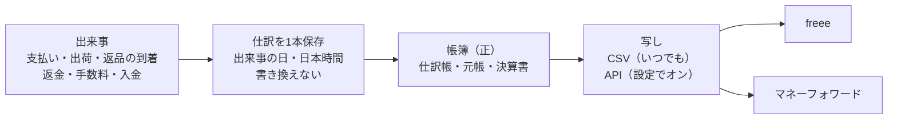

# 会計の作り直しの設計（売上の計上の方針 10章）

> 対象: Le Fil des Heures の通販の管理画面の会計（ACCOUNTING）・KPI と、freee・マネーフォワードへの写し
> 状態: 初版（話し合い中）。1〜6番を決めた所まで。7〜15番はこれから1つずつ決め、決まるたびにこの文書へ書き足す
> 決めた人: オーナー（2026-11-02〜03 の話し合い）。「私の判断」と書いた所は設計者の判断で、オーナーが読んで覆せる
> 元の方針: [売上の計上の方針](../../01_Planning/revenue-recognition-policy.md)（2026-10-23 承認）の10章「システムに入れる直し」
> 関係: [作業と指摘の台帳](../../05_Quality/reviews/code/2026-09-25-working-diff-security-review.md)（S-2）、[G の設計](2026-10-23-group-g-design.md)（発送票・出荷日）、[H の設計](2026-10-28-group-h-promotions-design.md)（1着ごとの支払額）
> 注意: 法令の確かめは AI によるもので、税理士の確認の代わりにならない。方針の9章の一覧を開店前に税理士へ持っていき、答えで変わった所だけ直す

---

## 概要

帳簿の売上を「出荷した日」に立て、先に受け取った代金を「前受金」で持つ形に、会計の仕組みを作り直す。仕訳は注文の状態から毎回作り直すのをやめ、お金と品物が動く出来事が起きた時に1本ずつ保存し、後から書き換えない。この店の帳簿を正（元の記録）にして、freee・マネーフォワードには写しを送る。

### 全体の決定（オーナー）

| # | 決めたこと |
| --- | --- |
| A1 | この店の帳簿を正とする。freee・マネーフォワードには写しを送る |
| A2 | 写しは CSV と API の両方で出せるようにする。API の連携は設定でオンにするオプション |
| A3 | freee とマネーフォワードの両方に対応する（オーナーは今「MF確定申告」を使っている） |
| A4 | 帳簿と決算書を、そのまま申告に使えるようにすることも視野に入れる |
| A5 | 10章の項目は、できるだけ全部対応する。1つずつ現状と変更方針を話して決める |

### 項目と決まり具合

| # | 項目 | 今の状態 | 決まり具合 |
| --- | --- | --- | --- |
| 1 | 仕訳の作り方（出来事ごと・保存して書き換えない） | 注文の日に売上を立て、画面を開くたびに作り直す | 決定（[1章](#1-仕訳の作り方項目1)） |
| 2 | 前受金と出荷の日の売上（一部の出荷は送った分だけ） | 前受金を使っていない | 決定（[2章](#2-前受金と出荷の日の売上項目2)） |
| 3 | 集計の仕方と期首の残高（仕訳の日の期間で数える） | 注文を作った年で絞っている | 決定（[3章](#3-集計の仕方と期首の残高項目3)） |
| 4 | Stripe の仕訳（二重・抜けを防ぐ、日本時間、手数料の消費税の区分、カード会社からの支払いの取り消し） | 日付が世界標準時、支払いの取り消しの記録が無い | 決定（[4章](#4-stripe-の仕訳項目4)） |
| 5 | 返品・返金の2段（届いた日・返金した日、検品の差、返金の失敗） | 返金が成功した日の1段だけ | 決定（[5章](#5-返品返金の2段項目5)） |
| 6 | 発送の日（実際の出荷日・直した跡） | G-3 でほぼ済み | 決定（[6章](#6-発送の日項目6)） |
| 7 | 勘定の名前（Stripe 残高（未収入金）・未払金） | 古い名前のまま | 未決 |
| 8 | 受注高（管理画面の数字の名前と数え方） | 名前と数え方が違う | 未決 |
| 9 | 在庫と原価（年末の棚卸・前受金の照合） | 製品・仕掛品を数える所が無い | 未決 |
| 10 | 締め（締めた年の固定・誤りの直しの記録） | 帳簿と決算書を毎回作り直している | 未決 |
| 11 | 会計の期間（1月始まりでない年度） | 1月〜12月で固定 | 未決 |
| 12 | 帳簿の保存（電子帳簿保存法） | 一部だけ | 未決 |
| 13 | 自家消費・宣伝用の印と年末の一覧 | 無い | 未決 |
| 14 | 返品の条件の表示 | 確かめていない | 未決 |
| 15 | freee・マネーフォワードへの写し（CSV・API） | 無い | 方向だけ決定（A1〜A3） |

---

## 0. 目的・目標・制約

### 0-1 目的

- 税法の売上の日（引渡しの日。この店は出荷した日）と帳簿を合わせる。今は注文の日に売上を立て、発送すると注文が売上から消える（台帳の S-2）。
- 帳簿と決算書を、申告に使える信頼できる記録にする。締めた年が後から動かず、直した跡が残る。
- オーナーが使う会計ソフト（今は MF確定申告）へ、同じ仕訳を写せるようにする。

### 0-2 目標にしないこと

- 会計ソフトそのものを作り直すこと。仕訳帳・元帳・決算書・青色申告の書類など、今の会計の画面の作りは使い続ける。
- 申告書の提出（e-Tax への送信）。
- 税理士の確認の代わり。

### 0-3 失敗とみなすこと

- 同じ出来事の売上が二重に入る、または抜ける。
- 締めた年の数字が、後の操作で黙って変わる。
- freee・マネーフォワードに送った写しと、この店の帳簿が食い違う。

### 0-4 前提と制約

- 個人事業（青色申告）で始め、後で法人にする。受注生産が中心で、代金は注文の時に全額受け取る。送料は価格に含み、無料に固定（K-1）。
- 開店前で、本番の注文は試しだけ（G-1 で片付け、2026-11-01 の H の本番適用の記録で 0件）。切り替えた日から新しい形で始める。
- 発送票・実際の出荷日（G-3）と、1着ごとの支払額・割引の割り振り（H）はできている。

---

## 1. 仕訳の作り方（項目1）

決めた日: 2026-11-03（オーナー）

### 1-1 今の作り

- 会計の窓口（`src/app/api/admin/kpi/cost-profit/route.ts`）が、その年に作られた注文を取り、状態が「支払い済み」の注文だけを、注文の日の売上にする（`src/lib/sales/order-sales.ts`）。発送して状態が「発送済み」に変わると、その注文は売上から消える（台帳の S-2）。
- Stripe の記録がある注文は、別の作り方で支払いの時に「クレジット売掛金／売上高」を立てる（`src/lib/finance/stripe-journal.ts`）。日付は日時の先頭10文字（世界標準時の日付）。
- 仕訳は保存せず、画面（`src/components/CostProfitSection.tsx`）を開くたびに全部作り直す。

### 1-2 決めたこと

| # | 決めたこと |
| --- | --- |
| 1-a | 仕訳は注文の状態から作らない。出来事ごとに作る。出来事は、支払い・出荷・出荷前の返金・返品の到着・検品での額の変更・返金・返金の失敗・Stripe の手数料・Stripe からの入金・カード会社からの支払いの取り消し（4章） |
| 1-b | 仕訳は、出来事が起きた時に保存する。保存した仕訳は後から書き換えず、消さない |
| 1-c | 誤りは、「取り消しの仕訳」と「正しい仕訳」を足して直す。直した理由を残す |
| 1-d | 出来事ごとに、他と重ならない印（何の出来事の、どの記録か）を付ける。同じ出来事の仕訳は1本しか作らない |
| 1-e | 仕訳の日は、出来事の日（日本時間） |

### 1-3 理由

- 税法の売上の日に合わせるため（方針1章）。注文の状態は1つしか持てず、一部の出荷・出荷前の返金・返品の到着・返金を表せない。
- 締めた年の帳簿を動かさないため（方針7-2。誤りは国税通則法19条の修正申告・23条の更正の請求で直す）。作り直す形では、注文の状態が後から変わるだけで申告した年の仕訳が変わる。
- 電子帳簿保存法の「優良な電子帳簿」は、訂正・削除の履歴が残るシステムか、訂正・削除ができないシステムであることを求める（国税庁の要件のチェック表、税研・東京税理士会の解説）。65万円の青色申告特別控除の道の1つ（もう1つは e-Tax での申告）。
- freee・マネーフォワードへ送った写しと食い違わないため（A1）。
- 日を勝手に動かさない。3つの税の通達は、選んだ日を「継続して」使うことを求める（6-4）。最高裁平成5年11月25日判決は、収益を「収入すべき権利が確定したとき」の年に計上するとし、為替取組日基準を「収益計上時期を人為的に操作する余地を生じさせる点において」認めなかった（判決の全文で確かめた）。

### 1-4 Shopify・定番との比較

| | 今 | 決めた形 | Shopify | 会計につなぐ定番の道具（A2X） |
| --- | --- | --- | --- | --- |
| 売上の日 | 注文の日 | 出荷した日 | 注文の日（売上のレポート） | 取引が起きた期間 |
| 何から作るか | 注文の状態 | 出来事 | 注文と、返品などの調整を別々に | 入金ごとに、売上・返金・割引・手数料を分けた仕訳 |
| 返品・返金の日 | 返金した日 | 届いた日と返金した日の2段（5番で詳しく決める） | 資料によって食い違う | 返金の出来事の日 |

Shopify は会計ソフトではなく、売上を注文の日で数える。帳簿の仕訳は、会計につなぐ道具が出来事から作るのが定番。出荷した日を売上にするのは、日本の税法に合わせたこの店の決まり（方針1章）。

---

## 2. 前受金と出荷の日の売上（項目2）

決めた日: 2026-11-03（オーナー）

### 2-1 今の作り

- 「前受金」の勘定（2150）は勘定の一覧（`src/lib/finance/accounts.ts`）にあるが、ネットの注文には使っていない。手で入れる仕訳にだけ出てくる。
- ネットの注文は、支払いの日に売上を全部立てている。

### 2-2 決めたこと

| # | 決めたこと |
| --- | --- |
| 2-a | 支払いを受けた日: 借方「Stripe 残高（未収入金）」、貸方「前受金」（注文の支払額） |
| 2-b | 出荷した日: 借方「前受金」、貸方「売上高」。額は、その発送で送った品の額だけ |
| 2-c | 出荷の時の売上の額 ＝ 送った品1着ごとの支払額（割引を引いた後）－ その品に当てた出荷前の返金 |
| 2-d | 出荷前の返金は、売上を通さず「前受金／Stripe 残高」（返金した日） |
| 2-e | 年末に出荷していない分は、前受金のまま翌年へ繰り越す |
| 2-f | 発送の取り消し・出荷日の訂正は、前の売上の仕訳をそのまま残し、「取り消しの仕訳」と「正しい日の仕訳」を足す。締めた年をまたぐ時の扱いは10番で決める |
| 2-g | 仕訳の単位は、発送票1枚に仕訳1本。中の行は品ごとに分ける |
| 2-h | 同じ品を2着以上買って、1着ごとの支払額に端数の差がある時は、番号（`unit_index`）の若い順に送ったことにする。この決め方は変えず、システムの概要の書類（12番）に書く |
| 2-i | 交換で送る品は、売上を変えない（方針3-3）。送る品と戻る品の原価の差は9番で決める |
| 2-j | 切り替える前の注文は無い。切り替えた日から新しい形で始める |

### 2-3 使う記録

| 決めること | 使う記録 | できた時 |
| --- | --- | --- |
| 出荷した日 | 発送票の実際の出荷日（`shipment_slips.shipment_date`） | G-3 |
| 記録した日時（入力の遅れが分かるように） | 発送票を確定した日時（`shipment_slips.confirmed_at`） | G-3 |
| 送った品と数 | 発送票の明細（`shipment_slip_lines`） | G-3 |
| 1着ごとの支払額 | `order_line_unit_amounts.paid_amount` | H |
| 出荷前の返金 | 返金の明細の印（`order_refund_lines.before_shipment`）と額 | 前から |

### 2-4 例

シャツ 20,000円・パンツ 12,000円の注文に 2,000円のクーポンを使い、金額の比でシャツに 1,250円、パンツに 750円を割り振った。支払いは 30,000円。

| 日 | 出来事 | 仕訳 | 前受金の残り | 売上の累計 |
| --- | --- | --- | --- | --- |
| 1/5 | 支払い | Stripe 残高／前受金 30,000 | 30,000 | 0 |
| 1/20 | シャツを出荷 | 前受金／売上高 18,750 | 11,250 | 18,750 |
| 2/1 | パンツにお詫びの返金（出荷前） | 前受金／Stripe 残高 1,000 | 10,250 | 18,750 |
| 2/10 | パンツを出荷 | 前受金／売上高 10,250 | 0 | 29,000 |

### 2-5 根拠

| 決めたこと | 根拠 |
| --- | --- |
| 支払いの時は前受金 | 消費税法基本通達9-1-27・タックスアンサー No.6165（前受けしても売上は引き渡した時）。所得税基本通達36-8（売上は引渡しの日）。所得税法施行規則57条1項（資産・負債の一切の取引を記録する） |
| 出荷するたびに送った分だけ売上 | 所得税基本通達36-8(1)・法人税基本通達2-1-2・消費税法基本通達9-1-2（引渡しの日の例に「出荷した日」）。最高裁平成5年11月25日判決（合理的な基準を選んで続けていれば正しい） |
| 取り消しの仕訳と正しい仕訳を足す | 電子帳簿保存法の「優良な電子帳簿」の訂正・削除の要件（1-3）。通常の入力の期間は最長2か月で、それを過ぎた入力は事実が分かることが要る（国税庁の要件のチェック表） |
| 発送票1枚に1本・行は品ごと | 仕訳帳は取引の起きた順に年月日・内容・勘定科目・金額を書く（法人税法施行規則55条。個人は所得税法施行規則58条1項で仕訳帳・総勘定元帳を備える）。課税事業者になったら、相手・年月日・内容・税率ごとの額（消費税法58条、タックスアンサー No.6625） |
| 端数は若い番号から | 法令に決まりは無い。合理的な方法を選んで続けることが条件（最高裁平成5年11月25日判決、所得税基本通達36-8 の「継続して」） |
| 交換は売上を変えない | 代金が動かないので、売上も消費税の対価の返還等（消費税法38条）も起きない（方針3-3） |

### 2-6 Shopify・定番との比較

| | 今 | 決めた形 | Shopify | 会計の定番（収益認識の基準） |
| --- | --- | --- | --- | --- |
| 支払いの時 | 売上 | 前受金 | 売上（注文の日で数える） | 契約負債（前受金） |
| 一部だけ送った時 | 区別しない | 送った品の分だけ売上 | 発送しても売上は変わらない | 渡した分だけ売上 |
| 年末の未出荷分 | 売上に入っている | 前受金で翌年へ | 売上に入っている | 負債で翌年へ |

Shopify と違う所は、日本の税法に合わせるため。Shopify と同じ注文の日の数字は、管理画面の「受注高」（8番）で残す。

---

## 3. 集計の仕方と期首の残高（項目3）

決めた日: 2026-11-03（オーナー）

### 3-1 今の作り

- 会計の窓口（`src/app/api/admin/kpi/cost-profit/route.ts`）は、注文をその年に作られたもの（`orders.created_at`）で絞る。年末に支払い、年明けに出荷した注文は、出荷した年の帳簿に出てこない。
- Stripe の記録（入出金・返金・入金）は、Stripe で記録された日時（`stripe_created_at`）でその年に絞る。
- 期間は「年」（1月1日〜12月31日）で固定。
- 年越しの処理（`src/lib/finance/year-end.ts` の157行目あたり）は、翌年の元入金 ＝ 当年の元入金 ＋ 当期純利益 ＋ 事業主借 － 事業主貸 で出し、事業主貸・事業主借を 0 にしている。

### 3-2 決めたこと

| # | 決めたこと |
| --- | --- |
| 3-a | 帳簿・決算書は、保存した仕訳を「仕訳の日」（出来事の日・日本時間）で期間に入れて数える。注文を作った日では絞らない |
| 3-b | 期間は「年」ではなく「初日〜末日」で持つ。個人は1月1日〜12月31日。法人の最初の事業年度や、消費税の課税期間を短くした場合（3か月・1か月）にも使える。年度の始まりの決め方は11番で決める |
| 3-c | 期首の残高は、前の期間を締めた時の残高から取る。前受金・Stripe 残高・在庫などの資産・負債はそのまま引き継ぐ |
| 3-d | 前の期間を締めていない時は、期首より前の仕訳を全部足して期首の残高にする。締める前なので、数字はまだ動く（画面にそう出す） |
| 3-e | 個人の期首では、事業主貸・事業主借は 0。元入金は「前の期間の元入金 ＋ 青色申告特別控除の前の所得 ＋ 事業主借 － 事業主貸」。今の年越しの処理の式を使い続ける |
| 3-f | 確かめ1: 期首の元入金 ＝ 期首の資産の総額 － 期首の負債の総額 になっていることを、システムで確かめる（期首の事業主貸・事業主借は 0） |
| 3-g | 確かめ2: 決算書を作る時に、損益計算書と貸借対照表の「青色申告特別控除前の所得金額」が一致することを確かめる。合わない時は、事業主貸・事業主借の入れ漏れを疑う |
| 3-h | 受注高（注文の日の数字）は帳簿と別に数える。名前と数え方は8番で決める |

### 3-3 例

12月28日に支払い、1月10日に出荷した注文（30,000円）。

| 期間 | 今の作り | 決めた形 |
| --- | --- | --- |
| 前の年 | 売上 30,000（注文の年） | 前受金 30,000 が期末の負債に残る |
| 次の年 | 出てこない | 期首に前受金 30,000 を引き継ぎ、1/10 に「前受金／売上高 30,000」 |

### 3-4 根拠

| 決めたこと | 根拠 |
| --- | --- |
| 仕訳の日の期間で数える | 所得税法36条1項（その年において収入すべき金額）。売上の日は引き渡した日（所得税基本通達36-8）。個人の消費税の課税期間は1月1日〜12月31日（消費税法19条1項1号、タックスアンサー No.6601）。年の途中で開業しても1月1日に始まる |
| 期間を初日〜末日で持つ | 法人の課税期間は事業年度（消費税法19条1項2号、法人税法13条）。届け出で課税期間を3か月・1か月に短くできる（消費税法19条の特例、タックスアンサー No.6137、国税庁の届出書の手引き） |
| 期首の元入金・事業主貸・事業主借 | 国税庁「青色申告決算書（一般用）の書き方」: 元入金は期首と期末に同じ額を書き、期首の元入金は「期首の資産の総額」から「期首の負債の総額」を引いて出す。事業主貸・事業主借の欄は本年中の合計額。この式は期首の事業主貸・事業主借が 0 の時に成り立つ。期首の欄が斜線で書けないことは、税理士ドットコムの税理士の回答と弥生・ソリマチの解説で確かめた（国税庁の原文は 8章） |
| 控除前の所得の一致 | 国税庁の同じ書き方: 損益計算書と貸借対照表の青色申告特別控除前の所得金額は必ず一致する。合わない時は事業主貸・事業主借の計上漏れを点検する |
| 受注高を別に数える | 法令で決まった帳簿の記載事項に受注高は無い。店の中の管理の数字なので数え方は自由。売上高と取り違えない名前にする（方針5章）。帳簿の売上高との照らし合わせの表は、税理士に確かめる一覧にある（方針9章 #12） |

### 3-5 Shopify・定番との比較

| | 今 | 決めた形 | Shopify | 会計ソフトの定番（freee・マネーフォワード・弥生） |
| --- | --- | --- | --- | --- |
| 何の日で期間に入れるか | 注文を作った日 | 仕訳の日 | 注文の日（売上のレポート） | 仕訳の日 |
| 期間 | 1月〜12月で固定 | 初日〜末日 | レポートで好きな期間 | 事業年度（初日〜末日） |
| 期首の残高 | 年越しの処理の結果 | 締めた時の残高（締めていなければ前の仕訳の合計） | 帳簿を持たない | 繰越処理で前の期末から引き継ぎ、個人は元入金にまとめる |

---

## 4. Stripe の仕訳（項目4）

決めた日: 2026-11-03（オーナー）

言葉: お客様（またはカードの持ち主）がカード会社に支払いへの異議を申し出て、カード会社が店の売上を強制的に取り戻すことを、この文書と画面では「カード会社からの支払いの取り消し」と呼ぶ（Stripe の用語ではチャージバック・不審請求の申し立て）。結果は「取り消しが取り下げられた（お金が戻った）」「取り消しが確定した（お金は戻らない）」、結果を待つ間は「カード会社の判断待ち」と呼ぶ。

### 4-1 今の作り

- 売上の道が2つある。Stripe の支払いの記録が同じ年にあればそこから（`src/lib/finance/stripe-journal.ts`）、無ければ注文の状態から（`src/app/api/admin/kpi/cost-profit/route.ts` の `mapOrderIncome`）作る。毎回作り直すので今は二重にならないが、保存する形（1番）では記録が後から届いた時に二重になる。
- 日付は日時の先頭10文字（世界標準時の日付）。
- 手数料の仕訳に消費税の区分が無く、相手の欄が空。
- カード会社からの支払いの取り消しは、Stripe の知らせを受けておらず、仕訳も無い。

### 4-2 決めたこと

| # | 決めたこと |
| --- | --- |
| 4-a | 支払いの仕訳「Stripe 残高／前受金」は、支払いの番号（Stripe の `payment_intent`）1つに1本。きっかけは支払いの確定の知らせ。注文の状態から作る道はやめる。額は手数料を引く前の総額 |
| 4-b | 日付は日本時間に直してから切る。Stripe からの入金の仕訳も同じ |
| 4-c | 手数料は Stripe の入出金の記録1件に1本（印は今の `stripe:fee:<記録の番号>`）。消費税の区分を持たせ、既定は「課税 10%」。月ごとの合計を画面に出し、Stripe が毎月10日までに出す適格請求書と見比べる。違えば「取り消し＋正しい仕訳」で直す。税額の正しい値は、選んだ計算方法（消費税法施行令46条の1項・2項・3項）で決める。適格請求書は電子のまま保存する（12番） |
| 4-c2 | 手数料の仕訳の相手は「ストライプジャパン株式会社」とし、内容（決済の手数料・取り消しの手数料・為替の手数料）を書き分ける |
| 4-c3 | 手数料が課税か非課税かは契約の形で決まる。システムは Stripe の適格請求書どおりに記帳し、契約の形は税理士に確かめる（方針9章 #11） |
| 4-d | 未出荷の注文の支払いの取り消し: 引かれた日に「前受金／Stripe 残高」。取り消しの手数料は「支払手数料／Stripe 残高」（課税）で、取り下げられても戻らない。取り下げられて代金が戻ったら、戻った日に代金だけ逆の仕訳 |
| 4-e | 出荷済みの注文の支払いの取り消し: 引かれた日に「仮払金（カード会社の判断待ち）／Stripe 残高」と原因（不正利用・届かない・品が違う など）を記録する。確定した日に、原因に合う科目へ振り替える。取り下げられたら「Stripe 残高／仮払金」。判断待ちのまま年を越す分は、中身の分かる名前で残してよい。振り替える先の科目と消費税の区分は、課税事業者になる前に税理士と決める（方針4-3・9章 #11） |
| 4-f | 取り消しの原因と Stripe の申し立ての資料は、電子取引の記録として保存する |

### 4-3 例

| 場面 | 今 | 決めた形 |
| --- | --- | --- |
| 1月1日 朝8時（日本時間）の支払い | 世界標準時では12月31日で、前の年の売上 | 1月1日に「Stripe 残高／前受金」 |
| Stripe の記録が1日遅れて届いた | 作り直すので今は問題なし | 支払いの番号が同じなので1本のまま |
| 出荷前の注文の支払いの取り消し 30,000円・手数料 1,500円 | 記録されない | 「前受金／Stripe 残高 30,000」「支払手数料／Stripe 残高 1,500」 |
| 出荷済みの注文に不正利用の取り消し 30,000円。2か月後に確定 | 記録されない | 引かれた日に「仮払金／Stripe 残高 30,000」、確定した日に仮払金を振り替える |

### 4-4 根拠

| 決めたこと | 根拠 |
| --- | --- |
| 支払い1つに1本・前受金 | 所得税法施行規則57条1項（資産・負債・資本に影響する一切の取引を「正規の簿記の原則に従い、整然と、かつ、明りように記録」）。タックスアンサー No.6165（受取の時期に関係なく、引渡しの時が売上の時期。消費税法基本通達9-1-27・11-3-1） |
| 総額 | 消費税法28条1項（課税標準は「対価として収受し、又は収受すべき一切の金銭」） |
| 日本時間 | 明治19年勅令第51号 第3項（「東経百三十五度ノ子午線ノ時ヲ以テ本邦一般ノ標準時ト定ム」。e-Gov で現行の法令）。消費税法19条1項1号（個人の課税期間は1月1日〜12月31日） |
| 手数料の日・区分・税額 | 消費税法30条1項1号（課税仕入れを行った日の課税期間）、消費税法基本通達11-3-1（役務の提供を受けた日）。施行令46条1項（請求書の税額を足す）・2項（取引ごとの税額を帳簿に書いて足す）・3項（割り戻す）。Stripe の説明（Visa・Mastercard は 2026-04-01 から課税、取り消しの手数料・為替の手数料も課税。請求書全体で四捨五入） |
| 請求書の保存・相手の名前 | 消費税法30条7項（帳簿と請求書を保存しないと控除できない）、30条8項1号（帳簿に相手方の名前・年月日・内容・対価の額）。免税事業者は控除しない（30条1項） |
| 契約の形で課税・非課税が分かれる | 国税庁 質疑応答「クレジット手数料」（カード会社が債権を買い取る形の差額は非課税。消費税法施行令10条3項8号） |
| 未出荷の取り消し | 引き渡していないので売上は無い（タックスアンサー No.6165）。Stripe の説明（取り消しの手数料は日本の事業者には返されない） |
| 出荷済みの取り消しは判断待ちの間は仮払金 | Stripe の説明（引かれた代金は申し立ての全期間保持され、店の言い分が通れば戻る）。所得税法51条2項（損失は「その損失の生じた日の属する年分」の必要経費）・所得税法施行令141条（返戻・値引きに類する行為、無効な行為による成果の喪失、取消し）。裁判例（無効な行為による損は実際に失った時）。仮払金は結果待ちなら中身の分かる名前で残せる（会計の解説） |
| 消費税の区分は税理士と | 消費税法基本通達14-1-11（取消し・無効なら「なかったものとする」。前の期間の売上なら分かった日に消費税法38条を使ってもよい）。消費税法39条・施行令59条（貸倒れは政令の事実で売掛金などが回収できない時だけ、書類の保存が条件）。国の直接の答えは無い（公認会計士・税理士の解説も同じ） |
| 資料の保存 | 電子帳簿保存法7条（電子取引の記録の保存）、消費税法39条2項 |

### 4-5 Shopify・定番との比較

| | 今 | 決めた形 | Shopify | 会計につなぐ定番の道具（A2X） |
| --- | --- | --- | --- | --- |
| 二重を防ぐ印 | 作り直すので無い | 支払いの番号・Stripe の記録の番号 | 注文ごとの記録 | 入金ごとにまとめた仕訳 |
| 手数料 | 区分なし | 1件ごと・消費税の区分と相手つき | 入金の明細に出る | 手数料を別の行に分ける |
| 支払いの取り消し | 無い | 原因つきで仕訳。判断待ちは仮払金 | 入金の明細に出る | 別の行に分ける |

---

## 5. 返品・返金の2段（項目5）

決めた日: 2026-11-03（オーナー）

言葉: 「届いた日」は、お客様が送り返した品が店に届いた日。店が発送してお客様が受け取った日ではない。

### 5-1 今の作り

- 仕訳は、Stripe の返金が成功した日の1本だけ（「売上値引・返品／クレジット売掛金」。`src/lib/finance/stripe-journal.ts`）。
- 返品の受け取りの記録（`order_return_receipts`）は記録した日時（`created_at`）しか持たない。「届いた日」の欄が無く、「検品を終えた日」も分けていない。
- 返金の失敗は仕訳にならない。消費税用の返金した日の一覧は無い。
- 配達の追跡（E-4）は店からお客様への発送だけを見ている。返品の追跡番号（`order_returns.return_tracking_number`）は記録するが、追跡には登録していない。

### 5-2 決めたこと

| # | 決めたこと |
| --- | --- |
| 5-a | 受け取りの記録に「届いた日」の欄を足す。既定は記録した日で、前の日も選べる。直したら跡が残る |
| 5-a2 | 設定に「返品の届いた日に、運送会社の配達日を使う」を足す。既定はオフ |
| 5-a3 | オンの時は、返品の追跡番号で配達済みになった日を「届いた日」に最初から入れておく。記録する人が確かめ、違えば直せる（直した跡は残る）。届いた日だけを自動で決めて仕訳にはしない |
| 5-a4 | 追跡番号が無い返品や、配達日が取れない時は、人が入れる |
| 5-a5 | 設定を切り替えた日と人を記録する。年の途中で切り替えないよう画面で注意を出す。このオプションは、返品の追跡番号を追跡のサービスに登録できるようになった後（E-4 の追跡をオンにした後）に使える |
| 5-b | 届いた日に「売上値引・返品／未払金」。額は返品した品の支払額の全額。規約で決まった返品の手数料は、値引きから引かず、別の売上（返品の求めに応じる役務の対価）として「未払金／返品の手数料の売上」で同じ日に立て、返す額から差し引く。勘定の名前は7番で決める |
| 5-b2 | 返金の額を相談で決める返品は、届いた日に規約どおりの見込みの額で立て、額が決まった日に差の仕訳を足す |
| 5-c | 「検品を終えた日」を別に持つ。検品で額が変わったら、その日に差の仕訳を足す |
| 5-d | 返金した日に「未払金／Stripe 残高」 |
| 5-e | 品が戻らない、出荷後の返金・値引き（返送不要・お詫び）は、返金した日に「売上値引・返品／Stripe 残高」の1本。値引きを決めた時にすぐ返金する作りとし、決めた日と返金の日がずれる作りにはしない |
| 5-f | 出荷前の返金は「前受金／Stripe 残高」（2-d のまま） |
| 5-g | 一部だけ出荷した注文の返金: 品を指定する返金はその品に当てる。品を指定しない値引きは、出荷した品とまだの品の額の比で分ける（方針3-3） |
| 5-h | 返金の失敗: 返金の仕訳の後に失敗したら「Stripe 残高／未払金」で未払金を戻す。仕訳の前に失敗したら、出荷前は「前受金／未払金」、出荷後は「売上値引・返品／未払金」。振込などで返した日に「未払金／普通預金」 |
| 5-i | 返品をお断りして品を送り返した時は、届いた日の仕訳を、決めた日の取り消しの仕訳で打ち消す |
| 5-j | 消費税用の返金の一覧を出す。項目は消費税法施行令58条の2のとおり: 返金した年月日（振込で返したら振込の日）・元の売上の品の内容・税率ごとの返金した額。返金を受けた人の名前は小売業なので省けるが、注文番号で分かるようにする。7年保存 |
| 5-k | インボイスの登録をしたら、事業者（課税事業者）のお客様への税込1万円以上の返金には「適格返還請求書」を渡す。一般のお客様には要らない。作るのは登録する時（6番の方針、12番の保存と一緒に決める） |

### 5-3 例

シャツ 18,750円（割引後）の返品。返品の手数料 1,000円を引いて返す。

| 日 | 出来事 | 仕訳 |
| --- | --- | --- |
| 12/28 | 品が店に届いた | 売上値引・返品／未払金 18,750。未払金／返品の手数料の売上 1,000 |
| 1/5 | 返金した | 未払金／Stripe 残高 17,750 |

所得税はこの年（12/28）、消費税は翌年（1/5）の分になる。今の作りでは両方とも翌年になる。

### 5-4 根拠

| 決めたこと | 根拠 |
| --- | --- |
| 届いた日（人が入れる・配達日を使う） | 所得税基本通達51-18（本文は「発送をした旨の通知を受けた日」。ただし書きで「継続して同一の経理を行うときは、その商品を受け取った日の属する年分の総売上高から控除して差し支えない」）。配達日も店が受け取った日なので同じ日の取り方。「継続して」が条件なので切り替えを記録する |
| 届いた日に売上値引・返品と未払金 | 所得税法施行令141条1号（販売した商品の返戻・値引きで収入が減ったこと）。所得税法施行規則57条1項（負債を含む一切の取引を記録） |
| 額は実際に返す額 | 消費税法38条1項（控除の元は返還をした税込価額） |
| 見込みの額・検品の差 | 消費税法基本通達10-1-20（確定していない時は「同日の現況によりその金額を適正に見積もる」。差額は「その確定した日の属する課税期間」で加減）。国税庁 質疑応答「確定していない対価の処理」。法人税基本通達2-1-1の10（注1）も同じ形。所得税は所得税基本通達36・37共-1（年末までに販売代金の額が確定していない時は「同日の現況によりその金額を適正に見積もる」。差額は「その確定した日の属する年分」に入れる） |
| 返品の手数料を別の売上にする | 消費税法基本通達5-5-2（「解約手数料、取消手数料又は払戻手数料等を対価とする役務の提供…は、資産の譲渡等に該当」。規約で決まった額を取るなら役務の対価）。所得の額と、一般課税で納める消費税の額は分けない時と同じ。簡易課税を選んだ時は、品の売上と手数料で割合が違うので分けておく |
| 返金した日・返金の失敗 | 消費税法38条1項（「対価の返還等をした日の属する課税期間」）。返せていない間は借りが残る（施行規則57条1項） |
| 一部出荷の当て方 | 法令に決まりは無い。合理的な方法を選んで続ける（最高裁平成5年11月25日判決）。合理的に区分する考え方は消費税法基本通達14-1-5 にもある |
| 返金の一覧 | 消費税法38条2項（返還等の明細を記録した帳簿を保存しないと控除できない）。消費税法施行令58条の2（記載事項・7年保存。小売業などは相手の名前を省ける） |
| 適格返還請求書 | 消費税法57条の4第3項。税込1万円未満は不要（消費税法施行令70条の9第3項2号） |

### 5-5 Shopify・定番との比較

| | 今 | 決めた形 | Shopify | 会計の定番 |
| --- | --- | --- | --- | --- |
| 返品の日 | 返金した日 | 届いた日と返金した日の2段 | 返金した日（売上のレポート） | 返品を受けた時に売上を減らし、返す額を負債に |
| 返金の失敗 | 記録なし | 未払金を残す | 返金の状態として出る | 負債を残す |
| 消費税の日 | 区別なし | 返金した日の一覧 | 無い（日本の税法の決まり） | 返還等をした日（消費税法38条） |

---

## 6. 発送の日（項目6）

決めた日: 2026-11-03（オーナー）

言葉: 「出荷した日」は、店が品を運送会社に渡した日（日本時間）。「お客様に届いた日」は、店が送った品がお客様に届いた日。5章の「届いた日」（お客様が送り返した品が店に届いた日）とは別の日。

### 6-1 今の作り（G-3 で作った物）

- 発送票（`shipment_slips`）を確定する時に「出荷した日」（`shipment_date`）を入れる。画面の既定は今日（日本時間）で、変えられる。確定した発送票は出荷した日が必須。一部だけの発送は発送票ごとに日がある（`order_fulfillments.shipment_date`）。
- 今日より後・支払いの日より前・お客様に届いた日より後の日は入れられない（`private.admin_correct_shipment_date`）。
- 直す時は理由（1〜200字）が要る。前の日・新しい日・直した人・操作の番号を `shipment_date_history` に残す。この記録は書き換え・消去を DB で止めている。
- 発送票を確定した日時（`confirmed_at`）も残る。
- 返品の期限は、お客様に届いた日（`delivered_at`）から数える。無い時は登録した日時（`shipped_at`）＋余裕の日数から数える（`private.fulfillment_line_returnable`）。売上の日とは混ぜていない。
- 会計は、まだ出荷した日を読んでいない（今は支払いの日。2番の実装で直す）。
- 本番の DB の発送の記録は 0件（2026-11-03、件数だけ確かめた）。G-3 より前の形の記録の扱いは作らない。

### 6-2 決めたこと

| # | 決めたこと |
| --- | --- |
| 6-a | 売上の日は、確定した発送票の「出荷した日」。一部だけの発送は発送票ごとの日（2-b・2-g） |
| 6-b | 出荷した日を直したら、古い日の仕訳を取り消し、新しい日の仕訳を足す（1-c・2-f）。締めていない年なら、取り消しの仕訳は古い日、正しい仕訳は新しい日の日付で入れる。仕訳から発送票の直した跡（理由・人・前後の日）をたどれるようにする |
| 6-b2 | 古い日か新しい日が締めた年にかかる直しは、発送票の画面で止める。10番で決める手順（直しの記録・その年の申告の直し）を通して入れる |
| 6-c | 帳簿の一覧に「出荷した日」と「登録した日」（発送票を確定した日）を並べて見せる |
| 6-d | 締めの前に、12月25日〜1月10日の発送票の一覧（運送会社・追跡番号・出荷した日）を出す。オーナーが運送会社の受付の記録と照らし、確かめた印を残す。法律の決まりではない。年をまたぐ誤りは修正申告になるので、前もって防ぐ店の決まり |
| 6-d2 | 運送会社の受付の日と自動で照らすのは、設定のオプション（既定はオフ）。E-4 の追跡をオンにした後に使える |
| 6-e | 返品の期限の数え方は今のまま変えない。売上の日と混ぜない。届いた日が無い時の数え方で、期限が特定商取引法15条の3（引渡しを受けた日から8日）より短くならないかは、14番で返品の条件の表示と一緒に確かめる |
| 6-f | 直した跡と登録の遅れが分かる作りは、「優良な電子帳簿」の条件（電子帳簿保存法施行規則5条5項1号イ）にも合う。優良な電子帳簿は必ず要る物ではない（必ず要るのは同規則2条2項の条件）。届出書（加算税の5%の軽減。翌年3月15日まで）を出すかどうかと、検索の機能（取引の日・金額・相手）は12番で決める |

### 6-3 例

12月31日に運送会社に渡し、1月2日に発送票を確定した。

| 日 | 出来事 | 仕訳・画面 |
| --- | --- | --- |
| 1/2 | 発送票を確定（出荷した日 12/31） | 前受金／売上高 18,750（日付は 12/31）。帳簿の一覧に「登録した日 1/2」を並べる |
| 1/8 | 本当は 1/3 に渡していたと分かった（前の年はまだ締めていない） | 売上高／前受金 18,750（12/31 の取り消し）と、前受金／売上高 18,750（1/3）。直した理由と人は発送票の跡に残る |
| 締めた後 | 同じ誤りが分かった | 発送票の画面では直せない。10番の手順で、前の年の申告の直しとして入れる |

年末の照合（6-d）で、12/31 の発送票は運送会社の受付の記録と照らす一覧に出る。

### 6-4 根拠

| 決めたこと | 根拠（原文） |
| --- | --- |
| 売上の日＝出荷した日・続けて使う | 所得税基本通達36-8(1)「その引渡しがあった日」、36-8の2「出荷した日…のうち、その者が継続して収入金額に計上することとしている日」。法人税基本通達2-1-2「法人が継続してその収益計上を行うこととしている日」。消費税法基本通達9-1-1・9-1-2「事業者が継続して棚卸資産の譲渡を行ったこととしている日」。日を勝手に動かさない根拠は、この「継続して」 |
| 直した跡・取り消しと正しい仕訳 | 電子帳簿保存法施行規則5条5項1号イ(1)「訂正又は削除を行った場合には、これらの事実及び内容を確認することができること」 |
| 登録した日を並べる | 同 イ(2)「入力をその業務の処理に係る通常の期間を経過した後に行った場合には、その事実を確認することができること」 |
| 締めた年にかかる直し | 国税通則法19条（修正申告）・23条（更正の請求、法定申告期限から5年以内）。方針7-2 |
| 優良な電子帳簿は選べる物 | 電子帳簿保存法8条4項（過少申告加算税の5%の軽減）。同規則2条2項（一般の電子帳簿の条件。システムの概要の書類・画面と紙に出せること・見せられること）。同規則5条1項（前もって届出書）・5条5項1号ハ（検索の機能）。国税庁の手続の案内 A1-15（提出は翌年3月15日まで。65万円の青色申告特別控除と一緒に受ける届出書） |
| 返品の期限はお客様に届いた日から | 特定商取引法15条の3「商品の引渡し…を受けた日から起算して八日」。返品の特約を広告に表示していれば特約による |
| 年末の照合 | 法律の決まりは無い（店の決まり） |
| 最高裁平成5年11月25日判決 | 収益は「その収入すべき権利が確定したときの属する年度の益金に計上すべき」とした。「合理的なものとみられる収益計上の基準の中から…選択し、継続して」計上していれば認める。為替取組日基準は「その収益計上時期を人為的に操作する余地を生じさせる点において」認めなかった（裁判所の全文の PDF で確かめた） |

### 6-5 Shopify・定番との比較

| | 今 | 決めた形 | Shopify | 会計の定番 |
| --- | --- | --- | --- | --- |
| 発送の日を後から直す | 直せる・跡が残る（G-3） | 同じ。仕訳は取り消しと正しい日の仕訳 | 普通の画面では直せない（公式の説明は見つからず、利用者の掲示板の話だけ）。直したい店は別の欄やアプリで持つ | 元の記録は残し、直しの記録を足す |
| 売上の日 | 支払いの日 | 出荷した日 | 注文の日 | 引き渡した日（出荷基準など） |
| 年末の前後の照合 | 無い | 一覧と確かめた印 | 無い | 期末の前後の出荷を確かめる（年をまたぐ誤りを防ぐ） |

---

## 7. まだ決めていない項目（7〜15番）

方針の10章の要点だけを置く。決まったら、1〜6章と同じ形の章にする。

| # | 方針の要点 |
| --- | --- |
| 7 | 「クレジット売掛金」（1130）を「Stripe 残高（未収入金）」に。返品で「未払金」を使う |
| 8 | 「受注高」に名前を変え、発送済みも含める。取消・返品のマイナスは返金した日 |
| 9 | 年末に材料・仕掛品・製品・前渡金を数え、原価を翌年へ。製品・仕掛品の棚卸高の勘定と手順。前受金の残高の照合 |
| 10 | 締めた年の仕訳と決算書を固定。後の出来事は起きた年。誤りはその年の申告を直し、直しの仕訳と理由を残す。翌年の損益に出さない |
| 11 | 法人の事業年度が1月〜12月でない場合 |
| 12 | 記録を消せない・直した跡が残る作り。システムの概要の書類。7年保存。画面と紙にすぐ出せる |
| 13 | 0円の注文・在庫の持ち出しに「自家消費」「宣伝用」の印を付け、年末に一覧 |
| 14 | 商品ページと注文の最終確認の画面に、返品の特約が出ているかを確かめる |
| 15 | CSV と API（設定でオン）。freee とマネーフォワードの両方（A1〜A3） |

---

## 8. 確かめきれていない点

| 点 | 状態 |
| --- | --- |
| 出荷済みの品の不正利用での支払いの取り消しの消費税の区分 | 国税庁の通達・質疑応答・裁決に直接の答えが無い（2026-11-03 にもう一度探した）。候補（取消し・対価の返還・貸倒れ・対象外の損）の原文は確かめた。免税事業者の間は納める額に影響しない。課税事業者になる前に税理士と決める |
| Stripe の手数料の契約の形（決済のサービスの代金か、債権の買い取りか） | Stripe は自分の手数料を課税として適格請求書を出している。Stripe の JCB の規約は読んだ: Stripe が店の代わりに JCB と包括代理加盟店契約を結び、JCB がお客様の代わりに代金を立替払いして JCB の手数料を取る形。国税庁の質疑応答では、信販会社が債権を買い取る時の差額は非課税。Visa・Mastercard の契約の形は読めていない。税理士に確かめる（方針9章 #11） |
| 期首の事業主貸・事業主借の欄が斜線（書けない）であること | 国税庁の決算書の様式と「書き方」の PDF は、文字を取り出せない作りだった。平成29年の「貸借対照表作成の手引き」は国税庁のサイトから消えていた。国税庁の元入金の式と、税理士の回答・会計ソフト会社の解説で確かめた。オーナーが PDF の貸借対照表のページを目で見れば確かめられる |
| 所得税法施行規則58条の記載事項 | 58条の原文は e-Gov で読んだ（仕訳帳・総勘定元帳を備え「財務大臣の定める取引に関する事項」を書く）。その財務大臣の告示の本文は、2026-11-03 にもう一度探したが見つからなかった。仕訳帳の記載事項は法人税法施行規則55条で確かめた |

2026-11-03 に原文で決着した点（ここから外した）:

| 点 | 決着の根拠 |
| --- | --- |
| 最高裁平成5年11月25日判決 | 裁判所の全文の PDF で読んだ（1-3・6-4） |
| 返品の手数料の扱い | 消費税法基本通達5-5-2。値引きと別の売上に分ける形に5-b を直した（オーナー承認） |
| 所得税での返品の額の見積り | 所得税基本通達36・37共-1（5-4） |
| 取り消しの仕訳を足す直し方 | 今の電子帳簿保存法取扱通達8-8（「いわゆる反対仕訳…を追加することもこれに含まれる」）・8-9(2)（「当初の記録事項を特定するための情報が付加されたもの」に限る）。1-c・1-d の形で合う。12番の材料: 8-7（届出の「代える日」は原則として年の初日）、8-10（入れてから1週間以内の直しの特例） |
| 2027年分からの75万円の青色申告特別控除 | 財務省 令和8年度税制改正の大綱（2025-12-26 閣議決定）。e-Tax の申告と優良な電子帳簿で75万円、e-Tax だけで65万円。令和9年分から |
| 租税特別措置法25条の2第4項 | e-Gov の今の条文。65万円は優良な電子帳簿か e-Tax の申告のどちらか |
| Shopify の返品の日の扱い | Shopify の公式ヘルプ: 返品は処理した日にマイナスで出る（今は「売上の取り消し」）。返金の額は財務レポートに出る |
| A2X の仕訳の日付 | A2X の公式の資料: 入金1回ごとにまとめた仕訳を、その入金の締めの期間の日付で作る |

---

## 9. 出典

- 国税庁 消費税法基本通達 第9章（9-1-2）: <https://www.nta.go.jp/law/tsutatsu/kihon/shohi/09/01/01.htm>
- 国税庁 タックスアンサー No.6165: <https://www.nta.go.jp/taxes/shiraberu/taxanswer/shohi/6165.htm>
- 国税庁 タックスアンサー No.6625: <https://www.nta.go.jp/taxes/shiraberu/taxanswer/shohi/6625.htm>
- 国税庁 法人税基本通達 2-1-2 ほか: <https://www.nta.go.jp/law/tsutatsu/kihon/hojin/02/02_01_01_2.htm>
- 国税庁 所得税基本通達 51-18: <https://www.nta.go.jp/law/tsutatsu/kihon/shotoku/09/03.htm>
- 国税庁 電子帳簿保存法取扱通達の解説: <https://www.nta.go.jp/law/joho-zeikaishaku/sonota/980528/index.htm>
- 国税庁 優良な電子帳簿の要件の資料: <https://www.nta.go.jp/law/joho-zeikaishaku/sonota/jirei/pdf/0021011-060_03.pdf>
- 東京税理士会 会報（2022年4月）: <https://www.tokyozeirishikai.or.jp/common/pdf/tax_accountant/bulletin/2022/apr_02.pdf>
- 税研 企業懇話会 FAQ: <https://www.zeiken.co.jp/kigyokonfaq/article/cat-3/20210064.php>
- 最高裁 平成5年11月25日判決: <https://www.courts.go.jp/hanrei/55872/detail2/index.html>
- マネーフォワード 優良な電子帳簿の要件（FAQ）: <https://biz.moneyforward.com/support/tax-return/faq/features2/tr-eb05.html>
- 弥生 優良な電子帳簿の解説: <https://www.yayoi-kk.co.jp/shinkoku/oyakudachi/yuryo-dencho/>
- freee 振替伝票の作成の API の変更のお知らせ: <https://developer.freee.co.jp/accounting/accounting-improvement/7937>
- マネーフォワード クラウド会計の API: <https://biz.moneyforward.com/accounting/smb/function/api/>
- マネーフォワード クラウド確定申告 お知らせ（2026-03-26）: <https://biz.moneyforward.com/support/tax-return/news/new-feature/20260326.html>
- A2X（Shopify Plus との連携）: <https://www.a2xaccounting.com/ecommerce-accounting-hub/how-a2x-works-with-shopify-plus>
- 国税庁 令和7年分 青色申告決算書（一般用）の書き方: <https://www.nta.go.jp/taxes/shiraberu/shinkoku/tebiki/2025/pdf/037.pdf>
- 国税庁 令和6年分 青色申告決算書（一般用）の書き方: <https://www.nta.go.jp/taxes/shiraberu/shinkoku/tebiki/2024/pdf/037.pdf>
- 国税庁 令和7年分 青色申告決算書の様式: <https://www.nta.go.jp/taxes/shiraberu/shinkoku/yoshiki/01/shinkokusho/pdf/r07/12.pdf>
- 国税庁 タックスアンサー No.6601（課税期間）: <https://www.nta.go.jp/taxes/shiraberu/taxanswer/shohi/6601.htm>
- 国税庁 タックスアンサー No.6137（課税期間の特例）: <https://www.nta.go.jp/taxes/shiraberu/taxanswer/shohi/6137.htm>
- 国税庁 消費税の届出書の手引き: <https://www.nta.go.jp/publication/pamph/shohi/todokedesho/pdf/01.pdf>
- 税理士ドットコム 今期の期首残高について: <https://www.zeiri4.com/c_5/c_1021/q_134379/>
- 税理士ドットコム 元入金の計算: <https://www.zeiri4.com/c_5/c_1021/q_109605/>
- 税理士ドットコム 青色申告決算書の貸借対照表: <https://www.zeiri4.com/c_5/c_1021/q_69940/>
- 弥生 青色申告の貸借対照表: <https://www.yayoi-kk.co.jp/shinkoku/aoiroshinkoku/oyakudachi/taishakutaishohyo/>
- ソリマチ 青色申告セミナー資料（2022）: <https://sorimachi.co.jp/seminar/files/2022_aoiro21_seminar.pdf>
- e-Gov 所得税法施行規則（57条・58条）: <https://laws.e-gov.go.jp/law/340M50000040011>
- e-Gov 所得税法（51条）: <https://laws.e-gov.go.jp/law/340AC0000000033>
- e-Gov 所得税法施行令（141条）: <https://laws.e-gov.go.jp/law/340CO0000000096>
- e-Gov 消費税法（28条・30条・39条）: <https://laws.e-gov.go.jp/law/363AC0000000108>
- e-Gov 消費税法施行令（46条・59条）: <https://laws.e-gov.go.jp/law/363CO0000000360>
- e-Gov 明治十九年勅令第五十一号: <https://laws.e-gov.go.jp/law/119IO0000000051>
- 国税庁 消費税法基本通達 第11章 第3節: <https://www.nta.go.jp/law/tsutatsu/kihon/shohi/11/03.htm>
- 国税庁 消費税法基本通達 14-1-11: <https://www.nta.go.jp/law/tsutatsu/kihon/shohi/14/01/02.htm>
- 国税庁 質疑応答事例 クレジット手数料: <https://www.nta.go.jp/law/shitsugi/shohi/06/02.htm>
- 国税庁 質疑応答事例 金銭債権の買取り等に対する課税関係: <https://www.nta.go.jp/law/shitsugi/shohi/06/03.htm>
- 裁判所 裁判例（無効な行為による損失の時期）: <https://www.courts.go.jp/hanrei/81535/detail2/index.html>
- Stripe 日本の事業者に対する Stripe 手数料の課税について: <https://support.stripe.com/questions/taxes-on-stripe-fees-for-businesses-in-japan?locale=ja-JP>
- Stripe 不審請求の申し立ての仕組み: <https://docs.stripe.com/disputes/how-disputes-work?locale=ja-JP>
- マネーフォワード 仮払金の解説: <https://biz.moneyforward.com/accounting/basic/?p=24149>
- 上浦会計事務所 チャージバックの会計と税務の取り扱い: <https://kamiura-kaikei.com/column/%E7%A8%8E%E5%8B%99%E4%BC%9A%E8%A8%88-column/%E3%83%81%E3%83%A3%E3%83%BC%E3%82%B8%E3%83%90%E3%83%83%E3%82%AF%EF%BC%88%E8%B2%B7%E6%88%BB%E3%81%97%E8%AB%8B%E6%B1%82%EF%BC%89%E3%81%AE%E4%BC%9A%E8%A8%88%E3%81%A8%E7%A8%8E%E5%8B%99%E3%81%AE%E5%8F%96/>
- e-Gov 消費税法施行令（58条の2・70条の9）: <https://laws.e-gov.go.jp/law/363CO0000000360>
- e-Gov 消費税法（38条・57条の4）: <https://laws.e-gov.go.jp/law/363AC0000000108>
- 国税庁 消費税法基本通達 第10章 第1節（10-1-20）: <https://www.nta.go.jp/law/tsutatsu/kihon/shohi/10/01.htm>
- 国税庁 質疑応答事例 確定していない対価の処理: <https://www.nta.go.jp/law/shitsugi/shohi/14/07.htm>
- 国税庁 法人税基本通達 第2章 第1節 第1款: <https://www.nta.go.jp/law/tsutatsu/kihon/hojin/02/02_01_01.htm>
- 国税庁 消費税法基本通達 第14章 第1節（14-1-5）: <https://www.nta.go.jp/law/tsutatsu/kihon/shohi/14/01/01.htm>
- 国税庁 所得税基本通達 36-8・36-8の2: <https://www.nta.go.jp/law/tsutatsu/kihon/shotoku/05/01.htm>
- e-Gov 電子帳簿保存法（8条）: <https://laws.e-gov.go.jp/law/410AC0000000025>
- e-Gov 電子帳簿保存法施行規則（2条・5条）: <https://laws.e-gov.go.jp/law/410M50000040043>
- e-Gov 特定商取引法（15条の3）: <https://laws.e-gov.go.jp/law/351AC0000000057>
- 国税庁 A1-15 65万円の青色申告特別控除・過少申告加算税の特例の適用を受ける旨の届出手続: <https://www.nta.go.jp/taxes/tetsuzuki/shinsei/annai/shinkoku/annai/09_2.htm>
- 国税庁 A1-45 過少申告加算税の特例の適用を受ける旨の届出: <https://www.nta.go.jp/law/joho-zeikaishaku/sonota/jirei/0021011-060_01.htm>
- TKC WEBコラム 平成5年最高裁判決の解釈の確認: <https://tkc.jp/consolidate/webcolumn/023812>
- 国税庁 消費税法基本通達 第5章 第5節（5-5-2）: <https://www.nta.go.jp/law/tsutatsu/kihon/shohi/05/05.htm>
- 国税庁 所得税基本通達 36・37共-1: <https://www.nta.go.jp/law/tsutatsu/kihon/shotoku/05/11.htm>
- 国税庁 電子帳簿保存法取扱通達（今のもの）: <https://www.nta.go.jp/law/tsutatsu/kobetsu/sonota/030628/pdf/01.pdf>
- 国税庁 質疑応答事例 クレジット手数料: <https://www.nta.go.jp/law/shitsugi/shohi/06/02.htm>
- Stripe JCB のサービス条項: <https://stripe.com/en-jp/legal/jcb>
- e-Gov 租税特別措置法（25条の2）: <https://laws.e-gov.go.jp/law/332AC0000000026>
- 財務省 令和8年度税制改正の大綱: <https://www.mof.go.jp/tax_policy/tax_reform/outline/fy2026/08taikou_01.htm>
- 国税庁 No.2072 青色申告特別控除: <https://www.nta.go.jp/taxes/shiraberu/taxanswer/shotoku/2072.htm>
- Shopify ヘルプ 売上のレポート: <https://help.shopify.com/en/manual/reports-and-analytics/shopify-reports/report-types/default-reports/sales-report>
- Shopify ヘルプ 財務レポート: <https://help.shopify.com/en/manual/reports-and-analytics/shopify-reports/report-types/default-reports/finances-report>
- A2X Shopify と QuickBooks の連携: <https://www.a2xaccounting.com/ecommerce-accounting-hub/shopify-quickbooks-integration>
- Shopify Community 発送の日を直したい: <https://community.shopify.com/t/update-adjust-fulfill-date-on-placed-orders-and-then-sort-the-list-of-orders-by-fulfillment-date/299441>
- Shopify Community 発送の日を手で直したい（機能の要望）: <https://community.shopify.com/t/allow-merchants-to-manually-adjust-fulfillment-date-when-orders-are-delayed-for-legitimate-reasons/615111>

---

## 10. 改訂の記録

| 日 | 内容 |
| --- | --- |
| 2026-11-03 | 初版。全体の決定 A1〜A5、項目1（仕訳の作り方）と項目2（前受金と出荷の日の売上）を決めた |
| 2026-11-03 | 項目3（集計の仕方と期首の残高）を決めた。元入金と控除前の所得の2つの確かめを足した |
| 2026-11-03 | 項目4（Stripe の仕訳）を決めた。「カード会社からの支払いの取り消し」などの言葉を決めた。所得税法施行規則58条の原文を確かめた |
| 2026-11-03 | 項目5（返品・返金の2段）を決めた。届いた日の運送会社の配達日のオプション、消費税用の返金の一覧の項目、適格返還請求書を足した |
| 2026-11-03 | 項目6（発送の日）を決めた。締めた年にかかる直しを止める・登録した日を並べる・年末の前後の照合を足した。1-3 の最高裁判決の言い方を、原文で確かめられた中身に直した |
| 2026-11-03 | 8章の確かめきれていない点を原文で確かめ直し、8件を決着として外した。最高裁判決の全文を読み、1-3・6-4 の言い方を戻した。返品の手数料を値引きと別の売上に分ける形に5-b・5-3・5-4 を直した（オーナー承認）。所得税の見積りの根拠（所得税基本通達36・37共-1）を足した |
