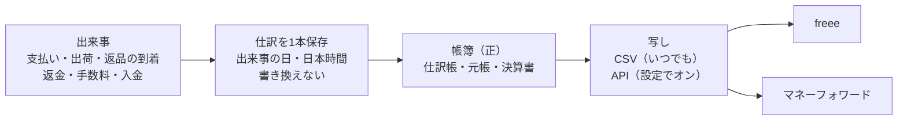

# 会計の作り直しの設計（売上の計上の方針 10章）

> 対象: Le Fil des Heures の通販の管理画面の会計（ACCOUNTING）・KPI と、freee・マネーフォワードへの写し
> 状態: 初版（話し合い中）。1番・2番を決めた所まで。3〜15番はこれから1つずつ決め、決まるたびにこの文書へ書き足す
> 決めた人: オーナー（2026-11-02〜03 の話し合い）。「私の判断」と書いた所は設計者の判断で、オーナーが読んで覆せる
> 元の方針: [売上の計上の方針](../../01_Planning/revenue-recognition-policy.md)（2026-10-23 承認）の10章「システムに入れる直し」
> 関係: [作業と指摘の台帳](../../05_Quality/reviews/code/2026-09-25-working-diff-security-review.md)（S-2）、[G の設計](2026-10-23-group-g-design.md)（発送票・出荷日）、[H の設計](2026-10-28-group-h-promotions-design.md)（1着ごとの支払額）
> 注意: 法令の確かめは AI によるもので、税理士の確認の代わりにならない。方針の9章の一覧を開店前に税理士へ持っていき、答えで変わった所だけ直す

---

## 概要

帳簿の売上を「出荷した日」に立て、先に受け取った代金を「前受金」で持つ形に、会計の仕組みを作り直す。仕訳は注文の状態から毎回作り直すのをやめ、お金と品物が動く出来事が起きた時に1本ずつ保存し、後から書き換えない。この店の帳簿を正（元の記録）にして、freee・マネーフォワードには写しを送る。

### 全体の決定（オーナー）

| # | 決めたこと |
| --- | --- |
| A1 | この店の帳簿を正とする。freee・マネーフォワードには写しを送る |
| A2 | 写しは CSV と API の両方で出せるようにする。API の連携は設定でオンにするオプション |
| A3 | freee とマネーフォワードの両方に対応する（オーナーは今「MF確定申告」を使っている） |
| A4 | 帳簿と決算書を、そのまま申告に使えるようにすることも視野に入れる |
| A5 | 10章の項目は、できるだけ全部対応する。1つずつ現状と変更方針を話して決める |

### 項目と決まり具合

| # | 項目 | 今の状態 | 決まり具合 |
| --- | --- | --- | --- |
| 1 | 仕訳の作り方（出来事ごと・保存して書き換えない） | 注文の日に売上を立て、画面を開くたびに作り直す | 決定（[1章](#1-仕訳の作り方項目1)） |
| 2 | 前受金と出荷の日の売上（一部の出荷は送った分だけ） | 前受金を使っていない | 決定（[2章](#2-前受金と出荷の日の売上項目2)） |
| 3 | 会計の画面を出来事の日の年で数える | 注文を作った年で絞っている | 未決 |
| 4 | Stripe の仕訳（二重・抜けを防ぐ、日本時間、手数料の消費税の区分、チャージバック） | 日付が世界標準時、チャージバックの記録が無い | 未決 |
| 5 | 返品・返金の2段（届いた日・返金した日、検品の差、返金の失敗） | 返金が成功した日の1段だけ | 未決 |
| 6 | 発送の日（実際の出荷日・直した跡） | G-3 でほぼ済み | 未決（確かめるだけ） |
| 7 | 勘定の名前（Stripe 残高（未収入金）・未払金） | 古い名前のまま | 未決 |
| 8 | 受注高（管理画面の数字の名前と数え方） | 名前と数え方が違う | 未決 |
| 9 | 在庫と原価（年末の棚卸・前受金の照合） | 製品・仕掛品を数える所が無い | 未決 |
| 10 | 締め（締めた年の固定・誤りの直しの記録） | 帳簿と決算書を毎回作り直している | 未決 |
| 11 | 会計の期間（1月始まりでない年度） | 1月〜12月で固定 | 未決 |
| 12 | 帳簿の保存（電子帳簿保存法） | 一部だけ | 未決 |
| 13 | 自家消費・宣伝用の印と年末の一覧 | 無い | 未決 |
| 14 | 返品の条件の表示 | 確かめていない | 未決 |
| 15 | freee・マネーフォワードへの写し（CSV・API） | 無い | 方向だけ決定（A1〜A3） |

---

## 0. 目的・目標・制約

### 0-1 目的

- 税法の売上の日（引渡しの日。この店は出荷した日）と帳簿を合わせる。今は注文の日に売上を立て、発送すると注文が売上から消える（台帳の S-2）。
- 帳簿と決算書を、申告に使える信頼できる記録にする。締めた年が後から動かず、直した跡が残る。
- オーナーが使う会計ソフト（今は MF確定申告）へ、同じ仕訳を写せるようにする。

### 0-2 目標にしないこと

- 会計ソフトそのものを作り直すこと。仕訳帳・元帳・決算書・青色申告の書類など、今の会計の画面の作りは使い続ける。
- 申告書の提出（e-Tax への送信）。
- 税理士の確認の代わり。

### 0-3 失敗とみなすこと

- 同じ出来事の売上が二重に入る、または抜ける。
- 締めた年の数字が、後の操作で黙って変わる。
- freee・マネーフォワードに送った写しと、この店の帳簿が食い違う。

### 0-4 前提と制約

- 個人事業（青色申告）で始め、後で法人にする。受注生産が中心で、代金は注文の時に全額受け取る。送料は価格に含み、無料に固定（K-1）。
- 開店前で、本番の注文は試しだけ（G-1 で片付け、2026-11-01 の H の本番適用の記録で 0件）。切り替えた日から新しい形で始める。
- 発送票・実際の出荷日（G-3）と、1着ごとの支払額・割引の割り振り（H）はできている。

---

## 1. 仕訳の作り方（項目1）

決めた日: 2026-11-03（オーナー）

### 1-1 今の作り

- 会計の窓口（`src/app/api/admin/kpi/cost-profit/route.ts`）が、その年に作られた注文を取り、状態が「支払い済み」の注文だけを、注文の日の売上にする（`src/lib/sales/order-sales.ts`）。発送して状態が「発送済み」に変わると、その注文は売上から消える（台帳の S-2）。
- Stripe の記録がある注文は、別の作り方で支払いの時に「クレジット売掛金／売上高」を立てる（`src/lib/finance/stripe-journal.ts`）。日付は日時の先頭10文字（世界標準時の日付）。
- 仕訳は保存せず、画面（`src/components/CostProfitSection.tsx`）を開くたびに全部作り直す。

### 1-2 決めたこと

| # | 決めたこと |
| --- | --- |
| 1-a | 仕訳は注文の状態から作らない。出来事ごとに作る。出来事は、支払い・出荷・出荷前の返金・返品の到着・検品での額の変更・返金・返金の失敗・Stripe の手数料・Stripe からの入金・チャージバック |
| 1-b | 仕訳は、出来事が起きた時に保存する。保存した仕訳は後から書き換えず、消さない |
| 1-c | 誤りは、「取り消しの仕訳」と「正しい仕訳」を足して直す。直した理由を残す |
| 1-d | 出来事ごとに、他と重ならない印（何の出来事の、どの記録か）を付ける。同じ出来事の仕訳は1本しか作らない |
| 1-e | 仕訳の日は、出来事の日（日本時間） |

### 1-3 理由

- 税法の売上の日に合わせるため（方針1章）。注文の状態は1つしか持てず、一部の出荷・出荷前の返金・返品の到着・返金を表せない。
- 締めた年の帳簿を動かさないため（方針7-2。誤りは国税通則法19条の修正申告・23条の更正の請求で直す）。作り直す形では、注文の状態が後から変わるだけで申告した年の仕訳が変わる。
- 電子帳簿保存法の「優良な電子帳簿」は、訂正・削除の履歴が残るシステムか、訂正・削除ができないシステムであることを求める（国税庁の要件のチェック表、税研・東京税理士会の解説）。65万円の青色申告特別控除の道の1つ（もう1つは e-Tax での申告）。
- freee・マネーフォワードへ送った写しと食い違わないため（A1）。
- 日を人の手で動かせる処理は認められない（最高裁平成5年11月25日判決）。

### 1-4 Shopify・定番との比較

| | 今 | 決めた形 | Shopify | 会計につなぐ定番の道具（A2X） |
| --- | --- | --- | --- | --- |
| 売上の日 | 注文の日 | 出荷した日 | 注文の日（売上のレポート） | 取引が起きた期間 |
| 何から作るか | 注文の状態 | 出来事 | 注文と、返品などの調整を別々に | 入金ごとに、売上・返金・割引・手数料を分けた仕訳 |
| 返品・返金の日 | 返金した日 | 届いた日と返金した日の2段（5番で詳しく決める） | 資料によって食い違う | 返金の出来事の日 |

Shopify は会計ソフトではなく、売上を注文の日で数える。帳簿の仕訳は、会計につなぐ道具が出来事から作るのが定番。出荷した日を売上にするのは、日本の税法に合わせたこの店の決まり（方針1章）。

---

## 2. 前受金と出荷の日の売上（項目2）

決めた日: 2026-11-03（オーナー）

### 2-1 今の作り

- 「前受金」の勘定（2150）は勘定の一覧（`src/lib/finance/accounts.ts`）にあるが、ネットの注文には使っていない。手で入れる仕訳にだけ出てくる。
- ネットの注文は、支払いの日に売上を全部立てている。

### 2-2 決めたこと

| # | 決めたこと |
| --- | --- |
| 2-a | 支払いを受けた日: 借方「Stripe 残高（未収入金）」、貸方「前受金」（注文の支払額） |
| 2-b | 出荷した日: 借方「前受金」、貸方「売上高」。額は、その発送で送った品の額だけ |
| 2-c | 出荷の時の売上の額 ＝ 送った品1着ごとの支払額（割引を引いた後）－ その品に当てた出荷前の返金 |
| 2-d | 出荷前の返金は、売上を通さず「前受金／Stripe 残高」（返金した日） |
| 2-e | 年末に出荷していない分は、前受金のまま翌年へ繰り越す |
| 2-f | 発送の取り消し・出荷日の訂正は、前の売上の仕訳をそのまま残し、「取り消しの仕訳」と「正しい日の仕訳」を足す。締めた年をまたぐ時の扱いは10番で決める |
| 2-g | 仕訳の単位は、発送票1枚に仕訳1本。中の行は品ごとに分ける |
| 2-h | 同じ品を2着以上買って、1着ごとの支払額に端数の差がある時は、番号（`unit_index`）の若い順に送ったことにする。この決め方は変えず、システムの概要の書類（12番）に書く |
| 2-i | 交換で送る品は、売上を変えない（方針3-3）。送る品と戻る品の原価の差は9番で決める |
| 2-j | 切り替える前の注文は無い。切り替えた日から新しい形で始める |

### 2-3 使う記録

| 決めること | 使う記録 | できた時 |
| --- | --- | --- |
| 出荷した日 | 発送票の実際の出荷日（`shipment_slips.shipment_date`） | G-3 |
| 記録した日時（入力の遅れが分かるように） | 発送票を確定した日時（`shipment_slips.confirmed_at`） | G-3 |
| 送った品と数 | 発送票の明細（`shipment_slip_lines`） | G-3 |
| 1着ごとの支払額 | `order_line_unit_amounts.paid_amount` | H |
| 出荷前の返金 | 返金の明細の印（`order_refund_lines.before_shipment`）と額 | 前から |

### 2-4 例

シャツ 20,000円・パンツ 12,000円の注文に 2,000円のクーポンを使い、金額の比でシャツに 1,250円、パンツに 750円を割り振った。支払いは 30,000円。

| 日 | 出来事 | 仕訳 | 前受金の残り | 売上の累計 |
| --- | --- | --- | --- | --- |
| 1/5 | 支払い | Stripe 残高／前受金 30,000 | 30,000 | 0 |
| 1/20 | シャツを出荷 | 前受金／売上高 18,750 | 11,250 | 18,750 |
| 2/1 | パンツにお詫びの返金（出荷前） | 前受金／Stripe 残高 1,000 | 10,250 | 18,750 |
| 2/10 | パンツを出荷 | 前受金／売上高 10,250 | 0 | 29,000 |

### 2-5 根拠

| 決めたこと | 根拠 |
| --- | --- |
| 支払いの時は前受金 | 消費税法基本通達9-1-27・タックスアンサー No.6165（前受けしても売上は引き渡した時）。所得税基本通達36-8（売上は引渡しの日）。所得税法施行規則57条1項（資産・負債の一切の取引を記録する） |
| 出荷するたびに送った分だけ売上 | 所得税基本通達36-8(1)・法人税基本通達2-1-2・消費税法基本通達9-1-2（引渡しの日の例に「出荷した日」）。最高裁平成5年11月25日判決（合理的な基準を選んで続けていれば正しい） |
| 取り消しの仕訳と正しい仕訳を足す | 電子帳簿保存法の「優良な電子帳簿」の訂正・削除の要件（1-3）。通常の入力の期間は最長2か月で、それを過ぎた入力は事実が分かることが要る（国税庁の要件のチェック表） |
| 発送票1枚に1本・行は品ごと | 仕訳帳は取引の起きた順に年月日・内容・勘定科目・金額を書く（法人税法施行規則55条。個人は所得税法施行規則58条1項で仕訳帳・総勘定元帳を備える）。課税事業者になったら、相手・年月日・内容・税率ごとの額（消費税法58条、タックスアンサー No.6625） |
| 端数は若い番号から | 法令に決まりは無い。合理的な方法を選んで続けることが条件（最高裁平成5年11月25日判決、所得税基本通達36-8 の「継続して」） |
| 交換は売上を変えない | 代金が動かないので、売上も消費税の対価の返還等（消費税法38条）も起きない（方針3-3） |

### 2-6 Shopify・定番との比較

| | 今 | 決めた形 | Shopify | 会計の定番（収益認識の基準） |
| --- | --- | --- | --- | --- |
| 支払いの時 | 売上 | 前受金 | 売上（注文の日で数える） | 契約負債（前受金） |
| 一部だけ送った時 | 区別しない | 送った品の分だけ売上 | 発送しても売上は変わらない | 渡した分だけ売上 |
| 年末の未出荷分 | 売上に入っている | 前受金で翌年へ | 売上に入っている | 負債で翌年へ |

Shopify と違う所は、日本の税法に合わせるため。Shopify と同じ注文の日の数字は、管理画面の「受注高」（8番）で残す。

---

## 3. まだ決めていない項目（3〜15番）

方針の10章の要点だけを置く。決まったら、1・2章と同じ形の章にする。

| # | 方針の要点 |
| --- | --- |
| 3 | 年をまたぐ出荷・返金・入金を、出来事の日の年で取る（今は注文を作った年で絞る） |
| 4 | 支払いは前受金・売上は発送の側。Stripe の記録の有無で二重・抜けが起きない印。日付は日本時間。手数料の消費税の区分を月の請求書どおりに。チャージバックを原因つきで記録（出荷済みの科目は税理士に確かめるまで決めない） |
| 5 | 返品の品が店に届いた日に「売上値引・返品／未払金」、返金した日に「未払金／Stripe 残高」。検品の差は分かった日に直す。返金の失敗は未払金を残す。消費税用に返金した日の一覧 |
| 6 | 実際の出荷日を入れられ、直した跡が残る。返品の期限に使う日と売上の日を混ぜない |
| 7 | 「クレジット売掛金」（1130）を「Stripe 残高（未収入金）」に。返品で「未払金」を使う |
| 8 | 「受注高」に名前を変え、発送済みも含める。取消・返品のマイナスは返金した日 |
| 9 | 年末に材料・仕掛品・製品・前渡金を数え、原価を翌年へ。製品・仕掛品の棚卸高の勘定と手順。前受金の残高の照合 |
| 10 | 締めた年の仕訳と決算書を固定。後の出来事は起きた年。誤りはその年の申告を直し、直しの仕訳と理由を残す。翌年の損益に出さない |
| 11 | 法人の事業年度が1月〜12月でない場合 |
| 12 | 記録を消せない・直した跡が残る作り。システムの概要の書類。7年保存。画面と紙にすぐ出せる |
| 13 | 0円の注文・在庫の持ち出しに「自家消費」「宣伝用」の印を付け、年末に一覧 |
| 14 | 商品ページと注文の最終確認の画面に、返品の特約が出ているかを確かめる |
| 15 | CSV と API（設定でオン）。freee とマネーフォワードの両方（A1〜A3） |

---

## 4. 確かめきれていない点

| 点 | 状態 |
| --- | --- |
| 電子帳簿保存法取扱通達の解説 4-5「訂正又は削除の意義」・4-6「訂正削除の履歴の確保の方法」 | 国税庁の PDF が画像で読めなかった。「取り消しの仕訳を足す直し方」を書いた国の原文は確かめていない。要件の言葉は国税庁のチェック表と税研・東京税理士会の解説で確かめた |
| 所得税法施行規則58条の記載事項の本文 | 原文を読めていない。仕訳帳の記載事項は法人税法施行規則55条で確かめた |
| 2027年分からの75万円の青色申告特別控除 | 弥生の解説だけで、国の原文は確かめていない |
| Shopify の返品の日の扱い | 二次資料で食い違う |
| A2X の仕訳の日付 | 公式の資料で確かめていない |

---

## 5. 出典

- 国税庁 消費税法基本通達 第9章（9-1-2）: <https://www.nta.go.jp/law/tsutatsu/kihon/shohi/09/01/01.htm>
- 国税庁 タックスアンサー No.6165: <https://www.nta.go.jp/taxes/shiraberu/taxanswer/shohi/6165.htm>
- 国税庁 タックスアンサー No.6625: <https://www.nta.go.jp/taxes/shiraberu/taxanswer/shohi/6625.htm>
- 国税庁 法人税基本通達 2-1-2 ほか: <https://www.nta.go.jp/law/tsutatsu/kihon/hojin/02/02_01_01_2.htm>
- 国税庁 所得税基本通達 51-18: <https://www.nta.go.jp/law/tsutatsu/kihon/shotoku/09/03.htm>
- 国税庁 電子帳簿保存法取扱通達の解説: <https://www.nta.go.jp/law/joho-zeikaishaku/sonota/980528/index.htm>
- 国税庁 優良な電子帳簿の要件の資料: <https://www.nta.go.jp/law/joho-zeikaishaku/sonota/jirei/pdf/0021011-060_03.pdf>
- 東京税理士会 会報（2022年4月）: <https://www.tokyozeirishikai.or.jp/common/pdf/tax_accountant/bulletin/2022/apr_02.pdf>
- 税研 企業懇話会 FAQ: <https://www.zeiken.co.jp/kigyokonfaq/article/cat-3/20210064.php>
- 最高裁 平成5年11月25日判決: <https://www.courts.go.jp/hanrei/55872/detail2/index.html>
- マネーフォワード 優良な電子帳簿の要件（FAQ）: <https://biz.moneyforward.com/support/tax-return/faq/features2/tr-eb05.html>
- 弥生 優良な電子帳簿の解説: <https://www.yayoi-kk.co.jp/shinkoku/oyakudachi/yuryo-dencho/>
- freee 振替伝票の作成の API の変更のお知らせ: <https://developer.freee.co.jp/accounting/accounting-improvement/7937>
- マネーフォワード クラウド会計の API: <https://biz.moneyforward.com/accounting/smb/function/api/>
- マネーフォワード クラウド確定申告 お知らせ（2026-03-26）: <https://biz.moneyforward.com/support/tax-return/news/new-feature/20260326.html>
- A2X（Shopify Plus との連携）: <https://www.a2xaccounting.com/ecommerce-accounting-hub/how-a2x-works-with-shopify-plus>

---

## 6. 改訂の記録

| 日 | 内容 |
| --- | --- |
| 2026-11-03 | 初版。全体の決定 A1〜A5、項目1（仕訳の作り方）と項目2（前受金と出荷の日の売上）を決めた |
