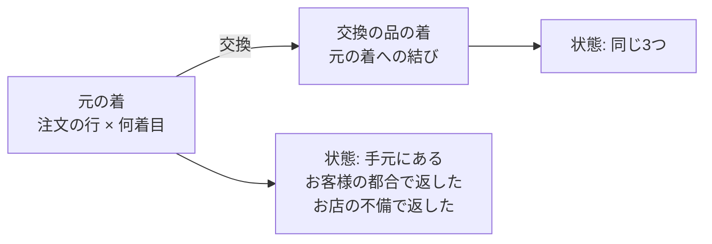

# 交換の印を着そのものに結び付け、返金の額を「手元に残る服の正しい値段」から決める 設計書

> 対象: 返品・交換・発送前の取り消しで返す額の決め方と、1着ずつの記録（グループ E-3・H・FREQ-641 の続き）
> 関連: [返品と交換（E-3）設計書](2026-10-12-returns-design.md)、[割引（グループ H）設計書](2026-10-28-group-h-promotions-design.md) の13章、[返品の受け取りで品ごとに返金の仕方を選ぶ 設計書](2026-11-06-return-receive-per-item-design.md)、[管理画面の詳細設計](../../04_DetailDesign/pages/16_admin.md) の「既知の点」、[売上の計上の方針](../../01_Planning/revenue-recognition-policy.md)、[会計の計画3](../plans/2026-11-04-accounting-p3-returns-refunds.md)
> 確認日: 2026-11-10。オーナーとの会話（2026-11-08〜11-10）で決めた内容を書く。2026-11-10 オーナー承認

---

## 概要

同じ服を割引つきで2着以上買った注文で、1着だけ返品・交換した時に返す額を、「お客様の手元に最後に残る服の正しい値段」から決める。交換の印は、今の「行の中で安い順の何番目か（位置）」ではなく、1着ずつの記録そのものに結び付ける。

| 項目 | 内容 |
| --- | --- |
| なぜ | 今は交換の印が位置で決まるので、交換と返金が同じ着を取り合い、返す額を誤る（既知の点4つ。お客様に 3,000円足りない・3,000円返し過ぎの道がある） |
| 基本の決まり | 返す額の累計 ＝ 払った合計 − 手元に残る服の正しい値段（オーナー決定 2026-11-08） |
| 条件1 | 不良・誤送は交換で応じる。在庫が無ければ今のとおり作って送り、どうしても送れない時だけ返金する。お店の側の事情で返金する時（その返金・発送前の取り消し）は、残りの割引を取り直さない（オーナー決定 2026-11-10。11-09 の「お店の不備でも取り直す」を、法のおそれを見て改めた） |
| 条件2 | ほかの注文の値段・返金の記録は直さない。ただし、お客様のご都合で前の注文の着を返して後の注文の累計の2着目割引が外れる時は、外れた分を前の注文の返金から差し引く（お客様の手元に残るのは1着なので、安い方の額を返す。オーナー決定 2026-11-09）。お店の側の事情の返金では差し引かない（条件1） |
| 条件3 | 返す額は0円より少なくしない。追加の支払いを求めない。払った合計を超えない |
| 条件4 | 割引の扱いを商品ページ・注文の最後の確認画面・規約に書き、返品の申し込み画面で返金の見込みの額を出す |
| 返品を受け付ける条件 | 今のまま（お客様のご都合は受けない、初期不良・誤送は到着後7日以内、サイズ交換は未使用・在庫ありだけ）。オーナー決定 2026-11-08。ただし、初期不良・誤送のお客様のご希望は「返金と交換」から「交換だけ」に変える（オーナー決定 2026-11-10） |
| 交換 | 同じ商品の色・サイズだけ（今のまま）。交換の品は元の商品の1着として数えるので、交換だけではお金は動かない |
| 1着の記録 | 元の着も交換の品の着も、1着ずつ「手元にある／お客様の都合で返した／お店の不備で返した」の状態と、交換の元の着への結びを持つ |
| 変わる前の決まり | H の D15「返した着は安い方とみなす」と「セットがくずれても残りの割引を取り直さない」は、この設計の決まりに置き換わる |

---

## 1. 目的と、しないこと

### 1-1 目的

- 交換と返品をどんな順で、何回に分けて行っても、最後にお客様へ返る額の合計が同じになる
- お客様の負担が「最初から手元に残る服だけを買った時」と同じになる（得も損もしない）
- お店の側の事情で返金する時は、お客様が割引を失わず、手数料・返送料も負わない
- 既知の点4つ（[管理画面の詳細設計](../../04_DetailDesign/pages/16_admin.md) の `20261108063711` の節）を直す
  1. 交換と返金が同じ空きの着を数え、交換の品を後で返す時に少なく返す
  2. 画面の見込みが DB の額とずれる
  3. 相談を2回に分けると手数料の控えが同じ着を2回数える
  4. 返金の error の後のやり直しで、交換の印が位置で移り返し過ぎる

### 1-2 しないこと

| しないこと | 理由 |
| --- | --- |
| 返品を受け付ける条件（期間・タグ・理由）を変える | オーナーが今のままでよいと決めた（2026-11-08）。初期不良・誤送のご希望を「交換だけ」にすることだけ変える（2026-11-10） |
| 違う商品への交換 | 今の E-3 の範囲のまま。同じ商品は色・サイズで値段が変わらない |
| ほかの注文の値段・返金の記録を直す | 条件2（外れた割引の分は、前の注文の返金から差し引く） |
| お客様から追加でお金を受け取る | 条件3 |
| H より前の注文（1着ずつの記録が無い注文）の計算を変える | 今の計算のまま |
| お客様がどの着を返すかを選ぶ欄 | 額は着の選び方に左右されない作りにするので要らない |

### 1-3 こうなったら失敗（アンチゴール）

- 同じ出来事でも、交換と返金の順によって最後に返る額の合計が変わる
- 画面に出た見込みの額と、実際に返した額が違う
- お店の側の事情で返金したのに、割引を取り戻す・前の注文から差し引く・手数料を掛ける
- お店の側の事情の返金が、同じ着をお客様のご都合で返した時より少ない
- 返金の額が、その注文で払った合計を超える
- 前の注文と後の注文の返金の合計が、2つの注文で払った合計 − 手元に残る服の正しい値段 を超える

---

## 2. 基本の決まり

### 2-1 式

注文ごとに、次の額を「返す権利の累計」（以下 E）とする。

E ＝ 払った合計 − 手元に残る服の正しい値段 − 後の注文で外れた割引の分 − 手数料の累計

- 「後の注文で外れた割引の分」: この注文の着を返したために、後の注文の累計の2着目割引が外れた分（2-2。ふだんは0円）
- 「手元に残る服」: 元の着と交換の品の着のうち、状態が「手元にある」の着
- 「正しい値段」: 注文の時と同じ割引の計算で、手元に残る服だけを買ったとした時の値段（2-2）
- 出来事（受け取り・発送前の取り消し）ごとに E を出し直し、その出来事で返す額 ＝ 新しい E − それまでの E の最高。0円より少なければ0円（条件3）
- 「それまでの E の最高」を起点にする理由: E が下がった時（割引の条件を外れて残りの値段が上がった時）、お客様に支払いを求めない代わりに、下がった分は後の出来事で埋め合わせる。例: 10,000円の服4着を「3着以上で 50%引き」で払った 20,000円。1着目を返すと E 5,000円で 5,000円返す。2着目で E 0円、返す額0円（支払いは求めない）。3着目で E 10,000円、起点は最高の 5,000円なので 5,000円返す。累計 10,000円 ＝ 払った合計 − 残る1着の 10,000円
- 起点は計算した E で、実際に返した額ではない（私の判断）。店長が受け取りや「額を決めて返金する」で額を変えた時、返金しないで終えた時、その差はその出来事だけの店長の決定で、後の出来事に持ち越さない。例: 例2の返品で店長が傷を理由に 15,000円に下げても、後で交換の品を返す時は 20,000円（合計 35,000円）。多めに返した分も後で引かない。返す額の累計は、今と同じ「注文の返せる額」の上限で止める
- 交換は同じ商品なので、手元に残る服の正しい値段を変えない。交換だけの受け取りでは返す額は0円

### 2-2 正しい値段の出し方

- 注文の時に使った割引の計算（`src/lib/discounts/`）に、「数える籠」を入れて出し直す
- 数える籠 ＝ 手元にある着 ＋ お店の側の事情で返した着（条件1のため。お店の側の事情で返した着は、割引の条件を数える時はまだあるとみなす）
- 数える籠の値段を出した後、お店の側の事情で返した着の分を引く。引く着は、同じ商品の中で割引の付いた着（計算した値段の安い方）から（2026-11-09 オーナー決定。例5: 2着目割引の 17,000円の着を返したとみなす）
- ただし、こうして出した手元の値段が、「手元に残る服だけで出し直した値段」より高い時は、低い方を使う（私の判断）。お店の側の事情の返金が、同じ着をお客様のご都合で返した時より少なくならないため（例12）
- 対象は全部の種類の割引: 2着目割引（リピート）、セット、商品の割引（数の条件つきも）、注文全体の割引（割合・金額・合計の条件つき）。注文全体の割引で合計の条件を外れたら、その割引も取り直す（2026-11-09 オーナー決定。例15）
- 重ねて使える設定の割引（重ね方の印が両方とも付いている時だけ。初めの値は重ねない）も、注文の時と同じ重ね方で出し直す（例16）
- 使う割引は、その注文に記録された割引だけ。値・対象・種類・重ね方は使った後は変えられない（H 設計の 367 行）ので、注文の時と同じ中身で出し直せる。期間・回数の上限・初回だけの条件は、注文の時に満たしていたものとして扱う
- その注文の手元の値段を出す時、リピート割引の「前の注文の着数」は、注文の時の数をそのまま使う（条件2）。そのため、注文の時の数を注文の記録に残す（4-3）
- 後の注文で外れた割引の分（条件2、例10）:
  - 後の注文 ＝ 同じお客様の、この注文より後の入金済みの注文で、リピート割引を「前の注文の着がある」ことで受けた物
  - 外れた分 ＝ 後の注文の手元にある着を、「前の注文の着数」を今の手元にある着の数に直して出し直した値段 − 注文の時の数のまま出した値段。0円より少なくしない。前の注文の着のうち、お店の側の事情で返した着は、ここでも「まだある」と数える（条件1。例10を不良で交換できず返金した時は差し引かず 20,000円）
  - 外れた分は、それを生んだ出来事の注文の E から引く。E が0円より少なくなる分は引かない（お客様に支払いを求めない。条件3）
  - 後で外れた分が減った時（後の注文の着も返った時・前の注文の着数が戻った時）は、引いた注文の E に戻し、その注文から返す。引いた注文が2つ以上ある時は、後に引いた注文から戻す（私の判断。合計の額は変わらない）

### 2-3 出来事の理由の分け方

「お店の側の事情」の返金は、割引を取り直さず（2-2）、手数料を掛けない（2-4）。

| 出来事 | 扱い |
| --- | --- |
| 返品の理由が「破損・不良」「注文と違う品が届いた」 | お客様のご希望は交換だけ（2026-11-10 オーナー決定。理由ごとの設定の `resolutions` を、この2つの理由だけ `exchange_only` にする。在庫の無い交換は今のとおり「作って送る」）。交換の品を送れず返金に変えた時は、お店の側の事情（下の行） |
| 返品のその他の理由（サイズ・色・好み・不要・説明と違った・その他） | お客様のご都合 |
| 発送前の取り消し（注文全体の取り消しと、管理画面の返金で発送前の品を選ぶ返金を含む） | お店の側の事情として扱う（私の判断。お客様のご都合の取り消しは受けない約束なので、取り消しはお店の事情に当たる）。選んだ着の状態を「お店の不備で返した」に変え、標準の額は E の増えた分。店長は今と同じく上限の中で額を変えられる（2-1 のとおり後に持ち越さない） |
| 管理画面の返金で発送後の品を、返品を作らずに選ぶ返金 | 品は手元に残るので、着の状態を変えず E も変えない。「品を指定しない返金」と同じ（私の判断） |
| 品を指定しない返金（お詫び・手で決めた額） | E を変えない。注文の返せる額の上限の中で、店長が決めた額を返す |
| 返品の理由が「説明と違った」 | お客様のご都合として扱う（私の判断。今の返送料の負担の設定に合わせる） |
| お客様の交換の頼みを、お店が交換の品を送れず返金に変えた時（不良・誤送で作って送ることもできない時と、サイズ交換などを含む） | お店の側の事情として扱い、割引を取り戻さず手数料を掛けない（不良・誤送は 2026-11-10 オーナー決定。ほかは私の判断。お客様は返品を選んでいないため） |

- 受け取りの時に、店長が返品の行ごとに「割引の扱い」（お店の側の事情の扱い／お客様のご都合の扱い）を直せる欄を、この作業で作る。初めの値は上の表から入る。理由そのもの（`order_return_lines` の理由）は変えない。誰がいつ直したかを残す
- 理由ごとの返送料の負担（`return_shipping_payer`）がお店のものを「お店の不備」にそろえるかは、作り手が今の理由の設定を見て決める。そろわない理由があれば、この表を正とする

### 2-4 手数料

- 今は返品ごとに率が1つで、受け取った品の全部の額に掛けている。この設計では、お客様のご都合の扱いの着の分だけに掛ける（変える）
- 手数料を掛ける元の額 ＝ E′ − E′不備（私の判断）
  - E′: 手数料を引く前の E（払った合計 − 手元に残る服の正しい値段 − 後の注文で外れた割引の分）
  - E′不備: お客様のご都合で返した着を、まだ手元にあるとみなして出した E′（お店の側の事情の分だけを返した時の E′）
  - どちらも今の着の状態だけで決まるので、出来事の順や、1回の受け取りの中の行の順で額は変わらない（例11・AC-24）
- 返品ごとに率が違う時は、その出来事で増えた「E′ − E′不備」に、その返品の率を掛ける
- このブランドは手数料を使わない設定（E-3 設計）。式は手数料がある時も合うように作る

### 2-5 E に入れない物

- 「払った合計」は商品の着の払った額（`order_line_unit_amounts.paid_amount`）の合計。送料は入れない
- 送料の返金、返送料、交換の手数料・送料は、今と同じく E の外で足し引きする
- 返す額の累計の上限は、今と同じ「注文の返せる額」（送料を含む）

---

## 3. 例

例の注文は2つ。

- **リピートの例:** ジャケット 20,000円を2着。2着目は 3,000円引き。払った額は 20,000円と 17,000円、合計 37,000円
- **セットの例:** ジャケット 20,000円を2着とパンツ 10,000円。ジャケットとパンツの組で 4,500円引き（ジャケットに 3,000円、パンツに 1,500円）。払った額はジャケット 17,000円（組の中）と 20,000円（組の外）、パンツ 8,500円、合計 45,500円

| 番号 | 出来事 | 今の作り | この設計 |
| --- | --- | --- | --- |
| 例1 | リピート。お客様のご都合で1着返す | 17,000円 | 17,000円（残る1着は割引なしの 20,000円） |
| 例2 | リピート。交換1 → あとで残りの元の1着を返す | 20,000円（順で変わる） | 交換で0円、返品で 17,000円 |
| 例3 | リピート。返品1 → あとで残りを交換 | 17,000円、交換で0円 | 17,000円、交換で0円（例2と同じ） |
| 例4 | 例2の後、交換の品も返す | 17,000円（合計 37,000円）。位置の誤りで 34,000円や 40,000円になる道がある | 20,000円（合計 37,000円） |
| 例5 | リピート。不良の1着を交換できず返金する | 17,000円 | 17,000円（返す着は割引の付いた2着目とみなす。2026-11-09 オーナー決定） |
| 例6 | セット。お客様のご都合でジャケット1着返す | 17,000円 | 20,000円（残るジャケット1着とパンツで組がそろう） |
| 例7 | セット。お客様のご都合でパンツを返す | 8,500円（割引を取り直さない） | 5,500円（組がくずれ、残るジャケット2着は 40,000円） |
| 例8 | セット。不良のパンツを交換できず返金する | 8,500円 | 8,500円（割引を取り戻さない。2026-11-10 オーナー決定） |
| 例9 | リピート。発送前に1着取り消す | 17,000円 | 17,000円（お店の側の事情の扱い。取り消す着は割引の付いた2着目とみなす） |
| 例10 | 累計の2着目割引。1回目の注文で1着 20,000円、2回目の注文で1着 17,000円。1回目の着をお客様のご都合で返す | 20,000円 | 17,000円。手元に残るのは1着なので安い方の額を返す。外れた 3,000円は1回目の注文の返金から差し引き、2回目の注文の値段と返金の記録は直さない（2026-11-09 オーナー決定）。1回目の着が不良で交換できず返金する時は、差し引かず 20,000円（2026-11-10） |
| 例10-2 | 例10の後、2回目の注文の着も返す | 17,000円（合計 37,000円） | 2回目の注文から 17,000円、1回目の注文から差し引いた 3,000円、合わせて 20,000円（合計 37,000円） |
| 例11 | 手数料 10% が掛かる返品の後に、交換の品を不良で返す（順を入れ替える） | 35,000円と 35,300円（順で変わる） | どちらの順でも 35,000円（不良の分 17,000円は手数料なし、ご都合の分 20,000円に 2,000円） |
| 例12 | セット。不良のジャケット1着を交換できず返金する | 17,000円 | 20,000円（籠から割引の付いたジャケット 17,000円を引くと手元は 28,500円。残るジャケットとパンツで組がそろう 25,500円の方が安いので、こちらを使う。お客様のご都合の例6と同じ額） |
| 例13 | ジャケット1着とパンツ1着だけのセット（ジャケット 17,000円、パンツ 8,500円、合計 25,500円）。不良のジャケットを交換できず返金する | 17,000円 | 17,000円（割引を取り戻さない。お客様のご都合なら 15,500円。2026-11-10 オーナー決定） |
| 例14 | 10%引きの割引コード。ジャケット 18,000円とパンツ 9,000円、合計 27,000円。ジャケットを返す | 18,000円 | 18,000円（残るパンツにも 10%引きが付き 9,000円） |
| 例15 | 「30,000円以上で 1,000円引き」。ジャケット 19,333円とパンツ 9,667円、合計 29,000円。パンツを返す | 9,667円 | 9,000円（残るジャケットは 30,000円に届かず 20,000円。2026-11-09 オーナー決定） |
| 例16 | 重ねる設定にした2着目割引と 10%引きの割引コード。ジャケット 18,000円と 15,300円、合計 33,300円。1着返す | 15,300円 | 15,300円（残る1着は 10%引きだけで 18,000円） |
| 例17 | セット。不良のパンツを交換する（在庫が無ければ作って送る） | 0円 | 0円（組はくずれない） |

例14〜例16の返品は、今の返品の条件ではお客様のご都合の理由「その他」で返金を選んだ時か、交換できなかった時に当たる。交換できなかった時は、お店の側の事情の扱いになり、割引を取り直さない（例15なら 9,667円）。

例7は、H 設計13章の「セットの片方を返しても残りの割引を取り直さない」（H の時の私の判断）を、お客様のご都合の時だけ変える。オーナーの決めた基本の決まりから出てくる結果なので、この設計の受け入れ基準に入れる。

数の条件つきの商品の割引（10,000円×4、3着以上で 50%引き、払った 20,000円）を1着ずつ返すと、5,000円・0円・5,000円・10,000円（2-1 の例。2026-11-09 オーナー決定）。

---

## 4. 1着ずつの記録

### 4-1 記録すること

| 記録 | 中身 |
| --- | --- |
| 着 | 元の注文の行の着（`order_item_id`・`unit_index`）と、交換の品の行の着 |
| 状態 | 手元にある／お客様のご都合で返した／お店の不備で返した。発送前の取り消しは「お店の不備で返した」 |
| 交換の結び | 交換の品の着から、交換に出した元の着へ。交換の品をさらに交換した時は、前の交換の品の着へ |
| 出来事 | 状態を変えた返品の行・受け取り・取り消し・返金。その出来事の E と返す額 |

- 交換に出す元の着は、返品の行に結び付いている着。結び付いていなければ、空きの着から決まった順で選ぶ。額は着の選び方で変わらないので、順は作り手が決めてよい（D15 の安い順を続けるのが手軽）
- 状態は受け取り・取り消しの確定の時に変える。返金の error・やり直しでは変えない（既知の点4がここで消える）
- 一度確定した出来事の E と返す額は、あとで出し直さない（年をまたいだ会計の額を変えないため）

### 4-2 変えない物（会計のセッションとの取り決め）

- `order_line_unit_amounts` の主キー（`order_item_id`, `unit_index`）、`unit_index` の付け方、`paid_amount` は変えない。行を消さない
- 交換の品の着の行は `order_line_unit_amounts` に足さない（交換の品は0円の行で、払った額が無い）。状態と結びは新しい表に持つ（私の判断。H の守り（`paid_amount` などを変えさせない仕組み）と、会計の `accounting_unit_refund_allocations` の参照を変えずに済む）
- 着の状態の正は新しい表の1つだけにする。H の取り押さえの列（`order_line_unit_amounts.refund_id`・`return_line_id`・`refund_before_shipment`）は「その着の分を払った返金の記録」へのつなぎとして残し、新しい表の状態から書く。安い順に空きの着を取る今のやり方（`group_h_claim_refund_units` など）は、返す着を決める所だけ 4-1 と5章の決まりに置き換える
- 移行を書く前に、版の時刻を会計のセッションに知らせる

### 4-3 注文の時に足して残す物

- リピート割引の「前の注文の着数」を、商品ごとに注文の記録に残す（2-2。今は割引の額だけが残り、数が残らない）
- H の注文でこの数が残っていない注文（この変更より前の注文）は、今の計算（D15）のまま。本番の店はまだ開いていないので、試しの注文だけが当たる（未確認事項 1）

### 4-4 リピート割引の「前の注文の着数」の数え方を直す

- 今: 入金済みの注文の着数 − 返金が成功した着数。交換の品を返金しても、元の行の着数が残る道がある（調べ C11）
- この設計: 商品ごとに「手元にある着」の数（元の着と交換の品の着）。お店の不備で返した着・取り消した着も数えない
- 数を減らすのは状態を変えた時（返金の成功を待たない。0円の返品でも減る）。私の判断。0円で返金の記録が作られない返品でも数が合うようにするため

---

## 5. 返金の記録と会計

この作業は、会計が読める記録を残すところまで作る。仕訳を書くのは会計の計画3（会計のセッション）。

- 1回の出来事で返す額は、今と同じ返金の記録（`order_refunds`・`order_refund_lines`）に書く
- 出来事ごとに、状態を変えた着と、返す額の1着ごとの割り振りを残す。割り振りの合計は返す額と同じ
  - 返した着が交換の品の着なら、結びをたどった元の着に割り振る
  - 1着に割り振る額は、その着の払った額まで。返す額が返した着の払った額と違う時（例6・例7）の差は「残る着の値段の直し」として、同じ出来事の記録に別に残す
  - 直しは、手元に残る着のうち値段が変わった着に、1着ずつ付ける。各着の直し ＝ 出し直した後のその着の値段 − 前のその着の値段。そのため、着ごとに「今の値段」（初めは `paid_amount`）を持ち、出来事ごとに書き換える。直しの合計 ＝ 返した着の割り振りの合計 − 返す額（例7: パンツに 8,500円を割り振り、組のジャケットに +3,000円の直し。返す額は 5,500円）。発送前の取り消しでも同じで、直しは残る着に付ける（その着が出荷済みかどうかは記録に残し、仕訳の分け方は会計が決める）
  - 返す着は、同じ商品の空きの着のうち、払った額が返す額にいちばん近い着（同じなら安い順・`unit_index` の順）。私の判断。差をできるだけ小さくするため
  - 後の注文で外れた割引の分（例10）は、前の注文の出来事の記録に、後の注文の残る着への直しとして残す（例10: 1回目の着に 20,000円を割り振り、2回目の着に +3,000円の直し。返す額 17,000円）。後でその分を返す時（例10-2）は、前の注文の新しい出来事として返金し、同じ着に −3,000円の直しを残す。どちらの注文の出来事かと、直しを付けた着の注文を記録に残す
- 会計の計画2の `private.accounting_record_unit_refund` は出荷前の着だけを受け付ける。発送前の取り消しの返金は、この道具に上の割り振りを渡す。発送後の返品の仕訳（売上値引・返品と差の直し）は、計画3がこの記録を読んで書く
- 売上の計上の方針の「売上値引・返品にするのは実際に返す額」はそのまま当てはまる
- 交換だけの出来事は、売上も返金も動かさない（今の方針どおり）
- 会計の計画3は、この設計の決まりを受けて規則2(a)と、作り直す3つの関数（`admin_receive_return`・`begin_order_refund_core`・`record_group_g_refund_result`）の前提を見直す。この設計が承認されたら、決まりを会計のセッションに知らせる

### 5-2 会計のセッションの問いへの答え（2026-11-09、計画3との突き合わせ）

| 問い | 答え（Q1・Q7 はオーナー決定、ほかは私の判断） |
| --- | --- |
| Q3 取り消しで返す額と割り振りの差の行き先 | 手元に残る着に付ける（5章の直し）。着ごとに残す |
| Q4 `accounting_unit_refund_allocations` を書く者と鍵 | 会計の道具1つが書く（例外を投げない）。鍵は出来事の id。返金のやり直しは元の出来事を指すので、同じ割り振りを指す。出来事と返金の記録の結びはこの作業が残す |
| Q5 返す着の選び方で、会計の出荷済みの着を避けるか | 発送前の取り消しは、`accounting_shipped_units` に無い着の中から選ぶ。発送後の返品は、出荷済みの着の中から選ぶ。その中で J-12 の決まり |
| Q6 返金の error・failed で H の `refund_id` を付け外しするか | 着の状態と割り振りは出来事に付き、返金の成り行きでは動かない。`refund_id` は返金の記録へのつなぎなので、やり直しの時に新しい返金の記録へ付け替えてよいが、割り振りは動かさない |
| Q8 手数料を出来事ごとに残すか | 残す。出来事ごとに E′・E′不備・手数料（2-4）を記録し、会計は出し直さずに読む |
| Q10 まだ発送していない交換の品を取り消し、元の着は出荷済み | 交換の結びを残す（4-1）。割り振りは元の着に付ける（会計は発送後の返品として扱う） |
| Q13 番号と移行の版 | 要求・試験の番号は計画3・4の範囲（FREQ-575〜593、FR-ADMIN-137〜140・141 から後）を避ける。移行の版は 20261108230000 より後なら何でもよい。計画3はこの作業の最後の移行の後に番号を振る。コミットした版を会計のセッションに知らせる |
| Q15 前の注文から差し引く記録（例10） | 出来事ごとに、2つの注文・着・差し引いた額か戻した額を残す。会計は各注文で実際に返した額だけを計上する |
| Q14 試験の道具の作り直し | 作り直した道具（`H5_RETURN_FUNCTION_NAMES`・`withH5ReturnBaseline`・RR/RD の再現・`CURRENT_ALLOWLIST`）と変えた所を、完了の報告に書く |
| Q1 残る着の値段の直しの仕訳 | オーナー決定（2026-11-10）: 売上値引・返品は実際に返す額だけで計上し、直しは仕訳にしない（例7は 5,500円）。この作業は着ごとの今の値段・出荷済みの印・出来事ごとの直しを記録として残す（発送前の取り消しで残る着は、出荷の時に今の値段で売上にするため） |
| Q7 店が止めた発送前の取り消しで、着の状態を戻すか | オーナー決定（2026-11-10）: 戻す。止めた取り消しの着だけ「手元にある」（発送できる）へ戻せる（7章）。前受金はそのまま残り、出荷の時に売上になる |

---

## 6. 画面とお客様への知らせ

### 6-1 お客様

| 場所 | 足す物 |
| --- | --- |
| 商品ページ・注文の最後の確認画面・/legal・/terms | 割引の扱いの文（下の案）。今の返品の条件の文の近くに置く |
| 返品の申し込みの画面の確かめる段 | 「返金の見込み: N円」。DB と同じ計算から出す。交換だけなら「お金のやり取りはありません」 |
| 返金のメール・注文の画面 | 今のまま（返した総額）。直しの差は出さない |

文の案（言い回しはオーナーが決める）:

> 割引（2着目割引・セット割引・割引コードなど）が付いたご注文で一部の商品を返品され、割引の条件を満たさなくなる場合は、お手元に残る商品の割引後の価格を差し引いて返金いたします。以前のご注文の商品を返品され、その後のご注文の2着目割引の条件を満たさなくなる場合も、その分を差し引いて返金いたします。初期不良・誤送は、同じ商品の交換でお応えします（在庫が無い場合はお作りしてお送りします）。どうしてもお送りできない場合に限り返金し、その時はお手元に残る商品の価格は上がりません。返金額がマイナスになることはありません。

### 6-2 管理画面

- 受け取りの画面と「額を決めて返金する」の見込みは、DB と同じ計算から出す（既知の点2がここで消える）
- 選んだ行・今すぐと相談の分け方・交換の有無・理由を変えるたびに、見込みを出し直す

---

## 7. どこで計算するか（私の判断）

- 正しい値段は、注文の時と同じ割引の計算（TypeScript）でサーバーが出す。見込みと確定は同じ関数を使う
- DB の関数は、サーバーが出した正しい値段と状態を受け取り、次を必ず守る: 返す額 ≥ 0、返す額の累計 ≤ 払った合計、注文の返せる額の上限、同じ二重防止の番号で同じ結果、1着の状態は一度だけ変わる（ただし、店が返金を止めた発送前の取り消しの着だけは「手元にある」へ戻せる。2026-11-10 オーナー決定）
- 理由: 割引の計算を SQL に写すと2つの計算がずれる。注文の時（H）も、割引の額はサーバーが出して DB が記録している
- 今の「返金の額は DB が正」（FREQ-464）は、「上限と状態は DB が正、正しい値段の計算はサーバー」に変わる。サーバーは画面から額を受け取らない（店長が直す額は今と同じ別の欄）

---

## 8. Shopify・業界との比べ

| 項目 | この店 | Shopify | 業界の例 | 出典 |
| --- | --- | --- | --- | --- |
| 割引つきの1着を返す時の額 | 手元に残る服の正しい値段から決める。条件を外れた割引は差し引く | 行の割引後の額を返す。割引を取り戻さない | Target・Amazon（Buy with Prime）・Uniqlo（米国）は割引を全着に割合で割り振って返す。Lightspeed は条件を外れた時、残す品を定価で売り直す。AfterShip・Returbo は取り戻しを設定で選べる | [Shopify の返金](https://help.shopify.com/manual/orders/refunds-returns/refunding-orders)、[AfterShip](https://support.aftership.com/en/articles/15389352-item-discount-distribution-for-returns)、[Returbo](https://intercom.help/returbo/en/articles/13727947-how-do-group-discounts-work-cancel-group-discounts)、[Lightspeed](https://retail-support.lightspeedhq.com/hc/en-us/articles/1260805832589-Refunding-discount-rule-sales)、[Target](https://www.target.com/help/article/000063251)、[Amazon](https://buywithprime.amazon.com/knowledge-center/buy-with-prime-app-for-shopify/refunds-with-promotions) |
| お店の不備の時 | 交換で応じる。送れない時だけ返金し、残りの割引を取り直さない。返す着は割引の付いた着から（リピートの2着目なら 17,000円） | 理由で額を変える標準の仕組みは無い（店の人が手で額を直す） | — | [Shopify の返金](https://help.shopify.com/manual/orders/refunds-returns/refunding-orders) |
| 交換 | 同じ商品の色・サイズだけ。お金は動かない | 返す品に払った額を新しい品に充て、差額を返すか受け取る | — | [Shopify の交換](https://help.shopify.com/en/manual/orders/refunds-returns/exchanges) |
| 交換の品をあとで返す | 交換の品を元の商品の1着として数え、同じ決まりで計算 | 交換の品の行の値段をもとに返す | HotWax・Swap の説明 | [HotWax](https://docs.hotwax.co/documents/learn-shopify/shopify-reference/order-return/shopify-pos-exchanges)、[Swap](https://intercom.help/swapcommerce/en/articles/12007642-returning-an-exchange-returns-v2) |
| 同じ商品で値段の違う着 | 1着ずつ記録する。額は着の選び方で変わらない | 行を分ける。どの行を返すかを人が選ぶ | — | [LineItem](https://shopify.dev/docs/api/admin-graphql/latest/objects/LineItem) |
| ほかの注文 | 値段と返金の記録は直さない。お客様のご都合の前の注文の返品で後の注文の累計の2着目割引が外れる時は、外れた分を前の注文の返金から差し引く | 注文ごとに返金する | — | 同上 |
| 返金の見込み | 申し込み画面と管理画面に、確定と同じ計算で出す | `returnCalculate` で先に額を出せる | — | [返品の管理](https://shopify.dev/docs/apps/build/orders-fulfillment/returns-apps/build-return-management) |
| 返金の額の下限 | 0円。追加の支払いは求めない | 返金は0円以上 | — | [Shopify の返金](https://help.shopify.com/manual/orders/refunds-returns/refunding-orders) |

Shopify と違う所と理由:

- 割引を取り戻す: オーナーの決定（2026-11-08）。会計（実際に返す額を売上から引く）・法（差し引くのは外れた割引の分だけ）・お客様の公平（最初から残る服だけ買った時と同じ）の3つの面で確かめた。Lightspeed と、AfterShip などの取り戻しの設定と同じ考え
- お店の不備は交換で応じ、送れない時の返金では取り直さない: オーナーの決定（2026-11-10）。民法の契約不適合（562条）では、お客様に不相当な負担を掛けなければ、お店は代わりの品を渡す形で応じられる。送れずに返金する時に割引を差し引くと、その分をお客様が損害（564条・415条）として求める余地があり、規約に書いても消費者契約法8条3項・10条で無効になるおそれがあるため、差し引かない
- 前の注文から差し引く: オーナーの決定（2026-11-09）。お客様のご都合の返品の時だけ。2回目の注文の時に割引の条件として示しておく（6-1）
- 交換でお金が動かない: 同じ商品の色・サイズの交換だけで、値段が変わらないため

---

## 9. 受け入れ基準

額は全部、注文の行と着（`order_item_id`・`unit_index`）、返品の行、受け取り、返金の記録の対応まで確かめる。

| 番号 | 場面 | 確かめること |
| --- | --- | --- |
| AC-01 | 例1 | 返す額 17,000円。残る着の状態は「手元にある」 |
| AC-02 | 例2・例3 | 交換が先でも返品が先でも、交換で0円・返品で 17,000円 |
| AC-03 | 交換と返品を同じ受け取りで | 交換0円・返品 17,000円。行の id の順を入れ替えても同じ |
| AC-04 | 例4 | 交換の品の返品で 20,000円、合計 37,000円。既知の点1の 34,000円にならない |
| AC-05 | 既知の点4の順（数量2の交換の行を届かないで終える → ふつうの返金 → 開き直し → 返金 error → 交換 → 今すぐ返金 → error → やり直し） | 合計 37,000円を超えない。交換の結びが動かない |
| AC-06 | 既知の点3（10%、1着ずつ2回相談） | 控えは 1,700円と 2,000円、合計 3,700円 |
| AC-07 | 既知の点2（一部の行だけ受け取る・相談と今すぐの id の順を入れ替える） | 画面の見込み・上限・DB の額・返金の記録が同じ |
| AC-08 | 例5・例8・例9・例12・例13 | お店の側の事情の返金・発送前の取り消しでは、返す着を割引の付いた着から選び、残りの割引を取り直さず、手数料を掛けない（17,000円・8,500円・17,000円・17,000円）。お客様のご都合の時より少なくならない（例12 で 20,000円） |
| AC-09 | 例6・例7 | 20,000円・5,500円 |
| AC-10 | 例10・例10-2 | 1回目の注文の返品で 17,000円。2回目の注文の値段と返金の記録は変わらない。あとで2回目の着を返すと、2回目から 17,000円・1回目から 3,000円、2つの注文の合計 37,000円。2回目の着が先に返っていれば、1回目は 20,000円。1回目の着を不良で交換できず返金する時は差し引かず 20,000円。1回目の返金は 20,000円を超えない |
| AC-11 | 例11 | どちらの順でも合計 35,000円 |
| AC-12 | 数量2の交換の品を1行にまとめた後に1着返す（調べ C07） | お客様のご都合なら 17,000円。平均の 18,500円にならない |
| AC-13 | 注文全体の1円引き（10,000円×2、払った額 9,999円と 10,000円） | 1着返した後も残る1着に注文の割引の条件が合えば、手元の値段 9,999円・返す額 10,000円。最低 50円の調整も注文の時と同じ計算 |
| AC-14 | 条件を外れると残りの値段が上がる割引（2-1 の例: 10,000円×4、3着以上で 50%引き） | 1着ずつ返すと 5,000円・0円・5,000円・10,000円、累計 20,000円。0円の時もお客様に支払いを求めない |
| AC-15 | 品を指定しないお詫びの返金の後に返品 | E は変わらない。返す額は注文の返せる額の上限で止まり、見込みにもその上限が出る |
| AC-16 | 交換 → 交換の品を全部返金 → 同じ商品をまた買う（調べ C11） | 前の注文の着数は0。次の注文は割引なし |
| AC-17 | 返金の error・pending・failed・やり直し | 着の状態と E は変わらない。同じ二重防止の番号で同じ額 |
| AC-18 | 会計が読む記録 | 出来事ごとに、割り振りの合計 − 直しの合計 ＝ 返す額。1着の割り振りはその着の払った額以下。交換の品の返金は元の着に割り振る。例7はパンツに割り振り 8,500円と、組のジャケットに直し +3,000円（返す額 5,500円）。例10は1回目の着に 20,000円と2回目の着に +3,000円、例10-2の1回目の出来事は同じ着に −3,000円。発送前の取り消しは `accounting_record_unit_refund` に同じ割り振りが渡る |
| AC-19 | 年をまたぐ | 前の年に確定した出来事の額を、後の出来事で出し直さない |
| AC-20 | H より前の注文・前の注文の着数が残っていない注文 | 今の計算のまま |
| AC-21 | お客様の返品の申し込み（mobile 390px・tablet 768px・desktop 1280px） | 確かめる段に返金の見込みが出て、受け取りで返した額と同じ（店長が額を直さない時）。交換だけなら「お金のやり取りはありません」 |
| AC-22 | 商品ページ・注文の最後の確認画面・/legal・/terms（3つの画面幅） | 割引の扱いの文が出る |
| AC-23 | 店長が額を変えた後の出来事 | 例2の返品を 15,000円に下げても、交換の品の返品は 20,000円（2-1） |
| AC-24 | 1回の受け取りに不良の1着とお客様のご都合の1着（リピートの例、手数料 10%） | 不良の分 17,000円は手数料なし、ご都合の分 20,000円に 2,000円、合計 35,000円。行の順を入れ替えても同じ |
| AC-25 | 受け取りで「割引の扱い」を直す（3つの画面幅） | 初めの値が理由から入り、直すと額の見込みが変わり、誰がいつ直したかが残る |
| AC-26 | 交換の品を送れず返金に変えた | お店の側の事情の扱い。返す着は割引の付いた着から（リピートの例で 17,000円、例13で 17,000円） |
| AC-27 | 管理画面の返金で発送前の品を選ぶ・注文全体の取り消し | 着の状態が「お店の不備で返した」になり、標準の額は E の増えた分（例9で 17,000円） |
| AC-28 | 管理画面の返金で発送後の品を返品なしで選ぶ | 着の状態と E は変わらない |
| AC-29 | 例14・例15・例16（お客様のご都合） | 18,000円・9,000円・15,300円。注文全体の割引も、重ねた割引も、注文の時と同じ計算で出し直す。例15を交換できず返金した時は 9,667円 |
| AC-30 | お客様の返品の申し込みで理由に「破損・不良」「注文と違う品が届いた」を選ぶ（3つの画面幅） | ご希望に「交換」だけが出て、「返金」は出ない。店長が交換を返金に変えると、お店の側の事情の扱いになる |
| AC-31 | 例17 | 交換で0円。残りのセットの割引は変わらない |

---

## 10. 私の判断（オーナーに確かめてほしい物）

| 番号 | 判断 | 理由 |
| --- | --- | --- |
| J-1 | 不良・誤送は交換で応じ（ご希望は交換だけ）、送れない時だけ返金する。その返金は、同じ商品の中で割引の付いた着から返したとみなし、残りの割引を取り直さない（例5・例8・例13） | 2026-11-10 オーナー決定（11-09 の「お店の不備でも取り直す」を、民法・消費者契約法のおそれを見て改めた）。割引の付いた着から返したとみなすのは 2026-11-09 オーナー決定 |
| J-15 | J-1 で出した手元の値段が、手元に残る服だけで出し直した値段より高い時は、低い方を使う（例12） | お店の側の事情の返金が、お客様のご都合の返品より少ない額にならないため |
| J-13 | お客様のご都合で前の注文の着を返して後の注文の累計の2着目割引が外れる時は、外れた分を前の注文の返金から差し引き、後の注文の着も返った時に前の注文から返す（例10・例10-2）。お店の側の事情の返金では差し引かない | 2026-11-09 オーナー決定（手元に残るのは1着なので安い方を返す）。お店の側の事情で差し引かないのは 2026-11-10 の決定から。外れた分の出し方と、前の注文が2つ以上ある時は後に引いた注文から戻すことは私の判断 |
| J-14 | 注文全体の割引も、お客様のご都合で合計の条件を外れたら取り直す（例15で 9,000円） | 2026-11-09 オーナー決定 |
| J-2 | 発送前の取り消しはお店の側の事情として扱う | お客様のご都合の取り消しは受けない約束のため |
| J-3 | 「説明と違った」はお客様のご都合として扱う。受け取りで店長が行ごとに「割引の扱い」を直せる欄を作る | 今の返送料の負担の設定に合わせた。返品の行の理由は作った後に変えない作りなので、別の欄にした |
| J-4 | セットの片方をお客様のご都合で返すと、残りの割引を取り直す（例7） | 基本の決まりから出る。H の時の判断を変える |
| J-5 | 品を指定しないお詫びの返金は E を変えない | 店長が決めた額で、服の値段の話ではないため |
| J-6 | 前の注文の着数は、手元にある着で数え、状態を変えた時に減らす | 交換の品の返品と0円の返品でも数が合うようにするため |
| J-7 | 正しい値段はサーバーが注文の時と同じ計算で出し、DB は上限と状態を守る | 割引の計算を2つ持たないため |
| J-8 | 次に返す額の起点は「それまでの E の最高」。店長が変えた額は後に持ち越さない | 下がった E を後で埋め合わせつつ、傷による値下げなどの店長の決定を後で戻さないため |
| J-9 | 交換の品を送れず返金に変えた時は、お店の側の事情として割引を取り戻さない | お客様は返品を選んでいないため（不良・誤送は 2026-11-10 オーナー決定） |
| J-10 | 発送後の品を返品なしで選ぶ返金は、品を指定しない返金と同じ | 品が手元に残るため |
| J-11 | 手数料はお客様のご都合の扱いの着の分だけに掛ける（今は全部に掛ける） | お店の不備に手数料を掛けないため |
| J-12 | 返す着は、払った額が返す額にいちばん近い着 | 会計の差の直しを小さくするため |

---

## 10-2. 入れる順番

この作業は、会計の計画2が終わった後、計画3の前に入れる（2026-11-09 オーナー決定）。

- 計画3は、この作業が作り直す3つの関数（`admin_receive_return`・`begin_order_refund_core`・`record_group_g_refund_result`）を「今の本文を写して」作り直す予定で、規則2(a)は返す着の決まりに頼る。計画3を先に入れると、同じ関数を2回作り直すことになる
- 会計の計画2（いま会計のセッションが進めている）が終わってから始める。計画2の移行の後の版の時刻を使う
- FREQ-641 も同じ理由で計画3の前に入れた

---

## 11. 作り手に任せること

- 新しい表・列の名前と形（4-1 の中身を持てること、4-2 を守ること）
- 交換に出す元の着の選び方の順（額に影響しない）
- 割引の計算に「数える籠」を渡す関数の作り方と、後の注文で外れた割引の分を出す関数の作り方
- 初期不良・誤送のご希望を交換だけにする移行の書き方（理由ごとの設定の2行の `resolutions` を `exchange_only` にする。店長は今のとおり設定の画面で変えられる）と、それに頼っている今の試験の直し
- 見込みを出す窓口の形と、画面の作り
- 今の `exchange_paid_amount` の扱い（返金の計算には使わない。表示や履歴に残すかは任せる）
- 試験の分け方（単体・DB 結合・E2E）。E2E は要求管理ルールどおり3つの画面幅

---

## 12. 未確認事項

1. 本番の DB に、試しでない H の注文が無いこと（4-3 の「前の注文の着数が残っていない注文は今の計算のまま」の前提）。計画を書く時に本番を読むだけで確かめる
2. 返品の理由ごとの返送料の負担の今の設定（2-3 の表とそろうか）
3. 6-1 の文の言い回し。開店前の税理士の確認の時に、返品の条件の書き方も見てもらう
4. 会計の計画3の規則2(a)を、この設計の差の扱い（5章）に合わせて会計のセッションが見直すこと
5. 済み（2026-11-09）: この作業は会計の計画2の後、計画3の前に入れる（10-2）
6. 不良・誤送のご希望を交換だけにすること（民法562条のただし書の「不相当な負担」に当たらないか）と、お客様のご都合の返品で割引を取り直す・前の注文から差し引く決まり（例7・例10）の規約の書き方を、開店前の税理士の確認の時に専門家にも見てもらう
7. 前の注文から差し引いた分を後で返す時（例10-2）、前の注文の年が締まっていた時の会計の扱い。会計のセッションと税理士に確かめる
