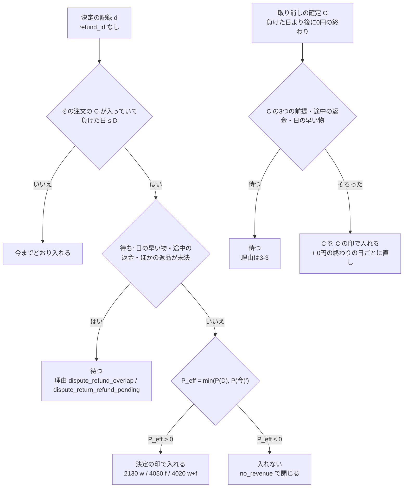

# 返品の0円の終わりと、カード会社の確定の重なりを、計上係が自動で入れる 設計書（案A・自動の形）

> 対象: 会計の計画3（返品・返金）で、今は人が閉じる計上待ち `order_not_postable` のうち、理由 `dispute_lost` と `return_closed_after_lost` の2つを、計上係（返品の計上係・取り消しの計上係）が自動で入れる形にする
> 関連: [会計の作り直しの設計](2026-11-03-accounting-redesign-design.md)（正本。この設計が足す所は11章に書く。この設計書では編集しない）、[計画3 返品・返金の手順書](../../06_Operations/accounting-p3-returns-refunds.md)、調べ（`.superpowers/sdd/2026-11-04-accounting-p3-returns-refunds/research-order-hand-journal.md`）、計画3 最終レビュー（同 `final/final-review-a.md` の I1・M3・M4・M5）、この設計の見直し5回分（`.superpowers/sdd/2026-11-15-accounting-pending-manual-entry/design-review.md`〜`design-rereview5.md`。最終は READY）
> 確認日: 2026-11-15（形の変更: 自動。D12（2026-11-15 controller の裁定）: 最後の直しは今の 2130 の負けも、C の pay を上限に戻す。4-2・3-8 (k)。D13（2026-11-15 controller の裁定）: 取り消しの計上係の C は、pay が負けた日の R より小さい時、別の返品が未決の間は待つ。3-3・14。D14（2026-11-15 controller の裁定）: 「ほかの返品が未決」の待ちは、注文の 2130 がまだ 0 より大きい間だけ（返品の計上係は P(今)′、C の側は C の前の P(今)）。3-3・14。D15（2026-11-15 controller の裁定）: C の側の待ちは、pay が R より小さい時に加えて、未決の返品に負けた日より後に届いたものがある時も待つ。返品の計上係の待ちは P_eff = min(P(D), P(今)′) が 0 より大きい間だけ。順序によらない帳簿を全部の順で確かめる試験を足す。3-3・3-5・14・15）。D16（2026-11-15 controller の裁定）: 最後の直しの上限に「0円の終わりが 2130 から取った額」を足し、C の側の入れた後の確かめは 2130 が負でもエラーにしない（二重払いは異常の一覧に出す）。4-2・4-3・14）。D17（2026-11-15 controller の裁定）: 直しは全部、その日までの0円の終わりが 2130 から取った額（前の直しを引く）までに上限をつけ、足りない負は異常の一覧に残す。入れた後の d_n ごとの確かめは、上限に止められなかった直しだけが対象。4-2・14）。オーナーが2026-11-15 に案Aを選び、続けて「人が確かめて閉じる画面」ではなく「計上係が自動で入れる」形を選んだ（15章 #1。D10）。式と円の例 (a)〜(j) は、人が閉じる形の見直し5回で確かめた物をそのまま使う。コードは読んだだけで、DB・E2E・build は動かしていない。法令の原文は調べ（2026-11-15）が e-Gov で確かめた物で、この設計の書き手が読み直した物ではない。実装はまだ無い

---

## 概要

| 項目 | 内容 |
| --- | --- |
| 何を作るか | 計上係の2か所の「止める」（返品の計上係 `20261113090000:1002-1012`、取り消しの計上係 :635-644）を、自動で入れる処理に作り直す（移行 S27）。人の画面・route・閉じる関数・「仕訳なしで閉じる」の道は作らない |
| 範囲 | 理由 `dispute_lost` と `return_closed_after_lost`。ほかの `order_not_postable`（`shipping`・`units_missing`・`units_sum`）は今の「結んで閉じる」のまま（8章） |
| なぜ必要か | 今の道（経費の欄の仕訳と結ぶ）は、注文も補助科目も付かないので、閉じても注文ごとの 2130 `return_refund` と 1470 の残高が動かない。銀行振込の上限・精算・2つ目の取り消しの相殺は、その残高を読む（`accounting_order_account_balance`）ので、払い済みの返金の振込が上限を通ってしまう |
| 自動で入れる仕訳 | 今の計上係と同じ印で入れる。`dispute_lost`: 決定の印 `return_amount_decided:[事実の番号]` で、0円の終わりの仕訳を、消す額 w だけに減らして入れる（借 2130 w・借 4050 f・貸 4020 w+f）。`return_closed_after_lost`: 確定 C を C の印 `dispute_event:<dp>:confirmed:lost` で負けた日に、計上係の C と同じ形で入れ、0円の終わりの日ごとに、戻しすぎの直し（借 4020 y_n・貸 2130 y_n。印 `dispute_event:closefix:<dp>:<n>`）を足す |
| 仕訳がいらない時 | `dispute_lost` で消す額が0以下（P_eff ≤ 0）の時は、何も入れない。理由 `no_revenue` の行を作って閉じる（今の「入れる物が無い」と同じ道）。返金の計上係の待ち `return_prior` が、この閉じた決定を「済んだ」と数えるよう、`accounting_refund_wait` を作り直す（3-6） |
| 前提は「待ち」 | 途中の返金・ほかの返品が未決・C の3つの前提・日の早い物が先、は断りでなく待ち。今の計上待ちの理由（`dispute_refund_overlap`・`dispute_return_refund_pending`・`dispute_withdrawal_missing`）で止め、前提が解けると次の計上係の実行で自動で入る。新しい理由は作らず、理由の CHECK（20個）も変えない（3-3） |
| 人が見るもの | 今の計上待ちの一覧に、今ある理由の行が、読むだけで出る（2つの理由の文だけ、人が何をするか分かる文に直す。3-3）。ボタンは無く、前提が解けると自動で消える。仕訳帳には、自動の仕訳（返品の額の決定・取り消しの確定・直し）が注文つきで出る |
| 今の「結ぶ」道 | 変えない。この2つの理由の行は S27 の後は新しく作られない（5-1、14章） |
| 閉じた後の取り消し（A-M3） | 自動の仕訳と同じ種類・印なので、今の一般の取り消し（`admin.finance.manage`）が使える。開き直しは別の仕事。10章 |
| 要求・試験 | FREQ-643、FR-ADMIN-169（12章）。DB 試験で円の例 (a)〜(j) を全部固定する |
| オーナーに確かめること | D10: 人が確かめて閉じる形でなく、自動で入れる形にしてよいか（決定済み。15章 #1）。人の確認の印（誰が閉じたか）は残らない |
| 税理士に確かめること | 仕訳の型、手数料の見せ方、年またぎ、消費税の返還等。13章 |

---

## 1. 目的と、しないこと

### 1-1 目的

- `dispute_lost` と `return_closed_after_lost` の出来事を、人の操作なしに、注文ごとの残高（2130 `return_refund`・1470）を正しく動かして入れる。
- 入れた後、銀行振込の上限・精算の候補・2つ目の取り消しの相殺が、正しい残高を読む。取り消しごとの残高・一覧・照合・遅れての取り下げ L も、自動で入った他の仕訳と同じに動く。

### 1-2 しないこと

- 人が確かめて閉じる画面・route・関数、「仕訳なしで閉じる」の道、閉じる順の鍵と `ACCOUNTING_EARLIER_ROW_OPEN`、人の確認の印は作らない（D10）。
- 新しい権限・新しい表・新しい仕訳の種類・新しい計上待ちの理由は作らない。
- A-M5（出荷の行の `payment_journal_missing` に閉じる道が無い）は直さない。2150 の注文つきの行が要る別の問題で、今の新しい注文では起きない（8章）。
- 閉じた行の開き直しは作らない（10章）。

---

## 2. 元の動き（SQL から読んだ事実）

### 2-1 出来事ごとの仕訳

| 出来事 | 仕訳（返品・確定の相殺の行には注文が付く） | 場所 |
| --- | --- | --- |
| 返品の到着 G=品の額、F=手数料 | 借方 4020 G ／ 貸方 2130 `return_refund` G。借方 2130 `return_refund` F ／ 貸方 4050 F | `20261113013000_accounting_p3_return_posting.sql:62-63` |
| 返金を決めた時（返金あり） | 借方 4020 ／ 貸方 2130 `return_refund` の差（payable_delta）。返金の成功は借方 2130 `return_refund` ／ 貸方 1160 | 同 :64-65、`20261112214341_accounting_p3_refund_posting.sql:143` |
| 0円で終える（返金なし。waive） covers=C、fee=F | 借方 2130 `return_refund` C、借方 4050 F、貸方 4020 (C+F)。到着の仕訳をそのまま打ち消す形。印は `return_amount_decided:[決定の事実の番号]` | 同 :66-74、:1018-1021（`20261113090000`） |
| カード会社に引かれた時 W | 貸方 1160 A、借方 2150 U、借方 1470 `dispute_pending` S（出荷した分）。1470 の行に注文は付かない | `20261113090000_accounting_p3_dispute_offset.sql:444-453` |
| 確定 C（負けが決まった時） | 借方 2130 `return_refund` pay（注文あり）、借方 1470 `dispute_refund_overlap_review` review（注文あり）、借方 費用科目 rest（設定の科目。無ければ 1470 `dispute_confirmed_unassigned`）、貸方 1470 `dispute_pending` S（費用・`dispute_pending` の行に注文は付かない）。印は `dispute_event:<dp>:confirmed:lost` | 同 :652-679 |

### 2-2 C の相殺の式（`accounting_dispute_offset_amounts`）

`20261113090000_accounting_p3_dispute_offset.sql:150-199`。

- R = 注文の 2130 `return_refund` の（貸方 − 借方）。負けた日（日本時間）以前の仕訳だけ数える。ただし返金の成功の仕訳は、日付でなく返金を作った日で数える（:165-172）。
- Z = 注文の 1160・1040 の、返品の返金の仕訳（と、その取り消し）の（貸方 − 借方）。失敗の戻り分を引き、すでに 1470 `dispute_refund_overlap_review` に置いた分を引く。0より小さければ0（:173-195）。
- pay = min(max(R, 0), S)。review = min(Z, S − pay)。rest = S − pay − review（:196-197、:655）。

### 2-3 今の計上係が止める場所

- `dispute_lost`（返品の計上係）: 返金なしの決定（`refund_id` が NULL）は、負けが確定した日以後で、その注文の C がもう入っていると、`order_not_postable` / `dispute_lost` で止める（`20261113090000:1002-1012`）。C が先に 2130 を相殺しているので、waive をそのまま入れると 2130 が負になるため。止める時に C の印の仕訳は**すでにある**。
- `return_closed_after_lost`（取り消しの計上係）: C は、その注文に「負けた日より後の日付の、返金なしの決定の仕訳（取り消されていない）」があると、`order_not_postable` / `return_closed_after_lost` で止める（:635-644）。止める時に C の印の仕訳は**まだ無い**。
- 計上係の取り出し: 計上係は新しい出来事（lane 0）を先に、前に止めた開いた行（lane 1、最大10件）を後に回す。取り出しの並びは `ORDER BY lane, phase, …`（返品の計上係は `created_at, return_id, seq`。`20261113090000:924`）。1回の実行の順は、返品の計上係 → 返金の計上係 → 取り消しの計上係（`20261113013000:410-419` の `accounting_run_posting`）。どれも `accounting_lock_all` を最初に取るので、同時には動かず、直列になる。
- 止めた行は、前提が解けると次の実行で自動で入る（lane 1 が開いた行を再評価し、入れば閉じる。`accounting_unpark_event`）。閉じた行は二度と開き直さない（`accounting_park_event`、`20261108150000:514-530`）。

### 2-4 今の「結んで閉じる」の穴と、手の仕訳（`manual_entry`）を使わない理由

- 結べるのは経費の欄の仕訳。その仕訳は2行とも `sub_account` と `order_id` が NULL（`20261107130400_accounting_p1_manual_entry_journal.sql:464-470`）。閉じても注文ごとの 2130 / 1470 は動かない。
- 注文つきの `manual_entry` を足す案（人が閉じる形）は、C の印が無いまま残る欠陥があった（見直し1の重要1）。遅れての取り下げ L は `confirmed_done` が無いので `dispute_withdrawal_missing` で止まり、閉じる道が無い（`20261108200000:183-191`、`20261113090000:504-506`）。取り消しごとの残高（`accounting_dispute_balance` は印の頭 `dispute_event:<dp>:` で数える。同 :204-214）・取り消しの一覧・照合も古いまま。だから `manual_entry` は使わず、計上係の印で入れる。

---

## 3. 自動で入れる式と待ち

### 3-1 方針

- 計上係が入れる仕訳の額は、今の計上係の式（2-2）と、この章の式で決まる。人は何も選ばない。式と円の例 (a)〜(j) は、人が閉じる形の見直し5回で確かめた物と同じ。
- `dispute_lost`（返品の計上係）では、止める代わりに、前提の待ち（3-3）を確かめ、P_eff を計算し、w>0 なら決定の仕訳を w だけで入れ、P_eff ≤ 0 なら入れる物が無いものとして閉じる。
- `return_closed_after_lost`（取り消しの計上係）では、止める代わりに、前提の待ち（3-3）を確かめ、C をそのまま（今の C の式のまま）入れ、0円の終わりの日ごとに直しを足す。

### 3-2 式（`dispute_lost`）

決定の記録 d（注文 O、返品 K、covers=c、fee=f、日 D=`decided_on`）について、計上係が次を計算する。

- **P(D)** = R の式（2-2）の日を D にした値。つまり 2130 `return_refund` の（貸方 − 借方）のうち、D 以前の仕訳（返金の成功は返金を作った日）だけ。D より後に入った仕訳（取り下げ L の戻りなど）は数えない。**P(今)** = 今までの全部の仕訳の同じ値。
- **P(今)′** = P(今) − 外した返金の post_shipment_amount の合計（3-3 の例外で途中から外した返金。`dispute_lost` の側だけで使う。返品の返金の成功は 借 2130 `return_refund`。`accounting_refund_lines('success_post', …, _plain = true)`）。
- **P_eff = min(P(D), P(今)′)**。D までに積み上がった分と、今も残っている分の小さい方。D で切るだけでは、D より後に別の仕訳が 2130 を減らした時に、入れた後の今の残高が負になる（(h)）。今だけで数えると、D より後の取り下げ L の戻りまで消してしまう（(g)）。
- **w** = min(c, max(P_eff, 0))。0円の終わりで本当に消すべき 2130 の額。

| 条件 | 計上係がすること |
| --- | --- |
| 前提の待ち（3-3）に当たる | 待つ（その理由で止める。解けると自動で入る） |
| P_eff > 0 | 決定の仕訳を入れる。行は `accounting_return_lines('waive', 注文, w, f)`（借 2130 w・借 4050 f・貸 4020 w+f）。印・日・見出しは今の0円の終わりと同じ |
| P_eff ≤ 0 | 仕訳は入れない（理由 `no_revenue` の行を作って閉じる。3-6）。P(D) が負の時も同じ（2130 がすでに負なのは、今ある異常の一覧（P3-F3a）で見つかる。ここでは何も足さない） |

なぜ P_eff ≤ 0 なら入れなくてよいか: waive が入れるはずの行は 借方 2130 w、借方 4050 f、貸方 4020 (w+f)。w = 0 なら、残るのは 借方 4050 f ／ 貸方 4020 f だけで、売上の中の科目の移動にすぎず、2130・1470 は動かず、利益も変わらない。手数料 f は、4050 に残るか、C の費用の行（rest）が受けている。見せ方は13章 #2。

### 3-3 前提の待ち

どれも「断る」でなく「待つ」。計上係が今の仕組みで止め、前提が解けると次の実行で自動で入る。**新しい理由は作らない**（今の20個の理由で足り、`accounting_pending_events_reason_check` の作り直しは要らない。`detail` の `why` も、今の許す値 `refund`・`return` で足りる）。

| 前提 | 待つ対象 | 使う理由（今ある物） | 詳細 `why` | どう解けるか |
| --- | --- | --- | --- | --- |
| 途中の返金（修正4回目の D8） | `dispute_lost`・`return_closed_after_lost` の両方（外す例外は `dispute_lost` の側だけ。下） | `dispute_refund_overlap` | `refund` | 返金の成功・失敗の仕訳が入る、または取りやめが決まる |
| ほかの返品が未決（D3） | `dispute_lost`、および `return_closed_after_lost`（D13・D15。pay < R(負けた日)、または未決の返品に負けた日より後に届いた到着がある時だけ。D14: 2130 が0より大きい間だけ。返品の計上係は P_eff が0より大きい間だけ） | `dispute_return_refund_pending` | `return` | ほかの返品の返金の額が決まる |
| 日の早い物が先（3-5） | `dispute_lost`・`return_closed_after_lost` | `dispute_return_refund_pending` | `return` | 日の早い物が入る |
| C の3つの前提（D4）: 引かれた分が全部入っている／負けより前の取り下げが未計上でない | `return_closed_after_lost` | `dispute_withdrawal_missing`（今の計上係が使う理由） | なし | その仕訳が入る |
| C の3つの前提: `offset_ready` | `return_closed_after_lost` | `dispute_refund_overlap`・`dispute_return_refund_pending`（今の計上係と同じ。`offset_ready` が返す理由） | `refund`／`return` | 返金や返品の仕訳が入る |

- **理由の文（自動の形の修正1）**: 文は今の計上待ちの一覧の `REASON_TEXT`（`src/components/cost-profit/pending-view.tsx`）にある。新しい `why` の値は作らず（今の許す値は `refund`・`return` だけで、`accounting_pending_detail_valid` の作り直しが要る）、**2つの文だけ**を、人が何をすればよいか分かる文に直す。ほかの理由の文は変えない。
  - `dispute_refund_overlap`（途中の返金・C の前提の `offset_ready` の返金の段）: 「カード会社からの支払いの取り消しがある注文に、終わっていない返金か、成功したのに仕訳がまだ入っていない返金があります。二重に費用にしないため止めています。返金や返品の仕訳が入ると、自動で計上されます。返金が処理中なら、そのまま待ってください。「エラー」の返金は、やり直してください。Stripe で取り消された返金は、返金の画面で取り消しの区分を選んでください。成功や失敗の仕訳が止まっている返金は、その返金の計上待ちの行の文のとおりに進めてください。」
  - `dispute_return_refund_pending`（ほかの返品が未決・日の早い物が先・C の前提の `offset_ready` の返品の段）: 「カード会社からの支払いの取り消しがある注文に、返品の返金待ちがあります。額がまだ決まっていないほかの返品があれば、その返品の返金の額を決めてください。日の早い返品や取り消しが先に計上されるのを待っている時は、そのまま待ってください。先の行が止まっている時は、その行の文のとおりに進めてください。仕訳が入ると、自動で計上されます。」
  - 2つの文は、`why` で分けない（今の許す値 `refund`・`return` は理由と1対1で、分けても新しい情報が無い）。新しい `why` は要らない。
  - どの待ちで何をするか: `requested`・`accepted` は待つだけ（自動で解ける）。`error` は返金のやり直し。Stripe で取り消されて決め待ちの返金（`canceled`）は、その返金に別に出る `refund_cancel_undecided` の行から区分を選ぶ。ほかの返品が未決は、その返品の額を決める。日の早い物が先は待つだけ。
  - `dispute_withdrawal_missing` の文は今のまま（「前の段の仕訳…がまだ入っていません。入ると自動で計上されます。」）。
  - 文の変更は文字だけで、判定・route・型は変わらない。試験は 12-3。
- 人の見え方: 計上待ちの一覧に、その理由の行が出る。ボタンは無く、「仕訳が入るまで閉じられません」と出るだけ（今の読むだけの行の見え方）。前提が解けて計上係が入れると、行は自動で閉じて一覧から消える。理由 `dispute_return_refund_pending`・`dispute_refund_overlap` の行は、人が閉じる道が元から無い（`CLOSABLE` は `before_cutover`・`no_revenue` だけ）ので、人が誤って閉じることもない。

**途中の返金**: その注文に、成功か失敗の仕訳がまだ入っていない返金。`accounting_dispute_offset_ready` の最初の段（`20261113090000:84-117`、S24 の作り直し後）と同じ5つで、**負けた日で切らない**: (1) 返金の記録があり、最後の会計の状態が `requested`・`accepted`・`error`、(2) `succeeded` の状態があるが、成功の仕訳（`pre_shipment_refund`・`return_refund`、返金の番号）が無く、その仕訳を人が閉じた行・切り替え前の行も無い、(3) `failed`・`owed` の状態があるが失敗の仕訳（`refund_failed`）も閉じた行も無い、(4) `canceled` の状態があるが `abandoned`・`owed` が無い、(5) `abandoned` の状態があるが取りやめの仕訳（`refund_abandoned`）も閉じた行も無い。理由: P(今) は未計上の成功を数えないので、途中の返金の分まで消してしまい、返金が成功すると 2130 が負になる（(h) 組2）。直しの y_n も同じ。`error` を数える理由: 今の銀行振込の断り（P3-T11i、`20261114100000:198-204`）は `awaiting_response`・`pending` だけを見て `error` を外した（P3-T11k。`error` の返金は再試行しかできず、振込で払うのは正しいので）。ここは払うのでなく消す側で、`error` の返金を再試行して成功すると同じ −10,000 の穴ができる。だから計上係の C の待ち（`offset_ready`）と同じに `error` も数える。`error` の間は、自動で待つ。人が急ぐなら、その返金を再試行して結果を出すか、取り消しの区分を決めて終わらせる。

**途中から外す返金（互いの待ちを作らない例外。自動の形の修正1で絞った）**: 途中の返金 R を、`dispute_lost` の側（返品の計上係）の評価でだけ、途中の数から外す。外すのは次の3つが**全部**成り立つ R だけ:

1. R は今、`accounting_refund_wait(R, 'success')` が `return_prior`（NULL でない）。つまり前の決定（payable_delta が0でなく、仕訳も、`no_revenue` で仕訳なしに閉じた行も無い物）か、届いたものの仕訳を、今待っている。
2. この物と、この物より日の順が後の同じ注文の決定を、済んだとすると、その待ちが NULL になる（足りない物が全部、この物以降の決定。届いたものの仕訳待ちが残れば解けない）。
3. R の成功の仕訳がまだ入っていない（途中の形が (1) `requested`・`accepted`・`error` か、(2) 成功したが未計上）。

何も待っていない普通の途中の返金（前の決定も到着も計上済みで、`accounting_refund_wait` が今 NULL の物）は、外さず、途中のまま待つ（1 が成り立たない）。理由: 外さないと、この物は返金を待ち、返金はこの物の決定の仕訳を待つ、という互いの待ちで、どちらも動かない（(j)）。この輪を切る時だけ外す。外した返金は成功の仕訳が入ったものとして、P(今)′ で2130 から引く（引くのは物ごとに1回）。

取り消しの計上係の C と直しの側は、途中の返金を**全部**待ち、外さない（P(今)′ の引き算も無い）。C の側には互いの待ちが無いため（返金の待ちが待つ決定は、C が無い間はふつうに入る。`dispute_lost` は C の印がある時だけ止める）。(i) はこの側の例。

**ほかの返品が未決（D3。`dispute_lost` と、D13 で `return_closed_after_lost`）**: 同じ注文のほかの返品 K' の「まだ残る額」v_left（到着の（品の額 − 手数料）の合計 + 決定の payable_delta の合計 − 返金ありの決定の decided_amount の合計。失敗した返金を除く。0未満は0。`accounting_record_return_decision` の `v_left` と同じ式。`20261115100000_accounting_p3_final_fixes.sql:149-159`）が1つでも0を超えたら待つ。決めていない返品の返金待ちを、C がもう消したのか消していないのか、2130 の合計からは分けられないため。`return_closed_after_lost`（取り消しの計上係の C）にも、**D13（2026-11-15 controller の裁定）**で、C の `pay` が負けた日の R（`accounting_order_return_payable(注文, 負けた日)`）より小さい時だけ付ける（途中の返金の待ちの後、日の早い物が先の待ちの前。「途中の返金 → ほかの返品が未決」の順は返品の計上係と同じで、返品の計上係は日の早い物が先を最初に確かめる。理由と `why` は同じなので違いは見えない）。この返品は「その注文の全部の返品」で、C の側には自分の返品が無いので、0円の終わりで一部だけ終えた返品の残りも数える（返品の計上係は決定の返品以外のほかの返品）。カード会社が返品の返金待ちの全部を覆わなかった時、未決の返品が後で返金されると、C と直しを入れた後に 2130 が負になり、売上が多く残る（直し y_n は C を入れた時の帳簿しか読めない）。pay = R の時は付けない（返品の返金待ちを全部 C が消したので、後の返金は本当の二重払いで、例 (e) は待たずに入る）。**ただし D15（2026-11-15 controller の裁定）**: 額が未決の返品（v_left > 0）の中に、到着の日が負けた日より後のものがあれば、pay = R でも待つ（R は負けた日までの 2130 なので、その返品は R に入らず、C が覆っていない。待たないと、C と0円の終わりが A の分を2回消し、後でその返品を返金すると 2130 が負になって売上が多く残る）。待つ条件は「pay < R、または未決の返品に負けた日より後に届いた到着がある」かつ D14。待ちの輪は無い（未決の返品の決定・返金・0円の終わりは C を待たない。C が入る前の0円の終わりは普通に入る）。

**D14（2026-11-15 controller の裁定。D3 と D13 の両方）**: この待ちは、その注文の 2130 `return_refund` がまだ 0 より大きい間だけ。返金が失敗し、返金の借りが返品の銀行振込（origin `return`）などで払われた返品は、数える決定が残らず（失敗した返金の決定は数えない）v_left が 0 を超えたままになる。2130 が0以下なら、返品の計上係は w = 0 になり（待っても待たなくても入れない）、C の側は D12 の直しで円が合うので、待たない。返品の計上係は P_eff = min(P(D), P(今)′)（D15。P(今)′ は今の 2130 から、途中から外した返金の分を引いた値。P_eff ≤ 0 なら待っても w = 0 で、後の取り下げ L が 2130 を戻していても待たない）、C の側は C の前の P(今)（`accounting_order_return_payable(注文, NULL)`）で読む。2130 が0より大きい間（例: 未決の返品が残っている・一部だけ返金した）は今までどおり待つ。割引の写しがある注文は、決定の `covers` を出来事の返金額から取るので、返金の額が到着の（品の額 − 手数料）より小さいと v_left が残りうる（コードを読んで確かめた。試験は作っていない）が、残りは 2130 にも残るので、D14 は待ちを外さない。その返品に返金を待つ品が残っていれば、その残りの額を決める（返金・返金しないで終える）と解ける。待つ品が残っていない時は返品の画面が `RETURN_NOTHING_TO_REFUND` で断るので、人が決める道があるかは確かめていない（15章 8）。

### 3-4 流れ

### 3-5 計上係の順で正しい帳簿になること

**取り出しの順**: 返品の計上係は決定を `created_at, return_id, seq` の順に取る。決定の `decided_on` はその事実を作った日（日本時間）なので、この順は D の昇順と同じ（同じ日は作った時刻の順）。取り出しの lane は、新しい出来事（lane 0）が先、前に止めた行（lane 1）が後。だから、前に待たせた行（日が早い）が、後から来た新しい決定（日が遅い）より後に評価される場合がある。この逆転が、(h) 組1 に L が入る時に 2130 を 10,000円ずらす（人が閉じる形の見直し3の重要1）。そこで、**日の早い物が先**を待ちにする。

- 日の順の鍵: （仕訳の日、種類の順〔決定 → 確定〕、決定の `created_at, return_id, seq`／取り消しの番号）。仕訳の日は、決定は D、確定は入れる仕訳の一番遅い日（最後の d_n。0円の終わりが無ければ負けた日）。
- ある物 X は、同じ注文に、鍵が X より小さく、まだ入っていない物があれば待つ。入っていない物とは、決定は「開いた計上待ちの行がある、または事実があって仕訳も閉じた行もない決定」、確定は「C の印の仕訳が無く、負けた日より後に返金なしの決定の仕訳がある取り消し」。理由が `before_cutover` の行は数えない（その決定は切り替えの日より前で、仕訳は切り替えの残高に入っており、P(D) の順に関わらない。数えると、後から来る行が、その行の解決まで待たされ続ける。その行は「確認済みにする」の人の操作で閉じる）。
- 待ちの輪が無いこと: 待つのは鍵が小さい物だけなので、物どうしの待ちに輪は無い。日の早い物は、日の遅い物を待たない。

**同じ注文の物が複数ある時の確かめ（(h) 組1に day10 の L を足した円）**: 返品 A（10,000円）は day1、返品 B（10,000円）は day6 に届く。day3 に A=S=10,000 を引かれ、day5 に負け。C: R(day5)=10,000、pay=10,000（借 2130 10,000 ／ 貸 1470 `dispute_pending` 10,000）。B を day8 に、A を day9 に、どちらも0円で終える（c=10,000、f=0）。day10 に取り下げ L（10,000円）。2130: day1 +10,000、day5 −10,000、day6 +10,000、day10 +10,000（L は C に費用の行が無いので返金待ちの分。借 1160 10,000 ／ 貸 2130 10,000）。

- day8 の実行: B の決定。A の返品が未決（v_left=10,000）なので、`dispute_return_refund_pending` で待つ。
- day9 の実行: A の決定（新しい出来事。lane 0）が B の行（開いた行。lane 1）より先に評価される。A の鍵は（day9）、B の鍵は（day8）で B が小さい。B が入っていないので、A が待つ（`dispute_return_refund_pending`）。次に B（lane 1）: A の決定ができたので v_left は両方0。P(day8)=10,000、P(今)=10,000（L はまだ無い）、P_eff=10,000、w=10,000 → day8 に 借 2130 10,000 ／ 貸 4020 10,000。2130 = 0。
- day10 の L の前に実行が済んでいれば、A（鍵 day9）は次の実行で入る: P(day9)=10,000−10,000+10,000−10,000=0 → P_eff=0 → 入れない。終わりの 2130 = 0、L が day10 に入ると 2130 = 10,000（(g) と同じ。L の借りが残る）。
- L が B と A の実行より前に入っていた場合: B は P(day8)=10,000、P(今)=20,000、P_eff=10,000、w=10,000 → 2130 は 10,000。A: P(day9)=0 → 入れない。終わりの 2130 = 10,000。(g) と同じ。A が先に入ったとすると、P(day9)=10,000 で借 2130 10,000 が入り、次の B も P(day8)=10,000、P(今)=10,000 で もう1本入り、2130 = 0 になって L の借りが消える。この順を「日の早い物が先」の待ちが止める。

**順序によらないこと（D15・D16。試験が確かめる範囲）**: 手数料なし（F = 0）の次の家族で、事実（負けの確定・A の0円の終わり・B の到着・B の返金の作成と成功・B の返金の失敗と銀行振込）を、事実が1つ届くたびに計上係を流す全部の順（N1・(k) 12通り、(i) 12、(h) 組2・N7 20、6,000+4,000 90、N5 6、(e) 2、(e) に B の返金 12）で入れ、終わりの 2130・4020・売上の純額・1470 review・異常の一覧・開いたままの計上待ち・銀行振込の断りが同じになることを、DB 試験（`accounting_p3_pending_auto_posting` の「order independence」）で確かめる。待ち（D3・D13・D14・D15）と最後の直しの上限（D12・D16）が順の差を消す。事実の間で計上係を流さない束ねた順は、待ちが遅らせるだけなので1つずつの順のどれかと同じになる。この範囲の外（手数料つきの F > 0 では、4020 と 4050 の分け方が順で動く。13章 2。売上の純額は同じ。取り下げ L・取り消し2つ）は、試験していない（限りは14章）。C が覆った返品への2回目の払い（(e) に B の返金 15,000 を day9 に作る形と day7 に作る形、返金が失敗して day7 の日付の銀行振込で払う形）は全部の順で試験し、N7 の鏡（負けた日より後に届いた B を0円で終え、早く届いた A を返金する形）は、30通りのうち29通りが 2130 = 0・売上の純額 0 で、C が最後の1通りだけ違う（14章。`test.failing` で正しい終わりを期待にして固定）。

**取り消しの計上係の側（C と直し）**: 取り消しの確定 C は、同じ注文に鍵の小さい物（決定）が入っていなければ待つ。決定が入った後は、C の式（R(負けた日)・Z）は、負けた日以前の仕訳だけを数えるので、C を入れる日の先後で値が変わらない。直し y_n は、d_n 以前の 2130 を数える（B(d_n)）ので、d_n 以前の物が全部入ってからでないと正しくならない。「日の早い物が先」と C の3つの前提がこれを保つ。

### 3-6 `dispute_lost` で入れる物が無い時、返金の待ちが済んだと数えること

仕訳を入れない（P_eff ≤ 0）場合でも、返金の計上係の待ち `accounting_refund_wait` の `return_prior`（`20261112214341:199-225`）は、同じ返品の後の返金の成功を、前の決定（payable_delta ≠ 0）の仕訳 `return_amount_decided:[番号]` が入るまで待つ。仕訳が入らなければ、その返金は永久に待つ（(j)）。

- **仕組み（一番小さい物）**: 入れる物が無い決定は、今の計上係がすでに使う道で閉じる。理由 `no_revenue`、`detail` は `{}`、`accounting_unpark_event` で `resolved_at` を書き、`resolved_entry_id` は NULL（`20261113090000:989-992`、:1069-1076）。新しい表・印・理由は作らない。偽の0円の仕訳は作らない（仕訳の核は2行未満・金額0の行を断る。`20261107130200:673-675、714-715`）。
- **`accounting_refund_wait` の作り直し（S27）**: `CREATE OR REPLACE`。S20 の定義（後の移行に作り直しは無い。2026-11-15 に grep で確かめた）をそのまま写し、決定の段の `AND NOT EXISTS (… dedupe_key = accounting_event_key('return_amount_decided', ARRAY[a.id::text]))` の後に、置き換えの印（`ACC_P3_REPLACE_BEGIN <元の md5>`）つきで次を足す: `AND NOT EXISTS (SELECT 1 FROM public.accounting_pending_events AS p WHERE p.event_kind = 'return_amount_decided' AND p.source_table = 'accounting_return_facts' AND p.source_id = a.id::text AND p.reason = 'no_revenue' AND p.resolved_at IS NOT NULL AND p.resolved_entry_id IS NULL)`。引数・戻り・属性・所有者・ACL は同じ。
- **この条件が、今ある `no_revenue` の決定を巻き込まないこと**: 今の `no_revenue` の決定は `(refund_id あり かつ payable_delta = 0)` か `(refund_id なし かつ covers = 0 → payable_delta = decided − covers = 0)` だけ（`20261113090000:989-990`）。待ちは `payable_delta <> 0` の決定だけを見るので、今の `no_revenue` は元から待ちの対象外。S27 の後に `payable_delta <> 0` で `no_revenue` に閉じるのは、この設計の P_eff ≤ 0 の道だけ。
- **別の案を選ばなかった理由**: (1) 印を持つ新しい表: 表・ACL・DML の許可・照合の変更が増える。(2) 待ちの式の中で P_eff を同じに計算する: 待ちが仕訳の有無でなく、計算に依存し、返金の待ちと計上係の2つで同じ式を持つことになる。閉じた行の列だけで決まる今の案が一番小さく、確かめやすい。

### 3-7 決定の仕訳の印 `return_amount_decided:[番号]` の有無を読む所

仕訳を入れない時、この印の仕訳は入らない。印の有無を読む所を全部調べた（`src/` にはラベルと種類の名前だけで、印を読む所は無い）。

| 読み手 | 場所 | 印が無い時 | この設計の扱い |
| --- | --- | --- | --- |
| 返金の計上係の待ち `accounting_refund_wait` の `return_prior` | `20261112214341_accounting_p3_refund_posting.sql:219-222`（S26 の返金の計上係 `20261115100000:411` が呼ぶ） | 同じ返品の後の返金の成功を、永久に待つ | **作り直す**（3-6） |
| 返品の計上係の決定の取り出し | `20261113090000:880-884`（取り出し）、:905-919（開いた行）、:980（二重の防ぎ） | 印も行も無い決定だけを新しく取る。行がある決定は取らない。開いた行は取り直し、閉じた行は取らない | 同じ扱いでよい（閉じた行は二度と開き直されない） |
| 確定 C の待ち `accounting_dispute_offset_ready` の決定の段 | `20261113090000:132-137`（S24 の作り直し `20261113110000:178-189`） | 行が「閉じて仕訳なし」または `dispute_lost` の開いた行なら、待たない | S27 の後は、`dispute_lost` の開いた行が新しく作られない。S24 の `dispute_lost` の項は、S27 の前に作った行のための物として残す（5-1） |
| 2つ目の取り消しの止め | `20261113090000:635-639`（S27 でこの塊を作り直す） | 印の仕訳（返金なしの決定）が無いと、止めない | この設計では、その塊は「C を入れて直す」に変わる（3-1）。決定の仕訳が入っている時の動きは同じ |
| 返金の失敗・取りやめの待ち | `accounting_refund_wait` の `original` | 決定の印を読まない | 関係なし |
| TS・画面 | `src/lib/accounting/event-kinds.ts`、`accounting-api.tsx`（ラベル） | 読まない | 関係なし |

### 3-8 例（円）

注文 O は10,000円で売り、出荷済み（売上 4010 の貸方 10,000。返品・0円の終わり・直しは 4020）。「2130」は 2130 `return_refund`（貸方が正）、「review」は 1470 `dispute_refund_overlap_review`（借方が正）の、その仕訳の後の値。「売上の純額」は 4010 − 4020 + 4050。「自動」は計上係が入れる仕訳。

**(a) 返品が、引かれた額と同じ。手数料なし。**（G=10,000、F=0、A=S=10,000。返品は1つ）

| 日 | 出来事 | 仕訳 | 2130 | review |
| --- | --- | --- | --- | --- |
| day1 | 到着 | 借 4020 10,000 ／ 貸 2130 10,000 | 10,000 | 0 |
| day3 | 引かれた W | 借 1470 `dispute_pending` 10,000 ／ 貸 1160 10,000 | 10,000 | 0 |
| day5 | 確定 C | pay=min(10,000, 10,000)=10,000。借 2130 10,000 ／ 貸 1470 `dispute_pending` 10,000 | 0 | 0 |
| day8 | 0円の終わり（自動。以前は止めた） | ほかの返品なし、P(day8)=0、P_eff=0 → 入れない（`no_revenue` で閉じる）。入れると 2130 は −10,000 だった | 0 | 0 |

閉じた後: 2130 = 0、review = 0。4020 は到着の借方 10,000 のまま。売上の純額 = 4010 貸 10,000 − 4020 借 10,000 = 0（お客様はカード会社から全額戻った）。

**(b) 一部だけ引かれた。**（G=10,000、F=0、A=S=4,000）

| 日 | 出来事 | 仕訳 | 2130 | review |
| --- | --- | --- | --- | --- |
| day1 | 到着 | 借 4020 10,000 ／ 貸 2130 10,000 | 10,000 | 0 |
| day3 | W | 借 1470 `dispute_pending` 4,000 ／ 貸 1160 4,000 | 10,000 | 0 |
| day5 | C | pay=min(10,000, 4,000)=4,000。借 2130 4,000 ／ 貸 1470 `dispute_pending` 4,000 | 6,000 | 0 |
| day8 | 0円の終わり（自動。決定の印） | c=10,000、P(day8)=6,000 → w=6,000、f=0。借 2130 6,000 ／ 貸 4020 6,000（全行に注文） | 0 | 0 |

閉じた後: 2130 = 0。4020 の純額 = 借 10,000 − 貸 6,000 = 借 4,000。売上の純額 = 4010 貸 10,000 − 4,000 = 6,000（売った10,000円のうち、カード会社が取った4,000円を除いた分）。入れないと 2130 が6,000のまま残り、銀行振込の上限（`20261114100000:210`）が、返金済みの6,000円の返品の借りの振込を通す。

**(c) 返品の手数料 F がある。**（G=10,000、F=1,000。到着で 借 4020 10,000 ／ 貸 2130 10,000、借 2130 1,000 ／ 貸 4050 1,000。2130 = 9,000）

(c1) 全額引かれた（A=S=10,000）。

| 日 | 出来事 | 仕訳 | 2130 | review |
| --- | --- | --- | --- | --- |
| day3 | W | 借 1470 `dispute_pending` 10,000 ／ 貸 1160 10,000 | 9,000 | 0 |
| day5 | C | pay=min(9,000, 10,000)=9,000、rest=1,000。借 2130 9,000、借 費用科目 1,000 ／ 貸 1470 `dispute_pending` 10,000 | 0 | 0 |
| day8 | 0円の終わり（自動） | c=9,000、f=1,000、P(day8)=0 → 入れない | 0 | 0 |

閉じた後: 2130 = 0。4020 は借 10,000（到着）、4050 は貸 1,000、費用は借 1,000。売上の純額 = 10,000 − 10,000 + 1,000 = 1,000 と費用 1,000 が両建てで残り、利益への効きは0。

(c2) 一部だけ引かれた（A=S=4,000）。

| 日 | 出来事 | 仕訳 | 2130 | review |
| --- | --- | --- | --- | --- |
| day5 | C | pay=4,000。借 2130 4,000 ／ 貸 1470 `dispute_pending` 4,000 | 5,000 | 0 |
| day8 | 0円の終わり（自動） | c=9,000、f=1,000、P(day8)=5,000 → w=5,000。借 2130 5,000、借 4050 1,000 ／ 貸 4020 6,000 | 0 | 0 |

閉じた後: 2130 = 0、4050 の純額 0、4020 の純額 = 借 10,000 − 貸 6,000 = 借 4,000。売上の純額 = 10,000 − 4,000 = 6,000。

Stripe が取る「取り消しの手数料」（chargeback fee）は、別の手数料の係が出す（`src/lib/accounting/stripe-categories.ts` の注）。注文つきの 2130・1470 の行を持たないので、この設計の対象外。

**(d) `return_closed_after_lost`（逆の順）。**（G=10,000、F=0、A=S=4,000。負けた日 day5、0円の終わりが day8 に先に入った）

| 日 | 出来事 | 仕訳 | 2130 |
| --- | --- | --- | --- |
| day1 | 到着 | 借 4020 10,000 ／ 貸 2130 10,000 | 10,000 |
| day3 | W | 借 1470 `dispute_pending` 4,000 ／ 貸 1160 4,000 | 10,000 |
| day8 | 0円の終わり（C がまだ無いのでふつうに入る） | 借 2130 10,000 ／ 貸 4020 10,000 | 0 |
| day9 | C が届き、取り消しの計上係が入れる（以前は止めた）。前提がそろっているので、次の2本を1つのトランザクションで入れる | 下の表 | |

| 日 | 仕訳 | 印 | 2130（その日まで） |
| --- | --- | --- | --- |
| day5 | C: 借 2130 4,000（注文あり）／ 貸 1470 `dispute_pending` 4,000。pay=min(R(day5)=10,000, 4,000)=4,000、review=0、rest=0 | `dispute_event:<dp>:confirmed:lost` | 6,000 |
| day8 | 直し: 借 4020 4,000 ／ 貸 2130 4,000（注文あり）。y = −（day8 までの 2130 = 10,000 − 4,000 − 10,000 = −4,000）= 4,000 | `dispute_event:closefix:<dp>:1` | 0 |

閉じた後: 2130 = 0、取り消しごとの `dispute_pending` = 0、4020 は 借 10,000（到着）− 貸 10,000（0円の終わり）+ 借 4,000（直し）= 借 4,000。売上の純額 = 4010 貸 10,000 − 4,000 = 6,000（(b) と同じ）。

(d2) 手数料あり（F=1,000、A=S=10,000）。到着後 2130 = 9,000。0円の終わりで 借 2130 9,000・借 4050 1,000 ／ 貸 4020 10,000（2130 = 0）。C: pay=min(9,000, 10,000)=9,000、rest=1,000 → 借 2130 9,000、借 費用科目 1,000 ／ 貸 1470 `dispute_pending` 10,000（2130 は day8 までで −9,000）。直し: 借 4020 9,000 ／ 貸 2130 9,000。閉じた後: 2130 = 0、4050 = 0、4020 の純額 = 借 10,000 − 貸 10,000 + 借 9,000 = 借 9,000。売上の純額 = 10,000 − 9,000 = 1,000、費用 1,000、利益 0。直しの印は `dispute_event:closefix:<dp>:1`（頭 `dispute_event:<dp>:` の外）なので、費用科目が 4020 の設定でも、後から取り下げ L（10,000）が来た時の振り分けは正しい: `accounting_dispute_balance(dp, 4020)` は C の rest だけの 1,000 を返し（直しの借方 9,000 を読まない）、費用の分 = min(10,000, 1,000) = 1,000、返金待ちの分 = 9,000。L の行は 貸 4020 1,000、貸 2130 9,000、借 1160 10,000 で、返金待ち 9,000円は消えない。

**(e) 返品が2つある注文の `return_closed_after_lost`。**（注文 20,000円: 品A 5,000円・品B 15,000円。返品 A・B は別。F=0。A=S=20,000）

| 日 | 出来事 | 仕訳 | 2130 |
| --- | --- | --- | --- |
| day1 | 返品 A・B が届く | 借 4020 5,000 ／ 貸 2130 5,000、借 4020 15,000 ／ 貸 2130 15,000 | 20,000 |
| day3 | W | 借 1470 `dispute_pending` 20,000 ／ 貸 1160 20,000 | 20,000 |
| day8 | 返品 A だけを0円で終える（C がまだ無いのでふつうに入る） | 借 2130 5,000 ／ 貸 4020 5,000 | 15,000 |
| day9 | C が届き、自動で入れる（C: 日 day5）。pay=min(R(day5)=20,000, 20,000)=20,000。借 2130 20,000 ／ 貸 1470 `dispute_pending` 20,000 | | −5,000（day8 まで） |
| 同じ | 直し（日 day8）: y=5,000。借 4020 5,000 ／ 貸 2130 5,000 | | 0 |

閉じた後: 2130 = 0（返品 B の 15,000円は、お客様がカード会社から全額戻したので、払うべき借りは残らない）。4020 の純額 = 借 5,000 + 15,000 − 貸 5,000 + 借 5,000 = 借 20,000。売上の純額 = 4010 貸 20,000 − 20,000 = 0（お客様に実際に戻った20,000円と同じ）、利益 0。銀行振込 15,000円は 2130 = 0 < 15,000 で `ACCOUNTING_EVENT_NOT_POSTABLE` で断られる。この後、返品 B を0円で終えると、P_eff=0 で入れない。

**(f) `return_closed_after_lost` で review が付く例。**（注文 10,000円。返品 A: G=4,000、day1 に届き、day2 に返金 4,000 が成功。返品 B: G=6,000、day1 に届く。A の返金は負けた日以前に作った。F=0。カード会社は 10,000 全額を引いて負けた）

| 日 | 出来事 | 仕訳 | 2130 | review |
| --- | --- | --- | --- | --- |
| day1 | 到着 A・B | 借 4020 4,000 ／ 貸 2130 4,000、借 4020 6,000 ／ 貸 2130 6,000 | 10,000 | 0 |
| day2 | A の返金の成功 | 借 2130 4,000 ／ 貸 1160 4,000 | 6,000 | 0 |
| day3 | W | 借 1470 `dispute_pending` 10,000 ／ 貸 1160 10,000 | 6,000 | 0 |
| day8 | 返品 B を0円で終える（C がまだ無い） | 借 2130 6,000 ／ 貸 4020 6,000 | 0 | 0 |
| day9 | C（日 day5、自動） | R(day5)=6,000、Z=4,000、S=10,000 → pay=6,000、review=min(4,000, 4,000)=4,000、rest=0。借 2130 6,000、借 1470 `dispute_refund_overlap_review` 4,000 ／ 貸 1470 `dispute_pending` 10,000 | −6,000（day8 まで） | 4,000 |
| 同じ | 直し（日 day8、自動） | y=6,000。借 4020 6,000 ／ 貸 2130 6,000 | 0 | 4,000 |

閉じた後: 2130 = 0、review = 4,000（お客様に二重に渡った額。取り戻す額として残る）。4020 の純額 = 借 4,000 + 借 6,000 − 貸 6,000 + 借 6,000 = 借 10,000。売上の純額 = 4010 貸 10,000 − 10,000 = 0。利益 0。

**(g) 仕訳の日より後の取り下げ L が来ている時（P を日で切る理由）。**（(a) の後、day10 にカード会社が 10,000 を取り下げ（L）、0円の終わりの評価は day12 の実行）

L は C の費用の行も review も無いので、戻り先は 2130（`accounting_dispute_reversal_targets` の payable_part、`20261113090000:233-240`）: day10 に 借 1160 10,000 ／ 貸 2130 10,000。2130 は 10,000（お客様への借りとして正しい）。評価する時、P(day8)=0 なので P_eff = min(0, 10,000) = 0（day10 の貸方は D の外）→ 入れない。2130 = 10,000 は残る。今の残高だけで数える式は、P=10,000 を消して借りを無くしていた。P_eff はこの例も守る。

**(h) 返品が2つある注文の `dispute_lost`。**（注文 20,000円。返品 A・B は各 10,000円で、負けた日より前に届く。20,000 を引かれて負け。C: pay=20,000 で 2130 = 0）

- 返品 A を day8 に0円で終える。返品 B はまだ額を決めていない（v_left=10,000）。D14 より、C が 2130 を 0 にしているので A の決定は待たず P_eff=0 で入れず閉じる。2130 が0より大きい注文では `dispute_return_refund_pending` で待つ（D3）。D3 の前は P=0 − 10,000 の `balance_negative` で、原因が分からない断りだった。
- 返品 B も day9 に0円で終えると、両方決まり、v_left は両方0。A: P(day8)=0 → 入れない。B: P(day9)=0 → 入れない。2130 = 0。
- **組1（負けた日の後に返品 B が届いた）**: 3-5 の円（L つき）で確かめた。B（day8）が先に、A（day9）が後に入る。日の早い物が先の待ちで、順は計上係の取り出しの lane に関わらない。
- **組2（返金が D の後に成功する）**: 注文 20,000円。返品 A（10,000円）は day1 に届き、C（day5）が 貸 2130 の 10,000 を消す。返品 B（10,000円）は day6 に届く。A を day8 に0円で終える。B はまだ未決なので、A の決定は `dispute_return_refund_pending` で待つ。B を day9 に返金ありで決め（返金を作った日が day9）、返金 10,000 が day10 に成功する（借 2130 10,000 ／ 貸 1160 10,000。仕訳の日は day10、R の式では返金を作った日 day9 で数える）。
  - 成功の仕訳が入るまで: B の返金は途中で、前の決定も到着も計上済みなので `accounting_refund_wait` は NULL（外す条件 1 が成り立たない）。外れないので、A の決定は `dispute_refund_overlap`（`why` `refund`）で待つ。待たずに入れると、P(day8)=10,000、P(今)=10,000 から w=10,000 で day8 に 借 2130 10,000 ／ 貸 4020 10,000 を入れ、day10 に返金が成功して 借 2130 10,000 が入ると、2130 = −10,000、売上の純額が 10,000円多くなる。待ちがこれを止める。
  - 成功の仕訳が入った後（day10）: P(day8)=10,000（B の貸 10,000。返金は day9 なので D の外）、P(今)=0（返金の成功の借 10,000 を含む）、P_eff=0 → 入れない。2130 = 0。B の返金 10,000 は払われ、A の仕訳は不要。

**(i) 直し y_n も同じ待ちで守られる**: 注文 20,000円。返品 A・B は各 10,000円で day1 に届く（2130 = 20,000）。W day3（S=10,000）、負け day5。A を day8 に0円で終える（C がまだ無いのでふつうに入る。借 2130 10,000 ／ 貸 4020 10,000、2130 = 10,000）。B を day7 に返金ありで決め（返金を作った日が day7）、返金 10,000 は day10 に成功する。C は、C の側は途中の返金を全部待つので、成功の仕訳が入るまで `dispute_refund_overlap` で待つ（B の返金はそもそも何も待っていないので、外す対象でもない）。待たずに入れると、C（day5）は pay=min(R(day5)=20,000, 10,000)=10,000、B(day8) = 20,000 − 10,000（A の終わり）− 10,000（C）= 0 → y_1=0。day10 の成功で 借 2130 10,000 が入ると（R の式では返金を作った day7 で数える）、2130 = −10,000 になる。成功の仕訳が入った後は、B(day8) = 20,000 − 10,000（返金。作った日 day7 ≤ day8）− 10,000（A の終わり）− 10,000（C）= −10,000 → y_1 = 10,000（借 4020 10,000 ／ 貸 2130 10,000）。2130 = 0、4020 の純額 = 借 20,000 − 貸 10,000 + 借 10,000 = 借 20,000、売上の純額 = 4010 貸 20,000 − 20,000 = 0、利益 0（お客様は返金 10,000 と取り消し 10,000 の合計 20,000 を受け取った）。

**(j) 入れない決定と、同じ返品の後の返金**: 注文 20,000円。返品 K の品 X・Y は各 10,000円で、2回に分けて届く（0円の終わりは、その時待っている品だけを終える）。

| 日 | 出来事 | 仕訳 | 2130 |
| --- | --- | --- | --- |
| day1 | X が届く（K の到着1） | 借 4020 10,000 ／ 貸 2130 10,000 | 10,000 |
| day3 | W（S=10,000） | 借 1470 `dispute_pending` 10,000 ／ 貸 1160 10,000 | 10,000 |
| day5 | C（pay=10,000） | 借 2130 10,000 ／ 貸 1470 `dispute_pending` 10,000 | 0 |
| day8 | X を0円で終える（決定 W1: c=10,000、payable_delta=−10,000）。C の印があるので、今の作りは `dispute_lost` で止める | | 0 |
| day9 | Y が届く（K の到着2）。Y を 10,000円返金すると決める（決定 R: covers=10,000、payable_delta=0）。返金を作る | 借 4020 10,000 ／ 貸 2130 10,000 | 10,000 |
| day10 | 返金が Stripe で成功。返金の計上係は、R の成功を、前の決定 W1 の仕訳が無いので `return_prior` で待つ | 入らない | 10,000 |

- **S27 の前（今の作り）**: W1 の行は人が閉じる道しかなく、閉じても仕訳が入らないので、R の成功は永久に待つ。2130・1160 が 10,000円ずつ多く残る。
- **S27 の後**: 計上係が W1 を評価する。ほかの行なし。途中の返金は R だが、R の成功の待ちは W1（この物の決定）だけなので外れる。P(day8) = 10,000 − 10,000 = 0（Y の到着は day9、R の返金は day9 で D の外）。P(今)′ = 10,000（Y の到着を含む）− 10,000（外した R の返金）= 0。P_eff = 0 → 入れない（`no_revenue` で閉じる）。次の計上係の実行で、`accounting_refund_wait` が W1 を済んだと数え（3-6）、R の成功が day10 に入る: 借 2130 10,000 ／ 貸 1160 10,000。終わりの 2130 = 0、1160 は貸 20,000（W と R。Stripe の残高と同じ）、4020 の純額 = 借 20,000、売上の純額 = 4010 貸 20,000 − 20,000 = 0、利益 0（お客様が受け取ったのは、取り消し 10,000 + 返金 10,000 = 20,000）。
- 互いの待ちが無いこと: W1 の評価は R を途中の数から外す。R の待ちは「W1 と同じ以降の決定が入るまで」で、W1 が入れない決定として閉じると解ける。返金の計上係が W1 を待ち、W1 が返金を待つ輪は無い。
- 返金が後で失敗した時: R が失敗すれば 2130 = 10,000 が残り、Y の返金待ちとして正しい（P(今)′ は P(D) 以下の方に効くので、W1 の判断は変わらない）。
- 外れない条件: 何も待っていない普通の途中の返金（(h) 組2・(i) の B の返金）は外れず、待つ。届いたものの仕訳が止まっている（Y の到着の仕訳が無い）時は、R の待ちに到着が残るので、R は外れず、W1 は `dispute_refund_overlap` で待つ。到着が入れば解ける。0円の終わりが2つ（W1・W2）の同じ返品の後の返金 R は、W1 の評価では「W1 以降の決定が全部済んだら待ちが解ける」に当たり外れる。W1 が入ると、W2 の評価で外れる。

**(k) 最後の直しの上限（D12）**: 注文 20,000円。返品 A・B は各 10,000円で day1 に届く（2130 = 20,000）。W day3（S=10,000）、負け day5 だが C は止められている。A を day8 に0円で終える（2130 = 10,000）。B を返金ありで決め、返金を作った日は day9、day10 に成功（借 2130 10,000。2130 = 0）。C が入れる時: pay=min(R(day5)=20,000, 10,000)=10,000、B(day8)=20,000−10,000−10,000=0 なので式 y=0 だが、C を入れた後の P(今)=−10,000（C を入れる前は 0）。y_last = max(0, min(10,000, 10,000−0), 0) = 10,000（借 4020 10,000／貸 2130 10,000、日 day8、印 `closefix:<dp>:1`）。2130 = 0、4020 の純額 借 20,000、売上の純額 0（お客様はカード会社から 10,000 円・B の返金で 10,000 円を受け取り済み）。この上に C と関係ない二重払い 5,000 があれば、P(今)=−15,000 でも y_last は pay_C=10,000 で止まり、今の 2130 は −5,000 のまま残り（例外にしない。D16・D17）、異常の一覧の `return_refund_negative_balance` に出る。

### 3-9 比較（Shopify・日本の会計ソフト）

| | Shopify | freee | マネーフォワード（会計Plus のヘルプ。クラウド会計と画面が違う可能性） | この設計 |
| --- | --- | --- | --- | --- |
| 「返金待ちが残っていないので仕訳なし」の判断 | 帳簿を持たないので判断しない。取り消し中は返金できない | 該当の標準手順は未確認 | 同左 | 返金待ちの残りの式で、計上係が判断する |
| 負けた後の会計 | 公式の説明は見つからなかった。第三者の記事は「貸倒費用」と「売上のマイナス」の2説（税理士に確かめる） | 未確認 | 未確認 | 返品が絡む額は「売上のマイナス」の形（2130 を消す、戻しすぎは 4020 を借方）。残りは費用科目（設定どおり）。税理士に確かめる（13章） |
| 自動か手か | 帳簿を持たない | 取引は自動の仕訳。手の入力は振替伝票 | 同左 | 計上係が自動で入れる（注文つき・補助科目つき） |

出典（調べの4章）: Shopify ヘルプ <https://help.shopify.com/en/manual/payments/chargebacks/chargebacks-in-admin>・<https://help.shopify.com/en/manual/payments/chargebacks/resolve-chargeback>、第三者・二次 <https://help.linkmybooks.com/en/articles/9154724-shopify-chargebacks>・<https://redo.com/resources/articles/chargebacks/chargeback-accounting>、freee ヘルプ <https://support.freee.co.jp/hc/ja/articles/207362843>、マネーフォワード 会計Plus ヘルプ <https://biz.moneyforward.com/support/ac-plus/guide/books2/subsidiary_ledger.html>。freee・マネーフォワードの負けた取り消しの標準手順は、調べでも確かめられなかった。

---

## 4. 型・印・入れ方

### 4-1 `dispute_lost`（返品の計上係）

印 `return_amount_decided:[決定の事実の番号]`、`source_table=accounting_return_facts`、日 D=決定の日、見出しは今の0円の終わりと同じ、`_source_recorded_at` も今と同じ（`LEAST(決定の事実の作成時刻, clock_timestamp())`）。行は `accounting_return_lines('waive', 注文, w, f)`:

| 行 | 借貸 | 額 | 補助科目 | 注文 |
| --- | --- | --- | --- | --- |
| 2130 | 借方 | w | `return_refund` | 行の注文 |
| 4050 | 借方 | f（f>0 の時。memo は今と同じ語） | なし | 行の注文 |
| 4020 | 貸方 | w + f | なし | 行の注文 |

実装の形: 今の「止める」の塊（S22:1002-1012）を、前提の待ち・P_eff の計算に置き換える。w>0 の時は、すぐ下の今の「入れる」の枝（`return_amount_decided` を `accounting_post_journal_core` で入れる所）に、w を `covers` として渡して進める（枝の組み立てを変えない）。P_eff ≤ 0 の時は `v_reason := 'no_revenue'`（今の枝）に入る。

### 4-2 `return_closed_after_lost`（取り消しの計上係）

2本を同じトランザクションで入れる（取り消しの計上係の1出来事の中）。

| 本 | 印・日 | 行 |
| --- | --- | --- |
| C | 印 `dispute_event:<dp>:confirmed:lost`、`source_table=stripe_disputes`、日=負けた日（日本時間）、見出し・`_source_recorded_at`・memo は今の C と同じ | 今の C と同じ（S22:652-679）。借 2130 `return_refund` pay（注文あり）、借 1470 `dispute_refund_overlap_review` review（注文あり）、借 費用科目 rest（設定の科目、無ければ 1470 `dispute_confirmed_unassigned`）、貸 1470 `dispute_pending` S |
| 直し（0円の終わりの日ごと） | 印 `dispute_event:closefix:<dp>:<n>`（部品 `['closefix', dp, n]`）、`source_table=stripe_disputes`、日=n 番目の0円の終わりの日 d_n（その注文の、負けた日より後の、返金なしの決定の仕訳〔取り消されていない〕の日を早い順に1, 2, …）、見出しは打ち消す0円の終わりと同じ語、`_source_recorded_at` は NULL | 借 4020 y_n ／ 貸 2130 `return_refund` y_n（注文あり）。y_n = max(−B(d_n), 0)。B(d_n) = d_n 以前の 2130 の（貸方 − 借方）で、C・d_n までの0円の終わり・前の直し（n−1 まで）を含む。**最後の直し（n が最後の0円の終わりの日 d_last）だけ**（D12）: y_last = max(−B(d_last), min(−P(今), pay_C − Σ(n<last の y_n), c_0 − Σ(n<last の y_n)), 0)（D16。c_0 は、この注文の、負けた日より後の取り消されていない0円の終わりの仕訳の 2130 の借方の合計。直しは0円の終わりが取った額しか戻さない）。P(今) は C と前の直しを入れた後に別の文で読む 2130 の今の値、pay_C は C の 2130 の借方（C の式の pay）。最後の0円の終わりの日 d_last より後に作った返金（B(d_last) に数えない）の成功が C を入れる前に入っていて今が負でも、C が取りすぎた分（pay_C まで）は戻す。pay_C と c_0 を超える分（C と関係ない二重払い）は隠さず、2130 の負として残り、異常の一覧（`return_refund_negative_balance`）に出る（D16。エラーにはしない。返金を C の後に入れた時と同じ見え方）。D17: **どの直しも**、y_n = max(0, min(上の式, その日（d_n）以前の0円の終わりの 2130 の借方の合計 − Σ(m<n の y_m)))。直しは、その日までの0円の終わりが取った額しか戻さない。上限に止められて残った 2130 の負は、C と関係ない二重払いで、異常の一覧に出る（返金を C の後に入れた時と同じ見え方）。入れた後の d_n ごとの確かめ（B(d_n) ≥ 0）は、上限に止められなかった直し（y_n が上限より小さい）が対象で、止められた直しが残す負は例外にしない。y_n=0 なら入れない。日ごとに分けるので、0円の終わりが2つあって年をまたぐ時も、各年に正しく入る |

- C の行の組み立ては、今の取り消しの計上係の文をそのまま使う（同じ関数の中で C の枝を通すので、写しは作らない）。直しだけが新しい文。したがって、C の形が計上係の C とずれることは無い。S22 の C の部分（`ACC_P3_REPLACE_BEGIN ed2e91010e8299e8f87dd455dc13dfa9` から `ACC_P3_REPLACE_END`）の空白を除いた md5 を、S27 の確かめで固定し、S22 の C の形が後で変わっても気づけるようにする（定数は実装の時に S22 適用後の関数から取る）。
- **印**: 直しの印は `dispute_event` の部品を `['closefix', dp, n]` の順にし、`dispute_event:closefix:<dp>:<n>` とする。頭 `dispute_event:<dp>:` と一致しないので、印の頭で読む `accounting_dispute_balance`・`accounting_dispute_reversal_targets` の費用の分の計算は、直しの行を読まない（費用科目が 4020 の設定でも、取り下げ L で返金待ちが消えない。(d2)）。新しい種類・部品の数は要らない: 計画1の印の組み立て（SQL の `private.accounting_event_key`、TS の `buildEventKey`。`src/lib/accounting/event-key.ts`）は、種類 `dispute_event` の部品数3・部品の形 `^[A-Za-z0-9_.-]{1,128}$` を見るだけで、`closefix`・dp の番号・`1` は通る。`accounting_journal_entries.dedupe_key` には UNIQUE だけで、形の CHECK は無い。直す所は無い。固定する試験は AC-09。
- 入れる時の決まり（4つ）:
  - 見出し（`description`）: C は計上係と同じ `c_label_confirmed`。`dispute_lost` の決定の仕訳は今と同じ `U&'\8FD4\91D1\306E\984D\306E\6C7A\5B9A'`。直しは打ち消す0円の終わりと同じ語。見出しは内容の印（hash）に入らない。
  - `_source_recorded_at`: C と決定の仕訳は今の計上係と同じ。直しは NULL（入れた時刻で記録する。2か月を過ぎていれば、遅れた印が自動で付く）。
  - memo: C は今の C と同じ。決定の仕訳は組み立ての関数のとおり。直しは `closefix:<n>`。
  - 入れた人（`recorded_by`）: 計上係なので NULL（今の計上係と同じ）。人の確認の印は残らない（D10）。

### 4-3 DB が確かめること（自動の形）

| # | 確かめ | 場所 |
| --- | --- | --- |
| 1 | 借方の合計 = 貸方の合計、額は正の整数 | 仕訳の核（`accounting_post_journal_core`）と遅延トリガー |
| 2 | 日付は固定。決定は `decided_on`、C は負けた日、直しは各 d_n。その日を含む期間があり、切り替えの日以後（切り替え前なら今どおり `before_cutover` で止める） | 核（期間）と `accounting_cutover_on()`。期間が無ければ今の計上係と同じく `period_missing` で止める |
| 3 | 入れた後、返品の計上係は、その注文の 2130 `return_refund` が仕訳の日までの値でも今の値でも 0 以上。取り消しの計上係（C と直し）は、直しごとに d_n までの 2130 が 0 以上（D17: 直しが「その日までの0円の終わりが取った額」の上限に止められた時は、負が残っても例外にしない）、全部入れた後に 1470 `dispute_refund_overlap_review` が借方 0 以上（D16: 今の 2130 の負は、C と関係ない二重払いなので例外にせず、異常の一覧に出す） | 仕訳を入れた直後に読み直し、違えば例外。今の計上係の例外の道（`posting_error` で止める）に入る。通常は起きない守り |
| 4 | 二重に入れない | 印の UNIQUE と、今の計上係の「印があれば何もしない」 |

### 4-4 比較

| | Shopify | freee | マネーフォワード（会計Plus のヘルプ） | この設計 |
| --- | --- | --- | --- | --- |
| 注文番号・補助科目 | なし | 定番ではない（タグで代用と調べは見る） | 補助科目・取引先で代用 | `order_id`（行の表にすでにある）と `sub_account` を使う |
| 仕訳の入れ方 | 帳簿の仕訳は作らない | 自動の仕訳＋振替伝票 | 同左 | 計上係が自動で入れる（人が勘定・金額を選ぶ欄は作らない） |

---

## 5. 移行 S27 の中身

名前の日時は `20261115100000` より後。実装の時に決める（例 `20261116000000_accounting_p3_pending_auto_posting.sql`）。

### 5-1 作り直す関数（`CREATE OR REPLACE`。最新の定義をそのまま写し、新しい文は `ACC_P3_BEGIN/END`、置き換える文は `ACC_P3_REPLACE_BEGIN <元の md5>`／`ACC_P3_REPLACE_END`。引数・戻り・属性・所有者・ACL は同じ）

| 関数 | 最新の定義 | 変える所 |
| --- | --- | --- |
| `private.accounting_post_return_events(integer)` | S22 の作り直し（`20261113090000:808-1095`） | `dispute_lost` の止める塊（:1002-1012）を、3-2・4-1 に置き換える |
| `private.accounting_post_dispute_events(integer)` | S22 の作り直し（`20261113090000:246-714`） | `return_closed_after_lost` の止める塊（:635-644）を、3-3 の待ちに置き換え、C を入れた後に直し（4-2）を足す |
| `private.accounting_refund_wait(uuid,text)` | S20（`20261112214341:199-`。後の移行に作り直しは無い） | 3-6 |

作り直さない物と理由:
- `accounting_pending_detail_valid`: `order_not_postable` の `reason` の許す値（`dispute_lost`・`return_closed_after_lost`）は残す。S27 の後は新しく作らないが、S27 の前に作った行の読みが落ちないため。
- `accounting_pending_events_reason_check`: 新しい理由が無いので変えない。
- `admin_link_accounting_pending_entry`（S24）: この2つの理由を明示で断る作り直しは**しない**。S27 の後、この2つの理由の行は新しく作られない。S27 の前に作った開いた行は、次の計上係の実行（lane 1）が新しい処理で再評価し、入れるか別の待ちの理由に変える。実行の前の短い間に人が結ぶ余地は残るが、本番の注文は0件で、明示の断りは作り直しとその確かめを増やすだけなので、最小にする。

### 5-2 S27 の前の確かめ（開く前の確認。`ACCOUNTING_MIGRATION_ASSERTION_FAILED`）

- S27 の前に、S24 の結ぶ関数で閉じた `dispute_lost`／`return_closed_after_lost` の行（`order_not_postable`・`detail.reason` がその2つ・`resolved_at` あり・`resolved_entry_id` あり・`resolved_by` あり）が0件であること。あれば、移行を止める（その決定の後の同じ返品の返金は、仕訳が入らず永久に待つ。人が個別に直してから流す）。本番の注文は0件なので、0件のはず。
- 開いた行（`resolved_at` が NULL）は、止めずに通す。S27 の後の計上係が自動で処理する。件数は手順書に記録する。

### 5-3 末尾の確かめ（ACC_S27_FINAL_ASSERT）と改ざん試験

- `acc_s27_functions`: 新しい私用の関数2つ（`accounting_order_return_payable`・`accounting_order_refunds_in_flight`）が、2つだけ、private・SECURITY DEFINER・STABLE・plpgsql・`search_path` が空・所有者 postgres・誰にも実行権が無い形で在り、本体（空白を除いた md5）が実装の時に当てた物と同じで、書き込みの語を持たず、5つの形・負けた日の切りが無いこと・外す3条件などを needle（空白を1つに畳み、数を数える）で見る。
- `acc_s27_function_attrs`: 作り直した3つの関数の引数・戻り・属性・所有者・ACL が変わっていない。
- `acc_s27_body_unchanged`: 作り直した関数の `ACC_P3` 以外の本体が元のまま（返品の計上係・取り消しの計上係は S22、`accounting_refund_wait` は S20）で、置き換え・足しの数が決めたとおり（置き換え前の文を `ACC_P3_REPLACE` の md5 で戻して、空白を除いた md5 が元と同じ）。定数は実装の時に取る。
- `acc_s27_c_shape_unchanged`: S22 の C の部分の md5（4-2）。
- `acc_s27_no_new_reason`: 理由の CHECK が20個のまま。
- `acc_s27_existing_dml_allowlist`: 移行が行を書かず、グループ G の書き手の一覧が変わっていない。
- 改ざん試験（`accounting_p3_migration_asserts.integration.test.ts`）: P_eff の `min` を `P(D)` だけにする・待ちの条件を1つ消す・外す返金の条件を広げる／消す・`accounting_refund_wait` の足した条件から `reason = 'no_revenue'`・`resolved_entry_id IS NULL` のどれかを消す・C の部分を1文字変える、のそれぞれで、確かめか DB 試験が落ちる。実装では、D13（C の側の `pay < R` の待ち・返品の計上係の別の返品が未決の待ち）・D15（届いた日が負けた日より後の到着の条件）・D14（C の側の `v_wait_now > 0`・返品の計上係の `P_eff > 0`）・D17（直しごとの上限と、上限に止められた直しを例外にしない確かめ）・D12/D16 の最後の直しの式も needle に並べ、それぞれを外す改ざんが `acc_s27_body_unchanged` で落ちる（DB 試験でなく確かめの側で落ちる）。

---

## 6. 銀行振込の上限・借りの一覧への効き

新しい仕訳は `order_id` と `sub_account` を持つので、注文ごとの残高を読む所は、変えずに新しい値を拾う。

| 読み | 場所 | 読むもの | 変更 |
| --- | --- | --- | --- |
| 返品の借りの銀行振込の上限 | `20261114100000_accounting_p3_refund_debt_reads.sql:210`（`admin_record_refund_bank_transfer`、残高 < 額で断る） | 2130 `return_refund` の残高 | 不要 |
| 借りの一覧 `owed_return` | `20261115100000_accounting_p3_final_fixes.sql:848-857`（`list_refund_accounting_states`） | 同上。ただし返金の行の最後の状態が `owed`・`failed` の時だけ出る。0円の終わりには返金の行が無いので、この一覧には出ない | 不要 |
| 2つ目の取り消しの相殺 R・Z | `20261113090000:165-195` | 2130 `return_refund`、1470 `dispute_refund_overlap_review` | 不要。この設計の仕訳は決定・確定の印なので、R の日の決めにそのまま入る |
| 精算・精算の候補 | `20261115100000:733-734、790-791` | `refund_owed_pre`・`refund_owed_post`（2130 `return_refund` は読まない） | 関係なし |
| 取り消しごとの残高・一覧・Stripe の残高の照合 | `accounting_dispute_balance`・`accounting_dispute_json`・`get_intake_reconciliation`（`20261113100000:292-298`） | C の印の仕訳 | C を C の印で入れるので、そのまま正しい。照合の「確定の科目別」（`dispute_event` の行を科目で合計する読み）には、直しの 4020・2130 の行が出る（読みとして許す） |

(b) の例: 入れる前は 2130 = 6,000 のまま。返品の借りの銀行振込 6,000円は、振込の日が負けた日より後なら（`dispute_confirmed` の断り `:186-189` を避ける）上限を通る。入れた後は 2130 = 0 なので、`6,000 > 0` で `ACCOUNTING_EVENT_NOT_POSTABLE` で断られる。DB 試験で証明する。借りの一覧は、`owed`/`failed` の返品の返金がある注文の場面を別に試験する。

2つ目の取り消し B が、`dispute_lost` の仕訳（決定の印）の後に入る場合: B の負けた日が D より前でも、2つ目の取り消しの計上係が決定の仕訳 `return_amount_decided` を見て、B の C を「C を入れて直す」に回す（3-2・4-2）。入れない決定（P_eff ≤ 0）の後は、決定の仕訳が無いので B はふつうに入る（2130 が0なので pay=0）。

既知の限り（正本の最終レビュー M4）: `dispute_lost` の決定が待っている間は、2つ目の取り消しの相殺が、待っている0円の終わりが消すはずの 2130 を数えてしまう。決定が入れば直る。待っている間の扱いは、この設計では変えない。

---

## 7. 法令（調べの3章を再掲）

調べ（2026-11-15）が e-Gov の API 版で原文を確かめた。この設計の書き手は、原文を読み直していない。

| 要件 | 条文 | 効き |
| --- | --- | --- |
| 正規の簿記の原則（個人） | 所得税法施行規則 第57条第1項 <https://laws.e-gov.go.jp/law/340M50000040011> | 取引を整然と明りょうに記録する。自動で入れた仕訳も同じ |
| 仕訳帳・総勘定元帳（個人） | 同 第58条第1項、第59条 | 年月日・内容・勘定科目・金額。注文番号・補助科目は記載事項に無い（上乗せは禁じられない） |
| 同（法人） | 法人税法施行規則 第53条〜第55条 <https://laws.e-gov.go.jp/law/340M50000040012> | 個人と同じ形。法人成りで要件は増えない |
| 訂正の履歴 | 電子帳簿保存法施行規則 第5条第5項第1号イ(1)（2025-04-01 施行の版）<https://laws.e-gov.go.jp/law/410M50000040043> | 訂正・削除の事実と内容を確認できる。直さず、取り消しの仕訳と新しい仕訳を足す今の作りに合う |
| 反対仕訳 | 国税庁 電子帳簿保存法一問一答 問21（旧版の番号。最新版の番号は未確認）<https://www.nta.go.jp/law/joho-zeikaishaku/sonota/jirei/07/02.htm> | 反対仕訳で訂正する方法は履歴の要件を満たす |

決まり: 訂正は「取り消しの仕訳 + 新しい仕訳」で行い、書き換えない（正本 1-c・12-c）。この設計の仕訳も、あとから書き換えない。直し（`closefix`）は、書き換えでなく、0円の終わりの戻しすぎを打ち消す新しい仕訳である。自動で入れる仕訳は、入れた人（`recorded_by`）が NULL で、印と出来事の元（`source_table`・`source_id`）から、どの事実で入ったかを確認できる（今の計上係の仕訳と同じ）。人の確認の印が必要な場合は、後から別の仕事で足す。

---

## 8. 範囲の理由（ほかの `order_not_postable`）

| 理由 | 今の起き方 | 扱い |
| --- | --- | --- |
| `shipping`（支払い・返金） | 送料は常に0（`src/features/checkout/services/checkout-pricing.service.ts:23`）。返金の送料の欄は 0を超えると `REFUND_SHIPPING_EXCEEDS` で断られる | 起きない。今の結ぶ道のまま |
| `units_missing`・`units_sum` | 1着ごとの支払額が無い／合計が合わない。グループ H より前の注文だけ。本番の注文は0件 | 同上 |
| `units_missing`（取り消し） | 同じく H より前の注文だけ | 同上 |

これらを閉じるには、前受金 2150 の注文つきの行（`payment_confirmed`）が要る。別の問題（A-M5）で、この設計の範囲に入れない。起きた時は、今の結ぶ道を使う。

---

## 9. 画面と route（変更なし）

新しい画面・route・部品は作らない（D10）。

- 計上待ちの一覧（`src/components/cost-profit/pending-view.tsx`）: 待ちの行は今ある理由（文は3-3で2つだけ直す）の文（`dispute_refund_overlap`・`dispute_return_refund_pending`・`dispute_withdrawal_missing`）で、読むだけに出る。ボタンの無い行は「仕訳が入るまで閉じられません」と出る。前提が解けると、計上係が入れて行が消える。「もう一度計上する」ボタン（`POST posting/run`）で、人が早く流すこともできる。
- `pending-view.tsx` の `ORDER_NOT_POSTABLE_MANUAL_TEXT` の `dispute_lost`・`return_closed_after_lost` の2つの文は、S27 の後は新しい行に当たらない。理由の文を直す同じコミットで**消す**（文の表と、それを呼ぶ `reasonText` の枝は、ほかの `order_not_postable` の文に戻る）。S27 の前に作った開いた行は、次の計上係の実行で別の理由に変わるので、一覧に残らない。
- 仕訳帳（`GET /api/admin/accounting/journal`）: 自動の仕訳（返品の額の決定・取り消しの確定・直し）が、注文つきの行で出る。
- 今の結ぶ route（`pending-events/[id]/link-entry`）・今の確認済みにする route は変えない。

### 9-1 比較

| | Shopify | freee | マネーフォワード（会計Plus のヘルプ） | この設計 |
| --- | --- | --- | --- | --- |
| 待ちの見せ方 | 帳簿を持たない | 未確認 | 未確認 | 今の計上待ちの一覧に、理由の文で出し、解けると自動で消える |

---

## 10. 閉じた後の取り消し（A-M3）

- 自動で入れた仕訳は、計上係の自動の仕訳と同じ種類・印なので、今の一般の取り消し（`admin_reverse_accounting_journal`、`admin.finance.manage`）が使える。取り消しても、印が残るので、計上係が入れ直すことはない。閉じた行は閉じたまま（自動の仕訳と同じ扱い）。開き直す仕組みは、自動の仕訳にも無い。別の仕事として、オーナーが決めて後で作る（15章 #6）。
- 古い経費の結び（残りの3つの理由）は今の作りのまま。A-M3 は残る。3つの理由は今の新しい注文で起きない（8章）ので、直さない。
- 要求 `FREQ-569-AC-01`（計上待ちの理由の文）は、`order_not_postable` の `dispute_lost`・`return_closed_after_lost` の専用の文（手で仕訳を入れる案内）を約束している。この設計でその2つの文を消すので、AC-01 の文から、その2つの専用の文の約束を外し、2つの理由の文（`dispute_refund_overlap`・`dispute_return_refund_pending`）が3-3 の文になることを足す（11章の表にも同じ行を足す）。

---

## 11. 正本（会計の作り直しの設計）と今の要求への追記案

この設計書では正本・要求の文書を編集しない。承認後に直す所:

| 場所 | 足す・直す内容 |
| --- | --- |
| 正本 1-2 の 1-a の一覧（1-a22 の次） | 「0円の終わりと確定の重なりの自動の仕訳」。`dispute_lost` は決定の印、`return_closed_after_lost` は確定の印と、直し（`dispute_event` の `closefix`）。仕訳の日は、決定の日・負けた日・0円の終わりの日 |
| 正本 1-c・12-c | 取り消しは自動の仕訳と同じ。行の開き直しは別の仕事（10章） |
| 正本 4-e2 | 返品の返金待ちがある注文の確定 C の止めていた2つを、計上係が自動で入れる型。3章・4章の式と例。待ちの理由 |
| 正本 5章（5-b・5-d） | 0円の終わりが、確定 C で 2130 がもう消えている時は仕訳にならない、という例外。0円の終わりが C より先に入った時の、C の相殺と戻しすぎの直し |
| 正本 12章（12-b） | 仕訳が注文と補助科目を持ってよい（上乗せ。法令は禁じない。7章） |
| 正本 16章 | 13章の確かめを新しい行（16-sr12 以降）として足す |
| 要求 `FREQ-569-AC-07`（`docs/02_Requirements/requirements.md:1935`） | 「取り消しの確定の分け方も結んで閉じられる」を、「結べるのは `shipping`・`units_*` の理由だけ。`dispute_lost`・`return_closed_after_lost` は計上係が自動で入れる（FREQ-643）」に直す |
| 要求 `FREQ-569-AC-01` | 「`dispute_lost`・`return_closed_after_lost` の専用の文（手で仕訳を入れる案内）」の約束を外し、`dispute_refund_overlap`・`dispute_return_refund_pending` の文が3-3 の文（人が何をするか）になることを足す |
| 要求 `FREQ-581-AC-05` | 「手で入れる待ちになり」を「計上係が自動で入れる（FREQ-643）」に直す |
| S24 の移行の文・手順書 | 結ぶ関数の対象が `shipping`・`units_*` だけになったこと（S27） |

---

## 12. 要求・受け入れ条件・試験

会計は `scripts/trace/scope.json` の外なので、`.claude/CLAUDE.md` の要求管理ルールに従う。FREQ-643 と FR-ADMIN-169 は、2026-11-15 に使われていないことを確かめた（`docs/02_Requirements/requirements.md` の最大は FREQ-642、`e2e/` の最大は FR-ADMIN-168。`FREQ-643`・`FR-ADMIN-169` は docs・e2e・tests・src のどこにも無い）。実装の時にもう一度確かめる。

### 12-1 `docs/02_Requirements/requirements.md` に足す行

| 要求 | 内容 | 要件 | 要件の内容 | AC | 受け入れ条件 |
| --- | --- | --- | --- | --- | --- |
| FREQ-643 | 返品の0円の終わりとカード会社の確定の重なり（`dispute_lost`・`return_closed_after_lost`）を、計上係が自動で、注文つきの仕訳（または入れない）として扱い、銀行振込の上限などが正しい残高を読むこと | FREQ-643-REQ-01 | 返品の計上係・取り消しの計上係が、止めていた出来事の仕訳を、今の計上係と同じ印で同じトランザクションで入れること。型・前提の待ち・日付・残高の確かめを持つこと | FREQ-643-AC-01〜AC-05、AC-07、AC-08、AC-10、AC-11 | 下の AC |
| | | FREQ-643-REQ-02 | 返金の計上係と互いに待たないこと。印の組み立て・移行の確かめを持つこと。計上待ちの一覧と仕訳帳で、待ちと自動の仕訳が見えること | FREQ-643-AC-06、AC-09、AC-12〜AC-14 | 下の AC |

### 12-2 受け入れ条件（AC）

| ID | 検証できる形の条件 |
| --- | --- |
| FREQ-643-AC-01 | `dispute_lost`: C の入った注文の、負けた日以後の返金なしの決定を、計上係が `dispute_return_refund_pending`・`dispute_refund_overlap` の待ちがなければ、`return_amount_decided:[事実の番号]` の印・種類 `return_amount_decided`・`source_table='accounting_return_facts'` の1本で入れること。行は (b)(c2) の円どおり（借 2130 `return_refund` w、借 4050 f、貸 4020 w+f）で、日が決定の日、全行に注文が付き、入れた後の 2130 が0、4050 の純額が0であること。同じ計上係を2回流しても1本であること |
| FREQ-643-AC-02 | P_eff = min(P(D), P(今)′) が0以下なら仕訳を入れず、理由 `no_revenue`・`detail` `{}` の行を作って閉じる（`resolved_entry_id` NULL）こと。(a)・(c1)・(g)・(h) の円（(g) は D より後の取り下げ L の戻りで 2130 = 10,000 が残る）。P(D) が負でも入れないこと |
| FREQ-643-AC-03 | 待ち: 途中の返金（5つの形。`error` を含む。負けた日で切らない）、ほかの返品が未決、日の早い物が先、は、それぞれ今ある理由（3-3 の表）で止まり、解けると次の計上係の実行で自動で入ること。何も書かれずに止まる間、2130 が変わらないこと。(h) 組2（成功の仕訳が入る前は `dispute_refund_overlap` で待ち、入った後に入れない）と (i)（入った後に y_1=10,000。C の側は全部待ち、外さない）の円。待ちの行が、人が閉じる道の無い読むだけの行として一覧に出て、文（3-3）が `requested`・`accepted` は待つ、`error` はやり直す、`canceled` の決め待ちは区分を選ぶ、ほかの返品が未決は額を決める、を書いていること。何も待っていない普通の途中の返金は、`dispute_lost` の側でも外れず待つこと。`error` の返金が再試行で成功した後に流しても 2130 が負にならないこと。新しい理由・理由の CHECK の変更が無いこと |
| FREQ-643-AC-04 | `return_closed_after_lost`: 取り消しの計上係が、C の3つの前提（引かれた分が全部入っている・負けより前の取り下げが未計上でない・`offset_ready`）と途中の返金・日の早い物が先の待ちがなければ、C（印 `dispute_event:<dp>:confirmed:lost`、日=負けた日）と、0円の終わりの日 d_n ごとの直し（印 `dispute_event:closefix:<dp>:<n>`）を1つのトランザクションで入れること。(d)(d2)(e)(f) の円どおりで、2130 が0（(f) は review が 4,000）。C の行が、今の計上係が普通の C で入れる行（見出し・`_source_recorded_at`・memo を含む）と一致すること（比べる試験）。y=0 なら直しを入れないこと。費用科目が未設定なら 1470 `dispute_confirmed_unassigned` に置き、振り替えの画面でその後振り替えられること。0円の終わりが年をまたいで2つある場合、直しが日ごとに各年へ入ること。前提の待ちは、今の理由（`dispute_withdrawal_missing`・`dispute_refund_overlap`・`dispute_return_refund_pending`）で止まること |
| FREQ-643-AC-05 | 計上係の順: 同じ注文に決定が2つ（(h) 組1に day10 の L を足した円）あり、新しい決定（lane 0）が古い待ち（lane 1）より先に取り出されても、日の早い物が先に入り、終わりの 2130 = 10,000（(g) と同じ）であること。逆の順（日の遅い物が先）に入れると 2130 = 0 になって L の借りが消えること（比べる試験）。同じ日の2つ、決定と確定が同じ注文にある場合（取り消しを2つ作る形）、決定が別の理由（計上係の失敗など）で止まっている間も鍵に入ること。理由 `before_cutover` の行は鍵に入らないこと |
| FREQ-643-AC-06 | 入れない決定は、`accounting_refund_wait` の `return_prior` で済んだと数えられ、同じ返品の後の返金の成功が入ること。(j) の円（W1 が入れない決定で閉じた後、day10 に R の成功が入り、2130 = 0、1160 が W の貸 10,000 と R の貸 10,000）。(j) で、R が途中の数から外れて W1 が評価でき、互いの待ちが残らないこと。外れる条件（3-3 の3つ）を1つでも満たさない返金は途中のまま待つこと: 届いたものの仕訳待ちが残る、何も待っていない普通の途中の返金、成功の仕訳が入っている返金。0円の終わりが2つ（W1・W2）の同じ返品の後の返金で、W1・W2 の順に解けること。別の返品の返金が、鍵の遅い決定だけを待つ場合も外れ、輪にならないこと。今ある `no_revenue` の決定（payable_delta = 0）が `return_prior` の対象外のままであること。この `no_revenue` の状態になる道が、この設計の P_eff ≤ 0 だけであること。`accounting_refund_wait` の ACC_P3 以外の動きが変わらないこと（既存の返金の計上の試験が通る） |
| FREQ-643-AC-07 | 入れた後、返品の借りの銀行振込の上限と、2つ目の取り消しの相殺 R・Z が、新しい残高を読むこと。(b) の6,000円の振込（振込の日は負けた日より後）は、入れる前は断られず、入れた後は `ACCOUNTING_EVENT_NOT_POSTABLE`。(e) の15,000円の振込は断られる。借りの一覧の `owed_return` は、`owed`/`failed` の返品の返金がある注文の場面で、新しい残高を反映すること。取り消しごとの `dispute_pending`・取り消しの一覧の確定の日・照合の確定の科目別が、C の印の仕訳を読むこと。入れた後に遅れての取り下げ L が来ると、計上係が止めず入れること |
| FREQ-643-AC-08 | 日付・期間: その日を含む期間が無い時は今の `period_missing` で止まり、切り替えの日より前は今の `before_cutover` で止まり、何も書かれないこと（試験は法人、または個人をやめた後の日で作る。個人は期間が自動で作られるため）。入れた後の残高の確かめ（4-3 の3）が、違えば今の `posting_error` の道に入ること |
| FREQ-643-AC-09 | 直しの印 `dispute_event:closefix:<dp>:<n>` が、SQL の `accounting_event_key` と TS の `buildEventKey`・`parseEventKey` で同じ文字列になり、3つの部品として受けられること。`accounting_dispute_balance(dp, 科目)`・`accounting_dispute_reversal_targets` が直しの行を読まないこと。(d2) の円で、費用科目が 4020 の設定でも、取り下げ L（10,000）の振り分けが 費用 1,000・返金待ち 9,000 になること |
| FREQ-643-AC-10 | 同時: 計上係を2つの接続で同時に流しても、印の UNIQUE と全体のロックで、仕訳が重ならず、1本であること。計上係と、同じ注文の返金の書き込み（返金を作る・返品の返金を決める）を同時に流しても、固まらず（ロックの待ちで止まらず）、2130 が負にならず、途中の返金の待ちと入れる仕訳のどちらが先でも、最後の 2130 が正しいこと |
| FREQ-643-AC-11 | 取り消し: この設計の仕訳を、今の一般の取り消し（`admin_reverse_accounting_journal`）で取り消せること。取り消した後も行は閉じたままで、計上係の実行で入れ直されず、残高が取り消し分だけ元に戻ること |
| FREQ-643-AC-12 | 移行 S27 の確かめ（関数の属性・本体・書き手の一覧・理由が20個のまま・S22 の C の部分の md5）が通り、改ざん（C の部分の1文字・待ちの条件・`min` の片方・`accounting_refund_wait` の条件）で落ちること。S27 の前の確かめ: S24 の結ぶ関数で閉じた `dispute_lost`／`return_closed_after_lost` の行が1件でもあれば移行が止まり、開いた行だけなら通り、次の計上係の実行で処理されること。今の結ぶ関数が `shipping`・`units_*` の理由では今までどおり結べること |
| FREQ-643-AC-14 | 計上待ちの一覧の理由の文: `dispute_refund_overlap`・`dispute_return_refund_pending` の文が3-3 の文になり、人の操作が要る待ち（`error`・取り消しの決め待ち・ほかの返品が未決）に何をするかが書かれていること。`order_not_postable` の `dispute_lost`・`return_closed_after_lost` の専用の文が無いこと。ほかの理由の文が変わっていないこと |
| FREQ-643-AC-13 | 計上待ちの一覧と仕訳帳（E2E。3幅）: 待ちの行（`dispute_refund_overlap` など）が、今の理由の文で出て、ボタンが無く、前提が解けて「もう一度計上する」を押すと一覧から消え、仕訳帳に注文つきの自動の仕訳（返品の額の決定の見出し）が出ること。390・768・1280pxで横スクロールが出ないこと。額は DB 試験で固定し、E2E は出ること・消えることだけを確かめる |

### 12-3 試験

**DB（`tests/integration/db/accounting_p3_pending_auto_posting.integration.test.ts`。テスト名の先頭に ID）**

- 3-8 の (a)〜(j) を作る共通の部品（今の `accounting-returns-fixtures.ts`・`accounting-orders-fixtures.ts` を使う）。**各例で、入れる前と後の 2130・1470・4020・1160 の残高を円で固定する**。
- AC-01〜AC-04: 各待ち（途中の返金の5つの形、ほかの返品が未決、日の早い物が先、C の3つの前提）で、止まる理由と、解けた後の自動の仕訳。入れる枝と入れない枝（`no_revenue`）。
- AC-05: (h) 組1に day10 の L を足した円。lane 0 と lane 1 の取り出しの逆転。同じ日、別の理由で止まった決定、取り消しが2つの注文、`before_cutover` の行。
- AC-06: (j) の円（今の作りで互いの待ちになること、S27 の後に解けること）。外れない返金、W1・W2、別の返品の返金。
- AC-07: (b)(e) と、`owed`/`failed` の返金がある注文で、入れる前と後の `list_refund_accounting_states`・`admin_record_refund_bank_transfer`・2つ目の取り消しの確定の `pay`。入れた後の L。取り消しの一覧・照合。
- AC-08: その日を含む期間が無い・切り替えより前・入れた後の残高の確かめが違えば `posting_error` の道に入る（今の `period_missing`・`before_cutover`・`posting_error` の行になり、何も書かれない）。期間が無い試験は法人、または個人をやめた後の日で作る。
- AC-10: 計上係の2接続の同時。計上係と返金の書き込みの同時（コミットを伴う試験は `ACCOUNTING_COMMIT_SUITE` の門と、前後の `db reset` を使う。計画3の最終レビュー M7 の決まり）。
- AC-11: 取り消し。
- AC-12: `accounting_p3_migration_asserts.integration.test.ts` に S27 の確かめと改ざん、S27 の前の確かめ（0件・閉じた行あり・開いた行のみ）を足す。今の結ぶ関数の試験（`accounting_p3_pending_manual_close.integration.test.ts`）のうち、`dispute_lost` の行を結ぶ所は、S27 の後は自動で入るので、`shipping`・`units_*` の理由の行を作る形に直す。
- PostgREST を通る試験は、新しい断りが無いので足さない（今の返金・取り消しの試験の範囲）。

**単体**

- `tests/unit/lib/accounting/event-key.test.ts`: AC-09 の TS の側（`buildEventKey('dispute_event', ['closefix', dp, '1'])` と `parseEventKey` の往復）。SQL の側は上の DB 試験。
- `tests/unit/components/cost-profit/pending-view.test.tsx`: AC-14。`dispute_refund_overlap`・`dispute_return_refund_pending` の文を3-3 の文に直した期待にし、`order_not_postable` の `dispute_lost`・`return_closed_after_lost` の専用の文の期待は消す（ほかの `order_not_postable` の文の期待は変えない）。具体的には: (1) `FREQ-581-AC-05`（147行付近。「どちらが先かで決めた補足を出し、手で仕訳を入れるよう伝える」）は、手で入れる案内が無くなるので消す。(2) `FREQ-569-AC-01` の「送料・合計が合わない行は今までの文のまま、取り消しの確定と返品の0円の終わりの行はその補足を主な文にする」（443行付近）は、`shipping` の行の期待だけを残し、2つの理由の行と「主な文に回した補足を二重に出さない」の期待を消す。(3) `FREQ-569-AC-01` の理由の一覧の試験（`PENDING_REASONS`）は、`dispute_refund_overlap`・`dispute_return_refund_pending` の期待の文を3-3 の文に直す。(4) 「結んで閉じる」の試験が使うヘルパー `manual()`（537行付近。`dispute_lost` の行を作る）は、S27 の後はその行が作られないので、`shipping`（または `units_sum`）の行を作る形に直す（行の `detail.reason` と、結ぶ route への送り方は変えない）。画面・route・型の新しい試験は作らない。

**E2E（`e2e/FR-ADMIN-169-pending-auto-posting.spec.ts`。mobile 390・tablet 768・desktop 1280 の3幅。本番ビルド・手元の Supabase）**

- 作る: 注文・返品の到着・引かれた・確定・0円の終わり・途中の返金を `e2e/accounting-test-utils.ts` の部品で作る（`FR-ADMIN-132-accounting-order-journals.spec.ts` の作りに合わせる）。
- 検証: 待ちの行が今の理由の文で出る／ボタンが無い／返金を終わらせて「もう一度計上する」で行が消える／仕訳帳に自動の仕訳が出る／3幅で横スクロールが出ない。額は検証しない（DB 試験の範囲。過大に言わない）。

### 12-4 docs の更新（実装と同じコミットで）

`docs/02_Requirements/requirements.md`（FREQ-643、FREQ-569-AC-07・FREQ-581-AC-05 の文の直し）、`docs/03_BasicDesign/ui/screen-list.md`（変更なしの旨のみ。実装の時に確かめる）、`docs/04_DetailDesign/pages/16_admin.md`、`docs/05_Quality/tests/test-spec.md`、`docs/06_Operations/db-migrations.md` と `accounting-p3-returns-refunds.md`（S27 の手順、5-2 の件数）、作業と指摘の台帳（`docs/05_Quality/reviews/code/2026-09-25-working-diff-security-review.md`）の I1 の状態。新しい route・API・表は無いので、`api-spec.md`・`route-inventory.md`・`er.md` は変えない。`npm.cmd run validate-docs` を通す。

---

## 13. 税理士に確かめること

正本の 16-sr6（確定の後に遅れて戻った額）と同じ系統。指示書は 16-sr7 とあるが、正本の 16-sr7 は「売れ残り・傷みの評価損」で別の話なので、ここは 16-sr6 に結び付け、新しい行（16-sr12 以降）を足す案にした。自動で入れるので、税理士の見方が違えば、型（科目）を直す移行が要る（金額の式は変わらない）。

| # | 確かめること | 型 | 関係 |
| --- | --- | --- | --- |
| 1 | 0円の終わりで、お客様に戻らない部分を 貸方 4020 に戻す形（借 2130、借 4050、貸 4020）でよいか。売上返品の戻りか、返金負債の消し込みか | `dispute_lost` の仕訳 | 16-sr6、正本 5章 |
| 2 | 返金待ちが C で全部消えている時、仕訳を入れず、手数料 F が 4050 に残り費用科目に同額の費用が出る見せ方でよいか。見せ方は届く順と取り消しの額で飛ぶ。(c1) は 4050 に 1,000 と費用 1,000 が残り、(d2)（逆の順）は 4050 が0で 4020 の借方が 9,000 と費用 1,000。取り消しの額が 9,000 なら 4050 に 1,000 が残り、8,999 なら 4050 が0になる。どれも利益は同じ。この飛びを許してよいか | 入れない・手数料 | 16-sr5（手数料の欄） |
| 3 | `return_closed_after_lost` の、C に続けて入れる戻しすぎの直し（借 4020 ／ 貸 2130）を、売上のマイナス（4020）とするか、費用にするか。Shopify まわりでも「貸倒費用」と「売上のマイナス」の2説（調べの4章） | 直しの仕訳 | 16-sr6 |
| 4 | 確定の後に遅れて取り下げられた時（L）の戻り先。C を計上係と同じ形で入れるので、L は今の順（費用科目 → 1470 → 2130）で戻る。直しで 4020 を借方にした部分があるとき、L の戻りが 2130 に出る（(g)）ことを許してよいか | L の戻り先 | 16-sr6 |
| 5 | 返品の到着の年と、負けた日・0円の終わりの日の年が違う時（年またぎ）に、C を負けた日の年、直しを0円の終わりの日の年に置いてよいか。前の年の売上を触らないでよいか | 日付の決め | 正本 10章、11章 |
| 6 | 売上のマイナス（4020 の借方）が、消費税の「売上に係る対価の返還等」（消費税法38条。正本 5-j）に当たるか。取り消し（カード会社）で戻った額も同じか。仕訳の行は税の区分を持たないので、一覧（5-j）側で扱う | 消費税 | 正本 5-j |
| 7 | 人の確認の印が仕訳に残らない（計上係が自動で入れる）ことが、帳簿の要件・内部の統制の説明として足りるか。足りなければ、確認の印を別の仕事で足す | 自動の仕訳 | 7章 |

---

## 14. 残る限り・影響（決めたこと）

- 前提が解けない間は、その出来事も、日の遅い同じ注文の物も、自動では入らず待つ（待ちの行が一覧に出る）。原因の返金・返品・取り下げを進めれば解ける。
- `dispute_lost` の決定が待っている間の2つ目の取り消しの相殺（A-M4）は、そのまま（6章）。
- 同じ注文に取り消しが2つある時の決定と確定の順は、鍵（3-5）で保つが、この形は試験でのみ固定する（本番の注文は0件。年に何件かは未計測）。
- 取り消した後の行の開き直しは無い（10章）。
- D13・D15: C の `pay` が負けた日の R より小さい、または額が未決の返品に負けた日より後に届いた到着があり、別の返品（その注文の全部の返品。0円の終わりで一部だけ終えた返品の残りも含む）が未決の間は、C も直しも待つ（`dispute_return_refund_pending`）。その返品の額を決める（返金か0円の終わり）と解ける。
- D16（N11、既知の限り）: C が覆った返品（pay = R で、届いた日が負けた日以前）への2回目の払い（返金）は、本当の二重払いで、2130 の負として異常の一覧に出る（負けた日より後に届いた返品が0円で終えられている形を除く。その形は N7 の鏡のとおり 2130 = 0・売上の純額 0 が正しい終わりで、二重払いではない）。ただし、返金・0円の終わり・C を入れる順によって、出方が変わる家族が残る。(e) に B の返金 15,000 を足した形は、どの順でも 2130 = −15,000・売上の純額 0 で一致する（D16 の上限で直した）。N7 の鏡（負けた日より後に届いた B を0円で終え、早く届いた A を返金する）の正しい終わりは、どの順でも 2130 = 0・4020 の純額 借 20,000・売上の純額 0 で、30通りのうち29通りがそうなる。C が最後に入る1通り（`arrivalB > closeB > lost > refund > success`）だけ、2130 = −10,000・4020 の純額 借 10,000・売上の純額 10,000・異常ありになる（この1通りが既知の限り）。試験は29通りと1通りの分かれ方を固定し、`test.failing` で「全部の順で 2130 = 0・売上の純額 0」を期待にする（直るとこの印が落ちて気づく）。直さない。人は、異常の一覧に出た注文を税理士に伝える。D17: (e) に B の返金を day7（0円の終わりの日 day8 より前）に作る形も、C が後でも前でも 2130 = −15,000・売上の純額 0・異常ありで一致する。
- D16（N13、既知の限り）: 取り下げ L の日が0円の終わりの日より前（例: L が day7、0円の終わりが day8）なのに、L が C や直しや0円の終わりの評価より後に仕訳になる順だと、日で切る式（P(D)・B(d_n)）は L の戻りを数えられない。注文 10,000 円（A が day1 に届く）・S = 10,000・負け day5・L 10,000 を day7・A の0円の終わり day8 で、時間どおりなら 2130 = 0・売上の純額 10,000、L が遅れて入ると 2130 = 10,000・売上の純額 0 になる。お金の合計は同じ（カード会社から取り下げで戻った 10,000 円が、売上に残るか、お客様への返金待ちとして 2130 に残るか）。人には、2130 の返金待ちが 10,000 円残り、返金の借りの一覧と銀行振込の上限がその10,000円を払えるものとして扱うのが見える。本番の注文は0件の今は許す。直す道は今は無い（手の仕訳は注文と 2130 の補助科目を持てない。2-4 と、運用の未確認事項 2）。人は、返金の借りの一覧に出た 10,000 円を払う前に、取り下げ L の日と0円の終わりの日を見比べ（運用 15節の注意）、税理士に確かめる。
- D14・D15: この待ち（D3・D13）は、注文の 2130 が 0 より大きい間だけ（返品の計上係は P_eff = min(P(決定の日), P(今)′) が0より大きい間だけ）。返金が失敗して銀行振込で払われた返品のように、数える決定が残らない返品では、2130 が0以下なら待ち続けない。ただし、決定の日に 2130 が0より大きく（C が覆っていない分が残る）、後の取り下げ L などで 2130 が戻った注文では、P_eff > 0 のまま待ち続ける。抜ける道は、その返品を返金なしで終える（waive）ことだけで、`return_waived_with_failed_refund` が出る。起きる条件が重なる（取り下げ L・失敗して銀行振込で払った返金・0円の終わりが同じ注文）ので、本番の注文は0件の今は許す。
- N18（既知の限り。2026-11-15 Task 5 の確かめで見つけ、オーナーが「文書の限り」と決めた）: **負けた日と同じ日に0円で終えると、C が先か後かで終わりの円が変わる**。原因は、負けた日の境の数え方が2つの計上係で違うこと。返品の計上係の S27 の枝は、負けた日と同じ日以後の決定を「負けた後」と数える（S27 の `accounting_dispute_lost_at` の日 <= 決定の日）。取り消しの計上係の側（D13・D15・直し・日の早い物が先の鍵）は、負けた日より**後**の0円の終わりだけを数える。同じ日の0円の終わりは、C の側の待ちにも直しにも届かない。
  - 例（返品 B が届いた 18,750 円・手数料 1,875 円で返金待ち 16,875 円、返品 A が届いた 10,000 円、取り消し S = 10,000 円が日 L に負け、A を日 L に0円で終え、B の返金 16,875 円が日 L 以後に成功。売上 38,750 円）:

| 順 | 入る物 | 終わりの 2130 | 1470 review | 4020 の借 | 売上の純額 |
| --- | --- | --- | --- | --- | --- |
| 1. C が先、その後に A の0円の終わり（負けの知らせで C がすぐ入った場合） | C の pay = 10,000。A の終わりは B が未決なので待ち、B の返金の後は P_eff = 0 で `no_revenue` | 0 | 0 | 28,750 | 11,875 |
| 2. A の0円の終わり、C、返金の順 | 普通の終わり（借 2130 10,000）、普通の C（pay 10,000）、返金 16,875 | −10,000（異常の一覧の `return_refund_negative_balance` に出る） | 0 | 18,750 | 21,875 |
| 3. A の0円の終わり、日 L に作った返金、C の順 | C は返金を待ち、R(L) = 0 なので pay 0、review 10,000 | 0 | 10,000（異常の一覧には出ない。「分けて調べる」の欄） | 18,750 | 21,875 |

  - 現金は3つの順で同じ。順 2・3 は利益が 10,000 円多く見え、同じ額が 2130 の負か review に出る。返金を日 L より後に作れば、順 3 も順 2 と同じになる。
  - 返品が1つだけの形（G = 10,000・S = 4,000・日 L に0円で終える）: 順 1 は w = 6,000 で入り売上の純額 6,000。0円の終わりが先なら C の rest 4,000 円が費用に回り、売上の純額 10,000・費用 4,000。2130 は0で利益は同じ、分け方（13章 2 と同じ種類）だけが違う。
  - S27 の前は、順 1 は `dispute_lost` で止まり（手で入れる）、順 2・3 は今と同じ結果だった。S27 は順 2・3 を変えず、順 1 を正しくする。
  - 負けた日より後（次の日以後）に0円で終えれば、D13・D15・直しが効いて、どの順でも同じ終わりになる（Task 5 の同時の試験はこの形で固定している）。
- S27 の前に S24 の結ぶ関数で閉じた行がある場合は、S27 を止める（5-2）。

---

## 15. 未確認事項

| # | 未確認 | どう決めるか |
| --- | --- | --- |
| 1 | **D10（オーナーの選択・2026-11-15）**: 人が確かめて閉じる形（画面・route・閉じる関数）でなく、計上係が自動で入れる形にする。人の確認の印は残らない。式・円の例・印は変えない（印は計上係と同じ。`manual_entry` は使わない） | オーナー（決定済み。承認の時に1行で再確認） |
| 2 | 型の仕訳（借貸・勘定・手数料の見せ方）が税理士の見方に合うか（13章 1〜3） | 税理士。型は先に実装し、結果が違えば型だけ直す移行を足す（金額の式は変わらない） |
| 3 | 遅れての取り下げ L の戻り先（13章 4） | 税理士 |
| 4 | 年またぎの日の置き方（13章 5） | 税理士 |
| 5 | 消費税の返還等（13章 6）、人の確認の印が要るか（13章 7） | 税理士 |
| 6 | 取り消して行を開き直す関数を、いつ作るか（10章） | オーナー |
| 7 | 古い経費の結びの A-M3 を、いつ直すか（10章） | オーナー（3つの理由が起きるまでは不要） |
| 8 | 割引の写しがある注文で、返品に返金を待つ品が残っていないのに v_left が残る形に、人が額を決める道があるか（3-3 の D14）。返品の画面は `RETURN_NOTHING_TO_REFUND` で断る | 実装の後に、割引の写しのある注文で確かめる。無ければ運用の手順に書く（2130 が0より大きいまま残る。手の仕訳は注文と 2130 の補助科目を持てないので直せない。税理士に確かめる） |
| 9 | 期間を締めた印が今の DB に無い。締めの計画が入った時に、自動で入れる仕訳が締めた期間に入らないよう、止める条件を足す | 実装（締めの計画が入る時に確かめる） |
| 10 | S22 の C の部分の md5・`accounting_refund_wait` の置き換え前の md5 の定数 | 実装（S22・S20 適用後の関数から取る） |
| 11 | 開いている `dispute_lost` の決定が2つ目の取り消しの相殺を狂わせる限り（A-M4。6章） | オーナー（今は直さない。頻度が上がったら決める） |
| 12 | 正本 1-a の新しい番号と16章の新しい行の番号 | 実装の時に正本を直す人（11章） |
| 13 | 年に何件起きるか（本番の注文は今0件） | 開店後の数か月で数える（調べ 6章と同じ） |
| 14 | 最新版の電子帳簿保存法一問一答の問番号、告示（別表）の本文 | 調べの6章から引き継ぎ。結論に効かない。実装では確かめない |
| 15 | 指示書の「16-sr7」は正本では評価損で、話が合わない（13章の前書き） | オーナー（正本を直す時に番号を決める） |
| 17 | **N18**: 負けた日と同じ日の0円の終わりは、C の前か後か（今は返品の計上係の側は「負けた後」、取り消しの計上係の側は「負けた日より後だけ」。14章 N18）。決まれば、C の側の6か所の境を揃える新しい設計の回を起こす | オーナー（今は直さない。運用の注意で避ける） |
| 16 | 取り消しの計上係が C を入れる時、同じ注文の決定の仕訳との日の順（3-5）を、取り消しが2つある注文でどこまで保つか | 実装（試験で固定。本番は0件） |
